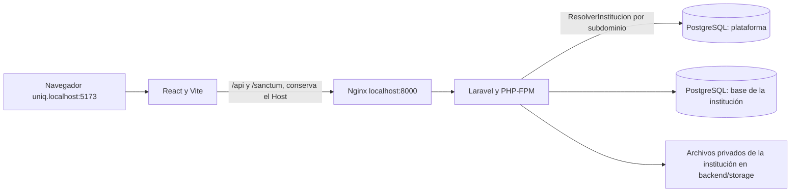

<p align="center">
  
</p>

<h1 align="center">Sistema de escalafón y legajos</h1>

---

**Contenido:** [Propósito](#propósito) · [Instalación en Windows](#1-instalación-en-windows) · [Instalación en Linux](#2-instalación-en-linux) · [Configuración](#3-referencia-de-configuración) · [Cuentas de acceso](#4-direcciones-y-cuentas-de-acceso) · [Trabajo diario y actualizaciones](#5-trabajo-diario-y-actualizaciones) · [Estructura del proyecto](#6-estructura-del-proyecto) · [Arquitectura general](#7-arquitectura-general) · [Desarrollo y pruebas](#8-cómo-continuar-el-desarrollo) · [Problemas frecuentes](#9-problemas-frecuentes) · [Datos y respaldos](#10-datos-respaldos-y-límites-de-esta-instalación) · [Mantenimiento](#11-mantenimiento-e-incremento-actual)

## Propósito

Aplicación para gestionar expedientes del personal docente y administrativo: datos personales, trayectoria laboral, documentos organizados por las secciones del legajo. Incluye acceso por roles, configuración institucional, registros de auditoría y un panel de plataforma para atender varias instituciones, cada una con su propia base de datos.

Esta guía explica la **instalación local para desarrollo**, primero en Windows y después en Linux. Sigue únicamente la sección de tu sistema operativo, en el orden indicado. Al terminar, consulta las cuentas de acceso de la sección 4.

Los comandos se ejecutan desde la raíz del repositorio, donde están `docker-compose.yml` e `iniciar.ps1`, salvo que se indique otra ubicación. PHP, Composer, Node, pnpm y PostgreSQL se ejecutan en contenedores; no necesitas instalarlos por separado.

## 1. Instalación en Windows

Usa **PowerShell** para todos los pasos de esta sección. Si trabajas desde una terminal de Ubuntu en WSL, sigue los comandos de Linux de la sección 2.

### Paso 1. Instalar las herramientas

1. Instala Git para Windows.
2. Instala Docker Desktop, habilita WSL2 y selecciona contenedores Linux. Completa los reinicios que solicite el instalador.
3. Abre Docker Desktop y espera a que el motor esté listo.
4. Abre una nueva ventana de PowerShell y comprueba:

   ```powershell
   git --version
   docker --version
   docker compose version
   docker info
   ```

Continúa cuando los cuatro comandos funcionen. Necesitas conexión a Internet durante la primera instalación y los puertos **5173**, **8000** y **5433** disponibles.

### Paso 2. Descargar el proyecto

En PowerShell, entra en la carpeta donde guardarás el proyecto y ejecuta:

```powershell
git clone https://github.com/spectre2005/proyecto_escalafon.git
cd proyecto_escalafon
```

Si ya tienes el repositorio, entra en su carpeta; no vuelvas a clonarlo encima.

### Paso 3. Preparar la configuración

Crea los archivos que falten:

```powershell
if (!(Test-Path .env)) { Copy-Item .env.example .env }
if (!(Test-Path backend/.env)) { Copy-Item backend/.env.example backend/.env }
```

Para una instalación nueva, conserva los valores de las plantillas. En el `.env` de la raíz deben aparecer:

```dotenv
DOCKER_UID=1000
DOCKER_GID=1000
DB_DATABASE=escalafon
DB_USERNAME=app
DB_PASSWORD=secret
```

En `backend/.env`, comprueba la conexión:

```dotenv
DB_CONNECTION=pgsql
DB_HOST=db
DB_PORT=5432
DB_DATABASE=escalafon
DB_USERNAME=app
DB_PASSWORD=secret
```

Conserva también las variables de cuentas demo, sesiones y plataforma de la plantilla. **No sobrescribas los `.env` ni cambies `APP_KEY` de una instalación existente.** La sección 3 explica cada archivo.

### Paso 4. Instalar e iniciar el sistema

Desde la raíz del proyecto:

```powershell
.\iniciar.ps1
```

El script construye e inicia los servicios, instala las dependencias del backend, genera la clave si falta, aplica las migraciones, crea la base de plataforma y carga los catálogos, instituciones y cuentas de demostración. Finalmente inicia el frontend. La primera ejecución puede tardar varios minutos.

Si el script termina con un error, resuélvelo antes de continuar; consulta las soluciones de esta sección. No borres la base de datos para reintentarlo.

### Paso 5. Comprobar el arranque y entrar

```powershell
docker compose ps
docker compose logs --tail=50 frontend
docker compose exec app php artisan migrate:status --no-interaction
```

Comprueba que `db` y `app` estén saludables, que `nginx` y `frontend` estén en ejecución y que no queden migraciones pendientes. `frontend_dependencies` puede aparecer detenido con código 0: es una tarea de preparación que ya terminó.

Espera el mensaje `VITE ... ready` en los logs. Abre **http://uniq.localhost:5173** para la institución o **http://localhost:5173/plataforma/login** para el panel. Las cuentas están en la sección 4. Puedes cerrar PowerShell: los servicios siguen en segundo plano.

### Problemas durante la instalación en Windows

| Problema | Solución |
| --- | --- |
| `git` o `docker` «no se reconoce» | Comprueba que instalaste la herramienta y abre una nueva ventana de PowerShell. |
| Docker informa que falta WSL2 o virtualización | Completa los requisitos que indica Docker Desktop, habilita la virtualización y reinicia cuando corresponda. Usa contenedores Linux. |
| `Cannot connect to the Docker daemon` | Abre Docker Desktop, espera a que esté listo y repite `docker info`. |
| PowerShell bloquea `iniciar.ps1` | Desde la raíz del proyecto, ejecuta `powershell -ExecutionPolicy Bypass -File .\iniciar.ps1`; el permiso se aplica solo a ese proceso. |
| `iniciar.ps1` no se encuentra | Comprueba que estás en la carpeta del repositorio y usa `.\iniciar.ps1`, incluido el prefijo `.\`. |
| Error de descarga de imágenes o paquetes | Revisa conexión, DNS o proxy. Corrige el problema y vuelve a ejecutar el script. |
| Puerto ocupado, página vacía, error 419 o conexión a la base | Consulta la sección 9 para los comandos de diagnóstico y la solución correspondiente. |

Para revisar un fallo del script:

```powershell
docker compose ps -a
docker compose logs --tail=100 app db nginx frontend
```

## 2. Instalación en Linux

Usa una terminal Bash. En WSL, ejecuta estos pasos dentro de tu distribución Linux y guarda el proyecto en tu carpeta personal, por ejemplo `~/proyecto/`.

### Paso 1. Instalar y comprobar las herramientas

Instala Git con el gestor de paquetes de tu distribución. Instala [Docker Engine](https://docs.docker.com/engine/install/) y el [plugin Docker Compose](https://docs.docker.com/compose/install/linux/) siguiendo las instrucciones oficiales para tu distribución.

En una distribución con systemd, comprueba e inicia el servicio:

```sh
sudo systemctl status docker
# Ejecuta lo siguiente si el servicio está detenido:
sudo systemctl start docker
```

Si trabajas en WSL con el motor de Windows, activa la integración de tu distribución en Docker Desktop y comprueba la conexión desde esa terminal.

```sh
git --version
docker --version
docker compose version
docker info
```

Continúa cuando funcionen los cuatro comandos. Necesitas conexión a Internet durante la primera instalación y los puertos **5173**, **8000** y **5433** disponibles.

### Paso 2. Descargar el proyecto

```sh
git clone https://github.com/spectre2005/proyecto_escalafon.git
cd proyecto_escalafon
```

Si ya tienes el repositorio, entra en su carpeta. Mantén esa ubicación durante los siguientes pasos.

### Paso 3. Preparar los archivos y permisos

```sh
test -f .env || cp .env.example .env
test -f backend/.env || cp backend/.env.example backend/.env
id -u
id -g
```

Edita el `.env` de la raíz y coloca el resultado de `id -u` en `DOCKER_UID` y el de `id -g` en `DOCKER_GID`. Por ejemplo, **solo si ambos resultados son 1000**:

```dotenv
DOCKER_UID=1000
DOCKER_GID=1000
DB_DATABASE=escalafon
DB_USERNAME=app
DB_PASSWORD=secret
```

En `backend/.env`, comprueba:

```dotenv
DB_CONNECTION=pgsql
DB_HOST=db
DB_PORT=5432
DB_DATABASE=escalafon
DB_USERNAME=app
DB_PASSWORD=secret
```

Conserva las variables de cuentas demo, sesiones y plataforma de la plantilla. Las credenciales de base de datos deben coincidir en ambos archivos. **No sobrescribas los `.env` ni cambies `APP_KEY` de una instalación existente.**

### Paso 4. Iniciar la base de datos y el backend

```sh
docker compose up -d --build --wait db app nginx
```

Este comando espera a que PostgreSQL y PHP estén preparados. La primera ejecución descarga imágenes e instala dependencias y puede tardar varios minutos.

Después, confirma las dependencias y limpia la configuración:

```sh
docker compose exec -e COMPOSER_HOME=/tmp/composer app composer install --no-interaction --prefer-dist
docker compose exec app php artisan config:clear --no-interaction
```

Si aparece un error de permisos en `vendor`, aplica la solución de permisos indicada al final de esta sección y repite el paso.

### Paso 5. Preparar la clave y las bases de datos

**Solo en una instalación nueva con `APP_KEY` vacía** en `backend/.env`, ejecuta:

```sh
docker compose exec app php artisan key:generate --no-interaction
```

No regeneres la clave de una instalación existente: afecta las sesiones y los datos cifrados.

Ejecuta los siguientes comandos **en este orden**, deteniéndote si alguno falla:

```sh
docker compose exec app php artisan migrate --no-interaction
docker compose exec app php artisan plataforma:migrar-instituciones --crear-base --no-interaction
docker compose exec app php artisan db:seed --no-interaction
```

Primero se prepara la base institucional, después la de plataforma y finalmente los catálogos y cuentas demo. El seeder crea también las instituciones `uno` y `dos` con sus propias bases.

### Paso 6. Iniciar el frontend y entrar

```sh
docker compose up -d --build frontend
docker compose ps
docker compose logs --tail=50 frontend
docker compose exec app php artisan migrate:status --no-interaction
```

Comprueba que `db` y `app` estén saludables, `nginx` y `frontend` estén en ejecución y no queden migraciones pendientes. `frontend_dependencies` termina con código 0 después de preparar los permisos: es lo esperado.

Espera el mensaje `VITE ... ready` y abre **http://uniq.localhost:5173** o **http://localhost:5173/plataforma/login**. Las cuentas están en la sección 4. Los servicios siguen en segundo plano al cerrar la terminal.

### Problemas durante la instalación en Linux

| Problema | Solución |
| --- | --- |
| `docker: command not found` | Revisa la instalación de Docker Engine y abre una nueva terminal. |
| `docker: 'compose' is not a docker command` | Instala el plugin Compose del paso 1. Los comandos usan `docker compose`, con espacio. |
| `Cannot connect to the Docker daemon` | Comprueba el servicio con `systemctl`; en WSL revisa la integración con el motor de Windows. Usa `docker context ls` si configuraste varios motores. |
| `permission denied` sobre `docker.sock` | Sigue la [configuración oficial de permisos](https://docs.docker.com/engine/install/linux-postinstall/). Tras cambiar los grupos, cierra y vuelve a abrir sesión. El grupo `docker` concede privilegios equivalentes a root; no cambies el socket a `777`. |
| Error al descargar imágenes o paquetes | Comprueba conexión, DNS o proxy y repite el paso que falló. |
| Puerto ocupado, página vacía, error 419 o conexión a la base | Consulta las soluciones de la sección 9. |

#### Permisos en `storage`, `bootstrap/cache` o `vendor`

Usa los UID/GID de tu `.env` de la raíz; el siguiente ejemplo supone 1000:1000:

```sh
docker compose run --rm --no-deps --user 0:0 --entrypoint sh app -c 'chown -R 1000:1000 storage bootstrap/cache vendor'
docker compose up -d app nginx
```

#### La terminal está dentro de Flatpak

Abre una terminal del sistema o antepone `flatpak-spawn --host` a los comandos de Docker. Especifica la ruta real del proyecto para que Compose encuentre la instalación correcta:

```sh
flatpak-spawn --host docker compose --project-directory /ruta/real/proyecto_escalafon ps
flatpak-spawn --host docker compose --project-directory /ruta/real/proyecto_escalafon logs --tail=100 frontend
```

Sustituye `/ruta/real/proyecto_escalafon` por tu carpeta. Una terminal normal no necesita ese prefijo.

## 3. Referencia de configuración

### Los dos archivos `.env`

| Archivo | Para qué sirve | Qué revisar |
| --- | --- | --- |
| `.env` de la raíz | Variables que lee Docker Compose | Usuario de los contenedores y credenciales de PostgreSQL |
| `backend/.env` | Configuración de Laravel | Conexión a PostgreSQL, clave de aplicación, cuentas de prueba, instituciones y sesiones |

Las variables `DB_DATABASE`, `DB_USERNAME` y `DB_PASSWORD` deben coincidir en ambos archivos. Los valores de ejemplo son para desarrollo local.

En `backend/.env`, conserva esta conexión dentro de Docker:

```dotenv
DB_CONNECTION=pgsql
DB_HOST=db
DB_PORT=5432
DB_DATABASE=escalafon
DB_USERNAME=app
DB_PASSWORD=secret
```

`db` es el nombre del servicio de PostgreSQL. Desde Laravel dentro del contenedor se usa **db:5432**; desde un cliente instalado en tu computadora se usa **localhost:5433**.

Configura también:

| Variable en `backend/.env` | Uso |
| --- | --- |
| `APP_ENV=local` | Habilita la API y los seeders de desarrollo |
| `APP_DEBUG=true` | Muestra errores durante el desarrollo |
| `APP_URL=http://localhost:8000` | Dirección del backend |
| `APP_KEY` | Se genera en el primer arranque; conservarla después |
| `ADMIN_EMAIL`, `ADMIN_PASSWORD` | Administrador de prueba de la institución principal (solo local) |
| `PLATAFORMA_ADMIN_EMAIL`, `PLATAFORMA_ADMIN_PASSWORD` | Superadministrador de prueba del panel de plataforma (solo local) |
| `PLATAFORMA_PRUEBA_SLUG`, `PLATAFORMA_PRUEBA_NOMBRE` | Subdominio y nombre de la institución principal de prueba (solo local) |
| `PLATAFORMA_MODO=subdominio`, `PLATAFORMA_DOMINIO=localhost` | Cada institución en su subdominio; el panel en `localhost` |
| `PLATAFORMA_DB_DATABASE` | Base de la plataforma (instituciones y superadministradores), separada de las institucionales |
| `SANCTUM_STATEFUL_DOMAINS` | Incluye `localhost:5173`, `127.0.0.1:5173`, `localhost:8000` y `*.localhost:5173` |
| `SESSION_SECURE_COOKIE=false` | Permite la sesión local usando HTTP |
| `SESSION_DRIVER=file`, `CACHE_STORE=file` | Sesiones y caché en archivos; Compose también impone estos valores al servicio `app` |
| `MAIL_MAILER=log` | Escribe correos en el log; no envía correo real |

`backend/.env.example` trae **cuentas de demostración con una contraseña compartida y pública** (ver [Cuentas e instituciones de demostración](#4-direcciones-y-cuentas-de-acceso)), para que todos los equipos que clonan el proyecto entren igual. Los seeders solo las crean con `APP_ENV=local` o `testing`. Si dejas esas variables vacías, el seeder muestra una advertencia y no crea la cuenta.

> **Producción:** nunca copies `backend/.env.example` a producción. Allí no hay cuentas ni contraseñas predeterminadas: se parte de `.env.produccion.example`, el primer superadministrador se crea con `php artisan plataforma:crear-administrador` y cada institución se aprovisiona desde el panel con una contraseña temporal. `php artisan produccion:verificar` (lo ejecuta el contenedor de producción antes de arrancar) rechaza la configuración si `ADMIN_*`, `PLATAFORMA_ADMIN_*` o `PLATAFORMA_PRUEBA_*` tienen valor. Ver [docs/PRODUCCION.md](docs/PRODUCCION.md).

El frontend utiliza `/api/v1` y el proxy de Vite de forma predeterminada. No necesita un `.env` propio para esta instalación. `VITE_API_URL` permite cambiar la URL, pero una configuración externa requiere revisar cookies, dominios y acceso al backend.

## 4. Direcciones y cuentas de acceso

`db:seed` crea las mismas cuentas en todos los equipos, con los valores de `backend/.env.example`. **Son ficticias y su contraseña es pública: solo sirven en local.**

Contraseña de todas: `Demo-Escalafon-2026`

| Para entrar a | Dirección | Correo | Base de datos |
| --- | --- | --- | --- |
| Panel de plataforma (superadministrador) | http://localhost:5173/plataforma/login | superadmin@demo.test | `escalafon_plataforma` |
| UNIQ (institución principal, con 10 personas demo) | http://uniq.localhost:5173 | admin.uniq@demo.test | `escalafon` (la de `DB_DATABASE`) |
| Universidad de Prueba Uno | http://uno.localhost:5173 | admin.uno@demo.test | `escalafon_uno` |
| Universidad de Prueba Dos | http://dos.localhost:5173 | admin.dos@demo.test | `escalafon_dos` |

Cada institución usa su propia base: la cuenta de una no existe en las otras. Desde el panel se pueden suspender y reactivar instituciones, o crear y aprovisionar otras nuevas, que se abren en su propio subdominio.

Los datos de demostración no incluyen documentos ni fotos: los legajos, PDF y fotos que cargue cada persona quedan solo en su computadora.

**Si ya tenías el proyecto instalado**, copia de `backend/.env.example` a tu `backend/.env` las líneas `ADMIN_*`, `PLATAFORMA_ADMIN_*`, `PLATAFORMA_PRUEBA_*`, `PLATAFORMA_MODO`, `PLATAFORMA_DOMINIO` y `SANCTUM_STATEFUL_DOMAINS`, y vuelve a ejecutar `iniciar.ps1` en Windows o los pasos 5 y 6 de la instalación en Linux. Ten en cuenta:

- Las instituciones que ya tengas registradas en tu panel no se tocan, aunque usen el mismo subdominio.
- `AdministradorSeeder` usa el correo de `ADMIN_EMAIL`: si tu base ya tenía el administrador del sistema con otro correo, lo cambia a `admin.uniq@demo.test` con la contraseña de demostración. Tus legajos no cambian.

## 5. Trabajo diario y actualizaciones

```sh
# Iniciar los servicios
docker compose up -d

# Ver su estado y los últimos mensajes
docker compose ps
docker compose logs --tail=100 frontend app nginx

# Detenerlos conservando los volúmenes
docker compose down
```

Después de incorporar cambios del equipo, revisa las modificaciones de los `.env.example` y agrega las variables nuevas a tus archivos locales. Luego:

```sh
docker compose up -d --build --wait db app nginx
docker compose exec -e COMPOSER_HOME=/tmp/composer app composer install --no-interaction --prefer-dist
docker compose exec app php artisan config:clear --no-interaction
docker compose exec app php artisan migrate --no-interaction
docker compose exec app php artisan plataforma:migrar-instituciones --no-interaction
docker compose exec app php artisan optimize:clear --no-interaction
docker compose up -d --build --force-recreate frontend
```

El arranque del frontend ejecuta `pnpm install`. Usa `composer install` para respetar el archivo de bloqueo; `composer update` y `pnpm update` son cambios de dependencias que deben revisarse con el equipo.

**Tareas programadas (recepción de correos de requerimientos).** El servicio `scheduler` ejecuta cada minuto `legajo:recibir-respuestas`, que lee el Gmail conectado en Configuración. En desarrollo no arranca con `docker compose up -d`; para probarlo, a propósito y con datos de prueba:

```sh
docker compose --profile programador up -d scheduler   # iniciarlo
docker compose --profile programador stop scheduler    # detenerlo
```

En producción arranca siempre (`docker-compose.produccion.yml`).

**Cada computadora tiene su propia base de datos y sus propios archivos.** Hacer `git pull` no descarga los registros, documentos ni fotos de otra instalación.

### Migraciones y seeders

Las migraciones crean y actualizan el esquema. Algunas también cargan o corrigen catálogos, incluida la sección 04. `DatabaseSeeder` carga catálogos, ubigeos, unidades, regímenes, las cuentas e instituciones de demostración y datos de demostración de usuarios, evaluaciones y requerimientos.

`migrate` solo migra la base de `DB_DATABASE`. La base de la plataforma y las de cada institución se migran con `plataforma:migrar-instituciones`. Para una instalación existente:

```sh
docker compose exec app php artisan migrate --no-interaction
docker compose exec app php artisan plataforma:migrar-instituciones --no-interaction
docker compose exec app php artisan migrate:status --no-interaction
```

Para volver a ejecutar los seeders registrados, o crear las cuentas después de completar sus variables:

```sh
docker compose exec app php artisan config:clear --no-interaction
docker compose exec app php artisan db:seed --no-interaction
```

Para ejecutar una clase específica:

```sh
docker compose exec app php artisan db:seed --class=AdministradorSeeder --no-interaction
```

Cambiar `ADMIN_PASSWORD` o `PLATAFORMA_ADMIN_PASSWORD` y repetir el seeder **no restablece automáticamente la contraseña de una cuenta existente con el mismo correo**. Las plantillas `.env.example` tampoco modifican por sí solas los archivos `.env` locales.

No todos los archivos de `database/seeders/` se ejecutan con `db:seed`: la lista está en `DatabaseSeeder.php`. Algunos son ejemplos o crean datos con factories; revisa su contenido antes de ejecutarlos individualmente. Las personas demo no reemplazan a la cuenta administradora.

## 6. Estructura del proyecto

```text
proyecto_escalafon/
├── README.md                 Guía principal para el equipo.
├── iniciar.ps1               Preparación e inicio desde PowerShell (Windows).
├── docker-compose.yml        Servicios, puertos y volúmenes locales.
├── .env.example              Variables de ejemplo para Docker.
├── docker/
│   ├── php/                  Imagen PHP y configuración de rendimiento.
│   ├── node/                 Imagen Node con pnpm.
│   └── nginx/                Servidor web que conecta con PHP-FPM.
├── backend/
│   ├── app/Http/             Controladores, validaciones y middleware.
│   ├── app/Models/           Modelos de base de datos.
│   ├── app/Support/          Lógica compartida, catálogos y servicios de apoyo.
│   ├── app/Console/          Comandos de tareas del sistema.
│   ├── routes/               API y programación de tareas.
│   ├── config/               Autenticación, archivos y demás configuración.
│   ├── database/migrations/  Cambios del esquema y ajustes de catálogos.
│   ├── database/seeders/     Datos iniciales y ejemplos de desarrollo.
│   ├── database/data/        CSV de ubicaciones y explicación de su origen.
│   ├── storage/             Documentos, fotos, sesiones y logs locales.
│   ├── tests/               Pruebas de backend.
│   └── .env.example          Variables de ejemplo de Laravel.
└── frontend/
    ├── src/app/              Composición de la aplicación y rutas.
    ├── src/features/         Pantallas y lógica por módulo funcional.
    ├── src/components/       Componentes de interfaz.
    ├── src/shared/           Código reutilizable entre módulos.
    ├── src/layouts/          Estructura visual de las pantallas.
    ├── src/axios.js           Cliente HTTP y manejo de sesión.
    ├── vite.config.js        Servidor local y proxy hacia Nginx.
    └── pnpm-lock.yaml        Versiones resueltas de las dependencias.
```

## 7. Arquitectura general



React consume la API mediante Axios; Vite reenvía `/api` y `/sanctum` al servicio `nginx` conservando el subdominio. En cada petición, `ResolverInstitucion` busca la institución del subdominio en la base de la plataforma y atiende la petición con su base, su almacenamiento y sus sesiones; si está suspendida o vencida responde 403, y si no existe o no está activa, 404. El panel (`/api/plataforma`) solo responde en el dominio sin subdominio y tiene su propia sesión. Laravel autentica mediante cookies de sesión con Sanctum y valida roles, permisos y acceso a secciones. Documentos y fotos se guardan en almacenamiento privado y se entregan mediante endpoints que comprueban acceso.

## 8. Cómo continuar el desarrollo

- Backend: empieza por `backend/routes/api.php`, sigue el controlador en `app/Http/Controllers/Api/V1` y revisa modelos, validaciones, permisos y pruebas relacionadas.
- Frontend: busca el módulo en `frontend/src/features`; reutiliza componentes y utilidades existentes.
- Base de datos: agrega migraciones nuevas para los cambios; no dependas de modificar una migración que otros ya ejecutaron.
- Catálogos: revisa migraciones y seeders de la sección correspondiente. Documenta cualquier dato nuevo requerido para que funcione una pantalla.
- Acceso: los controles visuales del frontend deben acompañarse de validación en el backend. Conserva la protección de datos sensibles y archivos privados.
- Lee `backend/AGENTS.md` antes de trabajar con asistentes de código en el backend.

El frontend se maneja con **pnpm dentro de Docker**:

```sh
docker compose exec frontend pnpm add nombre-del-paquete
docker compose exec frontend pnpm add -D nombre-del-paquete
docker compose exec app composer require proveedor/paquete
```

Incluye los cambios de manifiestos y archivos de bloqueo en la misma entrega. Nunca subas contraseñas, `.env`, PDFs ni fotos del personal al repositorio.

### Validación de cambios

```sh
# Backend: pruebas y rutas
docker compose exec app php artisan test --compact
docker compose exec app php artisan route:list --path=api/v1

# Backend: dar formato a cambios PHP
docker compose exec app vendor/bin/pint --dirty --format agent

# Frontend: pruebas, lint y compilación
docker compose exec frontend pnpm test
docker compose exec frontend pnpm lint
docker compose exec frontend pnpm build
```

PHPUnit está configurado para SQLite en memoria. Si aparece `could not find driver` al probar, comprueba `pdo_sqlite` con `docker compose exec app php -m`. La configuración de pruebas está en `backend/phpunit.xml`.

Antes de entregar, comprueba además el flujo modificado desde la interfaz con el rol correspondiente. Compilar el frontend no publica el sistema ni sustituye la revisión funcional.

### Alcance de la verificación de esta guía

Verificación realizada el **19 de octubre de 2026**, en Linux con Docker Engine, PHP 8.4.26 y Node 22.23.3:

| Comprobación | Resultado |
| --- | --- |
| Configuración de Compose (`docker compose config --quiet`) | Correcta. |
| Requisitos PHP (`composer check-platform-reqs`) | Cumplidos; PDO dispone de PostgreSQL y SQLite. |
| Instalación sobre PostgreSQL 16 vacío y temporal | Migraciones y seeders correctos; se crearon las cuatro bases y las instituciones `uniq`, `uno` y `dos`, con sus cuentas demo. |
| Backend (`php artisan test --compact`) | 792 pruebas aprobadas, 9062 aserciones. |
| Frontend (`pnpm test`) | 141 pruebas aprobadas. |
| Frontend (`pnpm lint` y `pnpm build`) | Correctos; Vite advierte de chunks mayores de 500 kB, sin impedir la compilación. |
| HTTP de la instalación activa | Página HTML: 200; API institucional y de plataforma sin sesión: 401; CSRF de plataforma: 200; CSRF de Sanctum: 204, ambos con cookies. |

La prueba sobre PostgreSQL vacío reutilizó el contenedor PHP y las dependencias instaladas, con conexión y almacenamiento temporal separados de la instalación de trabajo; no fue una instalación completa desde un clon limpio. El PostgreSQL temporal se retiró al terminar. Las comprobaciones HTTP enviaron el subdominio y el origen correspondientes; no sustituyen una prueba de inicio de sesión y carga de documentos desde el navegador. No se ejecutó el script PowerShell en Windows ni una reconstrucción de todas las imágenes desde cero. Los resultados anteriores corresponden a la verificación técnica realizada en Linux.

En la instalación existente se detectó pendiente `2026_10_19_164657_aceptar_documentos_anteriores_por_registro_directo`. Se conservó su estado para no modificar datos de trabajo: antes de actualizar, respalda los datos y aplica las migraciones institucionales y de plataforma de la sección 5. Esta migración regulariza documentos anteriores y registra su historial; conviene revisar ese cambio antes de aplicarlo a una base con datos.

## 9. Problemas frecuentes

### El puerto 5173 devuelve una página vacía o `NS_ERROR_NET_EMPTY_RESPONSE`

```sh
docker compose ps -a frontend
docker compose logs --tail=100 frontend
```

Si los logs muestran `Permission denied` al escribir en `/app/node_modules/.pnpm-store`, pnpm no terminó la instalación y Vite no arrancó. Revisa `DOCKER_UID` y `DOCKER_GID` en el `.env` de la raíz. Corrige **solo las dependencias**, usando los mismos números que configuraste; este ejemplo supone 1000:1000:

```sh
docker compose stop frontend
docker compose run --rm --no-deps --user 0:0 --entrypoint sh frontend -c 'chown -R 1000:1000 /app/node_modules'
docker compose up -d --force-recreate frontend
docker compose logs -f frontend
```

Espera `VITE ... ready`, sal de los logs con `Ctrl+C` y recarga el navegador. No uses permisos `777` para todo el proyecto.

### Error de conexión a PostgreSQL

```sh
docker compose ps db
docker compose logs --tail=50 db app
```

Comprueba que los datos de conexión coincidan en ambos `.env` y que Laravel use `DB_HOST=db` y `DB_PORT=5432`. Después de editar `backend/.env`:

```sh
docker compose exec app php artisan config:clear --no-interaction
```

PostgreSQL usa las variables de inicialización cuando crea el volumen por primera vez. Cambiar la contraseña en `.env` **no cambia la contraseña de una base ya creada**: requiere actualizar el usuario de PostgreSQL y las configuraciones de conexión de forma coordinada.

### No puedo iniciar sesión, aparece 419 o la API devuelve 403

- Si no existen las cuentas de demostración, revisa sus variables en `backend/.env`, limpia la configuración (`config:clear`) y vuelve a ejecutar `db:seed`.
- Para problemas de sesión, usa la misma dirección durante todo el flujo (por ejemplo, siempre `http://uniq.localhost:5173`). Comprueba que `SANCTUM_STATEFUL_DOMAINS` incluya `*.localhost:5173`, `SESSION_SECURE_COOKIE=false`, `SESSION_DOMAIN=null` y `APP_KEY`; borra las cookies locales después de corregir la configuración.
- Un 403 con "El acceso de esta institución está suspendido" significa que se suspendió desde el panel: reactívala ahí. Otro 403 puede indicar falta de permisos o acceso bloqueado a una sección. Revisa la respuesta de la API antes de cambiar permisos.

### "No existe una institución activa en esta dirección"

- En `http://localhost:5173` sin subdominio es lo esperado: entra por `uniq.localhost`, `uno.localhost` o `dos.localhost`.
- En un subdominio, la institución no está registrada, aún no está aprovisionada o no se ha activado. Revísala en el panel de plataforma, o vuelve a ejecutar `db:seed` si faltan las de demostración.
- Si el navegador no abre `uniq.localhost`, prueba con Chrome, Edge o Firefox.

### `database "escalafon_plataforma" does not exist`

La base de la plataforma no se creó. Ejecuta `docker compose exec app php artisan plataforma:migrar-instituciones --crear-base --no-interaction` y después `db:seed`.

### Faltan tablas o tipos de documentos

Ejecuta `migrate`, revisa `migrate:status` y verifica los seeders registrados. El catálogo de la sección 04 también tiene una migración que lo carga. Si necesitas ejecutar específicamente ese catálogo:

```sh
docker compose exec app php artisan db:seed --class=Seccion04CatalogoSeeder --no-interaction
```

### Puerto ocupado o backend con error 502

Un puerto ocupado impide arrancar el servicio: revisa `docker compose ps -a` y los logs. Si cambias el puerto del frontend, actualiza también los dominios de sesión; si cambias el del backend, revisa `APP_URL`.

Para un 502, revisa `docker compose logs --tail=100 app nginx`: Nginx depende de que PHP-FPM arranque y Composer haya completado la instalación. Los errores de Laravel están en `backend/storage/logs/laravel.log`.

## 10. Datos, respaldos y límites de esta instalación

- `dbdata` conserva PostgreSQL; `vendor` conserva dependencias PHP. `docker compose down` mantiene esos volúmenes.
- Los documentos y fotos están en `backend/storage/app/private/`. Un respaldo completo necesita **base de datos y archivos privados**, además de conservar de forma segura la configuración y `APP_KEY`.
- `docker compose down -v` elimina los volúmenes de Compose, incluida la base de datos. `php artisan migrate:fresh` elimina y recrea las tablas. No los uses para actualizar una instalación con datos que deban conservarse.
- El catálogo de ubigeos tiene una procedencia y limitaciones documentadas en [backend/database/data/README.md](backend/database/data/README.md).
- Esta configuración es de **desarrollo local**. `ApiHabilitada` bloquea la API fuera de `local` y `testing` salvo que se habilite expresamente; cambiar `APP_ENV` a `production` no constituye un despliegue. La instalación de producción (con Caddy y HTTPS) está en `docker-compose.produccion.yml` y [docs/PRODUCCION.md](docs/PRODUCCION.md); publicar el sistema requiere además revisar autenticación, secretos, correo y respaldos.
- Las cuentas de demostración de `backend/.env.example` tienen una contraseña pública: no deben existir en una instalación real.

## 11. Mantenimiento e incremento actual

Repositorio del equipo: [spectre2005/proyecto_escalafon](https://github.com/spectre2005/proyecto_escalafon). La autoría de los cambios puede consultarse en el historial de Git; no hay una lista formal de responsables en la configuración revisada.

El código incluye gestión de personal y legajos, las secciones documentales 01 a 11, configuración institucional, régimen laboral por vínculo y el panel de plataforma con varias instituciones por subdominio. Hay trabajo del equipo en otras ramas pendiente de integrar (por ejemplo, incorporación de personal y control de vencimientos de legajos). Este estado describe funcionalidades presentes en el repositorio, no una certificación de que todos los flujos estén terminados.

Para continuar un incremento, acuerda el alcance con el equipo, revisa las pruebas del módulo y entrega cambios de código, migraciones y datos iniciales necesarios juntos. Actualiza esta guía si cambian el arranque, las variables o los requisitos.
