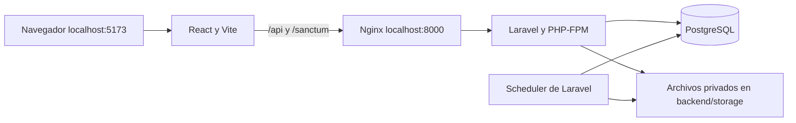

# Sistema de escalafón y legajos

Aplicación para gestionar expedientes del personal docente y administrativo: datos personales, trayectoria laboral, documentos organizados en 11 secciones, incorporaciones, evaluaciones y renovación de legajos. Incluye acceso por roles, configuración institucional y registros de auditoría.

Esta guía es el punto de entrada para instalar el proyecto y continuar su desarrollo. Todos los comandos se ejecutan **desde la raíz del repositorio**, donde están `docker-compose.yml` e `iniciar.ps1`, salvo que se indique otra ubicación.

## 1. Requisitos

- Git.
- Docker Engine con Docker Compose v2 en Linux, o Docker Desktop en Windows/macOS. En Windows, habilitar el motor WSL2 y los contenedores Linux.
- Conexión a Internet para descargar imágenes y dependencias durante la primera instalación.
- Puertos locales disponibles: **5173**, **8000** y **5433**.
- En Windows, PowerShell para utilizar `iniciar.ps1`.

PHP, Composer, Node y pnpm se ejecutan dentro de Docker; no hace falta instalarlos en tu computadora.

| Componente | Versión del proyecto | Ubicación |
| --- | --- | --- |
| Backend | Laravel 12; `composer.lock` registra 12.69.2 | `backend/` |
| PHP | 8.4 en la imagen Docker | `docker/php/Dockerfile` |
| Composer | 2 | Imagen del backend |
| Frontend | React 19, Vite 8, Tailwind CSS 4 | `frontend/package.json` |
| Node | 22 | `docker/node/Dockerfile` |
| Base de datos | PostgreSQL 16 | `docker-compose.yml` |
| Dependencias frontend | pnpm | `frontend/pnpm-lock.yaml` |

La imagen instala pnpm globalmente sin fijar su versión. Los archivos de bloqueo de Composer y pnpm forman parte del repositorio y deben conservarse.

Comprueba Docker antes de comenzar:

```sh
docker --version
docker compose version
docker info
```

## 2. Descargar y configurar

```sh
git clone https://github.com/spectre2005/proyecto_escalafon.git
cd proyecto_escalafon
```

Crea los archivos de configuración solo si todavía no existen. **No sobrescribas los `.env` de una instalación que ya funciona.**

Linux/macOS:

```sh
cp .env.example .env
cp backend/.env.example backend/.env
```

PowerShell:

```powershell
Copy-Item .env.example .env
Copy-Item backend/.env.example backend/.env
```

### Los dos archivos `.env`

| Archivo | Para qué sirve | Qué revisar |
| --- | --- | --- |
| `.env` de la raíz | Variables que lee Docker Compose | Usuario de los contenedores y credenciales de PostgreSQL |
| `backend/.env` | Configuración de Laravel | Conexión a PostgreSQL, clave de aplicación, administrador y sesiones |

Las variables `DB_DATABASE`, `DB_USERNAME` y `DB_PASSWORD` deben coincidir en ambos archivos. Los valores de ejemplo son para desarrollo local.

En `backend/.env`, conserva esta conexión dentro de Docker:

```dotenv
DB_CONNECTION=pgsql
DB_HOST=db
DB_PORT=5432
DB_DATABASE=escalafon
DB_USERNAME=app
DB_PASSWORD=secret
```

`db` es el nombre del servicio de PostgreSQL. Desde Laravel dentro del contenedor se usa **db:5432**; desde un cliente instalado en tu computadora se usa **localhost:5433**.

Configura también:

| Variable en `backend/.env` | Uso |
| --- | --- |
| `APP_ENV=local` | Habilita la API y los seeders de desarrollo |
| `APP_DEBUG=true` | Muestra errores durante el desarrollo |
| `APP_URL=http://localhost:8000` | Dirección del backend |
| `APP_KEY` | Se genera en el primer arranque; conservarla después |
| `ADMIN_EMAIL` | Correo elegido para el primer administrador |
| `ADMIN_PASSWORD` | Contraseña propia para ese administrador |
| `SANCTUM_STATEFUL_DOMAINS` | Incluye `localhost:5173`, `127.0.0.1:5173` y `localhost:8000` |
| `SESSION_SECURE_COOKIE=false` | Permite la sesión local usando HTTP |
| `SESSION_DRIVER=file`, `CACHE_STORE=file` | Sesiones y caché en archivos; Compose también impone estos valores al servicio `app` |
| `MAIL_MAILER=log` | Escribe correos en el log; no envía correo real |

Escribe `ADMIN_EMAIL` y `ADMIN_PASSWORD` antes de ejecutar los seeders. Si están vacíos, el seeder muestra una advertencia y no crea el administrador. No hay una contraseña compartida de administrador.

El frontend utiliza `/api/v1` y el proxy de Vite de forma predeterminada. No necesita un `.env` propio para esta instalación. `VITE_API_URL` permite cambiar la URL, pero una configuración externa requiere revisar cookies, dominios y acceso al backend.

### Usuario de Docker en Linux

Ejecuta `id -u` e `id -g` y coloca sus resultados en el `.env` de la raíz:

```dotenv
DOCKER_UID=1000
DOCKER_GID=1000
```

Los números anteriores son ejemplos: usa los de tu usuario. Esto permite que los contenedores escriban en las carpetas montadas. La imagen PHP prepara `vendor` para el usuario 1000; si usas otro UID, consulta la solución de permisos más abajo.

## 3. Primera instalación

### Opción A: Windows con el script

Con Docker Desktop encendido y las variables ya revisadas:

```powershell
.\iniciar.ps1
```

Si PowerShell bloquea el script, puedes permitirlo solo para esa ejecución:

```powershell
powershell -ExecutionPolicy Bypass -File .\iniciar.ps1
```

El script crea los `.env` faltantes, construye e inicia `db`, `app` y `nginx`, instala Composer, limpia la configuración, genera `APP_KEY` si falta, aplica migraciones y recrea el frontend. **No ejecuta `DatabaseSeeder` ni inicia `scheduler`.** Completa la instalación con:

```sh
docker compose exec app php artisan db:seed --no-interaction
docker compose up -d scheduler
```

### Opción B: instalación manual en Linux/macOS o Windows

1. Construye e inicia primero la base de datos y el backend:

   ```sh
   docker compose up -d --build --wait db app nginx
   ```

2. Confirma las dependencias del backend y limpia la configuración:

   ```sh
   docker compose exec -e COMPOSER_HOME=/tmp/composer app composer install --no-interaction --prefer-dist
   docker compose exec app php artisan config:clear --no-interaction
   ```

3. **Solo si `APP_KEY` está vacía**, genera la clave:

   ```sh
   docker compose exec app php artisan key:generate --no-interaction
   ```

   No vuelvas a generar la clave al actualizar una instalación: afecta sesiones y datos cifrados.

4. Aplica las migraciones pendientes y carga los datos iniciales:

   ```sh
   docker compose exec app php artisan migrate --seed --no-interaction
   ```

5. Inicia el frontend y las tareas programadas:

   ```sh
   docker compose up -d --build frontend scheduler
   ```

6. Revisa el arranque:

   ```sh
   docker compose ps
   docker compose logs --tail=50 frontend
   docker compose exec app php artisan migrate:status --no-interaction
   ```

El frontend instala sus dependencias antes de iniciar Vite. Espera el mensaje `VITE ... ready` y abre **http://localhost:5173**. Inicia sesión con el correo y la contraseña que configuraste para el administrador.

| Servicio | Dirección o función |
| --- | --- |
| Interfaz React | http://localhost:5173 |
| Backend por Nginx | http://localhost:8000 |
| API | http://localhost:8000/api/v1; requiere sesión y permisos según la ruta |
| PostgreSQL desde tu computadora | `localhost:5433` |
| Scheduler | Procesa vencimientos y avisos; no tiene interfaz web |

### Migraciones y seeders

Las migraciones crean y actualizan el esquema. Algunas también cargan o corrigen catálogos, incluida la sección 04. `DatabaseSeeder` carga catálogos, ubigeos, unidades, regímenes, el administrador y datos de demostración de usuarios, evaluaciones y requerimientos.

Para una instalación existente:

```sh
docker compose exec app php artisan migrate --no-interaction
docker compose exec app php artisan migrate:status --no-interaction
```

Para volver a ejecutar los seeders registrados, o crear el administrador después de completar sus variables:

```sh
docker compose exec app php artisan config:clear --no-interaction
docker compose exec app php artisan db:seed --no-interaction
```

Para ejecutar una clase específica:

```sh
docker compose exec app php artisan db:seed --class=AdministradorSeeder --no-interaction
```

Cambiar `ADMIN_PASSWORD` y repetir el seeder **no restablece automáticamente la contraseña de un administrador existente con el mismo correo**. El seeder está pensado para crear el administrador inicial.

No todos los archivos de `database/seeders/` se ejecutan con `db:seed`: la lista está en `DatabaseSeeder.php`. Algunos son ejemplos o crean datos con factories; revisa su contenido antes de ejecutarlos individualmente. Las personas demo no reemplazan a la cuenta administradora.

## 4. Trabajo diario y actualizaciones

```sh
# Iniciar los servicios
docker compose up -d

# Ver su estado y los últimos mensajes
docker compose ps
docker compose logs --tail=100 frontend app nginx scheduler

# Detenerlos conservando los volúmenes
docker compose down
```

Después de incorporar cambios del equipo, revisa las modificaciones de los `.env.example` y agrega las variables nuevas a tus archivos locales. Luego:

```sh
docker compose up -d --build db app nginx
docker compose exec -e COMPOSER_HOME=/tmp/composer app composer install --no-interaction --prefer-dist
docker compose exec app php artisan migrate --no-interaction
docker compose exec app php artisan optimize:clear --no-interaction
docker compose up -d --build --force-recreate frontend scheduler
```

El arranque del frontend ejecuta `pnpm install`. Usa `composer install` para respetar el archivo de bloqueo; `composer update` y `pnpm update` son cambios de dependencias que deben revisarse con el equipo.

**Cada computadora tiene su propia base de datos y sus propios archivos.** Hacer `git pull` no descarga los registros, documentos ni fotos de otra instalación.

## 5. Estructura del proyecto

```text
proyecto_escalafon/
├── README.md                 Guía principal para el equipo.
├── iniciar.ps1               Preparación e inicio desde PowerShell.
├── docker-compose.yml        Servicios, puertos y volúmenes locales.
├── .env.example              Variables de ejemplo para Docker.
├── docker/
│   ├── php/                  Imagen PHP y configuración de rendimiento.
│   ├── node/                 Imagen Node con pnpm.
│   └── nginx/                Servidor web que conecta con PHP-FPM.
├── backend/
│   ├── app/Http/             Controladores, validaciones y middleware.
│   ├── app/Models/           Modelos de base de datos.
│   ├── app/Support/          Lógica compartida, catálogos y servicios de apoyo.
│   ├── app/Console/          Comandos de tareas del sistema.
│   ├── routes/               API y programación de tareas.
│   ├── config/               Autenticación, archivos y demás configuración.
│   ├── database/migrations/  Cambios del esquema y ajustes de catálogos.
│   ├── database/seeders/     Datos iniciales y ejemplos de desarrollo.
│   ├── database/data/        CSV de ubicaciones y explicación de su origen.
│   ├── storage/             Documentos, fotos, sesiones y logs locales.
│   ├── tests/               Pruebas de backend.
│   └── .env.example          Variables de ejemplo de Laravel.
└── frontend/
    ├── src/app/              Composición de la aplicación y rutas.
    ├── src/features/         Pantallas y lógica por módulo funcional.
    ├── src/components/       Componentes de interfaz.
    ├── src/shared/           Código reutilizable entre módulos.
    ├── src/layouts/          Estructura visual de las pantallas.
    ├── src/axios.js           Cliente HTTP y manejo de sesión.
    ├── vite.config.js        Servidor local y proxy hacia Nginx.
    └── pnpm-lock.yaml        Versiones resueltas de las dependencias.
```

## 6. Arquitectura general



React consume la API mediante Axios; Vite reenvía `/api` y `/sanctum` al servicio `nginx`. Laravel autentica mediante cookies de sesión con Sanctum y valida roles, permisos y acceso a secciones. PostgreSQL conserva los registros; documentos y fotos se guardan en almacenamiento privado y se entregan mediante endpoints que comprueban acceso.

Las tareas se declaran en `backend/routes/console.php`: control de vencimientos diario y cada hora con zona `America/Lima`, y envío de avisos cada minuto. El contenedor `scheduler` ejecuta `php artisan schedule:work`.

## 7. Cómo continuar el desarrollo

- Backend: empieza por `backend/routes/api.php`, sigue el controlador en `app/Http/Controllers/Api/V1` y revisa modelos, validaciones, permisos y pruebas relacionadas.
- Frontend: busca el módulo en `frontend/src/features`; reutiliza componentes y utilidades existentes.
- Base de datos: agrega migraciones nuevas para los cambios; no dependas de modificar una migración que otros ya ejecutaron.
- Catálogos: revisa migraciones y seeders de la sección correspondiente. Documenta cualquier dato nuevo requerido para que funcione una pantalla.
- Acceso: los controles visuales del frontend deben acompañarse de validación en el backend. Conserva la protección de datos sensibles y archivos privados.
- Lee `backend/AGENTS.md` antes de trabajar con asistentes de código en el backend.

El frontend se maneja con **pnpm dentro de Docker**:

```sh
docker compose exec frontend pnpm add nombre-del-paquete
docker compose exec frontend pnpm add -D nombre-del-paquete
docker compose exec app composer require proveedor/paquete
```

Incluye los cambios de manifiestos y archivos de bloqueo en la misma entrega. Nunca subas contraseñas, `.env`, PDFs ni fotos del personal al repositorio.

### Validación de cambios

```sh
# Backend: pruebas y rutas
docker compose exec app php artisan test --compact
docker compose exec app php artisan route:list --path=api/v1

# Backend: dar formato a cambios PHP
docker compose exec app vendor/bin/pint --dirty --format agent

# Frontend: pruebas, lint y compilación
docker compose exec frontend pnpm test
docker compose exec frontend pnpm lint
docker compose exec frontend pnpm build
```

PHPUnit está configurado para SQLite en memoria. Si aparece `could not find driver` al probar, comprueba `pdo_sqlite` con `docker compose exec app php -m`. La configuración de pruebas está en `backend/phpunit.xml`.

Antes de entregar, comprueba además el flujo modificado desde la interfaz con el rol correspondiente. Compilar el frontend no publica el sistema ni sustituye la revisión funcional.

## 8. Problemas frecuentes

### El puerto 5173 devuelve una página vacía o `NS_ERROR_NET_EMPTY_RESPONSE`

```sh
docker compose ps -a frontend
docker compose logs --tail=100 frontend
```

Si los logs muestran `Permission denied` al escribir en `/app/node_modules/.pnpm-store`, pnpm no terminó la instalación y Vite no arrancó. Revisa `DOCKER_UID` y `DOCKER_GID` en el `.env` de la raíz. Corrige **solo las dependencias**, usando los mismos números que configuraste; este ejemplo supone 1000:1000:

```sh
docker compose stop frontend
docker compose run --rm --no-deps --user 0:0 --entrypoint sh frontend -c 'chown -R 1000:1000 /app/node_modules'
docker compose up -d --force-recreate frontend
docker compose logs -f frontend
```

Espera `VITE ... ready`, sal de los logs con `Ctrl+C` y recarga el navegador. No uses permisos `777` para todo el proyecto.

### La terminal está dentro de Flatpak y no encuentra Docker

Abre una terminal del sistema o antepone `flatpak-spawn --host` a los comandos de Docker. Especifica la ruta real del proyecto para que Compose encuentre la instalación correcta:

```sh
flatpak-spawn --host docker compose --project-directory /ruta/real/proyecto_escalafon ps
flatpak-spawn --host docker compose --project-directory /ruta/real/proyecto_escalafon logs --tail=100 frontend
```

Sustituye `/ruta/real/proyecto_escalafon` por tu carpeta. Una terminal normal no necesita ese prefijo.

### Laravel no puede escribir en `storage`, `bootstrap/cache` o `vendor`

Usa los UID/GID de tu `.env` de la raíz; el siguiente ejemplo supone 1000:1000:

```sh
docker compose run --rm --no-deps --user 0:0 --entrypoint sh app -c 'chown -R 1000:1000 storage bootstrap/cache vendor'
docker compose up -d app nginx scheduler
```

### Error de conexión a PostgreSQL

```sh
docker compose ps db
docker compose logs --tail=50 db app
```

Comprueba que los datos de conexión coincidan en ambos `.env` y que Laravel use `DB_HOST=db` y `DB_PORT=5432`. Después de editar `backend/.env`:

```sh
docker compose exec app php artisan config:clear --no-interaction
```

PostgreSQL usa las variables de inicialización cuando crea el volumen por primera vez. Cambiar la contraseña en `.env` **no cambia la contraseña de una base ya creada**: requiere actualizar el usuario de PostgreSQL y las configuraciones de conexión de forma coordinada.

### No puedo iniciar sesión, aparece 419 o la API devuelve 403

- Si no existe administrador, completa sus variables, limpia la configuración y ejecuta `AdministradorSeeder`.
- Para problemas de sesión, usa la misma dirección durante todo el flujo: `http://localhost:5173`. Comprueba `SANCTUM_STATEFUL_DOMAINS`, `SESSION_SECURE_COOKIE=false` y `APP_KEY`; borra las cookies locales después de corregir la configuración.
- Un 403 puede indicar falta de permisos, acceso bloqueado a una sección o un entorno distinto de `local`/`testing`. Revisa la respuesta de la API antes de cambiar permisos.

### Faltan tablas o tipos de documentos

Ejecuta `migrate`, revisa `migrate:status` y verifica los seeders registrados. El catálogo de la sección 04 también tiene una migración que lo carga. Si necesitas ejecutar específicamente ese catálogo:

```sh
docker compose exec app php artisan db:seed --class=Seccion04CatalogoSeeder --no-interaction
```

### Puerto ocupado o backend con error 502

Un puerto ocupado impide arrancar el servicio: revisa `docker compose ps -a` y los logs. Si cambias el puerto del frontend, actualiza también los dominios de sesión; si cambias el del backend, revisa `APP_URL`.

Para un 502, revisa `docker compose logs --tail=100 app nginx`: Nginx depende de que PHP-FPM arranque y Composer haya completado la instalación. Los errores de Laravel están en `backend/storage/logs/laravel.log`.

## 9. Datos, respaldos y límites de esta instalación

- `dbdata` conserva PostgreSQL; `vendor` conserva dependencias PHP. `docker compose down` mantiene esos volúmenes.
- Los documentos y fotos están en `backend/storage/app/private/`. Un respaldo completo necesita **base de datos y archivos privados**, además de conservar de forma segura la configuración y `APP_KEY`.
- `docker compose down -v` elimina los volúmenes de Compose, incluida la base de datos. `php artisan migrate:fresh` elimina y recrea las tablas. No los uses para actualizar una instalación con datos que deban conservarse.
- El catálogo de ubigeos tiene una procedencia y limitaciones documentadas en [backend/database/data/README.md](backend/database/data/README.md).
- Esta configuración es de **desarrollo local**. `LocalDevelopmentOnly` mantiene cerrado el CRUD interno fuera de `local` y `testing`. La API funcional usa `ApiDisponible` y exige habilitación y configuración segura en producción; cambiar `APP_ENV` no constituye un despliegue. Publicar el sistema requiere revisar autenticación, HTTPS, secretos, correo, respaldos y ejecución del frontend.

## 10. Mantenimiento e incremento actual

Repositorio del equipo: [spectre2005/proyecto_escalafon](https://github.com/spectre2005/proyecto_escalafon). La autoría de los cambios puede consultarse en el historial de Git; no hay una lista formal de responsables en la configuración revisada.

El código incluye gestión de personal y legajos, las 11 secciones documentales, configuración institucional, acceso a secciones e incorporación de personal. Los cambios recientes incorporan **control de vencimientos y renovación de legajos**. Este estado describe funcionalidades presentes en el repositorio, no una certificación de que todos los flujos estén terminados.

Para continuar un incremento, acuerda el alcance con el equipo, revisa las pruebas del módulo y entrega cambios de código, migraciones y datos iniciales necesarios juntos. Actualiza esta guía si cambian el arranque, las variables o los requisitos.


## Endurecimiento y operación

- [Ejecución y estado del backlog](docs/ejecucion-backlog.md).
- [Contrato API y comprobación de divergencias](docs/api.md).
- [Operación, SES y recuperación](docs/operacion-y-recuperacion.md).
- [Transición de permisos y preparación de producción](docs/produccion-y-permisos.md).
- [Código completo y diffs de este incremento](docs/codigo-backlog.md).

La suite SQLite corre en Docker; `backend/phpunit.pgsql.xml` añade integración y
concurrencia con PostgreSQL efímero en el proyecto `escalafon_ci`. CI separa su
almacenamiento del local. Playwright ejecuta los recorridos de teclado con API
simulada mediante el servicio `e2e` de `docker-compose.ci.yml`.
