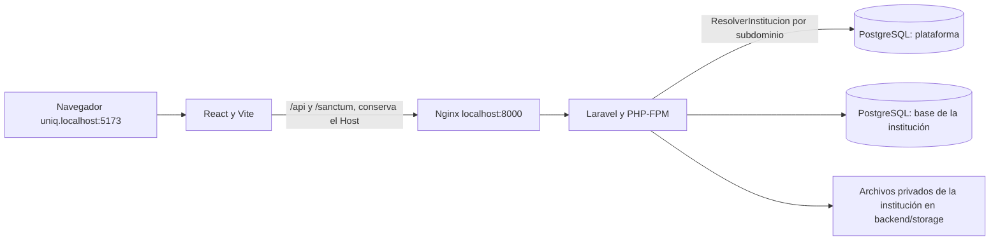

# Sistema de escalafón y legajos

Aplicación para gestionar expedientes del personal docente y administrativo: datos personales, trayectoria laboral, documentos organizados por las secciones del legajo y evaluaciones. Incluye acceso por roles, configuración institucional, registros de auditoría y un panel de plataforma para atender varias instituciones, cada una con su propia base de datos.

Esta guía es el punto de entrada para instalar el proyecto y continuar su desarrollo. Todos los comandos se ejecutan **desde la raíz del repositorio**, donde están `docker-compose.yml` e `iniciar.ps1`, salvo que se indique otra ubicación.

## 1. Requisitos

- Git.
- Docker Engine con Docker Compose v2 en Linux, o Docker Desktop en Windows/macOS. En Windows, habilitar el motor WSL2 y los contenedores Linux.
- Conexión a Internet para descargar imágenes y dependencias durante la primera instalación.
- Puertos locales disponibles: **5173**, **8000** y **5433**.
- En Windows, PowerShell para utilizar `iniciar.ps1`.
- Un navegador que abra subdominios de `localhost` sin configuración (Chrome, Edge o Firefox): cada institución se abre en `{nombre}.localhost:5173`.

PHP, Composer, Node y pnpm se ejecutan dentro de Docker; no hace falta instalarlos en tu computadora.

| Componente | Versión del proyecto | Ubicación |
| --- | --- | --- |
| Backend | Laravel 12; `composer.lock` registra 12.69.2 | `backend/` |
| PHP | 8.4 en la imagen Docker | `docker/php/Dockerfile` |
| Composer | 2 | Imagen del backend |
| Frontend | React 19, Vite 8, Tailwind CSS 4 | `frontend/package.json` |
| Node | 22 | `docker/node/Dockerfile` |
| Base de datos | PostgreSQL 16 | `docker-compose.yml` |
| Dependencias frontend | pnpm | `frontend/pnpm-lock.yaml` |

La imagen instala pnpm globalmente sin fijar su versión. Los archivos de bloqueo de Composer y pnpm forman parte del repositorio y deben conservarse.

Comprueba Docker antes de comenzar:

```sh
docker --version
docker compose version
docker info
```

## 2. Descargar y configurar

```sh
git clone https://github.com/spectre2005/proyecto_escalafon.git
cd proyecto_escalafon
```

Crea los archivos de configuración solo si todavía no existen. **No sobrescribas los `.env` de una instalación que ya funciona.**

Linux/macOS:

```sh
cp .env.example .env
cp backend/.env.example backend/.env
```

PowerShell:

```powershell
Copy-Item .env.example .env
Copy-Item backend/.env.example backend/.env
```

### Los dos archivos `.env`

| Archivo | Para qué sirve | Qué revisar |
| --- | --- | --- |
| `.env` de la raíz | Variables que lee Docker Compose | Usuario de los contenedores y credenciales de PostgreSQL |
| `backend/.env` | Configuración de Laravel | Conexión a PostgreSQL, clave de aplicación, cuentas de prueba, instituciones y sesiones |

Las variables `DB_DATABASE`, `DB_USERNAME` y `DB_PASSWORD` deben coincidir en ambos archivos. Los valores de ejemplo son para desarrollo local.

En `backend/.env`, conserva esta conexión dentro de Docker:

```dotenv
DB_CONNECTION=pgsql
DB_HOST=db
DB_PORT=5432
DB_DATABASE=escalafon
DB_USERNAME=app
DB_PASSWORD=secret
```

`db` es el nombre del servicio de PostgreSQL. Desde Laravel dentro del contenedor se usa **db:5432**; desde un cliente instalado en tu computadora se usa **localhost:5433**.

Configura también:

| Variable en `backend/.env` | Uso |
| --- | --- |
| `APP_ENV=local` | Habilita la API y los seeders de desarrollo |
| `APP_DEBUG=true` | Muestra errores durante el desarrollo |
| `APP_URL=http://localhost:8000` | Dirección del backend |
| `APP_KEY` | Se genera en el primer arranque; conservarla después |
| `ADMIN_EMAIL`, `ADMIN_PASSWORD` | Administrador de prueba de la institución principal (solo local) |
| `PLATAFORMA_ADMIN_EMAIL`, `PLATAFORMA_ADMIN_PASSWORD` | Superadministrador de prueba del panel de plataforma (solo local) |
| `PLATAFORMA_PRUEBA_SLUG`, `PLATAFORMA_PRUEBA_NOMBRE` | Subdominio y nombre de la institución principal de prueba (solo local) |
| `PLATAFORMA_MODO=subdominio`, `PLATAFORMA_DOMINIO=localhost` | Cada institución en su subdominio; el panel en `localhost` |
| `PLATAFORMA_DB_DATABASE` | Base de la plataforma (instituciones y superadministradores), separada de las institucionales |
| `SANCTUM_STATEFUL_DOMAINS` | Incluye `localhost:5173`, `127.0.0.1:5173`, `localhost:8000` y `*.localhost:5173` |
| `SESSION_SECURE_COOKIE=false` | Permite la sesión local usando HTTP |
| `SESSION_DRIVER=file`, `CACHE_STORE=file` | Sesiones y caché en archivos; Compose también impone estos valores al servicio `app` |
| `MAIL_MAILER=log` | Escribe correos en el log; no envía correo real |

`backend/.env.example` trae **cuentas de demostración con una contraseña compartida y pública** (ver [Cuentas e instituciones de demostración](#cuentas-e-instituciones-de-demostración)), para que todos los equipos que clonan el proyecto entren igual. Los seeders solo las crean con `APP_ENV=local` o `testing`. Si dejas esas variables vacías, el seeder muestra una advertencia y no crea la cuenta.

> **Producción:** nunca copies `backend/.env.example` a producción. Allí no hay cuentas ni contraseñas predeterminadas: se parte de `.env.produccion.example`, el primer superadministrador se crea con `php artisan plataforma:crear-administrador` y cada institución se aprovisiona desde el panel con una contraseña temporal. `php artisan produccion:verificar` (lo ejecuta el contenedor de producción antes de arrancar) rechaza la configuración si `ADMIN_*`, `PLATAFORMA_ADMIN_*` o `PLATAFORMA_PRUEBA_*` tienen valor. Ver [docs/PRODUCCION.md](docs/PRODUCCION.md).

El frontend utiliza `/api/v1` y el proxy de Vite de forma predeterminada. No necesita un `.env` propio para esta instalación. `VITE_API_URL` permite cambiar la URL, pero una configuración externa requiere revisar cookies, dominios y acceso al backend.

### Usuario de Docker en Linux

Ejecuta `id -u` e `id -g` y coloca sus resultados en el `.env` de la raíz:

```dotenv
DOCKER_UID=1000
DOCKER_GID=1000
```

Los números anteriores son ejemplos: usa los de tu usuario. Esto permite que los contenedores escriban en las carpetas montadas. La imagen PHP prepara `vendor` para el usuario 1000; si usas otro UID, consulta la solución de permisos más abajo.

## 3. Primera instalación

### Opción A: Windows con el script

Con Docker Desktop encendido y las variables ya revisadas:

```powershell
.\iniciar.ps1
```

Si PowerShell bloquea el script, puedes permitirlo solo para esa ejecución:

```powershell
powershell -ExecutionPolicy Bypass -File .\iniciar.ps1
```

El script crea los `.env` faltantes, construye e inicia `db`, `app` y `nginx`, instala Composer, limpia la configuración, genera `APP_KEY` si falta, aplica migraciones, crea y migra la base de la plataforma si falta, ejecuta `DatabaseSeeder` (catálogos, cuentas e instituciones de demostración) y recrea el frontend. Se puede volver a ejecutar: no duplica datos ni toca las instituciones que ya existen.

### Opción B: instalación manual en Linux/macOS o Windows

1. Construye e inicia primero la base de datos y el backend:

   ```sh
   docker compose up -d --build --wait db app nginx clamav
   ```

2. Confirma las dependencias del backend y limpia la configuración:

   ```sh
   docker compose exec -e COMPOSER_HOME=/tmp/composer app composer install --no-interaction --prefer-dist
   docker compose exec app php artisan config:clear --no-interaction
   docker compose exec app php artisan documentos:clave --no-interaction
   ```

3. **Solo si `APP_KEY` está vacía**, genera la clave:

   ```sh
   docker compose exec app php artisan key:generate --no-interaction
   ```

   No vuelvas a generar la clave al actualizar una instalación: afecta sesiones y datos cifrados.

4. Aplica las migraciones, crea y migra la base de la plataforma, y carga los datos iniciales. **En este orden**: los seeders necesitan la base de la plataforma.

   ```sh
   docker compose exec app php artisan migrate --no-interaction
   docker compose exec app php artisan plataforma:migrar-instituciones --crear-base --no-interaction
   docker compose exec app php artisan db:seed --no-interaction
   ```

   `--crear-base` solo crea la base de la plataforma si no existe; nunca borra ni reinicia bases. `db:seed` aprovisiona además las bases `escalafon_uno` y `escalafon_dos`; si ya existen sin estar registradas, no las toca y muestra un aviso.

5. Inicia el frontend:

   ```sh
   docker compose up -d --build frontend
   ```

6. Revisa el arranque:

   ```sh
   docker compose ps
   docker compose logs --tail=50 frontend
   docker compose exec app php artisan migrate:status --no-interaction
   ```

El frontend instala sus dependencias antes de iniciar Vite. Espera el mensaje `VITE ... ready` y entra con las cuentas de la sección siguiente.

| Servicio | Dirección o función |
| --- | --- |
| Instituciones | http://uniq.localhost:5173, http://uno.localhost:5173, http://dos.localhost:5173 |
| Panel de plataforma | http://localhost:5173/plataforma/login |
| Backend por Nginx | http://localhost:8000 |
| API | `/api/v1` en el subdominio de cada institución; requiere sesión y permisos según la ruta |
| PostgreSQL desde tu computadora | `localhost:5433` |

`http://localhost:5173` sin subdominio responde "No existe una institución activa en esta dirección": es lo esperado, porque cada institución tiene su propia dirección.

### Cuentas e instituciones de demostración

`db:seed` crea las mismas cuentas en todos los equipos, con los valores de `backend/.env.example`. **Son ficticias y su contraseña es pública: solo sirven en local.**

Contraseña de todas: `Demo-Escalafon-2026`

| Para entrar a | Dirección | Correo | Base de datos |
| --- | --- | --- | --- |
| Panel de plataforma (superadministrador) | http://localhost:5173/plataforma/login | superadmin@demo.test | `escalafon_plataforma` |
| UNIQ (institución principal, con 10 personas demo) | http://uniq.localhost:5173 | admin.uniq@demo.test | `escalafon` (la de `DB_DATABASE`) |
| Universidad de Prueba Uno | http://uno.localhost:5173 | admin.uno@demo.test | `escalafon_uno` |
| Universidad de Prueba Dos | http://dos.localhost:5173 | admin.dos@demo.test | `escalafon_dos` |

Cada institución usa su propia base: la cuenta de una no existe en las otras. Desde el panel se pueden suspender y reactivar instituciones, o crear y aprovisionar otras nuevas, que se abren en su propio subdominio.

Los datos de demostración no incluyen documentos ni fotos: los legajos, PDF y fotos que cargue cada persona quedan solo en su computadora.

**Si ya tenías el proyecto instalado**, copia de `backend/.env.example` a tu `backend/.env` las líneas `ADMIN_*`, `PLATAFORMA_ADMIN_*`, `PLATAFORMA_PRUEBA_*`, `PLATAFORMA_MODO`, `PLATAFORMA_DOMINIO` y `SANCTUM_STATEFUL_DOMAINS`, y vuelve a ejecutar los pasos 4 y 5 (o `iniciar.ps1`). Ten en cuenta:

- Las instituciones que ya tengas registradas en tu panel no se tocan, aunque usen el mismo subdominio.
- `AdministradorSeeder` usa el correo de `ADMIN_EMAIL`: si tu base ya tenía el administrador del sistema con otro correo, lo cambia a `admin.uniq@demo.test` con la contraseña de demostración. Tus legajos no cambian.

### Migraciones y seeders

Las migraciones crean y actualizan el esquema. Algunas también cargan o corrigen catálogos, incluida la sección 04. `DatabaseSeeder` carga catálogos, ubigeos, unidades, regímenes, las cuentas e instituciones de demostración y datos de demostración de usuarios, evaluaciones y requerimientos.

`migrate` solo migra la base de `DB_DATABASE`. La base de la plataforma y las de cada institución se migran con `plataforma:migrar-instituciones`. Para una instalación existente:

```sh
docker compose exec app php artisan documentos:clave --no-interaction
docker compose exec app php artisan migrate --no-interaction
docker compose exec app php artisan plataforma:migrar-instituciones --no-interaction
docker compose exec app php artisan migrate:status --no-interaction
```

Para volver a ejecutar los seeders registrados, o crear las cuentas después de completar sus variables:

```sh
docker compose exec app php artisan config:clear --no-interaction
docker compose exec app php artisan db:seed --no-interaction
```

Para ejecutar una clase específica:

```sh
docker compose exec app php artisan db:seed --class=AdministradorSeeder --no-interaction
```

Cambiar `ADMIN_PASSWORD` y repetir el seeder **no restablece automáticamente la contraseña de un administrador existente con el mismo correo**. El seeder está pensado para crear el administrador inicial.

No todos los archivos de `database/seeders/` se ejecutan con `db:seed`: la lista está en `DatabaseSeeder.php`. Algunos son ejemplos o crean datos con factories; revisa su contenido antes de ejecutarlos individualmente. Las personas demo no reemplazan a la cuenta administradora.

### Si no puedes entrar como administrador o superadministrador (local)

El archivo `backend/.env.example` es una plantilla: sus valores no se aplican automáticamente a una instalación existente. Agrega o actualiza las siguientes variables en **`backend/.env`**, conservando el resto de tu configuración y sin duplicar claves:

```dotenv
APP_ENV=local
ADMIN_EMAIL=admin.uniq@demo.test
ADMIN_PASSWORD=Demo-Escalafon-2026
PLATAFORMA_ADMIN_EMAIL=superadmin@demo.test
PLATAFORMA_ADMIN_PASSWORD=Demo-Escalafon-2026
PLATAFORMA_PRUEBA_SLUG=uniq
PLATAFORMA_PRUEBA_NOMBRE="Universidad Nacional Intercultural de Quillabamba"
PLATAFORMA_DB_DATABASE=escalafon_plataforma
PLATAFORMA_MODO=subdominio
PLATAFORMA_DOMINIO=localhost
SANCTUM_STATEFUL_DOMAINS=localhost:5173,127.0.0.1:5173,localhost:8000,*.localhost:5173
SESSION_SECURE_COOKIE=false
```

Estas cuentas y contraseñas son públicas y sirven únicamente para desarrollo local. Los seeders de cuentas de prueba solo se ejecutan en `local` o `testing`.

Si aparece `database "escalafon_plataforma" does not exist`, falta crear la base de plataforma. Desde la **raíz del proyecto**, ejecuta los siguientes comandos en orden para preparar las bases y cargar las cuentas de prueba; detente si alguno falla:

```sh
docker compose up -d db app nginx frontend
docker compose exec app php artisan config:clear --no-interaction
docker compose exec app php artisan migrate --no-interaction
docker compose exec app php artisan plataforma:migrar-instituciones --crear-base --no-interaction
docker compose exec app php artisan db:seed --no-interaction
```

`--crear-base` crea la base de plataforma si falta, sin borrar bases existentes. `db:seed` carga también catálogos, personas e instituciones de demostración; si encuentra al administrador inicial con otro correo, puede actualizar su correo y contraseña a los configurados arriba.

Después, entra por la dirección correspondiente:

| Acceso | Dirección | Correo | Contraseña local |
| --- | --- | --- | --- |
| Administrador UNIQ | http://uniq.localhost:5173 | `admin.uniq@demo.test` | `Demo-Escalafon-2026` |
| Superadministrador | http://localhost:5173/plataforma/login | `superadmin@demo.test` | `Demo-Escalafon-2026` |

El acceso institucional necesita el subdominio `uniq`; el panel de plataforma se abre en `localhost`, sin subdominio. Si sigue apareciendo «credenciales incorrectas», ten en cuenta que **ninguno de los dos seeders restablece la contraseña de una cuenta existente con el mismo correo**. Cambiar las variables de contraseña del `.env` no cambia por sí solo la contraseña guardada en la base.

No subas `.env` ni sus copias de respaldo al repositorio. Comparte la configuración mediante `.env.example`; cada integrante debe actualizar su `.env` local y ejecutar los comandos en su propia instalación.

## 4. Trabajo diario y actualizaciones

```sh
# Iniciar los servicios
docker compose up -d

# Ver su estado y los últimos mensajes
docker compose ps
docker compose logs --tail=100 frontend app nginx

# Detenerlos conservando los volúmenes
docker compose down
```

Después de incorporar cambios del equipo, revisa las modificaciones de los `.env.example` y agrega las variables nuevas a tus archivos locales. Luego:

```sh
docker compose up -d --build db app nginx clamav
docker compose exec -e COMPOSER_HOME=/tmp/composer app composer install --no-interaction --prefer-dist
docker compose exec app php artisan migrate --no-interaction
docker compose exec app php artisan plataforma:migrar-instituciones --no-interaction
docker compose exec app php artisan optimize:clear --no-interaction
docker compose up -d --build --force-recreate frontend
docker compose up -d --build scheduler worker
```

El arranque del frontend ejecuta `pnpm install`. Usa `composer install` para respetar el archivo de bloqueo; `composer update` y `pnpm update` son cambios de dependencias que deben revisarse con el equipo.

**Cada computadora tiene su propia base de datos y sus propios archivos.** Hacer `git pull` no descarga los registros, documentos ni fotos de otra instalación.

## 5. Estructura del proyecto

```text
proyecto_escalafon/
├── README.md                 Guía principal para el equipo.
├── iniciar.ps1               Preparación e inicio desde PowerShell (Windows).
├── docker-compose.yml        Servicios, puertos y volúmenes locales.
├── .env.example              Variables de ejemplo para Docker.
├── docker/
│   ├── php/                  Imagen PHP y configuración de rendimiento.
│   ├── node/                 Imagen Node con pnpm.
│   └── nginx/                Servidor web que conecta con PHP-FPM.
├── backend/
│   ├── app/Http/             Controladores, validaciones y middleware.
│   ├── app/Models/           Modelos de base de datos.
│   ├── app/Support/          Lógica compartida, catálogos y servicios de apoyo.
│   ├── app/Console/          Comandos de tareas del sistema.
│   ├── routes/               API y programación de tareas.
│   ├── config/               Autenticación, archivos y demás configuración.
│   ├── database/migrations/  Cambios del esquema y ajustes de catálogos.
│   ├── database/seeders/     Datos iniciales y ejemplos de desarrollo.
│   ├── database/data/        CSV de ubicaciones y explicación de su origen.
│   ├── storage/             Documentos, fotos, sesiones y logs locales.
│   ├── tests/               Pruebas de backend.
│   └── .env.example          Variables de ejemplo de Laravel.
└── frontend/
    ├── src/app/              Composición de la aplicación y rutas.
    ├── src/features/         Pantallas y lógica por módulo funcional.
    ├── src/components/       Componentes de interfaz.
    ├── src/shared/           Código reutilizable entre módulos.
    ├── src/layouts/          Estructura visual de las pantallas.
    ├── src/axios.js           Cliente HTTP y manejo de sesión.
    ├── vite.config.js        Servidor local y proxy hacia Nginx.
    └── pnpm-lock.yaml        Versiones resueltas de las dependencias.
```

## 6. Arquitectura general



React consume la API mediante Axios; Vite reenvía `/api` y `/sanctum` al servicio `nginx` conservando el subdominio. En cada petición, `ResolverInstitucion` busca la institución del subdominio en la base de la plataforma y atiende la petición con su base, su almacenamiento y sus sesiones; si está suspendida o vencida responde 403, y si no existe o no está activa, 404. El panel (`/api/plataforma`) solo responde en el dominio sin subdominio y tiene su propia sesión. Laravel autentica mediante cookies de sesión con Sanctum y valida roles, permisos y acceso a secciones. Documentos y fotos se guardan en almacenamiento privado y se entregan mediante endpoints que comprueban acceso.

## 7. Cómo continuar el desarrollo

- Backend: empieza por `backend/routes/api.php`, sigue el controlador en `app/Http/Controllers/Api/V1` y revisa modelos, validaciones, permisos y pruebas relacionadas.
- Frontend: busca el módulo en `frontend/src/features`; reutiliza componentes y utilidades existentes.
- Base de datos: agrega migraciones nuevas para los cambios; no dependas de modificar una migración que otros ya ejecutaron.
- Catálogos: revisa migraciones y seeders de la sección correspondiente. Documenta cualquier dato nuevo requerido para que funcione una pantalla.
- Acceso: los controles visuales del frontend deben acompañarse de validación en el backend. Conserva la protección de datos sensibles y archivos privados.
- Lee `backend/AGENTS.md` antes de trabajar con asistentes de código en el backend.

El frontend se maneja con **pnpm dentro de Docker**:

```sh
docker compose exec frontend pnpm add nombre-del-paquete
docker compose exec frontend pnpm add -D nombre-del-paquete
docker compose exec app composer require proveedor/paquete
```

Incluye los cambios de manifiestos y archivos de bloqueo en la misma entrega. Nunca subas contraseñas, `.env`, PDFs ni fotos del personal al repositorio.

### Validación de cambios

```sh
# Backend: pruebas y rutas
docker compose exec app php artisan test --compact
docker compose exec app php artisan route:list --path=api/v1

# Backend: dar formato a cambios PHP
docker compose exec app vendor/bin/pint --dirty --format agent

# Frontend: pruebas, lint y compilación
docker compose exec frontend pnpm test
docker compose exec frontend pnpm lint
docker compose exec frontend pnpm build
```

PHPUnit está configurado para SQLite en memoria y usa almacenamiento temporal por proceso (`tests/bootstrap.php`); no reutiliza los PDF ni las sesiones de la instalación. Si aparece `could not find driver` al probar, comprueba `pdo_sqlite` con `docker compose exec app php -m`. La configuración de pruebas está en `backend/phpunit.xml`.

El workflow `.github/workflows/calidad.yml` ejecuta pruebas backend, pruebas frontend, lint y build en pull requests y cambios de `main`. También prueba migraciones y consultas de Requerimientos/Vencimientos en un PostgreSQL desechable mediante `backend/phpunit.pgsql.xml` (credenciales exclusivas de CI). Su primera ejecución en GitHub debe revisarse; para impedir merges con fallos, configura los dos jobs como controles obligatorios de la rama.

### Validación local del incremento (18/10/2026)

- Backend: 710 pruebas correctas, 1 integración opcional omitida en la suite normal (8297 aserciones). La prueba real de ClamAV/EICAR pasó por separado.
- PostgreSQL desechable: 72 pruebas correctas (716 aserciones), separado de la base real.
- Frontend: 109 pruebas correctas, `pnpm lint` y `pnpm build` correctos. Vite advierte paquetes mayores de 500 kB; se debe medir rendimiento con el volumen objetivo.
- Base y archivos de pruebas aislados; las pruebas no usan `migrate:fresh` en la base local real.
- Las migraciones quedaron aplicadas en plataforma y las tres instituciones; los servicios HTTP, scheduler y worker están disponibles. El correo opcional sigue desactivado.
- Las reglas institucionales sin definición, la aceptación manual, la primera CI remota y los ensayos externos de restauración siguen pendientes. Los cambios aún no están publicados.

### Prueba manual de las tareas completadas del backlog

Usa personas, PDF y cuentas ficticios; la revisión necesita una cuenta administrativa distinta de quien cargó el PDF.

1. **Cuenta:** en Mi perfil cambia la contraseña primero con clave actual incorrecta y confirmación distinta; luego con datos válidos. Comprueba que la sesión actual continúa y las anteriores dejan de funcionar. Repite desde Mi cuenta de plataforma.
2. **Accesos del personal:** Configuración → Accesos; concede el rol fijo de asistente, prueba fechas, restablecimiento y revocación con motivo. Comprueba que puede cargar/recepcionar y que no puede revisar, anular, administrar cuentas ni consultar datos sensibles.
3. **Requerimientos:** crea uno con fecha explícita; enlaza un PDF de la misma persona/tipo; observa la respuesta, subsana con otro PDF y vuelve a presentar; completa tras revisión. Prueba prórroga, cancelación con motivo, historial y rechazo de cambios desde una pestaña desactualizada. «Ver ficha» y búsqueda por nombre completo deben funcionar.
4. **PDF y revisión:** carga un PDF válido de tres páginas con folios 1–3; rechaza el mismo PDF con rango 1–2 sin consumir folios. En Revisión documental verifica que cargado/observado no cuenten como completos; acepta desde otra cuenta con recepción confirmada. La subsanación conserva el PDF anterior.
5. **Vencimientos:** prueba hoy, 6, 7, 30 y 31 días, vencidos y requerimientos atrasados. Revisa filtros, orden y todas las páginas de motivos cuando hay más de cinco. No deben aparecer datos sensibles para el asistente.
6. **Fiscalización:** abre caso con fechas; registra comunicación y PDF de sustento; respuesta con evidencia y resultado; cierra con informe. Prueba caso sin respuestas, fechas inválidas, prórroga, cancelación/reapertura e historial. Registrar la comunicación no envía un correo.
7. **Custodia:** solicita un alcance documental, aprueba y comprueba que solo descarga los PDF autorizados. Rechaza entrega tras revocación/vencimiento; registra préstamo, intenta duplicarlo y devuelve sin borrar el movimiento. Documentos sensibles se restringen al titular identificado.
8. **Vigencia y reingreso:** prueba inicio futuro, fin/adenda vigente, adenda anulada y cese. La fecha final está incluida. Al día siguiente del último fin efectivo, el proceso diario pasa el legajo a pasivo; abrir el nuevo conserva persona, documentos y legajo anterior.
9. **Avisos:** ejecuta `docker compose exec app php artisan avisos:generar --todas` dos veces. Solo la primera debe crear avisos para los mismos asuntos y fechas. Cada administrador consulta sus propios avisos y puede marcarlos leídos. El correo permanece desactivado.
10. **Fedateo:** desde Revisión documental elige un PDF distinto del mismo legajo como sustento; registra fecha y motivo. Rechaza sustento ajeno, fecha futura y propia carga. Sustituye el sustento con motivo y comprueba que el historial conserva los anteriores.
11. **Calificaciones:** ADMIN ve puntajes y calificaciones; el asistente ve la evaluación sin esos campos, también en la respuesta de API.
12. **Baja/exportación:** con una institución ficticia, suspende y archiva con motivo. Debe perder acceso conservando datos y archivos. Solo superadministración descarga el ZIP de datos JSON/archivos y la auditoría registra la operación. Comprueba el manifiesto, cantidades y hashes. Los archivos cifrados requieren la clave externa; no es una restauración automática.
13. Comprueba teclado, foco, carga, consultas vacías, errores y reintentos. Las pruebas automatizadas de navegador siguen pendientes: no se añadió Playwright.

### Nuevos recorridos de archivo, reportes y plataforma

- **Sección 12:** incorpora un PDF complementario de tres páginas con tres folios. El asistente solo ve tipos sin datos sensibles; la revisión se hace en Revisión documental y se conserva cada subsanación.
- **Sección 13:** en un reingreso referencia un PDF de un legajo pasivo de la misma persona y su vínculo anterior terminado. Comprueba origen, folios y responsable sin duplicar documentos. Una segunda referencia al mismo original se rechaza. Para registrar una transferencia, el legajo debe llevar más de tres años pasivo: adjunta inventario PDF, fecha, ubicación, destino, números de sustento y constancia de microforma si es digital/mixto. El inventario se cifra; el traslado físico y la microforma se realizan fuera del sistema.
- **Reportes:** prueba carátula, matriz, incorporaciones documentales y referencias. Compara pantalla y PDF/Excel con filtros y más de 20 resultados; conserva ceros iniciales del DNI y verifica textos largos. La firma del responsable se completa manualmente.
- **Configuración → Parámetros:** cambia tamaño PDF, días de aviso o formato de numeración con motivo. Prueba límites y dos pestañas con versiones distintas. Los números anteriores no cambian.
- **Auditoría:** consulta cambios antes/después y bitácora de accesos; filtra fechas, actor y acción; compara el CSV con todos los resultados filtrados. El asistente no entra a estas pantallas administrativas.
- **Plataforma → Cuentas:** crea una cuenta ficticia, restablece su clave y desactívala desde otra cuenta. No se admite desactivar la propia sesión ni dejar cero cuentas activas. Los secretos no aparecen en auditoría.
- **Detalle de institución:** registra contacto/contrato con motivo, prueba conflicto entre pestañas y mide consumo agregado. Comprueba que la identidad visual institucional no cambia y que el estado de respaldo indica que requiere verificación del operador.
- **Resumen de plataforma:** compara próximas expiraciones (30 días), gracia y vencidas con los periodos efectivos. Los totales se expresan en PEN, por fecha de registro del periodo y sin anulados; no sustituyen una conciliación bancaria.

### Cola de avisos y correo opcional

`AVISOS_CORREO_HABILITADO=false` es el valor por defecto. Configurar `MAIL_*` no habilita el canal: debe activarse expresamente y probarse primero con un transporte de pruebas. El correo no adjunta PDF ni incluye nombres, documentos o detalles del legajo.

```sh
docker compose up -d --build scheduler worker
docker compose exec app php artisan avisos:generar --todas --cola
docker compose logs --tail=100 worker scheduler
```

La bandeja muestra el estado del correo. Solo un error anterior al envío permite reintento con motivo; una entrega iniciada/interrumpida o incierta exige comprobar el proveedor y no se reenvía automáticamente. El generador marca como inciertos los envíos iniciados que llevan más de diez minutos sin confirmación. Los reintentos de generación conservan la deduplicación del aviso interno y el contexto institucional.

### PDF, antivirus, cifrado y procesos diarios

Las imágenes PHP incorporan Poppler (`pdfinfo`). ClamAV analiza las cargas; si está inaccesible o detecta infección, la carga se bloquea. Los PDF nuevos se almacenan cifrados y se entregan por endpoints autenticados.

`documentos:clave` crea una clave independiente de `APP_KEY` en `backend/storage/app/keys/documentos.key` con permisos privados, sin mostrarla ni sobrescribirla. Está fuera de Git: conserva una copia segura junto al plan de restauración. También puede proporcionarse con las variables documentadas en `.env.example`. Perder la clave impide recuperar los PDF cifrados.

Después de respaldar una instalación anterior, protege los PDF existentes:

```sh
docker compose exec app php artisan documentos:proteger
docker compose exec app php artisan documentos:proteger --todas
```

El comando verifica la copia cifrada antes de retirar la anterior, registra el cambio y conserva una ruta pendiente para reintentar si falla la retirada. Los errores no se omiten. Las copias históricas de respaldo requieren la protección definida por sus responsables.

El servicio `scheduler` ejecuta el pase a pasivo a las 00:05 y la generación de avisos a las 08:00, hora de Lima, para las instituciones activas con servicio no vencido. Los avisos se procesan en la cola `avisos`, atendida por `worker`; ambos servicios deben estar ejecutándose. En modo de una sola institución sin registro en plataforma, ejecuta/programa `legajos:actualizar` y `avisos:generar` sin `--todas`.


## 8. Problemas frecuentes

### El puerto 5173 devuelve una página vacía o `NS_ERROR_NET_EMPTY_RESPONSE`

```sh
docker compose ps -a frontend
docker compose logs --tail=100 frontend
```

Si los logs muestran `Permission denied` al escribir en `/app/node_modules/.pnpm-store`, pnpm no terminó la instalación y Vite no arrancó. Revisa `DOCKER_UID` y `DOCKER_GID` en el `.env` de la raíz. Corrige **solo las dependencias**, usando los mismos números que configuraste; este ejemplo supone 1000:1000:

```sh
docker compose stop frontend
docker compose run --rm --no-deps --user 0:0 --entrypoint sh frontend -c 'chown -R 1000:1000 /app/node_modules'
docker compose up -d --force-recreate frontend
docker compose logs -f frontend
```

Espera `VITE ... ready`, sal de los logs con `Ctrl+C` y recarga el navegador. No uses permisos `777` para todo el proyecto.

### La terminal está dentro de Flatpak y no encuentra Docker

Abre una terminal del sistema o antepone `flatpak-spawn --host` a los comandos de Docker. Especifica la ruta real del proyecto para que Compose encuentre la instalación correcta:

```sh
flatpak-spawn --host docker compose --project-directory /ruta/real/proyecto_escalafon ps
flatpak-spawn --host docker compose --project-directory /ruta/real/proyecto_escalafon logs --tail=100 frontend
```

Sustituye `/ruta/real/proyecto_escalafon` por tu carpeta. Una terminal normal no necesita ese prefijo.

### Laravel no puede escribir en `storage`, `bootstrap/cache` o `vendor`

Usa los UID/GID de tu `.env` de la raíz; el siguiente ejemplo supone 1000:1000:

```sh
docker compose run --rm --no-deps --user 0:0 --entrypoint sh app -c 'chown -R 1000:1000 storage bootstrap/cache vendor'
docker compose up -d app nginx
```

### Error de conexión a PostgreSQL

```sh
docker compose ps db
docker compose logs --tail=50 db app
```

Comprueba que los datos de conexión coincidan en ambos `.env` y que Laravel use `DB_HOST=db` y `DB_PORT=5432`. Después de editar `backend/.env`:

```sh
docker compose exec app php artisan config:clear --no-interaction
```

PostgreSQL usa las variables de inicialización cuando crea el volumen por primera vez. Cambiar la contraseña en `.env` **no cambia la contraseña de una base ya creada**: requiere actualizar el usuario de PostgreSQL y las configuraciones de conexión de forma coordinada.

### No puedo iniciar sesión, aparece 419 o la API devuelve 403

- Si no existen las cuentas de demostración, revisa sus variables en `backend/.env`, limpia la configuración (`config:clear`) y vuelve a ejecutar `db:seed`.
- Para problemas de sesión, usa la misma dirección durante todo el flujo (por ejemplo, siempre `http://uniq.localhost:5173`). Comprueba que `SANCTUM_STATEFUL_DOMAINS` incluya `*.localhost:5173`, `SESSION_SECURE_COOKIE=false`, `SESSION_DOMAIN=null` y `APP_KEY`; borra las cookies locales después de corregir la configuración.
- Un 403 con "El acceso de esta institución está suspendido" significa que se suspendió desde el panel: reactívala ahí. Otro 403 puede indicar falta de permisos o acceso bloqueado a una sección. Revisa la respuesta de la API antes de cambiar permisos.

### "No existe una institución activa en esta dirección"

- En `http://localhost:5173` sin subdominio es lo esperado: entra por `uniq.localhost`, `uno.localhost` o `dos.localhost`.
- En un subdominio, la institución no está registrada, aún no está aprovisionada o no se ha activado. Revísala en el panel de plataforma, o vuelve a ejecutar `db:seed` si faltan las de demostración.
- Si el navegador no abre `uniq.localhost`, prueba con Chrome, Edge o Firefox.

### `database "escalafon_plataforma" does not exist`

La base de la plataforma no se creó. Ejecuta `docker compose exec app php artisan plataforma:migrar-instituciones --crear-base --no-interaction` y después `db:seed`.

### Faltan tablas o tipos de documentos

Ejecuta `migrate`, revisa `migrate:status` y verifica los seeders registrados. El catálogo de la sección 04 también tiene una migración que lo carga. Si necesitas ejecutar específicamente ese catálogo:

```sh
docker compose exec app php artisan db:seed --class=Seccion04CatalogoSeeder --no-interaction
```

### Puerto ocupado o backend con error 502

Un puerto ocupado impide arrancar el servicio: revisa `docker compose ps -a` y los logs. Si cambias el puerto del frontend, actualiza también los dominios de sesión; si cambias el del backend, revisa `APP_URL`.

Para un 502, revisa `docker compose logs --tail=100 app nginx`: Nginx depende de que PHP-FPM arranque y Composer haya completado la instalación. Los errores de Laravel están en `backend/storage/logs/laravel.log`.

## 9. Datos, respaldos y límites de esta instalación

- `dbdata` conserva PostgreSQL; `vendor` conserva dependencias PHP. `docker compose down` mantiene esos volúmenes.
- Los documentos y fotos están en `backend/storage/app/private/`. Un respaldo completo necesita **base de datos y archivos privados**, además de conservar de forma segura la configuración y `APP_KEY`.
- `docker compose down -v` elimina los volúmenes de Compose, incluida la base de datos. `php artisan migrate:fresh` elimina y recrea las tablas. No los uses para actualizar una instalación con datos que deban conservarse.
- El catálogo de ubigeos tiene una procedencia y limitaciones documentadas en [backend/database/data/README.md](backend/database/data/README.md).
- Esta configuración es de **desarrollo local**. `ApiHabilitada` bloquea la API fuera de `local` y `testing` salvo que se habilite expresamente; cambiar `APP_ENV` a `production` no constituye un despliegue. La instalación de producción (con Caddy y HTTPS) está en `docker-compose.produccion.yml` y [docs/PRODUCCION.md](docs/PRODUCCION.md); publicar el sistema requiere además revisar autenticación, secretos, correo y respaldos.
- Las cuentas de demostración de `backend/.env.example` tienen una contraseña pública: no deben existir en una instalación real.

## 10. Mantenimiento e incremento actual

Repositorio del equipo: [spectre2005/proyecto_escalafon](https://github.com/spectre2005/proyecto_escalafon). La autoría de los cambios puede consultarse en el historial de Git; no hay una lista formal de responsables en la configuración revisada.

El código incluye gestión de personal y legajos, las secciones documentales 01 a 11, configuración institucional, régimen laboral por vínculo y el panel de plataforma con varias instituciones por subdominio. Vencimientos ya está integrado debajo de Requerimientos: agrupa por persona documentos vencidos/próximos a vencer, contratos próximos a vencer y requerimientos atrasados, con rango inicial de 30 días y detalle paginado. Mi perfil permite consultar la cuenta y cambiar su contraseña. Los pendientes se mantienen en `docs/BACKLOG_SISTEMA.md`. Este estado describe funcionalidades presentes en el repositorio, no una certificación de que todos los flujos estén terminados.

Para continuar un incremento, acuerda el alcance con el equipo, revisa las pruebas del módulo y entrega cambios de código, migraciones y datos iniciales necesarios juntos. Actualiza esta guía si cambian el arranque, las variables o los requisitos.
