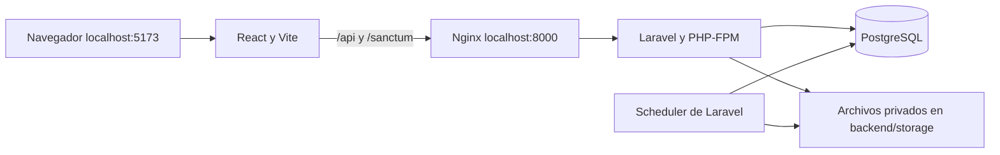

# Código completo del incremento — 16/10/2026

Base de revisión: `48b8274`.

Este informe contiene el código completo de cada archivo nuevo/modificado y el diff de cada archivo previamente versionado. El registro de criterios está en [ejecucion-backlog.md](ejecucion-backlog.md). Se excluye únicamente este mismo informe para evitar autorreferencia. Los archivos de entorno reales no se incluyen.

Archivos incluidos: 83.

## .dockerignore

Estado: nuevo.

Contenido completo:

``````text
.git
.aws
.codex
.agents
**/.env*
**/node_modules
**/vendor
**/dist
backend/storage
backend/bootstrap/cache/*.php
backend/public/storage
frontend/test-results
frontend/playwright-report
docs
``````

## .github/workflows/quality.yml

Estado: nuevo.

Contenido completo:

``````yaml
name: Calidad

on:
  push:
  pull_request:

permissions:
  contents: read

concurrency:
  group: quality-${{ github.ref }}
  cancel-in-progress: true

jobs:
  backend:
    runs-on: ubuntu-latest
    timeout-minutes: 20
    steps:
      - uses: actions/checkout@v4
      - name: Preparar entorno aislado
        run: cp backend/.env.example backend/.env
      - name: Construir PHP
        run: docker compose -p escalafon_ci -f docker-compose.ci.yml build backend
      - name: Instalar dependencias bloqueadas
        run: docker compose -p escalafon_ci -f docker-compose.ci.yml run --rm backend composer install --no-interaction --prefer-dist
      - name: Pruebas
        run: docker compose -p escalafon_ci -f docker-compose.ci.yml run --rm backend php artisan test --compact
      - name: PostgreSQL aislado
        run: docker compose -p escalafon_ci -f docker-compose.ci.yml up -d --wait testdb
      - name: Integración y concurrencia PostgreSQL
        run: docker compose -p escalafon_ci -f docker-compose.ci.yml run --rm backend vendor/bin/phpunit -c phpunit.pgsql.xml
      - name: Comprobar contrato API
        run: docker compose -p escalafon_ci -f docker-compose.ci.yml run --rm backend php artisan api:contrato --check=/var/www/docs/api-contract.json
      - name: Ensayo de restauración PostgreSQL
        run: |
          docker compose -p escalafon_ci -f docker-compose.ci.yml run --rm -e DB_CONNECTION=pgsql -e DB_DATABASE=escalafon_test backend php artisan db:seed --class=Seccion02DemoSeeder --no-interaction
          docker compose -p escalafon_ci -f docker-compose.ci.yml exec -T testdb sh -s < docker/operations/restore-smoke.sh
      - name: Limpiar entorno
        if: always()
        run: docker compose -p escalafon_ci -f docker-compose.ci.yml down -v

  frontend:
    runs-on: ubuntu-latest
    timeout-minutes: 15
    steps:
      - uses: actions/checkout@v4
      - name: Instalar dependencias bloqueadas
        run: docker compose -p escalafon_ci -f docker-compose.ci.yml run --rm frontend pnpm install --frozen-lockfile
      - name: Pruebas
        run: docker compose -p escalafon_ci -f docker-compose.ci.yml run --rm frontend pnpm test
      - name: Lint
        run: docker compose -p escalafon_ci -f docker-compose.ci.yml run --rm frontend pnpm lint
      - name: Build
        run: docker compose -p escalafon_ci -f docker-compose.ci.yml run --rm frontend pnpm build

  accessibility:
    runs-on: ubuntu-latest
    timeout-minutes: 15
    steps:
      - uses: actions/checkout@v4
      - name: Navegador aislado con API simulada
        run: docker compose -p escalafon_ci -f docker-compose.ci.yml run --build --rm e2e
``````

## .gitignore

Estado: modificado.

Contenido completo:

``````text
.env
.env.*
!.env.example
``````

Cambios respecto a la base:

``````diff
diff --git a/.gitignore b/.gitignore
index 4c49bd7..2cef73e 100644
--- a/.gitignore
+++ b/.gitignore
@@ -1,0 +2,2 @@
+.env.*
+!.env.example
``````

## README.md

Estado: modificado.

Contenido completo:

``````markdown
# Sistema de escalafón y legajos

Aplicación para gestionar expedientes del personal docente y administrativo: datos personales, trayectoria laboral, documentos organizados en 11 secciones, incorporaciones, evaluaciones y renovación de legajos. Incluye acceso por roles, configuración institucional y registros de auditoría.

Esta guía es el punto de entrada para instalar el proyecto y continuar su desarrollo. Todos los comandos se ejecutan **desde la raíz del repositorio**, donde están `docker-compose.yml` e `iniciar.ps1`, salvo que se indique otra ubicación.

## 1. Requisitos

- Git.
- Docker Engine con Docker Compose v2 en Linux, o Docker Desktop en Windows/macOS. En Windows, habilitar el motor WSL2 y los contenedores Linux.
- Conexión a Internet para descargar imágenes y dependencias durante la primera instalación.
- Puertos locales disponibles: **5173**, **8000** y **5433**.
- En Windows, PowerShell para utilizar `iniciar.ps1`.

PHP, Composer, Node y pnpm se ejecutan dentro de Docker; no hace falta instalarlos en tu computadora.

| Componente | Versión del proyecto | Ubicación |
| --- | --- | --- |
| Backend | Laravel 12; `composer.lock` registra 12.69.2 | `backend/` |
| PHP | 8.4 en la imagen Docker | `docker/php/Dockerfile` |
| Composer | 2 | Imagen del backend |
| Frontend | React 19, Vite 8, Tailwind CSS 4 | `frontend/package.json` |
| Node | 22 | `docker/node/Dockerfile` |
| Base de datos | PostgreSQL 16 | `docker-compose.yml` |
| Dependencias frontend | pnpm | `frontend/pnpm-lock.yaml` |

La imagen instala pnpm globalmente sin fijar su versión. Los archivos de bloqueo de Composer y pnpm forman parte del repositorio y deben conservarse.

Comprueba Docker antes de comenzar:

```sh
docker --version
docker compose version
docker info
```

## 2. Descargar y configurar

```sh
git clone https://github.com/spectre2005/proyecto_escalafon.git
cd proyecto_escalafon
```

Crea los archivos de configuración solo si todavía no existen. **No sobrescribas los `.env` de una instalación que ya funciona.**

Linux/macOS:

```sh
cp .env.example .env
cp backend/.env.example backend/.env
```

PowerShell:

```powershell
Copy-Item .env.example .env
Copy-Item backend/.env.example backend/.env
```

### Los dos archivos `.env`

| Archivo | Para qué sirve | Qué revisar |
| --- | --- | --- |
| `.env` de la raíz | Variables que lee Docker Compose | Usuario de los contenedores y credenciales de PostgreSQL |
| `backend/.env` | Configuración de Laravel | Conexión a PostgreSQL, clave de aplicación, administrador y sesiones |

Las variables `DB_DATABASE`, `DB_USERNAME` y `DB_PASSWORD` deben coincidir en ambos archivos. Los valores de ejemplo son para desarrollo local.

En `backend/.env`, conserva esta conexión dentro de Docker:

```dotenv
DB_CONNECTION=pgsql
DB_HOST=db
DB_PORT=5432
DB_DATABASE=escalafon
DB_USERNAME=app
DB_PASSWORD=secret
```

`db` es el nombre del servicio de PostgreSQL. Desde Laravel dentro del contenedor se usa **db:5432**; desde un cliente instalado en tu computadora se usa **localhost:5433**.

Configura también:

| Variable en `backend/.env` | Uso |
| --- | --- |
| `APP_ENV=local` | Habilita la API y los seeders de desarrollo |
| `APP_DEBUG=true` | Muestra errores durante el desarrollo |
| `APP_URL=http://localhost:8000` | Dirección del backend |
| `APP_KEY` | Se genera en el primer arranque; conservarla después |
| `ADMIN_EMAIL` | Correo elegido para el primer administrador |
| `ADMIN_PASSWORD` | Contraseña propia para ese administrador |
| `SANCTUM_STATEFUL_DOMAINS` | Incluye `localhost:5173`, `127.0.0.1:5173` y `localhost:8000` |
| `SESSION_SECURE_COOKIE=false` | Permite la sesión local usando HTTP |
| `SESSION_DRIVER=file`, `CACHE_STORE=file` | Sesiones y caché en archivos; Compose también impone estos valores al servicio `app` |
| `MAIL_MAILER=log` | Escribe correos en el log; no envía correo real |

Escribe `ADMIN_EMAIL` y `ADMIN_PASSWORD` antes de ejecutar los seeders. Si están vacíos, el seeder muestra una advertencia y no crea el administrador. No hay una contraseña compartida de administrador.

El frontend utiliza `/api/v1` y el proxy de Vite de forma predeterminada. No necesita un `.env` propio para esta instalación. `VITE_API_URL` permite cambiar la URL, pero una configuración externa requiere revisar cookies, dominios y acceso al backend.

### Usuario de Docker en Linux

Ejecuta `id -u` e `id -g` y coloca sus resultados en el `.env` de la raíz:

```dotenv
DOCKER_UID=1000
DOCKER_GID=1000
```

Los números anteriores son ejemplos: usa los de tu usuario. Esto permite que los contenedores escriban en las carpetas montadas. La imagen PHP prepara `vendor` para el usuario 1000; si usas otro UID, consulta la solución de permisos más abajo.

## 3. Primera instalación

### Opción A: Windows con el script

Con Docker Desktop encendido y las variables ya revisadas:

```powershell
.\iniciar.ps1
```

Si PowerShell bloquea el script, puedes permitirlo solo para esa ejecución:

```powershell
powershell -ExecutionPolicy Bypass -File .\iniciar.ps1
```

El script crea los `.env` faltantes, construye e inicia `db`, `app` y `nginx`, instala Composer, limpia la configuración, genera `APP_KEY` si falta, aplica migraciones y recrea el frontend. **No ejecuta `DatabaseSeeder` ni inicia `scheduler`.** Completa la instalación con:

```sh
docker compose exec app php artisan db:seed --no-interaction
docker compose up -d scheduler
```

### Opción B: instalación manual en Linux/macOS o Windows

1. Construye e inicia primero la base de datos y el backend:

   ```sh
   docker compose up -d --build --wait db app nginx
   ```

2. Confirma las dependencias del backend y limpia la configuración:

   ```sh
   docker compose exec -e COMPOSER_HOME=/tmp/composer app composer install --no-interaction --prefer-dist
   docker compose exec app php artisan config:clear --no-interaction
   ```

3. **Solo si `APP_KEY` está vacía**, genera la clave:

   ```sh
   docker compose exec app php artisan key:generate --no-interaction
   ```

   No vuelvas a generar la clave al actualizar una instalación: afecta sesiones y datos cifrados.

4. Aplica las migraciones pendientes y carga los datos iniciales:

   ```sh
   docker compose exec app php artisan migrate --seed --no-interaction
   ```

5. Inicia el frontend y las tareas programadas:

   ```sh
   docker compose up -d --build frontend scheduler
   ```

6. Revisa el arranque:

   ```sh
   docker compose ps
   docker compose logs --tail=50 frontend
   docker compose exec app php artisan migrate:status --no-interaction
   ```

El frontend instala sus dependencias antes de iniciar Vite. Espera el mensaje `VITE ... ready` y abre **http://localhost:5173**. Inicia sesión con el correo y la contraseña que configuraste para el administrador.

| Servicio | Dirección o función |
| --- | --- |
| Interfaz React | http://localhost:5173 |
| Backend por Nginx | http://localhost:8000 |
| API | http://localhost:8000/api/v1; requiere sesión y permisos según la ruta |
| PostgreSQL desde tu computadora | `localhost:5433` |
| Scheduler | Procesa vencimientos y avisos; no tiene interfaz web |

### Migraciones y seeders

Las migraciones crean y actualizan el esquema. Algunas también cargan o corrigen catálogos, incluida la sección 04. `DatabaseSeeder` carga catálogos, ubigeos, unidades, regímenes, el administrador y datos de demostración de usuarios, evaluaciones y requerimientos.

Para una instalación existente:

```sh
docker compose exec app php artisan migrate --no-interaction
docker compose exec app php artisan migrate:status --no-interaction
```

Para volver a ejecutar los seeders registrados, o crear el administrador después de completar sus variables:

```sh
docker compose exec app php artisan config:clear --no-interaction
docker compose exec app php artisan db:seed --no-interaction
```

Para ejecutar una clase específica:

```sh
docker compose exec app php artisan db:seed --class=AdministradorSeeder --no-interaction
```

Cambiar `ADMIN_PASSWORD` y repetir el seeder **no restablece automáticamente la contraseña de un administrador existente con el mismo correo**. El seeder está pensado para crear el administrador inicial.

No todos los archivos de `database/seeders/` se ejecutan con `db:seed`: la lista está en `DatabaseSeeder.php`. Algunos son ejemplos o crean datos con factories; revisa su contenido antes de ejecutarlos individualmente. Las personas demo no reemplazan a la cuenta administradora.

## 4. Trabajo diario y actualizaciones

```sh
# Iniciar los servicios
docker compose up -d

# Ver su estado y los últimos mensajes
docker compose ps
docker compose logs --tail=100 frontend app nginx scheduler

# Detenerlos conservando los volúmenes
docker compose down
```

Después de incorporar cambios del equipo, revisa las modificaciones de los `.env.example` y agrega las variables nuevas a tus archivos locales. Luego:

```sh
docker compose up -d --build db app nginx
docker compose exec -e COMPOSER_HOME=/tmp/composer app composer install --no-interaction --prefer-dist
docker compose exec app php artisan migrate --no-interaction
docker compose exec app php artisan optimize:clear --no-interaction
docker compose up -d --build --force-recreate frontend scheduler
```

El arranque del frontend ejecuta `pnpm install`. Usa `composer install` para respetar el archivo de bloqueo; `composer update` y `pnpm update` son cambios de dependencias que deben revisarse con el equipo.

**Cada computadora tiene su propia base de datos y sus propios archivos.** Hacer `git pull` no descarga los registros, documentos ni fotos de otra instalación.

## 5. Estructura del proyecto

```text
proyecto_escalafon/
├── README.md                 Guía principal para el equipo.
├── iniciar.ps1               Preparación e inicio desde PowerShell.
├── docker-compose.yml        Servicios, puertos y volúmenes locales.
├── .env.example              Variables de ejemplo para Docker.
├── docker/
│   ├── php/                  Imagen PHP y configuración de rendimiento.
│   ├── node/                 Imagen Node con pnpm.
│   └── nginx/                Servidor web que conecta con PHP-FPM.
├── backend/
│   ├── app/Http/             Controladores, validaciones y middleware.
│   ├── app/Models/           Modelos de base de datos.
│   ├── app/Support/          Lógica compartida, catálogos y servicios de apoyo.
│   ├── app/Console/          Comandos de tareas del sistema.
│   ├── routes/               API y programación de tareas.
│   ├── config/               Autenticación, archivos y demás configuración.
│   ├── database/migrations/  Cambios del esquema y ajustes de catálogos.
│   ├── database/seeders/     Datos iniciales y ejemplos de desarrollo.
│   ├── database/data/        CSV de ubicaciones y explicación de su origen.
│   ├── storage/             Documentos, fotos, sesiones y logs locales.
│   ├── tests/               Pruebas de backend.
│   └── .env.example          Variables de ejemplo de Laravel.
└── frontend/
    ├── src/app/              Composición de la aplicación y rutas.
    ├── src/features/         Pantallas y lógica por módulo funcional.
    ├── src/components/       Componentes de interfaz.
    ├── src/shared/           Código reutilizable entre módulos.
    ├── src/layouts/          Estructura visual de las pantallas.
    ├── src/axios.js           Cliente HTTP y manejo de sesión.
    ├── vite.config.js        Servidor local y proxy hacia Nginx.
    └── pnpm-lock.yaml        Versiones resueltas de las dependencias.
```

## 6. Arquitectura general



React consume la API mediante Axios; Vite reenvía `/api` y `/sanctum` al servicio `nginx`. Laravel autentica mediante cookies de sesión con Sanctum y valida roles, permisos y acceso a secciones. PostgreSQL conserva los registros; documentos y fotos se guardan en almacenamiento privado y se entregan mediante endpoints que comprueban acceso.

Las tareas se declaran en `backend/routes/console.php`: control de vencimientos diario y cada hora con zona `America/Lima`, y envío de avisos cada minuto. El contenedor `scheduler` ejecuta `php artisan schedule:work`.

## 7. Cómo continuar el desarrollo

- Backend: empieza por `backend/routes/api.php`, sigue el controlador en `app/Http/Controllers/Api/V1` y revisa modelos, validaciones, permisos y pruebas relacionadas.
- Frontend: busca el módulo en `frontend/src/features`; reutiliza componentes y utilidades existentes.
- Base de datos: agrega migraciones nuevas para los cambios; no dependas de modificar una migración que otros ya ejecutaron.
- Catálogos: revisa migraciones y seeders de la sección correspondiente. Documenta cualquier dato nuevo requerido para que funcione una pantalla.
- Acceso: los controles visuales del frontend deben acompañarse de validación en el backend. Conserva la protección de datos sensibles y archivos privados.
- Lee `backend/AGENTS.md` antes de trabajar con asistentes de código en el backend.

El frontend se maneja con **pnpm dentro de Docker**:

```sh
docker compose exec frontend pnpm add nombre-del-paquete
docker compose exec frontend pnpm add -D nombre-del-paquete
docker compose exec app composer require proveedor/paquete
```

Incluye los cambios de manifiestos y archivos de bloqueo en la misma entrega. Nunca subas contraseñas, `.env`, PDFs ni fotos del personal al repositorio.

### Validación de cambios

```sh
# Backend: pruebas y rutas
docker compose exec app php artisan test --compact
docker compose exec app php artisan route:list --path=api/v1

# Backend: dar formato a cambios PHP
docker compose exec app vendor/bin/pint --dirty --format agent

# Frontend: pruebas, lint y compilación
docker compose exec frontend pnpm test
docker compose exec frontend pnpm lint
docker compose exec frontend pnpm build
```

PHPUnit está configurado para SQLite en memoria. Si aparece `could not find driver` al probar, comprueba `pdo_sqlite` con `docker compose exec app php -m`. La configuración de pruebas está en `backend/phpunit.xml`.

Antes de entregar, comprueba además el flujo modificado desde la interfaz con el rol correspondiente. Compilar el frontend no publica el sistema ni sustituye la revisión funcional.

## 8. Problemas frecuentes

### El puerto 5173 devuelve una página vacía o `NS_ERROR_NET_EMPTY_RESPONSE`

```sh
docker compose ps -a frontend
docker compose logs --tail=100 frontend
```

Si los logs muestran `Permission denied` al escribir en `/app/node_modules/.pnpm-store`, pnpm no terminó la instalación y Vite no arrancó. Revisa `DOCKER_UID` y `DOCKER_GID` en el `.env` de la raíz. Corrige **solo las dependencias**, usando los mismos números que configuraste; este ejemplo supone 1000:1000:

```sh
docker compose stop frontend
docker compose run --rm --no-deps --user 0:0 --entrypoint sh frontend -c 'chown -R 1000:1000 /app/node_modules'
docker compose up -d --force-recreate frontend
docker compose logs -f frontend
```

Espera `VITE ... ready`, sal de los logs con `Ctrl+C` y recarga el navegador. No uses permisos `777` para todo el proyecto.

### La terminal está dentro de Flatpak y no encuentra Docker

Abre una terminal del sistema o antepone `flatpak-spawn --host` a los comandos de Docker. Especifica la ruta real del proyecto para que Compose encuentre la instalación correcta:

```sh
flatpak-spawn --host docker compose --project-directory /ruta/real/proyecto_escalafon ps
flatpak-spawn --host docker compose --project-directory /ruta/real/proyecto_escalafon logs --tail=100 frontend
```

Sustituye `/ruta/real/proyecto_escalafon` por tu carpeta. Una terminal normal no necesita ese prefijo.

### Laravel no puede escribir en `storage`, `bootstrap/cache` o `vendor`

Usa los UID/GID de tu `.env` de la raíz; el siguiente ejemplo supone 1000:1000:

```sh
docker compose run --rm --no-deps --user 0:0 --entrypoint sh app -c 'chown -R 1000:1000 storage bootstrap/cache vendor'
docker compose up -d app nginx scheduler
```

### Error de conexión a PostgreSQL

```sh
docker compose ps db
docker compose logs --tail=50 db app
```

Comprueba que los datos de conexión coincidan en ambos `.env` y que Laravel use `DB_HOST=db` y `DB_PORT=5432`. Después de editar `backend/.env`:

```sh
docker compose exec app php artisan config:clear --no-interaction
```

PostgreSQL usa las variables de inicialización cuando crea el volumen por primera vez. Cambiar la contraseña en `.env` **no cambia la contraseña de una base ya creada**: requiere actualizar el usuario de PostgreSQL y las configuraciones de conexión de forma coordinada.

### No puedo iniciar sesión, aparece 419 o la API devuelve 403

- Si no existe administrador, completa sus variables, limpia la configuración y ejecuta `AdministradorSeeder`.
- Para problemas de sesión, usa la misma dirección durante todo el flujo: `http://localhost:5173`. Comprueba `SANCTUM_STATEFUL_DOMAINS`, `SESSION_SECURE_COOKIE=false` y `APP_KEY`; borra las cookies locales después de corregir la configuración.
- Un 403 puede indicar falta de permisos, acceso bloqueado a una sección o un entorno distinto de `local`/`testing`. Revisa la respuesta de la API antes de cambiar permisos.

### Faltan tablas o tipos de documentos

Ejecuta `migrate`, revisa `migrate:status` y verifica los seeders registrados. El catálogo de la sección 04 también tiene una migración que lo carga. Si necesitas ejecutar específicamente ese catálogo:

```sh
docker compose exec app php artisan db:seed --class=Seccion04CatalogoSeeder --no-interaction
```

### Puerto ocupado o backend con error 502

Un puerto ocupado impide arrancar el servicio: revisa `docker compose ps -a` y los logs. Si cambias el puerto del frontend, actualiza también los dominios de sesión; si cambias el del backend, revisa `APP_URL`.

Para un 502, revisa `docker compose logs --tail=100 app nginx`: Nginx depende de que PHP-FPM arranque y Composer haya completado la instalación. Los errores de Laravel están en `backend/storage/logs/laravel.log`.

## 9. Datos, respaldos y límites de esta instalación

- `dbdata` conserva PostgreSQL; `vendor` conserva dependencias PHP. `docker compose down` mantiene esos volúmenes.
- Los documentos y fotos están en `backend/storage/app/private/`. Un respaldo completo necesita **base de datos y archivos privados**, además de conservar de forma segura la configuración y `APP_KEY`.
- `docker compose down -v` elimina los volúmenes de Compose, incluida la base de datos. `php artisan migrate:fresh` elimina y recrea las tablas. No los uses para actualizar una instalación con datos que deban conservarse.
- El catálogo de ubigeos tiene una procedencia y limitaciones documentadas en [backend/database/data/README.md](backend/database/data/README.md).
- Esta configuración es de **desarrollo local**. `LocalDevelopmentOnly` mantiene cerrado el CRUD interno fuera de `local` y `testing`. La API funcional usa `ApiDisponible` y exige habilitación y configuración segura en producción; cambiar `APP_ENV` no constituye un despliegue. Publicar el sistema requiere revisar autenticación, HTTPS, secretos, correo, respaldos y ejecución del frontend.

## 10. Mantenimiento e incremento actual

Repositorio del equipo: [spectre2005/proyecto_escalafon](https://github.com/spectre2005/proyecto_escalafon). La autoría de los cambios puede consultarse en el historial de Git; no hay una lista formal de responsables en la configuración revisada.

El código incluye gestión de personal y legajos, las 11 secciones documentales, configuración institucional, acceso a secciones e incorporación de personal. Los cambios recientes incorporan **control de vencimientos y renovación de legajos**. Este estado describe funcionalidades presentes en el repositorio, no una certificación de que todos los flujos estén terminados.

Para continuar un incremento, acuerda el alcance con el equipo, revisa las pruebas del módulo y entrega cambios de código, migraciones y datos iniciales necesarios juntos. Actualiza esta guía si cambian el arranque, las variables o los requisitos.


## Endurecimiento y operación

- [Ejecución y estado del backlog](docs/ejecucion-backlog.md).
- [Contrato API y comprobación de divergencias](docs/api.md).
- [Operación, SES y recuperación](docs/operacion-y-recuperacion.md).
- [Transición de permisos y preparación de producción](docs/produccion-y-permisos.md).
- [Código completo y diffs de este incremento](docs/codigo-backlog.md).

La suite SQLite corre en Docker; `backend/phpunit.pgsql.xml` añade integración y
concurrencia con PostgreSQL efímero en el proyecto `escalafon_ci`. CI separa su
almacenamiento del local. Playwright ejecuta los recorridos de teclado con API
simulada mediante el servicio `e2e` de `docker-compose.ci.yml`.
``````

Cambios respecto a la base:

``````diff
diff --git a/README.md b/README.md
index 15d174f..57705af 100644
--- a/README.md
+++ b/README.md
@@ -417 +417 @@ Para un 502, revisa `docker compose logs --tail=100 app nginx`: Nginx depende de
-- Esta configuración es de **desarrollo local**. `LocalDevelopmentOnly` bloquea la API fuera de `local` y `testing`; cambiar `APP_ENV` a `production` no constituye un despliegue. Publicar el sistema requiere revisar autenticación, HTTPS, secretos, correo, respaldos y ejecución del frontend.
+- Esta configuración es de **desarrollo local**. `LocalDevelopmentOnly` mantiene cerrado el CRUD interno fuera de `local` y `testing`. La API funcional usa `ApiDisponible` y exige habilitación y configuración segura en producción; cambiar `APP_ENV` no constituye un despliegue. Publicar el sistema requiere revisar autenticación, HTTPS, secretos, correo, respaldos y ejecución del frontend.
@@ -425,0 +426,14 @@ Para continuar un incremento, acuerda el alcance con el equipo, revisa las prueb
+
+
+## Endurecimiento y operación
+
+- [Ejecución y estado del backlog](docs/ejecucion-backlog.md).
+- [Contrato API y comprobación de divergencias](docs/api.md).
+- [Operación, SES y recuperación](docs/operacion-y-recuperacion.md).
+- [Transición de permisos y preparación de producción](docs/produccion-y-permisos.md).
+- [Código completo y diffs de este incremento](docs/codigo-backlog.md).
+
+La suite SQLite corre en Docker; `backend/phpunit.pgsql.xml` añade integración y
+concurrencia con PostgreSQL efímero en el proyecto `escalafon_ci`. CI separa su
+almacenamiento del local. Playwright ejecuta los recorridos de teclado con API
+simulada mediante el servicio `e2e` de `docker-compose.ci.yml`.
``````

## backend/.env.example

Estado: modificado.

Contenido completo:

``````text
APP_NAME=Laravel
APP_ENV=local
APP_KEY=
APP_DEBUG=true
APP_URL=http://localhost:8000

APP_LOCALE=en
APP_FALLBACK_LOCALE=en
APP_FAKER_LOCALE=en_US

APP_MAINTENANCE_DRIVER=file
# APP_MAINTENANCE_STORE=database

# PHP_CLI_SERVER_WORKERS=4

BCRYPT_ROUNDS=12

# Primer administrador (AdministradorSeeder, solo local/testing). Usa una clave propia.
ADMIN_EMAIL=
ADMIN_PASSWORD=

LOG_CHANNEL=stack
LOG_STACK=single
LOG_DEPRECATIONS_CHANNEL=null
LOG_LEVEL=debug


SESSION_DRIVER=file
SESSION_LIFETIME=120
SESSION_ENCRYPT=true
SESSION_PATH=/
SESSION_DOMAIN=null
# En producción con HTTPS: true
SESSION_SECURE_COOKIE=false

# Dominios (con puerto) desde los que el SPA usa la cookie de sesión
SANCTUM_STATEFUL_DOMAINS=localhost:5173,127.0.0.1:5173,localhost:8000

BROADCAST_CONNECTION=log
FILESYSTEM_DISK=local
QUEUE_CONNECTION=sync

CACHE_STORE=file
# CACHE_PREFIX=

MEMCACHED_HOST=127.0.0.1

REDIS_CLIENT=phpredis
REDIS_HOST=127.0.0.1
REDIS_PASSWORD=null
REDIS_PORT=6379

MAIL_MAILER=log
MAIL_SCHEME=null
MAIL_HOST=127.0.0.1
MAIL_PORT=2525
MAIL_USERNAME=null
MAIL_PASSWORD=null
MAIL_FROM_ADDRESS="hello@example.com"
MAIL_FROM_NAME="${APP_NAME}"

AWS_ACCESS_KEY_ID=
AWS_SECRET_ACCESS_KEY=
AWS_DEFAULT_REGION=us-east-1
AWS_BUCKET=
AWS_USE_PATH_STYLE_ENDPOINT=false

VITE_APP_NAME="${APP_NAME}"

DB_CONNECTION=pgsql
DB_HOST=db
DB_PORT=5432
DB_DATABASE=escalafon
DB_USERNAME=app
DB_PASSWORD=secret

# SES SMTP: credenciales inyectadas por DevOps desde AWS Secrets Manager.
SES_SMTP_HOST=email-smtp.us-east-1.amazonaws.com
SES_SMTP_USERNAME=
SES_SMTP_PASSWORD=
MAIL_TIMEOUT=15
SECURITY_AWS_REGION=us-east-1
SECURITY_KMS_KEY_ID=
BACKUP_KMS_KEY_ID=
SECURITY_SECRETS_MANAGER_ID=

# Local: análisis opcional. Producción: ambos true; daemon privado y firmas actualizadas.
ANTIVIRUS_ENABLED=false
ANTIVIRUS_ENFORCE=false
ANTIVIRUS_ENDPOINT=tcp://antivirus:3310

# legacy local; dual/database tras importar y revisar permisos en staging.
PERMISOS_FUENTE=legacy
API_ENABLED=false
``````

Cambios respecto a la base:

``````diff
diff --git a/backend/.env.example b/backend/.env.example
index 4d5971a..df33553 100644
--- a/backend/.env.example
+++ b/backend/.env.example
@@ -75,0 +76,19 @@ DB_PASSWORD=secret
+
+# SES SMTP: credenciales inyectadas por DevOps desde AWS Secrets Manager.
+SES_SMTP_HOST=email-smtp.us-east-1.amazonaws.com
+SES_SMTP_USERNAME=
+SES_SMTP_PASSWORD=
+MAIL_TIMEOUT=15
+SECURITY_AWS_REGION=us-east-1
+SECURITY_KMS_KEY_ID=
+BACKUP_KMS_KEY_ID=
+SECURITY_SECRETS_MANAGER_ID=
+
+# Local: análisis opcional. Producción: ambos true; daemon privado y firmas actualizadas.
+ANTIVIRUS_ENABLED=false
+ANTIVIRUS_ENFORCE=false
+ANTIVIRUS_ENDPOINT=tcp://antivirus:3310
+
+# legacy local; dual/database tras importar y revisar permisos en staging.
+PERMISOS_FUENTE=legacy
+API_ENABLED=false
``````

## backend/.gitignore

Estado: modificado.

Contenido completo:

``````text
*.log
.DS_Store
.env
.env.*
!.env.example
.env.backup
.env.production
.phpactor.json
.phpunit.result.cache
/.codex
/.cursor/
/.idea
/.nova
/.phpunit.cache
/.vscode
/.zed
/auth.json
/node_modules
/public/build
/public/fonts-manifest.dev.json
/public/hot
/public/storage
/storage/*.key
/storage/pail
/vendor
_ide_helper.php
Homestead.json
Homestead.yaml
Thumbs.db
``````

Cambios respecto a la base:

``````diff
diff --git a/backend/.gitignore b/backend/.gitignore
index 7be55e2..837fe36 100644
--- a/backend/.gitignore
+++ b/backend/.gitignore
@@ -3,0 +4,2 @@
+.env.*
+!.env.example
``````

## backend/app/Console/Commands/EstadoOperativo.php

Estado: nuevo.

Contenido completo:

``````php
<?php

namespace App\Console\Commands;

use Illuminate\Console\Command;
use Illuminate\Support\Facades\Cache;
use Illuminate\Support\Facades\DB;
use Illuminate\Support\Facades\Storage;
use Illuminate\Support\Str;
use Throwable;

class EstadoOperativo extends Command
{
    protected $signature = 'sistema:estado {--produccion : Comprueba además requisitos de configuración productiva}';

    protected $description = 'Comprueba BD, almacenamiento y heartbeat sin revelar secretos ni enviar mensajes';

    public function handle(): int
    {
        $checks = [];
        try {
            DB::select('SELECT 1');
            $checks['database'] = true;
        } catch (Throwable) {
            $checks['database'] = false;
        }
        $ruta = 'health/'.Str::uuid();
        try {
            $disco = Storage::disk(config('legajo.disco_documentos'));
            $checks['storage'] = $disco->put($ruta, 'health') && $disco->get($ruta) === 'health';
        } catch (Throwable) {
            $checks['storage'] = false;
        } finally {
            try {
                Storage::disk(config('legajo.disco_documentos'))->delete($ruta);
            } catch (Throwable) {
                $checks['storage'] = false;
            }
        }
        try {
            $heartbeat = Cache::get('scheduler.heartbeat');
            $checks['scheduler'] = is_numeric($heartbeat) && now()->timestamp - (int) $heartbeat >= 0 && now()->timestamp - (int) $heartbeat <= 180;
        } catch (Throwable) {
            $checks['scheduler'] = false;
        }
        if ($this->option('produccion')) {
            $checks['debug_off'] = ! config('app.debug');
            $checks['secure_cookie'] = (bool) config('session.secure');
            $checks['permissions_database'] = in_array(config('permisos.fuente'), ['dual', 'database'], true);
            $checks['antivirus_required'] = config('antivirus.enabled') && config('antivirus.enforce');
            $checks['ses_starttls'] = config('mail.default') === 'ses_smtp' && config('mail.mailers.ses_smtp.require_tls');
            $checks['kms_separate_keys'] = filled(config('seguridad.kms_key_id')) && filled(config('seguridad.backup_kms_key_id')) && config('seguridad.kms_key_id') !== config('seguridad.backup_kms_key_id');
        }
        $this->line(json_encode(['checks' => $checks], JSON_THROW_ON_ERROR));

        return in_array(false, $checks, true) ? self::FAILURE : self::SUCCESS;
    }
}
``````

## backend/app/Console/Commands/GenerarContratoApi.php

Estado: nuevo.

Contenido completo:

``````php
<?php

namespace App\Console\Commands;

use Illuminate\Console\Command;
use Illuminate\Support\Facades\Route;
use ReflectionMethod;

class GenerarContratoApi extends Command
{
    protected $signature = 'api:contrato {--check= : Compara con un inventario JSON existente}';

    protected $description = 'Emite un inventario determinista de rutas API, middleware y fuentes del contrato';

    public function handle(): int
    {
        $rutas = [];
        $fuentes = [];
        foreach (Route::getRoutes() as $ruta) {
            if (! str_starts_with($ruta->uri(), 'api/v1/')) {
                continue;
            }
            $accion = $ruta->getActionName();
            if (str_contains($accion, '@')) {
                [$clase, $metodo] = explode('@', $accion, 2);
                $reflexion = new ReflectionMethod($clase, $metodo);
                $archivo = $reflexion->getFileName();
                $fuentes[substr($archivo, strlen(base_path()) + 1)] = hash_file('sha256', $archivo);
            }
            $rutas[] = ['uri' => '/'.$ruta->uri(), 'methods' => array_values(array_diff($ruta->methods(), ['HEAD'])),
                'action' => $accion, 'middleware' => $ruta->gatherMiddleware(), 'constraints' => $ruta->wheres];
        }
        foreach (['app/Http', 'app/Support'] as $directorio) {
            $iterator = new \RecursiveIteratorIterator(new \RecursiveDirectoryIterator(base_path($directorio), \FilesystemIterator::SKIP_DOTS));
            foreach ($iterator as $fuente) {
                if ($fuente->getExtension() === 'php') {
                    $archivo = $fuente->getPathname();
                    $fuentes[substr($archivo, strlen(base_path()) + 1)] = hash_file('sha256', $archivo);
                }
            }
        }
        foreach (['routes/api.php', 'config/permisos.php', 'config/antivirus.php', 'config/deployment.php', 'app/Models/Usuario.php'] as $archivo) {
            $fuentes[$archivo] = hash_file('sha256', base_path($archivo));
        }
        usort($rutas, fn (array $a, array $b): int => [$a['uri'], $a['methods']] <=> [$b['uri'], $b['methods']]);
        ksort($fuentes);
        $json = json_encode(['version' => 1, 'routes' => $rutas, 'validation_sources_sha256' => $fuentes], JSON_PRETTY_PRINT | JSON_UNESCAPED_SLASHES | JSON_UNESCAPED_UNICODE | JSON_THROW_ON_ERROR)."\n";
        if ($archivo = $this->option('check')) {
            if (! is_file($archivo) || file_get_contents($archivo) !== $json) {
                $this->error('El contrato cambió. Revisa rutas, permisos y validaciones y regenera el inventario.');

                return self::FAILURE;
            }
            $this->info('Contrato API sin divergencias.');

            return self::SUCCESS;
        }
        $this->output->write($json);

        return self::SUCCESS;
    }
}
``````

## backend/app/Console/Commands/SincronizarPermisos.php

Estado: nuevo.

Contenido completo:

``````php
<?php

namespace App\Console\Commands;

use App\Models\Rol;
use Illuminate\Console\Command;
use Illuminate\Support\Facades\DB;

class SincronizarPermisos extends Command
{
    protected $signature = 'permisos:importar-legacy {--aplicar : Inserta políticas iniciales; sin esta opción solo muestra el resumen}';

    protected $description = 'Importa una vez permisos vigentes desde la configuración para iniciar la transición a BD';

    public function handle(): int
    {
        $filas = [];
        $catalogo = DB::table('permisos')->pluck('id', 'slug');
        $asignables = array_diff(array_keys(config('permisos.catalogo')), array_keys(config('permisos.derivados')), config('permisos.pendientes'));
        foreach (Rol::query()->get() as $rol) {
            $configurados = config('permisos.roles.'.$rol->codigo, []);
            $slugs = $configurados === '*' ? $asignables : array_intersect($configurados, $asignables);
            foreach (config('permisos.derivados') as $slug => $campo) {
                if ($rol->{$campo}) {
                    $slugs[] = $slug;
                }
            }
            foreach (array_unique($slugs) as $slug) {
                if (! isset($catalogo[$slug])) {
                    $this->error('El catálogo de BD no contiene todos los permisos.');

                    return self::FAILURE;
                }
                $filas[] = ['rol_id' => $rol->id, 'permiso_id' => $catalogo[$slug], 'permitido' => true];
            }
        }
        if ($this->option('aplicar')) {
            DB::transaction(function () use ($filas): void {
                foreach ($filas as $fila) {
                    DB::table('permisos_rol')->insertOrIgnore($fila);
                }
            });
        }
        $this->info(count($filas).' asignaciones '.($this->option('aplicar') ? 'procesadas.' : 'previstas; no se escribió ningún permiso.'));

        return self::SUCCESS;
    }
}
``````

## backend/app/Http/Controllers/Api/V1/IncorporacionController.php

Estado: modificado.

Contenido completo:

``````php
<?php

namespace App\Http\Controllers\Api\V1;

use App\Http\Controllers\Controller;
use App\Models\Incorporacion;
use App\Models\Legajo;
use App\Models\LegajoSeccion;
use App\Models\RegimenNormativo;
use App\Models\Rol;
use App\Models\SeccionLegajo;
use App\Models\Usuario;
use App\Models\UsuarioRol;
use App\Models\VinculoLaboral;
use App\Support\Documentos\Antivirus;
use App\Support\Documentos\ArchivoPdf;
use App\Support\NumeroLegajo;
use App\Support\RegimenesLaborales;
use Illuminate\Http\JsonResponse;
use Illuminate\Http\Request;
use Illuminate\Support\Facades\DB;
use Illuminate\Support\Facades\Storage;
use Illuminate\Support\Str;
use Illuminate\Validation\Rules\Password;
use Symfony\Component\HttpFoundation\StreamedResponse;

class IncorporacionController extends Controller
{
    public function index(Request $request): JsonResponse
    {
        $f = $request->validate(['q' => 'nullable|string|max:120', 'tipo' => 'nullable|in:docente,administrativo', 'cargo' => 'nullable|string|max:200', 'archivo' => 'nullable|boolean']);
        $q = Incorporacion::query()->with(['usuario', 'responsable']);
        if (! $request->user()->can('sistema.administrar')) {
            $q->where('responsable_id', $request->user()->id);
        }
        $q->whereIn('estado', ($f['archivo'] ?? false) ? ['incorporado', 'rechazado'] : ['registrado', 'en_revision', 'observado', 'admitido']);
        $q->when($f['tipo'] ?? null, fn ($q, $tipo) => $q->whereHas('usuario', fn ($u) => $u->where('tipo_personal', $tipo)));
        $q->when($f['cargo'] ?? null, fn ($q, $cargo) => $q->whereRaw('LOWER(cargo) LIKE ?', ['%'.mb_strtolower($cargo).'%']));
        $q->when($f['q'] ?? null, fn ($q, $texto) => $q->whereHas('usuario', fn ($u) => $u->whereRaw("LOWER(nombres || ' ' || apellido_paterno || ' ' || COALESCE(apellido_materno, '') || ' ' || numero_doc_identidad) LIKE ?", ['%'.mb_strtolower($texto).'%'])));
        $page = $q->orderByDesc('updated_at')->orderBy('id')->paginate(40);
        $page->through(fn (Incorporacion $i) => $this->presentar($i));

        return response()->json($page);
    }

    public function opciones(): JsonResponse
    {
        return response()->json(['data' => [
            'responsables' => Usuario::query()->where('activo', true)->get()->filter(fn (Usuario $u) => $u->can('legajo.editar'))->map(fn ($u) => $u->only(['id', 'nombres', 'apellido_paterno']))->values(),
            'roles' => Rol::query()->where('activo', true)->whereIn('codigo', array_keys(config('permisos.roles')))->get(['id', 'nombre', 'codigo']),
        ]]);
    }

    public function habilitarResponsable(Request $request): JsonResponse
    {
        $data = $request->validate(['usuario_id' => 'required|uuid|exists:usuarios,id', 'password' => ['nullable', 'string', 'max:255', Password::defaults()]]);
        DB::transaction(function () use ($request, $data): void {
            $usuario = Usuario::query()->lockForUpdate()->findOrFail($data['usuario_id']);
            abort_unless(Legajo::query()->where('usuario_id', $usuario->id)->where('estado_legajo', 'activo')->exists(), 422, 'El asistente debe ser personal con un legajo activo existente.');
            abort_if($usuario->can('legajo.editar'), 409, 'Esta persona ya tiene acceso para gestionar legajos.');
            $requiereClave = ! $usuario->activo || $usuario->permisos() === [];
            abort_if($requiereClave && empty($data['password']), 422, 'Define una contraseña inicial para habilitar la cuenta.');
            $rol = Rol::query()->where('codigo', 'asistente_legajo')->where('activo', true)->first();
            abort_unless($rol, 409, 'El rol de asistente está desactivado o no existe.');
            UsuarioRol::query()->create(['usuario_id' => $usuario->id, 'rol_id' => $rol->id, 'ambito_tipo_personal' => 'ambos', 'vigente_desde' => today(), 'asignado_por' => $request->user()->id]);
            if ($requiereClave) {
                $usuario->password = $data['password'];
            }
            $usuario->activo = true;
            $usuario->save();
        });

        return response()->json(['message' => 'Asistente habilitado. Ya puedes asignarle tareas de incorporación.']);
    }

    public function store(Request $request): JsonResponse
    {
        $data = $request->validate([
            'usuario_id' => 'nullable|uuid|exists:usuarios,id|unique:incorporaciones,usuario_id',
            'nombres' => 'required_without:usuario_id|string|max:120', 'apellido_paterno' => 'required_without:usuario_id|string|max:80',
            'apellido_materno' => 'nullable|string|max:80',
            'numero_doc_identidad' => 'required_without:usuario_id|regex:/^[0-9]{8}$/|unique:usuarios,numero_doc_identidad',
            'email_institucional' => 'required_without:usuario_id|email|max:255|unique:usuarios,email_institucional',
            'tipo_personal' => 'required_without:usuario_id|in:docente,administrativo', 'regimen_laboral' => 'required_without:usuario_id|string|max:20',
            'cargo' => 'required|string|max:150', 'numero_resolucion' => 'nullable|string|max:60',
            'fecha_resolucion' => 'nullable|date_format:Y-m-d', 'fecha_inicio' => 'nullable|date_format:Y-m-d',
            'documentos_exigidos' => 'required|array|min:1|max:30', 'documentos_exigidos.*' => 'required|string|max:150|distinct',
        ]);
        $i = DB::transaction(function () use ($data, $request): Incorporacion {
            if (! empty($data['usuario_id'])) {
                $u = Usuario::query()->lockForUpdate()->findOrFail($data['usuario_id']);
                abort_if(Incorporacion::query()->where('usuario_id', $u->id)->exists(), 409, 'Esta persona ya tiene una incorporación.');
            } else {
                abort_unless(in_array($data['regimen_laboral'], RegimenesLaborales::codigos($data['tipo_personal']), true), 422, 'El régimen no corresponde al tipo de personal.');
                $email = mb_strtolower($data['email_institucional']);
                abort_if(Usuario::query()->whereRaw('LOWER(email_institucional) = ?', [$email])->exists(), 422, 'El correo ya está registrado.');
                $u = Usuario::query()->create([...collect($data)->only(['nombres', 'apellido_paterno', 'apellido_materno', 'numero_doc_identidad', 'tipo_personal', 'regimen_laboral'])->all(),
                    'email_institucional' => $email, 'password' => Str::random(64), 'activo' => false, 'tipo_doc_identidad' => 'dni']);
            }

            return Incorporacion::query()->create([
                ...collect($data)->only(['cargo', 'numero_resolucion', 'fecha_resolucion', 'fecha_inicio'])->all(),
                'usuario_id' => $u->id, 'registrado_por' => $request->user()->id, 'estado' => 'registrado',
                'documentos' => array_map(fn ($nombre) => ['id' => (string) Str::uuid(), 'nombre' => $nombre, 'estado' => 'pendiente', 'versiones' => []], $data['documentos_exigidos']),
                'tareas' => [], 'historial' => [['accion' => 'registrado', 'actor' => $request->user()->id, 'fecha' => now()->toIso8601String()]],
            ]);
        });

        return response()->json(['data' => $this->presentar($i)], 201);
    }

    public function show(Request $request, string $incorporacion): JsonResponse
    {
        $i = Incorporacion::query()->findOrFail($incorporacion);
        $this->autorizar($request, $i);

        return response()->json(['data' => $this->presentar($i)]);
    }

    public function actualizar(Request $request, string $incorporacion): JsonResponse
    {
        $data = $request->validate([
            'version' => 'required|integer|min:1', 'accion' => 'required|in:datos,revision,admitir,observar,rechazar,incorporar,delegar,tarea,firma,revisar_documento',
            'motivo' => 'nullable|string|max:1000', 'responsable_id' => 'nullable|uuid|exists:usuarios,id',
            'tareas' => 'sometimes|array|min:1|max:20', 'tareas.*' => 'required|string|max:300|distinct',
            'tarea_id' => 'nullable|uuid', 'completada' => 'sometimes|boolean',
            'documento_id' => 'nullable|uuid', 'estado_documento' => 'nullable|in:revisado,rechazado',
            'numero_resolucion' => 'nullable|string|max:60', 'fecha_resolucion' => 'nullable|date_format:Y-m-d', 'fecha_inicio' => 'nullable|date_format:Y-m-d',
            'rol_id' => 'nullable|uuid|exists:roles,id', 'password' => ['nullable', 'string', 'max:255', Password::defaults()],
        ]);

        return DB::transaction(function () use ($request, $incorporacion, $data): JsonResponse {
            $i = Incorporacion::query()->lockForUpdate()->findOrFail($incorporacion);
            $this->autorizar($request, $i);
            abort_unless($i->version === $data['version'], 409, 'El expediente cambió. Recarga antes de guardar.');
            abort_if(in_array($i->estado, ['incorporado', 'rechazado'], true), 409, 'La incorporación está cerrada.');
            $accion = $data['accion'];
            $admin = $request->user()->can('sistema.administrar');
            abort_unless($admin || in_array($accion, ['datos', 'revision', 'tarea'], true), 403, 'Esta acción requiere administración.');
            if (in_array($accion, ['datos', 'revision', 'tarea'], true) && ! $admin) {
                abort_unless(collect($i->tareas)->contains(fn ($t) => ! $t['completada']), 403, 'No tienes tareas pendientes en esta incorporación.');
            }
            if ($accion === 'datos') {
                abort_if($i->estado === 'admitido', 409, 'Observa el expediente antes de corregirlo.');
                $i->fill(collect($data)->only(['numero_resolucion', 'fecha_resolucion', 'fecha_inicio'])->all());
            } elseif ($accion === 'delegar') {
                $u = Usuario::query()->find($data['responsable_id'] ?? null);
                abort_unless($u?->activo && $u->can('legajo.editar') && ! empty($data['tareas']), 422, 'Selecciona un responsable activo y sus tareas.');
                $i->responsable_id = $u->id;
                $i->tareas = array_map(fn ($titulo) => ['id' => (string) Str::uuid(), 'titulo' => $titulo, 'completada' => false], $data['tareas']);
            } elseif ($accion === 'tarea') {
                abort_unless(collect($i->tareas)->contains('id', $data['tarea_id'] ?? null) && array_key_exists('completada', $data), 422, 'Selecciona una tarea válida.');
                $i->tareas = array_map(fn ($t) => $t['id'] === $data['tarea_id'] ? [...$t, 'completada' => $data['completada']] : $t, $i->tareas);
            } elseif ($accion === 'revisar_documento') {
                abort_unless($i->estado === 'en_revision', 409, 'Inicia la revisión del expediente.');
                $docs = $i->documentos;
                $pos = collect($docs)->search(fn ($d) => $d['id'] === ($data['documento_id'] ?? null));
                abort_if($pos === false || empty($data['estado_documento']), 422, 'Selecciona un documento y resultado.');
                $doc = $docs[$pos];
                abort_if(empty($doc['versiones']), 422, 'Primero carga el PDF del documento.');
                abort_if(end($doc['versiones'])['subido_por'] === $request->user()->id, 403, 'Quien sube el documento no puede revisarlo.');
                abort_if($data['estado_documento'] === 'rechazado' && empty($data['motivo']), 422, 'Indica el motivo del rechazo.');
                $docs[$pos] = [...$doc, 'estado' => $data['estado_documento'], 'revisado_por' => $request->user()->id, 'revisado_nombre' => $request->user()->nombres.' '.$request->user()->apellido_paterno, 'motivo' => $data['motivo'] ?? null];
                $i->documentos = $docs;
            } elseif ($accion === 'firma') {
                abort_unless(in_array($i->estado, ['en_revision', 'admitido'], true), 409, 'Primero inicia la revisión.');
                $i->firma_solicitada_at = now();
            } elseif ($accion === 'revision') {
                abort_unless(in_array($i->estado, ['registrado', 'observado'], true), 409, 'No se puede iniciar revisión desde este estado.');
                $i->estado = 'en_revision';
            } elseif (in_array($accion, ['observar', 'rechazar'], true)) {
                abort_if(empty($data['motivo']), 422, 'Indica el motivo.');
                $i->estado = $accion === 'observar' ? 'observado' : 'rechazado';
            } elseif ($accion === 'admitir') {
                abort_unless($i->estado === 'en_revision', 409, 'El expediente debe estar en revisión.');
                $this->exigirCompleto($i);
                $i->estado = 'admitido';
            } elseif ($accion === 'incorporar') {
                abort_unless($i->estado === 'admitido', 409, 'Primero marca al postulante como Admitido.');
                $this->exigirCompleto($i);
                $this->incorporar($request, $i, $data);
            }
            $i->historial = [...$i->historial, ['accion' => $accion, 'actor' => $request->user()->id, 'fecha' => now()->toIso8601String(), 'motivo' => $data['motivo'] ?? null, 'detalle' => collect($data)->except(['password', 'version', 'accion'])->all()]];
            $i->version++;
            $i->save();

            return response()->json(['data' => $this->presentar($i)]);
        });
    }

    public function subir(Request $request, string $incorporacion, string $documento): JsonResponse
    {
        $request->validate(['pdf' => 'required|file|mimes:pdf|max:20480', 'version' => 'required|integer']);
        abort_unless(ArchivoPdf::esPdf($request->file('pdf')), 422, 'Selecciona un PDF válido.');
        $path = null;
        try {
            return DB::transaction(function () use ($request, $incorporacion, $documento, &$path): JsonResponse {
                $i = Incorporacion::query()->lockForUpdate()->findOrFail($incorporacion);
                $this->autorizar($request, $i);
                abort_unless($i->version === (int) $request->input('version'), 409, 'El expediente cambió. Recarga antes de subir.');
                abort_unless(in_array($i->estado, ['registrado', 'observado', 'en_revision'], true), 409, 'No se permiten cargas en este estado.');
                abort_unless($request->user()->can('sistema.administrar') || collect($i->tareas)->contains(fn ($t) => ! $t['completada']), 403);
                $docs = $i->documentos;
                $pos = collect($docs)->search(fn ($d) => $d['id'] === $documento);
                abort_if($pos === false, 404);
                abort_if($docs[$pos]['estado'] === 'revisado', 409, 'El documento revisado se conserva.');
                $path = $request->file('pdf')->store('incorporaciones/'.$i->id, 'local');
                abort_unless($path, 500, 'No se pudo guardar el PDF.');
                $docs[$pos]['versiones'][] = ['path' => $path, 'nombre' => $request->file('pdf')->getClientOriginalName(), 'hash' => ArchivoPdf::hash($request->file('pdf')), 'subido_por' => $request->user()->id, 'fecha' => now()->toIso8601String()];
                $docs[$pos]['estado'] = 'cargado';
                unset($docs[$pos]['revisado_por'], $docs[$pos]['revisado_nombre'], $docs[$pos]['motivo']);
                $i->documentos = $docs;
                $i->historial = [...$i->historial, ['accion' => 'carga_documento', 'documento_id' => $documento, 'actor' => $request->user()->id, 'fecha' => now()->toIso8601String()]];
                $i->version++;
                $i->save();

                return response()->json(['data' => $this->presentar($i)]);
            });
        } catch (\Throwable $e) {
            if ($path) {
                Storage::disk('local')->delete($path);
            }
            throw $e;
        }
    }

    public function archivo(Request $request, string $incorporacion, string $documento): StreamedResponse
    {
        $i = Incorporacion::query()->findOrFail($incorporacion);
        $this->autorizar($request, $i);
        $d = collect($i->documentos)->firstWhere('id', $documento);
        abort_if(empty($d['versiones']), 404);
        $v = end($d['versiones']);
        abort_unless(Storage::disk('local')->exists($v['path']), 404);
        app(Antivirus::class)->exigir('local', $v['path']);

        return Storage::disk('local')->response($v['path'], $v['nombre'], ['Content-Type' => 'application/pdf', 'Cache-Control' => 'private, no-store', 'X-Content-Type-Options' => 'nosniff']);
    }

    private function autorizar(Request $request, Incorporacion $i): void
    {
        abort_unless($request->user()->can('sistema.administrar') || ($request->user()->can('legajo.editar') && $i->responsable_id === $request->user()->id), 403);
    }

    private function exigirCompleto(Incorporacion $i): void
    {
        abort_if(empty($i->documentos) || collect($i->documentos)->contains(fn ($d) => $d['estado'] !== 'revisado'), 422, 'Todos los documentos exigidos deben estar revisados.');
        abort_unless($i->numero_resolucion && $i->fecha_resolucion && $i->fecha_inicio, 422, 'Completa la resolución, su fecha y el inicio del vínculo.');
        abort_if(collect($i->tareas)->contains(fn ($t) => ! $t['completada']), 422, 'Completa las tareas delegadas antes de admitir.');
    }

    private function incorporar(Request $request, Incorporacion $i, array $data): void
    {
        $u = Usuario::query()->lockForUpdate()->findOrFail($i->usuario_id);
        $rol = Rol::query()->where('activo', true)->find($data['rol_id'] ?? null);
        abort_unless($rol && array_key_exists($rol->codigo, config('permisos.roles')), 422, 'Selecciona un rol habilitado.');
        abort_if(! $u->activo && empty($data['password']), 422, 'Define la contraseña de activación de la cuenta.');
        $vinculo = VinculoLaboral::query()->where('usuario_id', $u->id)->where('anulado', false)->whereNull('fecha_cese')->first();
        if ($vinculo) {
            abort_unless($vinculo->numero_documento_vinculo === $i->numero_resolucion && $vinculo->nombre_puesto === $i->cargo && $vinculo->fecha_inicio->format('Y-m-d') === $i->fecha_inicio, 409, 'Ya existe un vínculo abierto distinto. Revisa sus datos antes de incorporar.');
        } else {
            $regimen = RegimenNormativo::query()->where('codigo', $u->regimen_laboral === 'CAS' ? '1057' : $u->regimen_laboral)->where('activo', true)->first();
            abort_unless($regimen, 422, 'No existe un régimen normativo activo para esta persona.');
            $vinculo = VinculoLaboral::query()->create(['regimen_normativo_id' => $regimen->id, 'usuario_id' => $u->id, 'tipo_personal' => $u->tipo_personal, 'regimen_laboral' => $u->regimen_laboral,
                'nombre_puesto' => $i->cargo, 'numero_documento_vinculo' => $i->numero_resolucion, 'fecha_inicio' => $i->fecha_inicio, 'registrado_por' => $request->user()->id]);
        }
        if (! Legajo::query()->where('usuario_id', $u->id)->where('estado_legajo', 'activo')->exists()) {
            abort_unless(SeccionLegajo::query()->whereBetween('id', [1, 13])->count() === 13, 409, 'El catálogo requiere las 13 secciones.');
            if (DB::getDriverName() === 'pgsql') {
                DB::select('select pg_advisory_xact_lock(?)', [crc32('numero_legajo')]);
            }
            $legajo = Legajo::query()->create(['usuario_id' => $u->id, 'numero_legajo' => NumeroLegajo::siguiente(), 'estado_legajo' => 'activo', 'fecha_apertura' => today()]);
            foreach (range(1, 13) as $seccion) {
                LegajoSeccion::query()->create(['legajo_id' => $legajo->id, 'seccion_legajo_id' => $seccion, 'ultimo_folio' => 0]);
            }
        }
        if (! UsuarioRol::query()->where('usuario_id', $u->id)->where('rol_id', $rol->id)->whereDate('vigente_desde', '<=', today())->where(fn ($q) => $q->whereNull('vigente_hasta')->orWhereDate('vigente_hasta', '>=', today()))->exists()) {
            UsuarioRol::query()->create(['usuario_id' => $u->id, 'rol_id' => $rol->id, 'ambito_tipo_personal' => $u->tipo_personal, 'vigente_desde' => today(), 'asignado_por' => $request->user()->id]);
        }
        $u->fill(['activo' => true, 'nombre_puesto' => $i->cargo]);
        if (! empty($data['password']) && ! $u->getOriginal('activo')) {
            $u->password = $data['password'];
        }
        $u->save();
        $i->vinculo_laboral_id = $vinculo->id;
        $i->estado = 'incorporado';
        $i->incorporado_at = now();
    }

    private function presentar(Incorporacion $i): array
    {
        $i->loadMissing(['usuario', 'responsable']);
        $data = $i->toArray();
        $data['usuario'] = $i->usuario->only(['id', 'nombres', 'apellido_paterno', 'apellido_materno', 'numero_doc_identidad', 'email_institucional', 'tipo_personal', 'regimen_laboral', 'activo']);
        $data['responsable'] = $i->responsable?->only(['id', 'nombres', 'apellido_paterno']);
        $data['documentos'] = array_map(function ($d) {
            $d['versiones'] = array_map(fn ($v) => collect($v)->except(['path', 'hash'])->all(), $d['versiones']);

            return $d;
        }, $i->documentos);
        $data['revisados'] = collect($i->documentos)->where('estado', 'revisado')->count();

        return $data;
    }
}
``````

Cambios respecto a la base:

``````diff
diff --git a/backend/app/Http/Controllers/Api/V1/IncorporacionController.php b/backend/app/Http/Controllers/Api/V1/IncorporacionController.php
index 565c57f..6b9e1c1 100644
--- a/backend/app/Http/Controllers/Api/V1/IncorporacionController.php
+++ b/backend/app/Http/Controllers/Api/V1/IncorporacionController.php
@@ -14,0 +15 @@
+use App\Support\Documentos\Antivirus;
@@ -233,0 +235 @@ public function archivo(Request $request, string $incorporacion, string $documen
+        app(Antivirus::class)->exigir('local', $v['path']);
``````

## backend/app/Http/Controllers/Api/V1/Legajos/DocumentoLegajoController.php

Estado: modificado.

Contenido completo:

``````php
<?php

namespace App\Http\Controllers\Api\V1\Legajos;

use App\Http\Controllers\Controller;
use App\Models\BitacoraAccesoLegajo;
use App\Models\DocumentoUsuario;
use App\Models\Legajo;
use App\Models\TipoDocumento;
use App\Models\Usuario;
use App\Support\Documentos\Antivirus;
use App\Support\Documentos\ArchivoPdf;
use App\Support\Documentos\AuditoriaDocumento;
use App\Support\Documentos\CargaDocumento;
use App\Support\Documentos\EstadoDocumento;
use App\Support\Documentos\Folios;
use App\Support\Documentos\FormulariosDatos;
use App\Support\Parametros;
use App\Support\ResumenSeccion04;
use App\Support\ResumenSeccion06;
use Illuminate\Http\JsonResponse;
use Illuminate\Http\Request;
use Illuminate\Support\Facades\DB;
use Illuminate\Support\Facades\Storage;
use Illuminate\Validation\Rule;
use Illuminate\Validation\ValidationException;
use Symfony\Component\HttpFoundation\StreamedResponse;

/**
 * Documentos del legajo (PDF + metadatos), común a todas las secciones: carga (documento.subir),
 * recepción (documento.recepcionar) y visor (legajo.ver, con registro en bitacora_accesos_legajo).
 * Un documento no se elimina ni se edita su archivo: la corrección es un documento nuevo que lo subsana.
 */
class DocumentoLegajoController extends Controller
{
    /** Secciones que se bloquean sin datos_sensibles.ver (01, 09 y 10). */
    public const SECCIONES_SENSIBLES = [1, 9, 10];

    public const MODALIDADES = ['original', 'copia_simple', 'copia_fedateada', 'digital_firmado'];

    public const RELACIONES_TITULAR = ['servidor', 'conyuge_concubino', 'hijo', 'otro'];

    private const CAMPOS = ['seccion_legajo_id', 'tipo_documento_id', 'pdf', 'folio_inicio', 'folio_fin', 'fecha_incorporacion', 'emisor', 'fecha_emision',
        'titular_nombre', 'titular_documento', 'num_resolucion', 'modalidad_presentacion', 'relacion_titular', 'motivo_incorporacion',
        'subsana_a_documento_id', 'enlace_id'];

    /** Folio sugerido para la próxima carga en una sección: ultimo_folio + 1. */
    public function folio(Request $request, string $usuario): JsonResponse
    {
        $seccion = (int) $request->validate(['seccion' => 'required|integer|exists:secciones_legajo,id'])['seccion'];
        $this->exigirSensibles($request, $seccion);
        $legajo = $this->legajoAbierto($usuario);
        $ultimo = Folios::ultimo($legajo, $seccion);

        return response()->json(['data' => ['seccion_legajo_id' => $seccion, 'ultimo_folio' => $ultimo, 'folio_sugerido' => $ultimo + 1,
            'tamano_maximo_kb' => Parametros::entero('tamano_maximo_pdf_kb')]]);
    }

    public function store(Request $request, string $usuario): JsonResponse
    {
        $legajo = $this->legajoAbierto($usuario);
        $desconocidos = array_diff(array_keys($request->all()), self::CAMPOS);
        if ($desconocidos !== []) {
            throw ValidationException::withMessages(array_fill_keys($desconocidos, 'Campo no permitido.'));
        }
        $seccion = (int) $request->validate(['seccion_legajo_id' => 'required|integer|exists:secciones_legajo,id'])['seccion_legajo_id'];
        $request->validate(['tipo_documento_id' => ['required', 'uuid', Rule::exists('tipos_documento', 'id')->where('seccion_legajo_id', $seccion)->where('activo', true)]],
            ['tipo_documento_id.exists' => 'El tipo de documento no pertenece a la sección indicada (o está inactivo).']);
        $tipo = TipoDocumento::query()->findOrFail($request->input('tipo_documento_id'));
        abort_if($seccion === 10, 422, 'Registra esta evidencia desde la ficha de SST y Bienestar Social de la Sección 10.');
        abort_if($tipo->seccion_legajo_id === 6 && isset(ResumenSeccion06::ITEMS[$tipo->codigo]), 422, 'Registra esta evidencia mediante Agregar documento en la Sección 06.');
        abort_if($seccion === 4 && isset(ResumenSeccion04::ITEMS[$tipo->codigo]), 422, 'Usa Agregar documento en la Sección 04 para registrar sus datos de experiencia.');
        $this->exigirSensibles($request, $seccion, $tipo);

        $maximo = Parametros::entero('tamano_maximo_pdf_kb');
        $data = $request->validate([
            'pdf' => ['required', 'file', 'max:'.$maximo],
            'folio_inicio' => 'required|integer|min:1',
            'folio_fin' => 'required|integer|gte:folio_inicio',
            'fecha_incorporacion' => 'required|date_format:Y-m-d|before_or_equal:today',
            'emisor' => 'required|string|max:200',
            'fecha_emision' => 'required|date_format:Y-m-d|before_or_equal:today',
            'titular_nombre' => 'required|string|max:200',
            'titular_documento' => 'required|string|max:20',
            'num_resolucion' => [$tipo->requiere_num_resolucion ? 'required' : 'nullable', 'string', 'max:60'],
            'modalidad_presentacion' => ['required', Rule::in(self::MODALIDADES)],
            'relacion_titular' => ['required', Rule::in(self::RELACIONES_TITULAR)],
            'motivo_incorporacion' => 'nullable|string|max:300',
            'subsana_a_documento_id' => 'nullable|uuid',
            'enlace_id' => 'nullable|uuid',
        ], [
            'pdf.max' => "El PDF no debe superar los {$maximo} KB.",
            'folio_fin.gte' => 'El folio final no puede ser menor que el inicial.',
            'num_resolucion.required' => 'Este tipo de documento exige el N.° de resolución.',
        ]);
        if (! ArchivoPdf::esPdf($request->file('pdf'))) {
            throw ValidationException::withMessages(['pdf' => 'El archivo no es un PDF válido (se comprueba su contenido, no solo la extensión).']);
        }
        if (! empty($data['enlace_id']) && ! FormulariosDatos::soportado($tipo->formulario_datos)) {
            throw ValidationException::withMessages(['enlace_id' => 'Este tipo de documento no tiene formulario de datos que enlazar.']);
        }

        $metadatos = collect($data)->except(['pdf', 'subsana_a_documento_id', 'enlace_id'])->map(fn ($valor) => is_string($valor) ? trim($valor) : $valor)->all();
        $documento = CargaDocumento::registrar($legajo, $tipo, $request->file('pdf'), $metadatos, $request->user()->getAuthIdentifier(), $request->ip(),
            $data['subsana_a_documento_id'] ?? null, $data['enlace_id'] ?? null);

        return response()->json(['data' => [
            ...$documento->only(['id', 'tipo_documento_id', 'seccion_legajo_id', 'estado', 'folio_inicio', 'folio_fin', 'num_resolucion', 'subsana_a_documento_id', 'vinculo_laboral_id', 'archivo_id']),
            // Si el tipo tiene formulario de datos y no se enlazó a un registro existente, el frontend abre ese formulario.
            'formulario_datos' => $tipo->formulario_datos,
            'enlazado' => ! empty($data['enlace_id']),
        ]], 201);
    }

    /**
     * Recepción del documento (Directiva, art. 4.5): quién la registra y la fecha. Una sola vez; el estado del
     * documento no cambia (sigue "cargado") y sin recepción no cuenta como aprobado.
     * TODO pendiente de confirmar con el cliente: el sello y la firma del art. 4.5 son físicos (en el documento
     * o el cargo); si quien sube puede recepcionar su propia carga (hoy se permite).
     */
    public function recepcionar(Request $request, string $usuario, string $documento): JsonResponse
    {
        $registro = $this->documentoDe($request, $usuario, $documento);
        $recepcionado = DB::transaction(function () use ($registro, $request): bool {
            // Actualización condicionada: de dos recepciones simultáneas solo una se registra.
            return DocumentoUsuario::query()->whereKey($registro->id)->whereNull('fecha_recepcion')
                ->update(['fecha_recepcion' => today(), 'recepcionado_por' => $request->user()->getAuthIdentifier(), 'updated_at' => now()]) === 1;
        });
        if (! $recepcionado) {
            return response()->json(['message' => 'El documento ya tiene la recepción registrada.'], 409);
        }
        $registro->refresh();

        return response()->json(['data' => [
            ...$registro->only(['id', 'estado', 'recepcionado_por']),
            'fecha_recepcion' => $registro->fecha_recepcion->format('Y-m-d'),
            'estado_visible' => EstadoDocumento::visible($registro),
            'aprobado' => EstadoDocumento::aprobado($registro, $registro->tipoDocumento),
        ]]);
    }

    /**
     * Entrega el PDF desde el disco privado (nunca una URL pública) y deja registro en la bitácora de accesos.
     * accion=ver lo muestra en línea (visor de la ficha); accion=descargar lo entrega como adjunto.
     */
    public function archivo(Request $request, string $usuario, string $documento): StreamedResponse
    {
        $accion = $request->validate(['accion' => 'sometimes|in:ver,descargar'])['accion'] ?? 'ver';
        $registro = $this->documentoDe($request, $usuario, $documento);
        $archivo = $registro->archivo;
        $disco = (string) config('legajo.disco_documentos');
        abort_unless($archivo && $archivo->almacenamiento === $disco && Storage::disk($disco)->exists($archivo->storage_path), 404, 'El documento no tiene un archivo disponible.');
        app(Antivirus::class)->exigir($disco, $archivo->storage_path, $archivo);

        BitacoraAccesoLegajo::query()->create([
            'legajo_id' => $registro->legajo_id, 'documento_id' => $registro->id, 'usuario_id' => $request->user()->getAuthIdentifier(),
            'accion' => $accion, 'ip_origen' => $request->ip(), 'user_agent' => mb_substr((string) $request->userAgent(), 0, 300), 'fecha_acceso' => now(),
        ]);
        if ($registro->seccion_legajo_id === 8) {
            AuditoriaDocumento::registrar($registro, $request, 'seccion08.documento.'.$accion);
        }
        if ($registro->seccion_legajo_id === 10 && $accion === 'descargar') {
            DB::transaction(fn () => AuditoriaDocumento::registrar($registro, $request, 'DESCARGAR_DOCUMENTO'));
        }
        $cabeceras = ['Content-Type' => 'application/pdf', 'X-Content-Type-Options' => 'nosniff', 'Cache-Control' => 'private, no-store'];

        return Storage::disk($disco)->response($archivo->storage_path, $archivo->nombre_original, $cabeceras, $accion === 'ver' ? 'inline' : 'attachment');
    }

    /** Documento de la persona; si es de una sección o tipo sensible, exige datos_sensibles.ver. */
    private function documentoDe(Request $request, string $usuario, string $documento): DocumentoUsuario
    {
        Usuario::query()->findOrFail($usuario);
        $registro = DocumentoUsuario::query()->where('usuario_id', $usuario)->with(['tipoDocumento', 'archivo'])->findOrFail($documento);
        $this->exigirSensibles($request, $registro->seccion_legajo_id, $registro->tipoDocumento);

        return $registro;
    }

    private function legajoAbierto(string $usuario): Legajo
    {
        Usuario::query()->findOrFail($usuario);
        $legajo = Legajo::query()->where('usuario_id', $usuario)->where('estado_legajo', 'activo')->orderByDesc('fecha_apertura')->first();
        abort_unless($legajo, 409, 'La persona no tiene un legajo abierto. Primero se debe abrir su legajo.');

        return $legajo;
    }

    private function exigirSensibles(Request $request, int $seccion, ?TipoDocumento $tipo = null): void
    {
        if ($seccion === 8 && in_array($tipo?->codigo, ['SAN_RESOLUCION_SANCION', 'SAN_RESOLUCION_RECURSO'], true)) {
            abort_unless($request->user()->can('seccion08.sanciones.ver') || $request->user()->can('seccion08.sanciones.revisar'), 403, 'Tu perfil no tiene acceso a documentos de sanciones.');
        }
        $sensible = in_array($seccion, self::SECCIONES_SENSIBLES, true) || $tipo?->es_dato_sensible || $tipo?->es_dato_salud;
        abort_if($sensible && ! $request->user()->veDatosSensibles(), 403, 'Esta sección o tipo de documento contiene datos sensibles.');
    }
}
``````

Cambios respecto a la base:

``````diff
diff --git a/backend/app/Http/Controllers/Api/V1/Legajos/DocumentoLegajoController.php b/backend/app/Http/Controllers/Api/V1/Legajos/DocumentoLegajoController.php
index 2f0b2a3..c1df971 100644
--- a/backend/app/Http/Controllers/Api/V1/Legajos/DocumentoLegajoController.php
+++ b/backend/app/Http/Controllers/Api/V1/Legajos/DocumentoLegajoController.php
@@ -10,0 +11 @@
+use App\Support\Documentos\Antivirus;
@@ -150,2 +150,0 @@ public function archivo(Request $request, string $usuario, string $documento): S
-        abort_if(in_array($registro->seccion_legajo_id, [3, 4, 6, 10], true) && $archivo?->estado_antivirus === 'infectado', 423,
-            'El archivo está bloqueado por el antivirus. Registra un documento nuevo que lo subsane.');
@@ -153,0 +153 @@ public function archivo(Request $request, string $usuario, string $documento): S
+        app(Antivirus::class)->exigir($disco, $archivo->storage_path, $archivo);
``````

## backend/app/Http/Controllers/Api/V1/Legajos/Seccion01Controller.php

Estado: modificado.

Contenido completo:

``````php
<?php

namespace App\Http\Controllers\Api\V1\Legajos;

use App\Http\Controllers\Api\V1\Concerns\AnulaConMotivo;
use App\Http\Controllers\Controller;
use App\Models\BitacoraAccesoLegajo;
use App\Models\CertificadoDiscapacidad;
use App\Models\DeclaracionVerificacion;
use App\Models\DocumentoUsuario;
use App\Models\Familiar;
use App\Models\Legajo;
use App\Models\TipoDocumento;
use App\Models\Usuario;
use App\Models\VinculoLaboral;
use App\Support\Catalogos;
use App\Support\Documentos\Antivirus;
use App\Support\Documentos\EstadoDocumento;
use App\Support\Documentos\FormulariosDatos;
use App\Support\ExigenciasSeccion01;
use App\Support\PerfilDocumental;
use App\Support\ResumenSeccion02;
use App\Support\Seccion01;
use Carbon\CarbonInterface;
use Database\Seeders\Seccion01CatalogoSeeder;
use Illuminate\Database\Eloquent\Model;
use Illuminate\Http\JsonResponse;
use Illuminate\Http\Request;
use Illuminate\Http\Resources\Json\JsonResource;
use Illuminate\Support\Collection;
use Illuminate\Support\Facades\Storage;
use Illuminate\Validation\Rule;
use Illuminate\Validation\ValidationException;
use Symfony\Component\HttpFoundation\StreamedResponse;

/**
 * Sección 01 (Información personal y familiar) desde la ficha: lectura de sus tipos de documento con sus
 * exigencias (por tipo y por familiar), familiares, declaraciones juradas y verificaciones, y certificados de
 * discapacidad; registro y corrección de declaraciones y certificados; anulación con motivo.
 *
 * Los PDF se suben como documentos del legajo (DocumentoLegajoController: folios, metadatos, recepción y
 * bitácora). Un registro de datos se enlaza al documento que lo acredita (documento_id) al crearlo o al subir
 * el documento, nunca después. Los PDF guardados antes en pdf_path (sin folios ni metadatos) se conservan y
 * solo se pueden descargar.
 */
class Seccion01Controller extends Controller
{
    use AnulaConMotivo;

    private const MODELOS = [
        'familiares' => Familiar::class,
        'declaraciones-verificaciones' => DeclaracionVerificacion::class,
        'certificados-discapacidad' => CertificadoDiscapacidad::class,
    ];

    public function show(Request $request, string $usuario): JsonResponse
    {
        $persona = Usuario::query()->findOrFail($usuario);
        $hoy = today();
        $perfil = PerfilDocumental::de($persona, VinculoLaboral::query()->where('usuario_id', $usuario)->where('anulado', false)->get());
        $legajo = Legajo::query()->where('usuario_id', $usuario)->where('estado_legajo', 'activo')->orderByDesc('fecha_apertura')->first();
        $documentos = DocumentoUsuario::query()->where('usuario_id', $usuario)->where('seccion_legajo_id', Seccion01CatalogoSeeder::SECCION)
            ->whereIn('legajo_id', Legajo::query()->where('usuario_id', $usuario)->select('id'))
            ->with(['archivo', 'recepcionadoPor', 'createdBy', 'tipoDocumento:id,codigo'])->orderByDesc('created_at')->orderByDesc('id')->get();
        $familiares = Familiar::query()->where('usuario_id', $usuario)->with('registradoPor')->orderBy('apellidos_nombres')->orderBy('id')->get();
        $declaraciones = DeclaracionVerificacion::query()->where('usuario_id', $usuario)->with('registradoPor')->orderByDesc('fecha')->orderBy('id')->get();
        $certificados = CertificadoDiscapacidad::query()->where('usuario_id', $usuario)->with(['registradoPor', 'familiar'])->orderByDesc('created_at')->orderBy('id')->get();
        $vigentes = $familiares->where('anulado', false)->values();

        // Exigencias por familiar (i, j), con el estado del documento enlazado a cada uno.
        $tipos = TipoDocumento::query()->where('seccion_legajo_id', Seccion01CatalogoSeeder::SECCION)->where('activo', true)->orderBy('orden')->get();
        $porFamiliar = [];
        foreach ($vigentes as $familiar) {
            $exigencia = ExigenciasSeccion01::documentoDeFamiliar($familiar, $hoy);
            $tipo = $exigencia ? $tipos->firstWhere('codigo', $exigencia['codigo']) : null;
            if ($tipo) {
                $porFamiliar[] = [...$exigencia, 'familiar_id' => $familiar->id, 'literal' => Seccion01::literal($tipo->codigo), 'nombre' => $tipo->nombre.' · '.$familiar->apellidos_nombres,
                    ...ExigenciasSeccion01::estadoEnlazado($familiar->documento_id, $documentos)];
            }
        }
        $filasTipos = $tipos->map(function (TipoDocumento $tipo) use ($perfil, $vigentes, $porFamiliar, $documentos): array {
            $propios = $documentos->where('tipo_documento_id', $tipo->id)->values();

            return $this->tipo($tipo, ExigenciasSeccion01::tipo($tipo, $perfil, $vigentes, $porFamiliar), $propios);
        })->values();
        // Resumen: una exigencia por tipo, salvo i y j, que cuentan una por familiar.
        $items = [...$filasTipos->reject(fn (array $tipo): bool => isset(Seccion01::PARENTESCOS[$tipo['codigo']]))
            ->map(fn (array $tipo): array => ['literal' => $tipo['literal'], 'nombre' => $tipo['nombre'], 'exigido' => $tipo['aplica'] ? $tipo['exigido'] : false, 'cargado' => $tipo['cargado'], 'recepcionado' => $tipo['recepcionado']])->all(),
            ...array_map(fn (array $item): array => array_intersect_key($item, array_flip(['literal', 'nombre', 'exigido', 'cargado', 'recepcionado'])), $porFamiliar)];

        $administra = $request->user()->can('sistema.administrar');

        return response()->json(['data' => [
            'legajo' => $legajo?->only(['id', 'numero_legajo', 'estado_legajo']),
            'titular' => ['nombre' => trim($persona->nombres.' '.$persona->apellido_paterno.' '.$persona->apellido_materno), 'documento' => $persona->numero_doc_identidad],
            'hoy' => $hoy->format('Y-m-d'),
            'banderas' => $perfil->banderas,
            'avisos' => $this->avisos($perfil, $vigentes, $certificados->where('anulado', false)),
            'resumen' => ExigenciasSeccion01::resumen(array_values($items)),
            'tipos' => $filasTipos,
            'familiares' => $vigentes->map(fn (Familiar $familiar): array => $this->familiar($familiar, $hoy, $porFamiliar))->values(),
            'declaraciones' => $declaraciones->where('anulado', false)->map(fn (DeclaracionVerificacion $registro): array => $this->declaracion($registro))->values(),
            'certificados' => $certificados->where('anulado', false)->map(fn (CertificadoDiscapacidad $registro): array => $this->certificado($registro))->values(),
            // Anulados: no cuentan ni salen en los listados; solo administración los ve aparte.
            'anulados' => $administra ? [
                'familiares' => $familiares->where('anulado', true)->map(fn (Familiar $familiar): array => $this->familiar($familiar, $hoy, []))->values(),
                'declaraciones' => $declaraciones->where('anulado', true)->map(fn (DeclaracionVerificacion $registro): array => $this->declaracion($registro))->values(),
                'certificados' => $certificados->where('anulado', true)->map(fn (CertificadoDiscapacidad $registro): array => $this->certificado($registro))->values(),
            ] : null,
        ]]);
    }

    public function storeDeclaracion(Request $request, string $usuario): JsonResponse
    {
        Usuario::query()->findOrFail($usuario);
        $data = $this->validarDeclaracion($request, true);
        $registro = new DeclaracionVerificacion([...collect($data)->except('documento_id')->all(), 'usuario_id' => $usuario, 'registrado_por' => $request->user()->getAuthIdentifier()]);

        return $this->creado(FormulariosDatos::crearEnlazado('declaraciones_verificaciones', $usuario, $data['documento_id'] ?? null, $registro));
    }

    public function updateDeclaracion(Request $request, string $usuario, string $declaracion): JsonResponse
    {
        $registro = DeclaracionVerificacion::query()->where('usuario_id', $usuario)->findOrFail($declaracion);

        return $this->corregir($registro, $this->validarDeclaracion($request, false));
    }

    public function storeCertificado(Request $request, string $usuario): JsonResponse
    {
        Usuario::query()->findOrFail($usuario);
        $data = $this->validarCertificado($request, $usuario, true);
        $registro = new CertificadoDiscapacidad([...collect($data)->except('documento_id')->all(), 'usuario_id' => $usuario, 'registrado_por' => $request->user()->getAuthIdentifier()]);

        return $this->creado(FormulariosDatos::crearEnlazado('certificados_discapacidad', $usuario, $data['documento_id'] ?? null, $registro));
    }

    public function updateCertificado(Request $request, string $usuario, string $certificado): JsonResponse
    {
        $registro = CertificadoDiscapacidad::query()->where('usuario_id', $usuario)->findOrFail($certificado);

        return $this->corregir($registro, $this->validarCertificado($request, $usuario, false));
    }

    /** PDF guardado antes del sistema de folios (pdf_path): solo descarga, con registro en la bitácora. */
    public function descargarDeclaracion(Request $request, string $usuario, string $declaracion): StreamedResponse
    {
        return $this->descargarPdf($request, $usuario, DeclaracionVerificacion::query()->where('usuario_id', $usuario)->findOrFail($declaracion));
    }

    public function descargarCertificado(Request $request, string $usuario, string $certificado): StreamedResponse
    {
        return $this->descargarPdf($request, $usuario, CertificadoDiscapacidad::query()->where('usuario_id', $usuario)->findOrFail($certificado));
    }

    public function anularRegistro(Request $request, string $usuario, string $tipo, string $registro): JsonResource|JsonResponse
    {
        $modelo = self::MODELOS[$tipo] ?? abort(404);

        return $this->anular($request, $modelo::query()->where('usuario_id', $usuario)->findOrFail($registro));
    }

    /**
     * Entrega el PDF y deja registro en bitacora_accesos_legajo, como el visor de documentos del legajo.
     * Estos PDF no están en documentos_usuario (documento_id queda vacío) y la bitácora exige un legajo:
     * se usa el legajo activo más reciente de la persona o, si no tiene, el más reciente. Sin legajo no se
     * puede registrar el acceso y no se entrega el archivo.
     */
    private function descargarPdf(Request $request, string $usuario, Model $record): StreamedResponse
    {
        $disk = Storage::disk('local');
        abort_unless($record->pdf_path && $disk->exists($record->pdf_path), 404, 'Este registro no tiene un PDF disponible.');
        app(Antivirus::class)->exigir('local', $record->pdf_path);
        $legajo = Legajo::query()->where('usuario_id', $usuario)
            ->orderByRaw("CASE WHEN estado_legajo = 'activo' THEN 0 ELSE 1 END")->orderByDesc('fecha_apertura')->value('id');
        abort_unless($legajo, 409, 'La persona no tiene legajo: no se puede registrar el acceso al PDF en la bitácora.');
        BitacoraAccesoLegajo::query()->create([
            'legajo_id' => $legajo, 'documento_id' => null, 'usuario_id' => $request->user()->getAuthIdentifier(),
            'accion' => 'descargar', 'ip_origen' => $request->ip(), 'user_agent' => mb_substr((string) $request->userAgent(), 0, 300), 'fecha_acceso' => now(),
        ]);

        return $disk->download($record->pdf_path, $record->pdf_nombre, [
            'Content-Type' => 'application/pdf',
            'Cache-Control' => 'private, no-store',
            'X-Content-Type-Options' => 'nosniff',
        ]);
    }

    /** Corrige los datos; un registro anulado no se toca y el enlace al documento no cambia. */
    private function corregir(Model $registro, array $data): JsonResponse
    {
        abort_if($registro->anulado, 409, 'Un registro anulado no se puede editar.');
        $registro->fill($data);
        if ($registro->documento_id && ! Seccion01::compatible(DocumentoUsuario::query()->with('tipoDocumento')->findOrFail($registro->documento_id)->tipoDocumento, $registro)) {
            throw ValidationException::withMessages(['tipo' => 'El registro está enlazado a un documento de otro tipo: no se puede cambiar a este.']);
        }
        $registro->save();

        return (new JsonResource($registro->refresh()))->response();
    }

    private function creado(Model $registro): JsonResponse
    {
        return (new JsonResource($registro))->response()->setStatusCode(201);
    }

    /** El PDF ya no se adjunta aquí: se sube como documento del legajo, con folios y metadatos. */
    private function sinPdf(Request $request): void
    {
        if ($request->hasFile('pdf') || $request->has('pdf')) {
            throw ValidationException::withMessages(['pdf' => 'El PDF se sube como documento del legajo (con folios y metadatos), no en este formulario.']);
        }
    }

    /** @return array<string, mixed> */
    private function validarDeclaracion(Request $request, bool $creando): array
    {
        $this->sinPdf($request);

        return $request->validate([
            'tipo' => ['required', Rule::in(Catalogos::TIPOS_DECLARACION)],
            'anio' => 'nullable|integer|between:1950,'.(now()->year + 1),
            'fecha' => 'required|date_format:Y-m-d|before_or_equal:today',
            'resultado' => ['required', Rule::in(Catalogos::RESULTADOS_DECLARACION)],
            'vigente_hasta' => 'nullable|date_format:Y-m-d|after_or_equal:fecha',
            'observacion' => 'nullable|string|max:300',
            'documento_id' => $creando ? 'nullable|uuid' : 'prohibited',
        ], ['documento_id.prohibited' => 'El documento se enlaza al registrar los datos o al subirlo; no se cambia después.']);
    }

    /** @return array<string, mixed> */
    private function validarCertificado(Request $request, string $usuario, bool $creando): array
    {
        $this->sinPdf($request);

        return $request->validate([
            'persona' => ['required', Rule::in(Catalogos::PERSONAS_CERTIFICADO)],
            // Solo un familiar vigente de esta misma persona.
            'familiar_id' => ['nullable', 'required_if:persona,familiar', 'prohibited_if:persona,servidor', 'uuid',
                // Condiciones en closure: en ->where('anulado', false) el false se pierde al pasar la regla a texto.
                Rule::exists('familiares', 'id')->where(fn ($query) => $query->where('usuario_id', $usuario)->where('anulado', false))],
            'numero_conadis' => 'required|string|max:30',
            'fecha_emision' => 'nullable|date_format:Y-m-d|before_or_equal:today',
            'vigente_hasta' => 'nullable|date_format:Y-m-d|after_or_equal:fecha_emision',
            'documento_id' => $creando ? 'nullable|uuid' : 'prohibited',
        ], [
            'familiar_id.exists' => 'Selecciona un familiar vigente registrado en esta ficha.',
            'documento_id.prohibited' => 'El documento se enlaza al registrar los datos o al subirlo; no se cambia después.',
        ]);
    }

    /**
     * Avisos sin bloqueo: banderas de la persona que no coinciden con lo registrado.
     *
     * @param  Collection<int, Familiar>  $familiares
     * @param  Collection<int, CertificadoDiscapacidad>  $certificados
     * @return list<string>
     */
    private function avisos(PerfilDocumental $perfil, Collection $familiares, Collection $certificados): array
    {
        $avisos = [];
        $derechohabientes = $familiares->where('es_derechohabiente', true)->count();
        if ($perfil->banderas['tiene_derechohabientes'] && $derechohabientes === 0) {
            $avisos[] = 'La persona figura con derechohabientes, pero no hay familiares vigentes marcados como derechohabientes.';
        }
        if (! $perfil->banderas['tiene_derechohabientes'] && $derechohabientes > 0) {
            $avisos[] = "La persona figura sin derechohabientes, pero hay {$derechohabientes} familiar(es) vigente(s) marcado(s) como derechohabiente(s).";
        }
        $propios = $certificados->where('persona', 'servidor')->count();
        if ($perfil->banderas['con_discapacidad'] && $propios === 0) {
            $avisos[] = 'La persona figura con discapacidad, pero no tiene un certificado CONADIS propio registrado.';
        }
        if (! $perfil->banderas['con_discapacidad'] && $propios > 0) {
            $avisos[] = 'La persona tiene un certificado CONADIS propio registrado, pero figura sin discapacidad.';
        }

        return $avisos;
    }

    /**
     * @param  array{exigido: ?bool, motivo: string, aplica: bool}  $exigencia
     * @param  Collection<int, DocumentoUsuario>  $documentos  del tipo, del más reciente al más antiguo
     */
    private function tipo(TipoDocumento $tipo, array $exigencia, Collection $documentos): array
    {
        $ultimo = $documentos->first();
        $cargados = $documentos->filter(fn (DocumentoUsuario $documento): bool => in_array($documento->estado, ResumenSeccion02::ESTADOS_CARGADO, true));

        return [
            'id' => $tipo->id,
            'literal' => Seccion01::literal($tipo->codigo),
            'solo_anexo_05' => Seccion01::soloAnexo05($tipo->codigo),
            ...$tipo->only(['codigo', 'nombre', 'descripcion', 'formulario_datos', 'obligatorio', 'permite_multiples', 'requiere_num_resolucion', 'es_hook_universidad']),
            // Registros de datos que puede acreditar (el backend lo vuelve a validar al enlazar).
            'declaraciones' => Seccion01::DECLARACIONES[$tipo->codigo] ?? null,
            'parentescos' => Seccion01::PARENTESCOS[$tipo->codigo] ?? null,
            ...$exigencia,
            'estado' => $ultimo ? EstadoDocumento::visible($ultimo) : 'pendiente',
            'cargado' => $cargados->isNotEmpty(),
            'recepcionado' => $cargados->contains(fn (DocumentoUsuario $documento): bool => EstadoDocumento::recepcionado($documento)),
            'documentos' => $documentos->count(),
            'documento' => $ultimo ? $this->fila($ultimo, ['estado', 'folio_inicio', 'folio_fin', 'fecha_recepcion'])['values'] : null,
            'lista' => $documentos->map(fn (DocumentoUsuario $documento): array => [
                ...$this->fila($documento, ['estado', 'folio_inicio', 'folio_fin', 'fecha_incorporacion', 'emisor', 'fecha_emision', 'titular_nombre', 'titular_documento', 'num_resolucion', 'modalidad_presentacion', 'relacion_titular', 'subsana_a_documento_id', 'fecha_recepcion', 'created_at']),
                'subsanado' => $documentos->contains('subsana_a_documento_id', $documento->id),
                'estado_visible' => EstadoDocumento::visible($documento),
                'aprobado' => EstadoDocumento::aprobado($documento, $tipo),
                'subido_por' => $this->nombre($documento->createdBy),
                'recepcionado_por' => $this->nombre($documento->recepcionadoPor),
                'archivo' => $documento->archivo?->only(['nombre_original', 'num_paginas', 'tamano_bytes']),
            ])->values()->all(),
        ];
    }

    /** @param  list<array<string, mixed>>  $porFamiliar */
    private function familiar(Familiar $familiar, CarbonInterface $hoy, array $porFamiliar): array
    {
        $fila = $this->fila($familiar, ['parentesco', 'tipo_doc_identidad', 'numero_doc_identidad', 'apellidos_nombres', 'fecha_nacimiento', 'es_derechohabiente', 'documento_id', 'motivo_anulacion']);
        $fila['values']['registrado_por'] = $this->nombre($familiar->registradoPor);
        $exigencias = array_values(array_filter($porFamiliar, fn (array $item): bool => $item['familiar_id'] === $familiar->id));

        return [...$fila, ...ExigenciasSeccion01::edad($familiar, $hoy), 'exigencias' => array_map(fn (array $item): array => collect($item)->except('familiar_id')->all(), $exigencias)];
    }

    private function declaracion(DeclaracionVerificacion $registro): array
    {
        $fila = $this->fila($registro, ['tipo', 'anio', 'fecha', 'resultado', 'vigente_hasta', 'observacion', 'documento_id', 'motivo_anulacion']);
        $fila['values']['registrado_por'] = $this->nombre($registro->registradoPor);

        return [...$fila, 'pdf_anterior' => $registro->pdf_path ? $registro->pdf_nombre : null];
    }

    private function certificado(CertificadoDiscapacidad $registro): array
    {
        $fila = $this->fila($registro, ['persona', 'familiar_id', 'numero_conadis', 'fecha_emision', 'vigente_hasta', 'documento_id', 'motivo_anulacion']);
        $fila['values']['registrado_por'] = $this->nombre($registro->registradoPor);

        return [...$fila, 'familiar' => $registro->familiar?->apellidos_nombres, 'pdf_anterior' => $registro->pdf_path ? $registro->pdf_nombre : null];
    }

    /** @return array{id: string, values: array<string, mixed>} */
    private function fila(Model $registro, array $campos): array
    {
        $values = [];
        foreach ($campos as $campo) {
            $valor = $registro->getAttribute($campo);
            $values[$campo] = $valor instanceof \DateTimeInterface ? $valor->format($campo === 'created_at' ? 'Y-m-d H:i' : 'Y-m-d') : $valor;
        }

        return ['id' => $registro->getKey(), 'values' => $values];
    }

    private function nombre(?Usuario $usuario): ?string
    {
        return $usuario ? trim($usuario->nombres.' '.$usuario->apellido_paterno.' '.$usuario->apellido_materno) : null;
    }
}
``````

Cambios respecto a la base:

``````diff
diff --git a/backend/app/Http/Controllers/Api/V1/Legajos/Seccion01Controller.php b/backend/app/Http/Controllers/Api/V1/Legajos/Seccion01Controller.php
index a8ea848..bdfb53b 100644
--- a/backend/app/Http/Controllers/Api/V1/Legajos/Seccion01Controller.php
+++ b/backend/app/Http/Controllers/Api/V1/Legajos/Seccion01Controller.php
@@ -16,0 +17 @@
+use App\Support\Documentos\Antivirus;
@@ -171,0 +173 @@ private function descargarPdf(Request $request, string $usuario, Model $record):
+        app(Antivirus::class)->exigir('local', $record->pdf_path);
``````

## backend/app/Http/Controllers/Api/V1/UsuarioController.php

Estado: modificado.

Contenido completo:

``````php
<?php

namespace App\Http\Controllers\Api\V1;

use App\Http\Controllers\Controller;
use App\Http\Requests\StoreUsuariosRequest;
use App\Http\Resources\UsuarioResource;
use App\Models\Usuario;
use Illuminate\Database\QueryException;
use Illuminate\Database\UniqueConstraintViolationException;
use Illuminate\Http\JsonResponse;
use Illuminate\Http\Request;
use Illuminate\Http\Resources\Json\AnonymousResourceCollection;
use Illuminate\Support\Facades\DB;
use Illuminate\Support\Facades\Hash;
use Illuminate\Support\Str;
use Illuminate\Validation\Rule;
use Illuminate\Validation\Rules\Unique;
use Illuminate\Validation\ValidationException;

class UsuarioController extends Controller
{
    public function index(Request $request): AnonymousResourceCollection
    {
        $datos = $request->validate([
            'q' => 'sometimes|nullable|string|max:255',
            'tipo_personal' => 'sometimes|in:todos,docente,administrativo',
            'estado' => 'sometimes|in:todos,activo,inactivo',
            'per_page' => 'sometimes|integer|between:1,100',
            'page' => 'sometimes|integer|min:1',
        ]);
        $query = Usuario::query();
        if (($datos['q'] ?? '') !== '') {
            $texto = mb_strtolower(trim($datos['q']));
            $query->whereRaw("LOWER(COALESCE(nombres, '') || ' ' || COALESCE(apellido_paterno, '') || ' ' || COALESCE(apellido_materno, '') || ' ' || numero_doc_identidad || ' ' || email_institucional) LIKE ? ESCAPE '!'", ['%'.str_replace(['!', '%', '_'], ['!!', '!%', '!_'], $texto).'%']);
        }
        if (($datos['tipo_personal'] ?? 'todos') !== 'todos') {
            $query->where('tipo_personal', $datos['tipo_personal']);
        }
        if (($datos['estado'] ?? 'todos') !== 'todos') {
            $query->where('activo', $datos['estado'] === 'activo');
        }

        return UsuarioResource::collection($query->orderBy('id')->paginate((int) ($datos['per_page'] ?? 100)))->additional(['resumen' => $this->resumenDatos()]);
    }

    public function resumen(): JsonResponse
    {
        return response()->json(['data' => $this->resumenDatos()]);
    }

    private function resumenDatos(): array
    {
        $fila = Usuario::query()->selectRaw("COUNT(*) AS total, SUM(CASE WHEN activo THEN 1 ELSE 0 END) AS activos, SUM(CASE WHEN tipo_personal = 'docente' THEN 1 ELSE 0 END) AS docentes, SUM(CASE WHEN tipo_personal = 'administrativo' THEN 1 ELSE 0 END) AS administrativos, SUM(CASE WHEN email_institucional IS NOT NULL AND email_institucional <> '' THEN 1 ELSE 0 END) AS con_correo")->first()->getAttributes();
        $resumen = array_map('intval', $fila);

        return [...$resumen, 'inactivos' => $resumen['total'] - $resumen['activos']];
    }

    public function show(string $record): UsuarioResource
    {
        return new UsuarioResource(Usuario::query()->findOrFail($record));
    }

    public function update(Request $request, string $record): UsuarioResource
    {
        $usuario = Usuario::query()->findOrFail($record);
        $rules = [];
        foreach ((new StoreUsuariosRequest)->rules() as $field => $fieldRules) {
            if (! str_starts_with($field, 'usuarios.*.')) {
                continue;
            }
            $field = substr($field, strlen('usuarios.*.'));
            $rules[$field] = ['sometimes', ...array_filter($fieldRules, fn (mixed $rule): bool => ! $rule instanceof Unique
                && ! (is_string($rule) && str_starts_with($rule, 'distinct:'))
            )];
        }
        $rules['numero_doc_identidad'][] = Rule::unique('usuarios', 'numero_doc_identidad')->ignore($usuario);
        $unknown = array_diff(array_keys($request->all()), array_keys($rules));
        if ($unknown !== []) {
            throw ValidationException::withMessages(array_fill_keys($unknown, 'Campo no permitido.'));
        }
        $data = $request->validate($rules);
        if (isset($data['email_institucional'])) {
            $data['email_institucional'] = strtolower($data['email_institucional']);
            if (Usuario::query()->whereKeyNot($usuario->id)->whereRaw('LOWER(email_institucional) = ?', [$data['email_institucional']])->exists()) {
                throw ValidationException::withMessages(['email_institucional' => 'Este correo ya está registrado.']);
            }
        }
        try {
            $usuario->update($data);
        } catch (UniqueConstraintViolationException) {
            throw ValidationException::withMessages(['usuario' => 'Un DNI o correo ya está registrado.']);
        }

        return new UsuarioResource($usuario->refresh());
    }

    public function destroy(string $record): JsonResponse
    {
        $usuario = Usuario::query()->findOrFail($record);
        try {
            $usuario->delete();
        } catch (QueryException $exception) {
            if (! str_starts_with((string) $exception->getCode(), '23')) {
                throw $exception;
            }

            return response()->json(['message' => 'El usuario tiene registros relacionados.'], 409);
        }

        return response()->json(null, 204);
    }

    public function store(StoreUsuariosRequest $request): JsonResponse
    {
        $rows = $request->validated('usuarios');
        $emails = array_map(fn (array $row): string => strtolower($row['email_institucional']), $rows);
        $existingEmails = Usuario::query()
            ->whereIn(DB::raw('LOWER(email_institucional)'), $emails)
            ->pluck('email_institucional')
            ->map(fn (string $email): string => strtolower($email));

        $errors = [];
        foreach ($emails as $index => $email) {
            if ($existingEmails->contains($email)) {
                $errors["usuarios.$index.email_institucional"] = 'Este correo ya está registrado.';
            }
        }
        if ($errors !== []) {
            throw ValidationException::withMessages($errors);
        }

        /** These records cannot sign in until a separate account activation flow sets their credentials. */
        $unissuedPassword = Hash::make(Str::random(64));
        $now = now();
        $records = array_map(fn (array $row): array => [
            ...$row,
            'id' => (string) Str::uuid(),
            'tipo_doc_identidad' => 'dni',
            'nacionalidad' => 'Peruano',
            'email_institucional' => strtolower($row['email_institucional']),
            'apellido_materno' => $row['apellido_materno'] ?? null,
            'telefono' => $row['telefono'] ?? null,
            'ubigeo_id' => $row['ubigeo_id'] ?? null,
            'password' => $unissuedPassword,
            'activo' => false,
            'created_at' => $now,
            'updated_at' => $now,
        ], $rows);

        try {
            DB::transaction(function () use ($records): void {
                foreach (array_chunk($records, 100) as $chunk) {
                    Usuario::query()->insert($chunk);
                }
            });
        } catch (UniqueConstraintViolationException) {
            throw ValidationException::withMessages([
                'usuarios' => 'Un DNI o correo ya está registrado. Actualiza la lista y revisa el archivo.',
            ]);
        }

        return UsuarioResource::collection(
            Usuario::query()->whereIn('id', array_column($records, 'id'))->orderBy('id')->get(),
        )->response()->setStatusCode(201);
    }
}
``````

Cambios respecto a la base:

``````diff
diff --git a/backend/app/Http/Controllers/Api/V1/UsuarioController.php b/backend/app/Http/Controllers/Api/V1/UsuarioController.php
index de3014d..8de6d60 100644
--- a/backend/app/Http/Controllers/Api/V1/UsuarioController.php
+++ b/backend/app/Http/Controllers/Api/V1/UsuarioController.php
@@ -23 +23 @@ class UsuarioController extends Controller
-    public function index(): AnonymousResourceCollection
+    public function index(Request $request): AnonymousResourceCollection
@@ -25 +25,33 @@ public function index(): AnonymousResourceCollection
-        return UsuarioResource::collection(Usuario::query()->orderBy('id')->paginate(100));
+        $datos = $request->validate([
+            'q' => 'sometimes|nullable|string|max:255',
+            'tipo_personal' => 'sometimes|in:todos,docente,administrativo',
+            'estado' => 'sometimes|in:todos,activo,inactivo',
+            'per_page' => 'sometimes|integer|between:1,100',
+            'page' => 'sometimes|integer|min:1',
+        ]);
+        $query = Usuario::query();
+        if (($datos['q'] ?? '') !== '') {
+            $texto = mb_strtolower(trim($datos['q']));
+            $query->whereRaw("LOWER(COALESCE(nombres, '') || ' ' || COALESCE(apellido_paterno, '') || ' ' || COALESCE(apellido_materno, '') || ' ' || numero_doc_identidad || ' ' || email_institucional) LIKE ? ESCAPE '!'", ['%'.str_replace(['!', '%', '_'], ['!!', '!%', '!_'], $texto).'%']);
+        }
+        if (($datos['tipo_personal'] ?? 'todos') !== 'todos') {
+            $query->where('tipo_personal', $datos['tipo_personal']);
+        }
+        if (($datos['estado'] ?? 'todos') !== 'todos') {
+            $query->where('activo', $datos['estado'] === 'activo');
+        }
+
+        return UsuarioResource::collection($query->orderBy('id')->paginate((int) ($datos['per_page'] ?? 100)))->additional(['resumen' => $this->resumenDatos()]);
+    }
+
+    public function resumen(): JsonResponse
+    {
+        return response()->json(['data' => $this->resumenDatos()]);
+    }
+
+    private function resumenDatos(): array
+    {
+        $fila = Usuario::query()->selectRaw("COUNT(*) AS total, SUM(CASE WHEN activo THEN 1 ELSE 0 END) AS activos, SUM(CASE WHEN tipo_personal = 'docente' THEN 1 ELSE 0 END) AS docentes, SUM(CASE WHEN tipo_personal = 'administrativo' THEN 1 ELSE 0 END) AS administrativos, SUM(CASE WHEN email_institucional IS NOT NULL AND email_institucional <> '' THEN 1 ELSE 0 END) AS con_correo")->first()->getAttributes();
+        $resumen = array_map('intval', $fila);
+
+        return [...$resumen, 'inactivos' => $resumen['total'] - $resumen['activos']];
``````

## backend/app/Http/Controllers/Api/V1/VencimientoLegajoController.php

Estado: modificado.

Contenido completo:

``````php
<?php

namespace App\Http\Controllers\Api\V1;

use App\Http\Controllers\Controller;
use App\Models\BitacoraAccesoLegajo;
use App\Models\CicloVigencia;
use App\Models\DocumentoUsuario;
use App\Models\HistorialEstadoDocumento;
use App\Models\Legajo;
use App\Models\PerfilDocente;
use App\Models\PresentacionRenovacion;
use App\Models\ProcesoFiscalizacion;
use App\Models\RenovacionLegajo;
use App\Models\TipoDocumento;
use App\Models\Usuario;
use App\Support\AvisosVencimiento;
use App\Support\Documentos\Antivirus;
use App\Support\Documentos\ArchivoPdf;
use App\Support\Documentos\AuditoriaDocumento;
use App\Support\Documentos\EstadoDocumento;
use App\Support\Parametros;
use App\Support\VigenciaLegajo;
use Illuminate\Http\JsonResponse;
use Illuminate\Http\Request;
use Illuminate\Support\Facades\Artisan;
use Illuminate\Support\Facades\Cache;
use Illuminate\Support\Facades\DB;
use Illuminate\Support\Facades\Storage;
use Illuminate\Support\Str;
use Illuminate\Validation\Rule;
use Symfony\Component\HttpFoundation\StreamedResponse;

class VencimientoLegajoController extends Controller
{
    public function index(Request $request): JsonResponse
    {
        $this->autorizarPanel($request);
        $filtros = $request->validate(['q' => 'nullable|string|max:120', 'categoria' => ['nullable', Rule::in(array_keys(VigenciaLegajo::ANIOS))],
            'estado' => 'nullable|in:vigente,por_vencer,vencido,revision', 'desde' => 'nullable|date_format:Y-m-d', 'hasta' => 'nullable|date_format:Y-m-d|after_or_equal:desde', 'page' => 'sometimes|integer|min:1']);
        $query = Legajo::query()->where('estado_legajo', 'activo')->whereHas('usuario', fn ($q) => $q->where('tipo_personal', 'docente'));
        if (! $request->user()->can('vencimientos.ver')) {
            $query->where('usuario_id', $request->user()->id);
        }
        if (! empty($filtros['q'])) {
            $buscar = '%'.mb_strtolower(trim($filtros['q'])).'%';
            $query->whereHas('usuario', fn ($q) => $q->whereRaw("LOWER(nombres || ' ' || apellido_paterno || ' ' || COALESCE(apellido_materno, '')) LIKE ?", [$buscar])->orWhere('numero_doc_identidad', 'like', $buscar));
        }
        if (! empty($filtros['categoria'])) {
            $query->where(fn ($q) => $q->whereHas('cicloActual', fn ($c) => $c->where('categoria', $filtros['categoria']))
                ->orWhere(fn ($q) => $q->whereDoesntHave('cicloActual')->whereHas('usuario.vinculosLaborales.perfilDocente', fn ($p) => $p->where('categoria', $filtros['categoria']))));
        }
        $hoy = VigenciaLegajo::hoy()->toDateString();
        $en30 = VigenciaLegajo::hoy()->addDays(30)->toDateString();
        if (($filtros['estado'] ?? null) === 'revision') {
            $query->whereDoesntHave('cicloActual');
        } elseif (! empty($filtros['estado'])) {
            $query->whereHas('cicloActual', function ($q) use ($filtros, $hoy, $en30): void {
                match ($filtros['estado']) {
                    'vencido' => $q->whereDate('fecha_vencimiento', '<=', $hoy),
                    'por_vencer' => $q->whereDate('fecha_vencimiento', '>', $hoy)->whereDate('fecha_vencimiento', '<=', $en30),
                    'vigente' => $q->whereDate('fecha_vencimiento', '>', $en30),
                };
            });
        }
        foreach (['desde' => '>=', 'hasta' => '<='] as $campo => $operador) {
            if (! empty($filtros[$campo])) {
                $query->whereHas('cicloActual', fn ($q) => $q->whereDate('fecha_vencimiento', $operador, $filtros[$campo]));
            }
        }
        $resumen = [
            'por_vencer' => (clone $query)->whereHas('cicloActual', fn ($q) => $q->whereDate('fecha_vencimiento', '>', $hoy)->whereDate('fecha_vencimiento', '<=', $en30))->count(),
            'vencidos' => (clone $query)->whereHas('cicloActual', fn ($q) => $q->whereDate('fecha_vencimiento', '<=', $hoy))->count(),
            'revision' => (clone $query)->whereDoesntHave('cicloActual')->count(),
        ];
        $records = $query->with(['usuario', 'cicloActual.renovacion', 'cicloActual.requerimientos'])
            ->orderBy(CicloVigencia::query()->select('fecha_vencimiento')->whereColumn('legajo_id', 'legajos.id')->where('actual', true)->limit(1))
            ->orderBy('id')->paginate(20);
        $records->through(fn (Legajo $legajo) => $this->fila($legajo, $request));

        return response()->json([...$records->toArray(), 'resumen' => $resumen, 'hoy' => $hoy,
            'correo_prueba' => in_array(config('mail.default'), ['log', 'array'], true)]);
    }

    public function show(Request $request, Legajo $legajo): JsonResponse
    {
        $this->autorizarLegajo($request, $legajo);
        $ciclo = $legajo->cicloActual;
        $data = $this->fila($legajo, $request);
        $data['hoy'] = VigenciaLegajo::hoy()->toDateString();
        $data['perfiles'] = VigenciaLegajo::perfiles($legajo)->map(fn ($p) => ['id' => $p->id, 'categoria' => $p->categoria, 'puesto' => $p->vinculoLaboral->nombre_puesto])->all();
        $data['resoluciones'] = $request->user()->can('vencimientos.gestionar') ? $legajo->documentosUsuario()->whereIn('seccion_legajo_id', [2, 7])
            ->whereNotNull('num_resolucion')->with(['tipoDocumento', 'archivo'])->get()->filter(fn ($d) => $this->puedeTipo($request, $d->tipoDocumento, $legajo) && VigenciaLegajo::evidenciaAprobada($d))
            ->filter(fn ($d) => VigenciaLegajo::perfiles($legajo)->contains(fn ($p) => VigenciaLegajo::resolucionAplicable($d, $p)))
            ->map(fn ($d) => ['id' => $d->id, 'numero' => $d->num_resolucion, 'fecha' => $d->fecha_emision?->toDateString()])->values()->all() : [];
        $data['requisitos'] = [];
        if ($ciclo) {
            $data['renovacion'] = $ciclo->renovacion;
            $data['documento_base'] = $ciclo->documentoBase ? ['id' => $ciclo->documento_base_id, 'numero' => $ciclo->documentoBase->num_resolucion] : null;
            $data['requisitos'] = $ciclo->requerimientos()->with(['tipoDocumento.seccionLegajo', 'presentacion', 'documento'])->get()->map(function ($r) use ($request, $legajo): array {
                $tipo = TipoDocumento::withoutGlobalScopes()->with('seccionLegajo')->find($r->tipo_documento_id);
                $permitido = $this->puedeTipo($request, $tipo, $legajo);
                $habilitado = $tipo?->activo && $tipo->seccionLegajo?->activa && ($tipo->seccion_legajo_id !== 9 || $tipo->codigo === 'S09_C_AFILIACION_SINDICATO');
                $documentos = $permitido && $request->user()->can('renovaciones.aprobar') ? $legajo->documentosUsuario()->where('tipo_documento_id', $tipo->id)
                    ->where('estado', '!=', 'anulado')->with(['tipoDocumento', 'archivo'])->get()->filter(fn ($d) => $d->id !== $r->documento_objetivo_id && (VigenciaLegajo::evidenciaAprobada($d)
                        || ($d->tipoDocumento?->acredita_perfil_puesto && EstadoDocumento::recepcionado($d) && ! in_array($d->estado, ['pendiente', 'observado', 'falso'], true))))
                    ->map(fn ($d) => ['id' => $d->id, 'fecha' => $d->fecha_emision?->toDateString(), 'numero' => $d->num_resolucion,
                        'cargado_por_revisor' => $d->created_by === $request->user()->id || $d->archivo?->subido_por === $request->user()->id,
                        'necesita_fiscalizacion' => $d->tipoDocumento->acredita_perfil_puesto && ! VigenciaLegajo::evidenciaAprobada($d)])->values()->all() : [];

                return ['id' => $r->id, 'nombre' => $permitido ? $tipo?->nombre : 'Documento de acceso restringido',
                    'seccion' => $permitido ? $tipo?->seccion_legajo_id : null, 'motivo' => $permitido ? $r->motivo_renovacion : null,
                    'estado' => $r->estado, 'permitido' => $permitido, 'habilitado' => (bool) $habilitado,
                    'documento_id' => $permitido ? $r->documento_id : null, 'presentacion' => $permitido && $r->presentacion ? ['id' => $r->presentacion->id, 'nombre' => $r->presentacion->nombre_original, 'fecha_vencimiento' => $r->presentacion->fecha_vencimiento?->toDateString()] : null,
                    'documentos' => $documentos];
            })->all();
            $data['avisos'] = $ciclo->avisos()->with('envios')->latest()->get()->map(fn ($a) => ['id' => $a->id, 'origen' => $a->origen,
                'fecha_programada' => $a->fecha_programada->toDateString(), 'creado_en' => $a->created_at,
                'envios' => $a->envios->filter(fn ($e) => $request->user()->can('vencimientos.notificar') || $e->destinatario_id === $request->user()->id)
                    ->map(fn ($e) => $e->only(['id', 'estado', 'intentos', 'enviado_en', 'error']))->values()])->all();
            $data['informes'] = $request->user()->can('documento.fiscalizar') ? $legajo->documentosUsuario()->where('estado', '!=', 'anulado')
                ->with(['tipoDocumento', 'archivo'])->get()->filter(fn ($d) => $this->puedeTipo($request, $d->tipoDocumento, $legajo)
                    && ! $d->tipoDocumento?->acredita_perfil_puesto && VigenciaLegajo::evidenciaAprobada($d))
                ->map(fn ($d) => ['id' => $d->id, 'nombre' => $d->tipoDocumento->nombre, 'fecha' => $d->fecha_emision?->toDateString(), 'numero' => $d->num_resolucion])->values()->all() : [];
        }

        return response()->json(['data' => $data]);
    }

    public function opciones(Request $request): JsonResponse
    {
        abort_unless($request->user()->can('vencimientos.gestionar'), 403);
        $tipos = TipoDocumento::query()->where('activo', true)->with('seccionLegajo')->orderBy('seccion_legajo_id')->orderBy('nombre')->get()
            ->filter(fn ($t) => $t->seccionLegajo?->activa && $this->puedeTipo($request, $t))->map(fn ($t) => $t->only(['id', 'nombre', 'seccion_legajo_id']))->values();

        return response()->json(['data' => ['categorias' => VigenciaLegajo::ANIOS, 'tipos' => $tipos,
            'politicas' => DB::table('politicas_renovacion')->where('actual', true)->get(),
            'jefes' => Usuario::query()->where('activo', true)->orderBy('apellido_paterno')->get(['id', 'nombres', 'apellido_paterno', 'apellido_materno'])]]);
    }

    public function procesar(Request $request): JsonResponse
    {
        abort_unless($request->user()->can('vencimientos.gestionar'), 403);
        $resultado = Artisan::call('legajos:controlar-vencimientos');

        return response()->json(['message' => $resultado === 0 ? 'Control de vencimientos completado.' : 'El control terminó con incidencias. Revisa los datos y el registro de errores.',
            'data' => Cache::get('vencimientos.ultimo_control')]);
    }

    public function politica(Request $request): JsonResponse
    {
        abort_unless($request->user()->can('vencimientos.gestionar'), 403);
        $data = $request->validate(['categoria' => ['required', Rule::in(array_keys(VigenciaLegajo::ANIOS))], 'tipo_documento_id' => 'required|uuid|exists:tipos_documento,id',
            'modo' => 'required|in:por_ciclo,si_falta,por_vencimiento', 'antiguedad_maxima_dias' => 'nullable|integer|min:1|max:36500']);
        $tipo = TipoDocumento::query()->findOrFail($data['tipo_documento_id']);
        $this->exigirTipo($request, $tipo);
        DB::transaction(function () use ($data, $request): void {
            DB::table('reglas_vigencia_categoria')->where('categoria', $data['categoria'])->lockForUpdate()->first();
            $query = DB::table('politicas_renovacion')->where('categoria', $data['categoria'])->where('tipo_documento_id', $data['tipo_documento_id']);
            $version = (clone $query)->max('version') ?? 0;
            (clone $query)->where('actual', true)->update(['actual' => false, 'updated_at' => now()]);
            DB::table('politicas_renovacion')->insert([...$data, 'id' => (string) Str::uuid(), 'actual' => true, 'version' => $version + 1,
                'configurada_por' => $request->user()->id, 'created_at' => now(), 'updated_at' => now()]);
        });

        return response()->json(['message' => 'Política guardada. Se aplica al preparar los requisitos; los existentes conservan su regla.']);
    }

    public function inicializar(Request $request, Legajo $legajo): JsonResponse
    {
        abort_unless($request->user()->can('vencimientos.gestionar'), 403);
        $data = $request->validate(['perfil_docente_id' => 'required|uuid', 'documento_id' => 'required|uuid', 'jefe_inmediato_id' => 'nullable|uuid|exists:usuarios,id']);
        $documento = DocumentoUsuario::query()->findOrFail($data['documento_id']);
        $this->exigirTipo($request, $documento->tipoDocumento, $legajo);
        $perfil = PerfilDocente::query()->findOrFail($data['perfil_docente_id']);
        if (! empty($data['jefe_inmediato_id'])) {
            abort_unless(Usuario::query()->whereKey($data['jefe_inmediato_id'])->where('activo', true)->exists(), 422, 'El jefe seleccionado debe tener cuenta activa.');
        }
        $ciclo = VigenciaLegajo::inicializar($legajo, $perfil, $documento, $request->user()->id, $data['jefe_inmediato_id'] ?? null);

        return response()->json(['data' => ['id' => $ciclo->id]], 201);
    }

    public function preparar(Request $request, CicloVigencia $ciclo): JsonResponse
    {
        $this->autorizarLegajo($request, $ciclo->legajo, true);
        DB::transaction(function () use ($ciclo, $request): void {
            $ciclo = VigenciaLegajo::bloquearActual($ciclo);
            VigenciaLegajo::asegurarRequisitos($ciclo);
            abort_if(! $ciclo->requerimientos()->exists(), 422, 'ORH debe configurar los documentos exigibles antes de presentar la renovación.');
            RenovacionLegajo::query()->firstOrCreate(['ciclo_id' => $ciclo->id]);
            VigenciaLegajo::auditar($ciclo, 'renovacion.preparar', $request->user()->id, []);
        });

        return response()->json(['message' => 'Renovación preparada.']);
    }

    public function subir(Request $request, CicloVigencia $ciclo, string $requisito): JsonResponse
    {
        $this->autorizarLegajo($request, $ciclo->legajo, true);
        $r = $ciclo->requerimientos()->findOrFail($requisito);
        $this->exigirTipo($request, $r->tipoDocumento, $ciclo->legajo);
        $data = $request->validate(['pdf' => ['required', 'file', 'max:'.Parametros::entero('tamano_maximo_pdf_kb')], 'fecha_vencimiento' => 'nullable|date_format:Y-m-d|after:'.VigenciaLegajo::hoy()->toDateString()]);
        abort_unless(ArchivoPdf::esPdf($request->file('pdf')), 422, 'El archivo no es un PDF válido.');
        DB::transaction(function () use ($ciclo, $r, $data, $request): void {
            $ciclo = VigenciaLegajo::bloquearActual($ciclo);
            $renovacion = RenovacionLegajo::query()->where('ciclo_id', $ciclo->id)->lockForUpdate()->first();
            abort_unless($renovacion && in_array($renovacion->estado, ['borrador', 'observada'], true), 409, 'Prepara la renovación o espera la revisión antes de modificarla.');
            $r->presentacion()->update(['actual' => false]);
            $pdf = $request->file('pdf');
            $ruta = $pdf->store('renovaciones/'.$ciclo->id, config('legajo.disco_documentos'));
            try {
                PresentacionRenovacion::query()->create(['requerimiento_id' => $r->id, 'storage_path' => $ruta, 'nombre_original' => mb_substr(basename($pdf->getClientOriginalName()), 0, 255),
                    'hash_sha256' => ArchivoPdf::hash($pdf), 'tamano_bytes' => $pdf->getSize(), 'subido_por' => $request->user()->id, 'fecha_vencimiento' => $data['fecha_vencimiento'] ?? null]);
                $r->update(['estado' => 'abierto', 'documento_id' => null, 'fecha_vencimiento_evidencia' => null, 'cerrado_en' => null]);
                VigenciaLegajo::auditar($ciclo, 'renovacion.subir', $request->user()->id, ['requerimiento_id' => $r->id, 'hash' => ArchivoPdf::hash($pdf)]);
            } catch (\Throwable $exception) {
                Storage::disk(config('legajo.disco_documentos'))->delete($ruta);
                throw $exception;
            }
        });

        return response()->json(['message' => 'PDF presentado; falta su recepción e incorporación por ORH.'], 201);
    }

    public function archivo(Request $request, CicloVigencia $ciclo, string $presentacion): StreamedResponse
    {
        $this->autorizarLegajo($request, $ciclo->legajo);
        $p = PresentacionRenovacion::query()->whereIn('requerimiento_id', $ciclo->requerimientos()->select('id'))->findOrFail($presentacion);
        $r = $ciclo->requerimientos()->findOrFail($p->requerimiento_id);
        $this->exigirTipo($request, $r->tipoDocumento, $ciclo->legajo);
        $disco = Storage::disk(config('legajo.disco_documentos'));
        abort_unless($disco->exists($p->storage_path), 404);
        app(Antivirus::class)->exigir(config('legajo.disco_documentos'), $p->storage_path);
        BitacoraAccesoLegajo::query()->create(['legajo_id' => $ciclo->legajo_id, 'usuario_id' => $request->user()->id, 'accion' => 'descargar',
            'ip_origen' => $request->ip(), 'fecha_acceso' => now()]);

        return $disco->download($p->storage_path, $p->nombre_original, ['Content-Type' => 'application/pdf', 'X-Content-Type-Options' => 'nosniff', 'Cache-Control' => 'private, no-store']);
    }

    public function presentar(Request $request, CicloVigencia $ciclo): JsonResponse
    {
        $this->autorizarLegajo($request, $ciclo->legajo, true);
        DB::transaction(function () use ($ciclo, $request): void {
            $ciclo = VigenciaLegajo::bloquearActual($ciclo);
            $renovacion = RenovacionLegajo::query()->where('ciclo_id', $ciclo->id)->lockForUpdate()->first();
            abort_unless($renovacion && in_array($renovacion->estado, ['borrador', 'observada'], true), 409, 'La renovación ya está en revisión o debe prepararse.');
            $requisitos = $ciclo->requerimientos()->with('presentacion')->get();
            abort_if($requisitos->isEmpty() || $requisitos->contains(fn ($r) => ! $r->presentacion && ! $r->documento_id), 422, 'Presenta un PDF o evidencia incorporada para cada requisito.');
            $renovacion->update(['estado' => 'en_revision', 'presentada_en' => now(), 'observacion' => null]);
            VigenciaLegajo::auditar($ciclo, 'renovacion.presentar', $request->user()->id, []);
        });

        return response()->json(['message' => 'Renovación enviada a revisión.']);
    }

    public function vincular(Request $request, CicloVigencia $ciclo, string $requisito): JsonResponse
    {
        abort_unless($request->user()->can('renovaciones.aprobar'), 403);
        $data = $request->validate(['documento_id' => 'required|uuid', 'fecha_vencimiento' => 'nullable|date_format:Y-m-d|after:'.VigenciaLegajo::hoy()->toDateString()]);
        DB::transaction(function () use ($ciclo, $requisito, $data, $request): void {
            $ciclo = VigenciaLegajo::bloquearActual($ciclo);
            $r = $ciclo->requerimientos()->lockForUpdate()->findOrFail($requisito);
            $this->exigirTipo($request, $r->tipoDocumento, $ciclo->legajo);
            $documento = DocumentoUsuario::query()->lockForUpdate()->findOrFail($data['documento_id']);
            $r->fecha_vencimiento_evidencia = $r->presentacion?->fecha_vencimiento ?? ($data['fecha_vencimiento'] ?? null);
            VigenciaLegajo::validarCumplimiento($ciclo, $r, $documento, $request->user());
            $r->fill(['documento_id' => $documento->id, 'estado' => 'cumplido'])->save();
            RenovacionLegajo::query()->firstOrCreate(['ciclo_id' => $ciclo->id]);
            VigenciaLegajo::auditar($ciclo, 'renovacion.vincular', $request->user()->id, ['requerimiento_id' => $r->id, 'documento_id' => $documento->id]);
        });

        return response()->json(['message' => 'Evidencia aprobada vinculada al requisito.']);
    }

    public function revisar(Request $request, CicloVigencia $ciclo): JsonResponse
    {
        abort_unless($request->user()->can('renovaciones.aprobar'), 403);
        $data = $request->validate(['accion' => 'required|in:aprobar,observar', 'motivo' => 'required_if:accion,observar|nullable|string|max:2000']);
        if ($data['accion'] === 'aprobar') {
            foreach ($ciclo->requerimientos()->with('tipoDocumento')->get() as $r) {
                $this->exigirTipo($request, $r->tipoDocumento, $ciclo->legajo);
            }
            $nuevo = VigenciaLegajo::aprobar($ciclo, $request->user());

            return response()->json(['message' => 'Renovación aprobada.', 'data' => ['ciclo_id' => $nuevo->id, 'fecha_vencimiento' => $nuevo->fecha_vencimiento->toDateString()]]);
        }
        DB::transaction(function () use ($ciclo, $data, $request): void {
            $ciclo = VigenciaLegajo::bloquearActual($ciclo);
            $renovacion = RenovacionLegajo::query()->where('ciclo_id', $ciclo->id)->first();
            abort_unless($renovacion?->estado === 'en_revision', 409, 'Solo se observa una renovación presentada.');
            $renovacion->update(['estado' => 'observada', 'observacion' => trim($data['motivo'])]);
            VigenciaLegajo::auditar($ciclo, 'renovacion.observar', $request->user()->id, ['motivo' => $data['motivo']]);
        });

        return response()->json(['message' => 'Renovación observada. El titular puede subsanar.']);
    }

    public function fiscalizar(Request $request, CicloVigencia $ciclo, string $requisito): JsonResponse
    {
        abort_unless($request->user()->can('documento.fiscalizar') && $request->user()->can('renovaciones.aprobar'), 403);
        $data = $request->validate(['documento_id' => 'required|uuid', 'informe_documento_id' => 'required|uuid|different:documento_id',
            'fecha_inicio' => 'required|date_format:Y-m-d|before_or_equal:'.VigenciaLegajo::hoy()->toDateString(), 'conclusiones' => 'required|string|min:10|max:2000', 'conformidad_confirmada' => 'required|accepted']);
        DB::transaction(function () use ($ciclo, $requisito, $data, $request): void {
            $ciclo = VigenciaLegajo::bloquearActual($ciclo);
            $r = $ciclo->requerimientos()->lockForUpdate()->findOrFail($requisito);
            $this->exigirTipo($request, $r->tipoDocumento, $ciclo->legajo);
            $doc = DocumentoUsuario::query()->lockForUpdate()->findOrFail($data['documento_id']);
            abort_unless($doc->legajo_id === $ciclo->legajo_id && $doc->usuario_id === $ciclo->legajo->usuario_id && $doc->tipo_documento_id === $r->tipo_documento_id, 422, 'La evidencia no corresponde al requisito.');
            abort_unless($doc->tipoDocumento?->acredita_perfil_puesto && EstadoDocumento::recepcionado($doc), 422, 'La evidencia debe acreditar el perfil del puesto y tener recepción registrada.');
            abort_if($doc->fiscalizado || in_array($doc->estado, ['anulado', 'pendiente', 'observado', 'falso'], true), 409, 'La evidencia ya fue fiscalizada o no admite conformidad.');
            abort_if($doc->observacionesDocumentoPorDocumento()->where('estado', 'abierta')->exists(), 409, 'La evidencia tiene observaciones pendientes.');
            abort_if($doc->created_by === $request->user()->id || $doc->archivo?->subido_por === $request->user()->id, 403, 'Quien carga el PDF no puede fiscalizarlo.');
            $informe = DocumentoUsuario::query()->findOrFail($data['informe_documento_id']);
            $this->exigirTipo($request, $informe->tipoDocumento, $ciclo->legajo);
            abort_unless($informe->legajo_id === $ciclo->legajo_id && VigenciaLegajo::evidenciaAprobada($informe), 422, 'El informe de sustento debe estar incorporado y aprobado en el mismo legajo.');
            abort_if($doc->tipoDocumento->requiere_fedateo && ! $doc->fedateado, 422, 'La evidencia requiere fedateo previo.');
            $antes = $doc->getAttributes();
            $doc->update(['estado' => 'verificado', 'fiscalizado' => true, 'fecha_fiscalizacion' => VigenciaLegajo::hoy()->toDateString(), 'fiscalizado_por' => $request->user()->id]);
            VigenciaLegajo::validarCumplimiento($ciclo, $r, $doc, $request->user());
            $proceso = ProcesoFiscalizacion::query()->create(['usuario_id' => $doc->usuario_id, 'legajo_id' => $doc->legajo_id, 'tipo_muestra' => 'renovacion_legajo',
                'fecha_vinculacion' => $ciclo->perfilDocente->vinculoLaboral->fecha_inicio->toDateString(), 'fecha_inicio' => $data['fecha_inicio'],
                'fecha_limite' => VigenciaLegajo::hoy()->toDateString(), 'fecha_fin' => VigenciaLegajo::hoy()->toDateString(), 'estado' => 'cerrado',
                'responsable_id' => $request->user()->id, 'informe_documento_id' => $informe->id, 'conclusiones' => trim($data['conclusiones'])]);
            HistorialEstadoDocumento::query()->create(['documento_usuario_id' => $doc->id, 'estado_anterior' => $antes['estado'], 'estado_nuevo' => 'verificado',
                'cambiado_por' => $request->user()->id, 'motivo' => 'Fiscalización conforme. Informe '.$informe->id, 'fecha_cambio' => now(), 'ip_origen' => $request->ip()]);
            AuditoriaDocumento::registrar($doc, $request, 'renovacion.fiscalizar', $antes, ['proceso_id' => $proceso->id, 'informe_documento_id' => $informe->id, 'estado' => 'verificado']);
            VigenciaLegajo::auditar($ciclo, 'renovacion.fiscalizar', $request->user()->id, ['documento_id' => $doc->id, 'proceso_id' => $proceso->id]);
        });

        return response()->json(['message' => 'Fiscalización conforme registrada con informe de sustento. Ahora puedes vincular la evidencia.']);
    }

    public function notificar(Request $request, CicloVigencia $ciclo): JsonResponse
    {
        abort_unless($request->user()->can('vencimientos.notificar'), 403);
        $aviso = AvisosVencimiento::reintentar($ciclo, $request->user());

        return response()->json(['message' => 'Aviso pendiente de envío.', 'data' => ['id' => $aviso->id]], 202);
    }

    public function constancia(Request $request, Legajo $legajo): JsonResponse
    {
        $this->autorizarLegajo($request, $legajo);
        abort_unless($legajo->estado_legajo === 'activo', 409, 'El legajo ya no está activo.');
        $ciclo = $legajo->cicloActual;
        abort_unless($ciclo, 422, 'Falta registrar la fecha base acreditada del legajo.');
        abort_if(VigenciaLegajo::calcular($ciclo->categoria, $ciclo->fecha_base->toDateString(), $ciclo->anios)['estado_vigencia'] === 'vencido', 423, 'El legajo está vencido. Completa la renovación para emitir una constancia de vigencia.');

        return response()->json(['data' => ['numero_legajo' => $legajo->numero_legajo, 'vigente_hasta' => $ciclo->fecha_vencimiento->toDateString(), 'fecha_consulta' => VigenciaLegajo::hoy()->toDateString()]]);
    }

    private function fila(Legajo $legajo, Request $request): array
    {
        $ciclo = $legajo->cicloActual;
        $perfiles = $ciclo ? collect() : VigenciaLegajo::perfiles($legajo);
        $usuario = $legajo->usuario;

        return ['legajo_id' => $legajo->id, 'usuario_id' => $legajo->usuario_id, 'numero_legajo' => $legajo->numero_legajo,
            'nombre' => trim($usuario->nombres.' '.$usuario->apellido_paterno.' '.$usuario->apellido_materno), 'categoria' => $ciclo?->categoria ?? ($perfiles->count() === 1 ? $perfiles->first()->categoria : null),
            'ciclo_id' => $ciclo?->id, 'fecha_base' => $ciclo?->fecha_base->toDateString(), 'origen_base' => $ciclo?->origen_base,
            ...($ciclo ? VigenciaLegajo::calcular($ciclo->categoria, $ciclo->fecha_base->toDateString(), $ciclo->anios) : ['estado_vigencia' => 'revision', 'dias_restantes' => null, 'fecha_vencimiento' => null, 'color' => 'neutro']),
            'pendientes' => $ciclo ? $ciclo->requerimientos->where('estado', '!=', 'cumplido')->count() : null,
            'estado_renovacion' => $ciclo?->renovacion?->estado, 'mensaje_datos' => $ciclo ? null : ($perfiles->isEmpty() ? 'No hay perfil ordinario activo aplicable; registra o revisa el vínculo y la categoría.' : 'Selecciona el perfil y una resolución aprobada para iniciar la vigencia.')];
    }

    private function autorizarPanel(Request $request): void
    {
        abort_unless($request->user()->can('vencimientos.ver') || $request->user()->can('renovacion.propia'), 403);
    }

    private function autorizarLegajo(Request $request, Legajo $legajo, bool $escritura = false): void
    {
        $permiso = $escritura ? 'renovaciones.gestionar' : 'vencimientos.ver';
        abort_unless($request->user()->can($permiso) || ($request->user()->can('renovacion.propia') && $legajo->usuario_id === $request->user()->id), 403);
    }

    private function puedeTipo(Request $request, ?TipoDocumento $tipo, ?Legajo $legajo = null): bool
    {
        if (! $tipo) {
            return false;
        }
        $sensible = in_array($tipo->seccion_legajo_id, [1, 9, 10], true) || $tipo->es_dato_sensible || $tipo->es_dato_salud;
        $propio = $legajo && $request->user()->can('renovacion.propia') && $legajo->usuario_id === $request->user()->id;

        return (! $sensible || $propio || $request->user()->veDatosSensibles())
            && ($tipo->seccion_legajo_id !== 8 || ! in_array($tipo->codigo, ['SAN_RESOLUCION_SANCION', 'SAN_RESOLUCION_RECURSO'], true) || $propio || $request->user()->can('seccion08.sanciones.ver'));
    }

    private function exigirTipo(Request $request, ?TipoDocumento $tipo, ?Legajo $legajo = null): void
    {
        abort_unless($tipo && $tipo->activo && $tipo->seccionLegajo?->activa, 422, 'El tipo o su sección están deshabilitados. ORH debe resolver la configuración.');
        abort_if($tipo->seccion_legajo_id === 9 && $tipo->codigo !== 'S09_C_AFILIACION_SINDICATO', 403, 'Solo está habilitada la afiliación sindical.');
        abort_unless($this->puedeTipo($request, $tipo, $legajo), 403, 'No tienes acceso a este requisito documental.');
    }
}
``````

Cambios respecto a la base:

``````diff
diff --git a/backend/app/Http/Controllers/Api/V1/VencimientoLegajoController.php b/backend/app/Http/Controllers/Api/V1/VencimientoLegajoController.php
index 5565d51..13b3393 100644
--- a/backend/app/Http/Controllers/Api/V1/VencimientoLegajoController.php
+++ b/backend/app/Http/Controllers/Api/V1/VencimientoLegajoController.php
@@ -17,0 +18 @@
+use App\Support\Documentos\Antivirus;
@@ -232,0 +234 @@ public function archivo(Request $request, CicloVigencia $ciclo, string $presenta
+        app(Antivirus::class)->exigir(config('legajo.disco_documentos'), $p->storage_path);
``````

## backend/app/Http/Middleware/ApiDisponible.php

Estado: nuevo.

Contenido completo:

``````php
<?php

namespace App\Http\Middleware;

use Closure;
use Illuminate\Http\Request;
use Symfony\Component\HttpFoundation\Response;

class ApiDisponible
{
    public function handle(Request $request, Closure $next): Response
    {
        $local = app()->environment(['local', 'testing']);
        $produccion = app()->environment('production') && config('deployment.api_enabled')
            && ! config('app.debug') && config('session.secure')
            && in_array(config('permisos.fuente'), ['dual', 'database'], true)
            && config('antivirus.enabled') && config('antivirus.enforce');
        abort_unless($local || $produccion, 403, 'La API funcional no está habilitada en este entorno.');

        return $next($request);
    }
}
``````

## backend/app/Models/AuditoriaEvento.php

Estado: modificado.

Contenido completo:

``````php
<?php

namespace App\Models;

use App\Support\RegistroInmutable;
use Database\Factories\AuditoriaEventoFactory;
use Illuminate\Database\Eloquent\Concerns\HasUuids;
use Illuminate\Database\Eloquent\Factories\HasFactory;
use Illuminate\Database\Eloquent\Model;
use Illuminate\Database\Eloquent\Relations\BelongsTo;

class AuditoriaEvento extends Model
{
    /** @use HasFactory<AuditoriaEventoFactory> */
    use HasFactory;

    use HasUuids;
    use RegistroInmutable;

    protected $table = 'auditoria_eventos';

    public $timestamps = false;

    protected $fillable = [
        'fecha_evento',
        'actor_usuario_id',
        'usuario_titular_id',
        'accion',
        'entidad',
        'entidad_id',
        'datos_antes',
        'datos_despues',
        'ip_origen',
        'user_agent',
        'request_id',
        'hash_previo',
        'hash_registro',
    ];

    /** @return array<string, string> */
    protected function casts(): array
    {
        return [
            'fecha_evento' => 'datetime',
        ];
    }

    public function actorUsuario(): BelongsTo
    {
        return $this->belongsTo(Usuario::class, 'actor_usuario_id', 'id');
    }

    public function usuarioTitular(): BelongsTo
    {
        return $this->belongsTo(Usuario::class, 'usuario_titular_id', 'id');
    }
}
``````

Cambios respecto a la base:

``````diff
diff --git a/backend/app/Models/AuditoriaEvento.php b/backend/app/Models/AuditoriaEvento.php
index 3e2e52c..4382af7 100644
--- a/backend/app/Models/AuditoriaEvento.php
+++ b/backend/app/Models/AuditoriaEvento.php
@@ -4,0 +5 @@
+use App\Support\RegistroInmutable;
@@ -16,0 +18 @@ class AuditoriaEvento extends Model
+    use RegistroInmutable;
``````

## backend/app/Models/BitacoraAccesoLegajo.php

Estado: modificado.

Contenido completo:

``````php
<?php

namespace App\Models;

use App\Support\RegistroInmutable;
use Database\Factories\BitacoraAccesoLegajoFactory;
use Illuminate\Database\Eloquent\Concerns\HasUuids;
use Illuminate\Database\Eloquent\Factories\HasFactory;
use Illuminate\Database\Eloquent\Model;
use Illuminate\Database\Eloquent\Relations\BelongsTo;

class BitacoraAccesoLegajo extends Model
{
    /** @use HasFactory<BitacoraAccesoLegajoFactory> */
    use HasFactory;

    use HasUuids;
    use RegistroInmutable;

    protected $table = 'bitacora_accesos_legajo';

    public $timestamps = false;

    protected $fillable = [
        'legajo_id',
        'documento_id',
        'usuario_id',
        'solicitud_acceso_id',
        'accion',
        'ip_origen',
        'user_agent',
        'fecha_acceso',
    ];

    /** @return array<string, string> */
    protected function casts(): array
    {
        return [
            'fecha_acceso' => 'datetime',
        ];
    }

    public function legajo(): BelongsTo
    {
        return $this->belongsTo(Legajo::class, 'legajo_id', 'id');
    }

    public function documento(): BelongsTo
    {
        return $this->belongsTo(DocumentoUsuario::class, 'documento_id', 'id');
    }

    public function usuario(): BelongsTo
    {
        return $this->belongsTo(Usuario::class, 'usuario_id', 'id');
    }

    public function solicitudAcceso(): BelongsTo
    {
        return $this->belongsTo(SolicitudAccesoLegajo::class, 'solicitud_acceso_id', 'id');
    }
}
``````

Cambios respecto a la base:

``````diff
diff --git a/backend/app/Models/BitacoraAccesoLegajo.php b/backend/app/Models/BitacoraAccesoLegajo.php
index b81656b..b8676fd 100644
--- a/backend/app/Models/BitacoraAccesoLegajo.php
+++ b/backend/app/Models/BitacoraAccesoLegajo.php
@@ -4,0 +5 @@
+use App\Support\RegistroInmutable;
@@ -16,0 +18 @@ class BitacoraAccesoLegajo extends Model
+    use RegistroInmutable;
``````

## backend/app/Models/HistorialEstadoDocumento.php

Estado: modificado.

Contenido completo:

``````php
<?php

namespace App\Models;

use App\Support\RegistroInmutable;
use Database\Factories\HistorialEstadoDocumentoFactory;
use Illuminate\Database\Eloquent\Concerns\HasUuids;
use Illuminate\Database\Eloquent\Factories\HasFactory;
use Illuminate\Database\Eloquent\Model;
use Illuminate\Database\Eloquent\Relations\BelongsTo;

class HistorialEstadoDocumento extends Model
{
    /** @use HasFactory<HistorialEstadoDocumentoFactory> */
    use HasFactory;

    use HasUuids;
    use RegistroInmutable;

    protected $table = 'historial_estados_documento';

    public $timestamps = false;

    protected $fillable = [
        'documento_usuario_id',
        'estado_anterior',
        'estado_nuevo',
        'cambiado_por',
        'motivo',
        'observacion_id',
        'ip_origen',
        'fecha_cambio',
    ];

    /** @return array<string, string> */
    protected function casts(): array
    {
        return [
            'fecha_cambio' => 'datetime',
        ];
    }

    public function documentoUsuario(): BelongsTo
    {
        return $this->belongsTo(DocumentoUsuario::class, 'documento_usuario_id', 'id');
    }

    public function cambiadoPor(): BelongsTo
    {
        return $this->belongsTo(Usuario::class, 'cambiado_por', 'id');
    }

    public function observacion(): BelongsTo
    {
        return $this->belongsTo(ObservacionDocumento::class, 'observacion_id', 'id');
    }
}
``````

Cambios respecto a la base:

``````diff
diff --git a/backend/app/Models/HistorialEstadoDocumento.php b/backend/app/Models/HistorialEstadoDocumento.php
index f407741..1235897 100644
--- a/backend/app/Models/HistorialEstadoDocumento.php
+++ b/backend/app/Models/HistorialEstadoDocumento.php
@@ -4,0 +5 @@
+use App\Support\RegistroInmutable;
@@ -16,0 +18 @@ class HistorialEstadoDocumento extends Model
+    use RegistroInmutable;
``````

## backend/app/Models/Usuario.php

Estado: modificado.

Contenido completo:

``````php
<?php

namespace App\Models;

use App\Support\PoliticaPermisos;
use Database\Factories\UsuarioFactory;
use Illuminate\Database\Eloquent\Builder;
use Illuminate\Database\Eloquent\Concerns\HasUuids;
use Illuminate\Database\Eloquent\Factories\HasFactory;
use Illuminate\Database\Eloquent\Relations\BelongsTo;
use Illuminate\Database\Eloquent\Relations\HasMany;
use Illuminate\Foundation\Auth\User as Authenticatable;
use Illuminate\Notifications\Notifiable;
use Illuminate\Support\Collection;
use Illuminate\Support\Facades\Log;
use Laravel\Sanctum\HasApiTokens;

class Usuario extends Authenticatable
{
    // Solo para Sanctum en modo SPA (cookie). No hay tabla de tokens: no usar createToken().
    use HasApiTokens;

    /** @use HasFactory<UsuarioFactory> */
    use HasFactory;

    use HasUuids;
    use Notifiable;

    protected $hidden = ['password'];

    protected $rememberTokenName = '';

    protected $table = 'usuarios';

    protected $fillable = [
        'foto_path',
        'tipo_doc_identidad',
        'numero_doc_identidad',
        'apellido_paterno',
        'apellido_materno',
        'nombres',
        'fecha_nacimiento',
        'nacionalidad',
        'estado_civil',
        'domicilio',
        'ubigeo_id',
        'telefono',
        'email_institucional',
        'password',
        'tipo_personal',
        'regimen_laboral',
        'regimen_normativo_id',
        'unidad_organica_id',
        'nombre_puesto',
        'obligado_djbr',
        'exige_colegiatura',
        'exige_estudios_basicos',
        'tiene_periodo_prueba',
        'tiene_derechohabientes',
        'con_discapacidad',
        'activo',
        'ultimo_acceso',
    ];

    /** @return array<string, string> */
    protected function casts(): array
    {
        return [
            'fecha_nacimiento' => 'date',
            'password' => 'hashed',
            'obligado_djbr' => 'boolean',
            'exige_colegiatura' => 'boolean',
            'exige_estudios_basicos' => 'boolean',
            'tiene_periodo_prueba' => 'boolean',
            'tiene_derechohabientes' => 'boolean',
            'con_discapacidad' => 'boolean',
            'activo' => 'boolean',
            'ultimo_acceso' => 'datetime',
            'created_at' => 'datetime',
            'updated_at' => 'datetime',
        ];
    }

    /** @var array<int, string>|null Permisos calculados una sola vez por petición. */
    private ?array $permisosCalculados = null;

    /** @var Collection<int, Rol>|null */
    private ?Collection $rolesVigentesCalculados = null;

    /** @return Collection<int, Rol> Roles activos con asignación vigente hoy. */
    public function rolesVigentes(): Collection
    {
        if ($this->rolesVigentesCalculados !== null) {
            return $this->rolesVigentesCalculados;
        }
        $hoy = today()->toDateString();

        if ($this->relationLoaded('usuarioRolesPorUsuario')) {
            return $this->rolesVigentesCalculados = $this->usuarioRolesPorUsuario
                ->filter(fn (UsuarioRol $asignacion): bool => $asignacion->vigente_desde->toDateString() <= $hoy
                    && ($asignacion->vigente_hasta === null || $asignacion->vigente_hasta->toDateString() >= $hoy))
                ->map(fn (UsuarioRol $asignacion): ?Rol => $asignacion->rol)
                ->filter(fn (?Rol $rol): bool => $rol !== null && $rol->activo)->unique('id')->values();
        }

        return $this->rolesVigentesCalculados = Rol::query()
            ->where('activo', true)
            ->whereIn('id', $this->usuarioRolesPorUsuario()
                ->whereDate('vigente_desde', '<=', $hoy)
                ->where(fn (Builder $query): Builder => $query->whereNull('vigente_hasta')->orWhereDate('vigente_hasta', '>=', $hoy))
                ->select('rol_id'))
            ->get();
    }

    /** @return array<int, string> Permisos del catálogo que dan sus roles vigentes. */
    public function permisos(): array
    {
        if ($this->permisosCalculados !== null) {
            return $this->permisosCalculados;
        }
        if (! $this->activo) {
            return $this->permisosCalculados = [];
        }
        $fuente = config('permisos.fuente');
        if (! in_array($fuente, ['legacy', 'dual', 'database'], true)) {
            return $this->permisosCalculados = [];
        }
        if ($fuente === 'database') {
            return $this->permisosCalculados = PoliticaPermisos::resolver($this->rolesVigentes());
        }
        $catalogo = array_keys(config('permisos.catalogo'));
        $derivados = config('permisos.derivados');
        $asignables = array_diff($catalogo, array_keys($derivados), config('permisos.pendientes'));
        $permisos = [];
        foreach ($this->rolesVigentes() as $rol) {
            $delRol = config('permisos.roles.'.$rol->codigo, []);
            $permisos = [...$permisos, ...($delRol === '*' ? $asignables : array_intersect($delRol, $asignables))];
            foreach ($derivados as $permiso => $columna) {
                if ($rol->{$columna}) {
                    $permisos[] = $permiso;
                }
            }
        }

        $legacy = array_values(array_unique($permisos));
        if ($fuente === 'dual') {
            $baseDatos = PoliticaPermisos::resolver($this->rolesVigentes());
            if (array_diff($legacy, $baseDatos) !== [] || array_diff($baseDatos, $legacy) !== []) {
                Log::notice('permisos.divergencia', ['usuario_id' => $this->id,
                    'solo_legacy' => array_values(array_diff($legacy, $baseDatos)), 'solo_bd' => array_values(array_diff($baseDatos, $legacy))]);
            }

            return $this->permisosCalculados = $baseDatos;
        }

        return $this->permisosCalculados = $legacy;
    }

    public function tienePermiso(string $permiso): bool
    {
        return in_array($permiso, $this->permisos(), true);
    }

    public function veDatosSensibles(): bool
    {
        return $this->tienePermiso('datos_sensibles.ver') || ($this->tienePermiso('legajo.propio') && request()->isMethod('GET') && request()->is('api/v1/expedientes/*') && request()->route('usuario') === $this->id);
    }

    public function isAdministrator(): bool
    {
        return $this->tienePermiso('sistema.administrar');
    }

    public function regimenNormativo(): BelongsTo
    {
        return $this->belongsTo(RegimenNormativo::class, 'regimen_normativo_id', 'id');
    }

    public function unidadOrganica(): BelongsTo
    {
        return $this->belongsTo(UnidadOrganica::class, 'unidad_organica_id', 'id');
    }

    public function ubigeo(): BelongsTo
    {
        return $this->belongsTo(Ubigeo::class, 'ubigeo_id', 'id');
    }

    public function usuarioRolesPorUsuario(): HasMany
    {
        return $this->hasMany(UsuarioRol::class, 'usuario_id', 'id');
    }

    public function usuarioRolesPorAsignadoPor(): HasMany
    {
        return $this->hasMany(UsuarioRol::class, 'asignado_por', 'id');
    }

    public function vinculosLaborales(): HasMany
    {
        return $this->hasMany(VinculoLaboral::class, 'usuario_id', 'id');
    }

    public function legajos(): HasMany
    {
        return $this->hasMany(Legajo::class, 'usuario_id', 'id');
    }

    public function archivosDocumento(): HasMany
    {
        return $this->hasMany(ArchivoDocumento::class, 'subido_por', 'id');
    }

    public function auditoriaEventosPorActorUsuario(): HasMany
    {
        return $this->hasMany(AuditoriaEvento::class, 'actor_usuario_id', 'id');
    }

    public function auditoriaEventosPorUsuarioTitular(): HasMany
    {
        return $this->hasMany(AuditoriaEvento::class, 'usuario_titular_id', 'id');
    }

    public function parametrosSistema(): HasMany
    {
        return $this->hasMany(ParametroSistema::class, 'actualizado_por', 'id');
    }

    public function documentosUsuarioPorUsuario(): HasMany
    {
        return $this->hasMany(DocumentoUsuario::class, 'usuario_id', 'id');
    }

    public function documentosUsuarioPorRecepcionadoPor(): HasMany
    {
        return $this->hasMany(DocumentoUsuario::class, 'recepcionado_por', 'id');
    }

    public function documentosUsuarioPorFedatario(): HasMany
    {
        return $this->hasMany(DocumentoUsuario::class, 'fedatario_id', 'id');
    }

    public function documentosUsuarioPorFiscalizadoPor(): HasMany
    {
        return $this->hasMany(DocumentoUsuario::class, 'fiscalizado_por', 'id');
    }

    public function documentosUsuarioPorCreatedBy(): HasMany
    {
        return $this->hasMany(DocumentoUsuario::class, 'created_by', 'id');
    }

    public function compromisosEntregaOriginalesPorUsuario(): HasMany
    {
        return $this->hasMany(CompromisoEntregaOriginal::class, 'usuario_id', 'id');
    }

    public function compromisosEntregaOriginalesPorRegistradoPor(): HasMany
    {
        return $this->hasMany(CompromisoEntregaOriginal::class, 'registrado_por', 'id');
    }

    public function referenciasLegajoPasivo(): HasMany
    {
        return $this->hasMany(ReferenciaLegajoPasivo::class, 'responsable_legajo_id', 'id');
    }

    public function solicitudesAccesoLegajoPorSolicitanteUsuario(): HasMany
    {
        return $this->hasMany(SolicitudAccesoLegajo::class, 'solicitante_usuario_id', 'id');
    }

    public function solicitudesAccesoLegajoPorResueltaPor(): HasMany
    {
        return $this->hasMany(SolicitudAccesoLegajo::class, 'resuelta_por', 'id');
    }

    public function movimientosCustodiaLegajo(): HasMany
    {
        return $this->hasMany(MovimientoCustodiaLegajo::class, 'autorizado_por', 'id');
    }

    public function vinculoAdendas(): HasMany
    {
        return $this->hasMany(VinculoAdenda::class, 'registrado_por', 'id');
    }

    public function familiaresPorUsuario(): HasMany
    {
        return $this->hasMany(Familiar::class, 'usuario_id', 'id');
    }

    public function familiaresPorRegistradoPor(): HasMany
    {
        return $this->hasMany(Familiar::class, 'registrado_por', 'id');
    }

    public function declaracionesVerificacionesPorUsuario(): HasMany
    {
        return $this->hasMany(DeclaracionVerificacion::class, 'usuario_id', 'id');
    }

    public function declaracionesVerificacionesPorRegistradoPor(): HasMany
    {
        return $this->hasMany(DeclaracionVerificacion::class, 'registrado_por', 'id');
    }

    public function induccionesPorUsuario(): HasMany
    {
        return $this->hasMany(Induccion::class, 'usuario_id', 'id');
    }

    public function induccionesPorRegistradoPor(): HasMany
    {
        return $this->hasMany(Induccion::class, 'registrado_por', 'id');
    }

    public function periodosPruebaPorUsuario(): HasMany
    {
        return $this->hasMany(PeriodoPrueba::class, 'usuario_id', 'id');
    }

    public function periodosPruebaPorRegistradoPor(): HasMany
    {
        return $this->hasMany(PeriodoPrueba::class, 'registrado_por', 'id');
    }

    public function formacionAcademicaPorUsuario(): HasMany
    {
        return $this->hasMany(FormacionAcademica::class, 'usuario_id', 'id');
    }

    public function formacionAcademicaPorRegistradoPor(): HasMany
    {
        return $this->hasMany(FormacionAcademica::class, 'registrado_por', 'id');
    }

    public function colegiaturasPorUsuario(): HasMany
    {
        return $this->hasMany(Colegiatura::class, 'usuario_id', 'id');
    }

    public function colegiaturasPorRegistradoPor(): HasMany
    {
        return $this->hasMany(Colegiatura::class, 'registrado_por', 'id');
    }

    public function capacitacionesPorUsuario(): HasMany
    {
        return $this->hasMany(Capacitacion::class, 'usuario_id', 'id');
    }

    public function capacitacionesPorRegistradoPor(): HasMany
    {
        return $this->hasMany(Capacitacion::class, 'registrado_por', 'id');
    }

    public function experienciaLaboralPorUsuario(): HasMany
    {
        return $this->hasMany(ExperienciaLaboral::class, 'usuario_id', 'id');
    }

    public function experienciaLaboralPorRegistradoPor(): HasMany
    {
        return $this->hasMany(ExperienciaLaboral::class, 'registrado_por', 'id');
    }

    public function licenciasPermisosPorUsuario(): HasMany
    {
        return $this->hasMany(LicenciaPermiso::class, 'usuario_id', 'id');
    }

    public function licenciasPermisosPorRegistradoPor(): HasMany
    {
        return $this->hasMany(LicenciaPermiso::class, 'registrado_por', 'id');
    }

    public function periodosVacacionalesPorUsuario(): HasMany
    {
        return $this->hasMany(PeriodoVacacional::class, 'usuario_id', 'id');
    }

    public function periodosVacacionalesPorRegistradoPor(): HasMany
    {
        return $this->hasMany(PeriodoVacacional::class, 'registrado_por', 'id');
    }

    public function tiempoServiciosReconocidosPorUsuario(): HasMany
    {
        return $this->hasMany(TiempoServicioReconocido::class, 'usuario_id', 'id');
    }

    public function tiempoServiciosReconocidosPorRegistradoPor(): HasMany
    {
        return $this->hasMany(TiempoServicioReconocido::class, 'registrado_por', 'id');
    }

    public function compensacionesBeneficiosPorUsuario(): HasMany
    {
        return $this->hasMany(CompensacionBeneficio::class, 'usuario_id', 'id');
    }

    public function compensacionesBeneficiosPorRegistradoPor(): HasMany
    {
        return $this->hasMany(CompensacionBeneficio::class, 'registrado_por', 'id');
    }

    public function evaluacionesDesempenoPorUsuario(): HasMany
    {
        return $this->hasMany(EvaluacionDesempeno::class, 'usuario_id', 'id');
    }

    public function evaluacionesDesempenoPorEvaluador(): HasMany
    {
        return $this->hasMany(EvaluacionDesempeno::class, 'evaluador_id', 'id');
    }

    public function evaluacionesDesempenoPorRegistradoPor(): HasMany
    {
        return $this->hasMany(EvaluacionDesempeno::class, 'registrado_por', 'id');
    }

    public function desplazamientosPorUsuario(): HasMany
    {
        return $this->hasMany(Desplazamiento::class, 'usuario_id', 'id');
    }

    public function desplazamientosPorRegistradoPor(): HasMany
    {
        return $this->hasMany(Desplazamiento::class, 'registrado_por', 'id');
    }

    public function progresionesCarreraPorUsuario(): HasMany
    {
        return $this->hasMany(ProgresionCarrera::class, 'usuario_id', 'id');
    }

    public function progresionesCarreraPorRegistradoPor(): HasMany
    {
        return $this->hasMany(ProgresionCarrera::class, 'registrado_por', 'id');
    }

    public function ratificacionesDocentesPorUsuario(): HasMany
    {
        return $this->hasMany(RatificacionDocente::class, 'usuario_id', 'id');
    }

    public function ratificacionesDocentesPorRegistradoPor(): HasMany
    {
        return $this->hasMany(RatificacionDocente::class, 'registrado_por', 'id');
    }

    public function reconocimientosPorUsuario(): HasMany
    {
        return $this->hasMany(Reconocimiento::class, 'usuario_id', 'id');
    }

    public function reconocimientosPorRegistradoPor(): HasMany
    {
        return $this->hasMany(Reconocimiento::class, 'registrado_por', 'id');
    }

    public function sancionesPorUsuario(): HasMany
    {
        return $this->hasMany(Sancion::class, 'usuario_id', 'id');
    }

    public function sancionesPorRegistradoPor(): HasMany
    {
        return $this->hasMany(Sancion::class, 'registrado_por', 'id');
    }

    public function controversiasPorUsuario(): HasMany
    {
        return $this->hasMany(Controversia::class, 'usuario_id', 'id');
    }

    public function controversiasPorRegistradoPor(): HasMany
    {
        return $this->hasMany(Controversia::class, 'registrado_por', 'id');
    }

    public function afiliacionesPorUsuario(): HasMany
    {
        return $this->hasMany(Afiliacion::class, 'usuario_id', 'id');
    }

    public function afiliacionesPorRegistradoPor(): HasMany
    {
        return $this->hasMany(Afiliacion::class, 'registrado_por', 'id');
    }

    public function registrosSstBienestarPorUsuario(): HasMany
    {
        return $this->hasMany(RegistroSstBienestar::class, 'usuario_id', 'id');
    }

    public function registrosSstBienestarPorRegistradoPor(): HasMany
    {
        return $this->hasMany(RegistroSstBienestar::class, 'registrado_por', 'id');
    }

    public function desvinculacionesPorUsuario(): HasMany
    {
        return $this->hasMany(Desvinculacion::class, 'usuario_id', 'id');
    }

    public function desvinculacionesPorRegistradoPor(): HasMany
    {
        return $this->hasMany(Desvinculacion::class, 'registrado_por', 'id');
    }

    public function requerimientosDocumentosPorUsuario(): HasMany
    {
        return $this->hasMany(RequerimientoDocumento::class, 'usuario_id', 'id');
    }

    public function requerimientosDocumentosPorSolicitadoPor(): HasMany
    {
        return $this->hasMany(RequerimientoDocumento::class, 'solicitado_por', 'id');
    }

    public function observacionesDocumentoPorRegistradaPor(): HasMany
    {
        return $this->hasMany(ObservacionDocumento::class, 'registrada_por', 'id');
    }

    public function observacionesDocumentoPorVerificadaPor(): HasMany
    {
        return $this->hasMany(ObservacionDocumento::class, 'verificada_por', 'id');
    }

    public function procesosFiscalizacionPorUsuario(): HasMany
    {
        return $this->hasMany(ProcesoFiscalizacion::class, 'usuario_id', 'id');
    }

    public function procesosFiscalizacionPorResponsable(): HasMany
    {
        return $this->hasMany(ProcesoFiscalizacion::class, 'responsable_id', 'id');
    }

    public function bitacoraAccesosLegajo(): HasMany
    {
        return $this->hasMany(BitacoraAccesoLegajo::class, 'usuario_id', 'id');
    }

    public function certificadosDiscapacidadPorUsuario(): HasMany
    {
        return $this->hasMany(CertificadoDiscapacidad::class, 'usuario_id', 'id');
    }

    public function certificadosDiscapacidadPorRegistradoPor(): HasMany
    {
        return $this->hasMany(CertificadoDiscapacidad::class, 'registrado_por', 'id');
    }

    public function gocesVacacionalesPorUsuario(): HasMany
    {
        return $this->hasMany(GoceVacacional::class, 'usuario_id', 'id');
    }

    public function gocesVacacionalesPorRegistradoPor(): HasMany
    {
        return $this->hasMany(GoceVacacional::class, 'registrado_por', 'id');
    }

    public function solicitudesFiscalizacion(): HasMany
    {
        return $this->hasMany(SolicitudFiscalizacion::class, 'registrado_por', 'id');
    }

    public function historialEstadosDocumento(): HasMany
    {
        return $this->hasMany(HistorialEstadoDocumento::class, 'cambiado_por', 'id');
    }

    public function notificacionesUsuario(): HasMany
    {
        return $this->hasMany(NotificacionUsuario::class, 'usuario_id', 'id');
    }

    public function getEmailForPasswordReset(): string
    {
        return $this->email_institucional;
    }

    public function routeNotificationForMail(): string
    {
        return $this->email_institucional;
    }
}
``````

Cambios respecto a la base:

``````diff
diff --git a/backend/app/Models/Usuario.php b/backend/app/Models/Usuario.php
index 66796a6..052fa29 100644
--- a/backend/app/Models/Usuario.php
+++ b/backend/app/Models/Usuario.php
@@ -4,0 +5 @@
+use App\Support\PoliticaPermisos;
@@ -13,0 +15 @@
+use Illuminate\Support\Facades\Log;
@@ -95,0 +98,8 @@ public function rolesVigentes(): Collection
+        if ($this->relationLoaded('usuarioRolesPorUsuario')) {
+            return $this->rolesVigentesCalculados = $this->usuarioRolesPorUsuario
+                ->filter(fn (UsuarioRol $asignacion): bool => $asignacion->vigente_desde->toDateString() <= $hoy
+                    && ($asignacion->vigente_hasta === null || $asignacion->vigente_hasta->toDateString() >= $hoy))
+                ->map(fn (UsuarioRol $asignacion): ?Rol => $asignacion->rol)
+                ->filter(fn (?Rol $rol): bool => $rol !== null && $rol->activo)->unique('id')->values();
+        }
+
@@ -113,0 +124,7 @@ public function permisos(): array
+        $fuente = config('permisos.fuente');
+        if (! in_array($fuente, ['legacy', 'dual', 'database'], true)) {
+            return $this->permisosCalculados = [];
+        }
+        if ($fuente === 'database') {
+            return $this->permisosCalculados = PoliticaPermisos::resolver($this->rolesVigentes());
+        }
@@ -128 +145,12 @@ public function permisos(): array
-        return $this->permisosCalculados = array_values(array_unique($permisos));
+        $legacy = array_values(array_unique($permisos));
+        if ($fuente === 'dual') {
+            $baseDatos = PoliticaPermisos::resolver($this->rolesVigentes());
+            if (array_diff($legacy, $baseDatos) !== [] || array_diff($baseDatos, $legacy) !== []) {
+                Log::notice('permisos.divergencia', ['usuario_id' => $this->id,
+                    'solo_legacy' => array_values(array_diff($legacy, $baseDatos)), 'solo_bd' => array_values(array_diff($baseDatos, $legacy))]);
+            }
+
+            return $this->permisosCalculados = $baseDatos;
+        }
+
+        return $this->permisosCalculados = $legacy;
``````

## backend/app/Support/AvisosVencimiento.php

Estado: modificado.

Contenido completo:

``````php
<?php

namespace App\Support;

use App\Models\AvisoVencimiento;
use App\Models\CicloVigencia;
use App\Models\EnvioVencimiento;
use App\Models\NotificacionUsuario;
use App\Models\Usuario;
use Illuminate\Support\Facades\DB;
use Illuminate\Support\Facades\Mail;
use Illuminate\Support\Facades\Validator;

final class AvisosVencimiento
{
    public static function crear(CicloVigencia $ciclo, ?string $actor = null): AvisoVencimiento
    {
        return DB::transaction(function () use ($ciclo, $actor): AvisoVencimiento {
            $ciclo = VigenciaLegajo::bloquearActual($ciclo);
            $clave = $actor ? 'manual:'.$ciclo->id.':'.VigenciaLegajo::hoy()->toDateString() : 'automatico:'.$ciclo->id;
            $existente = AvisoVencimiento::query()->where('clave', $clave)->first();
            if ($existente) {
                return $existente;
            }
            VigenciaLegajo::asegurarRequisitos($ciclo);
            $aviso = AvisoVencimiento::query()->create([
                'ciclo_id' => $ciclo->id, 'clave' => $clave, 'fecha_programada' => $actor ? VigenciaLegajo::hoy()->toDateString() : $ciclo->fecha_aviso->toDateString(),
                'origen' => $actor ? 'manual' : ($ciclo->fecha_aviso->toDateString() < VigenciaLegajo::hoy()->toDateString() ? 'recuperacion_tardia' : 'automatico'),
                'solicitado_por' => $actor,
            ]);
            $usuario = $ciclo->legajo->usuario;
            $mensaje = trim($usuario->nombres.' '.$usuario->apellido_paterno).' · '.$ciclo->categoria.' · vence '.$ciclo->fecha_vencimiento->format('d/m/Y').'. Consulta los requisitos de renovación.';
            Usuario::query()->where('activo', true)->with('usuarioRolesPorUsuario.rol')->chunkById(100, function ($usuarios) use ($aviso, $mensaje, $usuario): void {
                if (config('permisos.fuente') !== 'legacy') {
                    PoliticaPermisos::precargar($usuarios->flatMap(fn (Usuario $destinatario) => $destinatario->rolesVigentes())->unique('id')->values());
                }
                foreach ($usuarios as $destinatario) {
                    if ($destinatario->id === $usuario->id || $destinatario->tienePermiso('vencimientos.gestionar')) {
                        NotificacionUsuario::query()->firstOrCreate(['aviso_vencimiento_id' => $aviso->id, 'usuario_id' => $destinatario->id], [
                            'tipo' => 'vencimiento_legajo', 'titulo' => 'Vencimiento del legajo docente', 'mensaje' => $mensaje,
                        ]);
                    }
                }
            });
            foreach (array_unique(array_filter([$usuario->id, $ciclo->jefe_inmediato_id])) as $destinatarioId) {
                $destinatario = Usuario::query()->find($destinatarioId);
                EnvioVencimiento::query()->create([
                    'aviso_id' => $aviso->id, 'destinatario_id' => $destinatarioId, 'destino' => $destinatario?->email_institucional,
                    'estado' => $destinatario?->activo ? 'pendiente' : 'fallido',
                    'error' => $destinatario?->activo ? null : 'La cuenta destinataria está inactiva.',
                ]);
            }
            VigenciaLegajo::auditar($ciclo, 'vigencia.notificar', $actor, ['aviso_id' => $aviso->id, 'origen' => $aviso->origen]);

            return $aviso;
        });
    }

    public static function reintentar(CicloVigencia $ciclo, Usuario $actor): AvisoVencimiento
    {
        return DB::transaction(function () use ($ciclo, $actor): AvisoVencimiento {
            $ciclo = VigenciaLegajo::bloquearActual($ciclo);
            $aviso = $ciclo->avisos()->latest()->first();
            if (! $aviso) {
                return self::crear($ciclo, $actor->id);
            }
            $envios = $aviso->envios()->lockForUpdate()->get();
            abort_if($envios->contains('estado', 'procesando') || $envios->contains('estado', 'pendiente'), 409, 'Hay un aviso pendiente o en proceso. Espera su resultado.');
            abort_if($envios->contains('estado', 'incierto'), 409, 'Un envío tiene resultado incierto. Concílialo con el proveedor antes de reenviar.');
            $fallidos = $envios->whereIn('estado', ['fallido', 'simulado']);
            abort_if($fallidos->isEmpty(), 409, 'El aviso ya fue enviado.');
            foreach ($fallidos as $envio) {
                $envio->update(['estado' => 'pendiente', 'intentos' => 0, 'proximo_intento_en' => null, 'error' => null]);
            }
            VigenciaLegajo::auditar($ciclo, 'vigencia.reintentar_aviso', $actor->id, ['aviso_id' => $aviso->id]);

            return $aviso;
        });
    }

    public static function procesar(): array
    {
        $resultado = ['enviados' => 0, 'simulados' => 0, 'fallidos' => 0, 'cancelados' => 0];
        EnvioVencimiento::query()->where('estado', 'procesando')->where('updated_at', '<', now()->subMinutes(10))
            ->update(['estado' => 'incierto', 'error' => 'El proceso se interrumpió. Conciliar la entrega antes de reenviar.']);
        EnvioVencimiento::query()->where('estado', 'pendiente')->where(fn ($q) => $q->whereNull('proximo_intento_en')->orWhere('proximo_intento_en', '<=', now()))
            ->chunkById(100, function ($envios) use (&$resultado): void {
                foreach ($envios as $envio) {
                    $reservado = EnvioVencimiento::query()->whereKey($envio->id)->where('estado', 'pendiente')->update(['estado' => 'procesando', 'intentos' => DB::raw('intentos + 1'), 'updated_at' => now()]);
                    if (! $reservado) {
                        continue;
                    }
                    $envio->refresh()->load(['aviso.ciclo.legajo.usuario', 'destinatario']);
                    $ciclo = $envio->aviso->ciclo;
                    if (! $ciclo->actual || $ciclo->legajo->estado_legajo !== 'activo') {
                        $envio->update(['estado' => 'cancelado']);
                        $resultado['cancelados']++;

                        continue;
                    }
                    $destino = $envio->destinatario?->email_institucional;
                    if (! $envio->destinatario?->activo || Validator::make(['email' => $destino], ['email' => 'required|email'])->fails()) {
                        $envio->update(['estado' => 'fallido', 'error' => 'La cuenta está inactiva o no tiene correo institucional válido.']);
                        $resultado['fallidos']++;

                        continue;
                    }
                    $envio->update(['destino' => $destino]);
                    $usuario = $ciclo->legajo->usuario;
                    $texto = 'Estimado/a '.trim($usuario->nombres.' '.$usuario->apellido_paterno).', su legajo como docente '.$ciclo->categoria.' vence el '.$ciclo->fecha_vencimiento->format('d/m/Y').'.';
                    if ($envio->destinatario_id === $usuario->id) {
                        $tipos = $ciclo->requerimientos()->with('tipoDocumento')->get()->map(fn ($r) => $r->tipoDocumento?->nombre)->filter()->implode(', ');
                        $texto .= $tipos ? ' Por favor, presente los documentos pendientes: '.$tipos.'.' : ' Consulte a ORH para completar su revisión documental.';
                    } else {
                        $texto = 'El legajo de '.trim($usuario->nombres.' '.$usuario->apellido_paterno).' ('.$ciclo->categoria.') vence el '.$ciclo->fecha_vencimiento->format('d/m/Y').'. Consulte el estado del trámite con ORH.';
                    }
                    $texto .= "\nAcceda al sistema: ".rtrim((string) config('vencimientos.frontend_url'), '/').'/vencimientos';
                    try {
                        $transporte = config('mail.mailers.'.config('mail.default').'.transport');
                        if (! in_array($transporte, ['smtp', 'ses', 'ses-v2', 'sendmail', 'mailgun', 'postmark', 'resend', 'log', 'array'], true)) {
                            throw new \RuntimeException('Transporte sin confirmación individual de entrega.');
                        }
                        Mail::raw($texto, function ($mensaje) use ($destino, $envio): void {
                            $mensaje->to($destino)->subject('Vencimiento del legajo docente');
                            $mensaje->getSymfonyMessage()->getHeaders()->addTextHeader('X-Vencimiento-Envio', $envio->id);
                        });
                        $simulado = in_array($transporte, ['log', 'array'], true);
                        $envio->update(['estado' => $simulado ? 'simulado' : 'enviado', 'enviado_en' => $simulado ? null : now(), 'error' => $simulado ? 'Correo de prueba: configura SMTP para entrega real.' : null]);
                        $resultado[$simulado ? 'simulados' : 'enviados']++;
                    } catch (\Throwable $exception) {
                        report($exception);
                        $incierto = str_contains(strtolower($exception->getMessage()), 'timeout') || str_contains(strtolower($exception->getMessage()), 'timed out');
                        $esperas = config('vencimientos.reintentos_minutos');
                        $minutos = $esperas[$envio->intentos - 1] ?? null;
                        $estado = $incierto ? 'incierto' : ($minutos === null ? 'fallido' : 'pendiente');
                        $envio->update(['estado' => $estado, 'proximo_intento_en' => $estado === 'pendiente' ? now()->addMinutes($minutos) : null, 'error' => $incierto ? 'Tiempo de espera agotado; verificar entrega con el proveedor.' : 'No se pudo entregar el correo. Revisa la configuración del servicio.']);
                        $resultado['fallidos']++;
                    }
                }
            });

        return $resultado;
    }
}
``````

Cambios respecto a la base:

``````diff
diff --git a/backend/app/Support/AvisosVencimiento.php b/backend/app/Support/AvisosVencimiento.php
index 3331d82..721190b 100644
--- a/backend/app/Support/AvisosVencimiento.php
+++ b/backend/app/Support/AvisosVencimiento.php
@@ -33 +33,4 @@ public static function crear(CicloVigencia $ciclo, ?string $actor = null): Aviso
-            Usuario::query()->where('activo', true)->chunkById(100, function ($usuarios) use ($aviso, $mensaje, $usuario): void {
+            Usuario::query()->where('activo', true)->with('usuarioRolesPorUsuario.rol')->chunkById(100, function ($usuarios) use ($aviso, $mensaje, $usuario): void {
+                if (config('permisos.fuente') !== 'legacy') {
+                    PoliticaPermisos::precargar($usuarios->flatMap(fn (Usuario $destinatario) => $destinatario->rolesVigentes())->unique('id')->values());
+                }
@@ -115,0 +119,4 @@ public static function procesar(): array
+                        $transporte = config('mail.mailers.'.config('mail.default').'.transport');
+                        if (! in_array($transporte, ['smtp', 'ses', 'ses-v2', 'sendmail', 'mailgun', 'postmark', 'resend', 'log', 'array'], true)) {
+                            throw new \RuntimeException('Transporte sin confirmación individual de entrega.');
+                        }
@@ -120 +127 @@ public static function procesar(): array
-                        $simulado = in_array(config('mail.default'), ['log', 'array'], true);
+                        $simulado = in_array($transporte, ['log', 'array'], true);
@@ -126,2 +133,4 @@ public static function procesar(): array
-                        $estado = $incierto ? 'incierto' : ($envio->intentos >= 5 ? 'fallido' : 'pendiente');
-                        $envio->update(['estado' => $estado, 'proximo_intento_en' => now()->addMinutes(5 * $envio->intentos), 'error' => $incierto ? 'Tiempo de espera agotado; verificar entrega con el proveedor.' : 'No se pudo entregar el correo. Revisa la configuración del servicio.']);
+                        $esperas = config('vencimientos.reintentos_minutos');
+                        $minutos = $esperas[$envio->intentos - 1] ?? null;
+                        $estado = $incierto ? 'incierto' : ($minutos === null ? 'fallido' : 'pendiente');
+                        $envio->update(['estado' => $estado, 'proximo_intento_en' => $estado === 'pendiente' ? now()->addMinutes($minutos) : null, 'error' => $incierto ? 'Tiempo de espera agotado; verificar entrega con el proveedor.' : 'No se pudo entregar el correo. Revisa la configuración del servicio.']);
``````

## backend/app/Support/Documentos/Antivirus.php

Estado: nuevo.

Contenido completo:

``````php
<?php

namespace App\Support\Documentos;

use App\Models\ArchivoDocumento;
use Illuminate\Support\Facades\Storage;
use RuntimeException;
use Throwable;

class Antivirus
{
    public function archivo(string $disco, string $ruta): string
    {
        if (! config('antivirus.enabled')) {
            return 'pendiente';
        }
        try {
            $stream = Storage::disk($disco)->readStream($ruta);
        } catch (Throwable) {
            return 'error';
        }
        if (! is_resource($stream)) {
            return 'error';
        }
        try {
            return $this->analizar($stream);
        } finally {
            fclose($stream);
        }
    }

    /** @param resource $stream */
    public function analizar(mixed $stream): string
    {
        $socket = null;
        try {
            $socket = @stream_socket_client(config('antivirus.endpoint'), $errno, $error, (float) config('antivirus.timeout_seconds'));
            if (! is_resource($socket)) {
                return 'error';
            }
            stream_set_timeout($socket, (int) config('antivirus.timeout_seconds'));
            $limite = microtime(true) + (int) config('antivirus.timeout_seconds');
            $this->escribir($socket, "zINSTREAM\0", $limite);
            $bytes = 0;
            while (! feof($stream)) {
                $chunk = fread($stream, 8192);
                if ($chunk === false) {
                    throw new RuntimeException('No se pudo leer el archivo.');
                }
                if ($chunk === '') {
                    break;
                }
                $bytes += strlen($chunk);
                if ($bytes > (int) config('antivirus.max_bytes')) {
                    return 'error';
                }
                $this->escribir($socket, pack('N', strlen($chunk)).$chunk, $limite);
            }
            $this->escribir($socket, pack('N', 0), $limite);
            $respuesta = '';
            while (! feof($socket) && ! str_contains($respuesta, "\0") && strlen($respuesta) < 4096) {
                if (microtime(true) >= $limite) {
                    return 'error';
                }
                $parte = fread($socket, 1024);
                if ($parte === false || $parte === '') {
                    return 'error';
                }
                $respuesta .= $parte;
            }
            $respuesta = trim($respuesta, "\0\r\n ");
            if ($respuesta === 'stream: OK') {
                return 'limpio';
            }

            return str_starts_with($respuesta, 'stream: ') && str_ends_with($respuesta, ' FOUND') ? 'infectado' : 'error';
        } catch (Throwable) {
            return 'error';
        } finally {
            if (is_resource($socket)) {
                fclose($socket);
            }
        }
    }

    public function exigir(string $disco, string $ruta, ?ArchivoDocumento $archivo = null): void
    {
        abort_if($archivo?->estado_antivirus === 'infectado', 423, 'El archivo está en cuarentena. Registra una subsanación.');
        if (! config('antivirus.enforce')) {
            return;
        }
        if ($archivo?->estado_antivirus === 'limpio') {
            return;
        }
        $estado = $this->archivo($disco, $ruta);
        $archivo?->update(['estado_antivirus' => $estado]);
        abort_unless($estado === 'limpio', 423, 'El archivo está en cuarentena hasta completar un análisis antivirus limpio.');
    }

    /** @param resource $socket */
    private function escribir(mixed $socket, string $bytes, float $limite): void
    {
        $offset = 0;
        while ($offset < strlen($bytes)) {
            if (microtime(true) >= $limite) {
                throw new RuntimeException('Tiempo de análisis agotado.');
            }
            $escritos = fwrite($socket, substr($bytes, $offset));
            if ($escritos === false || $escritos === 0) {
                throw new RuntimeException('El antivirus no está disponible.');
            }
            $offset += $escritos;
        }
    }
}
``````

## backend/app/Support/Documentos/ArchivoPdf.php

Estado: modificado.

Contenido completo:

``````php
<?php

namespace App\Support\Documentos;

use Illuminate\Http\UploadedFile;

/**
 * Comprobaciones del PDF en el servidor: tipo real por contenido (no por extensión ni por el
 * Content-Type que manda el navegador), hash SHA-256 y número de páginas.
 */
final class ArchivoPdf
{
    private const MAX_BYTES = 8 * 1024 * 1024;

    private const MAX_BYTES_EXPANDIDOS = 8 * 1024 * 1024;

    private const MAX_STREAMS = 64;

    /** El contenido empieza por la firma %PDF- (se toleran bytes previos, como permite la norma) y finfo lo reconoce como PDF. */
    public static function esPdf(UploadedFile $archivo): bool
    {
        $ruta = $archivo->getRealPath();
        if ($ruta === false || ! is_readable($ruta)) {
            return false;
        }
        $inicio = (string) file_get_contents($ruta, false, null, 0, 1024);
        $mime = (new \finfo(FILEINFO_MIME_TYPE))->file($ruta);

        return str_contains($inicio, '%PDF-') && $mime === 'application/pdf';
    }

    public static function hash(UploadedFile $archivo): string
    {
        return hash_file('sha256', $archivo->getRealPath());
    }

    /**
     * Número de páginas, lo mejor posible sin librería externa: /Count del árbol de páginas (el mayor es la
     * raíz), buscando también en los object streams comprimidos. Si no se puede leer, null (columna opcional).
     */
    public static function paginas(UploadedFile $archivo): ?int
    {
        $ruta = $archivo->getRealPath();
        if ($ruta === false || ! is_readable($ruta) || $archivo->getSize() > self::MAX_BYTES) {
            return null;
        }
        $contenido = file_get_contents($ruta, false, null, 0, self::MAX_BYTES + 1);
        if ($contenido === false || strlen($contenido) > self::MAX_BYTES) {
            return null;
        }
        $paginas = self::contar($contenido);
        if ($paginas === null) {
            $offset = 0;
            $expandidos = 0;
            $cantidad = 0;
            while (preg_match('/stream\r?\n(.*?)\r?\nendstream/s', $contenido, $stream, PREG_OFFSET_CAPTURE, $offset) === 1) {
                if (++$cantidad > self::MAX_STREAMS || $expandidos >= self::MAX_BYTES_EXPANDIDOS) {
                    return null;
                }
                $offset = $stream[0][1] + strlen($stream[0][0]);
                $plano = @gzuncompress($stream[1][0], self::MAX_BYTES_EXPANDIDOS - $expandidos);
                if ($plano !== false) {
                    $expandidos += strlen($plano);
                }
                if ($plano !== false && ($n = self::contar($plano)) !== null) {
                    $paginas = max($paginas ?? 0, $n);
                }
            }
        }

        return $paginas;
    }

    private static function contar(string $contenido): ?int
    {
        if (preg_match_all('#/Type\s*/Pages\b[^>]*?/Count\s+(\d+)|/Count\s+(\d+)[^>]*?/Type\s*/Pages\b#s', $contenido, $m)) {
            $conteos = array_map('intval', array_filter([...$m[1], ...$m[2]], 'strlen'));
            if ($conteos !== []) {
                return max($conteos);
            }
        }

        return null;
    }
}
``````

Cambios respecto a la base:

``````diff
diff --git a/backend/app/Support/Documentos/ArchivoPdf.php b/backend/app/Support/Documentos/ArchivoPdf.php
index 3b15be9..320cd54 100644
--- a/backend/app/Support/Documentos/ArchivoPdf.php
+++ b/backend/app/Support/Documentos/ArchivoPdf.php
@@ -12,0 +13,6 @@ final class ArchivoPdf
+    private const MAX_BYTES = 8 * 1024 * 1024;
+
+    private const MAX_BYTES_EXPANDIDOS = 8 * 1024 * 1024;
+
+    private const MAX_STREAMS = 64;
+
@@ -37 +43,8 @@ public static function paginas(UploadedFile $archivo): ?int
-        $contenido = (string) file_get_contents($archivo->getRealPath());
+        $ruta = $archivo->getRealPath();
+        if ($ruta === false || ! is_readable($ruta) || $archivo->getSize() > self::MAX_BYTES) {
+            return null;
+        }
+        $contenido = file_get_contents($ruta, false, null, 0, self::MAX_BYTES + 1);
+        if ($contenido === false || strlen($contenido) > self::MAX_BYTES) {
+            return null;
+        }
@@ -39,3 +52,13 @@ public static function paginas(UploadedFile $archivo): ?int
-        if ($paginas === null && preg_match_all('/stream\r?\n(.*?)\r?\nendstream/s', $contenido, $streams)) {
-            foreach ($streams[1] as $stream) {
-                $plano = @gzuncompress($stream);
+        if ($paginas === null) {
+            $offset = 0;
+            $expandidos = 0;
+            $cantidad = 0;
+            while (preg_match('/stream\r?\n(.*?)\r?\nendstream/s', $contenido, $stream, PREG_OFFSET_CAPTURE, $offset) === 1) {
+                if (++$cantidad > self::MAX_STREAMS || $expandidos >= self::MAX_BYTES_EXPANDIDOS) {
+                    return null;
+                }
+                $offset = $stream[0][1] + strlen($stream[0][0]);
+                $plano = @gzuncompress($stream[1][0], self::MAX_BYTES_EXPANDIDOS - $expandidos);
+                if ($plano !== false) {
+                    $expandidos += strlen($plano);
+                }
``````

## backend/app/Support/Documentos/AuditoriaDocumento.php

Estado: modificado.

Contenido completo:

``````php
<?php

namespace App\Support\Documentos;

use App\Models\AuditoriaEvento;
use App\Models\DocumentoUsuario;
use Illuminate\Http\Request;
use Illuminate\Support\Facades\DB;
use Illuminate\Support\Str;

/** Cadena de auditoría por documento; se invoca dentro de la transacción que lo crea o revisa. */
final class AuditoriaDocumento
{
    public static function registrar(DocumentoUsuario $documento, Request $request, string $accion, ?array $antes = null, ?array $despues = null): void
    {
        DB::transaction(function () use ($documento, $request, $accion, $antes, $despues): void {
            DocumentoUsuario::query()->whereKey($documento->id)->lockForUpdate()->firstOrFail();
            $previo = AuditoriaEvento::query()->where('entidad', 'documentos_usuario')->where('entidad_id', $documento->id)
                ->orderByDesc('id')->value('hash_registro');
            $datos = [
                'fecha_evento' => now()->format('Y-m-d H:i:s'), 'actor_usuario_id' => $request->user()->getAuthIdentifier(),
                'usuario_titular_id' => $documento->usuario_id, 'accion' => $accion,
                'entidad' => 'documentos_usuario', 'entidad_id' => $documento->id,
                'datos_antes' => $antes === null ? null : json_encode($antes, JSON_THROW_ON_ERROR),
                'datos_despues' => json_encode($despues ?? $documento->getAttributes(), JSON_THROW_ON_ERROR),
                'ip_origen' => $request->ip(), 'user_agent' => mb_substr((string) $request->userAgent(), 0, 300),
                'request_id' => (string) Str::uuid(), 'hash_previo' => $previo,
            ];
            AuditoriaEvento::query()->create([...$datos, 'hash_registro' => hash('sha256', json_encode($datos, JSON_THROW_ON_ERROR))]);
        });
    }
}
``````

Cambios respecto a la base:

``````diff
diff --git a/backend/app/Support/Documentos/AuditoriaDocumento.php b/backend/app/Support/Documentos/AuditoriaDocumento.php
index 20d1241..a0b42f9 100644
--- a/backend/app/Support/Documentos/AuditoriaDocumento.php
+++ b/backend/app/Support/Documentos/AuditoriaDocumento.php
@@ -7,0 +8 @@
+use Illuminate\Support\Facades\DB;
@@ -15,13 +16,15 @@ public static function registrar(DocumentoUsuario $documento, Request $request,
-        DocumentoUsuario::query()->whereKey($documento->id)->lockForUpdate()->firstOrFail();
-        $previo = AuditoriaEvento::query()->where('entidad', 'documentos_usuario')->where('entidad_id', $documento->id)
-            ->orderByDesc('id')->value('hash_registro');
-        $datos = [
-            'fecha_evento' => now()->format('Y-m-d H:i:s'), 'actor_usuario_id' => $request->user()->getAuthIdentifier(),
-            'usuario_titular_id' => $documento->usuario_id, 'accion' => $accion,
-            'entidad' => 'documentos_usuario', 'entidad_id' => $documento->id,
-            'datos_antes' => $antes === null ? null : json_encode($antes, JSON_THROW_ON_ERROR),
-            'datos_despues' => json_encode($despues ?? $documento->getAttributes(), JSON_THROW_ON_ERROR),
-            'ip_origen' => $request->ip(), 'user_agent' => mb_substr((string) $request->userAgent(), 0, 300),
-            'request_id' => (string) Str::uuid(), 'hash_previo' => $previo,
-        ];
-        AuditoriaEvento::query()->create([...$datos, 'hash_registro' => hash('sha256', json_encode($datos, JSON_THROW_ON_ERROR))]);
+        DB::transaction(function () use ($documento, $request, $accion, $antes, $despues): void {
+            DocumentoUsuario::query()->whereKey($documento->id)->lockForUpdate()->firstOrFail();
+            $previo = AuditoriaEvento::query()->where('entidad', 'documentos_usuario')->where('entidad_id', $documento->id)
+                ->orderByDesc('id')->value('hash_registro');
+            $datos = [
+                'fecha_evento' => now()->format('Y-m-d H:i:s'), 'actor_usuario_id' => $request->user()->getAuthIdentifier(),
+                'usuario_titular_id' => $documento->usuario_id, 'accion' => $accion,
+                'entidad' => 'documentos_usuario', 'entidad_id' => $documento->id,
+                'datos_antes' => $antes === null ? null : json_encode($antes, JSON_THROW_ON_ERROR),
+                'datos_despues' => json_encode($despues ?? $documento->getAttributes(), JSON_THROW_ON_ERROR),
+                'ip_origen' => $request->ip(), 'user_agent' => mb_substr((string) $request->userAgent(), 0, 300),
+                'request_id' => (string) Str::uuid(), 'hash_previo' => $previo,
+            ];
+            AuditoriaEvento::query()->create([...$datos, 'hash_registro' => hash('sha256', json_encode($datos, JSON_THROW_ON_ERROR))]);
+        });
``````

## backend/app/Support/Documentos/CargaDocumento.php

Estado: modificado.

Contenido completo:

``````php
<?php

namespace App\Support\Documentos;

use App\Models\ArchivoDocumento;
use App\Models\DocumentoUsuario;
use App\Models\HistorialEstadoDocumento;
use App\Models\Legajo;
use App\Models\TipoDocumento;
use Closure;
use Illuminate\Http\UploadedFile;
use Illuminate\Support\Facades\DB;
use Illuminate\Support\Facades\Storage;
use Illuminate\Support\Str;
use Illuminate\Validation\ValidationException;
use RuntimeException;
use Throwable;

/**
 * Carga de un documento al legajo, común a todas las secciones (Directiva, arts. 2.3 y 5.3: nada se
 * elimina ni se reemplaza). Guarda el PDF en el disco privado con nombre aleatorio y, en una transacción:
 * reserva los folios, crea archivos_documento, documentos_usuario (estado "cargado") y el primer registro
 * de historial_estados_documento, y enlaza el registro de datos si se indicó.
 */
final class CargaDocumento
{
    public const ESTADO_INICIAL = 'cargado';

    /**
     * @param  array<string, mixed>  $metadatos  ya validados (folios, fechas, emisor, titular, etc.)
     */
    public static function registrar(Legajo $legajo, TipoDocumento $tipo, UploadedFile $pdf, array $metadatos, string $autor, ?string $ip, ?string $subsanaA = null, ?string $enlaceId = null, string $estadoInicial = self::ESTADO_INICIAL, ?Closure $completar = null): DocumentoUsuario
    {
        $disco = (string) config('legajo.disco_documentos');
        $ruta = sprintf('legajos/%s/seccion-%02d/%s.pdf', $legajo->id, $tipo->seccion_legajo_id, Str::uuid());
        $archivo = [
            'almacenamiento' => $disco, 'storage_path' => $ruta, 'nombre_original' => mb_substr($pdf->getClientOriginalName(), 0, 255),
            'mime_type' => 'application/pdf', 'tamano_bytes' => $pdf->getSize(), 'hash_sha256' => ArchivoPdf::hash($pdf),
            'num_paginas' => ArchivoPdf::paginas($pdf),
            // LUKS corresponde a DevOps; el archivo no lleva cifrado adicional de aplicación.
            'cifrado' => false,
            'estado_antivirus' => 'pendiente',
            'subido_por' => $autor,
        ];
        if (! Storage::disk($disco)->putFileAs(dirname($ruta), $pdf, basename($ruta))) {
            throw new RuntimeException('No se pudo almacenar el PDF. Intenta nuevamente.');
        }

        try {
            $archivo['estado_antivirus'] = app(Antivirus::class)->archivo($disco, $ruta);

            return DB::transaction(function () use ($legajo, $tipo, $metadatos, $autor, $ip, $subsanaA, $enlaceId, $archivo, $estadoInicial, $completar): DocumentoUsuario {
                Folios::reservar($legajo, $tipo->seccion_legajo_id, $metadatos['folio_inicio'], $metadatos['folio_fin']);
                self::validarSubsanacion($legajo, $tipo, $subsanaA);
                $registroArchivo = ArchivoDocumento::query()->create([...$archivo, 'subido_en' => now()]);
                $documento = DocumentoUsuario::query()->create([...$metadatos,
                    'usuario_id' => $legajo->usuario_id, 'legajo_id' => $legajo->id, 'tipo_documento_id' => $tipo->id,
                    'seccion_legajo_id' => $tipo->seccion_legajo_id, 'archivo_id' => $registroArchivo->id,
                    'estado' => $estadoInicial, 'subsana_a_documento_id' => $subsanaA, 'created_by' => $autor,
                ]);
                HistorialEstadoDocumento::query()->create([
                    'documento_usuario_id' => $documento->id, 'estado_anterior' => null, 'estado_nuevo' => $estadoInicial,
                    'cambiado_por' => $autor, 'ip_origen' => $ip, 'fecha_cambio' => now(),
                    'motivo' => $subsanaA ? 'Carga que subsana al documento '.$subsanaA.'.' : 'Carga inicial.',
                ]);
                if ($enlaceId !== null) {
                    FormulariosDatos::enlazarRegistro($documento, (string) $tipo->formulario_datos, $enlaceId);
                }
                if ($completar !== null) {
                    $completar($documento);
                }

                return $documento->refresh();
            });
        } catch (Throwable $exception) {
            // El registro no se creó: el archivo huérfano se retira para no dejar PDF sin metadatos.
            Storage::disk($disco)->delete($ruta);
            throw $exception;
        }
    }

    /**
     * Un documento corregido no se toca: el nuevo lo subsana. El subsanado debe ser del mismo legajo y tipo y no
     * estar ya subsanado. Si el tipo no admite varios documentos, uno nuevo solo entra subsanando al vigente.
     */
    private static function validarSubsanacion(Legajo $legajo, TipoDocumento $tipo, ?string $subsanaA): void
    {
        $vigentes = DocumentoUsuario::query()->where('legajo_id', $legajo->id)->where('tipo_documento_id', $tipo->id)
            ->when(in_array($tipo->seccion_legajo_id, [3, 4, 6, 10], true), fn ($query) => $query->where('estado', '!=', 'anulado'))
            ->whereDoesntHave('documentosUsuarioPorSubsanaADocumento')->lockForUpdate()->pluck('id');
        if ($subsanaA !== null && ! $vigentes->contains($subsanaA)) {
            throw ValidationException::withMessages(['subsana_a_documento_id' => 'El documento a subsanar debe ser de este legajo y tipo, y no estar ya subsanado.']);
        }
        if ($subsanaA === null && ! $tipo->permite_multiples && $vigentes->isNotEmpty()) {
            throw ValidationException::withMessages(['subsana_a_documento_id' => 'Este tipo admite un solo documento y ya tiene uno. Para corregirlo, sube uno nuevo que subsane al anterior.']);
        }
    }
}
``````

Cambios respecto a la base:

``````diff
diff --git a/backend/app/Support/Documentos/CargaDocumento.php b/backend/app/Support/Documentos/CargaDocumento.php
index 9606915..f24ff4b 100644
--- a/backend/app/Support/Documentos/CargaDocumento.php
+++ b/backend/app/Support/Documentos/CargaDocumento.php
@@ -40 +40 @@ public static function registrar(Legajo $legajo, TipoDocumento $tipo, UploadedFi
-            // TODO pendiente de confirmar con el cliente: cifrado en reposo. Hoy el archivo no se cifra.
+            // LUKS corresponde a DevOps; el archivo no lleva cifrado adicional de aplicación.
@@ -42 +41,0 @@ public static function registrar(Legajo $legajo, TipoDocumento $tipo, UploadedFi
-            // TODO: sin antivirus integrado todavía; queda pendiente de revisión.
@@ -50,0 +50,2 @@ public static function registrar(Legajo $legajo, TipoDocumento $tipo, UploadedFi
+            $archivo['estado_antivirus'] = app(Antivirus::class)->archivo($disco, $ruta);
+
``````

## backend/app/Support/Documentos/RevisionDocumento.php

Estado: modificado.

Contenido completo:

``````php
<?php

namespace App\Support\Documentos;

use App\Models\DocumentoUsuario;
use App\Models\HistorialEstadoDocumento;
use App\Models\Legajo;
use App\Models\ObservacionDocumento;
use Illuminate\Http\JsonResponse;
use Illuminate\Http\Request;
use Illuminate\Support\Facades\DB;
use Illuminate\Support\Facades\Storage;
use Illuminate\Validation\ValidationException;

final class RevisionDocumento
{
    public static function cambiarEstado(Request $request, string $usuario, string $documento, int $seccion, string $accion): JsonResponse
    {
        $hoy = in_array($seccion, [4, 6, 8, 10], true) ? now('America/Lima')->startOfDay() : today();
        $reglas = [
            'estado' => in_array($seccion, [4, 6, 8, 10], true) ? 'required|in:aceptado,observado,anulado' : 'required|in:aceptado,observado', 'estado_anterior' => 'required|string|max:20',
            'descripcion' => in_array($seccion, [4, 6, 8, 10], true) ? 'required_if:estado,observado,anulado|nullable|string|max:3000' : 'required_if:estado,observado|nullable|string|max:3000',
            'plazo_subsanacion' => 'required_if:estado,observado|nullable|date_format:Y-m-d|after_or_equal:'.$hoy->toDateString(),
            'recepcion_confirmada' => 'required_if:estado,aceptado|boolean',
            'fedateado' => 'sometimes|boolean',
        ];
        $desconocidos = array_diff(array_keys($request->all()), array_keys($reglas));
        if ($desconocidos !== []) {
            throw ValidationException::withMessages(array_fill_keys($desconocidos, 'Campo no permitido.'));
        }
        $datos = $request->validate($reglas);
        if ($datos['estado'] === 'anulado') {
            abort_unless($request->user()->can('sistema.administrar'), 403, 'Solo administración puede anular documentos.');
        }
        if (in_array($seccion, [4, 6, 8, 10], true) && isset($datos['descripcion']) && trim($datos['descripcion']) === '') {
            throw ValidationException::withMessages(['descripcion' => 'Explica el motivo antes de guardar.']);
        }
        $registro = DB::transaction(function () use ($request, $usuario, $documento, $datos, $seccion, $accion, $hoy): DocumentoUsuario {
            $legajo = Legajo::query()->where('usuario_id', $usuario)->where('estado_legajo', 'activo')->lockForUpdate()->first();
            abort_unless($legajo, 409, 'El legajo está cerrado y no admite revisiones.');
            $doc = DocumentoUsuario::query()->where('usuario_id', $usuario)->where('legajo_id', $legajo->id)->where('seccion_legajo_id', $seccion)->with(['tipoDocumento', 'archivo'])
                ->lockForUpdate()->findOrFail($documento);
            abort_if(($doc->tipoDocumento->es_dato_sensible || $doc->tipoDocumento->es_dato_salud) && ! $request->user()->veDatosSensibles(), 403, 'Tu perfil no tiene acceso a este documento sensible.');
            abort_unless($doc->legajo->estado_legajo === 'activo', 409, 'El legajo está cerrado y no admite revisiones.');
            abort_if($doc->created_by === $request->user()->getAuthIdentifier(), 403, 'La revisión debe hacerla otra persona de RR. HH. No puedes revisar tu propia carga.');
            abort_if($doc->documentosUsuarioPorSubsanaADocumento()->exists() || $doc->estado === 'anulado', 409, 'El documento fue subsanado o anulado. Revisa el documento vigente.');
            abort_if($doc->estado !== $datos['estado_anterior'] || $doc->estado === $datos['estado'], 409, 'El documento cambió desde que lo abriste. Actualiza la lista antes de revisarlo.');
            $antes = $doc->getAttributes();
            $cambios = ['estado' => $datos['estado']];
            $observacion = null;
            if ($datos['estado'] === 'aceptado') {
                if ($seccion === 4 && $doc->tipoDocumento->codigo === 'EXP_CERTIFICADO_TRABAJO') {
                    $periodos = $doc->experienciaLaboral()->get();
                    if ($periodos->isEmpty() || $periodos->contains(fn ($p): bool => $p->usuario_id !== $doc->usuario_id || $p->anulado
                        || $p->es_ejercicio_profesional === null || $p->es_docencia_universitaria === null
                        || ! in_array($p->sector, ['publico', 'privado'], true)
                        || $p->fecha_inicio->format('Y-m-d') > $hoy->toDateString()
                        || ($p->fecha_fin && ($p->fecha_fin->lt($p->fecha_inicio) || $p->fecha_fin->format('Y-m-d') > $hoy->toDateString())))) {
                        throw ValidationException::withMessages(['estado' => 'El certificado tiene datos de experiencia incompletos o inválidos. Registra una subsanación con el periodo y su clasificación.']);
                    }
                }
                if ($seccion === 6) {
                    self::validarDatosCompensaciones($doc, $hoy->toDateString());
                }
                if (! ($datos['recepcion_confirmada'] ?? false)) {
                    throw ValidationException::withMessages(['recepcion_confirmada' => 'Confirma que verificaste la recepción, el sello y los folios.']);
                }
                if (! $doc->archivo || $doc->archivo->estado_antivirus === 'infectado'
                    || (config('antivirus.enforce') && $doc->archivo->estado_antivirus !== 'limpio')) {
                    throw ValidationException::withMessages(['estado' => 'El documento no tiene un archivo disponible o el archivo está bloqueado. Registra una subsanación.']);
                }
                if (in_array($seccion, [6, 10], true) && ($doc->archivo->almacenamiento !== config('legajo.disco_documentos')
                    || ! Storage::disk(config('legajo.disco_documentos'))->exists($doc->archivo->storage_path))) {
                    throw ValidationException::withMessages(['estado' => 'El archivo PDF no está disponible. Registra una subsanación.']);
                }
                if ($doc->tipoDocumento->requiere_fedateo && ! $doc->fedateado && ! ($datos['fedateado'] ?? false)) {
                    throw ValidationException::withMessages(['fedateado' => 'Este documento requiere fedateo. Confirma el fedateo antes de aceptarlo.']);
                }
                if (! $doc->fecha_recepcion) {
                    $cambios += ['fecha_recepcion' => $hoy, 'recepcionado_por' => $request->user()->getAuthIdentifier()];
                }
                if (($datos['fedateado'] ?? false) && ! $doc->fedateado) {
                    $cambios += ['fedateado' => true, 'fecha_fedateo' => $hoy, 'fedatario_id' => $request->user()->getAuthIdentifier()];
                }
                abort_if($doc->observacionesDocumentoPorDocumento()->where('estado', 'abierta')->exists(), 409, 'Tiene una observación abierta. Registra un documento nuevo que la subsane antes de aceptarlo.');
            } elseif ($datos['estado'] === 'observado') {
                $observacion = ObservacionDocumento::query()->create([
                    'documento_id' => $doc->id, 'tipo_observacion' => 'otro', 'descripcion' => trim($datos['descripcion']),
                    'plazo_subsanacion' => $datos['plazo_subsanacion'], 'registrada_por' => $request->user()->getAuthIdentifier(), 'fecha_registro' => now(),
                ]);
            }
            $doc->update($cambios);
            if ($doc->estado === 'aceptado' && $doc->subsana_a_documento_id) {
                ObservacionDocumento::query()->where('documento_id', $doc->subsana_a_documento_id)->where('estado', 'abierta')->update([
                    'estado' => 'subsanada', 'documento_subsanacion_id' => $doc->id,
                    'fecha_subsanacion' => now(), 'verificada_por' => $request->user()->getAuthIdentifier(),
                    'comentario_cierre' => 'Subsanación aceptada por RR. HH.',
                ]);
            }
            HistorialEstadoDocumento::query()->create([
                'documento_usuario_id' => $doc->id, 'estado_anterior' => $antes['estado'], 'estado_nuevo' => $doc->estado,
                'cambiado_por' => $request->user()->getAuthIdentifier(), 'fecha_cambio' => now(), 'ip_origen' => $request->ip(),
                'observacion_id' => $observacion?->id, 'motivo' => $observacion?->descripcion ?? ($datos['descripcion'] ?? null) ?? 'Revisión y recepción conforme de RR. HH.; fiscalización posterior independiente.',
            ]);
            AuditoriaDocumento::registrar($doc, $request, $accion.'.'.$doc->estado, $antes);

            return $doc;
        });

        return response()->json(['data' => $registro->only(['id', 'estado', 'fedateado', 'fiscalizado'])]);
    }

    private static function validarDatosCompensaciones(DocumentoUsuario $doc, string $hoy): void
    {
        if ($doc->tipoDocumento->codigo === 'COMP_RECONOCIMIENTO_TIEMPO') {
            $filas = $doc->tiempoServiciosReconocidos()->get();
            $valido = $filas->count() === 1 && ! $filas->contains(fn ($p): bool => $p->usuario_id !== $doc->usuario_id || $p->anulado
                || $p->anios < 0 || $p->meses < 0 || $p->dias < 0 || $p->numero_resolucion !== $doc->num_resolucion
                || $p->fecha_resolucion->format('Y-m-d') !== $doc->fecha_emision?->format('Y-m-d') || $p->fecha_resolucion->format('Y-m-d') > $hoy);
        } elseif ($doc->tipoDocumento->codigo === 'COMP_PAGO_COMPENSACION') {
            $filas = $doc->compensacionesBeneficios()->get();
            $valido = $filas->count() === 1 && ! $filas->contains(fn ($p): bool => $p->usuario_id !== $doc->usuario_id || $p->anulado
                || ! in_array($p->tipo, ['economica', 'no_economica'], true) || trim($p->concepto) === '' || $p->fecha->format('Y-m-d') > $hoy);
        } else {
            return;
        }
        if (! $valido) {
            throw ValidationException::withMessages(['estado' => 'Los datos estructurados no corresponden al documento o están incompletos. Registra una subsanación.']);
        }
    }
}
``````

Cambios respecto a la base:

``````diff
diff --git a/backend/app/Support/Documentos/RevisionDocumento.php b/backend/app/Support/Documentos/RevisionDocumento.php
index a5a1b49..8170b9d 100644
--- a/backend/app/Support/Documentos/RevisionDocumento.php
+++ b/backend/app/Support/Documentos/RevisionDocumento.php
@@ -68 +68,2 @@ public static function cambiarEstado(Request $request, string $usuario, string $
-                if (! $doc->archivo || $doc->archivo->estado_antivirus === 'infectado') {
+                if (! $doc->archivo || $doc->archivo->estado_antivirus === 'infectado'
+                    || (config('antivirus.enforce') && $doc->archivo->estado_antivirus !== 'limpio')) {
``````

## backend/app/Support/PoliticaPermisos.php

Estado: nuevo.

Contenido completo:

``````php
<?php

namespace App\Support;

use App\Models\Rol;
use Illuminate\Support\Collection;
use Illuminate\Support\Facades\DB;

final class PoliticaPermisos
{
    /** @param Collection<int, Rol> $roles */
    public static function precargar(Collection $roles): void
    {
        if ($roles->isEmpty()) {
            return;
        }
        $filas = DB::table('permisos_rol')->join('permisos', 'permisos.id', '=', 'permisos_rol.permiso_id')
            ->whereIn('rol_id', $roles->pluck('id'))->where('permitido', true)->get(['rol_id', 'slug'])->groupBy('rol_id');
        foreach ($roles as $rol) {
            $rol->setRelation('permisosExplicitos', ($filas->get($rol->id) ?? collect())->pluck('slug'));
        }
    }

    /** @param Collection<int, Rol> $roles */
    public static function resolver(Collection $roles): array
    {
        self::precargar($roles->filter(fn (Rol $rol): bool => ! $rol->relationLoaded('permisosExplicitos')));

        return $roles->flatMap(fn (Rol $rol) => $rol->getRelation('permisosExplicitos'))
            ->intersect(array_keys(config('permisos.catalogo')))->unique()->values()->all();
    }
}
``````

## backend/app/Support/RegistroInmutable.php

Estado: nuevo.

Contenido completo:

``````php
<?php

namespace App\Support;

use Illuminate\Database\Eloquent\Model;
use LogicException;

trait RegistroInmutable
{
    protected static function bootRegistroInmutable(): void
    {
        static::updating(function (Model $registro): never {
            throw new LogicException('Los registros históricos no se modifican.');
        });
        static::deleting(function (Model $registro): never {
            throw new LogicException('Los registros históricos no se eliminan.');
        });
    }
}
``````

## backend/app/Support/VigenciaLegajo.php

Estado: modificado.

Contenido completo:

``````php
<?php

namespace App\Support;

use App\Models\AuditoriaEvento;
use App\Models\CicloVigencia;
use App\Models\DocumentoUsuario;
use App\Models\Legajo;
use App\Models\PerfilDocente;
use App\Models\RatificacionDocente;
use App\Models\RegistroSstBienestar;
use App\Models\RenovacionLegajo;
use App\Models\RequerimientoDocumento;
use App\Models\TipoDocumento;
use App\Models\Usuario;
use App\Support\Documentos\EstadoDocumento;
use Carbon\CarbonImmutable;
use Illuminate\Database\Eloquent\Collection;
use Illuminate\Support\Facades\DB;
use Illuminate\Support\Facades\Storage;
use Illuminate\Support\Str;
use Illuminate\Validation\ValidationException;

final class VigenciaLegajo
{
    public const ANIOS = ['auxiliar' => 3, 'asociado' => 5, 'principal' => 7];

    public static function hoy(): CarbonImmutable
    {
        return CarbonImmutable::now('America/Lima')->startOfDay();
    }

    public static function calcular(string $categoria, string $fechaBase, ?int $anios = null): array
    {
        if (! isset(self::ANIOS[$categoria])) {
            throw ValidationException::withMessages(['categoria' => 'Categoría docente sin política de vigencia.']);
        }
        $base = CarbonImmutable::parse($fechaBase, 'America/Lima')->startOfDay();
        if ($base->greaterThan(self::hoy())) {
            throw ValidationException::withMessages(['fecha_base' => 'La fecha base no puede ser futura.']);
        }
        $vencimiento = $base->addYearsNoOverflow($anios ?? self::ANIOS[$categoria]);
        $dias = (int) self::hoy()->diffInDays($vencimiento, false);

        return [
            'fecha_vencimiento' => $vencimiento->toDateString(),
            'fecha_aviso' => $vencimiento->subDays(7)->toDateString(),
            'dias_restantes' => $dias,
            'estado_vigencia' => $dias <= 0 ? 'vencido' : ($dias <= 30 ? 'por_vencer' : 'vigente'),
            'color' => $dias <= 7 ? 'rojo' : ($dias <= 30 ? 'amarillo' : 'verde'),
        ];
    }

    public static function perfiles(Legajo $legajo): Collection
    {
        return PerfilDocente::query()->where('condicion_docente', 'ordinario')->whereIn('categoria', array_keys(self::ANIOS))
            ->whereHas('vinculoLaboral', fn ($q) => $q->where('usuario_id', $legajo->usuario_id)->where('tipo_personal', 'docente')
                ->where('anulado', false)->whereDate('fecha_inicio', '<=', self::hoy()->toDateString())->whereNull('fecha_cese'))
            ->with('vinculoLaboral')->get();
    }

    public static function evidenciaAprobada(?DocumentoUsuario $documento): bool
    {
        if (! $documento || ! $documento->tipoDocumento || in_array($documento->estado, ['anulado', 'observado', 'falso', 'pendiente'], true)) {
            return false;
        }
        $archivo = $documento->archivo;

        return EstadoDocumento::aprobado($documento, $documento->tipoDocumento)
            && $archivo && $archivo->estado_antivirus !== 'infectado'
            && (! config('antivirus.enforce') || $archivo->estado_antivirus === 'limpio')
            && $archivo->almacenamiento === config('legajo.disco_documentos')
            && Storage::disk($archivo->almacenamiento)->exists($archivo->storage_path);
    }

    public static function resolucionAplicable(DocumentoUsuario $documento, PerfilDocente $perfil): bool
    {
        if (! $documento->num_resolucion || ! $documento->fecha_emision || ! self::evidenciaAprobada($documento)) {
            return false;
        }
        if ($documento->seccion_legajo_id === 2) {
            return $documento->vinculo_laboral_id === $perfil->vinculo_laboral_id
                && $documento->tipoDocumento?->formulario_datos === 'vinculos_laborales'
                && $documento->tipoDocumento->requiere_num_resolucion;
        }

        return $documento->seccion_legajo_id === 7 && RatificacionDocente::query()->where('documento_id', $documento->id)
            ->where('perfil_docente_id', $perfil->id)->where('tipo', 'nombramiento')->where('anulado', false)
            ->where('categoria_nueva', $perfil->categoria)->where('resultado', '!=', 'no_ratificado')
            ->whereNotNull('fecha_resolucion')->whereDate('fecha_inicio_periodo', '<=', self::hoy()->toDateString())
            ->whereDate('fecha_resolucion', '<=', self::hoy()->toDateString())->exists();
    }

    public static function crear(Legajo $legajo, PerfilDocente $perfil, string $fechaBase, ?DocumentoUsuario $documento, string $origen, ?string $actor, ?string $jefe = null): CicloVigencia
    {
        $regla = DB::table('reglas_vigencia_categoria')->where('categoria', $perfil->categoria)->first();
        abort_unless($regla, 422, 'La categoría no tiene regla de vigencia.');
        $calculo = self::calcular($perfil->categoria, $fechaBase, $regla->anios);
        $ciclo = CicloVigencia::query()->create([
            'legajo_id' => $legajo->id, 'perfil_docente_id' => $perfil->id, 'regla_id' => $regla->id,
            'categoria' => $perfil->categoria, 'anios' => $regla->anios, 'version_regla' => $regla->version,
            'fecha_base' => $fechaBase, 'fecha_vencimiento' => $calculo['fecha_vencimiento'], 'fecha_aviso' => $calculo['fecha_aviso'],
            'estado_vigencia' => $calculo['estado_vigencia'], 'origen_base' => $origen,
            'documento_base_id' => $documento?->id, 'creado_por' => $actor, 'jefe_inmediato_id' => $jefe,
        ]);
        self::auditar($ciclo, 'vigencia.iniciar', $actor, ['fecha_base' => $fechaBase, 'categoria' => $perfil->categoria, 'origen' => $origen]);

        return $ciclo;
    }

    public static function inicializar(Legajo $legajo, PerfilDocente $perfil, DocumentoUsuario $documento, ?string $actor, ?string $jefe = null): CicloVigencia
    {
        return DB::transaction(function () use ($legajo, $perfil, $documento, $actor, $jefe): CicloVigencia {
            $legajo = Legajo::query()->lockForUpdate()->findOrFail($legajo->id);
            abort_unless($legajo->estado_legajo === 'activo', 409, 'El legajo ya no está activo.');
            abort_if(CicloVigencia::query()->where('legajo_id', $legajo->id)->where('actual', true)->exists(), 409, 'El legajo ya tiene un ciclo. Usa su renovación.');
            abort_unless(self::perfiles($legajo)->contains('id', $perfil->id), 422, 'El perfil no pertenece a un vínculo docente ordinario activo de esta persona.');
            $documento = DocumentoUsuario::query()->lockForUpdate()->findOrFail($documento->id);
            abort_unless($documento->legajo_id === $legajo->id && $documento->usuario_id === $legajo->usuario_id && self::evidenciaAprobada($documento), 422, 'La resolución debe estar aprobada y pertenecer al legajo.');
            abort_unless($documento->num_resolucion && $documento->fecha_emision && in_array($documento->seccion_legajo_id, [2, 7], true), 422, 'Selecciona una resolución de incorporación o nombramiento con fecha de emisión en las secciones 02 o 07.');
            abort_unless(self::resolucionAplicable($documento, $perfil), 422, 'La resolución no acredita el vínculo seleccionado o un nombramiento aplicable.');
            $fecha = $documento->fecha_emision->toDateString();
            $ratificacion = RatificacionDocente::query()->where('documento_id', $documento->id)->where('perfil_docente_id', $perfil->id)
                ->where('tipo', 'nombramiento')->where('anulado', false)->first();
            if ($documento->seccion_legajo_id === 7 && $ratificacion) {
                abort_if($ratificacion->resultado === 'no_ratificado', 422, 'La resolución tiene resultado no ratificado.');
                abort_unless($ratificacion->categoria_nueva === $perfil->categoria && $ratificacion->fecha_resolucion, 422, 'La categoría o fecha de la resolución contradice el perfil.');
                abort_if($ratificacion->fecha_inicio_periodo->toDateString() > self::hoy()->toDateString(), 422, 'El nombramiento aún no es efectivo.');
                $fecha = $ratificacion->fecha_resolucion->toDateString();
            }
            $ciclo = self::crear($legajo, $perfil, $fecha, $documento, 'resolucion', $actor, $jefe);
            self::asegurarRequisitos($ciclo);

            return $ciclo;
        });
    }

    public static function sincronizar(): int
    {
        $creados = 0;
        Legajo::query()->where('estado_legajo', 'activo')->whereHas('usuario', fn ($q) => $q->where('tipo_personal', 'docente'))
            ->whereNotIn('id', CicloVigencia::query()->where('actual', true)->select('legajo_id'))->chunkById(100, function ($legajos) use (&$creados): void {
                foreach ($legajos as $legajo) {
                    $perfiles = self::perfiles($legajo);
                    if ($perfiles->count() !== 1) {
                        continue;
                    }
                    $perfil = $perfiles->first();
                    $resoluciones = RatificacionDocente::query()->where('perfil_docente_id', $perfil->id)->where('usuario_id', $legajo->usuario_id)
                        ->where('anulado', false)->where('tipo', 'nombramiento')->whereIn('resultado', ['ratificado', 'promovido'])
                        ->whereDate('fecha_inicio_periodo', '<=', self::hoy()->toDateString())->whereDate('fecha_resolucion', '<=', self::hoy()->toDateString())
                        ->where('categoria_nueva', $perfil->categoria)->with('documento')->orderByDesc('fecha_resolucion')->get();
                    $candidatos = $resoluciones->filter(fn ($r) => $r->documento?->legajo_id === $legajo->id && self::resolucionAplicable($r->documento, $perfil))
                        ->map(fn ($r) => ['documento' => $r->documento, 'fecha' => $r->fecha_resolucion->toDateString()]);
                    foreach ($legajo->documentosUsuario()->where('seccion_legajo_id', 2)->where('vinculo_laboral_id', $perfil->vinculo_laboral_id)
                        ->whereDate('fecha_emision', '<=', self::hoy()->toDateString())->with(['tipoDocumento', 'archivo'])->get() as $documento) {
                        if (self::resolucionAplicable($documento, $perfil)) {
                            $candidatos->push(['documento' => $documento, 'fecha' => $documento->fecha_emision->toDateString()]);
                        }
                    }
                    $ultimo = $candidatos->sortByDesc('fecha')->first();
                    if ($ultimo && $candidatos->where('fecha', $ultimo['fecha'])->pluck('documento.id')->unique()->count() > 1) {
                        continue;
                    }
                    if ($ultimo) {
                        try {
                            self::inicializar($legajo, $perfil, $ultimo['documento'], null);
                            $creados++;
                        } catch (\Throwable $exception) {
                            report($exception);
                        }
                    }
                }
            });

        return $creados;
    }

    public static function asegurarRequisitos(CicloVigencia $ciclo): void
    {
        $politicas = DB::table('politicas_renovacion')->where('categoria', $ciclo->categoria)->where('actual', true)->get();
        foreach ($politicas as $politica) {
            $tipo = TipoDocumento::withoutGlobalScopes()->find($politica->tipo_documento_id);
            if (! $tipo) {
                continue;
            }
            $anterior = DocumentoUsuario::withoutGlobalScopes()->where('legajo_id', $ciclo->legajo_id)->where('tipo_documento_id', $tipo->id)
                ->where('estado', '!=', 'anulado')->with(['tipoDocumento', 'archivo'])->orderByDesc('fecha_emision')->orderByDesc('created_at')->first();
            $falta = ! self::evidenciaAprobada($anterior);
            $hasta = $anterior ? self::vencimientoDocumento($anterior) : null;
            $evaluacion = $ciclo->fecha_vencimiento->toDateString() > self::hoy()->toDateString()
                && $ciclo->fecha_vencimiento->toDateString() <= self::hoy()->addDays(30)->toDateString()
                ? CarbonImmutable::parse($ciclo->fecha_vencimiento->toDateString()) : self::hoy();
            $antiguo = $politica->antiguedad_maxima_dias && $anterior?->fecha_emision
                && $anterior->fecha_emision->format('Y-m-d') < $evaluacion->subDays($politica->antiguedad_maxima_dias)->toDateString();
            $exigir = $politica->modo === 'por_ciclo' || $falta || ($politica->modo === 'por_vencimiento' && ($antiguo || ($hasta && $hasta <= $evaluacion->toDateString())));
            if ($exigir) {
                RequerimientoDocumento::query()->firstOrCreate(['ciclo_id' => $ciclo->id, 'tipo_documento_id' => $tipo->id], [
                    'usuario_id' => $ciclo->legajo->usuario_id, 'origen' => 'vencimiento', 'descripcion' => mb_substr('Renovación de legajo: '.$tipo->nombre, 0, 300),
                    'fecha_requerimiento' => self::hoy()->toDateString(), 'plazo_dias_habiles' => null, 'unidad_plazo' => 'calendario',
                    'fecha_limite' => $ciclo->fecha_vencimiento->toDateString(), 'solicitado_por' => null,
                    'politica_id' => $politica->id, 'documento_objetivo_id' => $anterior?->id,
                    'motivo_renovacion' => $falta ? 'Documento faltante o no aprobado' : ($politica->modo === 'por_ciclo' ? 'Renovación por ciclo' : 'Vencimiento individual o antigüedad'),
                    'antiguedad_maxima_dias' => $politica->antiguedad_maxima_dias,
                ]);
            }
        }
    }

    public static function vencimientoDocumento(DocumentoUsuario $documento): ?string
    {
        $registro = RegistroSstBienestar::withoutGlobalScopes()->where('documento_id', $documento->id)->where('anulado', false)->whereNotNull('fecha_vencimiento')->orderBy('fecha_vencimiento')->first();

        return $registro?->fecha_vencimiento->toDateString();
    }

    public static function bloquearActual(CicloVigencia $ciclo): CicloVigencia
    {
        $legajo = Legajo::query()->lockForUpdate()->findOrFail($ciclo->legajo_id);
        $actual = CicloVigencia::query()->lockForUpdate()->findOrFail($ciclo->id);
        abort_unless($actual->actual && $legajo->estado_legajo === 'activo', 409, 'El ciclo ya cambió o el legajo pasó a pasivo. Actualiza el panel.');

        return $actual;
    }

    public static function validarCumplimiento(CicloVigencia $ciclo, RequerimientoDocumento $requisito, DocumentoUsuario $documento, Usuario $revisor): void
    {
        abort_unless($documento->usuario_id === $ciclo->legajo->usuario_id && $documento->legajo_id === $ciclo->legajo_id
            && $documento->tipo_documento_id === $requisito->tipo_documento_id && self::evidenciaAprobada($documento), 422, 'Selecciona evidencia aprobada del mismo titular, legajo y tipo documental.');
        abort_if($documento->created_by === $revisor->id || $documento->archivo?->subido_por === $revisor->id || $requisito->presentacion?->subido_por === $revisor->id, 403, 'Quien carga la evidencia no puede aprobar su cumplimiento.');
        if ($requisito->documento_objetivo_id === $documento->id || ($requisito->motivo_renovacion === 'Renovación por ciclo' && $documento->fecha_incorporacion?->format('Y-m-d') < $requisito->fecha_requerimiento->toDateString())) {
            abort(422, 'La renovación requiere nueva evidencia, no el documento anterior.');
        }
        if ($requisito->presentacion) {
            abort_unless(hash_equals($requisito->presentacion->hash_sha256, (string) $documento->archivo?->hash_sha256), 422, 'El PDF incorporado no coincide con la presentación vigente.');
        }
        $hasta = self::vencimientoDocumento($documento) ?? $requisito->fecha_vencimiento_evidencia?->toDateString() ?? $requisito->presentacion?->fecha_vencimiento?->toDateString();
        abort_if($hasta && $hasta <= self::hoy()->toDateString(), 422, 'La evidencia ya venció. Solicita su subsanación.');
        if ($requisito->antiguedad_maxima_dias) {
            abort_unless($documento->fecha_emision && $documento->fecha_emision->toDateString() >= self::hoy()->subDays($requisito->antiguedad_maxima_dias)->toDateString(), 422, 'La evidencia supera la antigüedad máxima de la política.');
        }
    }

    public static function aprobar(CicloVigencia $ciclo, Usuario $revisor): CicloVigencia
    {
        return DB::transaction(function () use ($ciclo, $revisor): CicloVigencia {
            $ciclo = self::bloquearActual($ciclo);
            $renovacion = RenovacionLegajo::query()->where('ciclo_id', $ciclo->id)->lockForUpdate()->first();
            abort_unless($renovacion?->estado === 'en_revision', 409, 'Primero presenta la renovación completa para revisión.');
            self::asegurarRequisitos($ciclo);
            $requisitos = $ciclo->requerimientos()->with(['tipoDocumento', 'documento.archivo', 'documento.tipoDocumento', 'presentacion'])->get();
            abort_if($requisitos->isEmpty(), 422, 'Configura al menos un requisito documental antes de aprobar.');
            $evidencias = DocumentoUsuario::query()->whereIn('id', $requisitos->pluck('documento_id')->filter())->orderBy('id')->lockForUpdate()->with(['tipoDocumento', 'archivo'])->get()->keyBy('id');
            foreach ($requisitos as $requisito) {
                abort_unless($requisito->tipoDocumento?->activo && $requisito->tipoDocumento->seccionLegajo?->activa, 422, 'Hay un requisito en una sección o tipo deshabilitado. Resuelve la configuración.');
                abort_if($requisito->estado !== 'cumplido' || ! $requisito->documento, 422, 'Todos los requisitos deben tener evidencia aprobada vinculada.');
                $documento = $evidencias->get($requisito->documento_id);
                abort_unless($documento, 422, 'La evidencia ya no está disponible.');
                self::validarCumplimiento($ciclo, $requisito, $documento, $revisor);
            }
            $perfil = self::perfiles($ciclo->legajo)->firstWhere('id', $ciclo->perfil_docente_id);
            abort_unless($perfil, 422, 'El vínculo o categoría docente ya no es aplicable. Revisa los datos del perfil.');
            $ciclo->update(['actual' => false, 'cerrado_en' => now()]);
            $nuevo = self::crear($ciclo->legajo, $perfil, self::hoy()->toDateString(), null, 'renovacion_aprobada', $revisor->id, $ciclo->jefe_inmediato_id);
            $renovacion->update(['estado' => 'aprobada', 'aprobada_en' => now(), 'aprobada_por' => $revisor->id, 'ciclo_nuevo_id' => $nuevo->id]);
            $ciclo->requerimientos()->update(['cerrado_en' => now()]);
            self::auditar($ciclo, 'renovacion.aprobar', $revisor->id, ['ciclo_nuevo_id' => $nuevo->id]);
            self::asegurarRequisitos($nuevo);

            return $nuevo;
        });
    }

    public static function auditar(CicloVigencia $ciclo, string $accion, ?string $actor, array $datos): void
    {
        $previo = AuditoriaEvento::query()->where('entidad', 'ciclos_vigencia_legajo')->where('entidad_id', $ciclo->id)->orderByDesc('fecha_evento')->orderByDesc('id')->value('hash_registro');
        $evento = ['fecha_evento' => now(), 'actor_usuario_id' => $actor, 'usuario_titular_id' => $ciclo->legajo->usuario_id,
            'accion' => $accion, 'entidad' => 'ciclos_vigencia_legajo', 'entidad_id' => $ciclo->id,
            'datos_despues' => json_encode($datos, JSON_THROW_ON_ERROR), 'hash_previo' => $previo, 'request_id' => (string) Str::uuid()];
        AuditoriaEvento::query()->create([...$evento, 'hash_registro' => hash('sha256', json_encode($evento, JSON_THROW_ON_ERROR))]);
    }
}
``````

Cambios respecto a la base:

``````diff
diff --git a/backend/app/Support/VigenciaLegajo.php b/backend/app/Support/VigenciaLegajo.php
index 85ec95f..28c8609 100644
--- a/backend/app/Support/VigenciaLegajo.php
+++ b/backend/app/Support/VigenciaLegajo.php
@@ -70,0 +71 @@ public static function evidenciaAprobada(?DocumentoUsuario $documento): bool
+            && (! config('antivirus.enforce') || $archivo->estado_antivirus === 'limpio')
``````

## backend/config/antivirus.php

Estado: nuevo.

Contenido completo:

``````php
<?php

return [
    'enabled' => (bool) env('ANTIVIRUS_ENABLED', false),
    'enforce' => (bool) env('ANTIVIRUS_ENFORCE', ! in_array(env('APP_ENV'), ['local', 'testing'], true)),
    'endpoint' => env('ANTIVIRUS_ENDPOINT', 'tcp://antivirus:3310'),
    'timeout_seconds' => 10,
    'max_bytes' => 20 * 1024 * 1024,
];
``````

## backend/config/deployment.php

Estado: nuevo.

Contenido completo:

``````php
<?php

return [
    'api_enabled' => (bool) env('API_ENABLED', false),
];
``````

## backend/config/mail.php

Estado: modificado.

Contenido completo:

``````php
<?php

return [

    /*
    |--------------------------------------------------------------------------
    | Default Mailer
    |--------------------------------------------------------------------------
    |
    | This option controls the default mailer that is used to send all email
    | messages unless another mailer is explicitly specified when sending
    | the message. All additional mailers can be configured within the
    | "mailers" array. Examples of each type of mailer are provided.
    |
    */

    'default' => env('MAIL_MAILER', 'log'),

    /*
    |--------------------------------------------------------------------------
    | Mailer Configurations
    |--------------------------------------------------------------------------
    |
    | Here you may configure all of the mailers used by your application plus
    | their respective settings. Several examples have been configured for
    | you and you are free to add your own as your application requires.
    |
    | Laravel supports a variety of mail "transport" drivers that can be used
    | when delivering an email. You may specify which one you're using for
    | your mailers below. You may also add additional mailers if needed.
    |
    | Supported: "smtp", "sendmail", "mailgun", "ses", "ses-v2",
    |            "postmark", "resend", "log", "array",
    |            "failover", "roundrobin"
    |
    */

    'mailers' => [

        'ses_smtp' => [
            'transport' => 'smtp',
            'scheme' => 'smtp',
            'host' => env('SES_SMTP_HOST', 'email-smtp.us-east-1.amazonaws.com'),
            'port' => 587,
            'username' => env('SES_SMTP_USERNAME'),
            'password' => env('SES_SMTP_PASSWORD'),
            'auto_tls' => true,
            'require_tls' => true,
            'timeout' => (int) env('MAIL_TIMEOUT', 15),
        ],

        'smtp' => [
            'transport' => 'smtp',
            'scheme' => env('MAIL_SCHEME'),
            'url' => env('MAIL_URL'),
            'host' => env('MAIL_HOST', '127.0.0.1'),
            'port' => env('MAIL_PORT', 2525),
            'username' => env('MAIL_USERNAME'),
            'password' => env('MAIL_PASSWORD'),
            'timeout' => (int) env('MAIL_TIMEOUT', 15),
            'local_domain' => env('MAIL_EHLO_DOMAIN', parse_url((string) env('APP_URL', 'http://localhost'), PHP_URL_HOST)),
        ],

        'ses' => [
            'transport' => 'ses',
        ],

        'postmark' => [
            'transport' => 'postmark',
            // 'message_stream_id' => env('POSTMARK_MESSAGE_STREAM_ID'),
            // 'client' => [
            //     'timeout' => 5,
            // ],
        ],

        'resend' => [
            'transport' => 'resend',
        ],

        'sendmail' => [
            'transport' => 'sendmail',
            'path' => env('MAIL_SENDMAIL_PATH', '/usr/sbin/sendmail -bs -i'),
        ],

        'log' => [
            'transport' => 'log',
            'channel' => env('MAIL_LOG_CHANNEL'),
        ],

        'array' => [
            'transport' => 'array',
        ],

        'failover' => [
            'transport' => 'failover',
            'mailers' => [
                'smtp',
                'log',
            ],
            'retry_after' => 60,
        ],

        'roundrobin' => [
            'transport' => 'roundrobin',
            'mailers' => [
                'ses',
                'postmark',
            ],
            'retry_after' => 60,
        ],

    ],

    /*
    |--------------------------------------------------------------------------
    | Global "From" Address
    |--------------------------------------------------------------------------
    |
    | You may wish for all emails sent by your application to be sent from
    | the same address. Here you may specify a name and address that is
    | used globally for all emails that are sent by your application.
    |
    */

    'from' => [
        'address' => env('MAIL_FROM_ADDRESS', 'hello@example.com'),
        'name' => env('MAIL_FROM_NAME', env('APP_NAME', 'Laravel')),
    ],

];
``````

Cambios respecto a la base:

``````diff
diff --git a/backend/config/mail.php b/backend/config/mail.php
index 8a1e56b..4e1bae6 100644
--- a/backend/config/mail.php
+++ b/backend/config/mail.php
@@ -39,0 +40,12 @@
+        'ses_smtp' => [
+            'transport' => 'smtp',
+            'scheme' => 'smtp',
+            'host' => env('SES_SMTP_HOST', 'email-smtp.us-east-1.amazonaws.com'),
+            'port' => 587,
+            'username' => env('SES_SMTP_USERNAME'),
+            'password' => env('SES_SMTP_PASSWORD'),
+            'auto_tls' => true,
+            'require_tls' => true,
+            'timeout' => (int) env('MAIL_TIMEOUT', 15),
+        ],
+
``````

## backend/config/permisos.php

Estado: modificado.

Contenido completo:

``````php
<?php

/*
| Permisos del sistema.
|
| El backend valida cada ruta con can:<permiso> (Gate). El frontend recibe
| la lista calculada en /auth/login y /auth/me y solo la usa para mostrar
| u ocultar opciones.
|
| Los permisos de un usuario salen de sus roles vigentes (usuario_roles con
| vigente_desde <= hoy <= vigente_hasta, y roles.activo = true).
*/

return [
    'fuente' => env('PERMISOS_FUENTE', in_array(env('APP_ENV'), ['local', 'testing'], true) ? 'legacy' : 'database'),

    // Catálogo cerrado: un permiso que no esté aquí no existe.
    'catalogo' => [
        'legajo.propio' => 'Consultar únicamente el legajo propio.',
        'vencimientos.ver' => 'Consultar el control de vencimiento del legajo docente.',
        'vencimientos.gestionar' => 'Configurar políticas, requisitos y fechas acreditadas de vigencia.',
        'vencimientos.notificar' => 'Solicitar y reintentar avisos de vencimiento.',
        'renovaciones.gestionar' => 'Presentar y vincular documentos de renovación del personal.',
        'renovaciones.aprobar' => 'Observar o aprobar una renovación completa.',
        'documento.fiscalizar' => 'Registrar fiscalización conforme respaldada por un informe documental.',
        'renovacion.propia' => 'Presentar documentación para renovar el legajo propio.',
        'personal.ver' => 'Ver la lista del personal.',
        'usuarios.gestionar' => 'Crear, editar y desactivar personal y cuentas.',
        'legajo.ver' => 'Ver el legajo de una persona.',
        'legajo.editar' => 'Llenar y corregir datos del legajo (datos generales, foto, familiares).',
        'legajo.abrir' => 'Abrir el legajo de una persona que no tiene uno activo.',
        'documento.subir' => 'Subir documentos al legajo.',
        'documento.recepcionar' => 'Registrar la recepción de un documento.',
        'documento.revisar' => 'Aceptar u observar documentos de formación académica, experiencia laboral, compensaciones y SST/bienestar (RR. HH.).',
        'seccion07.ver' => 'Ver la sección 07: evaluación, progresión y desplazamiento.',
        'seccion07.registrar' => 'Registrar, corregir y anular datos de la sección 07 desde el legajo (anular exige además sistema.administrar).',
        'seccion07.ver_calificacion' => 'Ver calificaciones y puntajes de evaluación de desempeño.',
        'seccion08.sanciones.ver' => 'Ver sanciones disciplinarias y sus documentos en la sección 08.',
        'seccion08.sanciones.registrar' => 'Registrar sanciones y recursos impugnatorios en la sección 08.',
        'seccion08.sanciones.revisar' => 'Aceptar u observar documentos de sanciones en la sección 08.',
        'datos_sensibles.ver' => 'Ver datos sensibles y de salud (secciones 01, 09 y 10).',
        'sistema.administrar' => 'Configuración, catálogos y herramientas internas de la ORH.',
    ],

    // Permisos que no se asignan por rol, sino que salen de una columna de roles.
    'derivados' => [
        'datos_sensibles.ver' => 've_datos_sensibles',
    ],

    // Pendientes de decisión del cliente: no se asignan a ningún rol, ni siquiera ADMIN.
    'pendientes' => [
        'seccion07.ver_calificacion',
    ],

    // Código de rol (roles.codigo) => permisos. '*' = todo el catálogo menos
    // los derivados y los pendientes.
    'roles' => [
        'ADMIN' => '*',
        'personal' => ['legajo.propio', 'renovacion.propia'],

        // Pendiente de confirmar con el cliente: el rol no existe en la base
        // ni en los seeders. Basado en la tabla "Límites del asistente".
        'asistente_legajo' => [
            'personal.ver',
            'legajo.ver',
            'legajo.editar',
            'documento.subir',
            'documento.recepcionar',
            'seccion07.ver',
            'vencimientos.ver',
            'renovaciones.gestionar',
        ],
    ],

];
``````

Cambios respecto a la base:

``````diff
diff --git a/backend/config/permisos.php b/backend/config/permisos.php
index d33d5ba..9d3f08c 100644
--- a/backend/config/permisos.php
+++ b/backend/config/permisos.php
@@ -14,0 +15 @@
+    'fuente' => env('PERMISOS_FUENTE', in_array(env('APP_ENV'), ['local', 'testing'], true) ? 'legacy' : 'database'),
``````

## backend/config/seguridad.php

Estado: nuevo.

Contenido completo:

``````php
<?php

return [
    'aws_region' => env('SECURITY_AWS_REGION', 'us-east-1'),
    'kms_key_id' => env('SECURITY_KMS_KEY_ID'),
    'backup_kms_key_id' => env('BACKUP_KMS_KEY_ID'),
    'kms_rotation_days' => 90,
    'secrets_manager_id' => env('SECURITY_SECRETS_MANAGER_ID'),
    'backup' => [
        'retention_days' => 30,
        'interval_minutes' => 60,
        'rpo_minutes' => 60,
        'rto_minutes' => 240,
        'owner' => 'DevOps',
    ],
    // Requisitos de infraestructura; estos valores no acreditan su implementación.
    'volume_encryption' => 'LUKS',
    'sensitive_fields' => ['usuarios.numero_doc_identidad', 'familiares.numero_doc_identidad'],
];
``````

## backend/config/vencimientos.php

Estado: modificado.

Contenido completo:

``````php
<?php

return [
    'reintentos_minutos' => [1, 5, 15],
    'frontend_url' => env('FRONTEND_URL', 'http://localhost:5173'),
    // Activar exclusivamente trámites acordados con la institución. Renovación y consulta quedan disponibles.
    'rutas_requieren_vigencia' => ['api/v1/vencimientos/legajos/*/constancia'],
];
``````

Cambios respecto a la base:

``````diff
diff --git a/backend/config/vencimientos.php b/backend/config/vencimientos.php
index 67cdc8f..4dc3c63 100644
--- a/backend/config/vencimientos.php
+++ b/backend/config/vencimientos.php
@@ -3,0 +4 @@
+    'reintentos_minutos' => [1, 5, 15],
``````

## backend/database/factories/SeccionLegajoFactory.php

Estado: modificado.

Contenido completo:

``````php
<?php

namespace Database\Factories;

use App\Models\SeccionLegajo;
use Illuminate\Database\Eloquent\Factories\Factory;

/** @extends Factory<SeccionLegajo> */
class SeccionLegajoFactory extends Factory
{
    protected $model = SeccionLegajo::class;

    /** @return array<string, mixed> */
    public function definition(): array
    {
        return [
            'id' => fake()->unique()->numberBetween(14, 32767),
            'nombre' => substr(fake()->word(), 0, 150),
            'orden' => 1,
        ];
    }
}
``````

Cambios respecto a la base:

``````diff
diff --git a/backend/database/factories/SeccionLegajoFactory.php b/backend/database/factories/SeccionLegajoFactory.php
index 0636834..c7c426c 100644
--- a/backend/database/factories/SeccionLegajoFactory.php
+++ b/backend/database/factories/SeccionLegajoFactory.php
@@ -17 +17 @@ public function definition(): array
-            'id' => fake()->unique()->numberBetween(1, 32767),
+            'id' => fake()->unique()->numberBetween(14, 32767),
``````

## backend/database/migrations/2026_10_16_202452_create_permisos_rol_tables.php

Estado: nuevo.

Contenido completo:

``````php
<?php

use Illuminate\Database\Migrations\Migration;
use Illuminate\Database\Schema\Blueprint;
use Illuminate\Support\Facades\DB;
use Illuminate\Support\Facades\Schema;

return new class extends Migration
{
    public function up(): void
    {
        Schema::create('permisos', function (Blueprint $table): void {
            $table->id();
            $table->string('slug', 100)->unique();
            $table->string('descripcion');
        });
        Schema::create('permisos_rol', function (Blueprint $table): void {
            $table->id();
            $table->foreignUuid('rol_id')->constrained('roles');
            $table->foreignId('permiso_id')->constrained('permisos');
            $table->boolean('permitido')->default(false);
            $table->unique(['rol_id', 'permiso_id']);
        });
        foreach (config('permisos.catalogo') as $slug => $descripcion) {
            DB::table('permisos')->insert(['slug' => $slug, 'descripcion' => $descripcion]);
        }
    }

    public function down(): void
    {
        Schema::dropIfExists('permisos_rol');
        Schema::dropIfExists('permisos');
    }
};
``````

## backend/phpunit.pgsql.xml

Estado: nuevo.

Contenido completo:

``````xml
<?xml version="1.0" encoding="UTF-8"?>
<phpunit xmlns:xsi="http://www.w3.org/2001/XMLSchema-instance"
         xsi:noNamespaceSchemaLocation="vendor/phpunit/phpunit/phpunit.xsd"
         bootstrap="vendor/autoload.php"
         colors="true"
>
    <testsuites>
        <testsuite name="PostgreSQL">
            <directory>tests/Postgres</directory>
            <file>tests/Feature/DocumentoLegajoApiTest.php</file>
            <file>tests/Feature/VencimientoLegajoTest.php</file>
            <file>tests/Feature/AccesoSeccionesTest.php</file>
            <file>tests/Feature/UsuariosPaginacionTest.php</file>
            <file>tests/Feature/PermisosBaseDatosTest.php</file>
        </testsuite>
    </testsuites>
    <source>
        <include>
            <directory>app</directory>
        </include>
    </source>
    <php>
        <env name="APP_ENV" value="testing"/>
        <env name="APP_MAINTENANCE_DRIVER" value="file"/>
        <env name="BCRYPT_ROUNDS" value="4"/>
        <env name="BROADCAST_CONNECTION" value="null"/>
        <env name="CACHE_STORE" value="array" force="true"/>
        <env name="DB_CONNECTION" value="pgsql" force="true"/>
        <env name="DB_DATABASE" value="escalafon_test" force="true"/>
        <env name="DB_HOST" value="testdb" force="true"/>
        <env name="DB_PORT" value="5432" force="true"/>
        <env name="DB_USERNAME" value="escalafon_test" force="true"/>
        <env name="DB_PASSWORD" value="ci-only-password" force="true"/>
        <env name="DB_URL" value="" force="true"/>
        <env name="MAIL_MAILER" value="array"/>
        <env name="QUEUE_CONNECTION" value="sync"/>
        <env name="SESSION_DRIVER" value="array" force="true"/>
        <env name="PULSE_ENABLED" value="false"/>
        <env name="TELESCOPE_ENABLED" value="false"/>
        <env name="NIGHTWATCH_ENABLED" value="false"/>
    </php>
</phpunit>
``````

## backend/routes/api.php

Estado: modificado.

Contenido completo:

``````php
<?php

use App\Http\Controllers\Api\V1\AccesoSeccionesController;
use App\Http\Controllers\Api\V1\AfiliacionController;
use App\Http\Controllers\Api\V1\ArchivoDocumentoController;
use App\Http\Controllers\Api\V1\AuditoriaEventoController;
use App\Http\Controllers\Api\V1\AuthController;
use App\Http\Controllers\Api\V1\BitacoraAccesoLegajoController;
use App\Http\Controllers\Api\V1\CapacitacionController;
use App\Http\Controllers\Api\V1\CertificadoDiscapacidadController;
use App\Http\Controllers\Api\V1\ColegiaturaController;
use App\Http\Controllers\Api\V1\CompensacionBeneficioController;
use App\Http\Controllers\Api\V1\CompromisoDocumentoController;
use App\Http\Controllers\Api\V1\CompromisoEntregaOriginalController;
use App\Http\Controllers\Api\V1\ControversiaController;
use App\Http\Controllers\Api\V1\DeclaracionVerificacionController;
use App\Http\Controllers\Api\V1\DesplazamientoController;
use App\Http\Controllers\Api\V1\DesvinculacionController;
use App\Http\Controllers\Api\V1\DocumentoUsuarioController;
use App\Http\Controllers\Api\V1\EvaluacionDesempenoController;
use App\Http\Controllers\Api\V1\Evaluaciones\Seccion07Controller;
use App\Http\Controllers\Api\V1\ExperienciaLaboralController;
use App\Http\Controllers\Api\V1\FamiliarController;
use App\Http\Controllers\Api\V1\FeriadoController;
use App\Http\Controllers\Api\V1\FormacionAcademicaController;
use App\Http\Controllers\Api\V1\GoceVacacionalController;
use App\Http\Controllers\Api\V1\HistorialEstadoDocumentoController;
use App\Http\Controllers\Api\V1\IncorporacionController;
use App\Http\Controllers\Api\V1\InduccionController;
use App\Http\Controllers\Api\V1\InstitutionSettingsController;
use App\Http\Controllers\Api\V1\LegajoController;
use App\Http\Controllers\Api\V1\Legajos\AperturaLegajoController;
use App\Http\Controllers\Api\V1\Legajos\DocumentoLegajoController;
use App\Http\Controllers\Api\V1\Legajos\ExpedienteController;
use App\Http\Controllers\Api\V1\Legajos\FamiliarPersonalController;
use App\Http\Controllers\Api\V1\Legajos\FotoPersonalController;
use App\Http\Controllers\Api\V1\Legajos\Seccion01Controller;
use App\Http\Controllers\Api\V1\Legajos\Seccion02Controller;
use App\Http\Controllers\Api\V1\Legajos\Seccion03Controller;
use App\Http\Controllers\Api\V1\Legajos\Seccion04Controller;
use App\Http\Controllers\Api\V1\Legajos\Seccion05Controller;
use App\Http\Controllers\Api\V1\Legajos\Seccion06Controller;
use App\Http\Controllers\Api\V1\Legajos\Seccion07Controller as Seccion07LegajoController;
use App\Http\Controllers\Api\V1\Legajos\Seccion08Controller;
use App\Http\Controllers\Api\V1\Legajos\Seccion09Controller;
use App\Http\Controllers\Api\V1\Legajos\Seccion10Controller;
use App\Http\Controllers\Api\V1\Legajos\Seccion11Controller;
use App\Http\Controllers\Api\V1\LegajoSeccionController;
use App\Http\Controllers\Api\V1\LicenciaPermisoController;
use App\Http\Controllers\Api\V1\MovimientoCustodiaLegajoController;
use App\Http\Controllers\Api\V1\NotificacionUsuarioController;
use App\Http\Controllers\Api\V1\ObservacionDocumentoController;
use App\Http\Controllers\Api\V1\ParametroSistemaController;
use App\Http\Controllers\Api\V1\PerfilAdministrativoController;
use App\Http\Controllers\Api\V1\PerfilDocenteController;
use App\Http\Controllers\Api\V1\PeriodoPruebaController;
use App\Http\Controllers\Api\V1\PeriodoVacacionalController;
use App\Http\Controllers\Api\V1\ProcesoFiscalizacionController;
use App\Http\Controllers\Api\V1\ProgresionCarreraController;
use App\Http\Controllers\Api\V1\RatificacionDocenteController;
use App\Http\Controllers\Api\V1\ReconocimientoController;
use App\Http\Controllers\Api\V1\ReferenciaLegajoPasivoController;
use App\Http\Controllers\Api\V1\RegimenNormativoController;
use App\Http\Controllers\Api\V1\RegistroSstBienestarController;
use App\Http\Controllers\Api\V1\RequerimientoDocumentoController;
use App\Http\Controllers\Api\V1\RolController;
use App\Http\Controllers\Api\V1\SancionController;
use App\Http\Controllers\Api\V1\SeccionLegajoController;
use App\Http\Controllers\Api\V1\SolicitudAccesoLegajoController;
use App\Http\Controllers\Api\V1\SolicitudFiscalizacionController;
use App\Http\Controllers\Api\V1\SubseccionLegajoController;
use App\Http\Controllers\Api\V1\TiempoServicioReconocidoController;
use App\Http\Controllers\Api\V1\TipoDocumentoController;
use App\Http\Controllers\Api\V1\UbigeoController;
use App\Http\Controllers\Api\V1\UnidadOrganicaController;
use App\Http\Controllers\Api\V1\UsuarioController;
use App\Http\Controllers\Api\V1\UsuarioRolController;
use App\Http\Controllers\Api\V1\VencimientoLegajoController;
use App\Http\Controllers\Api\V1\VinculoAdendaController;
use App\Http\Controllers\Api\V1\VinculoLaboralController;
use App\Http\Middleware\AccesoSecciones;
use App\Http\Middleware\ApiDisponible;
use App\Http\Middleware\ExigirVigenciaLegajo;
use App\Http\Middleware\LocalDevelopmentOnly;
use Illuminate\Support\Facades\Route;

Route::prefix('v1/auth')->middleware(ApiDisponible::class)->group(function (): void {
    Route::post('login', [AuthController::class, 'login'])->middleware('throttle:20,1');
    Route::get('me', [AuthController::class, 'me'])->middleware('auth:sanctum');
    Route::post('logout', [AuthController::class, 'logout'])->middleware('auth:sanctum');
});

Route::prefix('v1')->middleware([ApiDisponible::class, 'auth:sanctum', AccesoSecciones::class, ExigirVigenciaLegajo::class])->group(function (): void {
    Route::prefix('vencimientos')->controller(VencimientoLegajoController::class)->group(function (): void {
        Route::get('/', 'index');
        Route::get('/opciones', 'opciones');
        Route::post('/politicas', 'politica');
        Route::post('/procesar', 'procesar');
        Route::get('/legajos/{legajo}', 'show')->whereUuid('legajo');
        Route::post('/legajos/{legajo}/inicializar', 'inicializar')->whereUuid('legajo');
        Route::get('/legajos/{legajo}/constancia', 'constancia')->whereUuid('legajo');
        Route::post('/ciclos/{ciclo}/preparar', 'preparar')->whereUuid('ciclo');
        Route::post('/ciclos/{ciclo}/presentar', 'presentar')->whereUuid('ciclo');
        Route::post('/ciclos/{ciclo}/revisar', 'revisar')->whereUuid('ciclo');
        Route::post('/ciclos/{ciclo}/notificar', 'notificar')->whereUuid('ciclo');
        Route::post('/ciclos/{ciclo}/requisitos/{requisito}/pdf', 'subir')->whereUuid(['ciclo', 'requisito']);
        Route::post('/ciclos/{ciclo}/requisitos/{requisito}/vincular', 'vincular')->whereUuid(['ciclo', 'requisito']);
        Route::post('/ciclos/{ciclo}/requisitos/{requisito}/fiscalizar', 'fiscalizar')->whereUuid(['ciclo', 'requisito']);
        Route::get('/ciclos/{ciclo}/presentaciones/{presentacion}', 'archivo')->whereUuid(['ciclo', 'presentacion']);
    });
    Route::get('acceso-secciones', [AccesoSeccionesController::class, 'show']);
    Route::put('acceso-secciones', [AccesoSeccionesController::class, 'update'])->middleware('can:sistema.administrar');
    Route::prefix('incorporaciones')->middleware('can:legajo.editar')->controller(IncorporacionController::class)->group(function (): void {
        Route::get('/', 'index');
        Route::get('/opciones', 'opciones')->middleware('can:sistema.administrar');
        Route::post('/responsables', 'habilitarResponsable')->middleware('can:sistema.administrar');
        Route::post('/', 'store')->middleware('can:sistema.administrar');
        Route::get('/{incorporacion}', 'show')->whereUuid('incorporacion');
        Route::patch('/{incorporacion}', 'actualizar')->whereUuid('incorporacion');
        Route::post('/{incorporacion}/documentos/{documento}', 'subir')->whereUuid(['incorporacion', 'documento']);
        Route::get('/{incorporacion}/documentos/{documento}', 'archivo')->whereUuid(['incorporacion', 'documento']);
    });
    Route::apiResource('requerimientos-documentos', RequerimientoDocumentoController::class)->parameters(['requerimientos-documentos' => 'record'])->whereUuid('record')->only(['index', 'show'])->middleware('can:sistema.administrar');
    Route::get('institucion', [InstitutionSettingsController::class, 'show']);
    Route::put('institucion', [InstitutionSettingsController::class, 'update'])->middleware('can:sistema.administrar');
    Route::middleware('can:datos_sensibles.ver')->group(function (): void {
        Route::get('expedientes/{usuario}/seccion-10', [Seccion10Controller::class, 'show'])->middleware('can:legajo.ver')->whereUuid('usuario');
        Route::get('expedientes/{usuario}/seccion-10/documentos/{documento}/historial', [Seccion10Controller::class, 'historial'])
            ->middleware('can:legajo.ver')->whereUuid(['usuario', 'documento']);
        Route::post('expedientes/{usuario}/seccion-10/documentos', [Seccion10Controller::class, 'store'])->middleware('can:documento.subir')->whereUuid('usuario');
        Route::patch('expedientes/{usuario}/seccion-10/documentos/{documento}', [Seccion10Controller::class, 'update'])
            ->middleware('can:legajo.editar')->whereUuid(['usuario', 'documento']);
        Route::post('expedientes/{usuario}/seccion-10/documentos/{documento}/estado', [Seccion10Controller::class, 'cambiarEstado'])
            ->middleware('can:documento.revisar')->whereUuid(['usuario', 'documento']);
        Route::post('expedientes/{usuario}/seccion-10/documentos/{documento}/anular', [Seccion10Controller::class, 'anular'])
            ->middleware('can:sistema.administrar')->whereUuid(['usuario', 'documento']);
    });
    Route::middleware('can:legajo.ver')->group(function (): void {
        Route::get('expedientes', [ExpedienteController::class, 'index']);
        Route::get('ubicaciones', [ExpedienteController::class, 'locations']);
        Route::get('expediente-opciones', [ExpedienteController::class, 'editOptions']);
        Route::get('expedientes/{usuario}', [ExpedienteController::class, 'show'])->whereUuid('usuario');
        Route::get('expedientes/{usuario}/foto', [FotoPersonalController::class, 'show'])->whereUuid('usuario');
        // Antes de la ruta genérica {section}. La sección 01 exige además datos_sensibles.ver.
        Route::get('expedientes/{usuario}/seccion-01', [Seccion01Controller::class, 'show'])->whereUuid('usuario')->middleware('can:datos_sensibles.ver');
        Route::get('expedientes/{usuario}/seccion-02', [Seccion02Controller::class, 'show'])->whereUuid('usuario');
        Route::get('expedientes/{usuario}/seccion-06', [Seccion06Controller::class, 'show'])->whereUuid('usuario');
        Route::get('expedientes/{usuario}/seccion-04', [Seccion04Controller::class, 'show'])->whereUuid('usuario');
        Route::get('expedientes/{usuario}/seccion-03', [Seccion03Controller::class, 'show'])->whereUuid('usuario');
        Route::get('expedientes/{usuario}/seccion-02/anulados', [Seccion02Controller::class, 'anulados'])->whereUuid('usuario')->middleware('can:sistema.administrar');
        Route::get('expedientes/{usuario}/seccion-05', [Seccion05Controller::class, 'show'])->whereUuid('usuario');
        Route::get('expedientes/{usuario}/seccion-05/anulados', [Seccion05Controller::class, 'anulados'])->whereUuid('usuario')->middleware('can:sistema.administrar');
        // Sección 07: además de legajo.ver, seccion07.ver. La calificación sale solo con seccion07.ver_calificacion.
        Route::get('expedientes/{usuario}/seccion-07', [Seccion07LegajoController::class, 'show'])->whereUuid('usuario')->middleware('can:seccion07.ver');
        Route::get('expedientes/{usuario}/seccion-08', [Seccion08Controller::class, 'show'])->whereUuid('usuario');
        Route::get('expedientes/{usuario}/seccion-07/resumen', [Seccion07LegajoController::class, 'resumen'])->whereUuid('usuario')->middleware('can:seccion07.ver');
        // Sección 09: sensible (afiliación sindical, Directiva definición "e"), exige además datos_sensibles.ver.
        Route::get('expedientes/{usuario}/seccion-09', [Seccion09Controller::class, 'show'])->whereUuid('usuario')->middleware('can:datos_sensibles.ver');
        // Sección 11 (desvinculación): no es sensible; la liquidación (tipo sensible) se filtra en el controlador.
        Route::get('expedientes/{usuario}/seccion-11', [Seccion11Controller::class, 'show'])->whereUuid('usuario');
        Route::get('expedientes/{usuario}/seccion-11/anulados', [Seccion11Controller::class, 'anulados'])->whereUuid('usuario')->middleware('can:sistema.administrar');
        Route::get('expedientes/{usuario}/{section}', [ExpedienteController::class, 'section'])->whereUuid('usuario');
    });

    Route::middleware('can:legajo.editar')->group(function (): void {
        Route::post('expedientes/{usuario}/foto', [FotoPersonalController::class, 'store'])->whereUuid('usuario');
    });

    // Sección 01 (datos personales y familiares): además del permiso de la acción, datos_sensibles.ver.
    Route::get('expedientes/{usuario}/declaraciones-verificaciones/{declaracion}/pdf', [Seccion01Controller::class, 'descargarDeclaracion'])
        ->middleware(['can:legajo.ver', 'can:datos_sensibles.ver'])->whereUuid(['usuario', 'declaracion']);
    Route::get('expedientes/{usuario}/certificados-discapacidad/{certificado}/pdf', [Seccion01Controller::class, 'descargarCertificado'])
        ->middleware(['can:legajo.ver', 'can:datos_sensibles.ver'])->whereUuid(['usuario', 'certificado']);

    Route::middleware(['can:legajo.editar', 'can:datos_sensibles.ver'])->group(function (): void {
        Route::patch('expedientes/{usuario}', [ExpedienteController::class, 'update'])->whereUuid('usuario');
        Route::post('expedientes/{usuario}/familiares', [FamiliarPersonalController::class, 'storeForPerson'])->whereUuid('usuario');
        Route::patch('expedientes/{usuario}/familiares/{familiar}', [FamiliarPersonalController::class, 'updateForPerson'])->whereUuid(['usuario', 'familiar']);
        Route::post('expedientes/{usuario}/declaraciones-verificaciones', [Seccion01Controller::class, 'storeDeclaracion'])->whereUuid('usuario');
        Route::patch('expedientes/{usuario}/declaraciones-verificaciones/{declaracion}', [Seccion01Controller::class, 'updateDeclaracion'])->whereUuid(['usuario', 'declaracion']);
        Route::post('expedientes/{usuario}/certificados-discapacidad', [Seccion01Controller::class, 'storeCertificado'])->whereUuid('usuario');
        Route::patch('expedientes/{usuario}/certificados-discapacidad/{certificado}', [Seccion01Controller::class, 'updateCertificado'])->whereUuid(['usuario', 'certificado']);
    });

    // Sección 02 (incorporación): no tiene datos sensibles.
    Route::middleware('can:legajo.editar')->group(function (): void {
        Route::post('expedientes/{usuario}/vinculos-laborales', [Seccion02Controller::class, 'storeVinculo'])->whereUuid('usuario');
        Route::patch('expedientes/{usuario}/vinculos-laborales/{vinculo}', [Seccion02Controller::class, 'updateVinculo'])->whereUuid(['usuario', 'vinculo']);
        Route::put('expedientes/{usuario}/vinculos-laborales/{vinculo}/datos-puesto', [Seccion02Controller::class, 'guardarDatosPuesto'])->whereUuid(['usuario', 'vinculo']);
        Route::post('expedientes/{usuario}/vinculo-adendas', [Seccion02Controller::class, 'storeAdenda'])->whereUuid('usuario');
        Route::post('expedientes/{usuario}/inducciones', [Seccion02Controller::class, 'storeInduccion'])->whereUuid('usuario');
        Route::post('expedientes/{usuario}/periodos-prueba', [Seccion02Controller::class, 'storePeriodo'])->whereUuid('usuario');
        Route::patch('expedientes/{usuario}/periodos-prueba/{periodo}', [Seccion02Controller::class, 'updatePeriodo'])->whereUuid(['usuario', 'periodo']);
    });

    // Sección 05 (movimientos del personal). El descanso médico (dato de salud) exige además datos_sensibles.ver: lo valida el controlador.
    Route::middleware('can:legajo.editar')->group(function (): void {
        Route::post('expedientes/{usuario}/seccion-05/licencias-permisos', [Seccion05Controller::class, 'storeLicencia'])->whereUuid('usuario');
        Route::post('expedientes/{usuario}/seccion-05/periodos-vacacionales', [Seccion05Controller::class, 'storePeriodo'])->whereUuid('usuario');
        Route::post('expedientes/{usuario}/seccion-05/goces-vacacionales', [Seccion05Controller::class, 'storeGoce'])->whereUuid('usuario');
    });

    // Sección 07 (evaluación, progresión y desplazamiento): registrar y corregir con seccion07.registrar; anular, además, solo administración.
    Route::middleware('can:seccion07.registrar')->group(function (): void {
        $tipos07 = ['evaluaciones-desempeno', 'progresiones-carrera', 'ratificaciones-docentes', 'desplazamientos'];
        Route::post('expedientes/{usuario}/seccion-07/{tipo}', [Seccion07LegajoController::class, 'store'])->whereUuid('usuario')->whereIn('tipo', $tipos07);
        Route::patch('expedientes/{usuario}/seccion-07/{tipo}/{registro}', [Seccion07LegajoController::class, 'update'])->whereUuid(['usuario', 'registro'])->whereIn('tipo', $tipos07);
        Route::post('expedientes/{usuario}/seccion-07/{tipo}/{registro}/anular', [Seccion07LegajoController::class, 'anularRegistro'])
            ->whereUuid(['usuario', 'registro'])->whereIn('tipo', $tipos07)->middleware('can:sistema.administrar');
    });

    // Sección 09 (relaciones laborales): registrar y corregir con legajo.editar; anular con sistema.administrar. Todo con datos_sensibles.ver.
    Route::middleware(['can:legajo.editar', 'can:datos_sensibles.ver'])->group(function (): void {
        Route::post('expedientes/{usuario}/seccion-09/controversias', [Seccion09Controller::class, 'storeControversia'])->whereUuid('usuario');
        Route::patch('expedientes/{usuario}/seccion-09/controversias/{registro}', [Seccion09Controller::class, 'updateControversia'])->whereUuid(['usuario', 'registro']);
        Route::post('expedientes/{usuario}/seccion-09/afiliaciones', [Seccion09Controller::class, 'storeAfiliacion'])->whereUuid('usuario');
        Route::patch('expedientes/{usuario}/seccion-09/afiliaciones/{registro}', [Seccion09Controller::class, 'updateAfiliacion'])->whereUuid(['usuario', 'registro']);
    });
    Route::post('expedientes/{usuario}/seccion-09/{tipo}/{registro}/anular', [Seccion09Controller::class, 'anularRegistro'])
        ->middleware(['can:sistema.administrar', 'can:datos_sensibles.ver'])->whereUuid(['usuario', 'registro'])->whereIn('tipo', ['controversias', 'afiliaciones']);

    // Sección 11 (desvinculación): registrar y corregir con legajo.editar; anular con sistema.administrar.
    Route::middleware('can:legajo.editar')->group(function (): void {
        Route::post('expedientes/{usuario}/seccion-11/desvinculaciones', [Seccion11Controller::class, 'store'])->whereUuid('usuario');
        Route::patch('expedientes/{usuario}/seccion-11/desvinculaciones/{registro}', [Seccion11Controller::class, 'update'])->whereUuid(['usuario', 'registro']);
    });
    Route::post('expedientes/{usuario}/seccion-11/desvinculaciones/{registro}/anular', [Seccion11Controller::class, 'anularRegistro'])
        ->middleware('can:sistema.administrar')->whereUuid(['usuario', 'registro']);

    Route::post('expedientes/{usuario}/legajo', [AperturaLegajoController::class, 'store'])->middleware('can:legajo.abrir')->whereUuid('usuario');

    // Documentos del legajo (PDF + metadatos), común a todas las secciones. Las secciones 01, 09 y 10
    // exigen además datos_sensibles.ver (lo valida el controlador según la sección y el tipo).
    Route::middleware('can:documento.subir')->group(function (): void {
        Route::post('expedientes/{usuario}/seccion-06/documentos', [Seccion06Controller::class, 'store'])->whereUuid('usuario');
        Route::post('expedientes/{usuario}/seccion-04/documentos', [Seccion04Controller::class, 'store'])->whereUuid('usuario');
        Route::post('expedientes/{usuario}/seccion-03/documentos', [Seccion03Controller::class, 'store'])->whereUuid('usuario');
        Route::get('expedientes/{usuario}/documentos/folio-sugerido', [DocumentoLegajoController::class, 'folio'])->whereUuid('usuario');
        Route::post('expedientes/{usuario}/documentos', [DocumentoLegajoController::class, 'store'])->whereUuid('usuario');
    });
    Route::post('expedientes/{usuario}/seccion-08/documentos', [Seccion08Controller::class, 'store'])->whereUuid('usuario');
    Route::post('expedientes/{usuario}/seccion-06/documentos/{documento}/estado', [Seccion06Controller::class, 'cambiarEstado'])
        ->middleware('can:documento.revisar')->whereUuid(['usuario', 'documento']);
    Route::post('expedientes/{usuario}/seccion-08/documentos/{documento}/estado', [Seccion08Controller::class, 'cambiarEstado'])
        ->whereUuid(['usuario', 'documento']);
    Route::post('expedientes/{usuario}/seccion-04/documentos/{documento}/estado', [Seccion04Controller::class, 'cambiarEstado'])
        ->middleware('can:documento.revisar')->whereUuid(['usuario', 'documento']);
    Route::post('expedientes/{usuario}/seccion-03/documentos/{documento}/estado', [Seccion03Controller::class, 'cambiarEstado'])
        ->middleware('can:documento.revisar')->whereUuid(['usuario', 'documento']);
    Route::post('expedientes/{usuario}/documentos/{documento}/recepcionar', [DocumentoLegajoController::class, 'recepcionar'])
        ->middleware('can:documento.recepcionar')->whereUuid(['usuario', 'documento']);
    Route::get('expedientes/{usuario}/documentos/{documento}/archivo', [DocumentoLegajoController::class, 'archivo'])
        ->middleware('can:legajo.ver')->whereUuid(['usuario', 'documento']);

    Route::middleware('can:sistema.administrar')->group(function (): void {
        // URI propia: la misma forma que la de la sección 01 la reemplazaría.
        Route::post('expedientes/{usuario}/seccion-02/{tipo}/{registro}/anular', [Seccion02Controller::class, 'anularRegistro'])
            ->whereUuid(['usuario', 'registro'])->whereIn('tipo', ['vinculos-laborales', 'vinculo-adendas', 'inducciones', 'periodos-prueba']);
        Route::post('expedientes/{usuario}/seccion-05/{tipo}/{registro}/anular', [Seccion05Controller::class, 'anularRegistro'])
            ->whereUuid(['usuario', 'registro'])->whereIn('tipo', ['licencias-permisos', 'periodos-vacacionales', 'goces-vacacionales']);
    });

    // Anular (no se elimina): solo administración.
    Route::middleware(['can:sistema.administrar', 'can:datos_sensibles.ver'])->group(function (): void {
        Route::post('expedientes/{usuario}/{tipo}/{registro}/anular', [Seccion01Controller::class, 'anularRegistro'])
            ->whereUuid(['usuario', 'registro'])->whereIn('tipo', ['familiares', 'declaraciones-verificaciones', 'certificados-discapacidad']);
    });

    Route::middleware('can:seccion07.ver')->group(function (): void {
        Route::get('seccion07-opciones', [Seccion07Controller::class, 'options']);
        Route::get('seccion07/{tipo}', [Seccion07Controller::class, 'index'])->whereIn('tipo', ['evaluaciones', 'progresiones', 'ratificaciones', 'desplazamientos']);
    });

    Route::middleware('can:personal.ver')->group(function (): void {
        Route::get('usuarios/resumen', [UsuarioController::class, 'resumen']);
        Route::get('usuarios', [UsuarioController::class, 'index'])->name('api.v1.usuarios.index');
        Route::get('usuarios/{record}', [UsuarioController::class, 'show'])->whereUuid('record')->name('api.v1.usuarios.show');
    });

    Route::middleware('can:usuarios.gestionar')->group(function (): void {
        Route::post('usuarios', [UsuarioController::class, 'store'])->name('api.v1.usuarios.store');
        Route::match(['put', 'patch'], 'usuarios/{record}', [UsuarioController::class, 'update'])->whereUuid('record')->name('api.v1.usuarios.update');
        Route::delete('usuarios/{record}', [UsuarioController::class, 'destroy'])->whereUuid('record')->name('api.v1.usuarios.destroy');
    });
});

// CRUD genérico por tabla: solo para sistema.administrar. LocalDevelopmentOnly sigue en este grupo; aquí no se quita hasta que cada recurso esté protegido.
// documentos-usuario y archivos-documento no tienen update ni destroy (Directiva, arts. 2.3 y 5.3:
// un documento no se elimina ni se altera). familiares, declaraciones-verificaciones y
// certificados-discapacidad (sección 01) exigen además datos_sensibles.ver; su destroy responde 405.
// vinculos-laborales, vinculo-adendas, inducciones, periodos-prueba, perfil-docente y perfil-administrativo también son
// solo de lectura: se registran, corrigen y anulan solo desde la sección 02 (Seccion02Controller). Responden 405.
// licencias-permisos, periodos-vacacionales y goces-vacacionales, igual: se registran y anulan solo desde la sección 05
// (Seccion05Controller). evaluaciones-desempeno, progresiones-carrera, ratificaciones-docentes y desplazamientos, igual: se
// registran, corrigen y anulan solo desde la sección 07 (Legajos\Seccion07Controller).
// afiliaciones y controversias (sección 09, sensibles): solo lectura y con datos_sensibles.ver; se registran, corrigen y
// anulan desde Legajos\Seccion09Controller.
// desvinculaciones (sección 11): solo lectura; se registran, corrigen y anulan desde Legajos\Seccion11Controller.
Route::prefix('v1')->middleware([LocalDevelopmentOnly::class, 'auth:sanctum', 'can:sistema.administrar', AccesoSecciones::class])->group(function (): void {
    Route::apiResource('afiliaciones', AfiliacionController::class)->parameters(['afiliaciones' => 'record'])->whereUuid('record')->names('api.v1.afiliaciones')->only(['index', 'show'])->middleware('can:datos_sensibles.ver');
    Route::apiResource('archivos-documento', ArchivoDocumentoController::class)->parameters(['archivos-documento' => 'record'])->whereUuid('record')->names('api.v1.archivos-documento')->only(['index', 'show']);
    Route::apiResource('auditoria-eventos', AuditoriaEventoController::class)->parameters(['auditoria-eventos' => 'record'])->whereUuid('record')->names('api.v1.auditoria-eventos')->only(['index', 'show']);
    Route::apiResource('bitacora-accesos-legajo', BitacoraAccesoLegajoController::class)->parameters(['bitacora-accesos-legajo' => 'record'])->whereUuid('record')->names('api.v1.bitacora-accesos-legajo')->only(['index', 'show']);
    Route::apiResource('capacitaciones', CapacitacionController::class)->parameters(['capacitaciones' => 'record'])->whereUuid('record')->names('api.v1.capacitaciones');
    Route::apiResource('certificados-discapacidad', CertificadoDiscapacidadController::class)->parameters(['certificados-discapacidad' => 'record'])->whereUuid('record')->names('api.v1.certificados-discapacidad')->middleware('can:datos_sensibles.ver');
    Route::apiResource('colegiaturas', ColegiaturaController::class)->parameters(['colegiaturas' => 'record'])->whereUuid('record')->names('api.v1.colegiaturas');
    Route::apiResource('compensaciones-beneficios', CompensacionBeneficioController::class)->parameters(['compensaciones-beneficios' => 'record'])->whereUuid('record')->names('api.v1.compensaciones-beneficios');
    Route::apiResource('compromiso-documentos', CompromisoDocumentoController::class)->parameters(['compromiso-documentos' => 'record'])->whereUuid('record')->names('api.v1.compromiso-documentos');
    Route::apiResource('compromisos-entrega-originales', CompromisoEntregaOriginalController::class)->parameters(['compromisos-entrega-originales' => 'record'])->whereUuid('record')->names('api.v1.compromisos-entrega-originales');
    Route::apiResource('controversias', ControversiaController::class)->parameters(['controversias' => 'record'])->whereUuid('record')->names('api.v1.controversias')->only(['index', 'show'])->middleware('can:datos_sensibles.ver');
    Route::apiResource('declaraciones-verificaciones', DeclaracionVerificacionController::class)->parameters(['declaraciones-verificaciones' => 'record'])->whereUuid('record')->names('api.v1.declaraciones-verificaciones')->middleware('can:datos_sensibles.ver');
    Route::apiResource('desplazamientos', DesplazamientoController::class)->parameters(['desplazamientos' => 'record'])->whereUuid('record')->names('api.v1.desplazamientos')->only(['index', 'show']);
    Route::apiResource('desvinculaciones', DesvinculacionController::class)->parameters(['desvinculaciones' => 'record'])->whereUuid('record')->names('api.v1.desvinculaciones')->only(['index', 'show']);
    Route::apiResource('documentos-usuario', DocumentoUsuarioController::class)->parameters(['documentos-usuario' => 'record'])->whereUuid('record')->names('api.v1.documentos-usuario')->only(['index', 'show']);
    Route::apiResource('evaluaciones-desempeno', EvaluacionDesempenoController::class)->parameters(['evaluaciones-desempeno' => 'record'])->whereUuid('record')->names('api.v1.evaluaciones-desempeno')->only(['index', 'show']);
    Route::apiResource('experiencia-laboral', ExperienciaLaboralController::class)->parameters(['experiencia-laboral' => 'record'])->whereUuid('record')->names('api.v1.experiencia-laboral');
    Route::apiResource('familiares', FamiliarController::class)->parameters(['familiares' => 'record'])->whereUuid('record')->names('api.v1.familiares')->middleware('can:datos_sensibles.ver');
    Route::apiResource('feriados', FeriadoController::class)->parameters(['feriados' => 'record'])->whereUuid('record')->names('api.v1.feriados');
    Route::apiResource('formacion-academica', FormacionAcademicaController::class)->parameters(['formacion-academica' => 'record'])->whereUuid('record')->names('api.v1.formacion-academica');
    Route::apiResource('goces-vacacionales', GoceVacacionalController::class)->parameters(['goces-vacacionales' => 'record'])->whereUuid('record')->names('api.v1.goces-vacacionales')->only(['index', 'show']);
    Route::apiResource('historial-estados-documento', HistorialEstadoDocumentoController::class)->parameters(['historial-estados-documento' => 'record'])->whereUuid('record')->names('api.v1.historial-estados-documento')->only(['index', 'show']);
    Route::apiResource('inducciones', InduccionController::class)->parameters(['inducciones' => 'record'])->whereUuid('record')->names('api.v1.inducciones')->only(['index', 'show']);
    Route::apiResource('legajos', LegajoController::class)->parameters(['legajos' => 'record'])->whereUuid('record')->names('api.v1.legajos');
    Route::apiResource('legajo-secciones', LegajoSeccionController::class)->parameters(['legajo-secciones' => 'record'])->whereUuid('record')->names('api.v1.legajo-secciones');
    Route::apiResource('licencias-permisos', LicenciaPermisoController::class)->parameters(['licencias-permisos' => 'record'])->whereUuid('record')->names('api.v1.licencias-permisos')->only(['index', 'show']);
    Route::apiResource('movimientos-custodia-legajo', MovimientoCustodiaLegajoController::class)->parameters(['movimientos-custodia-legajo' => 'record'])->whereUuid('record')->names('api.v1.movimientos-custodia-legajo');
    Route::apiResource('notificaciones-usuario', NotificacionUsuarioController::class)->parameters(['notificaciones-usuario' => 'record'])->whereUuid('record')->names('api.v1.notificaciones-usuario');
    Route::apiResource('observaciones-documento', ObservacionDocumentoController::class)->parameters(['observaciones-documento' => 'record'])->whereUuid('record')->names('api.v1.observaciones-documento');
    Route::apiResource('parametros-sistema', ParametroSistemaController::class)->parameters(['parametros-sistema' => 'record'])->whereUuid('record')->names('api.v1.parametros-sistema');
    Route::apiResource('perfil-administrativo', PerfilAdministrativoController::class)->parameters(['perfil-administrativo' => 'record'])->whereUuid('record')->names('api.v1.perfil-administrativo')->only(['index', 'show']);
    Route::apiResource('perfil-docente', PerfilDocenteController::class)->parameters(['perfil-docente' => 'record'])->whereUuid('record')->names('api.v1.perfil-docente')->only(['index', 'show']);
    Route::apiResource('periodos-prueba', PeriodoPruebaController::class)->parameters(['periodos-prueba' => 'record'])->whereUuid('record')->names('api.v1.periodos-prueba')->only(['index', 'show']);
    Route::apiResource('periodos-vacacionales', PeriodoVacacionalController::class)->parameters(['periodos-vacacionales' => 'record'])->whereUuid('record')->names('api.v1.periodos-vacacionales')->only(['index', 'show']);
    Route::apiResource('procesos-fiscalizacion', ProcesoFiscalizacionController::class)->parameters(['procesos-fiscalizacion' => 'record'])->whereUuid('record')->names('api.v1.procesos-fiscalizacion');
    Route::apiResource('progresiones-carrera', ProgresionCarreraController::class)->parameters(['progresiones-carrera' => 'record'])->whereUuid('record')->names('api.v1.progresiones-carrera')->only(['index', 'show']);
    Route::apiResource('ratificaciones-docentes', RatificacionDocenteController::class)->parameters(['ratificaciones-docentes' => 'record'])->whereUuid('record')->names('api.v1.ratificaciones-docentes')->only(['index', 'show']);
    Route::apiResource('reconocimientos', ReconocimientoController::class)->parameters(['reconocimientos' => 'record'])->whereUuid('record')->names('api.v1.reconocimientos')->only(['index', 'show']);
    Route::apiResource('referencias-legajo-pasivo', ReferenciaLegajoPasivoController::class)->parameters(['referencias-legajo-pasivo' => 'record'])->whereUuid('record')->names('api.v1.referencias-legajo-pasivo');
    Route::apiResource('regimenes-normativos', RegimenNormativoController::class)->parameters(['regimenes-normativos' => 'record'])->whereUuid('record')->names('api.v1.regimenes-normativos');
    Route::apiResource('registros-sst-bienestar', RegistroSstBienestarController::class)->parameters(['registros-sst-bienestar' => 'record'])->whereUuid('record')->names('api.v1.registros-sst-bienestar')->middleware('can:datos_sensibles.ver')->only(['index', 'show']);
    Route::apiResource('requerimientos-documentos', RequerimientoDocumentoController::class)->parameters(['requerimientos-documentos' => 'record'])->whereUuid('record')->names('api.v1.requerimientos-documentos')->only(['store', 'update', 'destroy']);
    Route::apiResource('roles', RolController::class)->parameters(['roles' => 'record'])->whereUuid('record')->names('api.v1.roles');
    Route::apiResource('sanciones', SancionController::class)->parameters(['sanciones' => 'record'])->whereUuid('record')->names('api.v1.sanciones')->only(['index', 'show'])->middleware('can:seccion08.sanciones.ver');
    Route::apiResource('secciones-legajo', SeccionLegajoController::class)->parameters(['secciones-legajo' => 'record'])->whereNumber('record')->names('api.v1.secciones-legajo');
    Route::apiResource('solicitudes-acceso-legajo', SolicitudAccesoLegajoController::class)->parameters(['solicitudes-acceso-legajo' => 'record'])->whereUuid('record')->names('api.v1.solicitudes-acceso-legajo');
    Route::apiResource('solicitudes-fiscalizacion', SolicitudFiscalizacionController::class)->parameters(['solicitudes-fiscalizacion' => 'record'])->whereUuid('record')->names('api.v1.solicitudes-fiscalizacion');
    Route::apiResource('subsecciones-legajo', SubseccionLegajoController::class)->parameters(['subsecciones-legajo' => 'record'])->whereUuid('record')->names('api.v1.subsecciones-legajo');
    Route::apiResource('tiempo-servicios-reconocidos', TiempoServicioReconocidoController::class)->parameters(['tiempo-servicios-reconocidos' => 'record'])->whereUuid('record')->names('api.v1.tiempo-servicios-reconocidos');
    Route::apiResource('tipos-documento', TipoDocumentoController::class)->parameters(['tipos-documento' => 'record'])->whereUuid('record')->names('api.v1.tipos-documento');
    Route::apiResource('ubigeo', UbigeoController::class)->parameters(['ubigeo' => 'record'])->whereUuid('record')->names('api.v1.ubigeo');
    Route::apiResource('unidades-organicas', UnidadOrganicaController::class)->parameters(['unidades-organicas' => 'record'])->whereUuid('record')->names('api.v1.unidades-organicas');
    Route::apiResource('usuario-roles', UsuarioRolController::class)->parameters(['usuario-roles' => 'record'])->whereUuid('record')->names('api.v1.usuario-roles');
    Route::apiResource('vinculo-adendas', VinculoAdendaController::class)->parameters(['vinculo-adendas' => 'record'])->whereUuid('record')->names('api.v1.vinculo-adendas')->only(['index', 'show']);
    Route::apiResource('vinculos-laborales', VinculoLaboralController::class)->parameters(['vinculos-laborales' => 'record'])->whereUuid('record')->names('api.v1.vinculos-laborales')->only(['index', 'show']);
});
``````

Cambios respecto a la base:

``````diff
diff --git a/backend/routes/api.php b/backend/routes/api.php
index b22f277..c87390e 100644
--- a/backend/routes/api.php
+++ b/backend/routes/api.php
@@ -81,0 +82 @@
+use App\Http\Middleware\ApiDisponible;
@@ -86 +87 @@
-Route::prefix('v1/auth')->middleware(LocalDevelopmentOnly::class)->group(function (): void {
+Route::prefix('v1/auth')->middleware(ApiDisponible::class)->group(function (): void {
@@ -92 +93 @@
-Route::prefix('v1')->middleware([LocalDevelopmentOnly::class, 'auth:sanctum', AccesoSecciones::class, ExigirVigenciaLegajo::class])->group(function (): void {
+Route::prefix('v1')->middleware([ApiDisponible::class, 'auth:sanctum', AccesoSecciones::class, ExigirVigenciaLegajo::class])->group(function (): void {
@@ -121,0 +123 @@
+    Route::apiResource('requerimientos-documentos', RequerimientoDocumentoController::class)->parameters(['requerimientos-documentos' => 'record'])->whereUuid('record')->only(['index', 'show'])->middleware('can:sistema.administrar');
@@ -272,0 +275 @@
+        Route::get('usuarios/resumen', [UsuarioController::class, 'resumen']);
@@ -284,2 +287 @@
-// CRUD genérico por tabla: solo para sistema.administrar. LocalDevelopmentOnly sigue en todas las
-// rutas hasta decidir qué se abre en producción; aquí no se quita hasta que cada recurso esté protegido.
+// CRUD genérico por tabla: solo para sistema.administrar. LocalDevelopmentOnly sigue en este grupo; aquí no se quita hasta que cada recurso esté protegido.
@@ -300,2 +302,2 @@
-    Route::apiResource('auditoria-eventos', AuditoriaEventoController::class)->parameters(['auditoria-eventos' => 'record'])->whereUuid('record')->names('api.v1.auditoria-eventos');
-    Route::apiResource('bitacora-accesos-legajo', BitacoraAccesoLegajoController::class)->parameters(['bitacora-accesos-legajo' => 'record'])->whereUuid('record')->names('api.v1.bitacora-accesos-legajo');
+    Route::apiResource('auditoria-eventos', AuditoriaEventoController::class)->parameters(['auditoria-eventos' => 'record'])->whereUuid('record')->names('api.v1.auditoria-eventos')->only(['index', 'show']);
+    Route::apiResource('bitacora-accesos-legajo', BitacoraAccesoLegajoController::class)->parameters(['bitacora-accesos-legajo' => 'record'])->whereUuid('record')->names('api.v1.bitacora-accesos-legajo')->only(['index', 'show']);
@@ -319 +321 @@
-    Route::apiResource('historial-estados-documento', HistorialEstadoDocumentoController::class)->parameters(['historial-estados-documento' => 'record'])->whereUuid('record')->names('api.v1.historial-estados-documento');
+    Route::apiResource('historial-estados-documento', HistorialEstadoDocumentoController::class)->parameters(['historial-estados-documento' => 'record'])->whereUuid('record')->names('api.v1.historial-estados-documento')->only(['index', 'show']);
@@ -339 +341 @@
-    Route::apiResource('requerimientos-documentos', RequerimientoDocumentoController::class)->parameters(['requerimientos-documentos' => 'record'])->whereUuid('record')->names('api.v1.requerimientos-documentos');
+    Route::apiResource('requerimientos-documentos', RequerimientoDocumentoController::class)->parameters(['requerimientos-documentos' => 'record'])->whereUuid('record')->names('api.v1.requerimientos-documentos')->only(['store', 'update', 'destroy']);
``````

## backend/routes/console.php

Estado: modificado.

Contenido completo:

``````php
<?php

use Illuminate\Foundation\Inspiring;
use Illuminate\Support\Facades\Artisan;
use Illuminate\Support\Facades\Cache;
use Illuminate\Support\Facades\Schedule;

Schedule::call(fn () => Cache::put('scheduler.heartbeat', now()->timestamp, 300))->everyMinute();

Schedule::command('legajos:controlar-vencimientos')->dailyAt('00:00')->timezone('America/Lima')->withoutOverlapping();
Schedule::command('legajos:controlar-vencimientos')->hourly()->timezone('America/Lima')->withoutOverlapping();
Schedule::command('legajos:enviar-avisos')->everyMinute()->withoutOverlapping();

Artisan::command('inspire', function () {
    $this->comment(Inspiring::quote());
})->purpose('Display an inspiring quote');
``````

Cambios respecto a la base:

``````diff
diff --git a/backend/routes/console.php b/backend/routes/console.php
index e8ef279..bfbd89a 100644
--- a/backend/routes/console.php
+++ b/backend/routes/console.php
@@ -4,0 +5 @@
+use Illuminate\Support\Facades\Cache;
@@ -6,0 +8,2 @@
+Schedule::call(fn () => Cache::put('scheduler.heartbeat', now()->timestamp, 300))->everyMinute();
+
``````

## backend/tests/Feature/AntivirusDocumentoTest.php

Estado: nuevo.

Contenido completo:

``````php
<?php

namespace Tests\Feature;

use App\Models\ArchivoDocumento;
use App\Models\DocumentoUsuario;
use App\Models\Legajo;
use App\Models\TipoDocumento;
use App\Models\Usuario;
use App\Support\Documentos\Antivirus;
use Illuminate\Foundation\Testing\RefreshDatabase;
use Illuminate\Support\Facades\Storage;
use Tests\TestCase;

class AntivirusDocumentoTest extends TestCase
{
    use RefreshDatabase;

    public function test_infected_files_are_blocked_in_every_section_even_in_local_mode(): void
    {
        $this->actuarComo();
        Storage::fake('documentos');
        config(['antivirus.enforce' => false]);
        $persona = Usuario::factory()->create();
        $legajo = Legajo::factory()->create(['usuario_id' => $persona->id]);
        foreach (range(1, 13) as $seccion) {
            $tipo = TipoDocumento::factory()->create(['seccion_legajo_id' => $seccion,
                'codigo' => $seccion === 9 ? 'S09_C_AFILIACION_SINDICATO' : 'AV_'.$seccion]);
            $archivo = ArchivoDocumento::factory()->create(['almacenamiento' => 'documentos', 'storage_path' => 'test-'.$seccion.'.pdf', 'estado_antivirus' => 'infectado']);
            Storage::disk('documentos')->put($archivo->storage_path, '%PDF-1.4');
            $doc = DocumentoUsuario::factory()->create(['usuario_id' => $persona->id, 'legajo_id' => $legajo->id,
                'tipo_documento_id' => $tipo->id, 'seccion_legajo_id' => $seccion, 'archivo_id' => $archivo->id]);
            $this->get('/api/v1/expedientes/'.$persona->id.'/documentos/'.$doc->id.'/archivo')->assertStatus(423);
        }
    }

    public function test_strict_mode_scans_pending_files_and_never_serves_an_error(): void
    {
        $this->actuarComo();
        Storage::fake('documentos');
        config(['antivirus.enforce' => true]);
        $persona = Usuario::factory()->create();
        $legajo = Legajo::factory()->create(['usuario_id' => $persona->id]);
        $tipo = TipoDocumento::factory()->create(['seccion_legajo_id' => 2]);
        $scanner = $this->mock(Antivirus::class)->makePartial();
        $scanner->shouldReceive('archivo')->times(3)->andReturn('error', 'pendiente', 'limpio');
        $archivo = ArchivoDocumento::factory()->create(['almacenamiento' => 'documentos', 'storage_path' => 'pending.pdf', 'estado_antivirus' => 'pendiente']);
        Storage::disk('documentos')->put('pending.pdf', '%PDF-1.4');
        $doc = DocumentoUsuario::factory()->create(['usuario_id' => $persona->id, 'legajo_id' => $legajo->id,
            'tipo_documento_id' => $tipo->id, 'seccion_legajo_id' => 2, 'archivo_id' => $archivo->id]);
        $url = '/api/v1/expedientes/'.$persona->id.'/documentos/'.$doc->id.'/archivo';
        $this->get($url)->assertStatus(423);
        $this->assertSame('error', $archivo->refresh()->estado_antivirus);
        $this->get($url)->assertStatus(423);
        $this->get($url)->assertOk();
        $this->assertSame('limpio', $archivo->refresh()->estado_antivirus);
    }

    public function test_unavailable_scanner_returns_error_without_serving_content(): void
    {
        config(['antivirus.enabled' => true, 'antivirus.endpoint' => 'tcp://127.0.0.1:1', 'antivirus.timeout_seconds' => 1]);
        Storage::fake('documentos');
        Storage::disk('documentos')->put('test.pdf', '%PDF-1.4');
        $this->assertSame('error', app(Antivirus::class)->archivo('documentos', 'test.pdf'));
    }

    public function test_strict_mode_cannot_accept_evidence_before_a_clean_scan(): void
    {
        $this->actuarComo();
        config(['antivirus.enforce' => true]);
        $persona = Usuario::factory()->create();
        $legajo = Legajo::factory()->create(['usuario_id' => $persona->id]);
        $tipo = TipoDocumento::factory()->create(['seccion_legajo_id' => 3, 'requiere_fedateo' => false]);
        $archivo = ArchivoDocumento::factory()->create(['estado_antivirus' => 'pendiente']);
        $doc = DocumentoUsuario::factory()->create(['usuario_id' => $persona->id, 'legajo_id' => $legajo->id,
            'tipo_documento_id' => $tipo->id, 'seccion_legajo_id' => 3, 'archivo_id' => $archivo->id, 'estado' => 'pendiente']);
        $this->postJson('/api/v1/expedientes/'.$persona->id.'/seccion-03/documentos/'.$doc->id.'/estado', [
            'estado' => 'aceptado', 'estado_anterior' => 'pendiente', 'recepcion_confirmada' => true,
        ])->assertUnprocessable();
        $this->assertSame('pendiente', $doc->refresh()->estado);
    }
}
``````

## backend/tests/Feature/AntivirusProtocolTest.php

Estado: nuevo.

Contenido completo:

``````php
<?php

namespace Tests\Feature;

use App\Support\Documentos\Antivirus;
use Symfony\Component\Process\Process;
use Tests\TestCase;

class AntivirusProtocolTest extends TestCase
{
    public function test_clamd_protocol_accepts_only_clean_and_recognizes_infected_responses(): void
    {
        foreach (['stream: OK' => 'limpio', 'stream: Test FOUND' => 'infectado', 'stream: size limit ERROR' => 'error'] as $reply => $expected) {
            $server = new Process([PHP_BINARY, '-r', <<<'PHP'
$server = stream_socket_server('tcp://127.0.0.1:0');
echo stream_socket_get_name($server, false)."\n";
flush();
$client = stream_socket_accept($server, 5);
if (!$client) exit(2);
stream_set_timeout($client, 3);
$header = '';
while (strlen($header) < 10) $header .= fread($client, 10 - strlen($header));
if ($header !== "zINSTREAM\0") exit(3);
do {
    $prefix = '';
    while (strlen($prefix) < 4) $prefix .= fread($client, 4 - strlen($prefix));
    $length = unpack('N', $prefix)[1];
    $read = 0;
    while ($read < $length) $read += strlen(fread($client, $length - $read));
} while ($length > 0);
fwrite($client, $argv[1]."\0");
fclose($client);
fclose($server);
PHP, $reply]);
            try {
                $server->setTimeout(8)->start();
                $server->waitUntil(fn () => str_contains($server->getOutput(), "\n"));
                config(['antivirus.endpoint' => 'tcp://'.trim($server->getOutput()), 'antivirus.timeout_seconds' => 3, 'antivirus.max_bytes' => 20480]);
                $stream = fopen('php://temp', 'w+b');
                try {
                    fwrite($stream, str_repeat('x', 16384));
                    rewind($stream);
                    $this->assertSame($expected, app(Antivirus::class)->analizar($stream));
                } finally {
                    fclose($stream);
                }
                $this->assertSame(0, $server->wait(), $server->getErrorOutput());
            } finally {
                $server->stop();
            }
        }
    }
}
``````

## backend/tests/Feature/ApiProduccionTest.php

Estado: nuevo.

Contenido completo:

``````php
<?php

namespace Tests\Feature;

use Illuminate\Foundation\Testing\RefreshDatabase;
use Tests\TestCase;

class ApiProduccionTest extends TestCase
{
    use RefreshDatabase;

    public function test_production_api_is_disabled_until_explicitly_configured(): void
    {
        $this->app->instance('env', 'production');
        config(['deployment.api_enabled' => false]);
        $this->postJson('/api/v1/auth/login', [])->assertForbidden();
    }

    public function test_enabled_functional_api_still_requires_authentication_and_keeps_generic_crud_closed(): void
    {
        $this->app->instance('env', 'production');
        config(['deployment.api_enabled' => true, 'app.debug' => false, 'session.secure' => true,
            'permisos.fuente' => 'database', 'antivirus.enabled' => true, 'antivirus.enforce' => true]);
        $this->getJson('/api/v1/auth/me')->assertUnauthorized();
        $this->getJson('/api/v1/usuarios')->assertUnauthorized();
        $this->getJson('/api/v1/roles')->assertUnauthorized();
        $this->actuarComo();
        $this->getJson('/api/v1/roles')->assertForbidden();
    }

    public function test_unsafe_configuration_blocks_production_even_if_flag_is_enabled(): void
    {
        $this->app->instance('env', 'production');
        config(['deployment.api_enabled' => true, 'app.debug' => true]);
        $this->postJson('/api/v1/auth/login', [])->assertForbidden();
    }
}
``````

## backend/tests/Feature/AuditoriaInmutableTest.php

Estado: nuevo.

Contenido completo:

``````php
<?php

namespace Tests\Feature;

use App\Models\AuditoriaEvento;
use App\Models\BitacoraAccesoLegajo;
use App\Models\HistorialEstadoDocumento;
use Illuminate\Foundation\Testing\RefreshDatabase;
use LogicException;
use Tests\TestCase;

class AuditoriaInmutableTest extends TestCase
{
    use RefreshDatabase;

    public function test_history_is_read_only_even_for_administrators(): void
    {
        $this->actuarComo();
        foreach ([AuditoriaEvento::class, BitacoraAccesoLegajo::class, HistorialEstadoDocumento::class] as $class) {
            $record = $class::factory()->create();
            $url = '/api/v1/'.str_replace('_', '-', $record->getTable());
            $this->getJson($url.'/'.$record->id)->assertOk();
            $this->postJson($url, $record->getAttributes())->assertStatus(405);
            $this->patchJson($url.'/'.$record->id, [])->assertStatus(405);
            $this->putJson($url.'/'.$record->id, [])->assertStatus(405);
            $this->deleteJson($url.'/'.$record->id)->assertStatus(405);
            $this->assertModelExists($record);
        }
    }

    public function test_eloquent_cannot_modify_or_delete_historical_records(): void
    {
        foreach ([AuditoriaEvento::class, BitacoraAccesoLegajo::class, HistorialEstadoDocumento::class] as $class) {
            $record = $class::factory()->create();
            foreach (['save', 'delete'] as $operation) {
                try {
                    if ($operation === 'save') {
                        $record->setAttribute('ip_origen', '192.0.2.1');
                    }
                    $record->{$operation}();
                    $this->fail('La operación histórica debió rechazarse.');
                } catch (LogicException $exception) {
                    $this->assertStringContainsString('registros históricos', $exception->getMessage());
                }
                $this->assertModelExists($record);
                $record->refresh();
            }
        }
    }
}
``````

## backend/tests/Feature/AuditoriaTransaccionTest.php

Estado: nuevo.

Contenido completo:

``````php
<?php

namespace Tests\Feature;

use App\Models\AuditoriaEvento;
use App\Models\DocumentoUsuario;
use App\Models\Usuario;
use App\Support\Documentos\AuditoriaDocumento;
use Illuminate\Foundation\Testing\RefreshDatabase;
use Illuminate\Http\Request;
use Illuminate\Support\Facades\DB;
use Illuminate\Support\Facades\Event;
use RuntimeException;
use Tests\TestCase;

class AuditoriaTransaccionTest extends TestCase
{
    use RefreshDatabase;

    public function test_registrar_opens_transaction_and_chains_access_events(): void
    {
        $documento = DocumentoUsuario::factory()->create();
        $request = Request::create('/api/v1/expedientes/'.$documento->usuario_id, 'GET');
        $usuario = Usuario::factory()->create();
        $request->setUserResolver(fn () => $usuario);
        $niveles = [];
        Event::listen('eloquent.creating: '.AuditoriaEvento::class, function () use (&$niveles): void {
            $niveles[] = DB::transactionLevel();
        });
        $this->assertSame(1, DB::transactionLevel());
        AuditoriaDocumento::registrar($documento, $request, 'ver');
        AuditoriaDocumento::registrar($documento, $request, 'descargar');
        $eventos = AuditoriaEvento::query()->orderBy('id')->get();
        $this->assertSame([2, 2], $niveles);
        $this->assertSame($eventos[0]->hash_registro, $eventos[1]->hash_previo);
        $this->assertSame(1, DB::transactionLevel());
    }

    public function test_failed_audit_rolls_back_and_releases_transaction(): void
    {
        $documento = DocumentoUsuario::factory()->create();
        $request = Request::create('/');
        $usuario = Usuario::factory()->create();
        $request->setUserResolver(fn () => $usuario);
        Event::listen('eloquent.created: '.AuditoriaEvento::class, function (): never {
            throw new RuntimeException('Fallo después de insertar');
        });
        try {
            AuditoriaDocumento::registrar($documento, $request, 'ver');
            $this->fail('Debió fallar la auditoría.');
        } catch (RuntimeException $exception) {
            $this->assertSame('Fallo después de insertar', $exception->getMessage());
        }
        $this->assertDatabaseCount('auditoria_eventos', 0);
        $this->assertSame(1, DB::transactionLevel());
    }
}
``````

## backend/tests/Feature/EstadoOperativoTest.php

Estado: nuevo.

Contenido completo:

``````php
<?php

namespace Tests\Feature;

use Illuminate\Foundation\Testing\RefreshDatabase;
use Illuminate\Support\Facades\Cache;
use Illuminate\Support\Facades\Storage;
use Tests\TestCase;

class EstadoOperativoTest extends TestCase
{
    use RefreshDatabase;

    public function test_status_checks_database_storage_and_fresh_heartbeat_without_leaving_files(): void
    {
        Storage::fake('documentos');
        Cache::put('scheduler.heartbeat', now()->timestamp, 300);
        $this->artisan('sistema:estado')->expectsOutputToContain('"scheduler":true')->assertSuccessful()->execute();
        $this->assertSame([], Storage::disk('documentos')->allFiles());
    }

    public function test_stale_heartbeat_and_incomplete_production_configuration_fail(): void
    {
        Storage::fake('documentos');
        Cache::put('scheduler.heartbeat', now()->subMinutes(4)->timestamp, 300);
        $this->artisan('sistema:estado')->expectsOutputToContain('"scheduler":false')->assertFailed()->execute();
        $this->artisan('sistema:estado', ['--produccion' => true])->assertFailed()->execute();
    }
}
``````

## backend/tests/Feature/ModelPersistenceTest.php

Estado: modificado.

Contenido completo:

``````php
<?php

namespace Tests\Feature;

use App\Models\DocumentoUsuario;
use App\Models\SeccionLegajo;
use App\Models\Ubigeo;
use App\Models\UnidadOrganica;
use App\Models\Usuario;
use Database\Seeders\SeccionesLegajoCatalogoSeeder;
use Illuminate\Database\Eloquent\Collection;
use Illuminate\Database\Eloquent\Relations\BelongsTo;
use Illuminate\Database\Eloquent\Relations\HasMany;
use Illuminate\Foundation\Testing\RefreshDatabase;
use Illuminate\Support\Facades\Hash;
use Illuminate\Support\Str;
use PHPUnit\Framework\Attributes\DataProvider;
use ReflectionClass;
use Tests\TestCase;

class ModelPersistenceTest extends TestCase
{
    use RefreshDatabase;

    public static function models(): array
    {
        $models = [];
        foreach (glob(__DIR__.'/../../app/Models/*.php') as $path) {
            $name = pathinfo($path, PATHINFO_FILENAME);
            if (! preg_match('/^[A-Za-z][A-Za-z0-9]*$/', $name)) {
                continue;
            }
            $models[$name] = ['App\\Models\\'.$name];
        }

        return $models;
    }

    #[DataProvider('models')]
    public function test_models_can_be_saved_reloaded_and_query_their_relations(string $class): void
    {
        $model = $class::factory()->create();
        $model->refresh();
        $this->assertDatabaseHas($model->getTable(), ['id' => $model->getKey()]);
        if ($model->getKeyType() === 'string') {
            $this->assertTrue(Str::isUuid($model->getKey()));
        }
        $this->assertTrue($model->save());

        foreach ((new ReflectionClass($class))->getMethods() as $method) {
            $type = (string) $method->getReturnType();
            if (! in_array($type, [BelongsTo::class, HasMany::class], true)) {
                continue;
            }
            $relation = $model->{$method->getName()}();
            if ($relation instanceof BelongsTo) {
                $foreignId = $model->getAttribute($relation->getForeignKeyName());
                $related = $relation->getResults();
                $this->assertEquals($foreignId, $related?->getKey());
            } else {
                $this->assertInstanceOf(Collection::class, $relation->getResults());
            }
        }
    }

    public function test_usuario_hashes_password_hides_it_and_uses_institutional_email(): void
    {
        $usuario = Usuario::factory()->create(['password' => 'example-password']);
        $usuario->refresh();
        $this->assertTrue(Hash::check('example-password', $usuario->password));
        $this->assertArrayNotHasKey('password', $usuario->toArray());
        $this->assertSame($usuario->email_institucional, $usuario->getEmailForPasswordReset());
        $this->assertSame($usuario->email_institucional, $usuario->routeNotificationFor('mail'));
        $this->assertSame('', $usuario->getRememberTokenName());
        $this->assertTrue($usuario->activo);
        $this->assertSame(Usuario::class, config('auth.providers.users.model'));
    }

    public function test_section_factory_can_create_fixtures_after_the_fixed_catalog_is_seeded(): void
    {
        $this->seed(SeccionesLegajoCatalogoSeeder::class);
        fake()->unique(true);
        fake()->seed(584);
        try {
            $seccion = SeccionLegajo::factory()->create();
            $this->assertModelExists($seccion);
            $this->assertSame('Información personal y familiar', SeccionLegajo::findOrFail(1)->nombre);
        } finally {
            fake()->seed();
        }
    }

    public function test_ubigeo_and_self_references_can_be_traversed_in_both_directions(): void
    {
        $ubigeo = Ubigeo::factory()->create();
        $usuario = Usuario::factory()->create(['ubigeo_id' => $ubigeo->id]);
        $this->assertTrue($usuario->ubigeo->is($ubigeo));
        $this->assertTrue($ubigeo->usuarios->contains($usuario));

        $parent = UnidadOrganica::factory()->create();
        $child = UnidadOrganica::factory()->create(['unidad_padre_id' => $parent->id]);
        $this->assertTrue($child->unidadPadre->is($parent));
        $this->assertTrue($parent->unidadesOrganicasPorUnidadPadre->contains($child));

        $original = DocumentoUsuario::factory()->create();
        $correction = DocumentoUsuario::factory()->create([
            'usuario_id' => $original->usuario_id,
            'legajo_id' => $original->legajo_id,
            'tipo_documento_id' => $original->tipo_documento_id,
            'seccion_legajo_id' => $original->seccion_legajo_id,
            'subsana_a_documento_id' => $original->id,
        ]);
        $this->assertTrue($correction->subsanaADocumento->is($original));
        $this->assertTrue($original->documentosUsuarioPorSubsanaADocumento->contains($correction));
    }
}
``````

Cambios respecto a la base:

``````diff
diff --git a/backend/tests/Feature/ModelPersistenceTest.php b/backend/tests/Feature/ModelPersistenceTest.php
index 9f4bafb..fe614d9 100644
--- a/backend/tests/Feature/ModelPersistenceTest.php
+++ b/backend/tests/Feature/ModelPersistenceTest.php
@@ -5,0 +6 @@
+use App\Models\SeccionLegajo;
@@ -8,0 +10 @@
+use Database\Seeders\SeccionesLegajoCatalogoSeeder;
@@ -76,0 +79,14 @@ public function test_usuario_hashes_password_hides_it_and_uses_institutional_ema
+    public function test_section_factory_can_create_fixtures_after_the_fixed_catalog_is_seeded(): void
+    {
+        $this->seed(SeccionesLegajoCatalogoSeeder::class);
+        fake()->unique(true);
+        fake()->seed(584);
+        try {
+            $seccion = SeccionLegajo::factory()->create();
+            $this->assertModelExists($seccion);
+            $this->assertSame('Información personal y familiar', SeccionLegajo::findOrFail(1)->nombre);
+        } finally {
+            fake()->seed();
+        }
+    }
+
``````

## backend/tests/Feature/PermisosBaseDatosTest.php

Estado: nuevo.

Contenido completo:

``````php
<?php

namespace Tests\Feature;

use App\Models\Usuario;
use Illuminate\Foundation\Testing\RefreshDatabase;
use Illuminate\Support\Facades\DB;
use Illuminate\Support\Facades\Log;
use Tests\TestCase;

class PermisosBaseDatosTest extends TestCase
{
    use RefreshDatabase;

    public function test_database_denies_roles_without_explicit_policy_and_uses_public_slugs(): void
    {
        $usuario = $this->actuarComo();
        config(['permisos.fuente' => 'database']);
        $this->assertSame([], $usuario->fresh()->permisos());
        $this->artisan('permisos:importar-legacy')->assertSuccessful()->execute();
        $this->assertDatabaseCount('permisos_rol', 0);
        $this->artisan('permisos:importar-legacy', ['--aplicar' => true])->assertSuccessful()->execute();
        $this->assertContains('sistema.administrar', $usuario->fresh()->permisos());
        $this->assertNotContains('seccion07.ver_calificacion', $usuario->fresh()->permisos());
        $permiso = DB::table('permisos')->where('slug', 'sistema.administrar')->first();
        $this->assertIsInt((int) $permiso->id);
        DB::table('permisos_rol')->where('permiso_id', $permiso->id)->update(['permitido' => false]);
        $this->assertNotContains('sistema.administrar', $usuario->fresh()->permisos());
    }

    public function test_dual_mode_logs_drift_but_never_falls_back_to_legacy_grants(): void
    {
        $usuario = $this->actuarComo();
        config(['permisos.fuente' => 'dual']);
        Log::shouldReceive('notice')->once()->with('permisos.divergencia', \Mockery::on(fn ($context) => $context['usuario_id'] === $usuario->id));
        $this->assertSame([], $usuario->fresh()->permisos());
    }

    public function test_expired_inactive_and_unknown_policies_do_not_grant_permissions(): void
    {
        $usuario = $this->asignarRol(Usuario::factory()->create(), 'ADMIN', ['vigente_hasta' => today()->subDay()->toDateString()]);
        $this->artisan('permisos:importar-legacy', ['--aplicar' => true])->assertSuccessful()->execute();
        config(['permisos.fuente' => 'database']);
        $this->assertSame([], $usuario->fresh()->permisos());
        $activo = $this->asignarRol(Usuario::factory()->create());
        $this->assertContains('sistema.administrar', $activo->fresh()->permisos());
        $activo->update(['activo' => false]);
        $this->assertSame([], $activo->fresh()->permisos());
        config(['permisos.fuente' => 'modo-inexistente']);
        $this->assertSame([], $this->asignarRol(Usuario::factory()->create())->fresh()->permisos());
    }
}
``````

## backend/tests/Feature/ResourceApiTest.php

Estado: modificado.

Contenido completo:

``````php
<?php

namespace Tests\Feature;

use App\Models\Afiliacion;
use App\Models\ArchivoDocumento;
use App\Models\AuditoriaEvento;
use App\Models\AvisoVencimiento;
use App\Models\BitacoraAccesoLegajo;
use App\Models\CicloVigencia;
use App\Models\Controversia;
use App\Models\Desplazamiento;
use App\Models\Desvinculacion;
use App\Models\DocumentoUsuario;
use App\Models\EnvioVencimiento;
use App\Models\EvaluacionDesempeno;
use App\Models\Familiar;
use App\Models\GoceVacacional;
use App\Models\HistorialEstadoDocumento;
use App\Models\Induccion;
use App\Models\Legajo;
use App\Models\LegajoSeccion;
use App\Models\LicenciaPermiso;
use App\Models\PerfilAdministrativo;
use App\Models\PerfilDocente;
use App\Models\PeriodoPrueba;
use App\Models\PeriodoVacacional;
use App\Models\PresentacionRenovacion;
use App\Models\ProgresionCarrera;
use App\Models\RatificacionDocente;
use App\Models\Reconocimiento;
use App\Models\RecursoImpugnatorio;
use App\Models\RegistroSstBienestar;
use App\Models\RenovacionLegajo;
use App\Models\Rol;
use App\Models\Sancion;
use App\Models\Usuario;
use App\Models\VinculoAdenda;
use App\Models\VinculoLaboral;
use Illuminate\Foundation\Testing\RefreshDatabase;
use PHPUnit\Framework\Attributes\DataProvider;
use Tests\TestCase;

class ResourceApiTest extends TestCase
{
    use RefreshDatabase;

    protected function setUp(): void
    {
        parent::setUp();
        $this->actuarComo();
    }

    /** Sección 02: el CRUD genérico solo lista y lee; no crea, no edita ni elimina. */
    private const SECCION_02 = [VinculoLaboral::class, VinculoAdenda::class, Induccion::class, PeriodoPrueba::class, PerfilDocente::class, PerfilAdministrativo::class];

    /** Sección 05: igual, se registran y anulan solo desde Seccion05Controller. */
    private const SECCION_05 = [LicenciaPermiso::class, PeriodoVacacional::class, GoceVacacional::class];

    /** Sección 07: igual, se registran, corrigen y anulan solo desde Legajos\Seccion07Controller. */
    private const SECCION_07 = [EvaluacionDesempeno::class, ProgresionCarrera::class, RatificacionDocente::class, Desplazamiento::class];

    /** Sección 08: igual, se registran desde Legajos\Seccion08Controller (sanciones exige además seccion08.sanciones.ver). */
    private const SECCION_08 = [Reconocimiento::class, Sancion::class];

    /** Sección 09: igual, desde Legajos\Seccion09Controller (y el CRUD genérico exige además datos_sensibles.ver). */
    private const SECCION_09 = [Afiliacion::class, Controversia::class];

    /**
     * Modelos que deliberadamente NO tienen CRUD genérico (ni lectura): solo existen dentro de su sección.
     * RecursoImpugnatorio (sección 08): se registra únicamente desde Legajos\Seccion08Controller al subir la resolución
     * del recurso. No participan de test_resource_can_be_created_read_updated_and_deleted; en su lugar,
     * test_models_without_generic_crud_have_no_endpoint verifica que no exista ningún endpoint genérico.
     * Siguen cubiertos por ModelPersistenceTest.
     */
    private const SIN_CRUD_GENERICO = [
        RecursoImpugnatorio::class,
        CicloVigencia::class,
        RenovacionLegajo::class,
        PresentacionRenovacion::class,
        AvisoVencimiento::class,
        EnvioVencimiento::class,
    ];

    /** Sección 10: igual, se registran desde Legajos\Seccion10Controller (el CRUD genérico exige además datos_sensibles.ver). */
    private const SECCION_10 = [RegistroSstBienestar::class];

    /** Sección 11: igual, desde Legajos\Seccion11Controller. */
    private const SECCION_11 = [Desvinculacion::class];

    public static function resources(): array
    {
        $resources = [];
        foreach (glob(__DIR__.'/../../app/Models/*.php') as $path) {
            $name = pathinfo($path, PATHINFO_FILENAME);
            if (! ctype_alnum($name) || in_array($name, ['Usuario', 'User', 'Incorporacion', ...array_keys(self::anulables())], true)
                || in_array('App\\Models\\'.$name, self::SIN_CRUD_GENERICO, true)) {
                continue;
            }
            $resources[$name] = ['App\\Models\\'.$name];
        }

        return $resources;
    }

    /** Modelos sin CRUD genérico (SIN_CRUD_GENERICO). */
    public static function sinCrudGenerico(): array
    {
        return collect(self::SIN_CRUD_GENERICO)->mapWithKeys(fn (string $clase): array => [class_basename($clase) => [$clase]])->all();
    }

    #[DataProvider('sinCrudGenerico')]
    public function test_models_without_generic_crud_have_no_endpoint(string $class): void
    {
        $model = $class::factory()->create();
        $uri = '/api/v1/'.str_replace('_', '-', $model->getTable());

        // Ninguna operación genérica existe: ni listar, ni leer, ni crear, ni editar, ni eliminar.
        $this->getJson($uri)->assertNotFound();
        $this->getJson($uri.'/'.$model->getKey())->assertNotFound();
        $this->postJson($uri, [])->assertNotFound();
        $this->patchJson($uri.'/'.$model->getKey(), [])->assertNotFound();
        $this->deleteJson($uri.'/'.$model->getKey())->assertNotFound();
        $this->assertDatabaseHas($model->getTable(), ['id' => $model->getKey()]);
    }

    /** Sección 01: registros que solo se crean y se anulan. Los de la 07 pasaron a solo lectura (SECCION_07). */
    public static function anulables(): array
    {
        return collect(['DeclaracionVerificacion', 'CertificadoDiscapacidad'])
            ->mapWithKeys(fn (string $name): array => [$name => ['App\\Models\\'.$name]])->all();
    }

    #[DataProvider('anulables')]
    public function test_annullable_records_are_annulled_never_edited_or_deleted(string $class): void
    {
        $autor = $this->actuarComo();
        $model = $class::factory()->make();
        if ($model instanceof Afiliacion) {
            $model->tipo = 'sindicato';
        }
        $payload = array_diff_key($model->getAttributes(), array_flip(['id', 'registrado_por', 'anulado', 'motivo_anulacion']));
        $uri = '/api/v1/'.str_replace('_', '-', $model->getTable());

        $this->postJson($uri, $payload + ['registrado_por' => Usuario::factory()->create()->id])
            ->assertUnprocessable()->assertJsonValidationErrors('registrado_por');
        $this->postJson($uri, $payload + ['anulado' => true])->assertUnprocessable()->assertJsonValidationErrors('anulado');
        $id = $this->postJson($uri, $payload)->assertCreated()->assertJsonPath('data.registrado_por', $autor->id)->json('data.id');
        $this->getJson($uri)->assertOk()->assertJsonPath('data.0.id', $id);

        $this->patchJson($uri.'/'.$id, $payload)->assertUnprocessable();
        $this->patchJson($uri.'/'.$id, ['anulado' => true])->assertUnprocessable()->assertJsonValidationErrors('motivo_anulacion');
        $this->patchJson($uri.'/'.$id, ['anulado' => false, 'motivo_anulacion' => 'Sin motivo real'])->assertUnprocessable();
        $this->deleteJson($uri.'/'.$id)->assertStatus(405);
        $this->assertDatabaseHas($model->getTable(), ['id' => $id, 'anulado' => false]);

        $this->patchJson($uri.'/'.$id, ['anulado' => true, 'motivo_anulacion' => 'Registrado por error'])
            ->assertOk()->assertJsonPath('data.anulado', true)->assertJsonPath('data.motivo_anulacion', 'Registrado por error');
        $this->patchJson($uri.'/'.$id, ['anulado' => true, 'motivo_anulacion' => 'Segundo intento'])->assertConflict();
        // El anulado sigue en la base, pero ya no aparece en el listado.
        $this->assertDatabaseHas($model->getTable(), ['id' => $id, 'anulado' => true]);
        $this->getJson($uri)->assertOk()->assertJsonCount(0, 'data');
        $this->getJson($uri.'/'.$id)->assertOk();
    }

    #[DataProvider('resources')]
    public function test_resource_can_be_created_read_updated_and_deleted(string $class): void
    {
        $model = $class::factory()->make();
        if ($model instanceof Afiliacion) {
            $model->tipo = 'sindicato';
        }
        $payload = $model->getAttributes();
        if ($model instanceof Familiar) {
            $this->actuarComo(Usuario::findOrFail($payload['registrado_por']));
            unset($payload['registrado_por']);
        }
        $uri = '/api/v1/'.str_replace('_', '-', $model->getTable());
        $soloLectura = in_array($class, [AuditoriaEvento::class, BitacoraAccesoLegajo::class, HistorialEstadoDocumento::class], true) || $model instanceof DocumentoUsuario || $model instanceof ArchivoDocumento || in_array($class, [...self::SECCION_02, ...self::SECCION_05, ...self::SECCION_07, ...self::SECCION_08, ...self::SECCION_09, ...self::SECCION_10, ...self::SECCION_11], true);
        if ($soloLectura) {
            // Documentos y archivos se crean únicamente por la carga del legajo (folios, hash y bitácora); los registros de
            // las secciones 02 y 05, solo desde Seccion02Controller y Seccion05Controller.
            $this->postJson($uri, $payload)->assertStatus(405);
            $model->save();
        }
        $id = $soloLectura ? $model->getKey() : $this->postJson($uri, $payload)->assertCreated()->json('data.id');
        $this->assertDatabaseHas($model->getTable(), ['id' => $id]);
        if ($model instanceof Controversia) {
            $this->getJson($uri.'/'.$id)->assertForbidden();
            $this->getJson($uri)->assertForbidden();
            $this->assertDatabaseHas($model->getTable(), ['id' => $id]);

            return;
        }
        $this->getJson($uri.'/'.$id)->assertOk()->assertJsonPath('data.id', $id);
        $this->getJson($uri)->assertOk()->assertJsonStructure(['data', 'links', 'meta']);
        unset($payload['id']);
        if ($soloLectura) {
            // No se editan ni se eliminan por el CRUD genérico (Directiva, arts. 2.3 y 5.3). Los de la sección 02 se
            // corrigen y se anulan solo desde Seccion02Controller.
            $this->patchJson($uri.'/'.$id, $payload)->assertStatus(405);
            $this->putJson($uri.'/'.$id, $payload)->assertStatus(405);
            $this->deleteJson($uri.'/'.$id)->assertStatus(405);
            $this->assertDatabaseHas($model->getTable(), ['id' => $id]);

            return;
        }
        $this->patchJson($uri.'/'.$id, $payload)->assertOk();
        if ($model instanceof Familiar) {
            // Los familiares se corrigen, pero no se eliminan (se anulan desde la ficha).
            $this->deleteJson($uri.'/'.$id)->assertStatus(405);
            $this->assertDatabaseHas($model->getTable(), ['id' => $id]);

            return;
        }
        $this->deleteJson($uri.'/'.$id)->assertNoContent();
        $this->assertDatabaseMissing($model->getTable(), ['id' => $id]);
        $this->getJson($uri.'/'.$id)->assertNotFound();
    }

    public function test_validation_rejects_missing_fields_unknown_fields_and_invalid_relations(): void
    {
        $this->postJson('/api/v1/roles', [])->assertUnprocessable()->assertJsonValidationErrors('nombre');
        $this->postJson('/api/v1/roles', ['password' => 'secret'])->assertUnprocessable()->assertJsonValidationErrors('password');
        $this->postJson('/api/v1/legajos', [
            'usuario_id' => '00000000-0000-4000-8000-000000000000',
            'numero_legajo' => 'L-001', 'fecha_apertura' => '2026-09-30',
        ])->assertUnprocessable()->assertJsonValidationErrors('usuario_id');
        $this->assertDatabaseCount('legajos', 0);
    }

    public function test_update_persists_changes_and_rejects_primary_key_changes(): void
    {
        $rol = Rol::factory()->create();
        $this->patchJson('/api/v1/roles/'.$rol->id, ['nombre' => 'Nuevo nombre'])
            ->assertOk()->assertJsonPath('data.nombre', 'Nuevo nombre');
        $this->assertDatabaseHas('roles', ['id' => $rol->id, 'nombre' => 'Nuevo nombre']);
        $this->patchJson('/api/v1/roles/'.$rol->id, ['id' => 'replacement'])->assertUnprocessable();
    }

    public function test_related_records_cannot_be_deleted(): void
    {
        $legajo = Legajo::factory()->create();
        LegajoSeccion::factory()->create(['legajo_id' => $legajo->id]);
        $this->deleteJson('/api/v1/legajos/'.$legajo->id)->assertConflict();
        $this->assertDatabaseHas('legajos', ['id' => $legajo->id]);
    }

    public function test_resource_routes_are_disabled_in_production(): void
    {
        $this->app->instance('env', 'production');
        $this->getJson('/api/v1/roles')->assertForbidden();
        $this->postJson('/api/v1/roles', [])->assertForbidden();
        $this->patchJson('/api/v1/roles/00000000-0000-4000-8000-000000000000', [])->assertForbidden();
        $this->deleteJson('/api/v1/roles/00000000-0000-4000-8000-000000000000')->assertForbidden();
    }
}
``````

Cambios respecto a la base:

``````diff
diff --git a/backend/tests/Feature/ResourceApiTest.php b/backend/tests/Feature/ResourceApiTest.php
index deb308e..265bb1c 100644
--- a/backend/tests/Feature/ResourceApiTest.php
+++ b/backend/tests/Feature/ResourceApiTest.php
@@ -6,0 +7 @@
+use App\Models\AuditoriaEvento;
@@ -7,0 +9 @@
+use App\Models\BitacoraAccesoLegajo;
@@ -16,0 +19 @@
+use App\Models\HistorialEstadoDocumento;
@@ -176 +179 @@ public function test_resource_can_be_created_read_updated_and_deleted(string $cl
-        $soloLectura = $model instanceof DocumentoUsuario || $model instanceof ArchivoDocumento || in_array($class, [...self::SECCION_02, ...self::SECCION_05, ...self::SECCION_07, ...self::SECCION_08, ...self::SECCION_09, ...self::SECCION_10, ...self::SECCION_11], true);
+        $soloLectura = in_array($class, [AuditoriaEvento::class, BitacoraAccesoLegajo::class, HistorialEstadoDocumento::class], true) || $model instanceof DocumentoUsuario || $model instanceof ArchivoDocumento || in_array($class, [...self::SECCION_02, ...self::SECCION_05, ...self::SECCION_07, ...self::SECCION_08, ...self::SECCION_09, ...self::SECCION_10, ...self::SECCION_11], true);
``````

## backend/tests/Feature/Seccion10ApiTest.php

Estado: modificado.

Contenido completo:

``````php
<?php

namespace Tests\Feature;

use App\Models\AuditoriaEvento;
use App\Models\DocumentoUsuario;
use App\Models\Legajo;
use App\Models\RegistroSstBienestar;
use App\Models\Rol;
use App\Models\SubseccionLegajo;
use App\Models\TipoDocumento;
use App\Models\Usuario;
use App\Support\ResumenSeccion10;
use Database\Seeders\Seccion10CatalogoSeeder;
use Illuminate\Foundation\Testing\RefreshDatabase;
use Illuminate\Http\UploadedFile;
use Illuminate\Support\Carbon;
use Illuminate\Support\Facades\Event;
use Illuminate\Support\Facades\Storage;
use Illuminate\Testing\TestResponse;
use Laravel\Sanctum\Sanctum;
use PHPUnit\Framework\Attributes\DataProvider;
use Tests\Concerns\SubeDocumentos;
use Tests\TestCase;

class Seccion10ApiTest extends TestCase
{
    use RefreshDatabase;
    use SubeDocumentos;

    private Usuario $persona;

    private Legajo $legajo;

    private Usuario $autor;

    protected function setUp(): void
    {
        parent::setUp();
        $this->travelTo(Carbon::parse('2026-10-06 12:00:00', 'America/Lima'));
        Storage::fake(config('legajo.disco_documentos'));
        $this->seed(Seccion10CatalogoSeeder::class);
        $this->persona = Usuario::factory()->create();
        $this->legajo = Legajo::factory()->create(['usuario_id' => $this->persona->id]);
        $this->autor = $this->actuarComo();
    }

    private function url(string $sufijo = ''): string
    {
        return '/api/v1/expedientes/'.$this->persona->id.'/seccion-10'.$sufijo;
    }

    private function datos(string $codigo = 'S10_REGLAMENTO', array $cambios = []): array
    {
        $datos = ['nombre' => 'Evidencia administrativa', 'emisor' => 'Oficina de Recursos Humanos', 'fecha_emision' => '2026-10-01',
            'modalidad_presentacion' => 'copia_simple', 'numero_documento' => 'DOC-001', 'descripcion' => 'Constancia de participación.'];
        if (in_array($codigo, ['S10_DESCANSO_MEDICO', 'S10_EPS'], true)) {
            $datos += ['fecha_inicio' => '2026-10-01', 'fecha_fin' => '2026-10-03'];
        }
        if ($codigo === 'S10_EPS') {
            $datos += ['entidad' => 'EPS de prueba', 'fecha_fin' => null];
            $datos['fecha_fin'] = $cambios['fecha_fin'] ?? null;
        }

        return [...$datos, ...$cambios];
    }

    private function cargar(string $codigo = 'S10_REGLAMENTO', array $cambios = []): TestResponse
    {
        $tipo = TipoDocumento::query()->where('seccion_legajo_id', 10)->where('codigo', $codigo)->firstOrFail();
        $datos = $this->datos($codigo, ['tipo_documento_id' => $tipo->id, 'numero_folios' => 2, 'pdf' => $this->pdf(), ...$cambios]);

        return $this->post($this->url('/documentos'), $datos, ['Accept' => 'application/json']);
    }

    private function item(string $codigo): array
    {
        return collect($this->getJson($this->url())->assertOk()->json('data.items'))->firstWhere('codigo', $codigo);
    }

    public function test_catalogue_has_two_subsections_nine_types_and_real_empty_states(): void
    {
        $this->seed(Seccion10CatalogoSeeder::class);
        $this->assertSame(2, SubseccionLegajo::query()->where('seccion_legajo_id', 10)->count());
        $this->assertSame(9, TipoDocumento::query()->where('seccion_legajo_id', 10)->count());
        $data = $this->getJson($this->url())->assertOk()->assertJsonPath('data.folios.total', 0)->json('data');
        $this->assertCount(9, $data['items']);
        $this->assertSame($this->persona->id, $data['persona']['id']);
        $this->assertSame($this->persona->numero_doc_identidad, $data['persona']['numero_doc_identidad']);
        foreach ($data['items'] as $item) {
            $this->assertSame('no', $item['estado']);
            $this->assertSame(0, $item['cantidad']);
        }
    }

    public static function conceptos(): array
    {
        return array_map(fn (string $codigo): array => [$codigo], array_keys(ResumenSeccion10::TIPOS));
    }

    public function test_subsection_queries_separate_sst_and_welfare_and_keep_section_totals(): void
    {
        $this->cargar('S10_CAPACITACIONES', ['numero_folios' => 3])->assertCreated();
        $this->cargar('S10_SUBSIDIOS', ['numero_folios' => 2])->assertCreated();
        foreach (['10.1' => 5, '10.2' => 4] as $subseccion => $cantidad) {
            $data = $this->getJson($this->url('?subseccion='.$subseccion))->assertOk()
                ->assertJsonPath('data.subseccion', $subseccion)->assertJsonCount($cantidad, 'data.items')
                ->assertJsonPath('data.folios.sst', 3)->assertJsonPath('data.folios.bienestar', 2)->assertJsonPath('data.folios.total', 5)->json('data');
            foreach ($data['items'] as $item) {
                $this->assertSame($subseccion, $item['subseccion']);
                $this->assertNotSame('S10_OTROS', $item['codigo']);
            }
        }
        $this->getJson($this->url('?subseccion=10.3'))->assertUnprocessable();
    }

    public function test_retired_type_cannot_receive_new_uploads_and_preserves_existing_documents_and_folios(): void
    {
        $subseccion = SubseccionLegajo::query()->where('seccion_legajo_id', 10)->where('codigo', '10.2')->firstOrFail();
        $tipo = TipoDocumento::factory()->create(['seccion_legajo_id' => 10, 'subseccion_legajo_id' => $subseccion->id, 'codigo' => 'S10_OTROS', 'activo' => true]);
        $doc = DocumentoUsuario::factory()->create(['usuario_id' => $this->persona->id, 'legajo_id' => $this->legajo->id,
            'seccion_legajo_id' => 10, 'tipo_documento_id' => $tipo->id, 'estado' => 'cargado', 'archivo_id' => null,
            'folio_inicio' => 1, 'folio_fin' => 3, 'created_by' => $this->autor->id]);
        RegistroSstBienestar::factory()->create(['usuario_id' => $this->persona->id, 'documento_id' => $doc->id, 'tipo' => 'S10_OTROS', 'anulado' => false]);
        $this->seed(Seccion10CatalogoSeeder::class);
        $this->assertFalse($tipo->fresh()->activo);
        $this->cargar('S10_OTROS')->assertUnprocessable();
        $this->getJson($this->url('?subseccion=10.2'))->assertOk()->assertJsonCount(4, 'data.items')
            ->assertJsonPath('data.documentos_anteriores.0.id', $doc->id)->assertJsonPath('data.folios.bienestar', 3)->assertJsonPath('data.folios.total', 3);
        $this->getJson($this->url('?subseccion=10.1'))->assertOk()->assertJsonCount(0, 'data.documentos_anteriores');
        $this->getJson($this->url('/documentos/'.$doc->id.'/historial'))->assertOk()->assertJsonPath('data.documento.id', $doc->id);
        $this->assertDatabaseHas('documentos_usuario', ['id' => $doc->id]);
    }

    public function test_opening_legajo_then_uploading_from_both_subsections_uses_complete_base_catalogue(): void
    {
        $this->persona = Usuario::factory()->create();
        $this->getJson($this->url('?subseccion=10.1'))->assertOk()->assertJsonPath('data.legajo', null);
        $legajo = $this->postJson('/api/v1/expedientes/'.$this->persona->id.'/legajo')->assertCreated()->assertJsonPath('data.secciones', 13)->json('data.id');
        $this->legajo = Legajo::query()->findOrFail($legajo);
        $this->cargar('S10_REGLAMENTO')->assertCreated();
        $this->cargar('S10_SEGURO')->assertCreated();
        foreach (['10.1', '10.2'] as $subseccion) {
            $this->getJson($this->url('?subseccion='.$subseccion))->assertOk()->assertJsonPath('data.legajo.id', $legajo)
                ->assertJsonPath('data.folios.sst', 2)->assertJsonPath('data.folios.bienestar', 2)->assertJsonPath('data.folios.total', 4);
        }
        $this->assertCount(2, Storage::disk(config('legajo.disco_documentos'))->allFiles());
        $this->postJson('/api/v1/expedientes/'.$this->persona->id.'/legajo')->assertConflict();
    }

    #[DataProvider('conceptos')]
    public function test_every_document_type_uses_existing_private_file_storage_and_person_relation(string $codigo): void
    {
        $id = $this->cargar($codigo)->assertCreated()->json('data.id');
        $doc = DocumentoUsuario::query()->with('archivo')->findOrFail($id);
        $this->assertSame($this->persona->id, $doc->usuario_id);
        $this->assertSame($this->legajo->id, $doc->legajo_id);
        $this->assertSame(10, $doc->seccion_legajo_id);
        $this->assertSame($this->autor->id, $doc->created_by);
        $this->assertSame('documento.pdf', $doc->archivo->nombre_original);
        $this->assertSame('application/pdf', $doc->archivo->mime_type);
        Storage::disk(config('legajo.disco_documentos'))->assertExists($doc->archivo->storage_path);
        $this->assertDatabaseHas('registros_sst_bienestar', ['usuario_id' => $this->persona->id, 'documento_id' => $id, 'tipo' => $codigo, 'registrado_por' => $this->autor->id]);
        $item = $this->item($codigo);
        $this->assertSame('si', $item['estado']);
        $this->assertSame(1, $item['cantidad']);
        $this->assertSame(2, $item['numero_folios']);
        $this->assertSame('2026-10-01', $item['ultima_fecha']);
        $this->assertDatabaseHas('auditoria_eventos', ['accion' => 'CREAR_DOCUMENTO', 'entidad_id' => $id, 'actor_usuario_id' => $this->autor->id]);
        $this->assertDatabaseHas('auditoria_eventos', ['accion' => 'ADJUNTAR_ARCHIVO', 'entidad_id' => $id]);
    }

    public function test_pending_process_can_be_completed_without_overwriting_history_or_allocating_empty_folios(): void
    {
        $id = $this->cargar(cambios: ['pdf' => null, 'numero_folios' => null])->assertCreated()->assertJsonPath('data.estado', 'pendiente')->json('data.id');
        $this->assertDatabaseCount('archivos_documento', 0);
        $this->assertSame('pendiente', $this->item('S10_REGLAMENTO')['estado']);
        $this->getJson($this->url())->assertJsonPath('data.folios.total', 0)->assertJsonPath('data.folio_sugerido', 1);
        $this->patchJson($this->url('/documentos/'.$id), $this->datos(cambios: ['estado_anterior' => 'pendiente', 'nombre' => 'Constancia pendiente', 'modalidad_presentacion' => null]))
            ->assertOk()->assertJsonPath('data.estado', 'pendiente');
        $this->assertDatabaseCount('documentos_usuario', 1);
        $nuevo = $this->cargar(cambios: ['subsana_a_documento_id' => $id])->assertCreated()->json('data.id');
        $this->assertSame('si', $this->item('S10_REGLAMENTO')['estado']);
        $this->getJson($this->url())->assertJsonPath('data.folios.total', 2)->assertJsonPath('data.folio_sugerido', 3);
        $this->assertDatabaseHas('documentos_usuario', ['id' => $id, 'archivo_id' => null, 'estado' => 'pendiente']);
        $this->assertDatabaseHas('documentos_usuario', ['id' => $nuevo, 'subsana_a_documento_id' => $id]);
        $this->assertDatabaseHas('auditoria_eventos', ['entidad_id' => $nuevo, 'accion' => 'COMPLETAR_TRAMITE']);
    }

    public function test_missing_pdf_automatically_creates_pending_records_in_both_subsections_without_file_metadata(): void
    {
        foreach (['S10_REGLAMENTO', 'S10_SEGURO'] as $codigo) {
            $id = $this->cargar($codigo, ['pdf' => null, 'numero_folios' => null, 'modalidad_presentacion' => null, 'pendiente' => 0])
                ->assertCreated()->assertJsonPath('data.estado', 'pendiente')->assertJsonPath('data.archivo_id', null)->json('data.id');
            $this->assertSame('pendiente', $this->item($codigo)['estado']);
            $this->assertDatabaseHas('documentos_usuario', ['id' => $id, 'folio_inicio' => null, 'folio_fin' => null]);
        }
        $this->getJson($this->url())->assertOk()->assertJsonPath('data.folios.total', 0)->assertJsonPath('data.folio_sugerido', 1);
        $this->assertDatabaseCount('archivos_documento', 0);
        $this->assertCount(0, Storage::disk(config('legajo.disco_documentos'))->allFiles());
    }

    public function test_real_pdf_cannot_be_marked_pending_by_a_client_flag(): void
    {
        $this->cargar(cambios: ['pendiente' => 1])->assertCreated()->assertJsonPath('data.estado', 'cargado');
        $this->assertSame('si', $this->item('S10_REGLAMENTO')['estado']);
    }

    public function test_folios_are_summed_by_subsection_excluding_annulled_and_superseded_documents(): void
    {
        $viejo = $this->cargar(cambios: ['numero_folios' => 3])->assertCreated()->json('data.id');
        $this->cargar(cambios: ['subsana_a_documento_id' => $viejo, 'numero_folios' => 5])->assertCreated();
        $bienestar = $this->cargar('S10_SEGURO', ['numero_folios' => 4])->assertCreated()->json('data.id');
        $this->getJson($this->url())->assertJsonPath('data.folios.sst', 5)->assertJsonPath('data.folios.bienestar', 4)
            ->assertJsonPath('data.folios.total', 9)->assertJsonPath('data.folio_sugerido', 13);
        $this->postJson($this->url('/documentos/'.$bienestar.'/anular'), ['estado_anterior' => 'cargado', 'motivo' => 'Registro duplicado.'])->assertOk();
        $this->getJson($this->url())->assertJsonPath('data.folios.total', 5)->assertJsonPath('data.folio_sugerido', 13);
        $this->assertSame('no', $this->item('S10_SEGURO')['estado']);
        $this->assertDatabaseHas('registros_sst_bienestar', ['documento_id' => $bienestar, 'anulado' => true, 'motivo_anulacion' => 'Registro duplicado.']);
        $this->assertDatabaseCount('documentos_usuario', 3);
        $this->assertCount(3, Storage::disk(config('legajo.disco_documentos'))->allFiles());
        $this->assertDatabaseHas('auditoria_eventos', ['entidad_id' => $viejo, 'accion' => 'DOCUMENTO_SUBSANADO']);
        $this->postJson($this->url('/documentos/'.$bienestar.'/anular'), ['estado_anterior' => 'cargado', 'motivo' => 'Otra anulación.'])->assertConflict();
    }

    public function test_expiry_and_eps_status_follow_dates_without_expiring_types_that_have_no_validity(): void
    {
        $this->cargar('S10_SEGURO', ['fecha_vencimiento' => '2026-10-05'])->assertCreated();
        $this->assertSame('vencido', $this->item('S10_SEGURO')['estado']);
        $this->cargar('S10_SEGURO', ['fecha_vencimiento' => '2026-10-06'])->assertCreated();
        $this->assertSame('si', $this->item('S10_SEGURO')['estado']);
        $this->cargar('S10_EPS', ['fecha_fin' => '2026-10-05'])->assertCreated();
        $eps = $this->item('S10_EPS');
        $this->assertSame('vencido', $eps['estado']);
        $this->assertSame('vencido', $eps['documentos'][0]['estado_eps']);
        $this->cargar('S10_DESCANSO_MEDICO')->assertCreated();
        $this->assertSame('si', $this->item('S10_DESCANSO_MEDICO')['estado']);
        $this->assertSame(3, $this->item('S10_DESCANSO_MEDICO')['documentos'][0]['numero_dias']);
        $this->cargar(cambios: ['fecha_vencimiento' => '2026-10-05'])->assertUnprocessable();
    }

    public function test_future_eps_affiliation_remains_pending_until_start_date(): void
    {
        $this->cargar('S10_EPS', ['fecha_inicio' => '2026-10-07', 'fecha_fin' => null])->assertCreated();
        $this->assertSame('pendiente', $this->item('S10_EPS')['estado']);
        $this->assertSame('pendiente', $this->item('S10_EPS')['documentos'][0]['estado_eps']);
        $this->travelTo(Carbon::parse('2026-10-07 12:00:00', 'America/Lima'));
        $this->assertSame('si', $this->item('S10_EPS')['estado']);
    }

    public function test_metadata_edits_are_audited_and_validated_evidence_requires_a_new_version(): void
    {
        $id = $this->cargar('S10_DESCANSO_MEDICO')->assertCreated()->json('data.id');
        $this->patchJson($this->url('/documentos/'.$id), $this->datos('S10_DESCANSO_MEDICO', ['estado_anterior' => 'cargado', 'fecha_fin' => '2026-10-04']))->assertOk();
        $this->assertSame(4, $this->item('S10_DESCANSO_MEDICO')['documentos'][0]['numero_dias']);
        $evento = AuditoriaEvento::query()->where('entidad_id', $id)->where('accion', 'ACTUALIZAR_DOCUMENTO')->firstOrFail();
        $this->assertSame('2026-10-03', Carbon::parse(json_decode($evento->datos_antes, true)['registro']['fecha_fin'])->toDateString());
        $this->assertSame('2026-10-04', Carbon::parse(json_decode($evento->datos_despues, true)['registro']['fecha_fin'])->toDateString());
        $this->postJson($this->url('/documentos/'.$id.'/estado'), ['estado' => 'aceptado', 'estado_anterior' => 'cargado', 'recepcion_confirmada' => true])->assertForbidden();
        $this->actuarComo();
        $this->postJson($this->url('/documentos/'.$id.'/estado'), ['estado' => 'aceptado', 'estado_anterior' => 'cargado', 'recepcion_confirmada' => true])->assertOk();
        $this->patchJson($this->url('/documentos/'.$id), $this->datos('S10_DESCANSO_MEDICO', ['estado_anterior' => 'aceptado', 'nombre' => 'Alterado']))->assertConflict();
        $nuevo = $this->cargar('S10_DESCANSO_MEDICO', ['subsana_a_documento_id' => $id])->assertCreated()->json('data.id');
        $this->assertDatabaseHas('documentos_usuario', ['id' => $id, 'estado' => 'aceptado', 'nombre' => 'Evidencia administrativa']);
        $this->assertDatabaseHas('auditoria_eventos', ['entidad_id' => $nuevo, 'accion' => 'REEMPLAZAR_ARCHIVO']);
    }

    public function test_observed_document_is_pending_and_absent_or_infected_files_cannot_be_accepted(): void
    {
        $id = $this->cargar()->assertCreated()->json('data.id');
        $this->actuarComo();
        $this->postJson($this->url('/documentos/'.$id.'/estado'), ['estado' => 'observado', 'estado_anterior' => 'cargado',
            'descripcion' => 'La constancia está incompleta.', 'plazo_subsanacion' => '2026-10-10'])->assertOk();
        $this->assertSame('pendiente', $this->item('S10_REGLAMENTO')['estado']);
        $otro = $this->cargar('S10_SIMULACROS')->assertCreated()->json('data.id');
        $doc = DocumentoUsuario::query()->with('archivo')->findOrFail($otro);
        $doc->archivo->update(['estado_antivirus' => 'infectado']);
        $this->actuarComo();
        $this->postJson($this->url('/documentos/'.$otro.'/estado'), ['estado' => 'aceptado', 'estado_anterior' => 'cargado', 'recepcion_confirmada' => true])->assertUnprocessable();
        $this->getJson('/api/v1/expedientes/'.$this->persona->id.'/documentos/'.$otro.'/archivo')->assertStatus(423);
        $doc->archivo->update(['estado_antivirus' => 'pendiente']);
        Storage::disk(config('legajo.disco_documentos'))->delete($doc->archivo->storage_path);
        $this->postJson($this->url('/documentos/'.$otro.'/estado'), ['estado' => 'aceptado', 'estado_anterior' => 'cargado', 'recepcion_confirmada' => true])->assertUnprocessable();
    }

    public function test_view_download_and_history_validate_person_and_record_actor_time_and_action(): void
    {
        $id = $this->cargar()->assertCreated()->json('data.id');
        $archivo = '/api/v1/expedientes/'.$this->persona->id.'/documentos/'.$id.'/archivo';
        $this->get($archivo.'?accion=descargar')->assertOk()->assertHeader('Content-Type', 'application/pdf')->assertHeader('X-Content-Type-Options', 'nosniff');
        $this->assertDatabaseHas('bitacora_accesos_legajo', ['documento_id' => $id, 'usuario_id' => $this->autor->id, 'accion' => 'descargar']);
        $this->assertDatabaseHas('auditoria_eventos', ['entidad_id' => $id, 'accion' => 'DESCARGAR_DOCUMENTO', 'usuario_titular_id' => $this->persona->id]);
        $this->getJson($this->url('/documentos/'.$id.'/historial'))->assertOk()->assertJsonCount(3, 'data.eventos')->assertJsonCount(1, 'data.accesos');
        $otro = Usuario::factory()->create();
        Legajo::factory()->create(['usuario_id' => $otro->id]);
        $base = '/api/v1/expedientes/'.$otro->id;
        $this->getJson($base.'/documentos/'.$id.'/archivo')->assertNotFound();
        $this->getJson($base.'/seccion-10/documentos/'.$id.'/historial')->assertNotFound();
        $this->patchJson($base.'/seccion-10/documentos/'.$id, $this->datos(cambios: ['estado_anterior' => 'cargado']))->assertNotFound();
        $this->postJson($base.'/seccion-10/documentos/'.$id.'/anular', ['estado_anterior' => 'cargado', 'motivo' => 'Manipulación de URL.'])->assertNotFound();
    }

    public function test_permissions_block_sensitive_access_and_allow_read_only_consultation(): void
    {
        $id = $this->cargar()->assertCreated()->json('data.id');
        $this->actuarComo(codigo: 'asistente_legajo');
        $this->getJson($this->url())->assertForbidden();
        $this->cargar()->assertForbidden();
        $this->getJson('/api/v1/expedientes/'.$this->persona->id.'/documentos/'.$id.'/archivo')->assertForbidden();
        $this->getJson($this->url('/documentos/'.$id.'/historial'))->assertForbidden();
        Rol::query()->where('codigo', 'ADMIN')->update(['ve_datos_sensibles' => false]);
        Sanctum::actingAs($this->autor->fresh());
        $this->getJson('/api/v1/registros-sst-bienestar')->assertForbidden();
        $this->getJson($this->url())->assertForbidden();
        config(['permisos.roles.consulta_sst' => ['legajo.ver']]);
        $lector = $this->asignarRol(Usuario::factory()->create(), 'consulta_sst', rol: ['ve_datos_sensibles' => true]);
        Sanctum::actingAs($lector->fresh());
        $this->getJson($this->url())->assertOk();
        $this->cargar()->assertForbidden();
        $this->patchJson($this->url('/documentos/'.$id), [])->assertForbidden();
        $this->postJson($this->url('/documentos/'.$id.'/anular'), [])->assertForbidden();
        $this->postJson($this->url('/documentos/'.$id.'/estado'), [])->assertForbidden();
    }

    public function test_invalid_payloads_medical_fields_spoofed_authors_bad_files_and_nonpositive_folios_are_rejected(): void
    {
        foreach ([['numero_folios' => 0], ['numero_folios' => -1], ['numero_folios' => 1.5], ['numero_folios' => 2147483648],
            ['nombre' => '   '], ['fecha_emision' => '2026-10-07'], ['fecha_emision' => '2026-02-30'],
            ['usuario_id' => $this->persona->id], ['registrado_por' => $this->autor->id], ['diagnostico' => 'Información clínica'], ['resultados_clinicos' => 'Resultado'],
            ['pdf' => UploadedFile::fake()->createWithContent('falso.pdf', 'Texto sin contenido PDF')]] as $datos) {
            $this->cargar(cambios: $datos)->assertUnprocessable();
        }
        $this->cargar('S10_DESCANSO_MEDICO', ['fecha_fin' => '2026-09-30'])->assertUnprocessable();
        $this->cargar('S10_EPS', ['entidad' => '  '])->assertUnprocessable();
        $this->cargar('S10_SEGURO', ['fecha_vencimiento' => '2026-09-30'])->assertUnprocessable();
        config(['legajo.tamano_maximo_pdf_kb' => 1]);
        $this->cargar(cambios: ['pdf' => $this->pdf(relleno: 2048)])->assertUnprocessable();
        $this->assertDatabaseCount('registros_sst_bienestar', 0);
        $this->assertCount(0, Storage::disk(config('legajo.disco_documentos'))->allFiles());
    }

    public function test_invalid_person_closed_legajo_wrong_type_or_cross_person_replacement_cannot_create_documents(): void
    {
        $tipo = TipoDocumento::query()->where('codigo', 'S10_REGLAMENTO')->firstOrFail();
        $this->postJson('/api/v1/expedientes/00000000-0000-4000-8000-000000000000/seccion-10/documentos', [])->assertNotFound();
        $this->legajo->update(['estado_legajo' => 'cerrado']);
        $this->cargar()->assertConflict();
        $this->legajo->update(['estado_legajo' => 'activo']);
        $invalido = TipoDocumento::factory()->create(['seccion_legajo_id' => 10]);
        $this->cargar(cambios: ['tipo_documento_id' => $invalido->id])->assertUnprocessable();
        $ajeno = DocumentoUsuario::factory()->create(['tipo_documento_id' => $tipo->id, 'seccion_legajo_id' => 10]);
        $this->cargar(cambios: ['subsana_a_documento_id' => $ajeno->id])->assertUnprocessable();
        $id = $this->cargar()->assertCreated()->json('data.id');
        $this->cargar('S10_SEGURO', ['subsana_a_documento_id' => $id])->assertUnprocessable();
        $tipo->update(['activo' => false]);
        $this->cargar()->assertUnprocessable();
    }

    public function test_generic_routes_cannot_bypass_sst_validation_or_physically_delete_records(): void
    {
        $tipo = TipoDocumento::query()->where('codigo', 'S10_REGLAMENTO')->firstOrFail();
        $this->subir($this->persona, $this->metadatos($tipo, 1, 1))->assertUnprocessable();
        // En la base integrada la ruta genérica de escritura de documentos-usuario ya está cerrada (solo index y show):
        // el routing rechaza la solicitud con 405 antes de llegar al controlador.
        $this->postJson('/api/v1/documentos-usuario', ['tipo_documento_id' => $tipo->id, 'seccion_legajo_id' => 10])->assertStatus(405);
        $id = $this->cargar()->assertCreated()->json('data.id');
        $registro = RegistroSstBienestar::query()->where('documento_id', $id)->firstOrFail();
        $this->patchJson('/api/v1/registros-sst-bienestar/'.$registro->id, ['usuario_id' => $this->autor->id])->assertStatus(405);
        $this->deleteJson('/api/v1/registros-sst-bienestar/'.$registro->id)->assertStatus(405);
        $this->assertDatabaseHas('registros_sst_bienestar', ['id' => $registro->id, 'usuario_id' => $this->persona->id]);
        $evento = AuditoriaEvento::query()->where('entidad_id', $id)->firstOrFail();
        $this->deleteJson('/api/v1/auditoria-eventos/'.$evento->id)->assertStatus(405);
        $this->patchJson('/api/v1/auditoria-eventos/'.$evento->id, ['accion' => 'ALTERADO'])->assertStatus(405);
        $historial = DocumentoUsuario::query()->findOrFail($id)->historialEstadosDocumento()->firstOrFail();
        $this->deleteJson('/api/v1/historial-estados-documento/'.$historial->id)->assertStatus(405);
        Rol::query()->where('codigo', 'ADMIN')->update(['ve_datos_sensibles' => false]);
        Sanctum::actingAs($this->autor->fresh());
        $this->getJson('/api/v1/auditoria-eventos/'.$evento->id)->assertNotFound();
        $this->getJson('/api/v1/historial-estados-documento/'.$historial->id)->assertNotFound();
        $this->getJson('/api/v1/auditoria-eventos')->assertOk()->assertJsonCount(0, 'data');
    }

    public function test_failed_audit_rolls_back_registry_folios_document_and_uploaded_file(): void
    {
        Event::listen('eloquent.creating: '.AuditoriaEvento::class, function (): void {
            throw new \RuntimeException('Fallo de auditoría simulado.');
        });
        $this->withoutExceptionHandling();
        try {
            $this->cargar();
            $this->fail('Debía fallar la auditoría.');
        } catch (\RuntimeException $exception) {
            $this->assertSame('Fallo de auditoría simulado.', $exception->getMessage());
        } finally {
            Event::forget('eloquent.creating: '.AuditoriaEvento::class);
        }
        $this->assertDatabaseCount('registros_sst_bienestar', 0);
        $this->assertDatabaseCount('archivos_documento', 0);
        $this->assertDatabaseCount('documentos_usuario', 0);
        $this->assertDatabaseMissing('legajo_secciones', ['legajo_id' => $this->legajo->id, 'seccion_legajo_id' => 10]);
        $this->assertCount(0, Storage::disk(config('legajo.disco_documentos'))->allFiles());
    }
}
``````

Cambios respecto a la base:

``````diff
diff --git a/backend/tests/Feature/Seccion10ApiTest.php b/backend/tests/Feature/Seccion10ApiTest.php
index 341df0e..cb829fc 100644
--- a/backend/tests/Feature/Seccion10ApiTest.php
+++ b/backend/tests/Feature/Seccion10ApiTest.php
@@ -372,2 +372,2 @@ public function test_generic_routes_cannot_bypass_sst_validation_or_physically_d
-        $this->deleteJson('/api/v1/auditoria-eventos/'.$evento->id)->assertConflict();
-        $this->patchJson('/api/v1/auditoria-eventos/'.$evento->id, ['accion' => 'ALTERADO'])->assertConflict();
+        $this->deleteJson('/api/v1/auditoria-eventos/'.$evento->id)->assertStatus(405);
+        $this->patchJson('/api/v1/auditoria-eventos/'.$evento->id, ['accion' => 'ALTERADO'])->assertStatus(405);
@@ -375 +375 @@ public function test_generic_routes_cannot_bypass_sst_validation_or_physically_d
-        $this->deleteJson('/api/v1/historial-estados-documento/'.$historial->id)->assertConflict();
+        $this->deleteJson('/api/v1/historial-estados-documento/'.$historial->id)->assertStatus(405);
``````

## backend/tests/Feature/UsuariosPaginacionTest.php

Estado: nuevo.

Contenido completo:

``````php
<?php

namespace Tests\Feature;

use App\Models\Usuario;
use Illuminate\Foundation\Testing\RefreshDatabase;
use Tests\TestCase;

class UsuariosPaginacionTest extends TestCase
{
    use RefreshDatabase;

    public function test_pagination_is_bounded_and_pages_do_not_overlap(): void
    {
        $this->actuarComo();
        Usuario::factory()->count(115)->create();
        $first = $this->getJson('/api/v1/usuarios?per_page=10')->assertOk()->assertJsonCount(10, 'data')->assertJsonPath('meta.total', 116)->assertJsonPath('resumen.total', 116)->json('data');
        $second = $this->getJson('/api/v1/usuarios?per_page=10&page=2')->assertOk()->assertJsonCount(10, 'data')->json('data');
        $this->assertSame([], array_intersect(array_column($first, 'id'), array_column($second, 'id')));
        $this->getJson('/api/v1/usuarios?per_page=101')->assertUnprocessable();
        $this->getJson('/api/v1/usuarios?page=-1')->assertUnprocessable();
    }

    public function test_filters_apply_before_pagination_and_wildcards_are_literal(): void
    {
        $this->actuarComo();
        $wanted = Usuario::factory()->create(['nombres' => 'Nombre Unico', 'apellido_paterno' => 'Familia', 'tipo_personal' => 'docente', 'activo' => false]);
        Usuario::factory()->create(['nombres' => 'Nombre Unico', 'apellido_paterno' => 'Familia', 'tipo_personal' => 'administrativo', 'activo' => true]);
        $this->getJson('/api/v1/usuarios?q=nombre%20unico%20familia&tipo_personal=docente&estado=inactivo&per_page=1')->assertOk()->assertJsonCount(1, 'data')->assertJsonPath('data.0.id', $wanted->id)->assertJsonPath('meta.total', 1);
        $literal = Usuario::factory()->create(['nombres' => 'Literal %_ especial']);
        $this->getJson('/api/v1/usuarios?q=%25_')->assertOk()->assertJsonPath('data.0.id', $literal->id)->assertJsonPath('meta.total', 1);
    }

    public function test_summary_does_not_return_personal_rows_and_requires_permission(): void
    {
        $admin = $this->actuarComo();
        $admin->update(['tipo_personal' => 'docente', 'activo' => true]);
        Usuario::factory()->create(['tipo_personal' => 'administrativo', 'activo' => false]);
        $this->getJson('/api/v1/usuarios/resumen')->assertOk()->assertExactJson(['data' => [
            'total' => 2, 'activos' => 1, 'inactivos' => 1, 'docentes' => 1, 'administrativos' => 1, 'con_correo' => 2,
        ]]);
        $this->actuarComo(null, 'personal');
        $this->getJson('/api/v1/usuarios/resumen')->assertForbidden();
    }
}
``````

## backend/tests/Feature/VencimientoLegajoTest.php

Estado: modificado.

Contenido completo:

``````php
<?php

namespace Tests\Feature;

use App\Models\ArchivoDocumento;
use App\Models\AvisoVencimiento;
use App\Models\CicloVigencia;
use App\Models\DocumentoUsuario;
use App\Models\EnvioVencimiento;
use App\Models\Legajo;
use App\Models\PerfilDocente;
use App\Models\PresentacionRenovacion;
use App\Models\SeccionLegajo;
use App\Models\TipoDocumento;
use App\Models\Usuario;
use App\Models\VinculoLaboral;
use App\Support\AvisosVencimiento;
use App\Support\VigenciaLegajo;
use Carbon\Carbon;
use Database\Seeders\SeccionesLegajoCatalogoSeeder;
use Illuminate\Cache\ArrayStore;
use Illuminate\Foundation\Testing\RefreshDatabase;
use Illuminate\Http\UploadedFile;
use Illuminate\Support\Facades\Artisan;
use Illuminate\Support\Facades\Cache;
use Illuminate\Support\Facades\DB;
use Illuminate\Support\Facades\Mail;
use Illuminate\Support\Facades\Storage;
use Illuminate\Support\Str;
use Tests\TestCase;

class VencimientoLegajoTest extends TestCase
{
    use RefreshDatabase;

    private Usuario $admin;

    private Usuario $cargador;

    protected function setUp(): void
    {
        parent::setUp();
        $this->travelTo(Carbon::parse('2026-10-09 10:00:00', 'America/Lima'));
        $this->seed(SeccionesLegajoCatalogoSeeder::class);
        Storage::fake('documentos');
        config(['mail.default' => 'array']);
        $this->admin = $this->actuarComo();
        $this->cargador = Usuario::factory()->create();
    }

    public function test_calendar_years_leap_day_and_signed_boundary_states(): void
    {
        foreach (['auxiliar' => '2023-10-16', 'asociado' => '2021-10-16', 'principal' => '2019-10-16'] as $categoria => $base) {
            $resultado = VigenciaLegajo::calcular($categoria, $base);
            $this->assertSame('2026-10-16', $resultado['fecha_vencimiento']);
            $this->assertSame('2026-10-09', $resultado['fecha_aviso']);
            $this->assertSame(7, $resultado['dias_restantes']);
        }
        $this->assertSame('2027-02-28', VigenciaLegajo::calcular('auxiliar', '2024-02-29')['fecha_vencimiento']);
        foreach ([31 => 'verde', 30 => 'amarillo', 8 => 'amarillo', 7 => 'rojo', 1 => 'rojo', 0 => 'rojo', -1 => 'rojo'] as $dias => $color) {
            $base = VigenciaLegajo::hoy()->addDays($dias)->subYears(3)->toDateString();
            $resultado = VigenciaLegajo::calcular('auxiliar', $base);
            $this->assertSame($dias, $resultado['dias_restantes']);
            $this->assertSame($color, $resultado['color']);
            $this->assertSame($dias <= 0 ? 'vencido' : ($dias <= 30 ? 'por_vencer' : 'vigente'), $resultado['estado_vigencia']);
        }
    }

    public function test_initialization_uses_evidence_date_and_preserves_legajo(): void
    {
        [$legajo, $perfil, $base] = $this->docente();
        $this->postJson('/api/v1/vencimientos/legajos/'.$legajo->id.'/inicializar', ['perfil_docente_id' => $perfil->id, 'documento_id' => $base->id])->assertCreated();
        $ciclo = CicloVigencia::query()->sole();
        $this->assertSame('2023-10-16', $ciclo->fecha_base->toDateString());
        $this->assertSame('2026-10-16', $ciclo->fecha_vencimiento->toDateString());
        $this->assertDatabaseHas('legajos', ['id' => $legajo->id, 'estado_legajo' => 'activo']);
        $this->postJson('/api/v1/vencimientos/legajos/'.$legajo->id.'/inicializar', ['perfil_docente_id' => $perfil->id, 'documento_id' => $base->id])->assertConflict();
        $this->assertSame(1, CicloVigencia::query()->count());
    }

    public function test_missing_future_and_foreign_resolution_never_start_a_cycle(): void
    {
        [$legajo, $perfil, $base] = $this->docente();
        $base->update(['fecha_recepcion' => null]);
        $payload = ['perfil_docente_id' => $perfil->id, 'documento_id' => $base->id];
        $this->postJson('/api/v1/vencimientos/legajos/'.$legajo->id.'/inicializar', $payload)->assertUnprocessable();
        $base->update(['fecha_recepcion' => '2026-10-09', 'fecha_emision' => '2027-01-01']);
        $this->postJson('/api/v1/vencimientos/legajos/'.$legajo->id.'/inicializar', $payload)->assertUnprocessable();
        [$otro, , $ajeno] = $this->docente();
        $this->postJson('/api/v1/vencimientos/legajos/'.$legajo->id.'/inicializar', [...$payload, 'documento_id' => $ajeno->id])->assertUnprocessable();
        $this->assertSame(0, CicloVigencia::query()->count());
        $this->getJson('/api/v1/vencimientos')->assertOk()->assertJsonPath('resumen.revision', 2);
    }

    public function test_own_access_is_scoped_and_cannot_mutate_another_teacher(): void
    {
        [$propio] = $this->docente();
        [$ajeno, $perfil, $base] = $this->docente();
        $ciclo = VigenciaLegajo::inicializar($ajeno, $perfil, $base, $this->admin->id);
        $this->actuarComo($propio->usuario, 'personal');
        $this->getJson('/api/v1/vencimientos')->assertOk()->assertJsonPath('total', 1)->assertJsonPath('data.0.legajo_id', $propio->id);
        $this->getJson('/api/v1/vencimientos/legajos/'.$ajeno->id)->assertForbidden();
        $this->postJson('/api/v1/vencimientos/ciclos/'.$ciclo->id.'/preparar')->assertForbidden();
        $this->postJson('/api/v1/vencimientos/ciclos/'.$ciclo->id.'/revisar', ['accion' => 'aprobar'])->assertForbidden();
        $this->getJson('/api/v1/vencimientos/opciones')->assertForbidden();
    }

    public function test_automatic_notification_occurs_at_seven_days_and_is_idempotent(): void
    {
        [$legajo, $perfil, $base] = $this->docente('auxiliar', '2023-10-17');
        $ciclo = VigenciaLegajo::inicializar($legajo, $perfil, $base, $this->admin->id);
        $this->artisan('legajos:controlar-vencimientos')->assertSuccessful();
        $this->assertSame(0, AvisoVencimiento::query()->count());
        $this->travelTo(Carbon::parse('2026-10-10 10:00:00', 'America/Lima'));
        $this->artisan('legajos:controlar-vencimientos')->assertSuccessful();
        $this->artisan('legajos:controlar-vencimientos')->assertSuccessful();
        $this->assertDatabaseHas('avisos_vencimiento', ['ciclo_id' => $ciclo->id, 'origen' => 'automatico']);
        $this->assertSame('2026-10-10', AvisoVencimiento::query()->sole()->fecha_programada->toDateString());
        $this->assertSame(1, AvisoVencimiento::query()->count());
        $this->assertSame(1, EnvioVencimiento::query()->count());
        $this->assertDatabaseHas('notificaciones_usuario', ['usuario_id' => $this->admin->id, 'tipo' => 'vencimiento_legajo']);
    }

    public function test_late_recovery_and_expiration_do_not_close_the_legajo(): void
    {
        [$legajo, $perfil, $base] = $this->docente('auxiliar', '2023-10-09');
        $ciclo = VigenciaLegajo::inicializar($legajo, $perfil, $base, $this->admin->id);
        $ciclo->update(['estado_vigencia' => 'vigente']);
        $this->artisan('legajos:controlar-vencimientos')->assertSuccessful();
        $this->assertDatabaseHas('avisos_vencimiento', ['ciclo_id' => $ciclo->id, 'origen' => 'recuperacion_tardia']);
        $this->assertSame('2026-10-02', AvisoVencimiento::query()->sole()->fecha_programada->toDateString());
        $this->assertDatabaseHas('ciclos_vigencia_legajo', ['id' => $ciclo->id, 'estado_vigencia' => 'vencido']);
        $this->assertDatabaseHas('legajos', ['id' => $legajo->id, 'estado_legajo' => 'activo']);
    }

    public function test_constancia_checks_live_expiration_without_scheduler_and_renewal_remains_available(): void
    {
        [$legajo, $perfil, $base] = $this->docente('auxiliar', '2023-10-09');
        $ciclo = VigenciaLegajo::inicializar($legajo, $perfil, $base, $this->admin->id);
        $ciclo->update(['estado_vigencia' => 'vigente']);
        $this->getJson('/api/v1/vencimientos/legajos/'.$legajo->id.'/constancia')->assertStatus(423);
        $this->getJson('/api/v1/vencimientos/legajos/'.$legajo->id)->assertOk()->assertJsonPath('data.estado_vigencia', 'vencido');
        $this->politica($this->tipo());
        $this->postJson('/api/v1/vencimientos/ciclos/'.$ciclo->id.'/preparar')->assertOk();
    }

    public function test_filters_summary_and_invalid_dates(): void
    {
        foreach (['2023-10-09', '2023-10-16', '2023-11-15'] as $fecha) {
            [$legajo, $perfil, $base] = $this->docente('auxiliar', $fecha);
            VigenciaLegajo::inicializar($legajo, $perfil, $base, $this->admin->id);
        }
        $this->getJson('/api/v1/vencimientos')->assertOk()->assertJsonPath('resumen.vencidos', 1)->assertJsonPath('resumen.por_vencer', 1);
        $this->getJson('/api/v1/vencimientos?categoria=auxiliar&estado=por_vencer&desde=2026-10-10&hasta=2026-10-30')->assertOk()->assertJsonPath('total', 1);
        $this->getJson('/api/v1/vencimientos?hasta=2026-10-30')->assertOk();
        $this->getJson('/api/v1/vencimientos?desde=2026-10-30&hasta=2026-10-01')->assertUnprocessable();
    }

    public function test_policy_requires_explicit_configuration_and_versions_are_preserved(): void
    {
        [$legajo, $perfil, $base] = $this->docente();
        $ciclo = VigenciaLegajo::inicializar($legajo, $perfil, $base, $this->admin->id);
        $this->postJson('/api/v1/vencimientos/ciclos/'.$ciclo->id.'/preparar')->assertUnprocessable();
        $tipo = $this->tipo();
        $payload = ['categoria' => 'auxiliar', 'tipo_documento_id' => $tipo->id, 'modo' => 'por_ciclo'];
        $this->postJson('/api/v1/vencimientos/politicas', $payload)->assertOk();
        $this->postJson('/api/v1/vencimientos/ciclos/'.$ciclo->id.'/preparar')->assertOk();
        $reglaOriginal = $ciclo->requerimientos()->sole()->politica_id;
        $this->postJson('/api/v1/vencimientos/politicas', [...$payload, 'modo' => 'si_falta'])->assertOk();
        $this->assertSame(2, DB::table('politicas_renovacion')->count());
        VigenciaLegajo::asegurarRequisitos($ciclo);
        $this->assertSame($reglaOriginal, $ciclo->requerimientos()->sole()->politica_id);
        $this->assertNull($ciclo->requerimientos()->sole()->plazo_dias_habiles);
    }

    public function test_staged_pdf_is_private_and_upload_does_not_restart_period(): void
    {
        [$legajo, $ciclo, $tipo, $requisito] = $this->preparada();
        $this->actuarComo($legajo->usuario, 'personal');
        $url = '/api/v1/vencimientos/ciclos/'.$ciclo->id.'/requisitos/'.$requisito->id.'/pdf';
        $this->post($url, ['pdf' => $this->pdf()], ['Accept' => 'application/json'])->assertCreated();
        $primero = PresentacionRenovacion::query()->sole();
        $this->get('/api/v1/vencimientos/ciclos/'.$ciclo->id.'/presentaciones/'.$primero->id)->assertOk()->assertHeader('Cache-Control', 'no-store, private');
        $this->post($url, ['pdf' => $this->pdf()], ['Accept' => 'application/json'])->assertCreated();
        $this->assertSame(2, PresentacionRenovacion::query()->count());
        $this->assertSame(1, PresentacionRenovacion::query()->where('actual', true)->count());
        $this->assertSame('2023-10-16', $ciclo->refresh()->fecha_base->toDateString());
        $this->assertSame(1, DocumentoUsuario::query()->where('legajo_id', $legajo->id)->count());
        $this->post($url, ['pdf' => UploadedFile::fake()->createWithContent('falso.pdf', 'no es un PDF')], ['Accept' => 'application/json'])->assertUnprocessable();
    }

    public function test_incomplete_renewal_is_not_submitted_or_approved(): void
    {
        [$legajo, $ciclo] = $this->preparada();
        $this->postJson('/api/v1/vencimientos/ciclos/'.$ciclo->id.'/presentar')->assertUnprocessable();
        $this->postJson('/api/v1/vencimientos/ciclos/'.$ciclo->id.'/revisar', ['accion' => 'aprobar'])->assertConflict();
        $this->assertSame('2023-10-16', $ciclo->refresh()->fecha_base->toDateString());
    }

    public function test_generic_crud_cannot_modify_or_delete_cycle_requirements(): void
    {
        [, , , $requisito] = $this->preparada();
        $this->patchJson('/api/v1/requerimientos-documentos/'.$requisito->id, ['estado' => 'cumplido'])->assertConflict();
        $this->deleteJson('/api/v1/requerimientos-documentos/'.$requisito->id)->assertConflict();
        $this->assertDatabaseHas('requerimientos_documentos', ['id' => $requisito->id, 'estado' => 'abierto']);
    }

    public function test_full_approved_renewal_restarts_period_once_and_keeps_old_evidence(): void
    {
        [$legajo, $ciclo, $tipo, $requisito] = $this->preparada();
        $nuevoDocumento = $this->evidencia($legajo, $tipo, '2026-10-09');
        $this->getJson('/api/v1/vencimientos/legajos/'.$legajo->id)->assertOk()->assertJsonPath('data.requisitos.0.documentos.0.id', $nuevoDocumento->id);
        $this->postJson('/api/v1/vencimientos/ciclos/'.$ciclo->id.'/requisitos/'.$requisito->id.'/vincular', ['documento_id' => $nuevoDocumento->id])->assertOk();
        $this->postJson('/api/v1/vencimientos/ciclos/'.$ciclo->id.'/presentar')->assertOk();
        $this->postJson('/api/v1/vencimientos/ciclos/'.$ciclo->id.'/revisar', ['accion' => 'aprobar'])->assertOk()->assertJsonPath('data.fecha_vencimiento', '2029-10-09');
        $this->assertFalse($ciclo->refresh()->actual);
        $this->assertSame(1, CicloVigencia::query()->where('actual', true)->where('legajo_id', $legajo->id)->count());
        $this->assertSame(2, DocumentoUsuario::query()->where('legajo_id', $legajo->id)->count());
        $this->assertDatabaseHas('renovaciones_legajo', ['ciclo_id' => $ciclo->id, 'estado' => 'aprobada', 'aprobada_por' => $this->admin->id]);
        $this->postJson('/api/v1/vencimientos/ciclos/'.$ciclo->id.'/revisar', ['accion' => 'aprobar'])->assertConflict();
    }

    public function test_wrong_owner_old_evidence_and_self_review_are_rejected(): void
    {
        [$legajo, $ciclo, $tipo, $requisito] = $this->preparada();
        [$otro] = $this->docente();
        $ajeno = $this->evidencia($otro, $tipo, '2026-10-09');
        $url = '/api/v1/vencimientos/ciclos/'.$ciclo->id.'/requisitos/'.$requisito->id.'/vincular';
        $this->postJson($url, ['documento_id' => $ajeno->id])->assertUnprocessable();
        $propio = $this->evidencia($legajo, $tipo, '2026-10-09', $this->admin);
        $this->postJson($url, ['documento_id' => $propio->id])->assertForbidden();
        $observado = $this->evidencia($legajo, $tipo, '2026-10-09');
        $observado->update(['estado' => 'observado']);
        $this->postJson($url, ['documento_id' => $observado->id])->assertUnprocessable();
    }

    public function test_expiring_evidence_is_rechecked_at_approval(): void
    {
        [$legajo, $ciclo, $tipo, $requisito] = $this->preparada();
        $doc = $this->evidencia($legajo, $tipo, '2026-10-09');
        $this->postJson('/api/v1/vencimientos/ciclos/'.$ciclo->id.'/requisitos/'.$requisito->id.'/vincular', ['documento_id' => $doc->id, 'fecha_vencimiento' => '2026-10-10'])->assertOk();
        $this->postJson('/api/v1/vencimientos/ciclos/'.$ciclo->id.'/presentar')->assertOk();
        $this->travelTo(Carbon::parse('2026-10-10 10:00:00', 'America/Lima'));
        $this->postJson('/api/v1/vencimientos/ciclos/'.$ciclo->id.'/revisar', ['accion' => 'aprobar'])->assertUnprocessable();
        $this->assertTrue($ciclo->refresh()->actual);
    }

    public function test_sensitive_requirement_is_hidden_from_assistant_and_disabled_section_blocks_approval(): void
    {
        [$legajo, $ciclo, $tipo, $requisito] = $this->preparada(10);
        $asistente = $this->actuarComo(null, 'asistente_legajo');
        $this->getJson('/api/v1/vencimientos/legajos/'.$legajo->id)->assertOk()->assertJsonPath('data.requisitos.0.nombre', 'Documento de acceso restringido')->assertJsonPath('data.requisitos.0.permitido', false);
        $this->actuarComo($this->admin);
        $doc = $this->evidencia($legajo, $tipo, '2026-10-09');
        $this->postJson('/api/v1/vencimientos/ciclos/'.$ciclo->id.'/requisitos/'.$requisito->id.'/vincular', ['documento_id' => $doc->id])->assertOk();
        $this->postJson('/api/v1/vencimientos/ciclos/'.$ciclo->id.'/presentar')->assertOk();
        SeccionLegajo::query()->whereKey(10)->update(['activa' => false]);
        $this->postJson('/api/v1/vencimientos/ciclos/'.$ciclo->id.'/revisar', ['accion' => 'aprobar'])->assertUnprocessable();
    }

    public function test_mail_test_transport_is_not_reported_as_delivered_and_archived_cycles_cancel_pending_mail(): void
    {
        $this->assertInstanceOf(ArrayStore::class, Cache::getStore());
        [$legajo, $perfil, $base] = $this->docente();
        $ciclo = VigenciaLegajo::inicializar($legajo, $perfil, $base, $this->admin->id);
        AvisosVencimiento::crear($ciclo);
        $this->assertSame(0, $this->withoutMockingConsoleOutput()->artisan('legajos:enviar-avisos'));
        $this->assertStringContainsString('"simulados":1', Artisan::output());
        $this->assertDatabaseHas('envios_vencimiento', ['estado' => 'simulado', 'enviado_en' => null]);
        $this->assertSame(0, EnvioVencimiento::query()->where('estado', 'enviado')->count());
        EnvioVencimiento::query()->update(['estado' => 'pendiente']);
        $legajo->update(['estado_legajo' => 'pasivo']);
        $this->assertSame(0, $this->withoutMockingConsoleOutput()->artisan('legajos:enviar-avisos'));
        $this->assertDatabaseHas('envios_vencimiento', ['estado' => 'cancelado']);
    }

    public function test_actual_mail_submission_is_tracked_and_manual_retry_does_not_duplicate_event(): void
    {
        [$legajo, $perfil, $base] = $this->docente();
        $ciclo = VigenciaLegajo::inicializar($legajo, $perfil, $base, $this->admin->id);
        $aviso = AvisosVencimiento::crear($ciclo);
        $aviso->envios()->update(['estado' => 'fallido']);
        $this->postJson('/api/v1/vencimientos/ciclos/'.$ciclo->id.'/notificar')->assertStatus(202);
        $this->postJson('/api/v1/vencimientos/ciclos/'.$ciclo->id.'/notificar')->assertConflict();
        $this->assertSame(1, AvisoVencimiento::query()->count());
        config(['mail.default' => 'smtp']);
        Mail::shouldReceive('raw')->once()->andReturn(null);
        AvisosVencimiento::procesar();
        $this->assertDatabaseHas('envios_vencimiento', ['estado' => 'enviado', 'intentos' => 1]);
    }

    private function tipo(int $seccion = 3): TipoDocumento
    {
        return TipoDocumento::factory()->create(['seccion_legajo_id' => $seccion, 'activo' => true, 'acredita_perfil_puesto' => false]);
    }

    public function test_sync_imports_latest_accredited_resolution_and_never_resets_existing_cycle(): void
    {
        [$legajo, $perfil, $base] = $this->docente();
        $nuevo = $this->evidencia($legajo, $base->tipoDocumento, '2024-02-29');
        $nuevo->update(['num_resolucion' => 'RES-002', 'vinculo_laboral_id' => $perfil->vinculo_laboral_id]);
        $this->artisan('legajos:controlar-vencimientos')->assertSuccessful();
        $ciclo = CicloVigencia::query()->where('legajo_id', $legajo->id)->sole();
        $this->assertSame('2024-02-29', $ciclo->fecha_base->toDateString());
        $this->assertSame('2027-02-28', $ciclo->fecha_vencimiento->toDateString());
        $perfil->update(['categoria' => 'principal']);
        $this->artisan('legajos:controlar-vencimientos')->assertSuccessful();
        $this->assertSame('auxiliar', $ciclo->refresh()->categoria);
    }

    public function test_staged_pdf_must_match_formal_evidence_before_approval(): void
    {
        [$legajo, $ciclo, $tipo, $r] = $this->preparada();
        $this->actuarComo($legajo->usuario, 'personal');
        $this->post('/api/v1/vencimientos/ciclos/'.$ciclo->id.'/requisitos/'.$r->id.'/pdf', ['pdf' => $this->pdf()], ['Accept' => 'application/json'])->assertCreated();
        $this->postJson('/api/v1/vencimientos/ciclos/'.$ciclo->id.'/presentar')->assertOk();
        $this->actuarComo($this->admin);
        $doc = $this->evidencia($legajo, $tipo, '2026-10-09');
        $doc->archivo->update(['hash_sha256' => hash('sha256', 'otro pdf')]);
        $url = '/api/v1/vencimientos/ciclos/'.$ciclo->id.'/requisitos/'.$r->id.'/vincular';
        $this->postJson($url, ['documento_id' => $doc->id])->assertUnprocessable();
        $doc->archivo->update(['hash_sha256' => hash('sha256', $this->pdf()->getContent())]);
        $this->postJson($url, ['documento_id' => $doc->id])->assertOk();
        $this->postJson('/api/v1/vencimientos/ciclos/'.$ciclo->id.'/revisar', ['accion' => 'aprobar'])->assertOk();
        $this->assertSame(2, CicloVigencia::query()->where('legajo_id', $legajo->id)->count());
    }

    public function test_fiscalization_requires_an_approved_report_and_a_different_uploader(): void
    {
        [$legajo, $ciclo, $tipo, $r] = $this->preparada();
        $tipo->update(['acredita_perfil_puesto' => true]);
        $doc = $this->evidencia($legajo, $tipo, '2026-10-09');
        $doc->update(['estado' => 'aceptado']);
        $informe = $this->evidencia($legajo, $this->tipo(12), '2026-10-09');
        $detalle = $this->getJson('/api/v1/vencimientos/legajos/'.$legajo->id)->assertOk();
        $detalle->assertJsonPath('data.requisitos.0.documentos.0.necesita_fiscalizacion', true);
        $this->assertContains($informe->id, array_column($detalle->json('data.informes'), 'id'));
        $payload = ['documento_id' => $doc->id, 'informe_documento_id' => $informe->id, 'fecha_inicio' => '2026-10-09', 'conclusiones' => 'Informe de comprobación de autenticidad conforme.', 'conformidad_confirmada' => true];
        $url = '/api/v1/vencimientos/ciclos/'.$ciclo->id.'/requisitos/'.$r->id;
        $this->postJson($url.'/vincular', ['documento_id' => $doc->id])->assertUnprocessable();
        $this->postJson($url.'/fiscalizar', [...$payload, 'conformidad_confirmada' => false])->assertUnprocessable();
        $informe->update(['fecha_recepcion' => null]);
        $this->postJson($url.'/fiscalizar', $payload)->assertUnprocessable();
        $this->assertFalse($doc->refresh()->fiscalizado);
        $informe->update(['fecha_recepcion' => '2026-10-09']);
        $this->postJson($url.'/fiscalizar', $payload)->assertOk();
        $this->assertDatabaseHas('documentos_usuario', ['id' => $doc->id, 'fiscalizado' => true, 'fiscalizado_por' => $this->admin->id, 'estado' => 'verificado']);
        $this->assertDatabaseHas('procesos_fiscalizacion', ['legajo_id' => $legajo->id, 'informe_documento_id' => $informe->id, 'estado' => 'cerrado']);
        $this->assertDatabaseHas('historial_estados_documento', ['documento_usuario_id' => $doc->id, 'estado_nuevo' => 'verificado']);
        $this->postJson($url.'/vincular', ['documento_id' => $doc->id])->assertOk();
        $this->postJson($url.'/fiscalizar', $payload)->assertConflict();
    }

    public function test_fiscalization_cannot_verify_the_uploaders_own_document(): void
    {
        [$legajo, $ciclo, $tipo, $r] = $this->preparada();
        $tipo->update(['acredita_perfil_puesto' => true]);
        $doc = $this->evidencia($legajo, $tipo, '2026-10-09', $this->admin);
        $informe = $this->evidencia($legajo, $this->tipo(12), '2026-10-09');
        $this->postJson('/api/v1/vencimientos/ciclos/'.$ciclo->id.'/requisitos/'.$r->id.'/fiscalizar', ['documento_id' => $doc->id, 'informe_documento_id' => $informe->id,
            'fecha_inicio' => '2026-10-09', 'conclusiones' => 'Resultado de verificación conforme.', 'conformidad_confirmada' => true])->assertForbidden();
        $this->assertFalse($doc->refresh()->fiscalizado);
    }

    public function test_email_failure_is_retained_for_retry_without_duplicate_panel_notification(): void
    {
        [$legajo, $perfil, $base] = $this->docente();
        $ciclo = VigenciaLegajo::inicializar($legajo, $perfil, $base, $this->admin->id);
        AvisosVencimiento::crear($ciclo);
        config(['mail.default' => 'smtp']);
        Mail::shouldReceive('raw')->once()->andThrow(new \RuntimeException('Fallo de conexión de prueba'));
        $resultado = AvisosVencimiento::procesar();
        $this->assertSame(1, $resultado['fallidos']);
        $this->assertSame(1, EnvioVencimiento::query()->count());
        $envio = EnvioVencimiento::query()->sole();
        $this->assertSame('pendiente', $envio->estado);
        $this->assertNotNull($envio->proximo_intento_en);
        $this->assertNull($envio->enviado_en);
    }

    public function test_mail_retries_at_one_five_and_fifteen_minutes_then_fails(): void
    {
        [$legajo, $perfil, $base] = $this->docente();
        $ciclo = VigenciaLegajo::inicializar($legajo, $perfil, $base, $this->admin->id);
        AvisosVencimiento::crear($ciclo);
        config(['mail.default' => 'smtp']);
        Mail::shouldReceive('raw')->times(4)->andThrow(new \RuntimeException('Fallo de conexión de prueba'));
        foreach ([1, 5, 15] as $intento => $espera) {
            AvisosVencimiento::procesar();
            $envio = EnvioVencimiento::query()->sole();
            $this->assertSame($intento + 1, $envio->intentos);
            $this->assertSame('pendiente', $envio->estado);
            $this->assertTrue(now()->addMinutes($espera)->equalTo($envio->proximo_intento_en));
            AvisosVencimiento::procesar();
            $this->assertSame($intento + 1, $envio->refresh()->intentos);
            $this->travel($espera)->minutes();
        }
        AvisosVencimiento::procesar();
        $envio = EnvioVencimiento::query()->sole();
        $this->assertSame(4, $envio->intentos);
        $this->assertSame('fallido', $envio->estado);
        $this->assertNull($envio->proximo_intento_en);
        AvisosVencimiento::procesar();
        $this->assertSame(4, $envio->refresh()->intentos);
    }

    public function test_mail_timeout_requires_reconciliation_without_automatic_resend(): void
    {
        [$legajo, $perfil, $base] = $this->docente();
        $ciclo = VigenciaLegajo::inicializar($legajo, $perfil, $base, $this->admin->id);
        AvisosVencimiento::crear($ciclo);
        config(['mail.default' => 'ses_smtp']);
        $this->assertTrue(config('mail.mailers.ses_smtp.require_tls'));
        $this->assertSame(587, config('mail.mailers.ses_smtp.port'));
        Mail::shouldReceive('raw')->once()->andThrow(new \RuntimeException('SMTP timed out'));
        AvisosVencimiento::procesar();
        $this->assertDatabaseHas('envios_vencimiento', ['estado' => 'incierto', 'intentos' => 1, 'proximo_intento_en' => null]);
        AvisosVencimiento::procesar();
        $this->postJson('/api/v1/vencimientos/ciclos/'.$ciclo->id.'/notificar')->assertConflict();
    }

    public function test_notice_recipient_role_queries_are_bounded_per_chunk(): void
    {
        [$legajo, $perfil, $base] = $this->docente();
        $ciclo = VigenciaLegajo::inicializar($legajo, $perfil, $base, $this->admin->id);
        $gestor = $this->asignarRol(Usuario::factory()->create());
        $expirado = $this->asignarRol(Usuario::factory()->create(), 'ADMIN', ['vigente_hasta' => today()->subDay()->toDateString()]);
        Usuario::factory()->count(25)->create();
        $consultasRoles = 0;
        DB::listen(function ($query) use (&$consultasRoles): void {
            if (str_contains($query->sql, 'from "roles"') || str_contains($query->sql, 'from "usuario_roles"')) {
                $consultasRoles++;
            }
        });
        $aviso = AvisosVencimiento::crear($ciclo);
        $this->assertLessThanOrEqual(3, $consultasRoles);
        $this->assertDatabaseHas('notificaciones_usuario', ['aviso_vencimiento_id' => $aviso->id, 'usuario_id' => $gestor->id]);
        $this->assertDatabaseMissing('notificaciones_usuario', ['aviso_vencimiento_id' => $aviso->id, 'usuario_id' => $expirado->id]);
        $this->assertDatabaseHas('notificaciones_usuario', ['aviso_vencimiento_id' => $aviso->id, 'usuario_id' => $legajo->usuario_id]);
    }

    private function docente(string $categoria = 'auxiliar', string $fecha = '2023-10-16'): array
    {
        $usuario = Usuario::factory()->create(['tipo_personal' => 'docente', 'activo' => true]);
        $legajo = Legajo::factory()->create(['usuario_id' => $usuario->id, 'estado_legajo' => 'activo', 'fecha_apertura' => '2026-01-01']);
        $vinculo = VinculoLaboral::factory()->create(['usuario_id' => $usuario->id, 'tipo_personal' => 'docente', 'fecha_inicio' => '2019-01-01']);
        $perfil = PerfilDocente::factory()->create(['vinculo_laboral_id' => $vinculo->id, 'condicion_docente' => 'ordinario', 'categoria' => $categoria]);
        $base = $this->evidencia($legajo, $this->tipo(2), $fecha);
        $base->tipoDocumento->update(['formulario_datos' => 'vinculos_laborales', 'requiere_num_resolucion' => true]);
        $base->update(['num_resolucion' => 'RES-001', 'vinculo_laboral_id' => $vinculo->id]);

        return [$legajo, $perfil, $base];
    }

    private function evidencia(Legajo $legajo, TipoDocumento $tipo, string $fecha, ?Usuario $actor = null): DocumentoUsuario
    {
        $actor ??= $this->cargador;
        $ruta = 'pruebas/'.Str::uuid().'.pdf';
        $contenido = $this->pdf()->getContent();
        Storage::disk('documentos')->put($ruta, $contenido);
        $archivo = ArchivoDocumento::factory()->create(['almacenamiento' => 'documentos', 'storage_path' => $ruta, 'subido_por' => $actor->id, 'hash_sha256' => hash('sha256', $contenido), 'estado_antivirus' => 'limpio']);

        return DocumentoUsuario::factory()->create(['legajo_id' => $legajo->id, 'usuario_id' => $legajo->usuario_id, 'tipo_documento_id' => $tipo->id, 'seccion_legajo_id' => $tipo->seccion_legajo_id,
            'archivo_id' => $archivo->id, 'estado' => 'cargado', 'fecha_emision' => $fecha, 'fecha_incorporacion' => $fecha,
            'fecha_recepcion' => '2026-10-09', 'recepcionado_por' => $this->admin->id, 'created_by' => $actor->id]);
    }

    private function politica(TipoDocumento $tipo): void
    {
        DB::table('politicas_renovacion')->insert(['id' => (string) Str::uuid(), 'categoria' => 'auxiliar', 'tipo_documento_id' => $tipo->id,
            'modo' => 'por_ciclo', 'version' => 1, 'actual' => true, 'configurada_por' => $this->admin->id, 'created_at' => now(), 'updated_at' => now()]);
    }

    private function preparada(int $seccion = 3): array
    {
        [$legajo, $perfil, $base] = $this->docente();
        $tipo = $this->tipo($seccion);
        $this->politica($tipo);
        $ciclo = VigenciaLegajo::inicializar($legajo, $perfil, $base, $this->admin->id);
        $this->postJson('/api/v1/vencimientos/ciclos/'.$ciclo->id.'/preparar')->assertOk();

        return [$legajo, $ciclo, $tipo, $ciclo->requerimientos()->sole()];
    }

    private function pdf(): UploadedFile
    {
        return UploadedFile::fake()->createWithContent('documento.pdf', "%PDF-1.4\n1 0 obj\n<< /Type /Catalog /Pages 2 0 R >>\nendobj\n2 0 obj\n<< /Type /Pages /Count 1 /Kids [] >>\nendobj\n%%EOF");
    }
}
``````

Cambios respecto a la base:

``````diff
diff --git a/backend/tests/Feature/VencimientoLegajoTest.php b/backend/tests/Feature/VencimientoLegajoTest.php
index 1504fc3..be4c2f2 100644
--- a/backend/tests/Feature/VencimientoLegajoTest.php
+++ b/backend/tests/Feature/VencimientoLegajoTest.php
@@ -20,0 +21 @@
+use Illuminate\Cache\ArrayStore;
@@ -22,0 +24,2 @@
+use Illuminate\Support\Facades\Artisan;
+use Illuminate\Support\Facades\Cache;
@@ -259,0 +263 @@ public function test_mail_test_transport_is_not_reported_as_delivered_and_archiv
+        $this->assertInstanceOf(ArrayStore::class, Cache::getStore());
@@ -263 +267,2 @@ public function test_mail_test_transport_is_not_reported_as_delivered_and_archiv
-        $this->artisan('legajos:enviar-avisos')->assertSuccessful();
+        $this->assertSame(0, $this->withoutMockingConsoleOutput()->artisan('legajos:enviar-avisos'));
+        $this->assertStringContainsString('"simulados":1', Artisan::output());
@@ -268 +273 @@ public function test_mail_test_transport_is_not_reported_as_delivered_and_archiv
-        $this->artisan('legajos:enviar-avisos')->assertSuccessful();
+        $this->assertSame(0, $this->withoutMockingConsoleOutput()->artisan('legajos:enviar-avisos'));
@@ -375,0 +381,61 @@ public function test_email_failure_is_retained_for_retry_without_duplicate_panel
+    public function test_mail_retries_at_one_five_and_fifteen_minutes_then_fails(): void
+    {
+        [$legajo, $perfil, $base] = $this->docente();
+        $ciclo = VigenciaLegajo::inicializar($legajo, $perfil, $base, $this->admin->id);
+        AvisosVencimiento::crear($ciclo);
+        config(['mail.default' => 'smtp']);
+        Mail::shouldReceive('raw')->times(4)->andThrow(new \RuntimeException('Fallo de conexión de prueba'));
+        foreach ([1, 5, 15] as $intento => $espera) {
+            AvisosVencimiento::procesar();
+            $envio = EnvioVencimiento::query()->sole();
+            $this->assertSame($intento + 1, $envio->intentos);
+            $this->assertSame('pendiente', $envio->estado);
+            $this->assertTrue(now()->addMinutes($espera)->equalTo($envio->proximo_intento_en));
+            AvisosVencimiento::procesar();
+            $this->assertSame($intento + 1, $envio->refresh()->intentos);
+            $this->travel($espera)->minutes();
+        }
+        AvisosVencimiento::procesar();
+        $envio = EnvioVencimiento::query()->sole();
+        $this->assertSame(4, $envio->intentos);
+        $this->assertSame('fallido', $envio->estado);
+        $this->assertNull($envio->proximo_intento_en);
+        AvisosVencimiento::procesar();
+        $this->assertSame(4, $envio->refresh()->intentos);
+    }
+
+    public function test_mail_timeout_requires_reconciliation_without_automatic_resend(): void
+    {
+        [$legajo, $perfil, $base] = $this->docente();
+        $ciclo = VigenciaLegajo::inicializar($legajo, $perfil, $base, $this->admin->id);
+        AvisosVencimiento::crear($ciclo);
+        config(['mail.default' => 'ses_smtp']);
+        $this->assertTrue(config('mail.mailers.ses_smtp.require_tls'));
+        $this->assertSame(587, config('mail.mailers.ses_smtp.port'));
+        Mail::shouldReceive('raw')->once()->andThrow(new \RuntimeException('SMTP timed out'));
+        AvisosVencimiento::procesar();
+        $this->assertDatabaseHas('envios_vencimiento', ['estado' => 'incierto', 'intentos' => 1, 'proximo_intento_en' => null]);
+        AvisosVencimiento::procesar();
+        $this->postJson('/api/v1/vencimientos/ciclos/'.$ciclo->id.'/notificar')->assertConflict();
+    }
+
+    public function test_notice_recipient_role_queries_are_bounded_per_chunk(): void
+    {
+        [$legajo, $perfil, $base] = $this->docente();
+        $ciclo = VigenciaLegajo::inicializar($legajo, $perfil, $base, $this->admin->id);
+        $gestor = $this->asignarRol(Usuario::factory()->create());
+        $expirado = $this->asignarRol(Usuario::factory()->create(), 'ADMIN', ['vigente_hasta' => today()->subDay()->toDateString()]);
+        Usuario::factory()->count(25)->create();
+        $consultasRoles = 0;
+        DB::listen(function ($query) use (&$consultasRoles): void {
+            if (str_contains($query->sql, 'from "roles"') || str_contains($query->sql, 'from "usuario_roles"')) {
+                $consultasRoles++;
+            }
+        });
+        $aviso = AvisosVencimiento::crear($ciclo);
+        $this->assertLessThanOrEqual(3, $consultasRoles);
+        $this->assertDatabaseHas('notificaciones_usuario', ['aviso_vencimiento_id' => $aviso->id, 'usuario_id' => $gestor->id]);
+        $this->assertDatabaseMissing('notificaciones_usuario', ['aviso_vencimiento_id' => $aviso->id, 'usuario_id' => $expirado->id]);
+        $this->assertDatabaseHas('notificaciones_usuario', ['aviso_vencimiento_id' => $aviso->id, 'usuario_id' => $legajo->usuario_id]);
+    }
+
``````

## backend/tests/Postgres/PostgresConcurrencyTest.php

Estado: nuevo.

Contenido completo:

``````php
<?php

namespace Tests\Postgres;

use App\Models\AuditoriaEvento;
use App\Models\DocumentoUsuario;
use App\Models\EnvioVencimiento;
use App\Models\Legajo;
use App\Models\LegajoSeccion;
use App\Models\SeccionLegajo;
use App\Models\Usuario;
use Illuminate\Foundation\Testing\RefreshDatabaseState;
use Illuminate\Support\Facades\DB;
use Symfony\Component\Process\Process;
use Tests\TestCase;

class PostgresConcurrencyTest extends TestCase
{
    protected function setUp(): void
    {
        parent::setUp();
        if (DB::getDriverName() !== 'pgsql' || DB::connection()->getDatabaseName() !== 'escalafon_test' || config('database.connections.pgsql.host') !== 'testdb') {
            $this->fail('Estas pruebas destructivas solo se ejecutan en testdb/escalafon_test.');
        }
        $this->artisan('migrate:fresh', ['--force' => true])->assertSuccessful()->execute();
        RefreshDatabaseState::$migrated = false;
    }

    public function test_two_accesses_produce_one_linear_audit_chain(): void
    {
        $documento = DocumentoUsuario::factory()->create();
        $actor = Usuario::factory()->create();
        $resultados = $this->concurrently('audit', $documento->id, $actor->id);
        $this->assertSame([0, 0], $resultados);
        $eventos = AuditoriaEvento::query()->orderBy('id')->get();
        $this->assertCount(2, $eventos);
        $this->assertNull($eventos[0]->hash_previo);
        $this->assertSame($eventos[0]->hash_registro, $eventos[1]->hash_previo);
    }

    public function test_two_uploads_cannot_reserve_the_same_folio(): void
    {
        $legajo = Legajo::factory()->create();
        SeccionLegajo::query()->firstOrCreate(['id' => 2], ['nombre' => 'Incorporación', 'orden' => 2]);
        $resultados = $this->concurrently('folio', $legajo->id);
        sort($resultados);
        $this->assertSame([0, 2], $resultados);
        $this->assertSame(1, LegajoSeccion::query()->where('legajo_id', $legajo->id)->value('ultimo_folio'));
    }

    public function test_two_workers_send_a_pending_notice_only_once(): void
    {
        $envio = EnvioVencimiento::factory()->create();
        $this->assertSame([0, 0], $this->concurrently('mail', $envio->id));
        $envio->refresh();
        $this->assertSame(1, $envio->intentos);
        $this->assertSame('simulado', $envio->estado);
    }

    private function concurrently(string ...$arguments): array
    {
        $processes = [];
        foreach ([1, 2] as $worker) {
            $process = new Process([PHP_BINARY, __DIR__.'/worker.php', ...$arguments], base_path(), [
                'APP_ENV' => 'testing', 'DB_CONNECTION' => 'pgsql', 'DB_HOST' => 'testdb',
                'DB_DATABASE' => 'escalafon_test', 'DB_USERNAME' => 'escalafon_test',
                'DB_PASSWORD' => 'ci-only-password', 'DB_URL' => '', 'MAIL_MAILER' => 'array',
                'MAIL_FROM_ADDRESS' => 'pruebas@example.test', 'CACHE_STORE' => 'array',
            ]);
            $process->setTimeout(20)->start();
            $processes[] = $process;
        }

        return array_map(function (Process $process): int {
            $code = $process->wait();
            $this->assertContains($code, [0, 2], $process->getErrorOutput());

            return $code;
        }, $processes);
    }
}
``````

## backend/tests/Postgres/worker.php

Estado: nuevo.

Contenido completo:

``````php
<?php

use App\Models\DocumentoUsuario;
use App\Models\Legajo;
use App\Models\Usuario;
use App\Support\AvisosVencimiento;
use App\Support\Documentos\AuditoriaDocumento;
use App\Support\Documentos\Folios;
use Illuminate\Contracts\Console\Kernel;
use Illuminate\Http\Request;
use Illuminate\Support\Facades\DB;
use Illuminate\Validation\ValidationException;

require __DIR__.'/../../vendor/autoload.php';
$app = require __DIR__.'/../../bootstrap/app.php';
$app->make(Kernel::class)->bootstrap();
if (DB::getDriverName() !== 'pgsql' || DB::connection()->getDatabaseName() !== 'escalafon_test' || config('database.connections.pgsql.host') !== 'testdb') {
    exit(3);
}
try {
    if ($argv[1] === 'audit') {
        $request = Request::create('/');
        $request->setUserResolver(fn () => Usuario::query()->findOrFail($argv[3]));
        AuditoriaDocumento::registrar(DocumentoUsuario::query()->findOrFail($argv[2]), $request, 'ver');
    } elseif ($argv[1] === 'folio') {
        DB::transaction(fn () => Folios::reservar(Legajo::query()->findOrFail($argv[2]), 2, 1, 1));
    } elseif ($argv[1] === 'mail') {
        AvisosVencimiento::procesar();
    } else {
        exit(3);
    }
} catch (ValidationException) {
    exit(2);
}
``````

## backend/tests/TestCase.php

Estado: modificado.

Contenido completo:

``````php
<?php

namespace Tests;

use App\Models\Rol;
use App\Models\Usuario;
use App\Models\UsuarioRol;
use Illuminate\Foundation\Testing\TestCase as BaseTestCase;
use Laravel\Sanctum\Sanctum;

abstract class TestCase extends BaseTestCase
{
    protected function setUp(): void
    {
        parent::setUp();
        // Docker define estas variables en $_SERVER; su precedencia puede superar phpunit.xml.
        config(['cache.default' => 'array', 'session.driver' => 'array']);
    }

    /** Asigna un rol vigente al usuario (lo crea si no existe el rol). */
    protected function asignarRol(Usuario $usuario, string $codigo = 'ADMIN', array $asignacion = [], array $rol = []): Usuario
    {
        $registro = Rol::query()->firstOrCreate(['codigo' => $codigo], $rol + [
            'nombre' => $codigo, 've_datos_sensibles' => $codigo === 'ADMIN', 'activo' => true,
        ]);
        UsuarioRol::query()->create($asignacion + [
            'usuario_id' => $usuario->id, 'rol_id' => $registro->id, 'ambito_tipo_personal' => 'ambos',
            'vigente_desde' => today()->subYear()->toDateString(), 'asignado_por' => $usuario->id,
        ]);

        return $usuario;
    }

    /** Autentica por Sanctum como un usuario con el rol indicado. */
    protected function actuarComo(?Usuario $usuario = null, string $codigo = 'ADMIN'): Usuario
    {
        // refresh(): carga los valores por defecto de la base (activo) antes de calcular permisos.
        $usuario = $this->asignarRol($usuario ?? Usuario::factory()->create(), $codigo)->refresh();
        Sanctum::actingAs($usuario);

        return $usuario;
    }
}
``````

Cambios respecto a la base:

``````diff
diff --git a/backend/tests/TestCase.php b/backend/tests/TestCase.php
index e3f02a0..8285011 100644
--- a/backend/tests/TestCase.php
+++ b/backend/tests/TestCase.php
@@ -12,0 +13,7 @@ abstract class TestCase extends BaseTestCase
+    protected function setUp(): void
+    {
+        parent::setUp();
+        // Docker define estas variables en $_SERVER; su precedencia puede superar phpunit.xml.
+        config(['cache.default' => 'array', 'session.driver' => 'array']);
+    }
+
``````

## backend/tests/Unit/ArchivoPdfTest.php

Estado: nuevo.

Contenido completo:

``````php
<?php

namespace Tests\Unit;

use App\Support\Documentos\ArchivoPdf;
use Illuminate\Http\UploadedFile;
use PHPUnit\Framework\TestCase;

class ArchivoPdfTest extends TestCase
{
    public function test_counts_plain_and_compressed_page_trees(): void
    {
        $tree = '/Type /Pages /Count 3';
        $this->assertSame(3, ArchivoPdf::paginas(UploadedFile::fake()->createWithContent('plain.pdf', "%PDF-1.4\n".$tree)));
        $this->assertSame(3, ArchivoPdf::paginas($this->compressed($tree)));
    }

    public function test_oversized_expansion_does_not_exhaust_memory_and_next_file_is_readable(): void
    {
        $this->assertNull(ArchivoPdf::paginas($this->compressed(str_repeat('x', 9 * 1024 * 1024))));
        $this->assertSame(2, ArchivoPdf::paginas($this->compressed('/Type /Pages /Count 2')));
    }

    public function test_limits_input_and_number_of_streams(): void
    {
        $this->assertNull(ArchivoPdf::paginas(UploadedFile::fake()->createWithContent('large.pdf', str_repeat('x', 8 * 1024 * 1024 + 1))));
        $content = "%PDF-1.4\n".str_repeat("stream\ninvalid\nendstream\n", 64)."stream\n".gzcompress('/Type /Pages /Count 2')."\nendstream";
        $this->assertNull(ArchivoPdf::paginas(UploadedFile::fake()->createWithContent('streams.pdf', $content)));
    }

    public function test_malformed_stream_has_no_page_count(): void
    {
        $this->assertNull(ArchivoPdf::paginas(UploadedFile::fake()->createWithContent('bad.pdf', "%PDF-1.4\nstream\nbroken\nendstream")));
    }

    private function compressed(string $content): UploadedFile
    {
        return UploadedFile::fake()->createWithContent('compressed.pdf', "%PDF-1.4\nstream\n".gzcompress($content)."\nendstream");
    }
}
``````

## docker-compose.ci.yml

Estado: nuevo.

Contenido completo:

``````yaml
services:
  backend:
    build:
      context: .
      dockerfile: docker/php/Dockerfile
      target: runtime
    working_dir: /var/www/html
    environment:
      APP_ENV: testing
      APP_KEY: base64:AAAAAAAAAAAAAAAAAAAAAAAAAAAAAAAAAAAAAAAAAAA=
      LOG_CHANNEL: stderr
      MAIL_MAILER: array
      MAIL_FROM_ADDRESS: pruebas@example.test
      SESSION_DRIVER: array
      CACHE_STORE: array
      DB_HOST: testdb
      DB_PORT: 5432
      DB_USERNAME: escalafon_test
      DB_PASSWORD: ci-only-password
    volumes:
      - ./backend:/var/www/html
      - ci_vendor:/var/www/html/vendor
      - ci_storage:/var/www/html/storage
      - ./docs:/var/www/docs:ro

  testdb:
    image: postgres:16-alpine
    environment:
      POSTGRES_DB: escalafon_test
      POSTGRES_USER: escalafon_test
      POSTGRES_PASSWORD: ci-only-password
    tmpfs:
      - /var/lib/postgresql/data
    healthcheck:
      test: ["CMD-SHELL", "pg_isready -U escalafon_test -d escalafon_test"]
      interval: 2s
      timeout: 3s
      retries: 30

  frontend:
    build: ./docker/node
    working_dir: /app
    environment:
      CI: "true"
    volumes:
      - ./frontend:/app
      - ci_node_modules:/app/node_modules

  e2e:
    build: ./docker/e2e
    working_dir: /app
    volumes:
      - ./frontend:/app
      - ci_node_modules:/app/node_modules
    command: sh -c "pnpm install --frozen-lockfile && pnpm test:e2e"

volumes:
  ci_vendor:
  ci_storage:
  ci_node_modules:
``````

## docker-compose.production.yml

Estado: nuevo.

Contenido completo:

``````yaml
services:
  app:
    image: escalafon-backend:${IMAGE_TAG:-local}
    build:
      context: .
      dockerfile: docker/php/Dockerfile
      target: production
    env_file: ${DEPLOY_ENV_FILE:-./backend/.env.production}
    environment:
      APP_ENV: production
      APP_DEBUG: "false"
      DB_HOST: db
      SESSION_SECURE_COOKIE: "true"
    volumes:
      - storage:/var/www/html/storage
    restart: unless-stopped
    depends_on:
      db:
        condition: service_healthy
    healthcheck:
      test: ["CMD", "php", "-r", "exit(is_resource(@fsockopen('127.0.0.1', 9000)) ? 0 : 1);"]
      interval: 15s
      timeout: 3s
      retries: 5

  scheduler:
    image: escalafon-backend:${IMAGE_TAG:-local}
    env_file: ${DEPLOY_ENV_FILE:-./backend/.env.production}
    environment:
      APP_ENV: production
      APP_DEBUG: "false"
      DB_HOST: db
      CACHE_STORE: file
    command: php artisan schedule:work
    volumes:
      - storage:/var/www/html/storage
    restart: unless-stopped
    depends_on:
      app:
        condition: service_healthy

  nginx:
    image: escalafon-frontend:${IMAGE_TAG:-local}
    build:
      context: .
      dockerfile: docker/nginx/Dockerfile.production
    ports:
      - "127.0.0.1:8080:80"
    restart: unless-stopped
    depends_on:
      app:
        condition: service_healthy

  db:
    image: postgres:16-alpine
    environment:
      POSTGRES_DB: ${DB_DATABASE:?Definir DB_DATABASE}
      POSTGRES_USER: ${DB_USERNAME:?Definir DB_USERNAME}
      POSTGRES_PASSWORD: ${DB_PASSWORD:?Inyectar DB_PASSWORD desde Secrets Manager}
    volumes:
      - dbdata:/var/lib/postgresql/data
    restart: unless-stopped
    healthcheck:
      test: ["CMD-SHELL", "pg_isready -U $${POSTGRES_USER} -d $${POSTGRES_DB}"]
      interval: 5s
      timeout: 3s
      retries: 12

volumes:
  dbdata:
    external: true
    name: ${DB_VOLUME:?Volumen PostgreSQL cifrado preparado por DevOps}
  storage:
    external: true
    name: ${STORAGE_VOLUME:?Volumen documental cifrado preparado por DevOps}
``````

## docker-compose.yml

Estado: modificado.

Contenido completo:

``````yaml
services:
  app:
    build:
      context: .
      dockerfile: docker/php/Dockerfile
      target: runtime
    user: "${DOCKER_UID:-1000}:${DOCKER_GID:-1000}"
    environment:
      SESSION_DRIVER: file
      CACHE_STORE: file
    volumes:
      - ./backend:/var/www/html
      - vendor:/var/www/html/vendor
      - ./docker/php/performance.ini:/usr/local/etc/php/conf.d/zz-performance.ini:ro
    command: sh -c "if [ ! -f vendor/autoload.php ]; then composer install --no-interaction --prefer-dist || exit 1; fi; exec php-fpm"
    depends_on:
      db:
        condition: service_healthy

  nginx:
    image: nginx:alpine
    ports:
      - "8000:80"
    volumes:
      - ./backend:/var/www/html
      - ./docker/nginx/default.conf:/etc/nginx/conf.d/default.conf
    depends_on:
      - app

  scheduler:
    build:
      context: .
      dockerfile: docker/php/Dockerfile
      target: runtime
    user: "${DOCKER_UID:-1000}:${DOCKER_GID:-1000}"
    environment:
      CACHE_STORE: file
    volumes:
      - ./backend:/var/www/html
      - vendor:/var/www/html/vendor
    command: php artisan schedule:work
    restart: unless-stopped
    depends_on:
      db:
        condition: service_healthy
      app:
        condition: service_started

  frontend:
    build: ./docker/node
    user: "${DOCKER_UID:-1000}:${DOCKER_GID:-1000}"
    environment:
      HOME: /tmp
    volumes:
      - ./frontend:/app
    ports:
      - "5173:5173"
    command: sh -c "pnpm install && pnpm dev --host"

  db:
    image: postgres:16-alpine
    healthcheck:
      test: ["CMD-SHELL", "pg_isready -U $${POSTGRES_USER} -d $${POSTGRES_DB}"]
      interval: 5s
      timeout: 5s
      retries: 12
    environment:
      POSTGRES_DB: ${DB_DATABASE:-escalafon}
      POSTGRES_USER: ${DB_USERNAME:-app}
      POSTGRES_PASSWORD: ${DB_PASSWORD:-secret}
    ports:
      - "5433:5432"
    volumes:
      - dbdata:/var/lib/postgresql/data

volumes:
  dbdata:
  vendor:
``````

Cambios respecto a la base:

``````diff
diff --git a/docker-compose.yml b/docker-compose.yml
index 2c2da9c..1ceaf20 100644
--- a/docker-compose.yml
+++ b/docker-compose.yml
@@ -3 +3,4 @@ services:
-    build: ./docker/php
+    build:
+      context: .
+      dockerfile: docker/php/Dockerfile
+      target: runtime
@@ -28 +31,4 @@ services:
-    build: ./docker/php
+    build:
+      context: .
+      dockerfile: docker/php/Dockerfile
+      target: runtime
``````

## docker/e2e/Dockerfile

Estado: nuevo.

Contenido completo:

``````dockerfile
FROM node:22-alpine
RUN apk add --no-cache chromium nss freetype harfbuzz ca-certificates ttf-freefont \
 && npm install -g pnpm@12.11.2
ENV PLAYWRIGHT_CHROMIUM_EXECUTABLE_PATH=/usr/bin/chromium
WORKDIR /app
``````

## docker/nginx/Dockerfile.production

Estado: nuevo.

Contenido completo:

``````dockerfile
FROM node:22-alpine AS frontend
RUN npm install -g pnpm@12.11.2
WORKDIR /app
COPY frontend/package.json frontend/pnpm-lock.yaml frontend/pnpm-workspace.yaml ./
RUN pnpm install --frozen-lockfile
COPY frontend/ ./
RUN pnpm build

FROM nginx:alpine
COPY --from=frontend /app/dist /usr/share/nginx/html
COPY docker/nginx/production.conf /etc/nginx/conf.d/default.conf
``````

## docker/nginx/production.conf

Estado: nuevo.

Contenido completo:

``````text
server {
    listen 80;
    root /usr/share/nginx/html;
    index index.html;
    client_max_body_size 3m;
    add_header X-Content-Type-Options nosniff always;
    add_header Referrer-Policy same-origin always;

    location ~ ^/(api/|sanctum/|up$) {
        include fastcgi_params;
        fastcgi_param SCRIPT_FILENAME /var/www/html/public/index.php;
        fastcgi_param SCRIPT_NAME /index.php;
        fastcgi_pass app:9000;
    }

    location ~ \.php$ { return 404; }
    location ~ /\. { deny all; }
    location / { try_files $uri $uri/ /index.html; }
}
``````

## docker/operations/restore-smoke.sh

Estado: nuevo.

Contenido completo:

``````sh
#!/bin/sh
# Ejecutar solamente dentro del servicio testdb de docker-compose.ci.yml.
set -eu
[ "${POSTGRES_DB:-}" = escalafon_test ] || { echo 'Se requiere escalafon_test.' >&2; exit 1; }
[ "${POSTGRES_USER:-}" = escalafon_test ] || { echo 'Se requiere el usuario aislado.' >&2; exit 1; }
restore_database="escalafon_restore_test_$$"
dump_path="/tmp/escalafon_restore_$$.dump"
cleanup() {
  dropdb -U escalafon_test --if-exists "$restore_database"
  rm -f "$dump_path"
}
trap cleanup EXIT HUP INT TERM
[ "$(psql -U escalafon_test -d escalafon_test -At -c 'SELECT COUNT(*) FROM usuarios')" -gt 0 ] || { echo 'Preparar datos sintéticos antes del ensayo.' >&2; exit 1; }
pg_dump -U escalafon_test -d escalafon_test -Fc -f "$dump_path"
createdb -U escalafon_test "$restore_database"
pg_restore -U escalafon_test --exit-on-error -d "$restore_database" "$dump_path"
for table in usuarios documentos_usuario archivos_documento; do
  query="SELECT COALESCE(md5(string_agg(row_to_json(t)::text, '' ORDER BY t.id)), 'empty') FROM $table t"
  original=$(psql -U escalafon_test -d escalafon_test -At -c "$query")
  restored=$(psql -U escalafon_test -d "$restore_database" -At -c "$query")
  [ "$original" = "$restored" ] || { echo "Restauración inconsistente: $table" >&2; exit 1; }
done
echo 'Restauración aislada: contenido de usuarios, documentos y metadatos íntegro.'
``````

## docker/php/Dockerfile

Estado: modificado.

Contenido completo:

``````dockerfile
FROM php:8.4-fpm AS runtime

RUN apt-get update && apt-get install -y \
    git unzip libzip-dev libpng-dev libjpeg62-turbo-dev libwebp-dev libpq-dev libsqlite3-dev \
 && docker-php-ext-configure gd --with-jpeg --with-webp \
 && docker-php-ext-install pdo_pgsql pdo_sqlite pgsql zip gd bcmath \
 && php -r 'exit(function_exists("imagejpeg") && extension_loaded("pdo_sqlite") ? 0 : 1);' \
 && rm -rf /var/lib/apt/lists/*

COPY --from=composer:2 /usr/bin/composer /usr/bin/composer

WORKDIR /var/www/html

RUN mkdir -p /var/www/html/vendor /var/www/html/storage/framework/cache/data \
    /var/www/html/storage/framework/sessions /var/www/html/storage/framework/views \
    /var/www/html/storage/framework/testing /var/www/html/storage/logs \
 && chown -R 1000:1000 /var/www/html/vendor /var/www/html/storage

FROM runtime AS production
COPY backend/composer.json backend/composer.lock ./
RUN composer install --no-dev --no-interaction --prefer-dist --no-scripts --no-autoloader
COPY --chown=1000:1000 backend/ /var/www/html/
RUN composer dump-autoload --no-dev --no-interaction --optimize --no-scripts \
 && php artisan package:discover --no-interaction \
 && chown -R 1000:1000 /var/www/html/bootstrap/cache /var/www/html/storage
USER 1000:1000
``````

Cambios respecto a la base:

``````diff
diff --git a/docker/php/Dockerfile b/docker/php/Dockerfile
index 5825ba2..4441ba2 100644
--- a/docker/php/Dockerfile
+++ b/docker/php/Dockerfile
@@ -1 +1 @@
-FROM php:8.4-fpm
+FROM php:8.4-fpm AS runtime
@@ -4 +4 @@ RUN apt-get update && apt-get install -y \
-    git unzip libzip-dev libpng-dev libjpeg62-turbo-dev libwebp-dev libpq-dev \
+    git unzip libzip-dev libpng-dev libjpeg62-turbo-dev libwebp-dev libpq-dev libsqlite3-dev \
@@ -6 +6,2 @@ RUN apt-get update && apt-get install -y \
- && docker-php-ext-install pdo_pgsql pgsql zip gd bcmath \
+ && docker-php-ext-install pdo_pgsql pdo_sqlite pgsql zip gd bcmath \
+ && php -r 'exit(function_exists("imagejpeg") && extension_loaded("pdo_sqlite") ? 0 : 1);' \
@@ -13 +14,13 @@ WORKDIR /var/www/html
-RUN mkdir -p /var/www/html/vendor && chown -R 1000:1000 /var/www/html/vendor
+RUN mkdir -p /var/www/html/vendor /var/www/html/storage/framework/cache/data \
+    /var/www/html/storage/framework/sessions /var/www/html/storage/framework/views \
+    /var/www/html/storage/framework/testing /var/www/html/storage/logs \
+ && chown -R 1000:1000 /var/www/html/vendor /var/www/html/storage
+
+FROM runtime AS production
+COPY backend/composer.json backend/composer.lock ./
+RUN composer install --no-dev --no-interaction --prefer-dist --no-scripts --no-autoloader
+COPY --chown=1000:1000 backend/ /var/www/html/
+RUN composer dump-autoload --no-dev --no-interaction --optimize --no-scripts \
+ && php artisan package:discover --no-interaction \
+ && chown -R 1000:1000 /var/www/html/bootstrap/cache /var/www/html/storage
+USER 1000:1000
``````

## docker/production.env.example

Estado: nuevo.

Contenido completo:

``````text
# Copiar fuera del repositorio o a backend/.env.production (ignorado).
# Valores inyectados por DevOps desde Secrets Manager; no usar valores de ejemplo como secretos.
APP_NAME=Escalafon
APP_ENV=production
APP_DEBUG=false
APP_KEY=
APP_URL=https://escalafon.midominio.com
API_ENABLED=false
SESSION_DRIVER=file
SESSION_SECURE_COOKIE=true
SESSION_SAME_SITE=lax
SANCTUM_STATEFUL_DOMAINS=escalafon.midominio.com
CACHE_STORE=file
DB_CONNECTION=pgsql
DB_HOST=db
DB_PORT=5432
DB_DATABASE=escalafon
DB_USERNAME=escalafon
DB_PASSWORD=
DB_VOLUME=
STORAGE_VOLUME=
PERMISOS_FUENTE=dual
MAIL_MAILER=ses_smtp
MAIL_FROM_ADDRESS=notificaciones@midominio.com
MAIL_FROM_NAME=Escalafon
SES_SMTP_HOST=email-smtp.us-east-1.amazonaws.com
SES_SMTP_USERNAME=
SES_SMTP_PASSWORD=
SECURITY_AWS_REGION=us-east-1
SECURITY_KMS_KEY_ID=
BACKUP_KMS_KEY_ID=
SECURITY_SECRETS_MANAGER_ID=
FRONTEND_URL=https://escalafon.midominio.com
ANTIVIRUS_ENABLED=true
ANTIVIRUS_ENFORCE=true
ANTIVIRUS_ENDPOINT=tcp://antivirus:3310
``````

## docs/api-contract.json

Estado: nuevo.

Contenido completo:

``````json
{
    "version": 1,
    "routes": [
        {
            "uri": "/api/v1/acceso-secciones",
            "methods": [
                "GET"
            ],
            "action": "App\\Http\\Controllers\\Api\\V1\\AccesoSeccionesController@show",
            "middleware": [
                "api",
                "App\\Http\\Middleware\\ApiDisponible",
                "auth:sanctum",
                "App\\Http\\Middleware\\AccesoSecciones",
                "App\\Http\\Middleware\\ExigirVigenciaLegajo"
            ],
            "constraints": []
        },
        {
            "uri": "/api/v1/acceso-secciones",
            "methods": [
                "PUT"
            ],
            "action": "App\\Http\\Controllers\\Api\\V1\\AccesoSeccionesController@update",
            "middleware": [
                "api",
                "App\\Http\\Middleware\\ApiDisponible",
                "auth:sanctum",
                "App\\Http\\Middleware\\AccesoSecciones",
                "App\\Http\\Middleware\\ExigirVigenciaLegajo",
                "can:sistema.administrar"
            ],
            "constraints": []
        },
        {
            "uri": "/api/v1/afiliaciones",
            "methods": [
                "GET"
            ],
            "action": "App\\Http\\Controllers\\Api\\V1\\AfiliacionController@index",
            "middleware": [
                "api",
                "App\\Http\\Middleware\\LocalDevelopmentOnly",
                "auth:sanctum",
                "can:sistema.administrar",
                "App\\Http\\Middleware\\AccesoSecciones",
                "can:datos_sensibles.ver"
            ],
            "constraints": {
                "record": "[\\da-fA-F]{8}-[\\da-fA-F]{4}-[\\da-fA-F]{4}-[\\da-fA-F]{4}-[\\da-fA-F]{12}"
            }
        },
        {
            "uri": "/api/v1/afiliaciones/{record}",
            "methods": [
                "GET"
            ],
            "action": "App\\Http\\Controllers\\Api\\V1\\AfiliacionController@show",
            "middleware": [
                "api",
                "App\\Http\\Middleware\\LocalDevelopmentOnly",
                "auth:sanctum",
                "can:sistema.administrar",
                "App\\Http\\Middleware\\AccesoSecciones",
                "can:datos_sensibles.ver"
            ],
            "constraints": {
                "record": "[\\da-fA-F]{8}-[\\da-fA-F]{4}-[\\da-fA-F]{4}-[\\da-fA-F]{4}-[\\da-fA-F]{12}"
            }
        },
        {
            "uri": "/api/v1/archivos-documento",
            "methods": [
                "GET"
            ],
            "action": "App\\Http\\Controllers\\Api\\V1\\ArchivoDocumentoController@index",
            "middleware": [
                "api",
                "App\\Http\\Middleware\\LocalDevelopmentOnly",
                "auth:sanctum",
                "can:sistema.administrar",
                "App\\Http\\Middleware\\AccesoSecciones"
            ],
            "constraints": {
                "record": "[\\da-fA-F]{8}-[\\da-fA-F]{4}-[\\da-fA-F]{4}-[\\da-fA-F]{4}-[\\da-fA-F]{12}"
            }
        },
        {
            "uri": "/api/v1/archivos-documento/{record}",
            "methods": [
                "GET"
            ],
            "action": "App\\Http\\Controllers\\Api\\V1\\ArchivoDocumentoController@show",
            "middleware": [
                "api",
                "App\\Http\\Middleware\\LocalDevelopmentOnly",
                "auth:sanctum",
                "can:sistema.administrar",
                "App\\Http\\Middleware\\AccesoSecciones"
            ],
            "constraints": {
                "record": "[\\da-fA-F]{8}-[\\da-fA-F]{4}-[\\da-fA-F]{4}-[\\da-fA-F]{4}-[\\da-fA-F]{12}"
            }
        },
        {
            "uri": "/api/v1/auditoria-eventos",
            "methods": [
                "GET"
            ],
            "action": "App\\Http\\Controllers\\Api\\V1\\AuditoriaEventoController@index",
            "middleware": [
                "api",
                "App\\Http\\Middleware\\LocalDevelopmentOnly",
                "auth:sanctum",
                "can:sistema.administrar",
                "App\\Http\\Middleware\\AccesoSecciones"
            ],
            "constraints": {
                "record": "[\\da-fA-F]{8}-[\\da-fA-F]{4}-[\\da-fA-F]{4}-[\\da-fA-F]{4}-[\\da-fA-F]{12}"
            }
        },
        {
            "uri": "/api/v1/auditoria-eventos/{record}",
            "methods": [
                "GET"
            ],
            "action": "App\\Http\\Controllers\\Api\\V1\\AuditoriaEventoController@show",
            "middleware": [
                "api",
                "App\\Http\\Middleware\\LocalDevelopmentOnly",
                "auth:sanctum",
                "can:sistema.administrar",
                "App\\Http\\Middleware\\AccesoSecciones"
            ],
            "constraints": {
                "record": "[\\da-fA-F]{8}-[\\da-fA-F]{4}-[\\da-fA-F]{4}-[\\da-fA-F]{4}-[\\da-fA-F]{12}"
            }
        },
        {
            "uri": "/api/v1/auth/login",
            "methods": [
                "POST"
            ],
            "action": "App\\Http\\Controllers\\Api\\V1\\AuthController@login",
            "middleware": [
                "api",
                "App\\Http\\Middleware\\ApiDisponible",
                "throttle:20,1"
            ],
            "constraints": []
        },
        {
            "uri": "/api/v1/auth/logout",
            "methods": [
                "POST"
            ],
            "action": "App\\Http\\Controllers\\Api\\V1\\AuthController@logout",
            "middleware": [
                "api",
                "App\\Http\\Middleware\\ApiDisponible",
                "auth:sanctum"
            ],
            "constraints": []
        },
        {
            "uri": "/api/v1/auth/me",
            "methods": [
                "GET"
            ],
            "action": "App\\Http\\Controllers\\Api\\V1\\AuthController@me",
            "middleware": [
                "api",
                "App\\Http\\Middleware\\ApiDisponible",
                "auth:sanctum"
            ],
            "constraints": []
        },
        {
            "uri": "/api/v1/bitacora-accesos-legajo",
            "methods": [
                "GET"
            ],
            "action": "App\\Http\\Controllers\\Api\\V1\\BitacoraAccesoLegajoController@index",
            "middleware": [
                "api",
                "App\\Http\\Middleware\\LocalDevelopmentOnly",
                "auth:sanctum",
                "can:sistema.administrar",
                "App\\Http\\Middleware\\AccesoSecciones"
            ],
            "constraints": {
                "record": "[\\da-fA-F]{8}-[\\da-fA-F]{4}-[\\da-fA-F]{4}-[\\da-fA-F]{4}-[\\da-fA-F]{12}"
            }
        },
        {
            "uri": "/api/v1/bitacora-accesos-legajo/{record}",
            "methods": [
                "GET"
            ],
            "action": "App\\Http\\Controllers\\Api\\V1\\BitacoraAccesoLegajoController@show",
            "middleware": [
                "api",
                "App\\Http\\Middleware\\LocalDevelopmentOnly",
                "auth:sanctum",
                "can:sistema.administrar",
                "App\\Http\\Middleware\\AccesoSecciones"
            ],
            "constraints": {
                "record": "[\\da-fA-F]{8}-[\\da-fA-F]{4}-[\\da-fA-F]{4}-[\\da-fA-F]{4}-[\\da-fA-F]{12}"
            }
        },
        {
            "uri": "/api/v1/capacitaciones",
            "methods": [
                "GET"
            ],
            "action": "App\\Http\\Controllers\\Api\\V1\\CapacitacionController@index",
            "middleware": [
                "api",
                "App\\Http\\Middleware\\LocalDevelopmentOnly",
                "auth:sanctum",
                "can:sistema.administrar",
                "App\\Http\\Middleware\\AccesoSecciones"
            ],
            "constraints": {
                "record": "[\\da-fA-F]{8}-[\\da-fA-F]{4}-[\\da-fA-F]{4}-[\\da-fA-F]{4}-[\\da-fA-F]{12}"
            }
        },
        {
            "uri": "/api/v1/capacitaciones",
            "methods": [
                "POST"
            ],
            "action": "App\\Http\\Controllers\\Api\\V1\\CapacitacionController@store",
            "middleware": [
                "api",
                "App\\Http\\Middleware\\LocalDevelopmentOnly",
                "auth:sanctum",
                "can:sistema.administrar",
                "App\\Http\\Middleware\\AccesoSecciones"
            ],
            "constraints": {
                "record": "[\\da-fA-F]{8}-[\\da-fA-F]{4}-[\\da-fA-F]{4}-[\\da-fA-F]{4}-[\\da-fA-F]{12}"
            }
        },
        {
            "uri": "/api/v1/capacitaciones/{record}",
            "methods": [
                "DELETE"
            ],
            "action": "App\\Http\\Controllers\\Api\\V1\\CapacitacionController@destroy",
            "middleware": [
                "api",
                "App\\Http\\Middleware\\LocalDevelopmentOnly",
                "auth:sanctum",
                "can:sistema.administrar",
                "App\\Http\\Middleware\\AccesoSecciones"
            ],
            "constraints": {
                "record": "[\\da-fA-F]{8}-[\\da-fA-F]{4}-[\\da-fA-F]{4}-[\\da-fA-F]{4}-[\\da-fA-F]{12}"
            }
        },
        {
            "uri": "/api/v1/capacitaciones/{record}",
            "methods": [
                "GET"
            ],
            "action": "App\\Http\\Controllers\\Api\\V1\\CapacitacionController@show",
            "middleware": [
                "api",
                "App\\Http\\Middleware\\LocalDevelopmentOnly",
                "auth:sanctum",
                "can:sistema.administrar",
                "App\\Http\\Middleware\\AccesoSecciones"
            ],
            "constraints": {
                "record": "[\\da-fA-F]{8}-[\\da-fA-F]{4}-[\\da-fA-F]{4}-[\\da-fA-F]{4}-[\\da-fA-F]{12}"
            }
        },
        {
            "uri": "/api/v1/capacitaciones/{record}",
            "methods": [
                "PUT",
                "PATCH"
            ],
            "action": "App\\Http\\Controllers\\Api\\V1\\CapacitacionController@update",
            "middleware": [
                "api",
                "App\\Http\\Middleware\\LocalDevelopmentOnly",
                "auth:sanctum",
                "can:sistema.administrar",
                "App\\Http\\Middleware\\AccesoSecciones"
            ],
            "constraints": {
                "record": "[\\da-fA-F]{8}-[\\da-fA-F]{4}-[\\da-fA-F]{4}-[\\da-fA-F]{4}-[\\da-fA-F]{12}"
            }
        },
        {
            "uri": "/api/v1/certificados-discapacidad",
            "methods": [
                "GET"
            ],
            "action": "App\\Http\\Controllers\\Api\\V1\\CertificadoDiscapacidadController@index",
            "middleware": [
                "api",
                "App\\Http\\Middleware\\LocalDevelopmentOnly",
                "auth:sanctum",
                "can:sistema.administrar",
                "App\\Http\\Middleware\\AccesoSecciones",
                "can:datos_sensibles.ver"
            ],
            "constraints": {
                "record": "[\\da-fA-F]{8}-[\\da-fA-F]{4}-[\\da-fA-F]{4}-[\\da-fA-F]{4}-[\\da-fA-F]{12}"
            }
        },
        {
            "uri": "/api/v1/certificados-discapacidad",
            "methods": [
                "POST"
            ],
            "action": "App\\Http\\Controllers\\Api\\V1\\CertificadoDiscapacidadController@store",
            "middleware": [
                "api",
                "App\\Http\\Middleware\\LocalDevelopmentOnly",
                "auth:sanctum",
                "can:sistema.administrar",
                "App\\Http\\Middleware\\AccesoSecciones",
                "can:datos_sensibles.ver"
            ],
            "constraints": {
                "record": "[\\da-fA-F]{8}-[\\da-fA-F]{4}-[\\da-fA-F]{4}-[\\da-fA-F]{4}-[\\da-fA-F]{12}"
            }
        },
        {
            "uri": "/api/v1/certificados-discapacidad/{record}",
            "methods": [
                "DELETE"
            ],
            "action": "App\\Http\\Controllers\\Api\\V1\\CertificadoDiscapacidadController@destroy",
            "middleware": [
                "api",
                "App\\Http\\Middleware\\LocalDevelopmentOnly",
                "auth:sanctum",
                "can:sistema.administrar",
                "App\\Http\\Middleware\\AccesoSecciones",
                "can:datos_sensibles.ver"
            ],
            "constraints": {
                "record": "[\\da-fA-F]{8}-[\\da-fA-F]{4}-[\\da-fA-F]{4}-[\\da-fA-F]{4}-[\\da-fA-F]{12}"
            }
        },
        {
            "uri": "/api/v1/certificados-discapacidad/{record}",
            "methods": [
                "GET"
            ],
            "action": "App\\Http\\Controllers\\Api\\V1\\CertificadoDiscapacidadController@show",
            "middleware": [
                "api",
                "App\\Http\\Middleware\\LocalDevelopmentOnly",
                "auth:sanctum",
                "can:sistema.administrar",
                "App\\Http\\Middleware\\AccesoSecciones",
                "can:datos_sensibles.ver"
            ],
            "constraints": {
                "record": "[\\da-fA-F]{8}-[\\da-fA-F]{4}-[\\da-fA-F]{4}-[\\da-fA-F]{4}-[\\da-fA-F]{12}"
            }
        },
        {
            "uri": "/api/v1/certificados-discapacidad/{record}",
            "methods": [
                "PUT",
                "PATCH"
            ],
            "action": "App\\Http\\Controllers\\Api\\V1\\CertificadoDiscapacidadController@update",
            "middleware": [
                "api",
                "App\\Http\\Middleware\\LocalDevelopmentOnly",
                "auth:sanctum",
                "can:sistema.administrar",
                "App\\Http\\Middleware\\AccesoSecciones",
                "can:datos_sensibles.ver"
            ],
            "constraints": {
                "record": "[\\da-fA-F]{8}-[\\da-fA-F]{4}-[\\da-fA-F]{4}-[\\da-fA-F]{4}-[\\da-fA-F]{12}"
            }
        },
        {
            "uri": "/api/v1/colegiaturas",
            "methods": [
                "GET"
            ],
            "action": "App\\Http\\Controllers\\Api\\V1\\ColegiaturaController@index",
            "middleware": [
                "api",
                "App\\Http\\Middleware\\LocalDevelopmentOnly",
                "auth:sanctum",
                "can:sistema.administrar",
                "App\\Http\\Middleware\\AccesoSecciones"
            ],
            "constraints": {
                "record": "[\\da-fA-F]{8}-[\\da-fA-F]{4}-[\\da-fA-F]{4}-[\\da-fA-F]{4}-[\\da-fA-F]{12}"
            }
        },
        {
            "uri": "/api/v1/colegiaturas",
            "methods": [
                "POST"
            ],
            "action": "App\\Http\\Controllers\\Api\\V1\\ColegiaturaController@store",
            "middleware": [
                "api",
                "App\\Http\\Middleware\\LocalDevelopmentOnly",
                "auth:sanctum",
                "can:sistema.administrar",
                "App\\Http\\Middleware\\AccesoSecciones"
            ],
            "constraints": {
                "record": "[\\da-fA-F]{8}-[\\da-fA-F]{4}-[\\da-fA-F]{4}-[\\da-fA-F]{4}-[\\da-fA-F]{12}"
            }
        },
        {
            "uri": "/api/v1/colegiaturas/{record}",
            "methods": [
                "DELETE"
            ],
            "action": "App\\Http\\Controllers\\Api\\V1\\ColegiaturaController@destroy",
            "middleware": [
                "api",
                "App\\Http\\Middleware\\LocalDevelopmentOnly",
                "auth:sanctum",
                "can:sistema.administrar",
                "App\\Http\\Middleware\\AccesoSecciones"
            ],
            "constraints": {
                "record": "[\\da-fA-F]{8}-[\\da-fA-F]{4}-[\\da-fA-F]{4}-[\\da-fA-F]{4}-[\\da-fA-F]{12}"
            }
        },
        {
            "uri": "/api/v1/colegiaturas/{record}",
            "methods": [
                "GET"
            ],
            "action": "App\\Http\\Controllers\\Api\\V1\\ColegiaturaController@show",
            "middleware": [
                "api",
                "App\\Http\\Middleware\\LocalDevelopmentOnly",
                "auth:sanctum",
                "can:sistema.administrar",
                "App\\Http\\Middleware\\AccesoSecciones"
            ],
            "constraints": {
                "record": "[\\da-fA-F]{8}-[\\da-fA-F]{4}-[\\da-fA-F]{4}-[\\da-fA-F]{4}-[\\da-fA-F]{12}"
            }
        },
        {
            "uri": "/api/v1/colegiaturas/{record}",
            "methods": [
                "PUT",
                "PATCH"
            ],
            "action": "App\\Http\\Controllers\\Api\\V1\\ColegiaturaController@update",
            "middleware": [
                "api",
                "App\\Http\\Middleware\\LocalDevelopmentOnly",
                "auth:sanctum",
                "can:sistema.administrar",
                "App\\Http\\Middleware\\AccesoSecciones"
            ],
            "constraints": {
                "record": "[\\da-fA-F]{8}-[\\da-fA-F]{4}-[\\da-fA-F]{4}-[\\da-fA-F]{4}-[\\da-fA-F]{12}"
            }
        },
        {
            "uri": "/api/v1/compensaciones-beneficios",
            "methods": [
                "GET"
            ],
            "action": "App\\Http\\Controllers\\Api\\V1\\CompensacionBeneficioController@index",
            "middleware": [
                "api",
                "App\\Http\\Middleware\\LocalDevelopmentOnly",
                "auth:sanctum",
                "can:sistema.administrar",
                "App\\Http\\Middleware\\AccesoSecciones"
            ],
            "constraints": {
                "record": "[\\da-fA-F]{8}-[\\da-fA-F]{4}-[\\da-fA-F]{4}-[\\da-fA-F]{4}-[\\da-fA-F]{12}"
            }
        },
        {
            "uri": "/api/v1/compensaciones-beneficios",
            "methods": [
                "POST"
            ],
            "action": "App\\Http\\Controllers\\Api\\V1\\CompensacionBeneficioController@store",
            "middleware": [
                "api",
                "App\\Http\\Middleware\\LocalDevelopmentOnly",
                "auth:sanctum",
                "can:sistema.administrar",
                "App\\Http\\Middleware\\AccesoSecciones"
            ],
            "constraints": {
                "record": "[\\da-fA-F]{8}-[\\da-fA-F]{4}-[\\da-fA-F]{4}-[\\da-fA-F]{4}-[\\da-fA-F]{12}"
            }
        },
        {
            "uri": "/api/v1/compensaciones-beneficios/{record}",
            "methods": [
                "DELETE"
            ],
            "action": "App\\Http\\Controllers\\Api\\V1\\CompensacionBeneficioController@destroy",
            "middleware": [
                "api",
                "App\\Http\\Middleware\\LocalDevelopmentOnly",
                "auth:sanctum",
                "can:sistema.administrar",
                "App\\Http\\Middleware\\AccesoSecciones"
            ],
            "constraints": {
                "record": "[\\da-fA-F]{8}-[\\da-fA-F]{4}-[\\da-fA-F]{4}-[\\da-fA-F]{4}-[\\da-fA-F]{12}"
            }
        },
        {
            "uri": "/api/v1/compensaciones-beneficios/{record}",
            "methods": [
                "GET"
            ],
            "action": "App\\Http\\Controllers\\Api\\V1\\CompensacionBeneficioController@show",
            "middleware": [
                "api",
                "App\\Http\\Middleware\\LocalDevelopmentOnly",
                "auth:sanctum",
                "can:sistema.administrar",
                "App\\Http\\Middleware\\AccesoSecciones"
            ],
            "constraints": {
                "record": "[\\da-fA-F]{8}-[\\da-fA-F]{4}-[\\da-fA-F]{4}-[\\da-fA-F]{4}-[\\da-fA-F]{12}"
            }
        },
        {
            "uri": "/api/v1/compensaciones-beneficios/{record}",
            "methods": [
                "PUT",
                "PATCH"
            ],
            "action": "App\\Http\\Controllers\\Api\\V1\\CompensacionBeneficioController@update",
            "middleware": [
                "api",
                "App\\Http\\Middleware\\LocalDevelopmentOnly",
                "auth:sanctum",
                "can:sistema.administrar",
                "App\\Http\\Middleware\\AccesoSecciones"
            ],
            "constraints": {
                "record": "[\\da-fA-F]{8}-[\\da-fA-F]{4}-[\\da-fA-F]{4}-[\\da-fA-F]{4}-[\\da-fA-F]{12}"
            }
        },
        {
            "uri": "/api/v1/compromiso-documentos",
            "methods": [
                "GET"
            ],
            "action": "App\\Http\\Controllers\\Api\\V1\\CompromisoDocumentoController@index",
            "middleware": [
                "api",
                "App\\Http\\Middleware\\LocalDevelopmentOnly",
                "auth:sanctum",
                "can:sistema.administrar",
                "App\\Http\\Middleware\\AccesoSecciones"
            ],
            "constraints": {
                "record": "[\\da-fA-F]{8}-[\\da-fA-F]{4}-[\\da-fA-F]{4}-[\\da-fA-F]{4}-[\\da-fA-F]{12}"
            }
        },
        {
            "uri": "/api/v1/compromiso-documentos",
            "methods": [
                "POST"
            ],
            "action": "App\\Http\\Controllers\\Api\\V1\\CompromisoDocumentoController@store",
            "middleware": [
                "api",
                "App\\Http\\Middleware\\LocalDevelopmentOnly",
                "auth:sanctum",
                "can:sistema.administrar",
                "App\\Http\\Middleware\\AccesoSecciones"
            ],
            "constraints": {
                "record": "[\\da-fA-F]{8}-[\\da-fA-F]{4}-[\\da-fA-F]{4}-[\\da-fA-F]{4}-[\\da-fA-F]{12}"
            }
        },
        {
            "uri": "/api/v1/compromiso-documentos/{record}",
            "methods": [
                "DELETE"
            ],
            "action": "App\\Http\\Controllers\\Api\\V1\\CompromisoDocumentoController@destroy",
            "middleware": [
                "api",
                "App\\Http\\Middleware\\LocalDevelopmentOnly",
                "auth:sanctum",
                "can:sistema.administrar",
                "App\\Http\\Middleware\\AccesoSecciones"
            ],
            "constraints": {
                "record": "[\\da-fA-F]{8}-[\\da-fA-F]{4}-[\\da-fA-F]{4}-[\\da-fA-F]{4}-[\\da-fA-F]{12}"
            }
        },
        {
            "uri": "/api/v1/compromiso-documentos/{record}",
            "methods": [
                "GET"
            ],
            "action": "App\\Http\\Controllers\\Api\\V1\\CompromisoDocumentoController@show",
            "middleware": [
                "api",
                "App\\Http\\Middleware\\LocalDevelopmentOnly",
                "auth:sanctum",
                "can:sistema.administrar",
                "App\\Http\\Middleware\\AccesoSecciones"
            ],
            "constraints": {
                "record": "[\\da-fA-F]{8}-[\\da-fA-F]{4}-[\\da-fA-F]{4}-[\\da-fA-F]{4}-[\\da-fA-F]{12}"
            }
        },
        {
            "uri": "/api/v1/compromiso-documentos/{record}",
            "methods": [
                "PUT",
                "PATCH"
            ],
            "action": "App\\Http\\Controllers\\Api\\V1\\CompromisoDocumentoController@update",
            "middleware": [
                "api",
                "App\\Http\\Middleware\\LocalDevelopmentOnly",
                "auth:sanctum",
                "can:sistema.administrar",
                "App\\Http\\Middleware\\AccesoSecciones"
            ],
            "constraints": {
                "record": "[\\da-fA-F]{8}-[\\da-fA-F]{4}-[\\da-fA-F]{4}-[\\da-fA-F]{4}-[\\da-fA-F]{12}"
            }
        },
        {
            "uri": "/api/v1/compromisos-entrega-originales",
            "methods": [
                "GET"
            ],
            "action": "App\\Http\\Controllers\\Api\\V1\\CompromisoEntregaOriginalController@index",
            "middleware": [
                "api",
                "App\\Http\\Middleware\\LocalDevelopmentOnly",
                "auth:sanctum",
                "can:sistema.administrar",
                "App\\Http\\Middleware\\AccesoSecciones"
            ],
            "constraints": {
                "record": "[\\da-fA-F]{8}-[\\da-fA-F]{4}-[\\da-fA-F]{4}-[\\da-fA-F]{4}-[\\da-fA-F]{12}"
            }
        },
        {
            "uri": "/api/v1/compromisos-entrega-originales",
            "methods": [
                "POST"
            ],
            "action": "App\\Http\\Controllers\\Api\\V1\\CompromisoEntregaOriginalController@store",
            "middleware": [
                "api",
                "App\\Http\\Middleware\\LocalDevelopmentOnly",
                "auth:sanctum",
                "can:sistema.administrar",
                "App\\Http\\Middleware\\AccesoSecciones"
            ],
            "constraints": {
                "record": "[\\da-fA-F]{8}-[\\da-fA-F]{4}-[\\da-fA-F]{4}-[\\da-fA-F]{4}-[\\da-fA-F]{12}"
            }
        },
        {
            "uri": "/api/v1/compromisos-entrega-originales/{record}",
            "methods": [
                "DELETE"
            ],
            "action": "App\\Http\\Controllers\\Api\\V1\\CompromisoEntregaOriginalController@destroy",
            "middleware": [
                "api",
                "App\\Http\\Middleware\\LocalDevelopmentOnly",
                "auth:sanctum",
                "can:sistema.administrar",
                "App\\Http\\Middleware\\AccesoSecciones"
            ],
            "constraints": {
                "record": "[\\da-fA-F]{8}-[\\da-fA-F]{4}-[\\da-fA-F]{4}-[\\da-fA-F]{4}-[\\da-fA-F]{12}"
            }
        },
        {
            "uri": "/api/v1/compromisos-entrega-originales/{record}",
            "methods": [
                "GET"
            ],
            "action": "App\\Http\\Controllers\\Api\\V1\\CompromisoEntregaOriginalController@show",
            "middleware": [
                "api",
                "App\\Http\\Middleware\\LocalDevelopmentOnly",
                "auth:sanctum",
                "can:sistema.administrar",
                "App\\Http\\Middleware\\AccesoSecciones"
            ],
            "constraints": {
                "record": "[\\da-fA-F]{8}-[\\da-fA-F]{4}-[\\da-fA-F]{4}-[\\da-fA-F]{4}-[\\da-fA-F]{12}"
            }
        },
        {
            "uri": "/api/v1/compromisos-entrega-originales/{record}",
            "methods": [
                "PUT",
                "PATCH"
            ],
            "action": "App\\Http\\Controllers\\Api\\V1\\CompromisoEntregaOriginalController@update",
            "middleware": [
                "api",
                "App\\Http\\Middleware\\LocalDevelopmentOnly",
                "auth:sanctum",
                "can:sistema.administrar",
                "App\\Http\\Middleware\\AccesoSecciones"
            ],
            "constraints": {
                "record": "[\\da-fA-F]{8}-[\\da-fA-F]{4}-[\\da-fA-F]{4}-[\\da-fA-F]{4}-[\\da-fA-F]{12}"
            }
        },
        {
            "uri": "/api/v1/controversias",
            "methods": [
                "GET"
            ],
            "action": "App\\Http\\Controllers\\Api\\V1\\ControversiaController@index",
            "middleware": [
                "api",
                "App\\Http\\Middleware\\LocalDevelopmentOnly",
                "auth:sanctum",
                "can:sistema.administrar",
                "App\\Http\\Middleware\\AccesoSecciones",
                "can:datos_sensibles.ver"
            ],
            "constraints": {
                "record": "[\\da-fA-F]{8}-[\\da-fA-F]{4}-[\\da-fA-F]{4}-[\\da-fA-F]{4}-[\\da-fA-F]{12}"
            }
        },
        {
            "uri": "/api/v1/controversias/{record}",
            "methods": [
                "GET"
            ],
            "action": "App\\Http\\Controllers\\Api\\V1\\ControversiaController@show",
            "middleware": [
                "api",
                "App\\Http\\Middleware\\LocalDevelopmentOnly",
                "auth:sanctum",
                "can:sistema.administrar",
                "App\\Http\\Middleware\\AccesoSecciones",
                "can:datos_sensibles.ver"
            ],
            "constraints": {
                "record": "[\\da-fA-F]{8}-[\\da-fA-F]{4}-[\\da-fA-F]{4}-[\\da-fA-F]{4}-[\\da-fA-F]{12}"
            }
        },
        {
            "uri": "/api/v1/declaraciones-verificaciones",
            "methods": [
                "GET"
            ],
            "action": "App\\Http\\Controllers\\Api\\V1\\DeclaracionVerificacionController@index",
            "middleware": [
                "api",
                "App\\Http\\Middleware\\LocalDevelopmentOnly",
                "auth:sanctum",
                "can:sistema.administrar",
                "App\\Http\\Middleware\\AccesoSecciones",
                "can:datos_sensibles.ver"
            ],
            "constraints": {
                "record": "[\\da-fA-F]{8}-[\\da-fA-F]{4}-[\\da-fA-F]{4}-[\\da-fA-F]{4}-[\\da-fA-F]{12}"
            }
        },
        {
            "uri": "/api/v1/declaraciones-verificaciones",
            "methods": [
                "POST"
            ],
            "action": "App\\Http\\Controllers\\Api\\V1\\DeclaracionVerificacionController@store",
            "middleware": [
                "api",
                "App\\Http\\Middleware\\LocalDevelopmentOnly",
                "auth:sanctum",
                "can:sistema.administrar",
                "App\\Http\\Middleware\\AccesoSecciones",
                "can:datos_sensibles.ver"
            ],
            "constraints": {
                "record": "[\\da-fA-F]{8}-[\\da-fA-F]{4}-[\\da-fA-F]{4}-[\\da-fA-F]{4}-[\\da-fA-F]{12}"
            }
        },
        {
            "uri": "/api/v1/declaraciones-verificaciones/{record}",
            "methods": [
                "DELETE"
            ],
            "action": "App\\Http\\Controllers\\Api\\V1\\DeclaracionVerificacionController@destroy",
            "middleware": [
                "api",
                "App\\Http\\Middleware\\LocalDevelopmentOnly",
                "auth:sanctum",
                "can:sistema.administrar",
                "App\\Http\\Middleware\\AccesoSecciones",
                "can:datos_sensibles.ver"
            ],
            "constraints": {
                "record": "[\\da-fA-F]{8}-[\\da-fA-F]{4}-[\\da-fA-F]{4}-[\\da-fA-F]{4}-[\\da-fA-F]{12}"
            }
        },
        {
            "uri": "/api/v1/declaraciones-verificaciones/{record}",
            "methods": [
                "GET"
            ],
            "action": "App\\Http\\Controllers\\Api\\V1\\DeclaracionVerificacionController@show",
            "middleware": [
                "api",
                "App\\Http\\Middleware\\LocalDevelopmentOnly",
                "auth:sanctum",
                "can:sistema.administrar",
                "App\\Http\\Middleware\\AccesoSecciones",
                "can:datos_sensibles.ver"
            ],
            "constraints": {
                "record": "[\\da-fA-F]{8}-[\\da-fA-F]{4}-[\\da-fA-F]{4}-[\\da-fA-F]{4}-[\\da-fA-F]{12}"
            }
        },
        {
            "uri": "/api/v1/declaraciones-verificaciones/{record}",
            "methods": [
                "PUT",
                "PATCH"
            ],
            "action": "App\\Http\\Controllers\\Api\\V1\\DeclaracionVerificacionController@update",
            "middleware": [
                "api",
                "App\\Http\\Middleware\\LocalDevelopmentOnly",
                "auth:sanctum",
                "can:sistema.administrar",
                "App\\Http\\Middleware\\AccesoSecciones",
                "can:datos_sensibles.ver"
            ],
            "constraints": {
                "record": "[\\da-fA-F]{8}-[\\da-fA-F]{4}-[\\da-fA-F]{4}-[\\da-fA-F]{4}-[\\da-fA-F]{12}"
            }
        },
        {
            "uri": "/api/v1/desplazamientos",
            "methods": [
                "GET"
            ],
            "action": "App\\Http\\Controllers\\Api\\V1\\DesplazamientoController@index",
            "middleware": [
                "api",
                "App\\Http\\Middleware\\LocalDevelopmentOnly",
                "auth:sanctum",
                "can:sistema.administrar",
                "App\\Http\\Middleware\\AccesoSecciones"
            ],
            "constraints": {
                "record": "[\\da-fA-F]{8}-[\\da-fA-F]{4}-[\\da-fA-F]{4}-[\\da-fA-F]{4}-[\\da-fA-F]{12}"
            }
        },
        {
            "uri": "/api/v1/desplazamientos/{record}",
            "methods": [
                "GET"
            ],
            "action": "App\\Http\\Controllers\\Api\\V1\\DesplazamientoController@show",
            "middleware": [
                "api",
                "App\\Http\\Middleware\\LocalDevelopmentOnly",
                "auth:sanctum",
                "can:sistema.administrar",
                "App\\Http\\Middleware\\AccesoSecciones"
            ],
            "constraints": {
                "record": "[\\da-fA-F]{8}-[\\da-fA-F]{4}-[\\da-fA-F]{4}-[\\da-fA-F]{4}-[\\da-fA-F]{12}"
            }
        },
        {
            "uri": "/api/v1/desvinculaciones",
            "methods": [
                "GET"
            ],
            "action": "App\\Http\\Controllers\\Api\\V1\\DesvinculacionController@index",
            "middleware": [
                "api",
                "App\\Http\\Middleware\\LocalDevelopmentOnly",
                "auth:sanctum",
                "can:sistema.administrar",
                "App\\Http\\Middleware\\AccesoSecciones"
            ],
            "constraints": {
                "record": "[\\da-fA-F]{8}-[\\da-fA-F]{4}-[\\da-fA-F]{4}-[\\da-fA-F]{4}-[\\da-fA-F]{12}"
            }
        },
        {
            "uri": "/api/v1/desvinculaciones/{record}",
            "methods": [
                "GET"
            ],
            "action": "App\\Http\\Controllers\\Api\\V1\\DesvinculacionController@show",
            "middleware": [
                "api",
                "App\\Http\\Middleware\\LocalDevelopmentOnly",
                "auth:sanctum",
                "can:sistema.administrar",
                "App\\Http\\Middleware\\AccesoSecciones"
            ],
            "constraints": {
                "record": "[\\da-fA-F]{8}-[\\da-fA-F]{4}-[\\da-fA-F]{4}-[\\da-fA-F]{4}-[\\da-fA-F]{12}"
            }
        },
        {
            "uri": "/api/v1/documentos-usuario",
            "methods": [
                "GET"
            ],
            "action": "App\\Http\\Controllers\\Api\\V1\\DocumentoUsuarioController@index",
            "middleware": [
                "api",
                "App\\Http\\Middleware\\LocalDevelopmentOnly",
                "auth:sanctum",
                "can:sistema.administrar",
                "App\\Http\\Middleware\\AccesoSecciones"
            ],
            "constraints": {
                "record": "[\\da-fA-F]{8}-[\\da-fA-F]{4}-[\\da-fA-F]{4}-[\\da-fA-F]{4}-[\\da-fA-F]{12}"
            }
        },
        {
            "uri": "/api/v1/documentos-usuario/{record}",
            "methods": [
                "GET"
            ],
            "action": "App\\Http\\Controllers\\Api\\V1\\DocumentoUsuarioController@show",
            "middleware": [
                "api",
                "App\\Http\\Middleware\\LocalDevelopmentOnly",
                "auth:sanctum",
                "can:sistema.administrar",
                "App\\Http\\Middleware\\AccesoSecciones"
            ],
            "constraints": {
                "record": "[\\da-fA-F]{8}-[\\da-fA-F]{4}-[\\da-fA-F]{4}-[\\da-fA-F]{4}-[\\da-fA-F]{12}"
            }
        },
        {
            "uri": "/api/v1/evaluaciones-desempeno",
            "methods": [
                "GET"
            ],
            "action": "App\\Http\\Controllers\\Api\\V1\\EvaluacionDesempenoController@index",
            "middleware": [
                "api",
                "App\\Http\\Middleware\\LocalDevelopmentOnly",
                "auth:sanctum",
                "can:sistema.administrar",
                "App\\Http\\Middleware\\AccesoSecciones"
            ],
            "constraints": {
                "record": "[\\da-fA-F]{8}-[\\da-fA-F]{4}-[\\da-fA-F]{4}-[\\da-fA-F]{4}-[\\da-fA-F]{12}"
            }
        },
        {
            "uri": "/api/v1/evaluaciones-desempeno/{record}",
            "methods": [
                "GET"
            ],
            "action": "App\\Http\\Controllers\\Api\\V1\\EvaluacionDesempenoController@show",
            "middleware": [
                "api",
                "App\\Http\\Middleware\\LocalDevelopmentOnly",
                "auth:sanctum",
                "can:sistema.administrar",
                "App\\Http\\Middleware\\AccesoSecciones"
            ],
            "constraints": {
                "record": "[\\da-fA-F]{8}-[\\da-fA-F]{4}-[\\da-fA-F]{4}-[\\da-fA-F]{4}-[\\da-fA-F]{12}"
            }
        },
        {
            "uri": "/api/v1/expediente-opciones",
            "methods": [
                "GET"
            ],
            "action": "App\\Http\\Controllers\\Api\\V1\\Legajos\\ExpedienteController@editOptions",
            "middleware": [
                "api",
                "App\\Http\\Middleware\\ApiDisponible",
                "auth:sanctum",
                "App\\Http\\Middleware\\AccesoSecciones",
                "App\\Http\\Middleware\\ExigirVigenciaLegajo",
                "can:legajo.ver"
            ],
            "constraints": []
        },
        {
            "uri": "/api/v1/expedientes",
            "methods": [
                "GET"
            ],
            "action": "App\\Http\\Controllers\\Api\\V1\\Legajos\\ExpedienteController@index",
            "middleware": [
                "api",
                "App\\Http\\Middleware\\ApiDisponible",
                "auth:sanctum",
                "App\\Http\\Middleware\\AccesoSecciones",
                "App\\Http\\Middleware\\ExigirVigenciaLegajo",
                "can:legajo.ver"
            ],
            "constraints": []
        },
        {
            "uri": "/api/v1/expedientes/{usuario}",
            "methods": [
                "GET"
            ],
            "action": "App\\Http\\Controllers\\Api\\V1\\Legajos\\ExpedienteController@show",
            "middleware": [
                "api",
                "App\\Http\\Middleware\\ApiDisponible",
                "auth:sanctum",
                "App\\Http\\Middleware\\AccesoSecciones",
                "App\\Http\\Middleware\\ExigirVigenciaLegajo",
                "can:legajo.ver"
            ],
            "constraints": {
                "usuario": "[\\da-fA-F]{8}-[\\da-fA-F]{4}-[\\da-fA-F]{4}-[\\da-fA-F]{4}-[\\da-fA-F]{12}"
            }
        },
        {
            "uri": "/api/v1/expedientes/{usuario}",
            "methods": [
                "PATCH"
            ],
            "action": "App\\Http\\Controllers\\Api\\V1\\Legajos\\ExpedienteController@update",
            "middleware": [
                "api",
                "App\\Http\\Middleware\\ApiDisponible",
                "auth:sanctum",
                "App\\Http\\Middleware\\AccesoSecciones",
                "App\\Http\\Middleware\\ExigirVigenciaLegajo",
                "can:legajo.editar",
                "can:datos_sensibles.ver"
            ],
            "constraints": {
                "usuario": "[\\da-fA-F]{8}-[\\da-fA-F]{4}-[\\da-fA-F]{4}-[\\da-fA-F]{4}-[\\da-fA-F]{12}"
            }
        },
        {
            "uri": "/api/v1/expedientes/{usuario}/certificados-discapacidad",
            "methods": [
                "POST"
            ],
            "action": "App\\Http\\Controllers\\Api\\V1\\Legajos\\Seccion01Controller@storeCertificado",
            "middleware": [
                "api",
                "App\\Http\\Middleware\\ApiDisponible",
                "auth:sanctum",
                "App\\Http\\Middleware\\AccesoSecciones",
                "App\\Http\\Middleware\\ExigirVigenciaLegajo",
                "can:legajo.editar",
                "can:datos_sensibles.ver"
            ],
            "constraints": {
                "usuario": "[\\da-fA-F]{8}-[\\da-fA-F]{4}-[\\da-fA-F]{4}-[\\da-fA-F]{4}-[\\da-fA-F]{12}"
            }
        },
        {
            "uri": "/api/v1/expedientes/{usuario}/certificados-discapacidad/{certificado}",
            "methods": [
                "PATCH"
            ],
            "action": "App\\Http\\Controllers\\Api\\V1\\Legajos\\Seccion01Controller@updateCertificado",
            "middleware": [
                "api",
                "App\\Http\\Middleware\\ApiDisponible",
                "auth:sanctum",
                "App\\Http\\Middleware\\AccesoSecciones",
                "App\\Http\\Middleware\\ExigirVigenciaLegajo",
                "can:legajo.editar",
                "can:datos_sensibles.ver"
            ],
            "constraints": {
                "usuario": "[\\da-fA-F]{8}-[\\da-fA-F]{4}-[\\da-fA-F]{4}-[\\da-fA-F]{4}-[\\da-fA-F]{12}",
                "certificado": "[\\da-fA-F]{8}-[\\da-fA-F]{4}-[\\da-fA-F]{4}-[\\da-fA-F]{4}-[\\da-fA-F]{12}"
            }
        },
        {
            "uri": "/api/v1/expedientes/{usuario}/certificados-discapacidad/{certificado}/pdf",
            "methods": [
                "GET"
            ],
            "action": "App\\Http\\Controllers\\Api\\V1\\Legajos\\Seccion01Controller@descargarCertificado",
            "middleware": [
                "api",
                "App\\Http\\Middleware\\ApiDisponible",
                "auth:sanctum",
                "App\\Http\\Middleware\\AccesoSecciones",
                "App\\Http\\Middleware\\ExigirVigenciaLegajo",
                "can:legajo.ver",
                "can:datos_sensibles.ver"
            ],
            "constraints": {
                "usuario": "[\\da-fA-F]{8}-[\\da-fA-F]{4}-[\\da-fA-F]{4}-[\\da-fA-F]{4}-[\\da-fA-F]{12}",
                "certificado": "[\\da-fA-F]{8}-[\\da-fA-F]{4}-[\\da-fA-F]{4}-[\\da-fA-F]{4}-[\\da-fA-F]{12}"
            }
        },
        {
            "uri": "/api/v1/expedientes/{usuario}/declaraciones-verificaciones",
            "methods": [
                "POST"
            ],
            "action": "App\\Http\\Controllers\\Api\\V1\\Legajos\\Seccion01Controller@storeDeclaracion",
            "middleware": [
                "api",
                "App\\Http\\Middleware\\ApiDisponible",
                "auth:sanctum",
                "App\\Http\\Middleware\\AccesoSecciones",
                "App\\Http\\Middleware\\ExigirVigenciaLegajo",
                "can:legajo.editar",
                "can:datos_sensibles.ver"
            ],
            "constraints": {
                "usuario": "[\\da-fA-F]{8}-[\\da-fA-F]{4}-[\\da-fA-F]{4}-[\\da-fA-F]{4}-[\\da-fA-F]{12}"
            }
        },
        {
            "uri": "/api/v1/expedientes/{usuario}/declaraciones-verificaciones/{declaracion}",
            "methods": [
                "PATCH"
            ],
            "action": "App\\Http\\Controllers\\Api\\V1\\Legajos\\Seccion01Controller@updateDeclaracion",
            "middleware": [
                "api",
                "App\\Http\\Middleware\\ApiDisponible",
                "auth:sanctum",
                "App\\Http\\Middleware\\AccesoSecciones",
                "App\\Http\\Middleware\\ExigirVigenciaLegajo",
                "can:legajo.editar",
                "can:datos_sensibles.ver"
            ],
            "constraints": {
                "usuario": "[\\da-fA-F]{8}-[\\da-fA-F]{4}-[\\da-fA-F]{4}-[\\da-fA-F]{4}-[\\da-fA-F]{12}",
                "declaracion": "[\\da-fA-F]{8}-[\\da-fA-F]{4}-[\\da-fA-F]{4}-[\\da-fA-F]{4}-[\\da-fA-F]{12}"
            }
        },
        {
            "uri": "/api/v1/expedientes/{usuario}/declaraciones-verificaciones/{declaracion}/pdf",
            "methods": [
                "GET"
            ],
            "action": "App\\Http\\Controllers\\Api\\V1\\Legajos\\Seccion01Controller@descargarDeclaracion",
            "middleware": [
                "api",
                "App\\Http\\Middleware\\ApiDisponible",
                "auth:sanctum",
                "App\\Http\\Middleware\\AccesoSecciones",
                "App\\Http\\Middleware\\ExigirVigenciaLegajo",
                "can:legajo.ver",
                "can:datos_sensibles.ver"
            ],
            "constraints": {
                "usuario": "[\\da-fA-F]{8}-[\\da-fA-F]{4}-[\\da-fA-F]{4}-[\\da-fA-F]{4}-[\\da-fA-F]{12}",
                "declaracion": "[\\da-fA-F]{8}-[\\da-fA-F]{4}-[\\da-fA-F]{4}-[\\da-fA-F]{4}-[\\da-fA-F]{12}"
            }
        },
        {
            "uri": "/api/v1/expedientes/{usuario}/documentos",
            "methods": [
                "POST"
            ],
            "action": "App\\Http\\Controllers\\Api\\V1\\Legajos\\DocumentoLegajoController@store",
            "middleware": [
                "api",
                "App\\Http\\Middleware\\ApiDisponible",
                "auth:sanctum",
                "App\\Http\\Middleware\\AccesoSecciones",
                "App\\Http\\Middleware\\ExigirVigenciaLegajo",
                "can:documento.subir"
            ],
            "constraints": {
                "usuario": "[\\da-fA-F]{8}-[\\da-fA-F]{4}-[\\da-fA-F]{4}-[\\da-fA-F]{4}-[\\da-fA-F]{12}"
            }
        },
        {
            "uri": "/api/v1/expedientes/{usuario}/documentos/folio-sugerido",
            "methods": [
                "GET"
            ],
            "action": "App\\Http\\Controllers\\Api\\V1\\Legajos\\DocumentoLegajoController@folio",
            "middleware": [
                "api",
                "App\\Http\\Middleware\\ApiDisponible",
                "auth:sanctum",
                "App\\Http\\Middleware\\AccesoSecciones",
                "App\\Http\\Middleware\\ExigirVigenciaLegajo",
                "can:documento.subir"
            ],
            "constraints": {
                "usuario": "[\\da-fA-F]{8}-[\\da-fA-F]{4}-[\\da-fA-F]{4}-[\\da-fA-F]{4}-[\\da-fA-F]{12}"
            }
        },
        {
            "uri": "/api/v1/expedientes/{usuario}/documentos/{documento}/archivo",
            "methods": [
                "GET"
            ],
            "action": "App\\Http\\Controllers\\Api\\V1\\Legajos\\DocumentoLegajoController@archivo",
            "middleware": [
                "api",
                "App\\Http\\Middleware\\ApiDisponible",
                "auth:sanctum",
                "App\\Http\\Middleware\\AccesoSecciones",
                "App\\Http\\Middleware\\ExigirVigenciaLegajo",
                "can:legajo.ver"
            ],
            "constraints": {
                "usuario": "[\\da-fA-F]{8}-[\\da-fA-F]{4}-[\\da-fA-F]{4}-[\\da-fA-F]{4}-[\\da-fA-F]{12}",
                "documento": "[\\da-fA-F]{8}-[\\da-fA-F]{4}-[\\da-fA-F]{4}-[\\da-fA-F]{4}-[\\da-fA-F]{12}"
            }
        },
        {
            "uri": "/api/v1/expedientes/{usuario}/documentos/{documento}/recepcionar",
            "methods": [
                "POST"
            ],
            "action": "App\\Http\\Controllers\\Api\\V1\\Legajos\\DocumentoLegajoController@recepcionar",
            "middleware": [
                "api",
                "App\\Http\\Middleware\\ApiDisponible",
                "auth:sanctum",
                "App\\Http\\Middleware\\AccesoSecciones",
                "App\\Http\\Middleware\\ExigirVigenciaLegajo",
                "can:documento.recepcionar"
            ],
            "constraints": {
                "usuario": "[\\da-fA-F]{8}-[\\da-fA-F]{4}-[\\da-fA-F]{4}-[\\da-fA-F]{4}-[\\da-fA-F]{12}",
                "documento": "[\\da-fA-F]{8}-[\\da-fA-F]{4}-[\\da-fA-F]{4}-[\\da-fA-F]{4}-[\\da-fA-F]{12}"
            }
        },
        {
            "uri": "/api/v1/expedientes/{usuario}/familiares",
            "methods": [
                "POST"
            ],
            "action": "App\\Http\\Controllers\\Api\\V1\\Legajos\\FamiliarPersonalController@storeForPerson",
            "middleware": [
                "api",
                "App\\Http\\Middleware\\ApiDisponible",
                "auth:sanctum",
                "App\\Http\\Middleware\\AccesoSecciones",
                "App\\Http\\Middleware\\ExigirVigenciaLegajo",
                "can:legajo.editar",
                "can:datos_sensibles.ver"
            ],
            "constraints": {
                "usuario": "[\\da-fA-F]{8}-[\\da-fA-F]{4}-[\\da-fA-F]{4}-[\\da-fA-F]{4}-[\\da-fA-F]{12}"
            }
        },
        {
            "uri": "/api/v1/expedientes/{usuario}/familiares/{familiar}",
            "methods": [
                "PATCH"
            ],
            "action": "App\\Http\\Controllers\\Api\\V1\\Legajos\\FamiliarPersonalController@updateForPerson",
            "middleware": [
                "api",
                "App\\Http\\Middleware\\ApiDisponible",
                "auth:sanctum",
                "App\\Http\\Middleware\\AccesoSecciones",
                "App\\Http\\Middleware\\ExigirVigenciaLegajo",
                "can:legajo.editar",
                "can:datos_sensibles.ver"
            ],
            "constraints": {
                "usuario": "[\\da-fA-F]{8}-[\\da-fA-F]{4}-[\\da-fA-F]{4}-[\\da-fA-F]{4}-[\\da-fA-F]{12}",
                "familiar": "[\\da-fA-F]{8}-[\\da-fA-F]{4}-[\\da-fA-F]{4}-[\\da-fA-F]{4}-[\\da-fA-F]{12}"
            }
        },
        {
            "uri": "/api/v1/expedientes/{usuario}/foto",
            "methods": [
                "GET"
            ],
            "action": "App\\Http\\Controllers\\Api\\V1\\Legajos\\FotoPersonalController@show",
            "middleware": [
                "api",
                "App\\Http\\Middleware\\ApiDisponible",
                "auth:sanctum",
                "App\\Http\\Middleware\\AccesoSecciones",
                "App\\Http\\Middleware\\ExigirVigenciaLegajo",
                "can:legajo.ver"
            ],
            "constraints": {
                "usuario": "[\\da-fA-F]{8}-[\\da-fA-F]{4}-[\\da-fA-F]{4}-[\\da-fA-F]{4}-[\\da-fA-F]{12}"
            }
        },
        {
            "uri": "/api/v1/expedientes/{usuario}/foto",
            "methods": [
                "POST"
            ],
            "action": "App\\Http\\Controllers\\Api\\V1\\Legajos\\FotoPersonalController@store",
            "middleware": [
                "api",
                "App\\Http\\Middleware\\ApiDisponible",
                "auth:sanctum",
                "App\\Http\\Middleware\\AccesoSecciones",
                "App\\Http\\Middleware\\ExigirVigenciaLegajo",
                "can:legajo.editar"
            ],
            "constraints": {
                "usuario": "[\\da-fA-F]{8}-[\\da-fA-F]{4}-[\\da-fA-F]{4}-[\\da-fA-F]{4}-[\\da-fA-F]{12}"
            }
        },
        {
            "uri": "/api/v1/expedientes/{usuario}/inducciones",
            "methods": [
                "POST"
            ],
            "action": "App\\Http\\Controllers\\Api\\V1\\Legajos\\Seccion02Controller@storeInduccion",
            "middleware": [
                "api",
                "App\\Http\\Middleware\\ApiDisponible",
                "auth:sanctum",
                "App\\Http\\Middleware\\AccesoSecciones",
                "App\\Http\\Middleware\\ExigirVigenciaLegajo",
                "can:legajo.editar"
            ],
            "constraints": {
                "usuario": "[\\da-fA-F]{8}-[\\da-fA-F]{4}-[\\da-fA-F]{4}-[\\da-fA-F]{4}-[\\da-fA-F]{12}"
            }
        },
        {
            "uri": "/api/v1/expedientes/{usuario}/legajo",
            "methods": [
                "POST"
            ],
            "action": "App\\Http\\Controllers\\Api\\V1\\Legajos\\AperturaLegajoController@store",
            "middleware": [
                "api",
                "App\\Http\\Middleware\\ApiDisponible",
                "auth:sanctum",
                "App\\Http\\Middleware\\AccesoSecciones",
                "App\\Http\\Middleware\\ExigirVigenciaLegajo",
                "can:legajo.abrir"
            ],
            "constraints": {
                "usuario": "[\\da-fA-F]{8}-[\\da-fA-F]{4}-[\\da-fA-F]{4}-[\\da-fA-F]{4}-[\\da-fA-F]{12}"
            }
        },
        {
            "uri": "/api/v1/expedientes/{usuario}/periodos-prueba",
            "methods": [
                "POST"
            ],
            "action": "App\\Http\\Controllers\\Api\\V1\\Legajos\\Seccion02Controller@storePeriodo",
            "middleware": [
                "api",
                "App\\Http\\Middleware\\ApiDisponible",
                "auth:sanctum",
                "App\\Http\\Middleware\\AccesoSecciones",
                "App\\Http\\Middleware\\ExigirVigenciaLegajo",
                "can:legajo.editar"
            ],
            "constraints": {
                "usuario": "[\\da-fA-F]{8}-[\\da-fA-F]{4}-[\\da-fA-F]{4}-[\\da-fA-F]{4}-[\\da-fA-F]{12}"
            }
        },
        {
            "uri": "/api/v1/expedientes/{usuario}/periodos-prueba/{periodo}",
            "methods": [
                "PATCH"
            ],
            "action": "App\\Http\\Controllers\\Api\\V1\\Legajos\\Seccion02Controller@updatePeriodo",
            "middleware": [
                "api",
                "App\\Http\\Middleware\\ApiDisponible",
                "auth:sanctum",
                "App\\Http\\Middleware\\AccesoSecciones",
                "App\\Http\\Middleware\\ExigirVigenciaLegajo",
                "can:legajo.editar"
            ],
            "constraints": {
                "usuario": "[\\da-fA-F]{8}-[\\da-fA-F]{4}-[\\da-fA-F]{4}-[\\da-fA-F]{4}-[\\da-fA-F]{12}",
                "periodo": "[\\da-fA-F]{8}-[\\da-fA-F]{4}-[\\da-fA-F]{4}-[\\da-fA-F]{4}-[\\da-fA-F]{12}"
            }
        },
        {
            "uri": "/api/v1/expedientes/{usuario}/seccion-01",
            "methods": [
                "GET"
            ],
            "action": "App\\Http\\Controllers\\Api\\V1\\Legajos\\Seccion01Controller@show",
            "middleware": [
                "api",
                "App\\Http\\Middleware\\ApiDisponible",
                "auth:sanctum",
                "App\\Http\\Middleware\\AccesoSecciones",
                "App\\Http\\Middleware\\ExigirVigenciaLegajo",
                "can:legajo.ver",
                "can:datos_sensibles.ver"
            ],
            "constraints": {
                "usuario": "[\\da-fA-F]{8}-[\\da-fA-F]{4}-[\\da-fA-F]{4}-[\\da-fA-F]{4}-[\\da-fA-F]{12}"
            }
        },
        {
            "uri": "/api/v1/expedientes/{usuario}/seccion-02",
            "methods": [
                "GET"
            ],
            "action": "App\\Http\\Controllers\\Api\\V1\\Legajos\\Seccion02Controller@show",
            "middleware": [
                "api",
                "App\\Http\\Middleware\\ApiDisponible",
                "auth:sanctum",
                "App\\Http\\Middleware\\AccesoSecciones",
                "App\\Http\\Middleware\\ExigirVigenciaLegajo",
                "can:legajo.ver"
            ],
            "constraints": {
                "usuario": "[\\da-fA-F]{8}-[\\da-fA-F]{4}-[\\da-fA-F]{4}-[\\da-fA-F]{4}-[\\da-fA-F]{12}"
            }
        },
        {
            "uri": "/api/v1/expedientes/{usuario}/seccion-02/anulados",
            "methods": [
                "GET"
            ],
            "action": "App\\Http\\Controllers\\Api\\V1\\Legajos\\Seccion02Controller@anulados",
            "middleware": [
                "api",
                "App\\Http\\Middleware\\ApiDisponible",
                "auth:sanctum",
                "App\\Http\\Middleware\\AccesoSecciones",
                "App\\Http\\Middleware\\ExigirVigenciaLegajo",
                "can:legajo.ver",
                "can:sistema.administrar"
            ],
            "constraints": {
                "usuario": "[\\da-fA-F]{8}-[\\da-fA-F]{4}-[\\da-fA-F]{4}-[\\da-fA-F]{4}-[\\da-fA-F]{12}"
            }
        },
        {
            "uri": "/api/v1/expedientes/{usuario}/seccion-02/{tipo}/{registro}/anular",
            "methods": [
                "POST"
            ],
            "action": "App\\Http\\Controllers\\Api\\V1\\Legajos\\Seccion02Controller@anularRegistro",
            "middleware": [
                "api",
                "App\\Http\\Middleware\\ApiDisponible",
                "auth:sanctum",
                "App\\Http\\Middleware\\AccesoSecciones",
                "App\\Http\\Middleware\\ExigirVigenciaLegajo",
                "can:sistema.administrar"
            ],
            "constraints": {
                "usuario": "[\\da-fA-F]{8}-[\\da-fA-F]{4}-[\\da-fA-F]{4}-[\\da-fA-F]{4}-[\\da-fA-F]{12}",
                "registro": "[\\da-fA-F]{8}-[\\da-fA-F]{4}-[\\da-fA-F]{4}-[\\da-fA-F]{4}-[\\da-fA-F]{12}",
                "tipo": "vinculos-laborales|vinculo-adendas|inducciones|periodos-prueba"
            }
        },
        {
            "uri": "/api/v1/expedientes/{usuario}/seccion-03",
            "methods": [
                "GET"
            ],
            "action": "App\\Http\\Controllers\\Api\\V1\\Legajos\\Seccion03Controller@show",
            "middleware": [
                "api",
                "App\\Http\\Middleware\\ApiDisponible",
                "auth:sanctum",
                "App\\Http\\Middleware\\AccesoSecciones",
                "App\\Http\\Middleware\\ExigirVigenciaLegajo",
                "can:legajo.ver"
            ],
            "constraints": {
                "usuario": "[\\da-fA-F]{8}-[\\da-fA-F]{4}-[\\da-fA-F]{4}-[\\da-fA-F]{4}-[\\da-fA-F]{12}"
            }
        },
        {
            "uri": "/api/v1/expedientes/{usuario}/seccion-03/documentos",
            "methods": [
                "POST"
            ],
            "action": "App\\Http\\Controllers\\Api\\V1\\Legajos\\Seccion03Controller@store",
            "middleware": [
                "api",
                "App\\Http\\Middleware\\ApiDisponible",
                "auth:sanctum",
                "App\\Http\\Middleware\\AccesoSecciones",
                "App\\Http\\Middleware\\ExigirVigenciaLegajo",
                "can:documento.subir"
            ],
            "constraints": {
                "usuario": "[\\da-fA-F]{8}-[\\da-fA-F]{4}-[\\da-fA-F]{4}-[\\da-fA-F]{4}-[\\da-fA-F]{12}"
            }
        },
        {
            "uri": "/api/v1/expedientes/{usuario}/seccion-03/documentos/{documento}/estado",
            "methods": [
                "POST"
            ],
            "action": "App\\Http\\Controllers\\Api\\V1\\Legajos\\Seccion03Controller@cambiarEstado",
            "middleware": [
                "api",
                "App\\Http\\Middleware\\ApiDisponible",
                "auth:sanctum",
                "App\\Http\\Middleware\\AccesoSecciones",
                "App\\Http\\Middleware\\ExigirVigenciaLegajo",
                "can:documento.revisar"
            ],
            "constraints": {
                "usuario": "[\\da-fA-F]{8}-[\\da-fA-F]{4}-[\\da-fA-F]{4}-[\\da-fA-F]{4}-[\\da-fA-F]{12}",
                "documento": "[\\da-fA-F]{8}-[\\da-fA-F]{4}-[\\da-fA-F]{4}-[\\da-fA-F]{4}-[\\da-fA-F]{12}"
            }
        },
        {
            "uri": "/api/v1/expedientes/{usuario}/seccion-04",
            "methods": [
                "GET"
            ],
            "action": "App\\Http\\Controllers\\Api\\V1\\Legajos\\Seccion04Controller@show",
            "middleware": [
                "api",
                "App\\Http\\Middleware\\ApiDisponible",
                "auth:sanctum",
                "App\\Http\\Middleware\\AccesoSecciones",
                "App\\Http\\Middleware\\ExigirVigenciaLegajo",
                "can:legajo.ver"
            ],
            "constraints": {
                "usuario": "[\\da-fA-F]{8}-[\\da-fA-F]{4}-[\\da-fA-F]{4}-[\\da-fA-F]{4}-[\\da-fA-F]{12}"
            }
        },
        {
            "uri": "/api/v1/expedientes/{usuario}/seccion-04/documentos",
            "methods": [
                "POST"
            ],
            "action": "App\\Http\\Controllers\\Api\\V1\\Legajos\\Seccion04Controller@store",
            "middleware": [
                "api",
                "App\\Http\\Middleware\\ApiDisponible",
                "auth:sanctum",
                "App\\Http\\Middleware\\AccesoSecciones",
                "App\\Http\\Middleware\\ExigirVigenciaLegajo",
                "can:documento.subir"
            ],
            "constraints": {
                "usuario": "[\\da-fA-F]{8}-[\\da-fA-F]{4}-[\\da-fA-F]{4}-[\\da-fA-F]{4}-[\\da-fA-F]{12}"
            }
        },
        {
            "uri": "/api/v1/expedientes/{usuario}/seccion-04/documentos/{documento}/estado",
            "methods": [
                "POST"
            ],
            "action": "App\\Http\\Controllers\\Api\\V1\\Legajos\\Seccion04Controller@cambiarEstado",
            "middleware": [
                "api",
                "App\\Http\\Middleware\\ApiDisponible",
                "auth:sanctum",
                "App\\Http\\Middleware\\AccesoSecciones",
                "App\\Http\\Middleware\\ExigirVigenciaLegajo",
                "can:documento.revisar"
            ],
            "constraints": {
                "usuario": "[\\da-fA-F]{8}-[\\da-fA-F]{4}-[\\da-fA-F]{4}-[\\da-fA-F]{4}-[\\da-fA-F]{12}",
                "documento": "[\\da-fA-F]{8}-[\\da-fA-F]{4}-[\\da-fA-F]{4}-[\\da-fA-F]{4}-[\\da-fA-F]{12}"
            }
        },
        {
            "uri": "/api/v1/expedientes/{usuario}/seccion-05",
            "methods": [
                "GET"
            ],
            "action": "App\\Http\\Controllers\\Api\\V1\\Legajos\\Seccion05Controller@show",
            "middleware": [
                "api",
                "App\\Http\\Middleware\\ApiDisponible",
                "auth:sanctum",
                "App\\Http\\Middleware\\AccesoSecciones",
                "App\\Http\\Middleware\\ExigirVigenciaLegajo",
                "can:legajo.ver"
            ],
            "constraints": {
                "usuario": "[\\da-fA-F]{8}-[\\da-fA-F]{4}-[\\da-fA-F]{4}-[\\da-fA-F]{4}-[\\da-fA-F]{12}"
            }
        },
        {
            "uri": "/api/v1/expedientes/{usuario}/seccion-05/anulados",
            "methods": [
                "GET"
            ],
            "action": "App\\Http\\Controllers\\Api\\V1\\Legajos\\Seccion05Controller@anulados",
            "middleware": [
                "api",
                "App\\Http\\Middleware\\ApiDisponible",
                "auth:sanctum",
                "App\\Http\\Middleware\\AccesoSecciones",
                "App\\Http\\Middleware\\ExigirVigenciaLegajo",
                "can:legajo.ver",
                "can:sistema.administrar"
            ],
            "constraints": {
                "usuario": "[\\da-fA-F]{8}-[\\da-fA-F]{4}-[\\da-fA-F]{4}-[\\da-fA-F]{4}-[\\da-fA-F]{12}"
            }
        },
        {
            "uri": "/api/v1/expedientes/{usuario}/seccion-05/goces-vacacionales",
            "methods": [
                "POST"
            ],
            "action": "App\\Http\\Controllers\\Api\\V1\\Legajos\\Seccion05Controller@storeGoce",
            "middleware": [
                "api",
                "App\\Http\\Middleware\\ApiDisponible",
                "auth:sanctum",
                "App\\Http\\Middleware\\AccesoSecciones",
                "App\\Http\\Middleware\\ExigirVigenciaLegajo",
                "can:legajo.editar"
            ],
            "constraints": {
                "usuario": "[\\da-fA-F]{8}-[\\da-fA-F]{4}-[\\da-fA-F]{4}-[\\da-fA-F]{4}-[\\da-fA-F]{12}"
            }
        },
        {
            "uri": "/api/v1/expedientes/{usuario}/seccion-05/licencias-permisos",
            "methods": [
                "POST"
            ],
            "action": "App\\Http\\Controllers\\Api\\V1\\Legajos\\Seccion05Controller@storeLicencia",
            "middleware": [
                "api",
                "App\\Http\\Middleware\\ApiDisponible",
                "auth:sanctum",
                "App\\Http\\Middleware\\AccesoSecciones",
                "App\\Http\\Middleware\\ExigirVigenciaLegajo",
                "can:legajo.editar"
            ],
            "constraints": {
                "usuario": "[\\da-fA-F]{8}-[\\da-fA-F]{4}-[\\da-fA-F]{4}-[\\da-fA-F]{4}-[\\da-fA-F]{12}"
            }
        },
        {
            "uri": "/api/v1/expedientes/{usuario}/seccion-05/periodos-vacacionales",
            "methods": [
                "POST"
            ],
            "action": "App\\Http\\Controllers\\Api\\V1\\Legajos\\Seccion05Controller@storePeriodo",
            "middleware": [
                "api",
                "App\\Http\\Middleware\\ApiDisponible",
                "auth:sanctum",
                "App\\Http\\Middleware\\AccesoSecciones",
                "App\\Http\\Middleware\\ExigirVigenciaLegajo",
                "can:legajo.editar"
            ],
            "constraints": {
                "usuario": "[\\da-fA-F]{8}-[\\da-fA-F]{4}-[\\da-fA-F]{4}-[\\da-fA-F]{4}-[\\da-fA-F]{12}"
            }
        },
        {
            "uri": "/api/v1/expedientes/{usuario}/seccion-05/{tipo}/{registro}/anular",
            "methods": [
                "POST"
            ],
            "action": "App\\Http\\Controllers\\Api\\V1\\Legajos\\Seccion05Controller@anularRegistro",
            "middleware": [
                "api",
                "App\\Http\\Middleware\\ApiDisponible",
                "auth:sanctum",
                "App\\Http\\Middleware\\AccesoSecciones",
                "App\\Http\\Middleware\\ExigirVigenciaLegajo",
                "can:sistema.administrar"
            ],
            "constraints": {
                "usuario": "[\\da-fA-F]{8}-[\\da-fA-F]{4}-[\\da-fA-F]{4}-[\\da-fA-F]{4}-[\\da-fA-F]{12}",
                "registro": "[\\da-fA-F]{8}-[\\da-fA-F]{4}-[\\da-fA-F]{4}-[\\da-fA-F]{4}-[\\da-fA-F]{12}",
                "tipo": "licencias-permisos|periodos-vacacionales|goces-vacacionales"
            }
        },
        {
            "uri": "/api/v1/expedientes/{usuario}/seccion-06",
            "methods": [
                "GET"
            ],
            "action": "App\\Http\\Controllers\\Api\\V1\\Legajos\\Seccion06Controller@show",
            "middleware": [
                "api",
                "App\\Http\\Middleware\\ApiDisponible",
                "auth:sanctum",
                "App\\Http\\Middleware\\AccesoSecciones",
                "App\\Http\\Middleware\\ExigirVigenciaLegajo",
                "can:legajo.ver"
            ],
            "constraints": {
                "usuario": "[\\da-fA-F]{8}-[\\da-fA-F]{4}-[\\da-fA-F]{4}-[\\da-fA-F]{4}-[\\da-fA-F]{12}"
            }
        },
        {
            "uri": "/api/v1/expedientes/{usuario}/seccion-06/documentos",
            "methods": [
                "POST"
            ],
            "action": "App\\Http\\Controllers\\Api\\V1\\Legajos\\Seccion06Controller@store",
            "middleware": [
                "api",
                "App\\Http\\Middleware\\ApiDisponible",
                "auth:sanctum",
                "App\\Http\\Middleware\\AccesoSecciones",
                "App\\Http\\Middleware\\ExigirVigenciaLegajo",
                "can:documento.subir"
            ],
            "constraints": {
                "usuario": "[\\da-fA-F]{8}-[\\da-fA-F]{4}-[\\da-fA-F]{4}-[\\da-fA-F]{4}-[\\da-fA-F]{12}"
            }
        },
        {
            "uri": "/api/v1/expedientes/{usuario}/seccion-06/documentos/{documento}/estado",
            "methods": [
                "POST"
            ],
            "action": "App\\Http\\Controllers\\Api\\V1\\Legajos\\Seccion06Controller@cambiarEstado",
            "middleware": [
                "api",
                "App\\Http\\Middleware\\ApiDisponible",
                "auth:sanctum",
                "App\\Http\\Middleware\\AccesoSecciones",
                "App\\Http\\Middleware\\ExigirVigenciaLegajo",
                "can:documento.revisar"
            ],
            "constraints": {
                "usuario": "[\\da-fA-F]{8}-[\\da-fA-F]{4}-[\\da-fA-F]{4}-[\\da-fA-F]{4}-[\\da-fA-F]{12}",
                "documento": "[\\da-fA-F]{8}-[\\da-fA-F]{4}-[\\da-fA-F]{4}-[\\da-fA-F]{4}-[\\da-fA-F]{12}"
            }
        },
        {
            "uri": "/api/v1/expedientes/{usuario}/seccion-07",
            "methods": [
                "GET"
            ],
            "action": "App\\Http\\Controllers\\Api\\V1\\Legajos\\Seccion07Controller@show",
            "middleware": [
                "api",
                "App\\Http\\Middleware\\ApiDisponible",
                "auth:sanctum",
                "App\\Http\\Middleware\\AccesoSecciones",
                "App\\Http\\Middleware\\ExigirVigenciaLegajo",
                "can:legajo.ver",
                "can:seccion07.ver"
            ],
            "constraints": {
                "usuario": "[\\da-fA-F]{8}-[\\da-fA-F]{4}-[\\da-fA-F]{4}-[\\da-fA-F]{4}-[\\da-fA-F]{12}"
            }
        },
        {
            "uri": "/api/v1/expedientes/{usuario}/seccion-07/resumen",
            "methods": [
                "GET"
            ],
            "action": "App\\Http\\Controllers\\Api\\V1\\Legajos\\Seccion07Controller@resumen",
            "middleware": [
                "api",
                "App\\Http\\Middleware\\ApiDisponible",
                "auth:sanctum",
                "App\\Http\\Middleware\\AccesoSecciones",
                "App\\Http\\Middleware\\ExigirVigenciaLegajo",
                "can:legajo.ver",
                "can:seccion07.ver"
            ],
            "constraints": {
                "usuario": "[\\da-fA-F]{8}-[\\da-fA-F]{4}-[\\da-fA-F]{4}-[\\da-fA-F]{4}-[\\da-fA-F]{12}"
            }
        },
        {
            "uri": "/api/v1/expedientes/{usuario}/seccion-07/{tipo}",
            "methods": [
                "POST"
            ],
            "action": "App\\Http\\Controllers\\Api\\V1\\Legajos\\Seccion07Controller@store",
            "middleware": [
                "api",
                "App\\Http\\Middleware\\ApiDisponible",
                "auth:sanctum",
                "App\\Http\\Middleware\\AccesoSecciones",
                "App\\Http\\Middleware\\ExigirVigenciaLegajo",
                "can:seccion07.registrar"
            ],
            "constraints": {
                "usuario": "[\\da-fA-F]{8}-[\\da-fA-F]{4}-[\\da-fA-F]{4}-[\\da-fA-F]{4}-[\\da-fA-F]{12}",
                "tipo": "evaluaciones-desempeno|progresiones-carrera|ratificaciones-docentes|desplazamientos"
            }
        },
        {
            "uri": "/api/v1/expedientes/{usuario}/seccion-07/{tipo}/{registro}",
            "methods": [
                "PATCH"
            ],
            "action": "App\\Http\\Controllers\\Api\\V1\\Legajos\\Seccion07Controller@update",
            "middleware": [
                "api",
                "App\\Http\\Middleware\\ApiDisponible",
                "auth:sanctum",
                "App\\Http\\Middleware\\AccesoSecciones",
                "App\\Http\\Middleware\\ExigirVigenciaLegajo",
                "can:seccion07.registrar"
            ],
            "constraints": {
                "usuario": "[\\da-fA-F]{8}-[\\da-fA-F]{4}-[\\da-fA-F]{4}-[\\da-fA-F]{4}-[\\da-fA-F]{12}",
                "registro": "[\\da-fA-F]{8}-[\\da-fA-F]{4}-[\\da-fA-F]{4}-[\\da-fA-F]{4}-[\\da-fA-F]{12}",
                "tipo": "evaluaciones-desempeno|progresiones-carrera|ratificaciones-docentes|desplazamientos"
            }
        },
        {
            "uri": "/api/v1/expedientes/{usuario}/seccion-07/{tipo}/{registro}/anular",
            "methods": [
                "POST"
            ],
            "action": "App\\Http\\Controllers\\Api\\V1\\Legajos\\Seccion07Controller@anularRegistro",
            "middleware": [
                "api",
                "App\\Http\\Middleware\\ApiDisponible",
                "auth:sanctum",
                "App\\Http\\Middleware\\AccesoSecciones",
                "App\\Http\\Middleware\\ExigirVigenciaLegajo",
                "can:seccion07.registrar",
                "can:sistema.administrar"
            ],
            "constraints": {
                "usuario": "[\\da-fA-F]{8}-[\\da-fA-F]{4}-[\\da-fA-F]{4}-[\\da-fA-F]{4}-[\\da-fA-F]{12}",
                "registro": "[\\da-fA-F]{8}-[\\da-fA-F]{4}-[\\da-fA-F]{4}-[\\da-fA-F]{4}-[\\da-fA-F]{12}",
                "tipo": "evaluaciones-desempeno|progresiones-carrera|ratificaciones-docentes|desplazamientos"
            }
        },
        {
            "uri": "/api/v1/expedientes/{usuario}/seccion-08",
            "methods": [
                "GET"
            ],
            "action": "App\\Http\\Controllers\\Api\\V1\\Legajos\\Seccion08Controller@show",
            "middleware": [
                "api",
                "App\\Http\\Middleware\\ApiDisponible",
                "auth:sanctum",
                "App\\Http\\Middleware\\AccesoSecciones",
                "App\\Http\\Middleware\\ExigirVigenciaLegajo",
                "can:legajo.ver"
            ],
            "constraints": {
                "usuario": "[\\da-fA-F]{8}-[\\da-fA-F]{4}-[\\da-fA-F]{4}-[\\da-fA-F]{4}-[\\da-fA-F]{12}"
            }
        },
        {
            "uri": "/api/v1/expedientes/{usuario}/seccion-08/documentos",
            "methods": [
                "POST"
            ],
            "action": "App\\Http\\Controllers\\Api\\V1\\Legajos\\Seccion08Controller@store",
            "middleware": [
                "api",
                "App\\Http\\Middleware\\ApiDisponible",
                "auth:sanctum",
                "App\\Http\\Middleware\\AccesoSecciones",
                "App\\Http\\Middleware\\ExigirVigenciaLegajo"
            ],
            "constraints": {
                "usuario": "[\\da-fA-F]{8}-[\\da-fA-F]{4}-[\\da-fA-F]{4}-[\\da-fA-F]{4}-[\\da-fA-F]{12}"
            }
        },
        {
            "uri": "/api/v1/expedientes/{usuario}/seccion-08/documentos/{documento}/estado",
            "methods": [
                "POST"
            ],
            "action": "App\\Http\\Controllers\\Api\\V1\\Legajos\\Seccion08Controller@cambiarEstado",
            "middleware": [
                "api",
                "App\\Http\\Middleware\\ApiDisponible",
                "auth:sanctum",
                "App\\Http\\Middleware\\AccesoSecciones",
                "App\\Http\\Middleware\\ExigirVigenciaLegajo"
            ],
            "constraints": {
                "usuario": "[\\da-fA-F]{8}-[\\da-fA-F]{4}-[\\da-fA-F]{4}-[\\da-fA-F]{4}-[\\da-fA-F]{12}",
                "documento": "[\\da-fA-F]{8}-[\\da-fA-F]{4}-[\\da-fA-F]{4}-[\\da-fA-F]{4}-[\\da-fA-F]{12}"
            }
        },
        {
            "uri": "/api/v1/expedientes/{usuario}/seccion-09",
            "methods": [
                "GET"
            ],
            "action": "App\\Http\\Controllers\\Api\\V1\\Legajos\\Seccion09Controller@show",
            "middleware": [
                "api",
                "App\\Http\\Middleware\\ApiDisponible",
                "auth:sanctum",
                "App\\Http\\Middleware\\AccesoSecciones",
                "App\\Http\\Middleware\\ExigirVigenciaLegajo",
                "can:legajo.ver",
                "can:datos_sensibles.ver"
            ],
            "constraints": {
                "usuario": "[\\da-fA-F]{8}-[\\da-fA-F]{4}-[\\da-fA-F]{4}-[\\da-fA-F]{4}-[\\da-fA-F]{12}"
            }
        },
        {
            "uri": "/api/v1/expedientes/{usuario}/seccion-09/afiliaciones",
            "methods": [
                "POST"
            ],
            "action": "App\\Http\\Controllers\\Api\\V1\\Legajos\\Seccion09Controller@storeAfiliacion",
            "middleware": [
                "api",
                "App\\Http\\Middleware\\ApiDisponible",
                "auth:sanctum",
                "App\\Http\\Middleware\\AccesoSecciones",
                "App\\Http\\Middleware\\ExigirVigenciaLegajo",
                "can:legajo.editar",
                "can:datos_sensibles.ver"
            ],
            "constraints": {
                "usuario": "[\\da-fA-F]{8}-[\\da-fA-F]{4}-[\\da-fA-F]{4}-[\\da-fA-F]{4}-[\\da-fA-F]{12}"
            }
        },
        {
            "uri": "/api/v1/expedientes/{usuario}/seccion-09/afiliaciones/{registro}",
            "methods": [
                "PATCH"
            ],
            "action": "App\\Http\\Controllers\\Api\\V1\\Legajos\\Seccion09Controller@updateAfiliacion",
            "middleware": [
                "api",
                "App\\Http\\Middleware\\ApiDisponible",
                "auth:sanctum",
                "App\\Http\\Middleware\\AccesoSecciones",
                "App\\Http\\Middleware\\ExigirVigenciaLegajo",
                "can:legajo.editar",
                "can:datos_sensibles.ver"
            ],
            "constraints": {
                "usuario": "[\\da-fA-F]{8}-[\\da-fA-F]{4}-[\\da-fA-F]{4}-[\\da-fA-F]{4}-[\\da-fA-F]{12}",
                "registro": "[\\da-fA-F]{8}-[\\da-fA-F]{4}-[\\da-fA-F]{4}-[\\da-fA-F]{4}-[\\da-fA-F]{12}"
            }
        },
        {
            "uri": "/api/v1/expedientes/{usuario}/seccion-09/controversias",
            "methods": [
                "POST"
            ],
            "action": "App\\Http\\Controllers\\Api\\V1\\Legajos\\Seccion09Controller@storeControversia",
            "middleware": [
                "api",
                "App\\Http\\Middleware\\ApiDisponible",
                "auth:sanctum",
                "App\\Http\\Middleware\\AccesoSecciones",
                "App\\Http\\Middleware\\ExigirVigenciaLegajo",
                "can:legajo.editar",
                "can:datos_sensibles.ver"
            ],
            "constraints": {
                "usuario": "[\\da-fA-F]{8}-[\\da-fA-F]{4}-[\\da-fA-F]{4}-[\\da-fA-F]{4}-[\\da-fA-F]{12}"
            }
        },
        {
            "uri": "/api/v1/expedientes/{usuario}/seccion-09/controversias/{registro}",
            "methods": [
                "PATCH"
            ],
            "action": "App\\Http\\Controllers\\Api\\V1\\Legajos\\Seccion09Controller@updateControversia",
            "middleware": [
                "api",
                "App\\Http\\Middleware\\ApiDisponible",
                "auth:sanctum",
                "App\\Http\\Middleware\\AccesoSecciones",
                "App\\Http\\Middleware\\ExigirVigenciaLegajo",
                "can:legajo.editar",
                "can:datos_sensibles.ver"
            ],
            "constraints": {
                "usuario": "[\\da-fA-F]{8}-[\\da-fA-F]{4}-[\\da-fA-F]{4}-[\\da-fA-F]{4}-[\\da-fA-F]{12}",
                "registro": "[\\da-fA-F]{8}-[\\da-fA-F]{4}-[\\da-fA-F]{4}-[\\da-fA-F]{4}-[\\da-fA-F]{12}"
            }
        },
        {
            "uri": "/api/v1/expedientes/{usuario}/seccion-09/{tipo}/{registro}/anular",
            "methods": [
                "POST"
            ],
            "action": "App\\Http\\Controllers\\Api\\V1\\Legajos\\Seccion09Controller@anularRegistro",
            "middleware": [
                "api",
                "App\\Http\\Middleware\\ApiDisponible",
                "auth:sanctum",
                "App\\Http\\Middleware\\AccesoSecciones",
                "App\\Http\\Middleware\\ExigirVigenciaLegajo",
                "can:sistema.administrar",
                "can:datos_sensibles.ver"
            ],
            "constraints": {
                "usuario": "[\\da-fA-F]{8}-[\\da-fA-F]{4}-[\\da-fA-F]{4}-[\\da-fA-F]{4}-[\\da-fA-F]{12}",
                "registro": "[\\da-fA-F]{8}-[\\da-fA-F]{4}-[\\da-fA-F]{4}-[\\da-fA-F]{4}-[\\da-fA-F]{12}",
                "tipo": "controversias|afiliaciones"
            }
        },
        {
            "uri": "/api/v1/expedientes/{usuario}/seccion-10",
            "methods": [
                "GET"
            ],
            "action": "App\\Http\\Controllers\\Api\\V1\\Legajos\\Seccion10Controller@show",
            "middleware": [
                "api",
                "App\\Http\\Middleware\\ApiDisponible",
                "auth:sanctum",
                "App\\Http\\Middleware\\AccesoSecciones",
                "App\\Http\\Middleware\\ExigirVigenciaLegajo",
                "can:datos_sensibles.ver",
                "can:legajo.ver"
            ],
            "constraints": {
                "usuario": "[\\da-fA-F]{8}-[\\da-fA-F]{4}-[\\da-fA-F]{4}-[\\da-fA-F]{4}-[\\da-fA-F]{12}"
            }
        },
        {
            "uri": "/api/v1/expedientes/{usuario}/seccion-10/documentos",
            "methods": [
                "POST"
            ],
            "action": "App\\Http\\Controllers\\Api\\V1\\Legajos\\Seccion10Controller@store",
            "middleware": [
                "api",
                "App\\Http\\Middleware\\ApiDisponible",
                "auth:sanctum",
                "App\\Http\\Middleware\\AccesoSecciones",
                "App\\Http\\Middleware\\ExigirVigenciaLegajo",
                "can:datos_sensibles.ver",
                "can:documento.subir"
            ],
            "constraints": {
                "usuario": "[\\da-fA-F]{8}-[\\da-fA-F]{4}-[\\da-fA-F]{4}-[\\da-fA-F]{4}-[\\da-fA-F]{12}"
            }
        },
        {
            "uri": "/api/v1/expedientes/{usuario}/seccion-10/documentos/{documento}",
            "methods": [
                "PATCH"
            ],
            "action": "App\\Http\\Controllers\\Api\\V1\\Legajos\\Seccion10Controller@update",
            "middleware": [
                "api",
                "App\\Http\\Middleware\\ApiDisponible",
                "auth:sanctum",
                "App\\Http\\Middleware\\AccesoSecciones",
                "App\\Http\\Middleware\\ExigirVigenciaLegajo",
                "can:datos_sensibles.ver",
                "can:legajo.editar"
            ],
            "constraints": {
                "usuario": "[\\da-fA-F]{8}-[\\da-fA-F]{4}-[\\da-fA-F]{4}-[\\da-fA-F]{4}-[\\da-fA-F]{12}",
                "documento": "[\\da-fA-F]{8}-[\\da-fA-F]{4}-[\\da-fA-F]{4}-[\\da-fA-F]{4}-[\\da-fA-F]{12}"
            }
        },
        {
            "uri": "/api/v1/expedientes/{usuario}/seccion-10/documentos/{documento}/anular",
            "methods": [
                "POST"
            ],
            "action": "App\\Http\\Controllers\\Api\\V1\\Legajos\\Seccion10Controller@anular",
            "middleware": [
                "api",
                "App\\Http\\Middleware\\ApiDisponible",
                "auth:sanctum",
                "App\\Http\\Middleware\\AccesoSecciones",
                "App\\Http\\Middleware\\ExigirVigenciaLegajo",
                "can:datos_sensibles.ver",
                "can:sistema.administrar"
            ],
            "constraints": {
                "usuario": "[\\da-fA-F]{8}-[\\da-fA-F]{4}-[\\da-fA-F]{4}-[\\da-fA-F]{4}-[\\da-fA-F]{12}",
                "documento": "[\\da-fA-F]{8}-[\\da-fA-F]{4}-[\\da-fA-F]{4}-[\\da-fA-F]{4}-[\\da-fA-F]{12}"
            }
        },
        {
            "uri": "/api/v1/expedientes/{usuario}/seccion-10/documentos/{documento}/estado",
            "methods": [
                "POST"
            ],
            "action": "App\\Http\\Controllers\\Api\\V1\\Legajos\\Seccion10Controller@cambiarEstado",
            "middleware": [
                "api",
                "App\\Http\\Middleware\\ApiDisponible",
                "auth:sanctum",
                "App\\Http\\Middleware\\AccesoSecciones",
                "App\\Http\\Middleware\\ExigirVigenciaLegajo",
                "can:datos_sensibles.ver",
                "can:documento.revisar"
            ],
            "constraints": {
                "usuario": "[\\da-fA-F]{8}-[\\da-fA-F]{4}-[\\da-fA-F]{4}-[\\da-fA-F]{4}-[\\da-fA-F]{12}",
                "documento": "[\\da-fA-F]{8}-[\\da-fA-F]{4}-[\\da-fA-F]{4}-[\\da-fA-F]{4}-[\\da-fA-F]{12}"
            }
        },
        {
            "uri": "/api/v1/expedientes/{usuario}/seccion-10/documentos/{documento}/historial",
            "methods": [
                "GET"
            ],
            "action": "App\\Http\\Controllers\\Api\\V1\\Legajos\\Seccion10Controller@historial",
            "middleware": [
                "api",
                "App\\Http\\Middleware\\ApiDisponible",
                "auth:sanctum",
                "App\\Http\\Middleware\\AccesoSecciones",
                "App\\Http\\Middleware\\ExigirVigenciaLegajo",
                "can:datos_sensibles.ver",
                "can:legajo.ver"
            ],
            "constraints": {
                "usuario": "[\\da-fA-F]{8}-[\\da-fA-F]{4}-[\\da-fA-F]{4}-[\\da-fA-F]{4}-[\\da-fA-F]{12}",
                "documento": "[\\da-fA-F]{8}-[\\da-fA-F]{4}-[\\da-fA-F]{4}-[\\da-fA-F]{4}-[\\da-fA-F]{12}"
            }
        },
        {
            "uri": "/api/v1/expedientes/{usuario}/seccion-11",
            "methods": [
                "GET"
            ],
            "action": "App\\Http\\Controllers\\Api\\V1\\Legajos\\Seccion11Controller@show",
            "middleware": [
                "api",
                "App\\Http\\Middleware\\ApiDisponible",
                "auth:sanctum",
                "App\\Http\\Middleware\\AccesoSecciones",
                "App\\Http\\Middleware\\ExigirVigenciaLegajo",
                "can:legajo.ver"
            ],
            "constraints": {
                "usuario": "[\\da-fA-F]{8}-[\\da-fA-F]{4}-[\\da-fA-F]{4}-[\\da-fA-F]{4}-[\\da-fA-F]{12}"
            }
        },
        {
            "uri": "/api/v1/expedientes/{usuario}/seccion-11/anulados",
            "methods": [
                "GET"
            ],
            "action": "App\\Http\\Controllers\\Api\\V1\\Legajos\\Seccion11Controller@anulados",
            "middleware": [
                "api",
                "App\\Http\\Middleware\\ApiDisponible",
                "auth:sanctum",
                "App\\Http\\Middleware\\AccesoSecciones",
                "App\\Http\\Middleware\\ExigirVigenciaLegajo",
                "can:legajo.ver",
                "can:sistema.administrar"
            ],
            "constraints": {
                "usuario": "[\\da-fA-F]{8}-[\\da-fA-F]{4}-[\\da-fA-F]{4}-[\\da-fA-F]{4}-[\\da-fA-F]{12}"
            }
        },
        {
            "uri": "/api/v1/expedientes/{usuario}/seccion-11/desvinculaciones",
            "methods": [
                "POST"
            ],
            "action": "App\\Http\\Controllers\\Api\\V1\\Legajos\\Seccion11Controller@store",
            "middleware": [
                "api",
                "App\\Http\\Middleware\\ApiDisponible",
                "auth:sanctum",
                "App\\Http\\Middleware\\AccesoSecciones",
                "App\\Http\\Middleware\\ExigirVigenciaLegajo",
                "can:legajo.editar"
            ],
            "constraints": {
                "usuario": "[\\da-fA-F]{8}-[\\da-fA-F]{4}-[\\da-fA-F]{4}-[\\da-fA-F]{4}-[\\da-fA-F]{12}"
            }
        },
        {
            "uri": "/api/v1/expedientes/{usuario}/seccion-11/desvinculaciones/{registro}",
            "methods": [
                "PATCH"
            ],
            "action": "App\\Http\\Controllers\\Api\\V1\\Legajos\\Seccion11Controller@update",
            "middleware": [
                "api",
                "App\\Http\\Middleware\\ApiDisponible",
                "auth:sanctum",
                "App\\Http\\Middleware\\AccesoSecciones",
                "App\\Http\\Middleware\\ExigirVigenciaLegajo",
                "can:legajo.editar"
            ],
            "constraints": {
                "usuario": "[\\da-fA-F]{8}-[\\da-fA-F]{4}-[\\da-fA-F]{4}-[\\da-fA-F]{4}-[\\da-fA-F]{12}",
                "registro": "[\\da-fA-F]{8}-[\\da-fA-F]{4}-[\\da-fA-F]{4}-[\\da-fA-F]{4}-[\\da-fA-F]{12}"
            }
        },
        {
            "uri": "/api/v1/expedientes/{usuario}/seccion-11/desvinculaciones/{registro}/anular",
            "methods": [
                "POST"
            ],
            "action": "App\\Http\\Controllers\\Api\\V1\\Legajos\\Seccion11Controller@anularRegistro",
            "middleware": [
                "api",
                "App\\Http\\Middleware\\ApiDisponible",
                "auth:sanctum",
                "App\\Http\\Middleware\\AccesoSecciones",
                "App\\Http\\Middleware\\ExigirVigenciaLegajo",
                "can:sistema.administrar"
            ],
            "constraints": {
                "usuario": "[\\da-fA-F]{8}-[\\da-fA-F]{4}-[\\da-fA-F]{4}-[\\da-fA-F]{4}-[\\da-fA-F]{12}",
                "registro": "[\\da-fA-F]{8}-[\\da-fA-F]{4}-[\\da-fA-F]{4}-[\\da-fA-F]{4}-[\\da-fA-F]{12}"
            }
        },
        {
            "uri": "/api/v1/expedientes/{usuario}/vinculo-adendas",
            "methods": [
                "POST"
            ],
            "action": "App\\Http\\Controllers\\Api\\V1\\Legajos\\Seccion02Controller@storeAdenda",
            "middleware": [
                "api",
                "App\\Http\\Middleware\\ApiDisponible",
                "auth:sanctum",
                "App\\Http\\Middleware\\AccesoSecciones",
                "App\\Http\\Middleware\\ExigirVigenciaLegajo",
                "can:legajo.editar"
            ],
            "constraints": {
                "usuario": "[\\da-fA-F]{8}-[\\da-fA-F]{4}-[\\da-fA-F]{4}-[\\da-fA-F]{4}-[\\da-fA-F]{12}"
            }
        },
        {
            "uri": "/api/v1/expedientes/{usuario}/vinculos-laborales",
            "methods": [
                "POST"
            ],
            "action": "App\\Http\\Controllers\\Api\\V1\\Legajos\\Seccion02Controller@storeVinculo",
            "middleware": [
                "api",
                "App\\Http\\Middleware\\ApiDisponible",
                "auth:sanctum",
                "App\\Http\\Middleware\\AccesoSecciones",
                "App\\Http\\Middleware\\ExigirVigenciaLegajo",
                "can:legajo.editar"
            ],
            "constraints": {
                "usuario": "[\\da-fA-F]{8}-[\\da-fA-F]{4}-[\\da-fA-F]{4}-[\\da-fA-F]{4}-[\\da-fA-F]{12}"
            }
        },
        {
            "uri": "/api/v1/expedientes/{usuario}/vinculos-laborales/{vinculo}",
            "methods": [
                "PATCH"
            ],
            "action": "App\\Http\\Controllers\\Api\\V1\\Legajos\\Seccion02Controller@updateVinculo",
            "middleware": [
                "api",
                "App\\Http\\Middleware\\ApiDisponible",
                "auth:sanctum",
                "App\\Http\\Middleware\\AccesoSecciones",
                "App\\Http\\Middleware\\ExigirVigenciaLegajo",
                "can:legajo.editar"
            ],
            "constraints": {
                "usuario": "[\\da-fA-F]{8}-[\\da-fA-F]{4}-[\\da-fA-F]{4}-[\\da-fA-F]{4}-[\\da-fA-F]{12}",
                "vinculo": "[\\da-fA-F]{8}-[\\da-fA-F]{4}-[\\da-fA-F]{4}-[\\da-fA-F]{4}-[\\da-fA-F]{12}"
            }
        },
        {
            "uri": "/api/v1/expedientes/{usuario}/vinculos-laborales/{vinculo}/datos-puesto",
            "methods": [
                "PUT"
            ],
            "action": "App\\Http\\Controllers\\Api\\V1\\Legajos\\Seccion02Controller@guardarDatosPuesto",
            "middleware": [
                "api",
                "App\\Http\\Middleware\\ApiDisponible",
                "auth:sanctum",
                "App\\Http\\Middleware\\AccesoSecciones",
                "App\\Http\\Middleware\\ExigirVigenciaLegajo",
                "can:legajo.editar"
            ],
            "constraints": {
                "usuario": "[\\da-fA-F]{8}-[\\da-fA-F]{4}-[\\da-fA-F]{4}-[\\da-fA-F]{4}-[\\da-fA-F]{12}",
                "vinculo": "[\\da-fA-F]{8}-[\\da-fA-F]{4}-[\\da-fA-F]{4}-[\\da-fA-F]{4}-[\\da-fA-F]{12}"
            }
        },
        {
            "uri": "/api/v1/expedientes/{usuario}/{section}",
            "methods": [
                "GET"
            ],
            "action": "App\\Http\\Controllers\\Api\\V1\\Legajos\\ExpedienteController@section",
            "middleware": [
                "api",
                "App\\Http\\Middleware\\ApiDisponible",
                "auth:sanctum",
                "App\\Http\\Middleware\\AccesoSecciones",
                "App\\Http\\Middleware\\ExigirVigenciaLegajo",
                "can:legajo.ver"
            ],
            "constraints": {
                "usuario": "[\\da-fA-F]{8}-[\\da-fA-F]{4}-[\\da-fA-F]{4}-[\\da-fA-F]{4}-[\\da-fA-F]{12}"
            }
        },
        {
            "uri": "/api/v1/expedientes/{usuario}/{tipo}/{registro}/anular",
            "methods": [
                "POST"
            ],
            "action": "App\\Http\\Controllers\\Api\\V1\\Legajos\\Seccion01Controller@anularRegistro",
            "middleware": [
                "api",
                "App\\Http\\Middleware\\ApiDisponible",
                "auth:sanctum",
                "App\\Http\\Middleware\\AccesoSecciones",
                "App\\Http\\Middleware\\ExigirVigenciaLegajo",
                "can:sistema.administrar",
                "can:datos_sensibles.ver"
            ],
            "constraints": {
                "usuario": "[\\da-fA-F]{8}-[\\da-fA-F]{4}-[\\da-fA-F]{4}-[\\da-fA-F]{4}-[\\da-fA-F]{12}",
                "registro": "[\\da-fA-F]{8}-[\\da-fA-F]{4}-[\\da-fA-F]{4}-[\\da-fA-F]{4}-[\\da-fA-F]{12}",
                "tipo": "familiares|declaraciones-verificaciones|certificados-discapacidad"
            }
        },
        {
            "uri": "/api/v1/experiencia-laboral",
            "methods": [
                "GET"
            ],
            "action": "App\\Http\\Controllers\\Api\\V1\\ExperienciaLaboralController@index",
            "middleware": [
                "api",
                "App\\Http\\Middleware\\LocalDevelopmentOnly",
                "auth:sanctum",
                "can:sistema.administrar",
                "App\\Http\\Middleware\\AccesoSecciones"
            ],
            "constraints": {
                "record": "[\\da-fA-F]{8}-[\\da-fA-F]{4}-[\\da-fA-F]{4}-[\\da-fA-F]{4}-[\\da-fA-F]{12}"
            }
        },
        {
            "uri": "/api/v1/experiencia-laboral",
            "methods": [
                "POST"
            ],
            "action": "App\\Http\\Controllers\\Api\\V1\\ExperienciaLaboralController@store",
            "middleware": [
                "api",
                "App\\Http\\Middleware\\LocalDevelopmentOnly",
                "auth:sanctum",
                "can:sistema.administrar",
                "App\\Http\\Middleware\\AccesoSecciones"
            ],
            "constraints": {
                "record": "[\\da-fA-F]{8}-[\\da-fA-F]{4}-[\\da-fA-F]{4}-[\\da-fA-F]{4}-[\\da-fA-F]{12}"
            }
        },
        {
            "uri": "/api/v1/experiencia-laboral/{record}",
            "methods": [
                "DELETE"
            ],
            "action": "App\\Http\\Controllers\\Api\\V1\\ExperienciaLaboralController@destroy",
            "middleware": [
                "api",
                "App\\Http\\Middleware\\LocalDevelopmentOnly",
                "auth:sanctum",
                "can:sistema.administrar",
                "App\\Http\\Middleware\\AccesoSecciones"
            ],
            "constraints": {
                "record": "[\\da-fA-F]{8}-[\\da-fA-F]{4}-[\\da-fA-F]{4}-[\\da-fA-F]{4}-[\\da-fA-F]{12}"
            }
        },
        {
            "uri": "/api/v1/experiencia-laboral/{record}",
            "methods": [
                "GET"
            ],
            "action": "App\\Http\\Controllers\\Api\\V1\\ExperienciaLaboralController@show",
            "middleware": [
                "api",
                "App\\Http\\Middleware\\LocalDevelopmentOnly",
                "auth:sanctum",
                "can:sistema.administrar",
                "App\\Http\\Middleware\\AccesoSecciones"
            ],
            "constraints": {
                "record": "[\\da-fA-F]{8}-[\\da-fA-F]{4}-[\\da-fA-F]{4}-[\\da-fA-F]{4}-[\\da-fA-F]{12}"
            }
        },
        {
            "uri": "/api/v1/experiencia-laboral/{record}",
            "methods": [
                "PUT",
                "PATCH"
            ],
            "action": "App\\Http\\Controllers\\Api\\V1\\ExperienciaLaboralController@update",
            "middleware": [
                "api",
                "App\\Http\\Middleware\\LocalDevelopmentOnly",
                "auth:sanctum",
                "can:sistema.administrar",
                "App\\Http\\Middleware\\AccesoSecciones"
            ],
            "constraints": {
                "record": "[\\da-fA-F]{8}-[\\da-fA-F]{4}-[\\da-fA-F]{4}-[\\da-fA-F]{4}-[\\da-fA-F]{12}"
            }
        },
        {
            "uri": "/api/v1/familiares",
            "methods": [
                "GET"
            ],
            "action": "App\\Http\\Controllers\\Api\\V1\\FamiliarController@index",
            "middleware": [
                "api",
                "App\\Http\\Middleware\\LocalDevelopmentOnly",
                "auth:sanctum",
                "can:sistema.administrar",
                "App\\Http\\Middleware\\AccesoSecciones",
                "can:datos_sensibles.ver"
            ],
            "constraints": {
                "record": "[\\da-fA-F]{8}-[\\da-fA-F]{4}-[\\da-fA-F]{4}-[\\da-fA-F]{4}-[\\da-fA-F]{12}"
            }
        },
        {
            "uri": "/api/v1/familiares",
            "methods": [
                "POST"
            ],
            "action": "App\\Http\\Controllers\\Api\\V1\\FamiliarController@store",
            "middleware": [
                "api",
                "App\\Http\\Middleware\\LocalDevelopmentOnly",
                "auth:sanctum",
                "can:sistema.administrar",
                "App\\Http\\Middleware\\AccesoSecciones",
                "can:datos_sensibles.ver"
            ],
            "constraints": {
                "record": "[\\da-fA-F]{8}-[\\da-fA-F]{4}-[\\da-fA-F]{4}-[\\da-fA-F]{4}-[\\da-fA-F]{12}"
            }
        },
        {
            "uri": "/api/v1/familiares/{record}",
            "methods": [
                "DELETE"
            ],
            "action": "App\\Http\\Controllers\\Api\\V1\\FamiliarController@destroy",
            "middleware": [
                "api",
                "App\\Http\\Middleware\\LocalDevelopmentOnly",
                "auth:sanctum",
                "can:sistema.administrar",
                "App\\Http\\Middleware\\AccesoSecciones",
                "can:datos_sensibles.ver"
            ],
            "constraints": {
                "record": "[\\da-fA-F]{8}-[\\da-fA-F]{4}-[\\da-fA-F]{4}-[\\da-fA-F]{4}-[\\da-fA-F]{12}"
            }
        },
        {
            "uri": "/api/v1/familiares/{record}",
            "methods": [
                "GET"
            ],
            "action": "App\\Http\\Controllers\\Api\\V1\\FamiliarController@show",
            "middleware": [
                "api",
                "App\\Http\\Middleware\\LocalDevelopmentOnly",
                "auth:sanctum",
                "can:sistema.administrar",
                "App\\Http\\Middleware\\AccesoSecciones",
                "can:datos_sensibles.ver"
            ],
            "constraints": {
                "record": "[\\da-fA-F]{8}-[\\da-fA-F]{4}-[\\da-fA-F]{4}-[\\da-fA-F]{4}-[\\da-fA-F]{12}"
            }
        },
        {
            "uri": "/api/v1/familiares/{record}",
            "methods": [
                "PUT",
                "PATCH"
            ],
            "action": "App\\Http\\Controllers\\Api\\V1\\FamiliarController@update",
            "middleware": [
                "api",
                "App\\Http\\Middleware\\LocalDevelopmentOnly",
                "auth:sanctum",
                "can:sistema.administrar",
                "App\\Http\\Middleware\\AccesoSecciones",
                "can:datos_sensibles.ver"
            ],
            "constraints": {
                "record": "[\\da-fA-F]{8}-[\\da-fA-F]{4}-[\\da-fA-F]{4}-[\\da-fA-F]{4}-[\\da-fA-F]{12}"
            }
        },
        {
            "uri": "/api/v1/feriados",
            "methods": [
                "GET"
            ],
            "action": "App\\Http\\Controllers\\Api\\V1\\FeriadoController@index",
            "middleware": [
                "api",
                "App\\Http\\Middleware\\LocalDevelopmentOnly",
                "auth:sanctum",
                "can:sistema.administrar",
                "App\\Http\\Middleware\\AccesoSecciones"
            ],
            "constraints": {
                "record": "[\\da-fA-F]{8}-[\\da-fA-F]{4}-[\\da-fA-F]{4}-[\\da-fA-F]{4}-[\\da-fA-F]{12}"
            }
        },
        {
            "uri": "/api/v1/feriados",
            "methods": [
                "POST"
            ],
            "action": "App\\Http\\Controllers\\Api\\V1\\FeriadoController@store",
            "middleware": [
                "api",
                "App\\Http\\Middleware\\LocalDevelopmentOnly",
                "auth:sanctum",
                "can:sistema.administrar",
                "App\\Http\\Middleware\\AccesoSecciones"
            ],
            "constraints": {
                "record": "[\\da-fA-F]{8}-[\\da-fA-F]{4}-[\\da-fA-F]{4}-[\\da-fA-F]{4}-[\\da-fA-F]{12}"
            }
        },
        {
            "uri": "/api/v1/feriados/{record}",
            "methods": [
                "DELETE"
            ],
            "action": "App\\Http\\Controllers\\Api\\V1\\FeriadoController@destroy",
            "middleware": [
                "api",
                "App\\Http\\Middleware\\LocalDevelopmentOnly",
                "auth:sanctum",
                "can:sistema.administrar",
                "App\\Http\\Middleware\\AccesoSecciones"
            ],
            "constraints": {
                "record": "[\\da-fA-F]{8}-[\\da-fA-F]{4}-[\\da-fA-F]{4}-[\\da-fA-F]{4}-[\\da-fA-F]{12}"
            }
        },
        {
            "uri": "/api/v1/feriados/{record}",
            "methods": [
                "GET"
            ],
            "action": "App\\Http\\Controllers\\Api\\V1\\FeriadoController@show",
            "middleware": [
                "api",
                "App\\Http\\Middleware\\LocalDevelopmentOnly",
                "auth:sanctum",
                "can:sistema.administrar",
                "App\\Http\\Middleware\\AccesoSecciones"
            ],
            "constraints": {
                "record": "[\\da-fA-F]{8}-[\\da-fA-F]{4}-[\\da-fA-F]{4}-[\\da-fA-F]{4}-[\\da-fA-F]{12}"
            }
        },
        {
            "uri": "/api/v1/feriados/{record}",
            "methods": [
                "PUT",
                "PATCH"
            ],
            "action": "App\\Http\\Controllers\\Api\\V1\\FeriadoController@update",
            "middleware": [
                "api",
                "App\\Http\\Middleware\\LocalDevelopmentOnly",
                "auth:sanctum",
                "can:sistema.administrar",
                "App\\Http\\Middleware\\AccesoSecciones"
            ],
            "constraints": {
                "record": "[\\da-fA-F]{8}-[\\da-fA-F]{4}-[\\da-fA-F]{4}-[\\da-fA-F]{4}-[\\da-fA-F]{12}"
            }
        },
        {
            "uri": "/api/v1/formacion-academica",
            "methods": [
                "GET"
            ],
            "action": "App\\Http\\Controllers\\Api\\V1\\FormacionAcademicaController@index",
            "middleware": [
                "api",
                "App\\Http\\Middleware\\LocalDevelopmentOnly",
                "auth:sanctum",
                "can:sistema.administrar",
                "App\\Http\\Middleware\\AccesoSecciones"
            ],
            "constraints": {
                "record": "[\\da-fA-F]{8}-[\\da-fA-F]{4}-[\\da-fA-F]{4}-[\\da-fA-F]{4}-[\\da-fA-F]{12}"
            }
        },
        {
            "uri": "/api/v1/formacion-academica",
            "methods": [
                "POST"
            ],
            "action": "App\\Http\\Controllers\\Api\\V1\\FormacionAcademicaController@store",
            "middleware": [
                "api",
                "App\\Http\\Middleware\\LocalDevelopmentOnly",
                "auth:sanctum",
                "can:sistema.administrar",
                "App\\Http\\Middleware\\AccesoSecciones"
            ],
            "constraints": {
                "record": "[\\da-fA-F]{8}-[\\da-fA-F]{4}-[\\da-fA-F]{4}-[\\da-fA-F]{4}-[\\da-fA-F]{12}"
            }
        },
        {
            "uri": "/api/v1/formacion-academica/{record}",
            "methods": [
                "DELETE"
            ],
            "action": "App\\Http\\Controllers\\Api\\V1\\FormacionAcademicaController@destroy",
            "middleware": [
                "api",
                "App\\Http\\Middleware\\LocalDevelopmentOnly",
                "auth:sanctum",
                "can:sistema.administrar",
                "App\\Http\\Middleware\\AccesoSecciones"
            ],
            "constraints": {
                "record": "[\\da-fA-F]{8}-[\\da-fA-F]{4}-[\\da-fA-F]{4}-[\\da-fA-F]{4}-[\\da-fA-F]{12}"
            }
        },
        {
            "uri": "/api/v1/formacion-academica/{record}",
            "methods": [
                "GET"
            ],
            "action": "App\\Http\\Controllers\\Api\\V1\\FormacionAcademicaController@show",
            "middleware": [
                "api",
                "App\\Http\\Middleware\\LocalDevelopmentOnly",
                "auth:sanctum",
                "can:sistema.administrar",
                "App\\Http\\Middleware\\AccesoSecciones"
            ],
            "constraints": {
                "record": "[\\da-fA-F]{8}-[\\da-fA-F]{4}-[\\da-fA-F]{4}-[\\da-fA-F]{4}-[\\da-fA-F]{12}"
            }
        },
        {
            "uri": "/api/v1/formacion-academica/{record}",
            "methods": [
                "PUT",
                "PATCH"
            ],
            "action": "App\\Http\\Controllers\\Api\\V1\\FormacionAcademicaController@update",
            "middleware": [
                "api",
                "App\\Http\\Middleware\\LocalDevelopmentOnly",
                "auth:sanctum",
                "can:sistema.administrar",
                "App\\Http\\Middleware\\AccesoSecciones"
            ],
            "constraints": {
                "record": "[\\da-fA-F]{8}-[\\da-fA-F]{4}-[\\da-fA-F]{4}-[\\da-fA-F]{4}-[\\da-fA-F]{12}"
            }
        },
        {
            "uri": "/api/v1/goces-vacacionales",
            "methods": [
                "GET"
            ],
            "action": "App\\Http\\Controllers\\Api\\V1\\GoceVacacionalController@index",
            "middleware": [
                "api",
                "App\\Http\\Middleware\\LocalDevelopmentOnly",
                "auth:sanctum",
                "can:sistema.administrar",
                "App\\Http\\Middleware\\AccesoSecciones"
            ],
            "constraints": {
                "record": "[\\da-fA-F]{8}-[\\da-fA-F]{4}-[\\da-fA-F]{4}-[\\da-fA-F]{4}-[\\da-fA-F]{12}"
            }
        },
        {
            "uri": "/api/v1/goces-vacacionales/{record}",
            "methods": [
                "GET"
            ],
            "action": "App\\Http\\Controllers\\Api\\V1\\GoceVacacionalController@show",
            "middleware": [
                "api",
                "App\\Http\\Middleware\\LocalDevelopmentOnly",
                "auth:sanctum",
                "can:sistema.administrar",
                "App\\Http\\Middleware\\AccesoSecciones"
            ],
            "constraints": {
                "record": "[\\da-fA-F]{8}-[\\da-fA-F]{4}-[\\da-fA-F]{4}-[\\da-fA-F]{4}-[\\da-fA-F]{12}"
            }
        },
        {
            "uri": "/api/v1/historial-estados-documento",
            "methods": [
                "GET"
            ],
            "action": "App\\Http\\Controllers\\Api\\V1\\HistorialEstadoDocumentoController@index",
            "middleware": [
                "api",
                "App\\Http\\Middleware\\LocalDevelopmentOnly",
                "auth:sanctum",
                "can:sistema.administrar",
                "App\\Http\\Middleware\\AccesoSecciones"
            ],
            "constraints": {
                "record": "[\\da-fA-F]{8}-[\\da-fA-F]{4}-[\\da-fA-F]{4}-[\\da-fA-F]{4}-[\\da-fA-F]{12}"
            }
        },
        {
            "uri": "/api/v1/historial-estados-documento/{record}",
            "methods": [
                "GET"
            ],
            "action": "App\\Http\\Controllers\\Api\\V1\\HistorialEstadoDocumentoController@show",
            "middleware": [
                "api",
                "App\\Http\\Middleware\\LocalDevelopmentOnly",
                "auth:sanctum",
                "can:sistema.administrar",
                "App\\Http\\Middleware\\AccesoSecciones"
            ],
            "constraints": {
                "record": "[\\da-fA-F]{8}-[\\da-fA-F]{4}-[\\da-fA-F]{4}-[\\da-fA-F]{4}-[\\da-fA-F]{12}"
            }
        },
        {
            "uri": "/api/v1/incorporaciones",
            "methods": [
                "GET"
            ],
            "action": "App\\Http\\Controllers\\Api\\V1\\IncorporacionController@index",
            "middleware": [
                "api",
                "App\\Http\\Middleware\\ApiDisponible",
                "auth:sanctum",
                "App\\Http\\Middleware\\AccesoSecciones",
                "App\\Http\\Middleware\\ExigirVigenciaLegajo",
                "can:legajo.editar"
            ],
            "constraints": []
        },
        {
            "uri": "/api/v1/incorporaciones",
            "methods": [
                "POST"
            ],
            "action": "App\\Http\\Controllers\\Api\\V1\\IncorporacionController@store",
            "middleware": [
                "api",
                "App\\Http\\Middleware\\ApiDisponible",
                "auth:sanctum",
                "App\\Http\\Middleware\\AccesoSecciones",
                "App\\Http\\Middleware\\ExigirVigenciaLegajo",
                "can:legajo.editar",
                "can:sistema.administrar"
            ],
            "constraints": []
        },
        {
            "uri": "/api/v1/incorporaciones/opciones",
            "methods": [
                "GET"
            ],
            "action": "App\\Http\\Controllers\\Api\\V1\\IncorporacionController@opciones",
            "middleware": [
                "api",
                "App\\Http\\Middleware\\ApiDisponible",
                "auth:sanctum",
                "App\\Http\\Middleware\\AccesoSecciones",
                "App\\Http\\Middleware\\ExigirVigenciaLegajo",
                "can:legajo.editar",
                "can:sistema.administrar"
            ],
            "constraints": []
        },
        {
            "uri": "/api/v1/incorporaciones/responsables",
            "methods": [
                "POST"
            ],
            "action": "App\\Http\\Controllers\\Api\\V1\\IncorporacionController@habilitarResponsable",
            "middleware": [
                "api",
                "App\\Http\\Middleware\\ApiDisponible",
                "auth:sanctum",
                "App\\Http\\Middleware\\AccesoSecciones",
                "App\\Http\\Middleware\\ExigirVigenciaLegajo",
                "can:legajo.editar",
                "can:sistema.administrar"
            ],
            "constraints": []
        },
        {
            "uri": "/api/v1/incorporaciones/{incorporacion}",
            "methods": [
                "GET"
            ],
            "action": "App\\Http\\Controllers\\Api\\V1\\IncorporacionController@show",
            "middleware": [
                "api",
                "App\\Http\\Middleware\\ApiDisponible",
                "auth:sanctum",
                "App\\Http\\Middleware\\AccesoSecciones",
                "App\\Http\\Middleware\\ExigirVigenciaLegajo",
                "can:legajo.editar"
            ],
            "constraints": {
                "incorporacion": "[\\da-fA-F]{8}-[\\da-fA-F]{4}-[\\da-fA-F]{4}-[\\da-fA-F]{4}-[\\da-fA-F]{12}"
            }
        },
        {
            "uri": "/api/v1/incorporaciones/{incorporacion}",
            "methods": [
                "PATCH"
            ],
            "action": "App\\Http\\Controllers\\Api\\V1\\IncorporacionController@actualizar",
            "middleware": [
                "api",
                "App\\Http\\Middleware\\ApiDisponible",
                "auth:sanctum",
                "App\\Http\\Middleware\\AccesoSecciones",
                "App\\Http\\Middleware\\ExigirVigenciaLegajo",
                "can:legajo.editar"
            ],
            "constraints": {
                "incorporacion": "[\\da-fA-F]{8}-[\\da-fA-F]{4}-[\\da-fA-F]{4}-[\\da-fA-F]{4}-[\\da-fA-F]{12}"
            }
        },
        {
            "uri": "/api/v1/incorporaciones/{incorporacion}/documentos/{documento}",
            "methods": [
                "GET"
            ],
            "action": "App\\Http\\Controllers\\Api\\V1\\IncorporacionController@archivo",
            "middleware": [
                "api",
                "App\\Http\\Middleware\\ApiDisponible",
                "auth:sanctum",
                "App\\Http\\Middleware\\AccesoSecciones",
                "App\\Http\\Middleware\\ExigirVigenciaLegajo",
                "can:legajo.editar"
            ],
            "constraints": {
                "incorporacion": "[\\da-fA-F]{8}-[\\da-fA-F]{4}-[\\da-fA-F]{4}-[\\da-fA-F]{4}-[\\da-fA-F]{12}",
                "documento": "[\\da-fA-F]{8}-[\\da-fA-F]{4}-[\\da-fA-F]{4}-[\\da-fA-F]{4}-[\\da-fA-F]{12}"
            }
        },
        {
            "uri": "/api/v1/incorporaciones/{incorporacion}/documentos/{documento}",
            "methods": [
                "POST"
            ],
            "action": "App\\Http\\Controllers\\Api\\V1\\IncorporacionController@subir",
            "middleware": [
                "api",
                "App\\Http\\Middleware\\ApiDisponible",
                "auth:sanctum",
                "App\\Http\\Middleware\\AccesoSecciones",
                "App\\Http\\Middleware\\ExigirVigenciaLegajo",
                "can:legajo.editar"
            ],
            "constraints": {
                "incorporacion": "[\\da-fA-F]{8}-[\\da-fA-F]{4}-[\\da-fA-F]{4}-[\\da-fA-F]{4}-[\\da-fA-F]{12}",
                "documento": "[\\da-fA-F]{8}-[\\da-fA-F]{4}-[\\da-fA-F]{4}-[\\da-fA-F]{4}-[\\da-fA-F]{12}"
            }
        },
        {
            "uri": "/api/v1/inducciones",
            "methods": [
                "GET"
            ],
            "action": "App\\Http\\Controllers\\Api\\V1\\InduccionController@index",
            "middleware": [
                "api",
                "App\\Http\\Middleware\\LocalDevelopmentOnly",
                "auth:sanctum",
                "can:sistema.administrar",
                "App\\Http\\Middleware\\AccesoSecciones"
            ],
            "constraints": {
                "record": "[\\da-fA-F]{8}-[\\da-fA-F]{4}-[\\da-fA-F]{4}-[\\da-fA-F]{4}-[\\da-fA-F]{12}"
            }
        },
        {
            "uri": "/api/v1/inducciones/{record}",
            "methods": [
                "GET"
            ],
            "action": "App\\Http\\Controllers\\Api\\V1\\InduccionController@show",
            "middleware": [
                "api",
                "App\\Http\\Middleware\\LocalDevelopmentOnly",
                "auth:sanctum",
                "can:sistema.administrar",
                "App\\Http\\Middleware\\AccesoSecciones"
            ],
            "constraints": {
                "record": "[\\da-fA-F]{8}-[\\da-fA-F]{4}-[\\da-fA-F]{4}-[\\da-fA-F]{4}-[\\da-fA-F]{12}"
            }
        },
        {
            "uri": "/api/v1/institucion",
            "methods": [
                "GET"
            ],
            "action": "App\\Http\\Controllers\\Api\\V1\\InstitutionSettingsController@show",
            "middleware": [
                "api",
                "App\\Http\\Middleware\\ApiDisponible",
                "auth:sanctum",
                "App\\Http\\Middleware\\AccesoSecciones",
                "App\\Http\\Middleware\\ExigirVigenciaLegajo"
            ],
            "constraints": []
        },
        {
            "uri": "/api/v1/institucion",
            "methods": [
                "PUT"
            ],
            "action": "App\\Http\\Controllers\\Api\\V1\\InstitutionSettingsController@update",
            "middleware": [
                "api",
                "App\\Http\\Middleware\\ApiDisponible",
                "auth:sanctum",
                "App\\Http\\Middleware\\AccesoSecciones",
                "App\\Http\\Middleware\\ExigirVigenciaLegajo",
                "can:sistema.administrar"
            ],
            "constraints": []
        },
        {
            "uri": "/api/v1/legajo-secciones",
            "methods": [
                "GET"
            ],
            "action": "App\\Http\\Controllers\\Api\\V1\\LegajoSeccionController@index",
            "middleware": [
                "api",
                "App\\Http\\Middleware\\LocalDevelopmentOnly",
                "auth:sanctum",
                "can:sistema.administrar",
                "App\\Http\\Middleware\\AccesoSecciones"
            ],
            "constraints": {
                "record": "[\\da-fA-F]{8}-[\\da-fA-F]{4}-[\\da-fA-F]{4}-[\\da-fA-F]{4}-[\\da-fA-F]{12}"
            }
        },
        {
            "uri": "/api/v1/legajo-secciones",
            "methods": [
                "POST"
            ],
            "action": "App\\Http\\Controllers\\Api\\V1\\LegajoSeccionController@store",
            "middleware": [
                "api",
                "App\\Http\\Middleware\\LocalDevelopmentOnly",
                "auth:sanctum",
                "can:sistema.administrar",
                "App\\Http\\Middleware\\AccesoSecciones"
            ],
            "constraints": {
                "record": "[\\da-fA-F]{8}-[\\da-fA-F]{4}-[\\da-fA-F]{4}-[\\da-fA-F]{4}-[\\da-fA-F]{12}"
            }
        },
        {
            "uri": "/api/v1/legajo-secciones/{record}",
            "methods": [
                "DELETE"
            ],
            "action": "App\\Http\\Controllers\\Api\\V1\\LegajoSeccionController@destroy",
            "middleware": [
                "api",
                "App\\Http\\Middleware\\LocalDevelopmentOnly",
                "auth:sanctum",
                "can:sistema.administrar",
                "App\\Http\\Middleware\\AccesoSecciones"
            ],
            "constraints": {
                "record": "[\\da-fA-F]{8}-[\\da-fA-F]{4}-[\\da-fA-F]{4}-[\\da-fA-F]{4}-[\\da-fA-F]{12}"
            }
        },
        {
            "uri": "/api/v1/legajo-secciones/{record}",
            "methods": [
                "GET"
            ],
            "action": "App\\Http\\Controllers\\Api\\V1\\LegajoSeccionController@show",
            "middleware": [
                "api",
                "App\\Http\\Middleware\\LocalDevelopmentOnly",
                "auth:sanctum",
                "can:sistema.administrar",
                "App\\Http\\Middleware\\AccesoSecciones"
            ],
            "constraints": {
                "record": "[\\da-fA-F]{8}-[\\da-fA-F]{4}-[\\da-fA-F]{4}-[\\da-fA-F]{4}-[\\da-fA-F]{12}"
            }
        },
        {
            "uri": "/api/v1/legajo-secciones/{record}",
            "methods": [
                "PUT",
                "PATCH"
            ],
            "action": "App\\Http\\Controllers\\Api\\V1\\LegajoSeccionController@update",
            "middleware": [
                "api",
                "App\\Http\\Middleware\\LocalDevelopmentOnly",
                "auth:sanctum",
                "can:sistema.administrar",
                "App\\Http\\Middleware\\AccesoSecciones"
            ],
            "constraints": {
                "record": "[\\da-fA-F]{8}-[\\da-fA-F]{4}-[\\da-fA-F]{4}-[\\da-fA-F]{4}-[\\da-fA-F]{12}"
            }
        },
        {
            "uri": "/api/v1/legajos",
            "methods": [
                "GET"
            ],
            "action": "App\\Http\\Controllers\\Api\\V1\\LegajoController@index",
            "middleware": [
                "api",
                "App\\Http\\Middleware\\LocalDevelopmentOnly",
                "auth:sanctum",
                "can:sistema.administrar",
                "App\\Http\\Middleware\\AccesoSecciones"
            ],
            "constraints": {
                "record": "[\\da-fA-F]{8}-[\\da-fA-F]{4}-[\\da-fA-F]{4}-[\\da-fA-F]{4}-[\\da-fA-F]{12}"
            }
        },
        {
            "uri": "/api/v1/legajos",
            "methods": [
                "POST"
            ],
            "action": "App\\Http\\Controllers\\Api\\V1\\LegajoController@store",
            "middleware": [
                "api",
                "App\\Http\\Middleware\\LocalDevelopmentOnly",
                "auth:sanctum",
                "can:sistema.administrar",
                "App\\Http\\Middleware\\AccesoSecciones"
            ],
            "constraints": {
                "record": "[\\da-fA-F]{8}-[\\da-fA-F]{4}-[\\da-fA-F]{4}-[\\da-fA-F]{4}-[\\da-fA-F]{12}"
            }
        },
        {
            "uri": "/api/v1/legajos/{record}",
            "methods": [
                "DELETE"
            ],
            "action": "App\\Http\\Controllers\\Api\\V1\\LegajoController@destroy",
            "middleware": [
                "api",
                "App\\Http\\Middleware\\LocalDevelopmentOnly",
                "auth:sanctum",
                "can:sistema.administrar",
                "App\\Http\\Middleware\\AccesoSecciones"
            ],
            "constraints": {
                "record": "[\\da-fA-F]{8}-[\\da-fA-F]{4}-[\\da-fA-F]{4}-[\\da-fA-F]{4}-[\\da-fA-F]{12}"
            }
        },
        {
            "uri": "/api/v1/legajos/{record}",
            "methods": [
                "GET"
            ],
            "action": "App\\Http\\Controllers\\Api\\V1\\LegajoController@show",
            "middleware": [
                "api",
                "App\\Http\\Middleware\\LocalDevelopmentOnly",
                "auth:sanctum",
                "can:sistema.administrar",
                "App\\Http\\Middleware\\AccesoSecciones"
            ],
            "constraints": {
                "record": "[\\da-fA-F]{8}-[\\da-fA-F]{4}-[\\da-fA-F]{4}-[\\da-fA-F]{4}-[\\da-fA-F]{12}"
            }
        },
        {
            "uri": "/api/v1/legajos/{record}",
            "methods": [
                "PUT",
                "PATCH"
            ],
            "action": "App\\Http\\Controllers\\Api\\V1\\LegajoController@update",
            "middleware": [
                "api",
                "App\\Http\\Middleware\\LocalDevelopmentOnly",
                "auth:sanctum",
                "can:sistema.administrar",
                "App\\Http\\Middleware\\AccesoSecciones"
            ],
            "constraints": {
                "record": "[\\da-fA-F]{8}-[\\da-fA-F]{4}-[\\da-fA-F]{4}-[\\da-fA-F]{4}-[\\da-fA-F]{12}"
            }
        },
        {
            "uri": "/api/v1/licencias-permisos",
            "methods": [
                "GET"
            ],
            "action": "App\\Http\\Controllers\\Api\\V1\\LicenciaPermisoController@index",
            "middleware": [
                "api",
                "App\\Http\\Middleware\\LocalDevelopmentOnly",
                "auth:sanctum",
                "can:sistema.administrar",
                "App\\Http\\Middleware\\AccesoSecciones"
            ],
            "constraints": {
                "record": "[\\da-fA-F]{8}-[\\da-fA-F]{4}-[\\da-fA-F]{4}-[\\da-fA-F]{4}-[\\da-fA-F]{12}"
            }
        },
        {
            "uri": "/api/v1/licencias-permisos/{record}",
            "methods": [
                "GET"
            ],
            "action": "App\\Http\\Controllers\\Api\\V1\\LicenciaPermisoController@show",
            "middleware": [
                "api",
                "App\\Http\\Middleware\\LocalDevelopmentOnly",
                "auth:sanctum",
                "can:sistema.administrar",
                "App\\Http\\Middleware\\AccesoSecciones"
            ],
            "constraints": {
                "record": "[\\da-fA-F]{8}-[\\da-fA-F]{4}-[\\da-fA-F]{4}-[\\da-fA-F]{4}-[\\da-fA-F]{12}"
            }
        },
        {
            "uri": "/api/v1/movimientos-custodia-legajo",
            "methods": [
                "GET"
            ],
            "action": "App\\Http\\Controllers\\Api\\V1\\MovimientoCustodiaLegajoController@index",
            "middleware": [
                "api",
                "App\\Http\\Middleware\\LocalDevelopmentOnly",
                "auth:sanctum",
                "can:sistema.administrar",
                "App\\Http\\Middleware\\AccesoSecciones"
            ],
            "constraints": {
                "record": "[\\da-fA-F]{8}-[\\da-fA-F]{4}-[\\da-fA-F]{4}-[\\da-fA-F]{4}-[\\da-fA-F]{12}"
            }
        },
        {
            "uri": "/api/v1/movimientos-custodia-legajo",
            "methods": [
                "POST"
            ],
            "action": "App\\Http\\Controllers\\Api\\V1\\MovimientoCustodiaLegajoController@store",
            "middleware": [
                "api",
                "App\\Http\\Middleware\\LocalDevelopmentOnly",
                "auth:sanctum",
                "can:sistema.administrar",
                "App\\Http\\Middleware\\AccesoSecciones"
            ],
            "constraints": {
                "record": "[\\da-fA-F]{8}-[\\da-fA-F]{4}-[\\da-fA-F]{4}-[\\da-fA-F]{4}-[\\da-fA-F]{12}"
            }
        },
        {
            "uri": "/api/v1/movimientos-custodia-legajo/{record}",
            "methods": [
                "DELETE"
            ],
            "action": "App\\Http\\Controllers\\Api\\V1\\MovimientoCustodiaLegajoController@destroy",
            "middleware": [
                "api",
                "App\\Http\\Middleware\\LocalDevelopmentOnly",
                "auth:sanctum",
                "can:sistema.administrar",
                "App\\Http\\Middleware\\AccesoSecciones"
            ],
            "constraints": {
                "record": "[\\da-fA-F]{8}-[\\da-fA-F]{4}-[\\da-fA-F]{4}-[\\da-fA-F]{4}-[\\da-fA-F]{12}"
            }
        },
        {
            "uri": "/api/v1/movimientos-custodia-legajo/{record}",
            "methods": [
                "GET"
            ],
            "action": "App\\Http\\Controllers\\Api\\V1\\MovimientoCustodiaLegajoController@show",
            "middleware": [
                "api",
                "App\\Http\\Middleware\\LocalDevelopmentOnly",
                "auth:sanctum",
                "can:sistema.administrar",
                "App\\Http\\Middleware\\AccesoSecciones"
            ],
            "constraints": {
                "record": "[\\da-fA-F]{8}-[\\da-fA-F]{4}-[\\da-fA-F]{4}-[\\da-fA-F]{4}-[\\da-fA-F]{12}"
            }
        },
        {
            "uri": "/api/v1/movimientos-custodia-legajo/{record}",
            "methods": [
                "PUT",
                "PATCH"
            ],
            "action": "App\\Http\\Controllers\\Api\\V1\\MovimientoCustodiaLegajoController@update",
            "middleware": [
                "api",
                "App\\Http\\Middleware\\LocalDevelopmentOnly",
                "auth:sanctum",
                "can:sistema.administrar",
                "App\\Http\\Middleware\\AccesoSecciones"
            ],
            "constraints": {
                "record": "[\\da-fA-F]{8}-[\\da-fA-F]{4}-[\\da-fA-F]{4}-[\\da-fA-F]{4}-[\\da-fA-F]{12}"
            }
        },
        {
            "uri": "/api/v1/notificaciones-usuario",
            "methods": [
                "GET"
            ],
            "action": "App\\Http\\Controllers\\Api\\V1\\NotificacionUsuarioController@index",
            "middleware": [
                "api",
                "App\\Http\\Middleware\\LocalDevelopmentOnly",
                "auth:sanctum",
                "can:sistema.administrar",
                "App\\Http\\Middleware\\AccesoSecciones"
            ],
            "constraints": {
                "record": "[\\da-fA-F]{8}-[\\da-fA-F]{4}-[\\da-fA-F]{4}-[\\da-fA-F]{4}-[\\da-fA-F]{12}"
            }
        },
        {
            "uri": "/api/v1/notificaciones-usuario",
            "methods": [
                "POST"
            ],
            "action": "App\\Http\\Controllers\\Api\\V1\\NotificacionUsuarioController@store",
            "middleware": [
                "api",
                "App\\Http\\Middleware\\LocalDevelopmentOnly",
                "auth:sanctum",
                "can:sistema.administrar",
                "App\\Http\\Middleware\\AccesoSecciones"
            ],
            "constraints": {
                "record": "[\\da-fA-F]{8}-[\\da-fA-F]{4}-[\\da-fA-F]{4}-[\\da-fA-F]{4}-[\\da-fA-F]{12}"
            }
        },
        {
            "uri": "/api/v1/notificaciones-usuario/{record}",
            "methods": [
                "DELETE"
            ],
            "action": "App\\Http\\Controllers\\Api\\V1\\NotificacionUsuarioController@destroy",
            "middleware": [
                "api",
                "App\\Http\\Middleware\\LocalDevelopmentOnly",
                "auth:sanctum",
                "can:sistema.administrar",
                "App\\Http\\Middleware\\AccesoSecciones"
            ],
            "constraints": {
                "record": "[\\da-fA-F]{8}-[\\da-fA-F]{4}-[\\da-fA-F]{4}-[\\da-fA-F]{4}-[\\da-fA-F]{12}"
            }
        },
        {
            "uri": "/api/v1/notificaciones-usuario/{record}",
            "methods": [
                "GET"
            ],
            "action": "App\\Http\\Controllers\\Api\\V1\\NotificacionUsuarioController@show",
            "middleware": [
                "api",
                "App\\Http\\Middleware\\LocalDevelopmentOnly",
                "auth:sanctum",
                "can:sistema.administrar",
                "App\\Http\\Middleware\\AccesoSecciones"
            ],
            "constraints": {
                "record": "[\\da-fA-F]{8}-[\\da-fA-F]{4}-[\\da-fA-F]{4}-[\\da-fA-F]{4}-[\\da-fA-F]{12}"
            }
        },
        {
            "uri": "/api/v1/notificaciones-usuario/{record}",
            "methods": [
                "PUT",
                "PATCH"
            ],
            "action": "App\\Http\\Controllers\\Api\\V1\\NotificacionUsuarioController@update",
            "middleware": [
                "api",
                "App\\Http\\Middleware\\LocalDevelopmentOnly",
                "auth:sanctum",
                "can:sistema.administrar",
                "App\\Http\\Middleware\\AccesoSecciones"
            ],
            "constraints": {
                "record": "[\\da-fA-F]{8}-[\\da-fA-F]{4}-[\\da-fA-F]{4}-[\\da-fA-F]{4}-[\\da-fA-F]{12}"
            }
        },
        {
            "uri": "/api/v1/observaciones-documento",
            "methods": [
                "GET"
            ],
            "action": "App\\Http\\Controllers\\Api\\V1\\ObservacionDocumentoController@index",
            "middleware": [
                "api",
                "App\\Http\\Middleware\\LocalDevelopmentOnly",
                "auth:sanctum",
                "can:sistema.administrar",
                "App\\Http\\Middleware\\AccesoSecciones"
            ],
            "constraints": {
                "record": "[\\da-fA-F]{8}-[\\da-fA-F]{4}-[\\da-fA-F]{4}-[\\da-fA-F]{4}-[\\da-fA-F]{12}"
            }
        },
        {
            "uri": "/api/v1/observaciones-documento",
            "methods": [
                "POST"
            ],
            "action": "App\\Http\\Controllers\\Api\\V1\\ObservacionDocumentoController@store",
            "middleware": [
                "api",
                "App\\Http\\Middleware\\LocalDevelopmentOnly",
                "auth:sanctum",
                "can:sistema.administrar",
                "App\\Http\\Middleware\\AccesoSecciones"
            ],
            "constraints": {
                "record": "[\\da-fA-F]{8}-[\\da-fA-F]{4}-[\\da-fA-F]{4}-[\\da-fA-F]{4}-[\\da-fA-F]{12}"
            }
        },
        {
            "uri": "/api/v1/observaciones-documento/{record}",
            "methods": [
                "DELETE"
            ],
            "action": "App\\Http\\Controllers\\Api\\V1\\ObservacionDocumentoController@destroy",
            "middleware": [
                "api",
                "App\\Http\\Middleware\\LocalDevelopmentOnly",
                "auth:sanctum",
                "can:sistema.administrar",
                "App\\Http\\Middleware\\AccesoSecciones"
            ],
            "constraints": {
                "record": "[\\da-fA-F]{8}-[\\da-fA-F]{4}-[\\da-fA-F]{4}-[\\da-fA-F]{4}-[\\da-fA-F]{12}"
            }
        },
        {
            "uri": "/api/v1/observaciones-documento/{record}",
            "methods": [
                "GET"
            ],
            "action": "App\\Http\\Controllers\\Api\\V1\\ObservacionDocumentoController@show",
            "middleware": [
                "api",
                "App\\Http\\Middleware\\LocalDevelopmentOnly",
                "auth:sanctum",
                "can:sistema.administrar",
                "App\\Http\\Middleware\\AccesoSecciones"
            ],
            "constraints": {
                "record": "[\\da-fA-F]{8}-[\\da-fA-F]{4}-[\\da-fA-F]{4}-[\\da-fA-F]{4}-[\\da-fA-F]{12}"
            }
        },
        {
            "uri": "/api/v1/observaciones-documento/{record}",
            "methods": [
                "PUT",
                "PATCH"
            ],
            "action": "App\\Http\\Controllers\\Api\\V1\\ObservacionDocumentoController@update",
            "middleware": [
                "api",
                "App\\Http\\Middleware\\LocalDevelopmentOnly",
                "auth:sanctum",
                "can:sistema.administrar",
                "App\\Http\\Middleware\\AccesoSecciones"
            ],
            "constraints": {
                "record": "[\\da-fA-F]{8}-[\\da-fA-F]{4}-[\\da-fA-F]{4}-[\\da-fA-F]{4}-[\\da-fA-F]{12}"
            }
        },
        {
            "uri": "/api/v1/parametros-sistema",
            "methods": [
                "GET"
            ],
            "action": "App\\Http\\Controllers\\Api\\V1\\ParametroSistemaController@index",
            "middleware": [
                "api",
                "App\\Http\\Middleware\\LocalDevelopmentOnly",
                "auth:sanctum",
                "can:sistema.administrar",
                "App\\Http\\Middleware\\AccesoSecciones"
            ],
            "constraints": {
                "record": "[\\da-fA-F]{8}-[\\da-fA-F]{4}-[\\da-fA-F]{4}-[\\da-fA-F]{4}-[\\da-fA-F]{12}"
            }
        },
        {
            "uri": "/api/v1/parametros-sistema",
            "methods": [
                "POST"
            ],
            "action": "App\\Http\\Controllers\\Api\\V1\\ParametroSistemaController@store",
            "middleware": [
                "api",
                "App\\Http\\Middleware\\LocalDevelopmentOnly",
                "auth:sanctum",
                "can:sistema.administrar",
                "App\\Http\\Middleware\\AccesoSecciones"
            ],
            "constraints": {
                "record": "[\\da-fA-F]{8}-[\\da-fA-F]{4}-[\\da-fA-F]{4}-[\\da-fA-F]{4}-[\\da-fA-F]{12}"
            }
        },
        {
            "uri": "/api/v1/parametros-sistema/{record}",
            "methods": [
                "DELETE"
            ],
            "action": "App\\Http\\Controllers\\Api\\V1\\ParametroSistemaController@destroy",
            "middleware": [
                "api",
                "App\\Http\\Middleware\\LocalDevelopmentOnly",
                "auth:sanctum",
                "can:sistema.administrar",
                "App\\Http\\Middleware\\AccesoSecciones"
            ],
            "constraints": {
                "record": "[\\da-fA-F]{8}-[\\da-fA-F]{4}-[\\da-fA-F]{4}-[\\da-fA-F]{4}-[\\da-fA-F]{12}"
            }
        },
        {
            "uri": "/api/v1/parametros-sistema/{record}",
            "methods": [
                "GET"
            ],
            "action": "App\\Http\\Controllers\\Api\\V1\\ParametroSistemaController@show",
            "middleware": [
                "api",
                "App\\Http\\Middleware\\LocalDevelopmentOnly",
                "auth:sanctum",
                "can:sistema.administrar",
                "App\\Http\\Middleware\\AccesoSecciones"
            ],
            "constraints": {
                "record": "[\\da-fA-F]{8}-[\\da-fA-F]{4}-[\\da-fA-F]{4}-[\\da-fA-F]{4}-[\\da-fA-F]{12}"
            }
        },
        {
            "uri": "/api/v1/parametros-sistema/{record}",
            "methods": [
                "PUT",
                "PATCH"
            ],
            "action": "App\\Http\\Controllers\\Api\\V1\\ParametroSistemaController@update",
            "middleware": [
                "api",
                "App\\Http\\Middleware\\LocalDevelopmentOnly",
                "auth:sanctum",
                "can:sistema.administrar",
                "App\\Http\\Middleware\\AccesoSecciones"
            ],
            "constraints": {
                "record": "[\\da-fA-F]{8}-[\\da-fA-F]{4}-[\\da-fA-F]{4}-[\\da-fA-F]{4}-[\\da-fA-F]{12}"
            }
        },
        {
            "uri": "/api/v1/perfil-administrativo",
            "methods": [
                "GET"
            ],
            "action": "App\\Http\\Controllers\\Api\\V1\\PerfilAdministrativoController@index",
            "middleware": [
                "api",
                "App\\Http\\Middleware\\LocalDevelopmentOnly",
                "auth:sanctum",
                "can:sistema.administrar",
                "App\\Http\\Middleware\\AccesoSecciones"
            ],
            "constraints": {
                "record": "[\\da-fA-F]{8}-[\\da-fA-F]{4}-[\\da-fA-F]{4}-[\\da-fA-F]{4}-[\\da-fA-F]{12}"
            }
        },
        {
            "uri": "/api/v1/perfil-administrativo/{record}",
            "methods": [
                "GET"
            ],
            "action": "App\\Http\\Controllers\\Api\\V1\\PerfilAdministrativoController@show",
            "middleware": [
                "api",
                "App\\Http\\Middleware\\LocalDevelopmentOnly",
                "auth:sanctum",
                "can:sistema.administrar",
                "App\\Http\\Middleware\\AccesoSecciones"
            ],
            "constraints": {
                "record": "[\\da-fA-F]{8}-[\\da-fA-F]{4}-[\\da-fA-F]{4}-[\\da-fA-F]{4}-[\\da-fA-F]{12}"
            }
        },
        {
            "uri": "/api/v1/perfil-docente",
            "methods": [
                "GET"
            ],
            "action": "App\\Http\\Controllers\\Api\\V1\\PerfilDocenteController@index",
            "middleware": [
                "api",
                "App\\Http\\Middleware\\LocalDevelopmentOnly",
                "auth:sanctum",
                "can:sistema.administrar",
                "App\\Http\\Middleware\\AccesoSecciones"
            ],
            "constraints": {
                "record": "[\\da-fA-F]{8}-[\\da-fA-F]{4}-[\\da-fA-F]{4}-[\\da-fA-F]{4}-[\\da-fA-F]{12}"
            }
        },
        {
            "uri": "/api/v1/perfil-docente/{record}",
            "methods": [
                "GET"
            ],
            "action": "App\\Http\\Controllers\\Api\\V1\\PerfilDocenteController@show",
            "middleware": [
                "api",
                "App\\Http\\Middleware\\LocalDevelopmentOnly",
                "auth:sanctum",
                "can:sistema.administrar",
                "App\\Http\\Middleware\\AccesoSecciones"
            ],
            "constraints": {
                "record": "[\\da-fA-F]{8}-[\\da-fA-F]{4}-[\\da-fA-F]{4}-[\\da-fA-F]{4}-[\\da-fA-F]{12}"
            }
        },
        {
            "uri": "/api/v1/periodos-prueba",
            "methods": [
                "GET"
            ],
            "action": "App\\Http\\Controllers\\Api\\V1\\PeriodoPruebaController@index",
            "middleware": [
                "api",
                "App\\Http\\Middleware\\LocalDevelopmentOnly",
                "auth:sanctum",
                "can:sistema.administrar",
                "App\\Http\\Middleware\\AccesoSecciones"
            ],
            "constraints": {
                "record": "[\\da-fA-F]{8}-[\\da-fA-F]{4}-[\\da-fA-F]{4}-[\\da-fA-F]{4}-[\\da-fA-F]{12}"
            }
        },
        {
            "uri": "/api/v1/periodos-prueba/{record}",
            "methods": [
                "GET"
            ],
            "action": "App\\Http\\Controllers\\Api\\V1\\PeriodoPruebaController@show",
            "middleware": [
                "api",
                "App\\Http\\Middleware\\LocalDevelopmentOnly",
                "auth:sanctum",
                "can:sistema.administrar",
                "App\\Http\\Middleware\\AccesoSecciones"
            ],
            "constraints": {
                "record": "[\\da-fA-F]{8}-[\\da-fA-F]{4}-[\\da-fA-F]{4}-[\\da-fA-F]{4}-[\\da-fA-F]{12}"
            }
        },
        {
            "uri": "/api/v1/periodos-vacacionales",
            "methods": [
                "GET"
            ],
            "action": "App\\Http\\Controllers\\Api\\V1\\PeriodoVacacionalController@index",
            "middleware": [
                "api",
                "App\\Http\\Middleware\\LocalDevelopmentOnly",
                "auth:sanctum",
                "can:sistema.administrar",
                "App\\Http\\Middleware\\AccesoSecciones"
            ],
            "constraints": {
                "record": "[\\da-fA-F]{8}-[\\da-fA-F]{4}-[\\da-fA-F]{4}-[\\da-fA-F]{4}-[\\da-fA-F]{12}"
            }
        },
        {
            "uri": "/api/v1/periodos-vacacionales/{record}",
            "methods": [
                "GET"
            ],
            "action": "App\\Http\\Controllers\\Api\\V1\\PeriodoVacacionalController@show",
            "middleware": [
                "api",
                "App\\Http\\Middleware\\LocalDevelopmentOnly",
                "auth:sanctum",
                "can:sistema.administrar",
                "App\\Http\\Middleware\\AccesoSecciones"
            ],
            "constraints": {
                "record": "[\\da-fA-F]{8}-[\\da-fA-F]{4}-[\\da-fA-F]{4}-[\\da-fA-F]{4}-[\\da-fA-F]{12}"
            }
        },
        {
            "uri": "/api/v1/procesos-fiscalizacion",
            "methods": [
                "GET"
            ],
            "action": "App\\Http\\Controllers\\Api\\V1\\ProcesoFiscalizacionController@index",
            "middleware": [
                "api",
                "App\\Http\\Middleware\\LocalDevelopmentOnly",
                "auth:sanctum",
                "can:sistema.administrar",
                "App\\Http\\Middleware\\AccesoSecciones"
            ],
            "constraints": {
                "record": "[\\da-fA-F]{8}-[\\da-fA-F]{4}-[\\da-fA-F]{4}-[\\da-fA-F]{4}-[\\da-fA-F]{12}"
            }
        },
        {
            "uri": "/api/v1/procesos-fiscalizacion",
            "methods": [
                "POST"
            ],
            "action": "App\\Http\\Controllers\\Api\\V1\\ProcesoFiscalizacionController@store",
            "middleware": [
                "api",
                "App\\Http\\Middleware\\LocalDevelopmentOnly",
                "auth:sanctum",
                "can:sistema.administrar",
                "App\\Http\\Middleware\\AccesoSecciones"
            ],
            "constraints": {
                "record": "[\\da-fA-F]{8}-[\\da-fA-F]{4}-[\\da-fA-F]{4}-[\\da-fA-F]{4}-[\\da-fA-F]{12}"
            }
        },
        {
            "uri": "/api/v1/procesos-fiscalizacion/{record}",
            "methods": [
                "DELETE"
            ],
            "action": "App\\Http\\Controllers\\Api\\V1\\ProcesoFiscalizacionController@destroy",
            "middleware": [
                "api",
                "App\\Http\\Middleware\\LocalDevelopmentOnly",
                "auth:sanctum",
                "can:sistema.administrar",
                "App\\Http\\Middleware\\AccesoSecciones"
            ],
            "constraints": {
                "record": "[\\da-fA-F]{8}-[\\da-fA-F]{4}-[\\da-fA-F]{4}-[\\da-fA-F]{4}-[\\da-fA-F]{12}"
            }
        },
        {
            "uri": "/api/v1/procesos-fiscalizacion/{record}",
            "methods": [
                "GET"
            ],
            "action": "App\\Http\\Controllers\\Api\\V1\\ProcesoFiscalizacionController@show",
            "middleware": [
                "api",
                "App\\Http\\Middleware\\LocalDevelopmentOnly",
                "auth:sanctum",
                "can:sistema.administrar",
                "App\\Http\\Middleware\\AccesoSecciones"
            ],
            "constraints": {
                "record": "[\\da-fA-F]{8}-[\\da-fA-F]{4}-[\\da-fA-F]{4}-[\\da-fA-F]{4}-[\\da-fA-F]{12}"
            }
        },
        {
            "uri": "/api/v1/procesos-fiscalizacion/{record}",
            "methods": [
                "PUT",
                "PATCH"
            ],
            "action": "App\\Http\\Controllers\\Api\\V1\\ProcesoFiscalizacionController@update",
            "middleware": [
                "api",
                "App\\Http\\Middleware\\LocalDevelopmentOnly",
                "auth:sanctum",
                "can:sistema.administrar",
                "App\\Http\\Middleware\\AccesoSecciones"
            ],
            "constraints": {
                "record": "[\\da-fA-F]{8}-[\\da-fA-F]{4}-[\\da-fA-F]{4}-[\\da-fA-F]{4}-[\\da-fA-F]{12}"
            }
        },
        {
            "uri": "/api/v1/progresiones-carrera",
            "methods": [
                "GET"
            ],
            "action": "App\\Http\\Controllers\\Api\\V1\\ProgresionCarreraController@index",
            "middleware": [
                "api",
                "App\\Http\\Middleware\\LocalDevelopmentOnly",
                "auth:sanctum",
                "can:sistema.administrar",
                "App\\Http\\Middleware\\AccesoSecciones"
            ],
            "constraints": {
                "record": "[\\da-fA-F]{8}-[\\da-fA-F]{4}-[\\da-fA-F]{4}-[\\da-fA-F]{4}-[\\da-fA-F]{12}"
            }
        },
        {
            "uri": "/api/v1/progresiones-carrera/{record}",
            "methods": [
                "GET"
            ],
            "action": "App\\Http\\Controllers\\Api\\V1\\ProgresionCarreraController@show",
            "middleware": [
                "api",
                "App\\Http\\Middleware\\LocalDevelopmentOnly",
                "auth:sanctum",
                "can:sistema.administrar",
                "App\\Http\\Middleware\\AccesoSecciones"
            ],
            "constraints": {
                "record": "[\\da-fA-F]{8}-[\\da-fA-F]{4}-[\\da-fA-F]{4}-[\\da-fA-F]{4}-[\\da-fA-F]{12}"
            }
        },
        {
            "uri": "/api/v1/ratificaciones-docentes",
            "methods": [
                "GET"
            ],
            "action": "App\\Http\\Controllers\\Api\\V1\\RatificacionDocenteController@index",
            "middleware": [
                "api",
                "App\\Http\\Middleware\\LocalDevelopmentOnly",
                "auth:sanctum",
                "can:sistema.administrar",
                "App\\Http\\Middleware\\AccesoSecciones"
            ],
            "constraints": {
                "record": "[\\da-fA-F]{8}-[\\da-fA-F]{4}-[\\da-fA-F]{4}-[\\da-fA-F]{4}-[\\da-fA-F]{12}"
            }
        },
        {
            "uri": "/api/v1/ratificaciones-docentes/{record}",
            "methods": [
                "GET"
            ],
            "action": "App\\Http\\Controllers\\Api\\V1\\RatificacionDocenteController@show",
            "middleware": [
                "api",
                "App\\Http\\Middleware\\LocalDevelopmentOnly",
                "auth:sanctum",
                "can:sistema.administrar",
                "App\\Http\\Middleware\\AccesoSecciones"
            ],
            "constraints": {
                "record": "[\\da-fA-F]{8}-[\\da-fA-F]{4}-[\\da-fA-F]{4}-[\\da-fA-F]{4}-[\\da-fA-F]{12}"
            }
        },
        {
            "uri": "/api/v1/reconocimientos",
            "methods": [
                "GET"
            ],
            "action": "App\\Http\\Controllers\\Api\\V1\\ReconocimientoController@index",
            "middleware": [
                "api",
                "App\\Http\\Middleware\\LocalDevelopmentOnly",
                "auth:sanctum",
                "can:sistema.administrar",
                "App\\Http\\Middleware\\AccesoSecciones"
            ],
            "constraints": {
                "record": "[\\da-fA-F]{8}-[\\da-fA-F]{4}-[\\da-fA-F]{4}-[\\da-fA-F]{4}-[\\da-fA-F]{12}"
            }
        },
        {
            "uri": "/api/v1/reconocimientos/{record}",
            "methods": [
                "GET"
            ],
            "action": "App\\Http\\Controllers\\Api\\V1\\ReconocimientoController@show",
            "middleware": [
                "api",
                "App\\Http\\Middleware\\LocalDevelopmentOnly",
                "auth:sanctum",
                "can:sistema.administrar",
                "App\\Http\\Middleware\\AccesoSecciones"
            ],
            "constraints": {
                "record": "[\\da-fA-F]{8}-[\\da-fA-F]{4}-[\\da-fA-F]{4}-[\\da-fA-F]{4}-[\\da-fA-F]{12}"
            }
        },
        {
            "uri": "/api/v1/referencias-legajo-pasivo",
            "methods": [
                "GET"
            ],
            "action": "App\\Http\\Controllers\\Api\\V1\\ReferenciaLegajoPasivoController@index",
            "middleware": [
                "api",
                "App\\Http\\Middleware\\LocalDevelopmentOnly",
                "auth:sanctum",
                "can:sistema.administrar",
                "App\\Http\\Middleware\\AccesoSecciones"
            ],
            "constraints": {
                "record": "[\\da-fA-F]{8}-[\\da-fA-F]{4}-[\\da-fA-F]{4}-[\\da-fA-F]{4}-[\\da-fA-F]{12}"
            }
        },
        {
            "uri": "/api/v1/referencias-legajo-pasivo",
            "methods": [
                "POST"
            ],
            "action": "App\\Http\\Controllers\\Api\\V1\\ReferenciaLegajoPasivoController@store",
            "middleware": [
                "api",
                "App\\Http\\Middleware\\LocalDevelopmentOnly",
                "auth:sanctum",
                "can:sistema.administrar",
                "App\\Http\\Middleware\\AccesoSecciones"
            ],
            "constraints": {
                "record": "[\\da-fA-F]{8}-[\\da-fA-F]{4}-[\\da-fA-F]{4}-[\\da-fA-F]{4}-[\\da-fA-F]{12}"
            }
        },
        {
            "uri": "/api/v1/referencias-legajo-pasivo/{record}",
            "methods": [
                "DELETE"
            ],
            "action": "App\\Http\\Controllers\\Api\\V1\\ReferenciaLegajoPasivoController@destroy",
            "middleware": [
                "api",
                "App\\Http\\Middleware\\LocalDevelopmentOnly",
                "auth:sanctum",
                "can:sistema.administrar",
                "App\\Http\\Middleware\\AccesoSecciones"
            ],
            "constraints": {
                "record": "[\\da-fA-F]{8}-[\\da-fA-F]{4}-[\\da-fA-F]{4}-[\\da-fA-F]{4}-[\\da-fA-F]{12}"
            }
        },
        {
            "uri": "/api/v1/referencias-legajo-pasivo/{record}",
            "methods": [
                "GET"
            ],
            "action": "App\\Http\\Controllers\\Api\\V1\\ReferenciaLegajoPasivoController@show",
            "middleware": [
                "api",
                "App\\Http\\Middleware\\LocalDevelopmentOnly",
                "auth:sanctum",
                "can:sistema.administrar",
                "App\\Http\\Middleware\\AccesoSecciones"
            ],
            "constraints": {
                "record": "[\\da-fA-F]{8}-[\\da-fA-F]{4}-[\\da-fA-F]{4}-[\\da-fA-F]{4}-[\\da-fA-F]{12}"
            }
        },
        {
            "uri": "/api/v1/referencias-legajo-pasivo/{record}",
            "methods": [
                "PUT",
                "PATCH"
            ],
            "action": "App\\Http\\Controllers\\Api\\V1\\ReferenciaLegajoPasivoController@update",
            "middleware": [
                "api",
                "App\\Http\\Middleware\\LocalDevelopmentOnly",
                "auth:sanctum",
                "can:sistema.administrar",
                "App\\Http\\Middleware\\AccesoSecciones"
            ],
            "constraints": {
                "record": "[\\da-fA-F]{8}-[\\da-fA-F]{4}-[\\da-fA-F]{4}-[\\da-fA-F]{4}-[\\da-fA-F]{12}"
            }
        },
        {
            "uri": "/api/v1/regimenes-normativos",
            "methods": [
                "GET"
            ],
            "action": "App\\Http\\Controllers\\Api\\V1\\RegimenNormativoController@index",
            "middleware": [
                "api",
                "App\\Http\\Middleware\\LocalDevelopmentOnly",
                "auth:sanctum",
                "can:sistema.administrar",
                "App\\Http\\Middleware\\AccesoSecciones"
            ],
            "constraints": {
                "record": "[\\da-fA-F]{8}-[\\da-fA-F]{4}-[\\da-fA-F]{4}-[\\da-fA-F]{4}-[\\da-fA-F]{12}"
            }
        },
        {
            "uri": "/api/v1/regimenes-normativos",
            "methods": [
                "POST"
            ],
            "action": "App\\Http\\Controllers\\Api\\V1\\RegimenNormativoController@store",
            "middleware": [
                "api",
                "App\\Http\\Middleware\\LocalDevelopmentOnly",
                "auth:sanctum",
                "can:sistema.administrar",
                "App\\Http\\Middleware\\AccesoSecciones"
            ],
            "constraints": {
                "record": "[\\da-fA-F]{8}-[\\da-fA-F]{4}-[\\da-fA-F]{4}-[\\da-fA-F]{4}-[\\da-fA-F]{12}"
            }
        },
        {
            "uri": "/api/v1/regimenes-normativos/{record}",
            "methods": [
                "DELETE"
            ],
            "action": "App\\Http\\Controllers\\Api\\V1\\RegimenNormativoController@destroy",
            "middleware": [
                "api",
                "App\\Http\\Middleware\\LocalDevelopmentOnly",
                "auth:sanctum",
                "can:sistema.administrar",
                "App\\Http\\Middleware\\AccesoSecciones"
            ],
            "constraints": {
                "record": "[\\da-fA-F]{8}-[\\da-fA-F]{4}-[\\da-fA-F]{4}-[\\da-fA-F]{4}-[\\da-fA-F]{12}"
            }
        },
        {
            "uri": "/api/v1/regimenes-normativos/{record}",
            "methods": [
                "GET"
            ],
            "action": "App\\Http\\Controllers\\Api\\V1\\RegimenNormativoController@show",
            "middleware": [
                "api",
                "App\\Http\\Middleware\\LocalDevelopmentOnly",
                "auth:sanctum",
                "can:sistema.administrar",
                "App\\Http\\Middleware\\AccesoSecciones"
            ],
            "constraints": {
                "record": "[\\da-fA-F]{8}-[\\da-fA-F]{4}-[\\da-fA-F]{4}-[\\da-fA-F]{4}-[\\da-fA-F]{12}"
            }
        },
        {
            "uri": "/api/v1/regimenes-normativos/{record}",
            "methods": [
                "PUT",
                "PATCH"
            ],
            "action": "App\\Http\\Controllers\\Api\\V1\\RegimenNormativoController@update",
            "middleware": [
                "api",
                "App\\Http\\Middleware\\LocalDevelopmentOnly",
                "auth:sanctum",
                "can:sistema.administrar",
                "App\\Http\\Middleware\\AccesoSecciones"
            ],
            "constraints": {
                "record": "[\\da-fA-F]{8}-[\\da-fA-F]{4}-[\\da-fA-F]{4}-[\\da-fA-F]{4}-[\\da-fA-F]{12}"
            }
        },
        {
            "uri": "/api/v1/registros-sst-bienestar",
            "methods": [
                "GET"
            ],
            "action": "App\\Http\\Controllers\\Api\\V1\\RegistroSstBienestarController@index",
            "middleware": [
                "api",
                "App\\Http\\Middleware\\LocalDevelopmentOnly",
                "auth:sanctum",
                "can:sistema.administrar",
                "App\\Http\\Middleware\\AccesoSecciones",
                "can:datos_sensibles.ver"
            ],
            "constraints": {
                "record": "[\\da-fA-F]{8}-[\\da-fA-F]{4}-[\\da-fA-F]{4}-[\\da-fA-F]{4}-[\\da-fA-F]{12}"
            }
        },
        {
            "uri": "/api/v1/registros-sst-bienestar/{record}",
            "methods": [
                "GET"
            ],
            "action": "App\\Http\\Controllers\\Api\\V1\\RegistroSstBienestarController@show",
            "middleware": [
                "api",
                "App\\Http\\Middleware\\LocalDevelopmentOnly",
                "auth:sanctum",
                "can:sistema.administrar",
                "App\\Http\\Middleware\\AccesoSecciones",
                "can:datos_sensibles.ver"
            ],
            "constraints": {
                "record": "[\\da-fA-F]{8}-[\\da-fA-F]{4}-[\\da-fA-F]{4}-[\\da-fA-F]{4}-[\\da-fA-F]{12}"
            }
        },
        {
            "uri": "/api/v1/requerimientos-documentos",
            "methods": [
                "GET"
            ],
            "action": "App\\Http\\Controllers\\Api\\V1\\RequerimientoDocumentoController@index",
            "middleware": [
                "api",
                "App\\Http\\Middleware\\ApiDisponible",
                "auth:sanctum",
                "App\\Http\\Middleware\\AccesoSecciones",
                "App\\Http\\Middleware\\ExigirVigenciaLegajo",
                "can:sistema.administrar"
            ],
            "constraints": {
                "record": "[\\da-fA-F]{8}-[\\da-fA-F]{4}-[\\da-fA-F]{4}-[\\da-fA-F]{4}-[\\da-fA-F]{12}"
            }
        },
        {
            "uri": "/api/v1/requerimientos-documentos",
            "methods": [
                "POST"
            ],
            "action": "App\\Http\\Controllers\\Api\\V1\\RequerimientoDocumentoController@store",
            "middleware": [
                "api",
                "App\\Http\\Middleware\\LocalDevelopmentOnly",
                "auth:sanctum",
                "can:sistema.administrar",
                "App\\Http\\Middleware\\AccesoSecciones"
            ],
            "constraints": {
                "record": "[\\da-fA-F]{8}-[\\da-fA-F]{4}-[\\da-fA-F]{4}-[\\da-fA-F]{4}-[\\da-fA-F]{12}"
            }
        },
        {
            "uri": "/api/v1/requerimientos-documentos/{record}",
            "methods": [
                "DELETE"
            ],
            "action": "App\\Http\\Controllers\\Api\\V1\\RequerimientoDocumentoController@destroy",
            "middleware": [
                "api",
                "App\\Http\\Middleware\\LocalDevelopmentOnly",
                "auth:sanctum",
                "can:sistema.administrar",
                "App\\Http\\Middleware\\AccesoSecciones"
            ],
            "constraints": {
                "record": "[\\da-fA-F]{8}-[\\da-fA-F]{4}-[\\da-fA-F]{4}-[\\da-fA-F]{4}-[\\da-fA-F]{12}"
            }
        },
        {
            "uri": "/api/v1/requerimientos-documentos/{record}",
            "methods": [
                "GET"
            ],
            "action": "App\\Http\\Controllers\\Api\\V1\\RequerimientoDocumentoController@show",
            "middleware": [
                "api",
                "App\\Http\\Middleware\\ApiDisponible",
                "auth:sanctum",
                "App\\Http\\Middleware\\AccesoSecciones",
                "App\\Http\\Middleware\\ExigirVigenciaLegajo",
                "can:sistema.administrar"
            ],
            "constraints": {
                "record": "[\\da-fA-F]{8}-[\\da-fA-F]{4}-[\\da-fA-F]{4}-[\\da-fA-F]{4}-[\\da-fA-F]{12}"
            }
        },
        {
            "uri": "/api/v1/requerimientos-documentos/{record}",
            "methods": [
                "PUT",
                "PATCH"
            ],
            "action": "App\\Http\\Controllers\\Api\\V1\\RequerimientoDocumentoController@update",
            "middleware": [
                "api",
                "App\\Http\\Middleware\\LocalDevelopmentOnly",
                "auth:sanctum",
                "can:sistema.administrar",
                "App\\Http\\Middleware\\AccesoSecciones"
            ],
            "constraints": {
                "record": "[\\da-fA-F]{8}-[\\da-fA-F]{4}-[\\da-fA-F]{4}-[\\da-fA-F]{4}-[\\da-fA-F]{12}"
            }
        },
        {
            "uri": "/api/v1/roles",
            "methods": [
                "GET"
            ],
            "action": "App\\Http\\Controllers\\Api\\V1\\RolController@index",
            "middleware": [
                "api",
                "App\\Http\\Middleware\\LocalDevelopmentOnly",
                "auth:sanctum",
                "can:sistema.administrar",
                "App\\Http\\Middleware\\AccesoSecciones"
            ],
            "constraints": {
                "record": "[\\da-fA-F]{8}-[\\da-fA-F]{4}-[\\da-fA-F]{4}-[\\da-fA-F]{4}-[\\da-fA-F]{12}"
            }
        },
        {
            "uri": "/api/v1/roles",
            "methods": [
                "POST"
            ],
            "action": "App\\Http\\Controllers\\Api\\V1\\RolController@store",
            "middleware": [
                "api",
                "App\\Http\\Middleware\\LocalDevelopmentOnly",
                "auth:sanctum",
                "can:sistema.administrar",
                "App\\Http\\Middleware\\AccesoSecciones"
            ],
            "constraints": {
                "record": "[\\da-fA-F]{8}-[\\da-fA-F]{4}-[\\da-fA-F]{4}-[\\da-fA-F]{4}-[\\da-fA-F]{12}"
            }
        },
        {
            "uri": "/api/v1/roles/{record}",
            "methods": [
                "DELETE"
            ],
            "action": "App\\Http\\Controllers\\Api\\V1\\RolController@destroy",
            "middleware": [
                "api",
                "App\\Http\\Middleware\\LocalDevelopmentOnly",
                "auth:sanctum",
                "can:sistema.administrar",
                "App\\Http\\Middleware\\AccesoSecciones"
            ],
            "constraints": {
                "record": "[\\da-fA-F]{8}-[\\da-fA-F]{4}-[\\da-fA-F]{4}-[\\da-fA-F]{4}-[\\da-fA-F]{12}"
            }
        },
        {
            "uri": "/api/v1/roles/{record}",
            "methods": [
                "GET"
            ],
            "action": "App\\Http\\Controllers\\Api\\V1\\RolController@show",
            "middleware": [
                "api",
                "App\\Http\\Middleware\\LocalDevelopmentOnly",
                "auth:sanctum",
                "can:sistema.administrar",
                "App\\Http\\Middleware\\AccesoSecciones"
            ],
            "constraints": {
                "record": "[\\da-fA-F]{8}-[\\da-fA-F]{4}-[\\da-fA-F]{4}-[\\da-fA-F]{4}-[\\da-fA-F]{12}"
            }
        },
        {
            "uri": "/api/v1/roles/{record}",
            "methods": [
                "PUT",
                "PATCH"
            ],
            "action": "App\\Http\\Controllers\\Api\\V1\\RolController@update",
            "middleware": [
                "api",
                "App\\Http\\Middleware\\LocalDevelopmentOnly",
                "auth:sanctum",
                "can:sistema.administrar",
                "App\\Http\\Middleware\\AccesoSecciones"
            ],
            "constraints": {
                "record": "[\\da-fA-F]{8}-[\\da-fA-F]{4}-[\\da-fA-F]{4}-[\\da-fA-F]{4}-[\\da-fA-F]{12}"
            }
        },
        {
            "uri": "/api/v1/sanciones",
            "methods": [
                "GET"
            ],
            "action": "App\\Http\\Controllers\\Api\\V1\\SancionController@index",
            "middleware": [
                "api",
                "App\\Http\\Middleware\\LocalDevelopmentOnly",
                "auth:sanctum",
                "can:sistema.administrar",
                "App\\Http\\Middleware\\AccesoSecciones",
                "can:seccion08.sanciones.ver"
            ],
            "constraints": {
                "record": "[\\da-fA-F]{8}-[\\da-fA-F]{4}-[\\da-fA-F]{4}-[\\da-fA-F]{4}-[\\da-fA-F]{12}"
            }
        },
        {
            "uri": "/api/v1/sanciones/{record}",
            "methods": [
                "GET"
            ],
            "action": "App\\Http\\Controllers\\Api\\V1\\SancionController@show",
            "middleware": [
                "api",
                "App\\Http\\Middleware\\LocalDevelopmentOnly",
                "auth:sanctum",
                "can:sistema.administrar",
                "App\\Http\\Middleware\\AccesoSecciones",
                "can:seccion08.sanciones.ver"
            ],
            "constraints": {
                "record": "[\\da-fA-F]{8}-[\\da-fA-F]{4}-[\\da-fA-F]{4}-[\\da-fA-F]{4}-[\\da-fA-F]{12}"
            }
        },
        {
            "uri": "/api/v1/seccion07-opciones",
            "methods": [
                "GET"
            ],
            "action": "App\\Http\\Controllers\\Api\\V1\\Evaluaciones\\Seccion07Controller@options",
            "middleware": [
                "api",
                "App\\Http\\Middleware\\ApiDisponible",
                "auth:sanctum",
                "App\\Http\\Middleware\\AccesoSecciones",
                "App\\Http\\Middleware\\ExigirVigenciaLegajo",
                "can:seccion07.ver"
            ],
            "constraints": []
        },
        {
            "uri": "/api/v1/seccion07/{tipo}",
            "methods": [
                "GET"
            ],
            "action": "App\\Http\\Controllers\\Api\\V1\\Evaluaciones\\Seccion07Controller@index",
            "middleware": [
                "api",
                "App\\Http\\Middleware\\ApiDisponible",
                "auth:sanctum",
                "App\\Http\\Middleware\\AccesoSecciones",
                "App\\Http\\Middleware\\ExigirVigenciaLegajo",
                "can:seccion07.ver"
            ],
            "constraints": {
                "tipo": "evaluaciones|progresiones|ratificaciones|desplazamientos"
            }
        },
        {
            "uri": "/api/v1/secciones-legajo",
            "methods": [
                "GET"
            ],
            "action": "App\\Http\\Controllers\\Api\\V1\\SeccionLegajoController@index",
            "middleware": [
                "api",
                "App\\Http\\Middleware\\LocalDevelopmentOnly",
                "auth:sanctum",
                "can:sistema.administrar",
                "App\\Http\\Middleware\\AccesoSecciones"
            ],
            "constraints": {
                "record": "[0-9]+"
            }
        },
        {
            "uri": "/api/v1/secciones-legajo",
            "methods": [
                "POST"
            ],
            "action": "App\\Http\\Controllers\\Api\\V1\\SeccionLegajoController@store",
            "middleware": [
                "api",
                "App\\Http\\Middleware\\LocalDevelopmentOnly",
                "auth:sanctum",
                "can:sistema.administrar",
                "App\\Http\\Middleware\\AccesoSecciones"
            ],
            "constraints": {
                "record": "[0-9]+"
            }
        },
        {
            "uri": "/api/v1/secciones-legajo/{record}",
            "methods": [
                "DELETE"
            ],
            "action": "App\\Http\\Controllers\\Api\\V1\\SeccionLegajoController@destroy",
            "middleware": [
                "api",
                "App\\Http\\Middleware\\LocalDevelopmentOnly",
                "auth:sanctum",
                "can:sistema.administrar",
                "App\\Http\\Middleware\\AccesoSecciones"
            ],
            "constraints": {
                "record": "[0-9]+"
            }
        },
        {
            "uri": "/api/v1/secciones-legajo/{record}",
            "methods": [
                "GET"
            ],
            "action": "App\\Http\\Controllers\\Api\\V1\\SeccionLegajoController@show",
            "middleware": [
                "api",
                "App\\Http\\Middleware\\LocalDevelopmentOnly",
                "auth:sanctum",
                "can:sistema.administrar",
                "App\\Http\\Middleware\\AccesoSecciones"
            ],
            "constraints": {
                "record": "[0-9]+"
            }
        },
        {
            "uri": "/api/v1/secciones-legajo/{record}",
            "methods": [
                "PUT",
                "PATCH"
            ],
            "action": "App\\Http\\Controllers\\Api\\V1\\SeccionLegajoController@update",
            "middleware": [
                "api",
                "App\\Http\\Middleware\\LocalDevelopmentOnly",
                "auth:sanctum",
                "can:sistema.administrar",
                "App\\Http\\Middleware\\AccesoSecciones"
            ],
            "constraints": {
                "record": "[0-9]+"
            }
        },
        {
            "uri": "/api/v1/solicitudes-acceso-legajo",
            "methods": [
                "GET"
            ],
            "action": "App\\Http\\Controllers\\Api\\V1\\SolicitudAccesoLegajoController@index",
            "middleware": [
                "api",
                "App\\Http\\Middleware\\LocalDevelopmentOnly",
                "auth:sanctum",
                "can:sistema.administrar",
                "App\\Http\\Middleware\\AccesoSecciones"
            ],
            "constraints": {
                "record": "[\\da-fA-F]{8}-[\\da-fA-F]{4}-[\\da-fA-F]{4}-[\\da-fA-F]{4}-[\\da-fA-F]{12}"
            }
        },
        {
            "uri": "/api/v1/solicitudes-acceso-legajo",
            "methods": [
                "POST"
            ],
            "action": "App\\Http\\Controllers\\Api\\V1\\SolicitudAccesoLegajoController@store",
            "middleware": [
                "api",
                "App\\Http\\Middleware\\LocalDevelopmentOnly",
                "auth:sanctum",
                "can:sistema.administrar",
                "App\\Http\\Middleware\\AccesoSecciones"
            ],
            "constraints": {
                "record": "[\\da-fA-F]{8}-[\\da-fA-F]{4}-[\\da-fA-F]{4}-[\\da-fA-F]{4}-[\\da-fA-F]{12}"
            }
        },
        {
            "uri": "/api/v1/solicitudes-acceso-legajo/{record}",
            "methods": [
                "DELETE"
            ],
            "action": "App\\Http\\Controllers\\Api\\V1\\SolicitudAccesoLegajoController@destroy",
            "middleware": [
                "api",
                "App\\Http\\Middleware\\LocalDevelopmentOnly",
                "auth:sanctum",
                "can:sistema.administrar",
                "App\\Http\\Middleware\\AccesoSecciones"
            ],
            "constraints": {
                "record": "[\\da-fA-F]{8}-[\\da-fA-F]{4}-[\\da-fA-F]{4}-[\\da-fA-F]{4}-[\\da-fA-F]{12}"
            }
        },
        {
            "uri": "/api/v1/solicitudes-acceso-legajo/{record}",
            "methods": [
                "GET"
            ],
            "action": "App\\Http\\Controllers\\Api\\V1\\SolicitudAccesoLegajoController@show",
            "middleware": [
                "api",
                "App\\Http\\Middleware\\LocalDevelopmentOnly",
                "auth:sanctum",
                "can:sistema.administrar",
                "App\\Http\\Middleware\\AccesoSecciones"
            ],
            "constraints": {
                "record": "[\\da-fA-F]{8}-[\\da-fA-F]{4}-[\\da-fA-F]{4}-[\\da-fA-F]{4}-[\\da-fA-F]{12}"
            }
        },
        {
            "uri": "/api/v1/solicitudes-acceso-legajo/{record}",
            "methods": [
                "PUT",
                "PATCH"
            ],
            "action": "App\\Http\\Controllers\\Api\\V1\\SolicitudAccesoLegajoController@update",
            "middleware": [
                "api",
                "App\\Http\\Middleware\\LocalDevelopmentOnly",
                "auth:sanctum",
                "can:sistema.administrar",
                "App\\Http\\Middleware\\AccesoSecciones"
            ],
            "constraints": {
                "record": "[\\da-fA-F]{8}-[\\da-fA-F]{4}-[\\da-fA-F]{4}-[\\da-fA-F]{4}-[\\da-fA-F]{12}"
            }
        },
        {
            "uri": "/api/v1/solicitudes-fiscalizacion",
            "methods": [
                "GET"
            ],
            "action": "App\\Http\\Controllers\\Api\\V1\\SolicitudFiscalizacionController@index",
            "middleware": [
                "api",
                "App\\Http\\Middleware\\LocalDevelopmentOnly",
                "auth:sanctum",
                "can:sistema.administrar",
                "App\\Http\\Middleware\\AccesoSecciones"
            ],
            "constraints": {
                "record": "[\\da-fA-F]{8}-[\\da-fA-F]{4}-[\\da-fA-F]{4}-[\\da-fA-F]{4}-[\\da-fA-F]{12}"
            }
        },
        {
            "uri": "/api/v1/solicitudes-fiscalizacion",
            "methods": [
                "POST"
            ],
            "action": "App\\Http\\Controllers\\Api\\V1\\SolicitudFiscalizacionController@store",
            "middleware": [
                "api",
                "App\\Http\\Middleware\\LocalDevelopmentOnly",
                "auth:sanctum",
                "can:sistema.administrar",
                "App\\Http\\Middleware\\AccesoSecciones"
            ],
            "constraints": {
                "record": "[\\da-fA-F]{8}-[\\da-fA-F]{4}-[\\da-fA-F]{4}-[\\da-fA-F]{4}-[\\da-fA-F]{12}"
            }
        },
        {
            "uri": "/api/v1/solicitudes-fiscalizacion/{record}",
            "methods": [
                "DELETE"
            ],
            "action": "App\\Http\\Controllers\\Api\\V1\\SolicitudFiscalizacionController@destroy",
            "middleware": [
                "api",
                "App\\Http\\Middleware\\LocalDevelopmentOnly",
                "auth:sanctum",
                "can:sistema.administrar",
                "App\\Http\\Middleware\\AccesoSecciones"
            ],
            "constraints": {
                "record": "[\\da-fA-F]{8}-[\\da-fA-F]{4}-[\\da-fA-F]{4}-[\\da-fA-F]{4}-[\\da-fA-F]{12}"
            }
        },
        {
            "uri": "/api/v1/solicitudes-fiscalizacion/{record}",
            "methods": [
                "GET"
            ],
            "action": "App\\Http\\Controllers\\Api\\V1\\SolicitudFiscalizacionController@show",
            "middleware": [
                "api",
                "App\\Http\\Middleware\\LocalDevelopmentOnly",
                "auth:sanctum",
                "can:sistema.administrar",
                "App\\Http\\Middleware\\AccesoSecciones"
            ],
            "constraints": {
                "record": "[\\da-fA-F]{8}-[\\da-fA-F]{4}-[\\da-fA-F]{4}-[\\da-fA-F]{4}-[\\da-fA-F]{12}"
            }
        },
        {
            "uri": "/api/v1/solicitudes-fiscalizacion/{record}",
            "methods": [
                "PUT",
                "PATCH"
            ],
            "action": "App\\Http\\Controllers\\Api\\V1\\SolicitudFiscalizacionController@update",
            "middleware": [
                "api",
                "App\\Http\\Middleware\\LocalDevelopmentOnly",
                "auth:sanctum",
                "can:sistema.administrar",
                "App\\Http\\Middleware\\AccesoSecciones"
            ],
            "constraints": {
                "record": "[\\da-fA-F]{8}-[\\da-fA-F]{4}-[\\da-fA-F]{4}-[\\da-fA-F]{4}-[\\da-fA-F]{12}"
            }
        },
        {
            "uri": "/api/v1/subsecciones-legajo",
            "methods": [
                "GET"
            ],
            "action": "App\\Http\\Controllers\\Api\\V1\\SubseccionLegajoController@index",
            "middleware": [
                "api",
                "App\\Http\\Middleware\\LocalDevelopmentOnly",
                "auth:sanctum",
                "can:sistema.administrar",
                "App\\Http\\Middleware\\AccesoSecciones"
            ],
            "constraints": {
                "record": "[\\da-fA-F]{8}-[\\da-fA-F]{4}-[\\da-fA-F]{4}-[\\da-fA-F]{4}-[\\da-fA-F]{12}"
            }
        },
        {
            "uri": "/api/v1/subsecciones-legajo",
            "methods": [
                "POST"
            ],
            "action": "App\\Http\\Controllers\\Api\\V1\\SubseccionLegajoController@store",
            "middleware": [
                "api",
                "App\\Http\\Middleware\\LocalDevelopmentOnly",
                "auth:sanctum",
                "can:sistema.administrar",
                "App\\Http\\Middleware\\AccesoSecciones"
            ],
            "constraints": {
                "record": "[\\da-fA-F]{8}-[\\da-fA-F]{4}-[\\da-fA-F]{4}-[\\da-fA-F]{4}-[\\da-fA-F]{12}"
            }
        },
        {
            "uri": "/api/v1/subsecciones-legajo/{record}",
            "methods": [
                "DELETE"
            ],
            "action": "App\\Http\\Controllers\\Api\\V1\\SubseccionLegajoController@destroy",
            "middleware": [
                "api",
                "App\\Http\\Middleware\\LocalDevelopmentOnly",
                "auth:sanctum",
                "can:sistema.administrar",
                "App\\Http\\Middleware\\AccesoSecciones"
            ],
            "constraints": {
                "record": "[\\da-fA-F]{8}-[\\da-fA-F]{4}-[\\da-fA-F]{4}-[\\da-fA-F]{4}-[\\da-fA-F]{12}"
            }
        },
        {
            "uri": "/api/v1/subsecciones-legajo/{record}",
            "methods": [
                "GET"
            ],
            "action": "App\\Http\\Controllers\\Api\\V1\\SubseccionLegajoController@show",
            "middleware": [
                "api",
                "App\\Http\\Middleware\\LocalDevelopmentOnly",
                "auth:sanctum",
                "can:sistema.administrar",
                "App\\Http\\Middleware\\AccesoSecciones"
            ],
            "constraints": {
                "record": "[\\da-fA-F]{8}-[\\da-fA-F]{4}-[\\da-fA-F]{4}-[\\da-fA-F]{4}-[\\da-fA-F]{12}"
            }
        },
        {
            "uri": "/api/v1/subsecciones-legajo/{record}",
            "methods": [
                "PUT",
                "PATCH"
            ],
            "action": "App\\Http\\Controllers\\Api\\V1\\SubseccionLegajoController@update",
            "middleware": [
                "api",
                "App\\Http\\Middleware\\LocalDevelopmentOnly",
                "auth:sanctum",
                "can:sistema.administrar",
                "App\\Http\\Middleware\\AccesoSecciones"
            ],
            "constraints": {
                "record": "[\\da-fA-F]{8}-[\\da-fA-F]{4}-[\\da-fA-F]{4}-[\\da-fA-F]{4}-[\\da-fA-F]{12}"
            }
        },
        {
            "uri": "/api/v1/tiempo-servicios-reconocidos",
            "methods": [
                "GET"
            ],
            "action": "App\\Http\\Controllers\\Api\\V1\\TiempoServicioReconocidoController@index",
            "middleware": [
                "api",
                "App\\Http\\Middleware\\LocalDevelopmentOnly",
                "auth:sanctum",
                "can:sistema.administrar",
                "App\\Http\\Middleware\\AccesoSecciones"
            ],
            "constraints": {
                "record": "[\\da-fA-F]{8}-[\\da-fA-F]{4}-[\\da-fA-F]{4}-[\\da-fA-F]{4}-[\\da-fA-F]{12}"
            }
        },
        {
            "uri": "/api/v1/tiempo-servicios-reconocidos",
            "methods": [
                "POST"
            ],
            "action": "App\\Http\\Controllers\\Api\\V1\\TiempoServicioReconocidoController@store",
            "middleware": [
                "api",
                "App\\Http\\Middleware\\LocalDevelopmentOnly",
                "auth:sanctum",
                "can:sistema.administrar",
                "App\\Http\\Middleware\\AccesoSecciones"
            ],
            "constraints": {
                "record": "[\\da-fA-F]{8}-[\\da-fA-F]{4}-[\\da-fA-F]{4}-[\\da-fA-F]{4}-[\\da-fA-F]{12}"
            }
        },
        {
            "uri": "/api/v1/tiempo-servicios-reconocidos/{record}",
            "methods": [
                "DELETE"
            ],
            "action": "App\\Http\\Controllers\\Api\\V1\\TiempoServicioReconocidoController@destroy",
            "middleware": [
                "api",
                "App\\Http\\Middleware\\LocalDevelopmentOnly",
                "auth:sanctum",
                "can:sistema.administrar",
                "App\\Http\\Middleware\\AccesoSecciones"
            ],
            "constraints": {
                "record": "[\\da-fA-F]{8}-[\\da-fA-F]{4}-[\\da-fA-F]{4}-[\\da-fA-F]{4}-[\\da-fA-F]{12}"
            }
        },
        {
            "uri": "/api/v1/tiempo-servicios-reconocidos/{record}",
            "methods": [
                "GET"
            ],
            "action": "App\\Http\\Controllers\\Api\\V1\\TiempoServicioReconocidoController@show",
            "middleware": [
                "api",
                "App\\Http\\Middleware\\LocalDevelopmentOnly",
                "auth:sanctum",
                "can:sistema.administrar",
                "App\\Http\\Middleware\\AccesoSecciones"
            ],
            "constraints": {
                "record": "[\\da-fA-F]{8}-[\\da-fA-F]{4}-[\\da-fA-F]{4}-[\\da-fA-F]{4}-[\\da-fA-F]{12}"
            }
        },
        {
            "uri": "/api/v1/tiempo-servicios-reconocidos/{record}",
            "methods": [
                "PUT",
                "PATCH"
            ],
            "action": "App\\Http\\Controllers\\Api\\V1\\TiempoServicioReconocidoController@update",
            "middleware": [
                "api",
                "App\\Http\\Middleware\\LocalDevelopmentOnly",
                "auth:sanctum",
                "can:sistema.administrar",
                "App\\Http\\Middleware\\AccesoSecciones"
            ],
            "constraints": {
                "record": "[\\da-fA-F]{8}-[\\da-fA-F]{4}-[\\da-fA-F]{4}-[\\da-fA-F]{4}-[\\da-fA-F]{12}"
            }
        },
        {
            "uri": "/api/v1/tipos-documento",
            "methods": [
                "GET"
            ],
            "action": "App\\Http\\Controllers\\Api\\V1\\TipoDocumentoController@index",
            "middleware": [
                "api",
                "App\\Http\\Middleware\\LocalDevelopmentOnly",
                "auth:sanctum",
                "can:sistema.administrar",
                "App\\Http\\Middleware\\AccesoSecciones"
            ],
            "constraints": {
                "record": "[\\da-fA-F]{8}-[\\da-fA-F]{4}-[\\da-fA-F]{4}-[\\da-fA-F]{4}-[\\da-fA-F]{12}"
            }
        },
        {
            "uri": "/api/v1/tipos-documento",
            "methods": [
                "POST"
            ],
            "action": "App\\Http\\Controllers\\Api\\V1\\TipoDocumentoController@store",
            "middleware": [
                "api",
                "App\\Http\\Middleware\\LocalDevelopmentOnly",
                "auth:sanctum",
                "can:sistema.administrar",
                "App\\Http\\Middleware\\AccesoSecciones"
            ],
            "constraints": {
                "record": "[\\da-fA-F]{8}-[\\da-fA-F]{4}-[\\da-fA-F]{4}-[\\da-fA-F]{4}-[\\da-fA-F]{12}"
            }
        },
        {
            "uri": "/api/v1/tipos-documento/{record}",
            "methods": [
                "DELETE"
            ],
            "action": "App\\Http\\Controllers\\Api\\V1\\TipoDocumentoController@destroy",
            "middleware": [
                "api",
                "App\\Http\\Middleware\\LocalDevelopmentOnly",
                "auth:sanctum",
                "can:sistema.administrar",
                "App\\Http\\Middleware\\AccesoSecciones"
            ],
            "constraints": {
                "record": "[\\da-fA-F]{8}-[\\da-fA-F]{4}-[\\da-fA-F]{4}-[\\da-fA-F]{4}-[\\da-fA-F]{12}"
            }
        },
        {
            "uri": "/api/v1/tipos-documento/{record}",
            "methods": [
                "GET"
            ],
            "action": "App\\Http\\Controllers\\Api\\V1\\TipoDocumentoController@show",
            "middleware": [
                "api",
                "App\\Http\\Middleware\\LocalDevelopmentOnly",
                "auth:sanctum",
                "can:sistema.administrar",
                "App\\Http\\Middleware\\AccesoSecciones"
            ],
            "constraints": {
                "record": "[\\da-fA-F]{8}-[\\da-fA-F]{4}-[\\da-fA-F]{4}-[\\da-fA-F]{4}-[\\da-fA-F]{12}"
            }
        },
        {
            "uri": "/api/v1/tipos-documento/{record}",
            "methods": [
                "PUT",
                "PATCH"
            ],
            "action": "App\\Http\\Controllers\\Api\\V1\\TipoDocumentoController@update",
            "middleware": [
                "api",
                "App\\Http\\Middleware\\LocalDevelopmentOnly",
                "auth:sanctum",
                "can:sistema.administrar",
                "App\\Http\\Middleware\\AccesoSecciones"
            ],
            "constraints": {
                "record": "[\\da-fA-F]{8}-[\\da-fA-F]{4}-[\\da-fA-F]{4}-[\\da-fA-F]{4}-[\\da-fA-F]{12}"
            }
        },
        {
            "uri": "/api/v1/ubicaciones",
            "methods": [
                "GET"
            ],
            "action": "App\\Http\\Controllers\\Api\\V1\\Legajos\\ExpedienteController@locations",
            "middleware": [
                "api",
                "App\\Http\\Middleware\\ApiDisponible",
                "auth:sanctum",
                "App\\Http\\Middleware\\AccesoSecciones",
                "App\\Http\\Middleware\\ExigirVigenciaLegajo",
                "can:legajo.ver"
            ],
            "constraints": []
        },
        {
            "uri": "/api/v1/ubigeo",
            "methods": [
                "GET"
            ],
            "action": "App\\Http\\Controllers\\Api\\V1\\UbigeoController@index",
            "middleware": [
                "api",
                "App\\Http\\Middleware\\LocalDevelopmentOnly",
                "auth:sanctum",
                "can:sistema.administrar",
                "App\\Http\\Middleware\\AccesoSecciones"
            ],
            "constraints": {
                "record": "[\\da-fA-F]{8}-[\\da-fA-F]{4}-[\\da-fA-F]{4}-[\\da-fA-F]{4}-[\\da-fA-F]{12}"
            }
        },
        {
            "uri": "/api/v1/ubigeo",
            "methods": [
                "POST"
            ],
            "action": "App\\Http\\Controllers\\Api\\V1\\UbigeoController@store",
            "middleware": [
                "api",
                "App\\Http\\Middleware\\LocalDevelopmentOnly",
                "auth:sanctum",
                "can:sistema.administrar",
                "App\\Http\\Middleware\\AccesoSecciones"
            ],
            "constraints": {
                "record": "[\\da-fA-F]{8}-[\\da-fA-F]{4}-[\\da-fA-F]{4}-[\\da-fA-F]{4}-[\\da-fA-F]{12}"
            }
        },
        {
            "uri": "/api/v1/ubigeo/{record}",
            "methods": [
                "DELETE"
            ],
            "action": "App\\Http\\Controllers\\Api\\V1\\UbigeoController@destroy",
            "middleware": [
                "api",
                "App\\Http\\Middleware\\LocalDevelopmentOnly",
                "auth:sanctum",
                "can:sistema.administrar",
                "App\\Http\\Middleware\\AccesoSecciones"
            ],
            "constraints": {
                "record": "[\\da-fA-F]{8}-[\\da-fA-F]{4}-[\\da-fA-F]{4}-[\\da-fA-F]{4}-[\\da-fA-F]{12}"
            }
        },
        {
            "uri": "/api/v1/ubigeo/{record}",
            "methods": [
                "GET"
            ],
            "action": "App\\Http\\Controllers\\Api\\V1\\UbigeoController@show",
            "middleware": [
                "api",
                "App\\Http\\Middleware\\LocalDevelopmentOnly",
                "auth:sanctum",
                "can:sistema.administrar",
                "App\\Http\\Middleware\\AccesoSecciones"
            ],
            "constraints": {
                "record": "[\\da-fA-F]{8}-[\\da-fA-F]{4}-[\\da-fA-F]{4}-[\\da-fA-F]{4}-[\\da-fA-F]{12}"
            }
        },
        {
            "uri": "/api/v1/ubigeo/{record}",
            "methods": [
                "PUT",
                "PATCH"
            ],
            "action": "App\\Http\\Controllers\\Api\\V1\\UbigeoController@update",
            "middleware": [
                "api",
                "App\\Http\\Middleware\\LocalDevelopmentOnly",
                "auth:sanctum",
                "can:sistema.administrar",
                "App\\Http\\Middleware\\AccesoSecciones"
            ],
            "constraints": {
                "record": "[\\da-fA-F]{8}-[\\da-fA-F]{4}-[\\da-fA-F]{4}-[\\da-fA-F]{4}-[\\da-fA-F]{12}"
            }
        },
        {
            "uri": "/api/v1/unidades-organicas",
            "methods": [
                "GET"
            ],
            "action": "App\\Http\\Controllers\\Api\\V1\\UnidadOrganicaController@index",
            "middleware": [
                "api",
                "App\\Http\\Middleware\\LocalDevelopmentOnly",
                "auth:sanctum",
                "can:sistema.administrar",
                "App\\Http\\Middleware\\AccesoSecciones"
            ],
            "constraints": {
                "record": "[\\da-fA-F]{8}-[\\da-fA-F]{4}-[\\da-fA-F]{4}-[\\da-fA-F]{4}-[\\da-fA-F]{12}"
            }
        },
        {
            "uri": "/api/v1/unidades-organicas",
            "methods": [
                "POST"
            ],
            "action": "App\\Http\\Controllers\\Api\\V1\\UnidadOrganicaController@store",
            "middleware": [
                "api",
                "App\\Http\\Middleware\\LocalDevelopmentOnly",
                "auth:sanctum",
                "can:sistema.administrar",
                "App\\Http\\Middleware\\AccesoSecciones"
            ],
            "constraints": {
                "record": "[\\da-fA-F]{8}-[\\da-fA-F]{4}-[\\da-fA-F]{4}-[\\da-fA-F]{4}-[\\da-fA-F]{12}"
            }
        },
        {
            "uri": "/api/v1/unidades-organicas/{record}",
            "methods": [
                "DELETE"
            ],
            "action": "App\\Http\\Controllers\\Api\\V1\\UnidadOrganicaController@destroy",
            "middleware": [
                "api",
                "App\\Http\\Middleware\\LocalDevelopmentOnly",
                "auth:sanctum",
                "can:sistema.administrar",
                "App\\Http\\Middleware\\AccesoSecciones"
            ],
            "constraints": {
                "record": "[\\da-fA-F]{8}-[\\da-fA-F]{4}-[\\da-fA-F]{4}-[\\da-fA-F]{4}-[\\da-fA-F]{12}"
            }
        },
        {
            "uri": "/api/v1/unidades-organicas/{record}",
            "methods": [
                "GET"
            ],
            "action": "App\\Http\\Controllers\\Api\\V1\\UnidadOrganicaController@show",
            "middleware": [
                "api",
                "App\\Http\\Middleware\\LocalDevelopmentOnly",
                "auth:sanctum",
                "can:sistema.administrar",
                "App\\Http\\Middleware\\AccesoSecciones"
            ],
            "constraints": {
                "record": "[\\da-fA-F]{8}-[\\da-fA-F]{4}-[\\da-fA-F]{4}-[\\da-fA-F]{4}-[\\da-fA-F]{12}"
            }
        },
        {
            "uri": "/api/v1/unidades-organicas/{record}",
            "methods": [
                "PUT",
                "PATCH"
            ],
            "action": "App\\Http\\Controllers\\Api\\V1\\UnidadOrganicaController@update",
            "middleware": [
                "api",
                "App\\Http\\Middleware\\LocalDevelopmentOnly",
                "auth:sanctum",
                "can:sistema.administrar",
                "App\\Http\\Middleware\\AccesoSecciones"
            ],
            "constraints": {
                "record": "[\\da-fA-F]{8}-[\\da-fA-F]{4}-[\\da-fA-F]{4}-[\\da-fA-F]{4}-[\\da-fA-F]{12}"
            }
        },
        {
            "uri": "/api/v1/usuario-roles",
            "methods": [
                "GET"
            ],
            "action": "App\\Http\\Controllers\\Api\\V1\\UsuarioRolController@index",
            "middleware": [
                "api",
                "App\\Http\\Middleware\\LocalDevelopmentOnly",
                "auth:sanctum",
                "can:sistema.administrar",
                "App\\Http\\Middleware\\AccesoSecciones"
            ],
            "constraints": {
                "record": "[\\da-fA-F]{8}-[\\da-fA-F]{4}-[\\da-fA-F]{4}-[\\da-fA-F]{4}-[\\da-fA-F]{12}"
            }
        },
        {
            "uri": "/api/v1/usuario-roles",
            "methods": [
                "POST"
            ],
            "action": "App\\Http\\Controllers\\Api\\V1\\UsuarioRolController@store",
            "middleware": [
                "api",
                "App\\Http\\Middleware\\LocalDevelopmentOnly",
                "auth:sanctum",
                "can:sistema.administrar",
                "App\\Http\\Middleware\\AccesoSecciones"
            ],
            "constraints": {
                "record": "[\\da-fA-F]{8}-[\\da-fA-F]{4}-[\\da-fA-F]{4}-[\\da-fA-F]{4}-[\\da-fA-F]{12}"
            }
        },
        {
            "uri": "/api/v1/usuario-roles/{record}",
            "methods": [
                "DELETE"
            ],
            "action": "App\\Http\\Controllers\\Api\\V1\\UsuarioRolController@destroy",
            "middleware": [
                "api",
                "App\\Http\\Middleware\\LocalDevelopmentOnly",
                "auth:sanctum",
                "can:sistema.administrar",
                "App\\Http\\Middleware\\AccesoSecciones"
            ],
            "constraints": {
                "record": "[\\da-fA-F]{8}-[\\da-fA-F]{4}-[\\da-fA-F]{4}-[\\da-fA-F]{4}-[\\da-fA-F]{12}"
            }
        },
        {
            "uri": "/api/v1/usuario-roles/{record}",
            "methods": [
                "GET"
            ],
            "action": "App\\Http\\Controllers\\Api\\V1\\UsuarioRolController@show",
            "middleware": [
                "api",
                "App\\Http\\Middleware\\LocalDevelopmentOnly",
                "auth:sanctum",
                "can:sistema.administrar",
                "App\\Http\\Middleware\\AccesoSecciones"
            ],
            "constraints": {
                "record": "[\\da-fA-F]{8}-[\\da-fA-F]{4}-[\\da-fA-F]{4}-[\\da-fA-F]{4}-[\\da-fA-F]{12}"
            }
        },
        {
            "uri": "/api/v1/usuario-roles/{record}",
            "methods": [
                "PUT",
                "PATCH"
            ],
            "action": "App\\Http\\Controllers\\Api\\V1\\UsuarioRolController@update",
            "middleware": [
                "api",
                "App\\Http\\Middleware\\LocalDevelopmentOnly",
                "auth:sanctum",
                "can:sistema.administrar",
                "App\\Http\\Middleware\\AccesoSecciones"
            ],
            "constraints": {
                "record": "[\\da-fA-F]{8}-[\\da-fA-F]{4}-[\\da-fA-F]{4}-[\\da-fA-F]{4}-[\\da-fA-F]{12}"
            }
        },
        {
            "uri": "/api/v1/usuarios",
            "methods": [
                "GET"
            ],
            "action": "App\\Http\\Controllers\\Api\\V1\\UsuarioController@index",
            "middleware": [
                "api",
                "App\\Http\\Middleware\\ApiDisponible",
                "auth:sanctum",
                "App\\Http\\Middleware\\AccesoSecciones",
                "App\\Http\\Middleware\\ExigirVigenciaLegajo",
                "can:personal.ver"
            ],
            "constraints": []
        },
        {
            "uri": "/api/v1/usuarios",
            "methods": [
                "POST"
            ],
            "action": "App\\Http\\Controllers\\Api\\V1\\UsuarioController@store",
            "middleware": [
                "api",
                "App\\Http\\Middleware\\ApiDisponible",
                "auth:sanctum",
                "App\\Http\\Middleware\\AccesoSecciones",
                "App\\Http\\Middleware\\ExigirVigenciaLegajo",
                "can:usuarios.gestionar"
            ],
            "constraints": []
        },
        {
            "uri": "/api/v1/usuarios/resumen",
            "methods": [
                "GET"
            ],
            "action": "App\\Http\\Controllers\\Api\\V1\\UsuarioController@resumen",
            "middleware": [
                "api",
                "App\\Http\\Middleware\\ApiDisponible",
                "auth:sanctum",
                "App\\Http\\Middleware\\AccesoSecciones",
                "App\\Http\\Middleware\\ExigirVigenciaLegajo",
                "can:personal.ver"
            ],
            "constraints": []
        },
        {
            "uri": "/api/v1/usuarios/{record}",
            "methods": [
                "DELETE"
            ],
            "action": "App\\Http\\Controllers\\Api\\V1\\UsuarioController@destroy",
            "middleware": [
                "api",
                "App\\Http\\Middleware\\ApiDisponible",
                "auth:sanctum",
                "App\\Http\\Middleware\\AccesoSecciones",
                "App\\Http\\Middleware\\ExigirVigenciaLegajo",
                "can:usuarios.gestionar"
            ],
            "constraints": {
                "record": "[\\da-fA-F]{8}-[\\da-fA-F]{4}-[\\da-fA-F]{4}-[\\da-fA-F]{4}-[\\da-fA-F]{12}"
            }
        },
        {
            "uri": "/api/v1/usuarios/{record}",
            "methods": [
                "GET"
            ],
            "action": "App\\Http\\Controllers\\Api\\V1\\UsuarioController@show",
            "middleware": [
                "api",
                "App\\Http\\Middleware\\ApiDisponible",
                "auth:sanctum",
                "App\\Http\\Middleware\\AccesoSecciones",
                "App\\Http\\Middleware\\ExigirVigenciaLegajo",
                "can:personal.ver"
            ],
            "constraints": {
                "record": "[\\da-fA-F]{8}-[\\da-fA-F]{4}-[\\da-fA-F]{4}-[\\da-fA-F]{4}-[\\da-fA-F]{12}"
            }
        },
        {
            "uri": "/api/v1/usuarios/{record}",
            "methods": [
                "PUT",
                "PATCH"
            ],
            "action": "App\\Http\\Controllers\\Api\\V1\\UsuarioController@update",
            "middleware": [
                "api",
                "App\\Http\\Middleware\\ApiDisponible",
                "auth:sanctum",
                "App\\Http\\Middleware\\AccesoSecciones",
                "App\\Http\\Middleware\\ExigirVigenciaLegajo",
                "can:usuarios.gestionar"
            ],
            "constraints": {
                "record": "[\\da-fA-F]{8}-[\\da-fA-F]{4}-[\\da-fA-F]{4}-[\\da-fA-F]{4}-[\\da-fA-F]{12}"
            }
        },
        {
            "uri": "/api/v1/vencimientos",
            "methods": [
                "GET"
            ],
            "action": "App\\Http\\Controllers\\Api\\V1\\VencimientoLegajoController@index",
            "middleware": [
                "api",
                "App\\Http\\Middleware\\ApiDisponible",
                "auth:sanctum",
                "App\\Http\\Middleware\\AccesoSecciones",
                "App\\Http\\Middleware\\ExigirVigenciaLegajo"
            ],
            "constraints": []
        },
        {
            "uri": "/api/v1/vencimientos/ciclos/{ciclo}/notificar",
            "methods": [
                "POST"
            ],
            "action": "App\\Http\\Controllers\\Api\\V1\\VencimientoLegajoController@notificar",
            "middleware": [
                "api",
                "App\\Http\\Middleware\\ApiDisponible",
                "auth:sanctum",
                "App\\Http\\Middleware\\AccesoSecciones",
                "App\\Http\\Middleware\\ExigirVigenciaLegajo"
            ],
            "constraints": {
                "ciclo": "[\\da-fA-F]{8}-[\\da-fA-F]{4}-[\\da-fA-F]{4}-[\\da-fA-F]{4}-[\\da-fA-F]{12}"
            }
        },
        {
            "uri": "/api/v1/vencimientos/ciclos/{ciclo}/preparar",
            "methods": [
                "POST"
            ],
            "action": "App\\Http\\Controllers\\Api\\V1\\VencimientoLegajoController@preparar",
            "middleware": [
                "api",
                "App\\Http\\Middleware\\ApiDisponible",
                "auth:sanctum",
                "App\\Http\\Middleware\\AccesoSecciones",
                "App\\Http\\Middleware\\ExigirVigenciaLegajo"
            ],
            "constraints": {
                "ciclo": "[\\da-fA-F]{8}-[\\da-fA-F]{4}-[\\da-fA-F]{4}-[\\da-fA-F]{4}-[\\da-fA-F]{12}"
            }
        },
        {
            "uri": "/api/v1/vencimientos/ciclos/{ciclo}/presentaciones/{presentacion}",
            "methods": [
                "GET"
            ],
            "action": "App\\Http\\Controllers\\Api\\V1\\VencimientoLegajoController@archivo",
            "middleware": [
                "api",
                "App\\Http\\Middleware\\ApiDisponible",
                "auth:sanctum",
                "App\\Http\\Middleware\\AccesoSecciones",
                "App\\Http\\Middleware\\ExigirVigenciaLegajo"
            ],
            "constraints": {
                "ciclo": "[\\da-fA-F]{8}-[\\da-fA-F]{4}-[\\da-fA-F]{4}-[\\da-fA-F]{4}-[\\da-fA-F]{12}",
                "presentacion": "[\\da-fA-F]{8}-[\\da-fA-F]{4}-[\\da-fA-F]{4}-[\\da-fA-F]{4}-[\\da-fA-F]{12}"
            }
        },
        {
            "uri": "/api/v1/vencimientos/ciclos/{ciclo}/presentar",
            "methods": [
                "POST"
            ],
            "action": "App\\Http\\Controllers\\Api\\V1\\VencimientoLegajoController@presentar",
            "middleware": [
                "api",
                "App\\Http\\Middleware\\ApiDisponible",
                "auth:sanctum",
                "App\\Http\\Middleware\\AccesoSecciones",
                "App\\Http\\Middleware\\ExigirVigenciaLegajo"
            ],
            "constraints": {
                "ciclo": "[\\da-fA-F]{8}-[\\da-fA-F]{4}-[\\da-fA-F]{4}-[\\da-fA-F]{4}-[\\da-fA-F]{12}"
            }
        },
        {
            "uri": "/api/v1/vencimientos/ciclos/{ciclo}/requisitos/{requisito}/fiscalizar",
            "methods": [
                "POST"
            ],
            "action": "App\\Http\\Controllers\\Api\\V1\\VencimientoLegajoController@fiscalizar",
            "middleware": [
                "api",
                "App\\Http\\Middleware\\ApiDisponible",
                "auth:sanctum",
                "App\\Http\\Middleware\\AccesoSecciones",
                "App\\Http\\Middleware\\ExigirVigenciaLegajo"
            ],
            "constraints": {
                "ciclo": "[\\da-fA-F]{8}-[\\da-fA-F]{4}-[\\da-fA-F]{4}-[\\da-fA-F]{4}-[\\da-fA-F]{12}",
                "requisito": "[\\da-fA-F]{8}-[\\da-fA-F]{4}-[\\da-fA-F]{4}-[\\da-fA-F]{4}-[\\da-fA-F]{12}"
            }
        },
        {
            "uri": "/api/v1/vencimientos/ciclos/{ciclo}/requisitos/{requisito}/pdf",
            "methods": [
                "POST"
            ],
            "action": "App\\Http\\Controllers\\Api\\V1\\VencimientoLegajoController@subir",
            "middleware": [
                "api",
                "App\\Http\\Middleware\\ApiDisponible",
                "auth:sanctum",
                "App\\Http\\Middleware\\AccesoSecciones",
                "App\\Http\\Middleware\\ExigirVigenciaLegajo"
            ],
            "constraints": {
                "ciclo": "[\\da-fA-F]{8}-[\\da-fA-F]{4}-[\\da-fA-F]{4}-[\\da-fA-F]{4}-[\\da-fA-F]{12}",
                "requisito": "[\\da-fA-F]{8}-[\\da-fA-F]{4}-[\\da-fA-F]{4}-[\\da-fA-F]{4}-[\\da-fA-F]{12}"
            }
        },
        {
            "uri": "/api/v1/vencimientos/ciclos/{ciclo}/requisitos/{requisito}/vincular",
            "methods": [
                "POST"
            ],
            "action": "App\\Http\\Controllers\\Api\\V1\\VencimientoLegajoController@vincular",
            "middleware": [
                "api",
                "App\\Http\\Middleware\\ApiDisponible",
                "auth:sanctum",
                "App\\Http\\Middleware\\AccesoSecciones",
                "App\\Http\\Middleware\\ExigirVigenciaLegajo"
            ],
            "constraints": {
                "ciclo": "[\\da-fA-F]{8}-[\\da-fA-F]{4}-[\\da-fA-F]{4}-[\\da-fA-F]{4}-[\\da-fA-F]{12}",
                "requisito": "[\\da-fA-F]{8}-[\\da-fA-F]{4}-[\\da-fA-F]{4}-[\\da-fA-F]{4}-[\\da-fA-F]{12}"
            }
        },
        {
            "uri": "/api/v1/vencimientos/ciclos/{ciclo}/revisar",
            "methods": [
                "POST"
            ],
            "action": "App\\Http\\Controllers\\Api\\V1\\VencimientoLegajoController@revisar",
            "middleware": [
                "api",
                "App\\Http\\Middleware\\ApiDisponible",
                "auth:sanctum",
                "App\\Http\\Middleware\\AccesoSecciones",
                "App\\Http\\Middleware\\ExigirVigenciaLegajo"
            ],
            "constraints": {
                "ciclo": "[\\da-fA-F]{8}-[\\da-fA-F]{4}-[\\da-fA-F]{4}-[\\da-fA-F]{4}-[\\da-fA-F]{12}"
            }
        },
        {
            "uri": "/api/v1/vencimientos/legajos/{legajo}",
            "methods": [
                "GET"
            ],
            "action": "App\\Http\\Controllers\\Api\\V1\\VencimientoLegajoController@show",
            "middleware": [
                "api",
                "App\\Http\\Middleware\\ApiDisponible",
                "auth:sanctum",
                "App\\Http\\Middleware\\AccesoSecciones",
                "App\\Http\\Middleware\\ExigirVigenciaLegajo"
            ],
            "constraints": {
                "legajo": "[\\da-fA-F]{8}-[\\da-fA-F]{4}-[\\da-fA-F]{4}-[\\da-fA-F]{4}-[\\da-fA-F]{12}"
            }
        },
        {
            "uri": "/api/v1/vencimientos/legajos/{legajo}/constancia",
            "methods": [
                "GET"
            ],
            "action": "App\\Http\\Controllers\\Api\\V1\\VencimientoLegajoController@constancia",
            "middleware": [
                "api",
                "App\\Http\\Middleware\\ApiDisponible",
                "auth:sanctum",
                "App\\Http\\Middleware\\AccesoSecciones",
                "App\\Http\\Middleware\\ExigirVigenciaLegajo"
            ],
            "constraints": {
                "legajo": "[\\da-fA-F]{8}-[\\da-fA-F]{4}-[\\da-fA-F]{4}-[\\da-fA-F]{4}-[\\da-fA-F]{12}"
            }
        },
        {
            "uri": "/api/v1/vencimientos/legajos/{legajo}/inicializar",
            "methods": [
                "POST"
            ],
            "action": "App\\Http\\Controllers\\Api\\V1\\VencimientoLegajoController@inicializar",
            "middleware": [
                "api",
                "App\\Http\\Middleware\\ApiDisponible",
                "auth:sanctum",
                "App\\Http\\Middleware\\AccesoSecciones",
                "App\\Http\\Middleware\\ExigirVigenciaLegajo"
            ],
            "constraints": {
                "legajo": "[\\da-fA-F]{8}-[\\da-fA-F]{4}-[\\da-fA-F]{4}-[\\da-fA-F]{4}-[\\da-fA-F]{12}"
            }
        },
        {
            "uri": "/api/v1/vencimientos/opciones",
            "methods": [
                "GET"
            ],
            "action": "App\\Http\\Controllers\\Api\\V1\\VencimientoLegajoController@opciones",
            "middleware": [
                "api",
                "App\\Http\\Middleware\\ApiDisponible",
                "auth:sanctum",
                "App\\Http\\Middleware\\AccesoSecciones",
                "App\\Http\\Middleware\\ExigirVigenciaLegajo"
            ],
            "constraints": []
        },
        {
            "uri": "/api/v1/vencimientos/politicas",
            "methods": [
                "POST"
            ],
            "action": "App\\Http\\Controllers\\Api\\V1\\VencimientoLegajoController@politica",
            "middleware": [
                "api",
                "App\\Http\\Middleware\\ApiDisponible",
                "auth:sanctum",
                "App\\Http\\Middleware\\AccesoSecciones",
                "App\\Http\\Middleware\\ExigirVigenciaLegajo"
            ],
            "constraints": []
        },
        {
            "uri": "/api/v1/vencimientos/procesar",
            "methods": [
                "POST"
            ],
            "action": "App\\Http\\Controllers\\Api\\V1\\VencimientoLegajoController@procesar",
            "middleware": [
                "api",
                "App\\Http\\Middleware\\ApiDisponible",
                "auth:sanctum",
                "App\\Http\\Middleware\\AccesoSecciones",
                "App\\Http\\Middleware\\ExigirVigenciaLegajo"
            ],
            "constraints": []
        },
        {
            "uri": "/api/v1/vinculo-adendas",
            "methods": [
                "GET"
            ],
            "action": "App\\Http\\Controllers\\Api\\V1\\VinculoAdendaController@index",
            "middleware": [
                "api",
                "App\\Http\\Middleware\\LocalDevelopmentOnly",
                "auth:sanctum",
                "can:sistema.administrar",
                "App\\Http\\Middleware\\AccesoSecciones"
            ],
            "constraints": {
                "record": "[\\da-fA-F]{8}-[\\da-fA-F]{4}-[\\da-fA-F]{4}-[\\da-fA-F]{4}-[\\da-fA-F]{12}"
            }
        },
        {
            "uri": "/api/v1/vinculo-adendas/{record}",
            "methods": [
                "GET"
            ],
            "action": "App\\Http\\Controllers\\Api\\V1\\VinculoAdendaController@show",
            "middleware": [
                "api",
                "App\\Http\\Middleware\\LocalDevelopmentOnly",
                "auth:sanctum",
                "can:sistema.administrar",
                "App\\Http\\Middleware\\AccesoSecciones"
            ],
            "constraints": {
                "record": "[\\da-fA-F]{8}-[\\da-fA-F]{4}-[\\da-fA-F]{4}-[\\da-fA-F]{4}-[\\da-fA-F]{12}"
            }
        },
        {
            "uri": "/api/v1/vinculos-laborales",
            "methods": [
                "GET"
            ],
            "action": "App\\Http\\Controllers\\Api\\V1\\VinculoLaboralController@index",
            "middleware": [
                "api",
                "App\\Http\\Middleware\\LocalDevelopmentOnly",
                "auth:sanctum",
                "can:sistema.administrar",
                "App\\Http\\Middleware\\AccesoSecciones"
            ],
            "constraints": {
                "record": "[\\da-fA-F]{8}-[\\da-fA-F]{4}-[\\da-fA-F]{4}-[\\da-fA-F]{4}-[\\da-fA-F]{12}"
            }
        },
        {
            "uri": "/api/v1/vinculos-laborales/{record}",
            "methods": [
                "GET"
            ],
            "action": "App\\Http\\Controllers\\Api\\V1\\VinculoLaboralController@show",
            "middleware": [
                "api",
                "App\\Http\\Middleware\\LocalDevelopmentOnly",
                "auth:sanctum",
                "can:sistema.administrar",
                "App\\Http\\Middleware\\AccesoSecciones"
            ],
            "constraints": {
                "record": "[\\da-fA-F]{8}-[\\da-fA-F]{4}-[\\da-fA-F]{4}-[\\da-fA-F]{4}-[\\da-fA-F]{12}"
            }
        }
    ],
    "validation_sources_sha256": {
        "app/Http/Controllers/Api/V1/AccesoSeccionesController.php": "f1a8c07da9bc995ee189b5cecc5cf918d9fbc81ad224b19c61ce8d3da815c7bc",
        "app/Http/Controllers/Api/V1/AfiliacionController.php": "68cec1ae59764a8bf8a1f9fbba2913e1a1c3eac6bb46af60b7b74b72c1e77b62",
        "app/Http/Controllers/Api/V1/ArchivoDocumentoController.php": "cb45f27212e6490d90c71fb263da58e38f65587535a5e48621c222b20f522fa1",
        "app/Http/Controllers/Api/V1/AuditoriaEventoController.php": "7bb097ee6cb16c8358bdb394028c500d47f728c0b54bf5ce3b473e6d74ce0f0b",
        "app/Http/Controllers/Api/V1/AuthController.php": "a5c592c7a60445d10398fc01bcd13b59093156dfe8f4e31506f4a7be61081383",
        "app/Http/Controllers/Api/V1/BitacoraAccesoLegajoController.php": "2f9c3f25be6c3dcda72a5ce8e538a5f814b9506251ea8beb8350c81a788883ff",
        "app/Http/Controllers/Api/V1/CapacitacionController.php": "25af2e0a9c1612d20cd7c242f9a9952da4449493c24a47d61693184c9dcf390e",
        "app/Http/Controllers/Api/V1/CertificadoDiscapacidadController.php": "93cf7ad1d8b5ea3578fb6528667adc981d28b3abaddd722ebfcca449865598c1",
        "app/Http/Controllers/Api/V1/ColegiaturaController.php": "030acf680c5c3cef1ffa1a0a057cb81399b70a932ac2a3c23e026f805fdccdd0",
        "app/Http/Controllers/Api/V1/CompensacionBeneficioController.php": "6a73f44892099eaab248560c821595dc31f36c5b46cb9a403ea8c9a58d7ce0eb",
        "app/Http/Controllers/Api/V1/CompromisoDocumentoController.php": "eb9934a21d3e36e32c5a277185fa7626f22fb9a5f41557f7c293f20b373d06e0",
        "app/Http/Controllers/Api/V1/CompromisoEntregaOriginalController.php": "95045f50593fae78d76fce4e65a36cf62aa83403a8c6c673a8047f454db1077c",
        "app/Http/Controllers/Api/V1/Concerns/AnulaConMotivo.php": "20e864ca1d4d421b5dfc0886055b1fc185e17f9985ff106e2047437200cb116d",
        "app/Http/Controllers/Api/V1/ControversiaController.php": "bfcea302427e835a0d07d15301abe03022776b6df6ac50c2364afa1540e2ee6e",
        "app/Http/Controllers/Api/V1/DeclaracionVerificacionController.php": "fff71a98f97c1c1a60bfdc5869369a774a3e5d96ac79bb6ec60a698f9d280f84",
        "app/Http/Controllers/Api/V1/DesplazamientoController.php": "b2d36bf4d6184c643da808c61b441f6a857358f3bb52814d79e05d8302ac1bfe",
        "app/Http/Controllers/Api/V1/DesvinculacionController.php": "6aef61644ce1a07ee205dce492708008b54e360a45cc3b2545a7f1d58f222af9",
        "app/Http/Controllers/Api/V1/DocumentoUsuarioController.php": "20845511f017fdd82cb32f2ccc5eaf037f971de5732e71743ab0887efc0ecc1d",
        "app/Http/Controllers/Api/V1/EvaluacionDesempenoController.php": "b99ee634652942517255c75dd8f88980cf61e92a4b0653b433e9096966a1ff27",
        "app/Http/Controllers/Api/V1/Evaluaciones/Seccion07Controller.php": "0f44e0cd1c2c54c72a5d3e229acac83b3f6037b5d10efbefe4eddd120e3e8f2f",
        "app/Http/Controllers/Api/V1/ExperienciaLaboralController.php": "2f89fadb27ad36f862a1ef2d4c540f2b7602d96867175bd5bb75c7301529f580",
        "app/Http/Controllers/Api/V1/FamiliarController.php": "fe5129bbb74e8acce0d873c7520e1c7079748d9ee2911ef1b3d3ce3b980a83c5",
        "app/Http/Controllers/Api/V1/FeriadoController.php": "44c6d8515f614967380845527d68a6e416c1df49fe6e3f51ff76ff630b2ef5da",
        "app/Http/Controllers/Api/V1/FormacionAcademicaController.php": "79d82bc881d6c0314be927835dfe7b192eb4dc979d4a92d5261d80162e2b127a",
        "app/Http/Controllers/Api/V1/GoceVacacionalController.php": "ea0348edc91289707902a3645ecd86cdcd5c205c9f7b448d6c96e97e9ff7f03c",
        "app/Http/Controllers/Api/V1/HistorialEstadoDocumentoController.php": "9f6c2324a8350743ff5a6a3d830807cd2bebf1ad2d8c4e9c2ccad191645a05b0",
        "app/Http/Controllers/Api/V1/IncorporacionController.php": "44cbbf1025bc6661d21d49e7c5fea86ca6aff8dd97a277a01679b569dc18da87",
        "app/Http/Controllers/Api/V1/InduccionController.php": "c914325699d5da7a0263d93dca9c428d1fe6149b1a4c690c43821bdef2eb7272",
        "app/Http/Controllers/Api/V1/InstitutionSettingsController.php": "50fcc1bed1b874d7c4127630c0b83103315c09d000ab3625c4c61e349c71a374",
        "app/Http/Controllers/Api/V1/LegajoController.php": "bad0ded44b589ed9bd8a74fecc7380f05cf948be437ae837570c0511f0a4aa93",
        "app/Http/Controllers/Api/V1/LegajoSeccionController.php": "ed3a4dd5754b5de6dbb401c0b4665ca6bb5444c8b09dd8c1bbf3cee1ed8337e4",
        "app/Http/Controllers/Api/V1/Legajos/AperturaLegajoController.php": "77c0ccc20299d5a06b98c9ecc3dfa0e6d79798be34a16029d06508a802ff8e3c",
        "app/Http/Controllers/Api/V1/Legajos/DocumentoLegajoController.php": "6e79d6d3c0240414a92ef8a27dcaeaca340d2bf0991de06fb8686b0a111d791a",
        "app/Http/Controllers/Api/V1/Legajos/ExpedienteController.php": "f24e3f4d24aa827f1636504bee12d7ccf81cfd3b1478ae321cab8c5527915471",
        "app/Http/Controllers/Api/V1/Legajos/FamiliarPersonalController.php": "343fe518d9718b1f0ef802955701d1c52a786c6a1985a29f41fcfaa485d40972",
        "app/Http/Controllers/Api/V1/Legajos/FotoPersonalController.php": "0937652826bbd28d36c4aa0a177b5d59071d9e7ebd7693afb8031295fdba38e5",
        "app/Http/Controllers/Api/V1/Legajos/Seccion01Controller.php": "88bfc1b67d1378cdc3e1b8127f99608b3b8bba8687b97b21d7ed165299ef6ce9",
        "app/Http/Controllers/Api/V1/Legajos/Seccion02Controller.php": "613802997a67264aa94ec446233ffef8c841834f7521e4e1ac879c56c3b49a7b",
        "app/Http/Controllers/Api/V1/Legajos/Seccion03Controller.php": "73d35c106553fb348e172ec2fa61cab8c4ae5525f72fe9819d0547869a02457d",
        "app/Http/Controllers/Api/V1/Legajos/Seccion04Controller.php": "4743e06a8fc8b8190833c7d9aa6f786cff8a65d20986643498eab79f88839311",
        "app/Http/Controllers/Api/V1/Legajos/Seccion05Controller.php": "86429f74def8db55daeec696218c83ab3faada5225f4f9db62fd7faea9336e97",
        "app/Http/Controllers/Api/V1/Legajos/Seccion06Controller.php": "b216bae0d48beab0e248572092797b384397eb2da3daaba76b033f5b78f9d33c",
        "app/Http/Controllers/Api/V1/Legajos/Seccion07Controller.php": "bb0397a6f793fa1417378a02287675f878356cc5ec3a8e4c0a7477fc987e452d",
        "app/Http/Controllers/Api/V1/Legajos/Seccion08Controller.php": "8917c20b0e552cb9aefd7b9f34018f6cfaf187617cd72162577a60ae8ba8b87b",
        "app/Http/Controllers/Api/V1/Legajos/Seccion09Controller.php": "75ce445ebd5fb9b95bb96606f438efc50c4e37f5998c184712080aabf608e715",
        "app/Http/Controllers/Api/V1/Legajos/Seccion10Controller.php": "8a83281080a2143db452a5c87beafe177a56c3389eae7fdfa7df90a1de7f7afc",
        "app/Http/Controllers/Api/V1/Legajos/Seccion11Controller.php": "6b436b1b15b4a3396113b4aad72d867f3fa59e9f38e072c153c4fd5911f2120a",
        "app/Http/Controllers/Api/V1/LicenciaPermisoController.php": "36dcf7698d3ca2dface88f6eb17fd40bcc9641052957e29c10b4a6640cb570d5",
        "app/Http/Controllers/Api/V1/MovimientoCustodiaLegajoController.php": "aa364e09b0aca41d94bce467dba7f00b471ec79b5ee1b08621dec858f455c00a",
        "app/Http/Controllers/Api/V1/NotificacionUsuarioController.php": "6eb65c48ae6b9309bb2809b74b2e8de11ee94e067b6c2ffe5eda6c502173b602",
        "app/Http/Controllers/Api/V1/ObservacionDocumentoController.php": "8c2001f2d57e6898846faaeb472c36818a28e18c2ba78ee4acbee11ccbfb9fa4",
        "app/Http/Controllers/Api/V1/ParametroSistemaController.php": "997d2b6e0a1e5255cd4029d8e898ffc08790040cbce8efdf6ff7a93e8b5667bb",
        "app/Http/Controllers/Api/V1/PerfilAdministrativoController.php": "c5d52815cf54a6da0a9f39c8ddec71eb5b96ac9190e3f7d03e9c208aa09047c6",
        "app/Http/Controllers/Api/V1/PerfilDocenteController.php": "993f3ddb15d384ce31d3d5091ebe6855b3d89a9dee134046e2faf04d65678c5d",
        "app/Http/Controllers/Api/V1/PeriodoPruebaController.php": "7e8b3aedac5c2c0d0e9d1c7535ed56bdaf234d3982796799bd24c9884ada2ba7",
        "app/Http/Controllers/Api/V1/PeriodoVacacionalController.php": "cd6d08e3baf760181de5039daca8d4ce929d60a3f6366877e2aa6c4ab67764a6",
        "app/Http/Controllers/Api/V1/ProcesoFiscalizacionController.php": "0295da8629a65d836bf732f8f86ee1b47a30fc4d4d12cc2d971e523b0e4da542",
        "app/Http/Controllers/Api/V1/ProgresionCarreraController.php": "1a03b71c8780ba7682840036859b71e769ef86d83f92ac363edceaecd875ea7a",
        "app/Http/Controllers/Api/V1/RatificacionDocenteController.php": "baec52561b8c1f8b1d9dba32cfe894f58c84e5b8304fbb003a305c0b71b1fb58",
        "app/Http/Controllers/Api/V1/ReconocimientoController.php": "6f2ca6c606fb19782a752b8deccb0a5b9eddb4454d9a449d94f17789a1fd1c99",
        "app/Http/Controllers/Api/V1/ReferenciaLegajoPasivoController.php": "774f9b38e8eda3d61553e867bc385330e32e6473d7cb1d192169c8ac44477e16",
        "app/Http/Controllers/Api/V1/RegimenNormativoController.php": "53ae742c6abbc2db189ef1c7fc8ddd74d3835b0d820bfa5a3d096d6eb52e2982",
        "app/Http/Controllers/Api/V1/RegistroAnulableController.php": "e0d9e29e9edd1519848c18693faa0f0e32ec49f7e7ee1c05b361ac1cd3f907fb",
        "app/Http/Controllers/Api/V1/RegistroSstBienestarController.php": "5396ac3e3176b89307afa7a85d43fe361b3fadb55b841b15a1f42c8154fb69f3",
        "app/Http/Controllers/Api/V1/RequerimientoDocumentoController.php": "ecce61352b019711a11b164a3cce1e9bd46bfbaf5a7550f40583ad8cd02d8704",
        "app/Http/Controllers/Api/V1/ResourceController.php": "18247fddf3df21eab39840b1c2e671a781f77cde8b400cd544d9410ccce674da",
        "app/Http/Controllers/Api/V1/RolController.php": "ca1530a66344e31cdd86bcaa0581d7542e9ec5cfe274788e768adf929ab96902",
        "app/Http/Controllers/Api/V1/SancionController.php": "d7d8dfb826ed115cd8f43a360d38ca713adcd4964cea6f09109202e4c0b58cb9",
        "app/Http/Controllers/Api/V1/SeccionLegajoController.php": "e5f0464d103428943b2cba72d224a4f9d62ae3696daa7406e19415f893b771a1",
        "app/Http/Controllers/Api/V1/SolicitudAccesoLegajoController.php": "c114e6662b21d1d9879307c1a782871cebabfa54b9ba1bd9d6016715cd1cbefe",
        "app/Http/Controllers/Api/V1/SolicitudFiscalizacionController.php": "da11de3b4ba7bb0df422ed7a0fcf46f75dd3275e031c1dea9e5656682c072e04",
        "app/Http/Controllers/Api/V1/SubseccionLegajoController.php": "27c789a1e56b79b6f298adff71358b111fcbe5f4d9a9228c0942ee354a1df74a",
        "app/Http/Controllers/Api/V1/TiempoServicioReconocidoController.php": "293233ded5c1c121412634577b9c2d2af075a65ffee892d481fe420f69157e4a",
        "app/Http/Controllers/Api/V1/TipoDocumentoController.php": "2b28addcfc853c101cb9c69733ddbe2793da3782493e00bb539383b9b3061b94",
        "app/Http/Controllers/Api/V1/UbigeoController.php": "667ebb70e97eb33a2a34e2b3882968dd7c037a55f1a6cc98e1648839398638d2",
        "app/Http/Controllers/Api/V1/UnidadOrganicaController.php": "9d47e3be669599d3e844a9e63f77c03cd3b3782e42de399e0cc7162c6d9fbf8d",
        "app/Http/Controllers/Api/V1/UserController.php": "a90b537313d9312f9e8bff71205c64f5f56426c110a14ec94670daf684813633",
        "app/Http/Controllers/Api/V1/UsuarioController.php": "a2c794a4c7f0a584674b2332622802af4f5037ab37ee3f75ac4c6c4ca586987c",
        "app/Http/Controllers/Api/V1/UsuarioRolController.php": "1feb6ba03d29399cc39c7b178ef56d4e162a0e1cbf42faa6e8e7eddc6b457b62",
        "app/Http/Controllers/Api/V1/VencimientoLegajoController.php": "5b563efc322659e0604ed3e1afcef9256bcf8cebe15a5ae2c93eac3ce83a8057",
        "app/Http/Controllers/Api/V1/VinculoAdendaController.php": "09f8f13d2fab3127cf4bc94ca94864bfacfcfdbd40d20d5baee10c44bfc33e5e",
        "app/Http/Controllers/Api/V1/VinculoLaboralController.php": "2412b42e6a83f6bfe315a5c3950f6ca36f5aa06fb9aa2b2a0a30ccecc7a2ace3",
        "app/Http/Controllers/Controller.php": "11c9cc2e593c2fb6fe98adb5100d8c31fa99d66511b738646d99e2df12e33d22",
        "app/Http/Middleware/AccesoSecciones.php": "8df52ace19a9faf869bcaf5c8118fa60db250f2b9ba1f032029f2c6bdb4b9c70",
        "app/Http/Middleware/ApiDisponible.php": "9e1492bfdbede296f92751620ebcf995996a6ed85909d39899acdab52f632e79",
        "app/Http/Middleware/ExigirVigenciaLegajo.php": "6d12f675933610d65818b0d32367230cbeaafec0da8a0b1af0448e2f68ec44e9",
        "app/Http/Middleware/LocalDevelopmentOnly.php": "60ecce48855192c3924f38b77dc10fad8bfa98bdfa5e657bd89ce1ff9b0ac358",
        "app/Http/Middleware/RequireAdministrator.php": "5fb85a49392e88194929fe14d687dbb5cf0156ad1b4bd0cb437868a00ec9780e",
        "app/Http/Requests/StoreUsuariosRequest.php": "b13fa7d6eaf02c6948345a9dfd48d9582908b2504366fad8736e51d62a986a73",
        "app/Http/Requests/UpdateExpedienteRequest.php": "6425d969f6f80c9a5f11e837449eeb43628dfadb4c161995d07eaa9511b25031",
        "app/Http/Resources/EvaluacionDesempenoResource.php": "03c9a38a3165707a675a6b97c0505dd57b19d4394ef869533accc749a59905d7",
        "app/Http/Resources/UsuarioResource.php": "e342505787ba990fb28452d738ee4f2a29418e49c0cbab73c5951585741709f1",
        "app/Models/Usuario.php": "339dc6b2bf263e69dfa1353ee37c9bdd9d7be917d8feba2bca1f4bbf689e7172",
        "app/Support/AccesoLegajo.php": "207467fdc3f6fa7fa9a78e7a0f7c9d91dafd6309e8e4728f4dccd7f9dfd26b3c",
        "app/Support/AvisosVencimiento.php": "c5d0c2c526bc70b35bc91b9a58f9e1b2baa37588a8dd35fe41b2af75723f868e",
        "app/Support/Catalogos.php": "5e3723d96f67407b8554176bf1d69104e98e919b789cbe74dcd5addf9f496c25",
        "app/Support/Documentos/Antivirus.php": "be7440b595f390b5b18acb3ab3e5e3ca71c94870fdfef0b3a5832461b374624c",
        "app/Support/Documentos/ArchivoPdf.php": "1eecaaab4d119865bc3c296565df6029c9a733e1449f1280423c3d2ceb8e4709",
        "app/Support/Documentos/AuditoriaDocumento.php": "78322e8e11e24f3c956d114b9a705904cc74a8b028b43907ef364d8515e363d4",
        "app/Support/Documentos/CargaDocumento.php": "441b125b6d9d2e64eb0c8cacb0d1d939f050149f888bbcf361a847afe4f00837",
        "app/Support/Documentos/EstadoDocumento.php": "7db08e30124cc4f1b0400834a1941b39079b27c141306085a07679afaae2b06a",
        "app/Support/Documentos/Folios.php": "655bc98ea0b7c507d4df6cf7bfcce99b381e0e0c6b4574bf4aaeb44429f53736",
        "app/Support/Documentos/FormulariosDatos.php": "70a1bd27902c10d3807ca46830d114af9cf29cdfc7433e2ed44d1eeec4dde7a6",
        "app/Support/Documentos/RegistroSeccion10.php": "118b220bf902166f96cf44641584fb349893b827fcfda3dfcbc2a41ade736845",
        "app/Support/Documentos/RevisionDocumento.php": "6cd783044c17e7055a7724357a80a670e03ec500ed0dc931e48cdcf951c4b812",
        "app/Support/ExigenciasSeccion01.php": "96c98f834e0924a5c859e7f9d8cad6d57ed46ce22cf7c69265b08a58fd568b0d",
        "app/Support/NumeroLegajo.php": "c5b1f51db25034445734cecd9be69f1947878668f933112aac1c8961aec0dbb7",
        "app/Support/Parametros.php": "57e3bbae63ce07da740cbe53208c106db9d5a87714aca816ab97974df04d4532",
        "app/Support/PerfilDocumental.php": "a0a5a4073d05f3ed5614cfdfa6eb165113e55d4ab8cd74b25f7196c8eb6e729e",
        "app/Support/PoliticaPermisos.php": "51c0fdd967d2620df14f5b72a72567f5cd1f88df8445adf60ea61e67ee070b7e",
        "app/Support/RegimenesLaborales.php": "1c86b0fc683e835948d6824e7e252a48f9287f8ae9b145331b7f3da5242d0aa1",
        "app/Support/RegistroInmutable.php": "6042aaf0c461fecf9705e312f6d1fb486fed775e709f6479d14293c0ea3b99b0",
        "app/Support/ResumenSeccion02.php": "887b92d56e6c7b229c61c3650ec3954ac473b96066f5a0031576837ac1279cde",
        "app/Support/ResumenSeccion03.php": "6d0bbe50deb435b59205e61e6f5d0ad4bdb69b2ea3161038ae35584a7e0100ce",
        "app/Support/ResumenSeccion04.php": "e3cb8a1a317c4b450ef2b6a66ed40add7dd9528f0289e212201b29c6f3d1855f",
        "app/Support/ResumenSeccion06.php": "0836c7f44dd2a88ba1d61c0ab02c1db687ed70facae46a270e84d0ee4fd56492",
        "app/Support/ResumenSeccion08.php": "49a654d7f8caec9d71e7572d4f611fc3f5d6bb63cc771bc35d1c5439d0329f86",
        "app/Support/ResumenSeccion10.php": "3d15d811b8c16ae63facd31404a28442d86578ffea5691d2a2c01e66550c0691",
        "app/Support/Seccion01.php": "92d8f3a342039f6f0f94874fad8c0d3bdba069318a2ac1dee55b284ceaa366c5",
        "app/Support/Seccion05.php": "66d1f9b4a73aca07ce3dbd3f4f50d3986a31a48c1173474d368893f15e2200b6",
        "app/Support/Seccion07.php": "ef05bfb00f15615b75cc303bf44ec6b9bbad0eb1de9de95066fa8c7ca05630cb",
        "app/Support/Seccion09.php": "076bddbd3190783d9c1ad44bba7152b8e2dfa3dc4c787d4e1a3a88294098f8ae",
        "app/Support/Seccion11.php": "4960584545fb3e81e4fdd6c3ec2ca5c835479016a911ab0d74f114c57a91e048",
        "app/Support/TiempoExperiencia.php": "5672902f05d1e555caf5b4a4ce5f448c201b9433388691f37b74d344f33dacad",
        "app/Support/VigenciaLegajo.php": "0c02c8bac0db053cd00921502282b87b8d0edaf3bac159e6421b46153aed7aee",
        "config/antivirus.php": "411995a0275d17824697b993727276d5bb2a268f7b7148d2699cdcfd24636927",
        "config/deployment.php": "d1385a7e462d26eeaad4a64ac9c2f50d80f824f3fbb9b802c15fb90a1ac65fda",
        "config/permisos.php": "f5f067e24c72195a3a6cbdbcfbb31f179982b58ae868e055653bc28fd0dcc58d",
        "routes/api.php": "a80ad410ae39bd69025742921f61ab6bd48b2e967b3d2aab4f8daaf5671dfeee"
    }
}
``````

## docs/api.md

Estado: nuevo.

Contenido completo:

``````markdown
# Contrato de API v1

Base `/api/v1`. Respuestas JSON salvo descargas de archivo. Autenticación SPA por
cookies Sanctum: obtener `/sanctum/csrf-cookie`, enviar credenciales en `/auth/login`
y conservar cookie de sesión y cabecera `X-XSRF-TOKEN` en escrituras. El nombre de
la cookie depende de la configuración del despliegue. No se usan bearer tokens.

## Respuestas y errores

- Recurso: `{ "data": { ... } }`. Colección paginada: `data`, `links`, `meta`.
- Validación: HTTP 422, `message` y `errors` por campo. No reintentar sin corregir.
- HTTP 401: sesión inválida; 419: CSRF/sesión expirada; recuperar sesión.
- HTTP 403: permiso, sección desactivada o entorno no habilitado.
- HTTP 404: recurso inexistente o no visible; no inferir existencia de información sensible.
- HTTP 405: operación sin ruta, incluidos cambios en registros históricos.
- HTTP 409: conflicto de estado, versión o unicidad. Recargar antes de repetir.
- HTTP 423: archivo en cuarentena. No se entrega su contenido.
- HTTP 429: límite de acceso; respetar Retry-After cuando esté presente.
- HTTP 5xx o timeout: resultado de escritura no confirmado; recargar antes de repetir.

Las lecturas de archivos verifican titular, permiso y sección antes de servir PDF
privado y registrar acceso. No se publican rutas del almacenamiento como enlaces.

## Contratos principales

| Endpoint | Entrada | Resultado y permisos |
|---|---|---|
| POST `/auth/login` | email válido, password string; ambos obligatorios, máximo 255 caracteres | data.usuario, data.permisos, data.ve_datos_sensibles; errores de credenciales genéricos; límite de intentos |
| GET `/auth/me` | Cookie | Sesión y permisos actuales; cuenta sin permisos rechazada |
| POST `/auth/logout` | Cookie y CSRF | Sesión invalidada |
| GET `/usuarios` | page entero >=1; per_page 1–100; q texto <=255; tipo_personal todos/docente/administrativo; estado todos/activo/inactivo | Colección paginada y resumen global; personal.ver; q trata % y _ literalmente |
| GET `/usuarios/resumen` | Sin parámetros | data: total, activos, inactivos, docentes, administrativos, con_correo; personal.ver; sin filas personales |
| POST `/usuarios` | usuarios: lista de 1–1000 registros | 201; usuarios.gestionar; transacción por lote y cuentas inicialmente inactivas |
| GET `/expedientes/{usuario}` | UUID del titular | Ficha con información filtrada según permisos |
| GET `/expedientes/{usuario}/seccion-NN` | UUID; sección según ruta | Datos y documentos de la sección; permisos adicionales en middleware/controlador |
| POST `/expedientes/{usuario}/documentos` | multipart: pdf, seccion_legajo_id, tipo_documento_id, folio_inicio, folio_fin, fecha_incorporacion, emisor, fecha_emision, titular_nombre, titular_documento; modalidad y datos adicionales según tipo | 201; documento.subir; folios correlativos; corrección mediante subsanación |
| GET `/expedientes/{usuario}/documentos/{documento}/archivo` | UUIDs; accion opcional ver/descargar | PDF privado o 423; legajo.ver y controles sensibles del tipo/sección |
| POST `/expedientes/{usuario}/documentos/{documento}/recepcionar` | UUIDs y CSRF | Recepción única; documento.recepcionar |
| GET `/acceso-secciones` | Cookie | Configuración de secciones y versión |
| PUT `/acceso-secciones` | secciones y If-Match con versión obtenida | sistema.administrar; 409 si versión cambió |
| GET `/vencimientos` | Filtros definidos en VencimientoLegajoController | Vista paginada, corte y resumen; permisos de vencimientos o renovación propia |
| POST `/vencimientos/ciclos/{ciclo}/notificar` | UUID y CSRF | Aviso/reintento controlado; 409 si existe pendiente, en proceso o incierto |

Cada usuario de POST /usuarios requiere DNI de 8 dígitos, nombres (120), apellido
paterno (80), email institucional (255), tipo_personal y régimen compatible.
Apellido materno y teléfono son opcionales; teléfono presente debe tener 9 dígitos.
DNI y correo no pueden repetirse; el correo se normaliza a minúsculas.

## Inventario completo y cambios

`api-contract.json` contiene todas las rutas, acciones, restricciones y middleware,
y hashes de controladores y fuentes de validación. Incluye CRUD de desarrollo y
rutas funcionales; el inventario no habilita ninguna de ellas.

Generar desde la raíz del repositorio:

```sh
docker compose run --rm --no-deps app php artisan api:contrato > docs/api-contract.json
```

En CI, con `docs` montado como solo lectura:

```sh
php artisan api:contrato --check=/var/www/docs/api-contract.json
```

El inventario detecta cambios del código fuente; no sustituye esquemas detallados
por operación ni pruebas funcionales. Queda pendiente completar esos esquemas para
los formularios especializados. No se presenta este archivo como OpenAPI completo.
``````

## docs/ejecucion-backlog.md

Estado: nuevo.

Contenido completo:

``````markdown
# Ejecución del backlog — 16/10/2026

El usuario aprobó el plan y después confirmó conservar las reglas funcionales actuales.
Autorizó configuración y pruebas aisladas de infraestructura y pidió un commit local.
No se publican cambios ni se hace push. No se modifican `.env` reales ni se migran datos
activos. Se conserva la rama feature/Panel-Acceso_e_Incorporacion.

## Estado por tarea y criterios de aceptación

✅ significa verificado o decisión explícitamente aprobada. ❌ identifica un criterio
pendiente, no un resultado simulado como aprobado. No se declara cerrado el backlog completo.

| Tarea | Dependencias | Estado | Criterios y evidencia |
|---|---|---|---|
| B01 Proteger respaldos | — | Cerrada | ✅ .env.save de raíz/backend ignorados; ✅ ejemplos versionables; ✅ sin coincidencias de los cuatro archivos sensibles revisados en el historial local accesible. No se acreditó historia remota ni objetos eliminados; no hay evidencia local para rotar credenciales. |
| B02 Limitar procesamiento PDF | — | Cerrada | ✅ Entrada y expansión acumulada acotadas a 8 MiB, máximo 64 streams; ✅ salida null cuando no puede contarse con seguridad; ✅ PDF comprimido, malformado, sobrelímite y lectura posterior cubiertos por pruebas. |
| B11 Aprobar reglas | — | Cerrada por decisión del usuario | ✅ Conservar corrección/anulación actuales; ✅ sin cascadas ni pase automático a pasivo; ✅ nuevos casos de Reportes, Fiscalización y Mi perfil fuera del incremento. |
| B04 Inmutabilidad histórica | — | Cerrada en API y Eloquent | ✅ POST/PUT/PATCH/DELETE históricos rechazados incluso para administradores; ✅ instancias Eloquent rechazan edición/borrado; ✅ carga, revisión y lectura siguen registrando eventos. SQL directo/query builder necesitan privilegios de BD: no se afirma inmutabilidad ante un DBA. |
| B05 Auditoría transaccional | B04 | Cerrada | ✅ Registrador abre transacción; ✅ rollback ante fallo posterior a insertar; ✅ cadena secuencial y dos procesos concurrentes PostgreSQL producen una sola cadena lineal. |
| B06 Cifrado y recuperación | — | Parcial | ✅ Política aprobada y configuración parametrizada: LUKS, KMS 90 días, claves separadas, retención 30 días, RPO 60 min/RTO 240 min; ❌ integración y migración de cifrado de identidad con búsqueda/unicidad; ❌ LUKS/KMS/Secrets Manager y recuperación de claves acreditados en infraestructura. No se identificaron campos bancarios en el esquema actual. |
| B07 CI | — | Implementada y validada localmente | ✅ Workflow backend/frontend/navegador; ✅ PostgreSQL y storage CI aislados; ✅ pruebas, lint, build y formato ejecutados localmente; ✅ imagen verifica JPEG/SQLite; ✅ regresión determinista de factory corregida. ❌ Ejecución remota GitHub y protección de rama requieren configuración del repositorio remoto. |
| B10 Avisos SES | B07 | Implementada; entrega real pendiente | ✅ SES us-east-1 por 587 con STARTTLS obligatorio; ✅ cuatro intentos con 1/5/15 min; ✅ fallos y timeout conservan trazabilidad; ✅ simulación nunca equivale a entrega; ❌ credenciales inyectadas y entrega real conciliada con SES en ventana autorizada. |
| B08 PostgreSQL | B05, B07 | Cerrada en entorno aislado | ✅ Base efímera sin puertos publicados; ✅ workers solo admiten testdb/escalafon_test; ✅ concurrencia de auditoría, folios y envíos; ✅ APIs, filtros y permisos también probados con PostgreSQL. |
| B17 Alertas/restauración | B06, B10 | Preparación local verificada; operación pendiente | ✅ Heartbeat del scheduler y comando sin secretos; ✅ fallo ante heartbeat obsoleto; ✅ dump/restore aislado con contenido sintético no vacío y verificación de integridad; ✅ runbook DevOps. ❌ Alertas externas, snapshots incrementales horarios y restauración conjunta BD/PDF/claves en staging; ❌ RPO/RTO reales medidos. |
| B03 Antivirus/cuarentena | B02 | Implementada; motor real pendiente | ✅ Cliente INSTREAM acotado con timeout; ✅ protocolo limpio/infectado/error probado con servidor local; ✅ infectados bloqueados en las 13 secciones; ✅ modo estricto no entrega ni acepta evidencia sin análisis limpio; ✅ descargas de legajo, PDF antiguos, incorporación y renovación pasan por la política; ✅ error accesible. ❌ Motor ClamAV real con firmas vigentes validado. |
| B09 Producción | B01–B08, B10, B17 | Preparada; publicación bloqueada por criterios pendientes | ✅ Imágenes con código/dependencias incluidos y frontend compilado; ✅ sin `.env` ni PHPUnit en imagen backend; ✅ Nginx validado; ✅ PostgreSQL sin puerto publicado; ✅ API funcional exige flag y controles; ✅ CRUD interno permanece local; ✅ API_ENABLED=false en ejemplo. ❌ Cierre de B06/B17 y smoke test en staging HTTPS con infraestructura real. No se ha desplegado producción. |
| B19 Accesibilidad | B07 | Verificada en recorridos Chromium | ✅ Login por teclado, toggle y error recuperable; ✅ foco atrapado en registro, Escape y retorno al disparador; ✅ menú con Escape; ✅ descarga/cierre del visor y error de cuarentena; ✅ paginación solicitada al servidor. No equivale a una auditoría WCAG completa ni valida el contenido accesible de PDF externos. |
| B14 Consultas de avisos | B08 | Implementada y verificada | ✅ Roles precargados por lote y reutilizados; ✅ destinatarios vigentes conservados y roles vencidos excluidos; ✅ prueba con 25 usuarios adicionales limita consultas de roles a tres. Para un SLA productivo falta acordar volumen representativo y medir tiempos allí. |
| B15 Directorio paginado | B07 | Cerrada | ✅ API limita página a 100; ✅ UI solicita solo su página; ✅ filtros aplican antes de paginar y q trata comodines como texto; ✅ indicadores agregados sin descargar personal; ✅ importación/plantilla y validación definitiva en backend conservadas; ✅ navegación/filtro probados en navegador. |
| B16 Contrato API | B11 | Parcial | ✅ Documentación de contratos principales y errores; ✅ inventario completo de rutas, acciones, middleware/restricciones y hashes de fuentes; ✅ comando detecta divergencias. ❌ Esquemas detallados de entrada/salida de todos los formularios especializados; no se presenta como OpenAPI completo. |
| B18 Permisos explícitos | B07, B08 | Implementada; observación en staging pendiente | ✅ Catálogo con IDs numéricos y slugs, tabla permisos_rol; ✅ importación con vista previa; ✅ modos legacy/dual/database; ✅ dual decide por BD y registra diferencias; ✅ política ausente o modo desconocido deniega; ✅ vigencias/inactividad conservadas; ✅ precarga para avisos. ❌ Dos sprints de doble lectura y matriz validada en staging espejo antes de retirar lectura antigua. |
| B12 Diferencias funcionales aprobadas | B11 | Sin cambios funcionales adicionales requeridos | ✅ El usuario aprobó conservar comportamiento; ✅ regresiones de secciones incluidas en suite completa. |
| B13 Módulos nuevos | B11 | Excluida del incremento por el usuario | Reportes generales, Fiscalización y Mi perfil no reciben casos de uso nuevos ni se presentan como terminados. Las funciones existentes se conservan. |

## Cambios y pruebas

El informe [codigo-backlog.md](codigo-backlog.md) incluye el contenido completo de
archivos nuevos/modificados y diffs de archivos previamente versionados. Los `.env`
reales y los archivos temporales de pruebas quedan fuera del informe.

Comandos reproducibles: [produccion-y-permisos.md](produccion-y-permisos.md).
Contratos: [api.md](api.md) y [api-contract.json](api-contract.json).
Operación: [operacion-y-recuperacion.md](operacion-y-recuperacion.md).

La primera suite detectó tres fallos de JPEG en la imagen activa y un fallo por caché
de archivos compartida con el scheduler. La imagen nueva verifica JPEG/SQLite y
TestCase fuerza caché/sesión de pruebas en memoria. CI usa además storage propio.
Una ejecución posterior reveló una colisión intermitente de SeccionLegajoFactory con
el catálogo fijo 1–13: la semilla 584 reproduce el fallo antes del cambio y pasa después.
Las secciones sintéticas usan ahora el intervalo 14–32767.

El visor de prueba usa un PDF válido generado con jsPDF. Un fixture PDF inválido activaba
el error y recarga del visor nativo de Chromium; no se atribuyó ese comportamiento a
un fallo del componente. Sí se corrigió el ciclo de Tab del diálogo de registro.

## Pendientes para cerrar el backlog

- B06: implementar migración de cifrado de identidad y aportar acceso/evidencias de LUKS,
  KMS, Secrets Manager y recuperación de claves. Ningún flag acredita por sí solo cifrado.
- B03: proveer daemon ClamAV privado y comprobar firmas, disponibilidad y muestras de prueba.
- B10: inyectar credenciales SES y verificar entrega real solo a
  pruebas-notificaciones@midominio.com, martes 10:00–12:00 America/Lima. Remitente:
  notificaciones@midominio.com. Primera ventana posterior al inicio: 20/10/2026.
- B17/B09: implementar monitoreo y snapshots, restaurar BD/PDF/claves en staging y medir RPO/RTO;
  probar DNS/HTTPS/Sanctum antes de habilitar API productiva.
- B18: registrar fechas y resultados de los dos sprints; después activar database y decidir
  retirada del código legacy en otro incremento. No se cambian los UUID de recursos existentes.
- B07: ejecutar los jobs en GitHub y exigirlos en protección de rama.
- B16: terminar esquemas especializados; el inventario automático no sustituye esa documentación.

## Seguridad de la ejecución

Las migraciones destructivas y seeders se ejecutan únicamente en SQLite en memoria o
PostgreSQL efímero testdb/escalafon_test. El ensayo de restore crea y elimina solo su
BD temporal. No se borran volúmenes de desarrollo. Los contenedores locales pueden
reconstruirse para usar el runtime corregido sin ejecutar migraciones sobre datos activos.
Los reportes no contienen credenciales de los `.env` reales. Las claves y contraseñas del
Compose CI son públicas, exclusivas de pruebas y no sirven para producción.

## Resultados finales de verificación

- Suite backend completa en CI aislado: **509 pruebas, 5.244 aserciones, todas aprobadas**.
- Integración PostgreSQL: **49 pruebas, 414 aserciones, todas aprobadas**, incluidos workers concurrentes.
- Frontend: **28 pruebas unitarias aprobadas**, lint y build correctos.
- Navegador Chromium con API simulada: **6 recorridos aprobados** (login, diálogo, menú,
  paginación del servidor, visor/descarga y cuarentena).
- Pint aplicado a PHP modificado y nuevo; git diff --check sin errores.
- Contrato generado comprobado sin divergencias; inventario de rutas y validaciones de fuente.
- Restore PostgreSQL aislado con usuarios sintéticos no vacíos e integridad coincidente.
- Imágenes productivas construidas; configuración Nginx válida y ausencia de .env/.env.save
  y de PHPUnit en la imagen backend comprobada.
- Contenedores locales actualizados sin migraciones; /up = 200 y API protegida sin sesión = 401.
- Build frontend conserva una advertencia de tamaño de bundle >500 kB; no impide compilar.

No se enviaron correos reales, no se activó API productiva, no se aplicó la transición de
permisos sobre datos activos ni se provisionaron recursos AWS/LUKS. Las pruebas no
sustituyen los criterios pendientes expresamente marcados en la tabla.
``````

## docs/operacion-y-recuperacion.md

Estado: nuevo.

Contenido completo:

``````markdown
# Operación y recuperación — DevOps

## Alcance y evidencias

Este runbook parametriza lo aprobado: LUKS, KMS con rotación de 90 días, claves
separadas para backups, retención de 30 días, copia cada 60 minutos, RPO <=1 hora
y RTO <=4 horas. No acredita que la infraestructura esté provisionada ni que esos
objetivos se hayan medido. No ejecutar operaciones de disco contra un servidor activo.

El esquema actual contiene numero_doc_identidad en usuarios y familiares. No se
identificaron campos bancarios. El cifrado de identidad a nivel de aplicación sigue
pendiente de una migración con índices ciegos, backfill y compatibilidad de búsquedas,
importaciones y unicidad. No guardar una clave de datos en código ni reutilizar la
clave de sesión como sustituto de la integración KMS acordada.

## Provisionamiento previo

1. DevOps prepara volúmenes LUKS para BD, PDF y fotografías, y verifica el montaje
   cifrado antes de arrancar servicios. Guardar evidencia de cryptsetup status y findmnt.
2. Crear claves KMS de aplicación y backup separadas, con políticas mínimas e IAM
   independiente para escritura de copias y restauración. Habilitar rotación de 90 días.
   La rotación KMS no recifra automáticamente filas ni archivos existentes.
3. Configurar AWS Secrets Manager con credenciales SES y claves de datos protegidas por KMS.
   Inyectar valores al proceso en el despliegue; el repositorio no incluye credenciales
   ni un lector AWS automático. No volcar secretos en logs ni en docker compose config.
4. Configurar copia incremental coordinada de PostgreSQL y almacenamiento cada 60 min.
   Un pg_dump aislado no es una estrategia de snapshots incrementales ni garantiza RPO.
5. Cifrar backups con la clave separada y aplicar retención de 30 días. Proteger también
   manifiestos, fotografías, configuración necesaria y catálogo de claves recuperables.

## Señales y alertas

El scheduler escribe scheduler.heartbeat cada minuto. `php artisan sistema:estado`
comprueba BD, escritura/lectura/borrado de un objeto de health y heartbeat <=180 segundos.
Devuelve JSON sin credenciales y salida distinta de cero ante un fallo.
`--produccion` añade comprobaciones de configuración; no inspecciona LUKS ni AWS.

DevOps debe ejecutar la comprobación cada minuto desde monitoreo, alertar tras tres
fallos y registrar duración del último backup y antigüedad del punto recuperable.
Alertar si el último backup válido supera 60 min, si hay envíos inciertos o fallidos,
si el antivirus no tiene firmas vigentes o si aparecen permisos.divergencia en modo dual.
No publicar este diagnóstico como endpoint anónimo ni incluir sus detalles en /up.

## Restauración en staging

1. Registrar inicio, incidente, punto de recuperación y responsables. Aislar staging:
   sin correo real, scheduler de negocio ni acceso de usuarios productivos.
2. Obtener el backup y su manifiesto con la identidad de restauración; recuperar las
   claves separadas por el procedimiento de DevOps. Verificar integridad antes de restaurar.
3. Restaurar PostgreSQL, PDF y fotografías del mismo corte en volúmenes cifrados nuevos.
   No usar migrate:fresh ni restaurar sobre los volúmenes de producción.
4. Inyectar secretos de staging y ejecutar migraciones compatibles con el backup.
   Validar sesiones/permisos, recuentos de documentos, hashes SHA-256 de PDF y claves históricas.
5. Medir pérdida de datos <=60 min y tiempo hasta servicio funcional <=240 min. Adjuntar
   timestamps, comprobaciones y responsables. Un restore de esquema vacío no acredita RTO.
6. Destruir las copias de prueba según política y dejar constancia del simulacro.

## Ensayo local seguro de PostgreSQL

Tras ejecutar la suite PostgreSQL, puede comprobarse dump/restore del servicio efímero:

```sh
docker compose -p escalafon_ci -f docker-compose.ci.yml exec -T testdb sh -s < docker/operations/restore-smoke.sh
```

El script rechaza una BD/usuario distintos de escalafon_test; crea una BD temporal,
compara contenido y elimina únicamente su BD y dump temporales. No prueba KMS, LUKS,
recuperación de PDF ni el staging espejo solicitado.

## Correo SES y ventana autorizada

MAIL_MAILER=ses_smtp, SES_SMTP_HOST=email-smtp.us-east-1.amazonaws.com, puerto 587,
STARTTLS obligatorio. SES_SMTP_USERNAME/SES_SMTP_PASSWORD se inyectan desde Secrets Manager.
MAIL_FROM_ADDRESS=notificaciones@midominio.com. Solo se autorizó una prueba a
pruebas-notificaciones@midominio.com los martes 10:00–12:00 America/Lima; no enviar
fuera de esa ventana. La primera ventana posterior al inicio de este trabajo es
el martes 20/10/2026. No se ha enviado ningún mensaje real durante la implementación.

Cuatro intentos totales; esperas de 1, 5 y 15 minutos. Un timeout o una interrupción
posterior a reservar el envío se marca incierto y exige conciliación con SES antes
de reintentar. Estado enviado significa aceptado por el transporte, no recepción
en la bandeja: comprobar eventos SES de entrega, rebote y queja antes de certificarla.
``````

## docs/produccion-y-permisos.md

Estado: nuevo.

Contenido completo:

``````markdown
# Preparación de producción y transición de permisos

## Estado

Las imágenes y configuración están preparadas para validación aislada. API_ENABLED
permanece false. No se ha publicado el sistema ni se acredita preparación completa:
falta cifrado de campos sensibles, infraestructura LUKS/KMS/Secrets Manager, ClamAV
real, correo autorizado y restauración en staging. Véase operacion-y-recuperacion.md.

## Construcción y arranque controlado por DevOps

1. Copiar docker/production.env.example a un archivo fuera del repositorio o a
   backend/.env.production, ignorado por Git. Inyectar secretos desde Secrets Manager;
   completar APP_KEY, credenciales y nombres de volúmenes externos cifrados.
2. Mantener API_ENABLED=false durante preparación. El flag no es una certificación
   del cifrado ni sustituye revisión operativa.
3. Usar `docker compose --env-file backend/.env.production -f docker-compose.production.yml config --quiet`
   y `... build`. No imprimir config completo porque expone variables.
4. DevOps debe proveer volúmenes externos PostgreSQL y storage en el almacenamiento
   cifrado, con propietario 1000:1000 para storage, y preparar su contenido inicial
   (`framework/cache/data`, `framework/sessions`, `framework/views`, `logs`).
5. Publicar Nginx exclusivamente detrás del proxy HTTPS institucional. Solo escucha
   en 127.0.0.1:8080; PostgreSQL no publica puertos. Configurar DNS/TLS y verificar
   cookies Secure, dominios Sanctum y CSRF desde el origen HTTPS definitivo.
6. Ejecutar migraciones normales sobre copia de staging antes de cualquier migración
   productiva; no usar migrate:fresh. Proveer una cuenta administradora por el proceso
   de gestión de cuentas acordado: el seeder local no crea administradores en producción.
7. Proveer ClamAV privado en ANTIVIRUS_ENDPOINT, firmas vigentes, límites de INSTREAM
   compatibles con el máximo de PDF y acceso de red solo desde aplicación.
8. Completar la transición de permisos, probar sesiones, secciones y descargas en
   staging espejo. Activar API_ENABLED solo después de cerrar los criterios pendientes.

La imagen backend incorpora código y vendor sin dependencias de desarrollo. La imagen
Nginx incorpora frontend compilado. El arranque no instala paquetes ni monta el código
fuente del host. Scheduler comparte el volumen privado y su caché con la aplicación.
El healthcheck de FPM verifica escucha del proceso; `sistema:estado` verifica dependencias.

## Transición de permisos durante dos sprints

Catálogo `permisos`: id numérico interno, slug público estable. `permisos_rol` vincula
rol y permiso con permitido explícito. Los UUID de recursos y roles existentes se
conservan; no se cambian URLs ni claves foráneas de los expedientes.

1. Aplicar migración en staging. El catálogo se crea, pero no se conceden permisos.
2. `php artisan permisos:importar-legacy` muestra vista previa sin escribir.
3. Revisar la matriz. `php artisan permisos:importar-legacy --aplicar` inserta las
   asignaciones iniciales sin sobrescribir denegaciones existentes. No ejecutar como
   tarea programada: una asignación borrada podría reintroducirse por una nueva importación.
4. PERMISOS_FUENTE=dual durante dos sprints: se lee configuración antigua y BD,
   pero la decisión la toma BD; permisos.divergencia registra diferencias por usuario.
   Una asignación ausente deniega. No hay fallback que conceda acceso desde legacy.
5. Validar en staging espejo roles, vigencias, secciones, datos sensibles, navegación,
   consulta propia y operaciones rechazadas. Guardar matriz, logs y resultados por sprint.
6. Tras aprobación cambiar a PERMISOS_FUENTE=database. La lectura antigua queda inactiva;
   retirar su código en un incremento posterior a la observación de dos sprints.

El catálogo de permisos soportados por el código sigue cerrado; un slug arbitrario no
crea funcionalidad. Un error de BD no recupera concesiones antiguas. Se exige sesión y
rol vigente y activo. Las nuevas concesiones deben mantenerse en BD por el proceso de
administración autorizado; el CRUD de desarrollo de roles no estará abierto en producción.

## Ensayo local de CI

```sh
docker compose -p escalafon_ci -f docker-compose.ci.yml build backend
docker compose -p escalafon_ci -f docker-compose.ci.yml run --rm backend composer install --no-interaction --prefer-dist
docker compose -p escalafon_ci -f docker-compose.ci.yml run --rm backend php artisan test --compact
docker compose -p escalafon_ci -f docker-compose.ci.yml up -d --wait testdb
docker compose -p escalafon_ci -f docker-compose.ci.yml run --rm backend vendor/bin/phpunit -c phpunit.pgsql.xml
docker compose -p escalafon_ci -f docker-compose.ci.yml run --build --rm e2e
```

No ejecutar dos suites backend simultáneas en el mismo proyecto CI. Los workers de
concurrencia están coordinados por su prueba y solo aceptan testdb/escalafon_test.
No confundir estos comandos con los de producción. Los jobs remotos y la protección
de rama necesitan ejecución/configuración en GitHub para acreditarse.
``````

## frontend/.gitignore

Estado: modificado.

Contenido completo:

``````text
# Logs
logs
*.log
npm-debug.log*
yarn-debug.log*
yarn-error.log*
pnpm-debug.log*
lerna-debug.log*

node_modules
dist
dist-ssr
*.local

# Editor directories and files
.vscode/*
!.vscode/extensions.json
.idea
.DS_Store
*.suo
*.ntvs*
*.njsproj
*.sln
*.sw?

/test-results/
/playwright-report/
``````

Cambios respecto a la base:

``````diff
diff --git a/frontend/.gitignore b/frontend/.gitignore
index a547bf3..21e408d 100644
--- a/frontend/.gitignore
+++ b/frontend/.gitignore
@@ -24,0 +25,3 @@ dist-ssr
+
+/test-results/
+/playwright-report/
``````

## frontend/e2e/accessibility.spec.js

Estado: nuevo.

Contenido completo:

``````javascript
import { test, expect } from '@playwright/test'
import { jsPDF } from 'jspdf'

async function mockApi(page, authenticated = true) {
  await page.route('**/sanctum/csrf-cookie', route => route.fulfill({ status: 204 }))
  await page.route('**/api/v1/**', route => {
    const path = new URL(route.request().url()).pathname
    const fulfill = (body, status = 200) => route.fulfill({ status, json: body })
    if (path.endsWith('/auth/me')) return authenticated
      ? fulfill({ data: { usuario: { id: 'test-person', nombres: 'Persona', apellido_paterno: 'Prueba', email_institucional: 'persona@example.test' }, permisos: ['personal.ver', 'usuarios.gestionar', 'sistema.administrar'], ve_datos_sensibles: false } })
      : fulfill({ message: 'No autenticado' }, 401)
    if (path.endsWith('/auth/login')) return fulfill({ errors: { email: ['Correo o contraseña incorrectos.'] } }, 422)
    if (path.endsWith('/institucion')) return fulfill({ configured: false, data: {}, version: 'test', updated_at: null })
    if (path.endsWith('/usuarios/resumen')) return fulfill({ data: { total: 0, activos: 0, inactivos: 0, docentes: 0, administrativos: 0, con_correo: 0 } })
    if (path.endsWith('/usuarios')) return fulfill({ data: [], meta: { current_page: 1, last_page: 1, total: 0 }, resumen: { total: 0, docentes: 0, administrativos: 0 } })
    return fulfill({ data: [] })
  })
}

test('login labels, password toggle and recoverable error work with keyboard', async ({ page }) => {
  await mockApi(page, false)
  await page.goto('/login_principal')
  const email = page.getByLabel('Correo institucional', { exact: true })
  await email.focus()
  await email.fill('persona@example.test')
  await page.keyboard.press('Tab')
  const password = page.getByLabel('Contraseña', { exact: true })
  await expect(password).toBeFocused()
  await password.fill('clave-de-prueba')
  await page.keyboard.press('Tab')
  await page.keyboard.press('Enter')
  await expect(password).toHaveAttribute('type', 'text')
  await page.keyboard.press('Tab')
  await page.keyboard.press('Enter')
  await expect(page.getByRole('alert')).toContainText('Correo o contraseña incorrectos.')
  await expect(page.getByRole('button', { name: /Ingresar al sistema/ })).toBeEnabled()
})

test('registration dialog traps focus, closes on Escape and restores its trigger', async ({ page }) => {
  await mockApi(page)
  await page.goto('/personal')
  const trigger = page.getByRole('button', { name: 'Agregar personal', exact: true })
  await trigger.focus()
  await page.keyboard.press('Enter')
  const dialog = page.getByRole('dialog')
  await expect(dialog).toBeVisible()
  for (let i = 0; i < 18; i++) {
    await page.keyboard.press('Tab')
    await expect.poll(() => dialog.evaluate(element => element.contains(document.activeElement))).toBe(true)
  }
  await page.keyboard.press('Escape')
  await expect(dialog).not.toBeVisible()
  await expect(trigger).toBeFocused()
})

test('account disclosure closes on Escape and restores focus', async ({ page }) => {
  await mockApi(page)
  await page.goto('/personal')
  const trigger = page.getByRole('button', { name: /cuenta/i })
  await trigger.focus()
  await page.keyboard.press('Enter')
  await expect(trigger).toHaveAttribute('aria-expanded', 'true')
  await page.keyboard.press('Escape')
  await expect(trigger).toHaveAttribute('aria-expanded', 'false')
  await expect(trigger).toBeFocused()
})

test('directory requests only the selected server page and resets it when filtering', async ({ page }) => {
  await mockApi(page)
  const requests = []
  await page.route('**/api/v1/usuarios?**', route => {
    const params = new URL(route.request().url()).searchParams
    requests.push(params.toString())
    const current = Number(params.get('page'))
    return route.fulfill({ json: { data: [{ id: `person-${current}`, nombres: `Persona página ${current}`, apellido_paterno: 'Prueba', apellido_materno: '', email_institucional: 'persona@example.test', numero_doc_identidad: '99000001', tipo_personal: 'docente', regimen_laboral: 'carrera', activo: true }], meta: { current_page: current, last_page: 3, total: 21 }, resumen: { total: 21, docentes: 21, administrativos: 0 } } })
  })
  await page.goto('/personal')
  await expect(page.getByRole('link', { name: 'Persona página 1 Prueba', exact: true })).toBeVisible()
  expect(requests.every(query => new URLSearchParams(query).get('page') === '1')).toBe(true)
  expect(new URLSearchParams(requests[0]).get('per_page')).toBe('10')
  await page.getByRole('button', { name: 'Siguiente', exact: true }).click()
  await expect(page.getByRole('link', { name: 'Persona página 2 Prueba', exact: true })).toBeVisible()
  await page.getByLabel('Buscar usuarios', { exact: true }).fill('Persona')
  await expect.poll(() => requests.some(query => {
    const params = new URLSearchParams(query)
    return params.get('page') === '1' && params.get('q') === 'Persona'
  })).toBe(true)
})

test('PDF viewer can download and close using the keyboard', async ({ page }) => {
  const pdf = new jsPDF()
  pdf.text('Documento de prueba', 20, 20)
  const content = Buffer.from(pdf.output('arraybuffer'))
  await page.route('**/api/v1/expedientes/**/archivo?**', route => route.fulfill({ contentType: 'application/pdf', body: content }))
  await page.goto('/e2e/visor.html')
  await expect(page.getByTitle('Documento de prueba')).toBeVisible()
  const downloadButton = page.getByRole('button', { name: 'Descargar', exact: true })
  await downloadButton.focus()
  const downloadEvent = page.waitForEvent('download')
  await page.keyboard.press('Enter')
  const download = await downloadEvent
  expect(download.suggestedFilename()).toBe('prueba.pdf')
  await expect(downloadButton).toBeEnabled()
  await downloadButton.focus()
  await page.keyboard.press('Tab')
  await expect(page.getByRole('button', { name: 'Cerrar visor' })).toBeFocused()
  await page.getByRole('button', { name: 'Cerrar visor' }).press('Enter')
  await expect(page.getByRole('status')).toHaveText('Visor cerrado')
})

test('PDF quarantine error is announced and the viewer remains closable', async ({ page }) => {
  await page.route('**/api/v1/expedientes/**/archivo?**', route => route.fulfill({ status: 423, json: { message: 'Archivo en cuarentena' } }))
  await page.goto('/e2e/visor.html')
  await expect(page.getByRole('alert')).toContainText('cuarentena')
  await page.getByRole('button', { name: 'Cerrar visor' }).press('Enter')
  await expect(page.getByRole('status')).toHaveText('Visor cerrado')
})
``````

## frontend/e2e/visor.html

Estado: nuevo.

Contenido completo:

``````html
<!doctype html>
<html lang="es">
<head><meta charset="UTF-8"><title>Prueba aislada del visor</title></head>
<body><div id="root"></div>
<script type="module">
import React from 'react'
import { createRoot } from 'react-dom/client'
import VisorPdf from '/src/features/legajos/components/documentos/VisorPdf.jsx'
const root = createRoot(document.getElementById('root'))
root.render(React.createElement(VisorPdf, {
  usuario: 'test-person',
  documento: { id: 'test-document', archivo: { nombre_original: 'prueba.pdf' } },
  titulo: 'Documento de prueba',
  onClose: () => root.render(React.createElement('p', { role: 'status' }, 'Visor cerrado')),
}))
</script>
</body>
</html>
``````

## frontend/eslint.config.js

Estado: modificado.

Contenido completo:

``````javascript
import js from '@eslint/js'
import globals from 'globals'
import reactHooks from 'eslint-plugin-react-hooks'
import reactRefresh from 'eslint-plugin-react-refresh'
import { defineConfig, globalIgnores } from 'eslint/config'

export default defineConfig([
  globalIgnores(['dist']),
  {
    files: ['playwright.config.js', 'e2e/**/*.js'],
    languageOptions: { globals: globals.node },
  },
  {
    files: ['**/*.{js,jsx}'],
    extends: [
      js.configs.recommended,
      reactHooks.configs.flat.recommended,
      reactRefresh.configs.vite,
    ],
    languageOptions: {
      globals: globals.browser,
      parserOptions: { ecmaFeatures: { jsx: true } },
    },
  },
])
``````

Cambios respecto a la base:

``````diff
diff --git a/frontend/eslint.config.js b/frontend/eslint.config.js
index ea36dd3..d106813 100644
--- a/frontend/eslint.config.js
+++ b/frontend/eslint.config.js
@@ -8,0 +9,4 @@ export default defineConfig([
+  {
+    files: ['playwright.config.js', 'e2e/**/*.js'],
+    languageOptions: { globals: globals.node },
+  },
``````

## frontend/package.json

Estado: modificado.

Contenido completo:

``````json
{
  "name": "frontend",
  "private": true,
  "version": "0.0.0",
  "type": "module",
  "scripts": {
    "dev": "vite",
    "build": "vite build",
    "lint": "eslint .",
    "preview": "vite preview",
    "test": "node --test",
    "test:e2e": "playwright test"
  },
  "dependencies": {
    "axios": "^1.20.0",
    "jspdf": "^4.2.1",
    "pdfjs-dist": "^6.4.299",
    "react": "^19.2.8",
    "react-dom": "^19.2.8",
    "react-router-dom": "^7.18.4"
  },
  "devDependencies": {
    "@eslint/js": "^10.0.1",
    "@playwright/test": "^1.64.1",
    "@tailwindcss/vite": "^4.3.3",
    "@types/react": "^19.2.18",
    "@types/react-dom": "^19.2.7",
    "@vitejs/plugin-react": "^6.1.1",
    "eslint": "^10.10.0",
    "eslint-plugin-react-hooks": "^7.1.1",
    "eslint-plugin-react-refresh": "^0.5.6",
    "globals": "^17.12.0",
    "tailwindcss": "^4.3.3",
    "vite": "^8.3.0"
  }
}
``````

Cambios respecto a la base:

``````diff
diff --git a/frontend/package.json b/frontend/package.json
index 3c141d5..c3d46c9 100644
--- a/frontend/package.json
+++ b/frontend/package.json
@@ -11 +11,2 @@
-    "test": "node --test"
+    "test": "node --test",
+    "test:e2e": "playwright test"
@@ -22,0 +24 @@
+    "@playwright/test": "^1.64.1",
``````

## frontend/playwright.config.js

Estado: nuevo.

Contenido completo:

``````javascript
import { defineConfig } from '@playwright/test'

export default defineConfig({
  testDir: './e2e',
  workers: 1,
  retries: 0,
  use: {
    baseURL: 'http://127.0.0.1:4173',
    launchOptions: { executablePath: process.env.PLAYWRIGHT_CHROMIUM_EXECUTABLE_PATH || '/usr/bin/chromium', args: ['--no-sandbox'] },
    trace: 'retain-on-failure',
  },
  webServer: {
    command: 'pnpm dev --host 127.0.0.1 --port 4173 --strictPort',
    url: 'http://127.0.0.1:4173',
    reuseExistingServer: false,
  },
})
``````

## frontend/pnpm-lock.yaml

Estado: modificado.

Contenido completo:

``````yaml
lockfileVersion: '9.0'

settings:
  autoInstallPeers: true
  excludeLinksFromLockfile: false

importers:

  .:
    dependencies:
      axios:
        specifier: ^1.20.0
        version: 1.20.0(debug@4.4.3)
      jspdf:
        specifier: ^4.2.1
        version: 4.2.1
      pdfjs-dist:
        specifier: ^6.4.299
        version: 6.4.299
      react:
        specifier: ^19.2.8
        version: 19.3.0
      react-dom:
        specifier: ^19.2.8
        version: 19.3.0(react@19.3.0)
      react-router-dom:
        specifier: ^7.18.4
        version: 7.18.4(react-dom@19.3.0(react@19.3.0))(react@19.3.0)
    devDependencies:
      '@eslint/js':
        specifier: ^10.0.1
        version: 10.0.1(eslint@10.10.0(jiti@2.7.0))
      '@playwright/test':
        specifier: ^1.64.1
        version: 1.64.1
      '@tailwindcss/vite':
        specifier: ^4.3.3
        version: 4.3.3(vite@8.3.0(jiti@2.7.0))
      '@types/react':
        specifier: ^19.2.18
        version: 19.3.0
      '@types/react-dom':
        specifier: ^19.2.7
        version: 19.3.0(@types/react@19.3.0)
      '@vitejs/plugin-react':
        specifier: ^6.1.1
        version: 6.1.1(vite@8.3.0(jiti@2.7.0))
      eslint:
        specifier: ^10.10.0
        version: 10.10.0(jiti@2.7.0)
      eslint-plugin-react-hooks:
        specifier: ^7.1.1
        version: 7.1.1(eslint@10.10.0(jiti@2.7.0))
      eslint-plugin-react-refresh:
        specifier: ^0.5.6
        version: 0.5.7(eslint@10.10.0(jiti@2.7.0))
      globals:
        specifier: ^17.12.0
        version: 17.12.0
      tailwindcss:
        specifier: ^4.3.3
        version: 4.3.3
      vite:
        specifier: ^8.3.0
        version: 8.3.0(jiti@2.7.0)

packages:

  '@babel/code-frame@7.29.7':
    resolution: {integrity: sha512-Aup7aUOfpbAUg2ROOJN6Iw5f9DMBlzu0mIkm/malLQFN/YQgO48wCj0Kxa3sEHJvPVFg7siR+qRInwXd2qhQKw==}
    engines: {node: '>=6.9.0'}

  '@babel/compat-data@7.29.7':
    resolution: {integrity: sha512-locTkQyKvwIEgBzVrn8693ebc97F2U8ZHjbXwDXJ5Fn2TCpNwTlKcaKLkdHop5c/icOFE7qt7Q9JC5hnKNa6Gg==}
    engines: {node: '>=6.9.0'}

  '@babel/core@7.29.7':
    resolution: {integrity: sha512-RgHBCvtjbOK2gXSNBNIkNoEc9qoVEtau3hj8gEqKQuL3HZAibKarWFEI3Lfm6EYKkLalOh8eSrj9b+ch9H/VBA==}
    engines: {node: '>=6.9.0'}

  '@babel/generator@7.29.8':
    resolution: {integrity: sha512-gZbepsdh3WDtgZKWL+vTPh71LSBrm/Y4/QDZBVCcYfmeTEEuoOYwlSy+G1StfJg+/Zy550u/3TATbm7qDbbMtg==}
    engines: {node: '>=6.9.0'}

  '@babel/helper-compilation-targets@7.29.7':
    resolution: {integrity: sha512-wem6WaBj4NaVYVdNhLPPVacES6ZJ+KBBfSkTMD3YZxbP3rm3Di85tJU5ljaUNhaOynt+Aj0xruhYuzQBt8n71g==}
    engines: {node: '>=6.9.0'}

  '@babel/helper-globals@7.29.7':
    resolution: {integrity: sha512-3nQVUAtvkKH9zahfWgw96Jc/uFOmjACE1kQz82E2lqWmHBgjzbNlsC22nuQTfahmWeQtTq5nQ/4Nnd2A1wj4zA==}
    engines: {node: '>=6.9.0'}

  '@babel/helper-module-imports@7.29.7':
    resolution: {integrity: sha512-ejHwrQQYcm9xnTivShn2IDOlIzInN34AXskvq9QicvCtEzq1Vzclu/tKF8Jq1Cg8JG2GL6/EmjgsCT7lXepE3g==}
    engines: {node: '>=6.9.0'}

  '@babel/helper-module-transforms@7.29.7':
    resolution: {integrity: sha512-UPUVSyXbOh627KiCIGQSgwWzGeBKLkaJ9PJEdrngIwMSzxLR4jS4+f1f1jb7VzBbg8nFLaYotvVPFCTqdrmTAg==}
    engines: {node: '>=6.9.0'}
    peerDependencies:
      '@babel/core': ^7.0.0

  '@babel/helper-string-parser@7.29.7':
    resolution: {integrity: sha512-Pb5ijPrZ89GDH8223L4UP8i6QApWxs04RbPQJTeWDV0/keR2E36MeKnyr6LYmUUvqRRI+Iv87SuF1W6ErINzYw==}
    engines: {node: '>=6.9.0'}

  '@babel/helper-validator-identifier@7.29.7':
    resolution: {integrity: sha512-qehxGkRj55h/ff8EMaJ+cYhyaKlHIxqYDn682wQD7RNp9UujOQsHog2uS0r2vzr4pW+sXf90NeeayjcNaX3fFg==}
    engines: {node: '>=6.9.0'}

  '@babel/helper-validator-option@7.29.7':
    resolution: {integrity: sha512-N9ZErrD+yW5geCDtBqnOoxmR8+tNKiGuxKlDpuJxfsqpa2dFcexaziGAE/qoHLiDDreVNMupxGmSoNlyvsA3gw==}
    engines: {node: '>=6.9.0'}

  '@babel/helpers@7.29.7':
    resolution: {integrity: sha512-1k2lAGRMfHTcwuNYcCNUmaUffmQv8KWMfh2iJUUeRlwlwH4FdNG7mfPI10NPfLHJFThE4Tyr4mv7kTNZOiPuBg==}
    engines: {node: '>=6.9.0'}

  '@babel/parser@7.29.9':
    resolution: {integrity: sha512-CjXrNHTnvqBVqHgdBysY3vk2T8tpJHb5/RMeHJBTyVa9xgugCB0CJTx/3oO8RV2QRQP391RWpB7D6hLjm8V9uA==}
    engines: {node: '>=6.0.0'}
    hasBin: true

  '@babel/runtime@7.29.7':
    resolution: {integrity: sha512-Nq8OhGWiZIZGV6hLHoyAKLLcJihP/xFeBMGJoUrxTX2psI8dCifzLhZISFb+VWS3wFMRDmCGw5R+dOySCqPLhw==}
    engines: {node: '>=6.9.0'}

  '@babel/template@7.29.7':
    resolution: {integrity: sha512-puq+Gf35oI24FeN11LkoUQFqv9uwNeWpxXZi/Ji3rRIoKAzKnxRaZ+Gkj0vKS9ZCiTESfng1N9LyOyXvo+m+Gg==}
    engines: {node: '>=6.9.0'}

  '@babel/traverse@7.29.8':
    resolution: {integrity: sha512-I5z7H3bf/41ktsNVLtpN0wAa336HkqIHQ5BuPLEhTkt1jVSyZpeNKIzTgEWmlxjdg81R0IgUCcaE+Ok3NvrfZg==}
    engines: {node: '>=6.9.0'}

  '@babel/types@7.29.8':
    resolution: {integrity: sha512-Vj1jF3cPfxg7OAfoI7QnVKLoILlm2JF9pnVHrX8qx7AHMiYWT+NDAA7jChlNgRS4WTLc/fD1lXLmPixluj+3Gg==}
    engines: {node: '>=6.9.0'}

  '@cacheable/memory@2.2.0':
    resolution: {integrity: sha512-CTLKqLItRCEixEAewD3/j9DB3/o96gpTPD4eJ1v+DGOlxZRZncRQkGYqqnAGCscYd6RNeXfGeiuCphsPtqyIfQ==}

  '@cacheable/utils@2.5.0':
    resolution: {integrity: sha512-buipgOVDkkPXNR5+xBpDw7Zk2n1EvU7qBJCNUcL7rhQ//kfpOXPAvQ511Os0vpLYJ1pZnvudNytkQt2hst3wqA==}

  '@eslint-community/eslint-utils@4.10.1':
    resolution: {integrity: sha512-cuadcxVFE8sDK6iWJbs8Sn0av2Nrh2QSGQhVlBW9AaAHqHwjWsZHT8LJ4hFGPh7ASBV2deFdM7H/DPjulmh8rg==}
    engines: {node: ^12.22.0 || ^14.17.0 || >=16.0.0}
    peerDependencies:
      eslint: ^6.0.0 || ^7.0.0 || >=8.0.0

  '@eslint-community/regexpp@4.12.2':
    resolution: {integrity: sha512-EriSTlt5OC9/7SXkRSCAhfSxxoSUgBm33OH+IkwbdpgoqsSsUg7y3uh+IICI/Qg4BBWr3U2i39RpmycbxMq4ew==}
    engines: {node: ^12.0.0 || ^14.0.0 || >=16.0.0}

  '@eslint/config-array@0.23.5':
    resolution: {integrity: sha512-Y3kKLvC1dvTOT+oGlqNQ1XLqK6D1HU2YXPc52NmAlJZbMMWDzGYXMiPRJ8TYD39muD/OTjlZmNJ4ib7dvSrMBA==}
    engines: {node: ^20.19.0 || ^22.13.0 || >=24}

  '@eslint/config-helpers@0.7.0':
    resolution: {integrity: sha512-DObd/KKUsU+FaFv4PLxSRenpXfQWmPXXP3pPZ6/K1PCrMu2vQpMDMuQe/BqYeoLcz8ro0bVDF1RxOJgfVEdhUw==}
    engines: {node: ^20.19.0 || ^22.13.0 || >=24}

  '@eslint/core@1.2.1':
    resolution: {integrity: sha512-MwcE1P+AZ4C6DWlpin/OmOA54mmIZ/+xZuJiQd4SyB29oAJjN30UW9wkKNptW2ctp4cEsvhlLY/CsQ1uoHDloQ==}
    engines: {node: ^20.19.0 || ^22.13.0 || >=24}

  '@eslint/js@10.0.1':
    resolution: {integrity: sha512-zeR9k5pd4gxjZ0abRoIaxdc7I3nDktoXZk2qOv9gCNWx3mVwEn32VRhyLaRsDiJjTs0xq/T8mfPtyuXu7GWBcA==}
    engines: {node: ^20.19.0 || ^22.13.0 || >=24}
    peerDependencies:
      eslint: ^10.0.0
    peerDependenciesMeta:
      eslint:
        optional: true

  '@eslint/object-schema@3.0.5':
    resolution: {integrity: sha512-vqTaUEgxzm+YDSdElad6PiRoX4t8VGDjCtt05zn4nU810UIx/uNEV7/lZJ6KwFThKZOzOxzXy48da+No7HZaMw==}
    engines: {node: ^20.19.0 || ^22.13.0 || >=24}

  '@eslint/plugin-kit@0.7.3':
    resolution: {integrity: sha512-IkO+/KEUvwbVpiURZg+P7zF74z5Jxe0UgJxVni+RtoHQ6IZieXaO02kmadomap/q+l6bc/jdPGGqTjhuZnuz1Q==}
    engines: {node: ^20.19.0 || ^22.13.0 || >=24}

  '@humanfs/core@0.19.2':
    resolution: {integrity: sha512-UhXNm+CFMWcbChXywFwkmhqjs3PRCmcSa/hfBgLIb7oQ5HNb1wS0icWsGtSAUNgefHeI+eBrA8I1fxmbHsGdvA==}
    engines: {node: '>=18.18.0'}

  '@humanfs/node@0.16.8':
    resolution: {integrity: sha512-gE1eQNZ3R++kTzFUpdGlpmy8kDZD/MLyHqDwqjkVQI0JMdI1D51sy1H958PNXYkM2rAac7e5/CnIKZrHtPh3BQ==}
    engines: {node: '>=18.18.0'}

  '@humanfs/types@0.15.0':
    resolution: {integrity: sha512-ZZ1w0aoQkwuUuC7Yf+7sdeaNfqQiiLcSRbfI08oAxqLtpXQr9AIVX7Ay7HLDuiLYAaFPu8oBYNq/QIi9URHJ3Q==}
    engines: {node: '>=18.18.0'}

  '@humanwhocodes/module-importer@1.0.1':
    resolution: {integrity: sha512-bxveV4V8v5Yb4ncFTT3rPSgZBOpCkjfK0y4oVVVJwIuDVBRMDXrPyXRL988i5ap9m9bnyEEjWfm5WkBmtffLfA==}
    engines: {node: '>=12.22'}

  '@humanwhocodes/retry@0.4.3':
    resolution: {integrity: sha512-bV0Tgo9K4hfPCek+aMAn81RppFKv2ySDQeMoSZuvTASywNTnVJCArCZE2FWqpvIatKu7VMRLWlR1EazvVhDyhQ==}
    engines: {node: '>=18.18'}

  '@jridgewell/gen-mapping@0.3.13':
    resolution: {integrity: sha512-2kkt/7niJ6MgEPxF0bYdQ6etZaA+fQvDcLKckhy1yIQOzaoKjBBjSj63/aLVjYE3qhRt5dvM+uUyfCg6UKCBbA==}

  '@jridgewell/remapping@2.3.5':
    resolution: {integrity: sha512-LI9u/+laYG4Ds1TDKSJW2YPrIlcVYOwi2fUC6xB43lueCjgxV4lffOCZCtYFiH6TNOX+tQKXx97T4IKHbhyHEQ==}

  '@jridgewell/resolve-uri@3.1.2':
    resolution: {integrity: sha512-bRISgCIjP20/tbWSPWMEi54QVPRZExkuD9lJL+UIxUKtwVJA8wW1Trb1jMs1RFXo1CBTNZ/5hpC9QvmKWdopKw==}
    engines: {node: '>=6.0.0'}

  '@jridgewell/sourcemap-codec@1.6.0':
    resolution: {integrity: sha512-T7jf+5zgsZHwNJ4lvQ7/aezbyk0nNX+zJVWpmHA7VYsEx7a7qr5Rg5IbtJFqkgze5Y2sruq1RUY8Q837Od7iFw==}

  '@jridgewell/trace-mapping@0.3.31':
    resolution: {integrity: sha512-zzNR+SdQSDJzc8joaeP8QQoCQr8NuYx2dIIytl1QeBEZHJ9uW6hebsrYgbz8hJwUQao3TWCMtmfV8Nu1twOLAw==}

  '@keyv/bigmap@1.3.1':
    resolution: {integrity: sha512-WbzE9sdmQtKy8vrNPa9BRnwZh5UF4s1KTmSK0KUVLo3eff5BlQNNWDnFOouNpKfPKDnms9xynJjsMYjMaT/aFQ==}
    engines: {node: '>= 18'}
    peerDependencies:
      keyv: ^5.6.0

  '@keyv/serialize@1.1.1':
    resolution: {integrity: sha512-dXn3FZhPv0US+7dtJsIi2R+c7qWYiReoEh5zUntWCf4oSpMNib8FDhSoed6m3QyZdx5hK7iLFkYk3rNxwt8vTA==}

  '@napi-rs/canvas-android-arm64@1.0.10':
    resolution: {integrity: sha512-0sDMvme+7fj6bHERUaBs5SvEyWaORc91VUkaB4RrtG7p6dBrBNGy1of8cyEKDxygd1FlHtW+Thunj8lSixzY7A==}
    engines: {node: '>= 10'}
    cpu: [arm64]
    os: [android]

  '@napi-rs/canvas-darwin-arm64@1.0.10':
    resolution: {integrity: sha512-pdHL1TEfFMrnchRYqmPWXKN7hR4XtOYmzJqnh4XhpfWD4/eeSokOGVzrdFP/iQ3sfr2rf0939gOGq9uCp8BGmg==}
    engines: {node: '>= 10'}
    cpu: [arm64]
    os: [darwin]

  '@napi-rs/canvas-darwin-x64@1.0.10':
    resolution: {integrity: sha512-iuuk5plGxAcxurxv2ycF2yR20y5zvaBZ4heQdhPpg3EMFD21PhlY1V+YwSRmYRWzbvKL474UYdw3WIg2qfafyw==}
    engines: {node: '>= 10'}
    cpu: [x64]
    os: [darwin]

  '@napi-rs/canvas-linux-arm-gnueabihf@1.0.10':
    resolution: {integrity: sha512-kH7GFR5Unpm77pKSEsmkqvzeQCRD7/MQ7upmeLLjg4XpQ62dX/R6THFsp6vkF1Pkco2aKUq9KhoLM4W5twdk7g==}
    engines: {node: '>= 10'}
    cpu: [arm]
    os: [linux]

  '@napi-rs/canvas-linux-arm64-gnu@1.0.10':
    resolution: {integrity: sha512-0/Hj7IwM9pmzdwxiqkp4YLJ8dKqASBrWQ3Y7dWUSU/4dgvCL9O6YNvX7xVUJjonQvdD3IE9ESS/nXa5srQqoVw==}
    engines: {node: '>= 10'}
    cpu: [arm64]
    os: [linux]
    libc: [glibc]

  '@napi-rs/canvas-linux-arm64-musl@1.0.10':
    resolution: {integrity: sha512-fmjKM0P2MLF9O6XzCQsRjhB+jlLzaf6tFQU36hMPMsYup+VThYvpjjhqNLOc/Ee3tHUE3r13H2BSJx/yXz4pFA==}
    engines: {node: '>= 10'}
    cpu: [arm64]
    os: [linux]
    libc: [musl]

  '@napi-rs/canvas-linux-riscv64-gnu@1.0.10':
    resolution: {integrity: sha512-O/BUrGwrs3pVP9PpD/3++ZiOpjHMJlmiB7aBgswP8rbe4egPfiFkFxmcCczoLvZa72TaQX5lJ8Udedb6rc/Hvg==}
    engines: {node: '>= 10'}
    cpu: [riscv64]
    os: [linux]
    libc: [glibc]

  '@napi-rs/canvas-linux-x64-gnu@1.0.10':
    resolution: {integrity: sha512-48HkZPQeAN/R+9NPpY64tceoyCUW5xYYtHKZnC+BG11qiihXJCbH+xfbgGU+OdYp1Q4s84HDl9ILU0KBK6SBOQ==}
    engines: {node: '>= 10'}
    cpu: [x64]
    os: [linux]
    libc: [glibc]

  '@napi-rs/canvas-linux-x64-musl@1.0.10':
    resolution: {integrity: sha512-QYHVi7WZ9v+Wm9OQyHLMTnJ8QiBPVX94BgbCHFJC/4bCFMfvX7fRzo4FJPgkRP0ISz3ulYNow/FCbQOPjzhYjg==}
    engines: {node: '>= 10'}
    cpu: [x64]
    os: [linux]
    libc: [musl]

  '@napi-rs/canvas-win32-arm64-msvc@1.0.10':
    resolution: {integrity: sha512-bWK+YajM/8sL0mMgLtug2s063FVBPzFV4QAn987CQomMKlmzrBY6Trz43KY+24hq7IOa3qNhUAgP/XMEF50ZEQ==}
    engines: {node: '>= 10'}
    cpu: [arm64]
    os: [win32]

  '@napi-rs/canvas-win32-x64-msvc@1.0.10':
    resolution: {integrity: sha512-9WtzW85PaIhtB27iXaR/9RrLCqHLbqD3Z8Q+kh17NjFxwQXFXU5vWbYH4vEH+drM307TTyK3hidZgpt09G5T3g==}
    engines: {node: '>= 10'}
    cpu: [x64]
    os: [win32]

  '@napi-rs/canvas@1.0.10':
    resolution: {integrity: sha512-V+qptzsGnPMFxEbhwc6eDNMe5eDrfiBIp8qGpuRjAVIX4Kn2zxvwQ1Xco6Fwe+3tYIe3iLW8LM9D+SvjyJhqbQ==}
    engines: {node: '>= 10'}

  '@oxc-project/types@0.150.0':
    resolution: {integrity: sha512-rDS5/31E9HfPl/CIzGrn0DOlvBbXFseQ5URJ9sYMfstbKLD/c6Gm9vmRzRGDdAXyOIL4zmO37lc9RIwYqVruZw==}

  '@playwright/test@1.64.1':
    resolution: {integrity: sha512-IaYGml/nSOiZWROfPtuIL7neuu9qDOZ3TNvNljUIrhDMxiGTgPjzj/g9p9RxpS2tSepPDRY+UwAaEeiKtUvIAg==}
    engines: {node: '>=20'}
    hasBin: true

  '@rolldown/binding-android-arm-eabi@1.2.9':
    resolution: {integrity: sha512-tNISae1QEf/vkb3xkRcjV5SEdzPE97We5IVaa2Z8jSszQPZ8U60B/YCYpw4QI7VidYsBtKavczXf+DyDs9WGxw==}
    engines: {node: ^20.19.0 || >=22.12.0}
    cpu: [arm]
    os: [android]

  '@rolldown/binding-android-arm64@1.2.9':
    resolution: {integrity: sha512-YC8YsI30o606GTZi0VyzYlsDKFP8W61i/QzayHDkLbNEz/IShqAmTa+hsJRj13xTHA0H+6fk4b2UmGn+Q/cMlg==}
    engines: {node: ^20.19.0 || >=22.12.0}
    cpu: [arm64]
    os: [android]

  '@rolldown/binding-darwin-arm64@1.2.9':
    resolution: {integrity: sha512-IwhlH3qK5urrY8hZiEgGkHKEFN901p/p2bjxCxJlr4GyNnF7wYpUvK+Y43uaRYuC4hpfjzbR3SJC3arX1jGvmw==}
    engines: {node: ^20.19.0 || >=22.12.0}
    cpu: [arm64]
    os: [darwin]

  '@rolldown/binding-darwin-x64@1.2.9':
    resolution: {integrity: sha512-XxpJfVzFh+jilRxIXUqcfYAYcunIc/XEzIizsOL1fcJee5Sf7H3mH8WlLmfHfluz5amqR88QQo9izKtmMlavAw==}
    engines: {node: ^20.19.0 || >=22.12.0}
    cpu: [x64]
    os: [darwin]

  '@rolldown/binding-freebsd-x64@1.2.9':
    resolution: {integrity: sha512-kSfvhmgeWyfkbT3p/1s5vSgboogoah2zkm9fX2zjg2hHxSV7T4KhMWRUUaRk4OXNqoD3QAUeRqLcs1aZOK4U1g==}
    engines: {node: ^20.19.0 || >=22.12.0}
    cpu: [x64]
    os: [freebsd]

  '@rolldown/binding-linux-arm-gnueabihf@1.2.9':
    resolution: {integrity: sha512-1RVzG17pxqbTfYLC352JlLt6kKLG+6Hr30n8DlIJqsnV5luUDd2Qdx9Ayw1Cabfyb1K9k0jXEZ7evxkRoT+uiw==}
    engines: {node: ^20.19.0 || >=22.12.0}
    cpu: [arm]
    os: [linux]

  '@rolldown/binding-linux-arm64-gnu@1.2.9':
    resolution: {integrity: sha512-BXqPvZ2drqVD+/Z8UpKwcs4Mp7grM+eGFku4CAEKrEtcbAsUpzREphK1sogCRZGreVPiMkiiBtw0n3TPteuqvw==}
    engines: {node: ^20.19.0 || >=22.12.0}
    cpu: [arm64]
    os: [linux]
    libc: [glibc]

  '@rolldown/binding-linux-arm64-musl@1.2.9':
    resolution: {integrity: sha512-11vWvo8YDwLzukt27J3aYDWU+gg2P7J+ZOmiJ0hkF5BXZDW7pVya7r40MXDy6ya0i9KamoENSVKIugvJNgFXIA==}
    engines: {node: ^20.19.0 || >=22.12.0}
    cpu: [arm64]
    os: [linux]
    libc: [musl]

  '@rolldown/binding-linux-ppc64-gnu@1.2.9':
    resolution: {integrity: sha512-a1tijMkdwsIARtc0F39ApURROkf3NwqinI6TOiSSWCTR7dT96dffNvMUtDHnq64wKNTIZOIlzKrFvvFUznJiyw==}
    engines: {node: ^20.19.0 || >=22.12.0}
    cpu: [ppc64]
    os: [linux]
    libc: [glibc]

  '@rolldown/binding-linux-s390x-gnu@1.2.9':
    resolution: {integrity: sha512-x6SQNdAvv4c3hWqTMaWuawzMX9myaCs/yEmlGsxJzkdClnHW7FbrjQuSiRDhuSYzEYoEMhsaJy9qHG/XNemJPQ==}
    engines: {node: ^20.19.0 || >=22.12.0}
    cpu: [s390x]
    os: [linux]
    libc: [glibc]

  '@rolldown/binding-linux-x64-gnu@1.2.9':
    resolution: {integrity: sha512-9s0AZ8BFK5/n7B/TBoa2yJE3gI3KURrbXcPBlsAsvjU4VeJKgE90y1YtNxyEUIcHPQkg6/yfF3qihUrcM/Kf0Q==}
    engines: {node: ^20.19.0 || >=22.12.0}
    cpu: [x64]
    os: [linux]
    libc: [glibc]

  '@rolldown/binding-linux-x64-musl@1.2.9':
    resolution: {integrity: sha512-P7VWAmV+WdJluH7ovnRGoiv2i8To7GAZ+kGzfGup635cyL7SyYl3lSUaA3Gp5THf0n/Co5EyEqb2zbqq+nMOHQ==}
    engines: {node: ^20.19.0 || >=22.12.0}
    cpu: [x64]
    os: [linux]
    libc: [musl]

  '@rolldown/binding-openharmony-arm64@1.2.9':
    resolution: {integrity: sha512-1qixtsE4BK8h+yS3BfmZ09UhA7O/N4IACva6YBr7EBvCJraByTuRcgOTaiA62Tm0vey3UcKXLOaoGHtYmNGEVg==}
    engines: {node: ^20.19.0 || >=22.12.0}
    cpu: [arm64]
    os: [openharmony]

  '@rolldown/binding-win32-arm64-msvc@1.2.9':
    resolution: {integrity: sha512-ok8IQjcEPs1AKZfuEUznVBrJw+gK4soq+bx8b1X2XoMqVClarc1q5JDmVtWXY1xfr6ZuHTAsPXHTgTrqKTZeww==}
    engines: {node: ^20.19.0 || >=22.12.0}
    cpu: [arm64]
    os: [win32]

  '@rolldown/binding-win32-x64-msvc@1.2.9':
    resolution: {integrity: sha512-Ip2mXoU0hM0boq3Rf+ekuT653OROSo6aSYcPT1VHE4q52KvyxgFkQgrgb/IEsxOuvQ2fZZbs8khJAyCEPM24/g==}
    engines: {node: ^20.19.0 || >=22.12.0}
    cpu: [x64]
    os: [win32]

  '@rolldown/pluginutils@1.0.1':
    resolution: {integrity: sha512-2j9bGt5Jh8hj+vPtgzPtl72j0yRxHAyumoo6TNfAjsLB04UtpSvPbPcDcBMxz7n+9CYB0c1GxQFxYRg2jimqGw==}

  '@tailwindcss/node@4.3.3':
    resolution: {integrity: sha512-/T8IKEsf9VTU6tLjgC7+sv2mOPtQxzE2jMw7u4Tt40Tx+QSZxpzh95/H6cMKoja9XuW7iMdLJYBB0o9G1CaAgg==}

  '@tailwindcss/oxide-android-arm64@4.3.3':
    resolution: {integrity: sha512-Y85A2gmPSkl5Ve5qR86GL4HT509cFqQh1aes9p3sSkyTPwt0Pppf3GkwGe4JPACcRYjgJIEhQgM6dBClnr0NYw==}
    engines: {node: '>= 20'}
    cpu: [arm64]
    os: [android]

  '@tailwindcss/oxide-darwin-arm64@4.3.3':
    resolution: {integrity: sha512-BiaWatpBcERQFDlOjRDpIVXuFK5PJez5SA4JMg6VYZdBYU+qKfV/vqjcIs+IYmtitf1xYQZTwXvU/8y4lfZUGw==}
    engines: {node: '>= 20'}
    cpu: [arm64]
    os: [darwin]

  '@tailwindcss/oxide-darwin-x64@4.3.3':
    resolution: {integrity: sha512-fAeUqfV5ndhxRwai8cXGzdLvul9utWOmeTkv69unv4ZXixjn61Z+p9lCWdwOwA3TYboG3BwdVuN/RDjhBRl0mw==}
    engines: {node: '>= 20'}
    cpu: [x64]
    os: [darwin]

  '@tailwindcss/oxide-freebsd-x64@4.3.3':
    resolution: {integrity: sha512-iyf5bV6+wnAlflVeEy7R25dupxTNECZN5QMI0qNT6eT+EgaGdZcKhGkr5SdoaWiLJ3spLqIY9VCeSGrwmtg4kw==}
    engines: {node: '>= 20'}
    cpu: [x64]
    os: [freebsd]

  '@tailwindcss/oxide-linux-arm-gnueabihf@4.3.3':
    resolution: {integrity: sha512-aAYUprJAJQWWbRrPvtjdroZ56Md+JM8pMiopS6xGEwDfLhqj+2ver2p4nU4Mb3CRqcMmNBjo8KkUgcxhkzVQGQ==}
    engines: {node: '>= 20'}
    cpu: [arm]
    os: [linux]

  '@tailwindcss/oxide-linux-arm64-gnu@4.3.3':
    resolution: {integrity: sha512-nDxldcEENOxZRzC2uu9jrutZdAAQtb+8WWDCSnWL1zvBk1+FN+x6MtDViPB5AJMfttVCUhehGWus3XBPgatM/w==}
    engines: {node: '>= 20'}
    cpu: [arm64]
    os: [linux]
    libc: [glibc]

  '@tailwindcss/oxide-linux-arm64-musl@4.3.3':
    resolution: {integrity: sha512-Md44bD6veX/PC5iyF8cDVnw4HBIANZepRZZ7a8DQOvkfo5WUBwcp6iAuCUz23u+4SUkhJlD3eL7hNdW8ezd/kA==}
    engines: {node: '>= 20'}
    cpu: [arm64]
    os: [linux]
    libc: [musl]

  '@tailwindcss/oxide-linux-x64-gnu@4.3.3':
    resolution: {integrity: sha512-tx7us1muwOKAKWao2v/GaafFeQboE6aj88vC6ziN2NCGcRm8gWUhwjzg+YdVB1e4boAtdtma4L43onunI6NS4w==}
    engines: {node: '>= 20'}
    cpu: [x64]
    os: [linux]
    libc: [glibc]

  '@tailwindcss/oxide-linux-x64-musl@4.3.3':
    resolution: {integrity: sha512-SJxX60smvHgasZoBy11dX6YRjXJFovwWBoedhbQPOBzgFWBHGB+TVPWB9BxzR7TTxU8FQZAI2AyiNCMzFm8Img==}
    engines: {node: '>= 20'}
    cpu: [x64]
    os: [linux]
    libc: [musl]

  '@tailwindcss/oxide-wasm32-wasi@4.3.3':
    resolution: {integrity: sha512-jx1+rPhY/5Ympkktd656HBWEBLxP7dH06losBLjjf5vgCODXvi9KhtftWcMIwTFIDqBr7cRnQkdLnAG+IOlGvQ==}
    engines: {node: '>=14.0.0'}
    cpu: [wasm32]
    bundledDependencies:
      - '@napi-rs/wasm-runtime'
      - '@emnapi/core'
      - '@emnapi/runtime'
      - '@tybys/wasm-util'
      - '@emnapi/wasi-threads'
      - tslib

  '@tailwindcss/oxide-win32-arm64-msvc@4.3.3':
    resolution: {integrity: sha512-3rc292Ca2ceK6Ulcc/bAVnTs/3nDtoPhyEKlgPv+yQJQi/JS/AMJlqzxvlDacL1nekbrcf6bTqp/jV4qgnPxNQ==}
    engines: {node: '>= 20'}
    cpu: [arm64]
    os: [win32]

  '@tailwindcss/oxide-win32-x64-msvc@4.3.3':
    resolution: {integrity: sha512-yJ0pwIVc/nYeGoV02WtsN8KYyLQv7kyI2wDnkezyJlGGjkd4QLwDGAwl47YpPJeuI0M0ObaXGSPjvWDPeTPggw==}
    engines: {node: '>= 20'}
    cpu: [x64]
    os: [win32]

  '@tailwindcss/oxide@4.3.3':
    resolution: {integrity: sha512-krXjAikiaFSPaK/FkAQT5UTx3VormQaiZ5hBFlJZ9UFQGB/rwg1MZIhHAG9smMQRTdyJxP6Qt5MwMtdyU5FWrA==}
    engines: {node: '>= 20'}

  '@tailwindcss/vite@4.3.3':
    resolution: {integrity: sha512-yYU8cogLeSh/ms2jh8Fj7jaba/EWa7Ja6GoUqYZaraEuCI5YS6ms6ObZgjjedm+jm6XZjdNRWBpPP6Z86oOxcw==}
    peerDependencies:
      vite: ^5.2.0 || ^6 || ^7 || ^8

  '@types/esrecurse@4.3.1':
    resolution: {integrity: sha512-xJBAbDifo5hpffDBuHl0Y8ywswbiAp/Wi7Y/GtAgSlZyIABppyurxVueOPE8LUQOxdlgi6Zqce7uoEpqNTeiUw==}

  '@types/estree@1.0.9':
    resolution: {integrity: sha512-GhdPgy1el4/ImP05X05Uw4cw2/M93BCUmnEvWZNStlCzEKME4Fkk+YpoA5OiHNQmoS7Cafb8Xa3Pya8m1Qrzeg==}

  '@types/json-schema@7.0.15':
    resolution: {integrity: sha512-5+fP8P8MFNC+AyZCDxrB2pkZFPGzqQWUzpSeuuVLvm8VMcorNYavBqoFcxK8bQz4Qsbn4oUEEem4wDLfcysGHA==}

  '@types/pako@2.0.4':
    resolution: {integrity: sha512-VWDCbrLeVXJM9fihYodcLiIv0ku+AlOa/TQ1SvYOaBuyrSKgEcro95LJyIsJ4vSo6BXIxOKxiJAat04CmST9Fw==}

  '@types/raf@3.4.3':
    resolution: {integrity: sha512-c4YAvMedbPZ5tEyxzQdMoOhhJ4RD3rngZIdwC2/qDN3d7JpEhB6fiBRKVY1lg5B7Wk+uPBjn5f39j1/2MY1oOw==}

  '@types/react-dom@19.3.0':
    resolution: {integrity: sha512-ZI7bU42mZXXKHn/qNLEw2IrbiINU7X5+vfgdixBHkCNpYWXjKgfQ/P+uyGb5CjOLB9UcnTeg3rylQtV2hym44Q==}
    peerDependencies:
      '@types/react': ^19.3.0

  '@types/react@19.3.0':
    resolution: {integrity: sha512-N0rFCuH9YoxG9/m61l9MfpJKfmLOVU0em7ipIz6TRgSSkvReLB9vL85GB+yr8Bs5leqpvg96JSwF4ZS1s4viQg==}

  '@types/trusted-types@2.0.7':
    resolution: {integrity: sha512-ScaPdn1dQczgbl0QFTeTOmVHFULt394XJgOQNoyVhZ6r2vLnMLJfBPd53SB52T/3G36VI1/g2MZaX0cwDuXsfw==}

  '@vitejs/plugin-react@6.1.1':
    resolution: {integrity: sha512-yxLaQV9gkhS8ezJqCM6+ndU7mDY6gqAg75NQ+0IjwEI8IYOmQCgkRwHKVSfWXW076DsqMo0Dk+0FK1U+M5RgFw==}
    engines: {node: ^20.19.0 || >=22.12.0}
    peerDependencies:
      '@rolldown/plugin-babel': ^0.1.7 || ^0.2.0
      babel-plugin-react-compiler: ^1.0.0
      oxc-transform-react: ^0.145.0
      vite: ^8.0.0
    peerDependenciesMeta:
      '@rolldown/plugin-babel':
        optional: true
      babel-plugin-react-compiler:
        optional: true
      oxc-transform-react:
        optional: true

  acorn-jsx@5.3.2:
    resolution: {integrity: sha512-rq9s+JNhf0IChjtDXxllJ7g41oZk5SlXtp0LHwyA5cejwn7vKmKp4pPri6YEePv2PU65sAsegbXtIinmDFDXgQ==}
    peerDependencies:
      acorn: ^6.0.0 || ^7.0.0 || ^8.0.0

  acorn@8.18.0:
    resolution: {integrity: sha512-lGq+9yr1/GuAWaVYIHRjvvySG5/4VfKIvC8EWxStPdcDh/Ka7FG3twP6v4d5BkravUilhIAsG4Qj83t02LWUPQ==}
    engines: {node: '>=0.4.0'}
    hasBin: true

  agent-base@6.0.2:
    resolution: {integrity: sha512-RZNwNclF7+MS/8bDg70amg32dyeZGZxiDuQmZxKLAlQjr3jGyLx+4Kkk58UO7D2QdgFIQCovuSuZESne6RG6XQ==}
    engines: {node: '>= 6.0.0'}

  ajv@6.15.0:
    resolution: {integrity: sha512-fgFx7Hfoq60ytK2c7DhnF8jIvzYgOMxfugjLOSMHjLIPgenqa7S7oaagATUq99mV6IYvN2tRmC0wnTYX6iPbMw==}

  asynckit@0.4.0:
    resolution: {integrity: sha512-Oei9OH4tRh0YqU3GxhX79dM/mwVgvbZJaSNaRk+bshkj0S5cfHcgYakreBjrHwatXKbz+IoIdYLxrKim2MjW0Q==}

  axios@1.20.0:
    resolution: {integrity: sha512-r8aOh8j9cGKpgQAqpzrUHnSIc6a59Y3Xf/cv8sy1DrHCkZHzQGEuoq1tARk6qSyDdtQGSDgpb9kFlruzPvrgwg==}

  balanced-match@4.0.4:
    resolution: {integrity: sha512-BLrgEcRTwX2o6gGxGOCNyMvGSp35YofuYzw9h1IMTRmKqttAZZVU67bdb9Pr2vUHA8+j3i2tJfjO6C6+4myGTA==}
    engines: {node: 18 || 20 || >=22}

  base64-arraybuffer@1.0.2:
    resolution: {integrity: sha512-I3yl4r9QB5ZRY3XuJVEPfc2XhZO6YweFPI+UovAzn+8/hb3oJ6lnysaFcjVpkCPfVWFUDvoZ8kmVDP7WyRtYtQ==}
    engines: {node: '>= 0.6.0'}

  baseline-browser-mapping@2.11.25:
    resolution: {integrity: sha512-gMmEShwwq7FJqMwvfRwvCl00v4kN+KOfJqXn+f4nrufak5gNHJOksd/60Dvjuz7sI8Y5WiSFBa8FEYr+zoyqCw==}
    engines: {node: '>=6.0.0'}
    hasBin: true

  brace-expansion@5.0.12:
    resolution: {integrity: sha512-YovQ3rzhaLMIrDjNDMkNS01tea93qhEhG5xy8f6+R0l+dw3Ki+5sCoIoI942iuLZTHWogWktgwVDhU09iNEimQ==}
    engines: {node: 20 || >=22}

  browserslist@4.29.0:
    resolution: {integrity: sha512-3GSvyjvDI4Dur1Meg2BekJquu5uF+9R9a1+5M1Mde192eZoXbeXjzgOsgqPS2V8D5wrrip0gR5Hf/GhWQ9ZzaA==}
    engines: {node: ^6 || ^7 || ^8 || ^9 || ^10 || ^11 || ^12 || >=13.7}
    hasBin: true

  cacheable@2.5.0:
    resolution: {integrity: sha512-60cyAOytib/OzBw1JNSoSV/boK1AtHryDIjvVBk7XbN4ugfkM3+Sry7fEjNgPMGgOjuaZPAp8ruZ0Cxafwyq9g==}

  call-bind-apply-helpers@1.0.2:
    resolution: {integrity: sha512-Sp1ablJ0ivDkSzjcaJdxEunN5/XvksFJ2sMBFfq6x0ryhQV/2b/KwFe21cMpmHtPOSij8K99/wSfoEuTObmuMQ==}
    engines: {node: '>= 0.4'}

  caniuse-lite@1.0.30001810:
    resolution: {integrity: sha512-TITQPUkaz+aVk5GL6NhOdwk1aEaNTSDPsGFWrTuhKGtjTF70jL/Oht2W4c6rXUe5fu7Ie19VIahAXHIIiWWNeg==}

  canvg@3.0.11:
    resolution: {integrity: sha512-5ON+q7jCTgMp9cjpu4Jo6XbvfYwSB2Ow3kzHKfIyJfaCAOHLbdKPQqGKgfED/R5B+3TFFfe8pegYA+b423SRyA==}
    engines: {node: '>=10.0.0'}

  combined-stream@1.0.8:
    resolution: {integrity: sha512-FQN4MRfuJeHf7cBbBMJFXhKSDq+2kAArBlmRBvcvFE5BB1HZKXtSFASDhdlz9zOYwxh8lDdnvmMOe/+5cdoEdg==}
    engines: {node: '>= 0.8'}

  convert-source-map@2.0.0:
    resolution: {integrity: sha512-Kvp459HrV2FEJ1CAsi1Ku+MY3kasH19TFykTz2xWmMeq6bk2NU3XXvfJ+Q61m0xktWwt+1HSYf3JZsTms3aRJg==}

  cookie@1.1.1:
    resolution: {integrity: sha512-ei8Aos7ja0weRpFzJnEA9UHJ/7XQmqglbRwnf2ATjcB9Wq874VKH9kfjjirM6UhU2/E5fFYadylyhFldcqSidQ==}
    engines: {node: '>=18'}

  core-js@3.50.0:
    resolution: {integrity: sha512-BRWgOLKkFeCgRudR6zrs8p9XJZcE14grzKMMssoYrk6krtuEZ7MTKPIY5RzOnqsEKIR9kst7wNzphttraT+Yqw==}

  cross-spawn@7.0.6:
    resolution: {integrity: sha512-uV2QOWP2nWzsy2aMp8aRibhi9dlzF5Hgh5SHaB9OiTGEyDTiJJyx0uy51QXdyWbtAHNua4XJzUKca3OzKUd3vA==}
    engines: {node: '>= 8'}

  css-line-break@2.1.0:
    resolution: {integrity: sha512-FHcKFCZcAha3LwfVBhCQbW2nCNbkZXn7KVUJcsT5/P8YmfsVja0FMPJr0B903j/E69HUphKiV9iQArX8SDYA4w==}

  csstype@3.2.3:
    resolution: {integrity: sha512-z1HGKcYy2xA8AGQfwrn0PAy+PB7X/GSj3UVJW9qKyn43xWa+gl5nXmU4qqLMRzWVLFC8KusUX8T/0kCiOYpAIQ==}

  debug@4.4.3:
    resolution: {integrity: sha512-RGwwWnwQvkVfavKVt22FGLw+xYSdzARwm0ru6DhTVA3umU5hZc28V3kO4stgYryrTlLpuvgI9GiijltAjNbcqA==}
    engines: {node: '>=6.0'}
    peerDependencies:
      supports-color: '*'
    peerDependenciesMeta:
      supports-color:
        optional: true

  deep-is@0.1.4:
    resolution: {integrity: sha512-oIPzksmTg4/MriiaYGO+okXDT7ztn/w3Eptv/+gSIdMdKsJo0u4CfYNFJPy+4SKMuCqGw2wxnA+URMg3t8a/bQ==}

  delayed-stream@1.0.0:
    resolution: {integrity: sha512-ZySD7Nf91aLB0RxL4KGrKHBXl7Eds1DAmEdcoVawXnLD7SDhpNgtuII2aAkg7a7QS41jxPSZ17p4VdGnMHk3MQ==}
    engines: {node: '>=0.4.0'}

  detect-libc@2.1.2:
    resolution: {integrity: sha512-Btj2BOOO83o3WyH59e8MgXsxEQVcarkUOpEYrubB0urwnN10yQ364rsiByU11nZlqWYZm05i/of7io4mzihBtQ==}
    engines: {node: '>=8'}

  dompurify@3.4.16:
    resolution: {integrity: sha512-sqo+pNp3qRhCIpbgRi1y8Tgk27Bo2Ry7w0dC1NBeNTdZChWjz9Xb/KOoZbRP/R6pQZ80Qw8YhXw13hWWBbMRnQ==}

  dunder-proto@1.0.1:
    resolution: {integrity: sha512-KIN/nDJBQRcXw0MLVhZE9iQHmG68qAVIBg9CqmUYjmQIhgij9U5MFvrqkUL5FbtyyzZuOeOt0zdeRe4UY7ct+A==}
    engines: {node: '>= 0.4'}

  electron-to-chromium@1.5.431:
    resolution: {integrity: sha512-AAVihz2YwJeOdAynX8MUtqpvjY0gaiARp/7+r4kwqgzqXMrfG1qDN7vwT80uxAoOQRPcZH8t73EI+CA/1OJN8A==}

  enhanced-resolve@5.25.1:
    resolution: {integrity: sha512-nGXts5znJzmWPu+mIE9izCOzdg63oJca2mDzGWWTth7sr4aCToKcoyFVBQwN75Ij5Pf6p510EwkTqViTRzDV+w==}
    engines: {node: '>=10.13.0'}

  es-define-property@1.0.1:
    resolution: {integrity: sha512-e3nRfgfUZ4rNGL232gUgX06QNyyez04KdjFrF+LTRoOXmrOgFKDg4BCdsjW8EnT69eqdYGmRpJwiPVYNrCaW3g==}
    engines: {node: '>= 0.4'}

  es-errors@1.3.0:
    resolution: {integrity: sha512-Zf5H2Kxt2xjTvbJvP2ZWLEICxA6j+hAmMzIlypy4xcBg1vKVnx89Wy0GbS+kf5cwCVFFzdCFh2XSCFNULS6csw==}
    engines: {node: '>= 0.4'}

  es-object-atoms@1.1.2:
    resolution: {integrity: sha512-HWcBoN6NileqtSydK2FqHbS/LoDd2pqrnQHLyJzBj4kOp/ky2MWMN694xOfkK8/SnUsW2DH7EfyVlydKCsm1Zw==}
    engines: {node: '>= 0.4'}

  es-set-tostringtag@2.1.0:
    resolution: {integrity: sha512-j6vWzfrGVfyXxge+O0x5sh6cvxAog0a/4Rdd2K36zCMV5eJ+/+tOAngRO8cODMNWbVRdVlmGZQL2YS3yR8bIUA==}
    engines: {node: '>= 0.4'}

  escalade@3.2.0:
    resolution: {integrity: sha512-WUj2qlxaQtO4g6Pq5c29GTcWGDyd8itL8zTlipgECz3JesAiiOKotd8JU6otB3PACgG6xkJUyVhboMS+bje/jA==}
    engines: {node: '>=6'}

  escape-string-regexp@4.0.0:
    resolution: {integrity: sha512-TtpcNJ3XAzx3Gq8sWRzJaVajRs0uVxA2YAkdb1jm2YkPz4G6egUFAyA3n5vtEIZefPk5Wa4UXbKuS5fKkJWdgA==}
    engines: {node: '>=10'}

  eslint-plugin-react-hooks@7.1.1:
    resolution: {integrity: sha512-f2I7Gw6JbvCexzIInuSbZpfdQ44D7iqdWX01FKLvrPgqxoE7oMj8clOfto8U6vYiz4yd5oKu39rRSVOe1zRu0g==}
    engines: {node: '>=18'}
    peerDependencies:
      eslint: ^3.0.0 || ^4.0.0 || ^5.0.0 || ^6.0.0 || ^7.0.0 || ^8.0.0-0 || ^9.0.0 || ^10.0.0

  eslint-plugin-react-refresh@0.5.7:
    resolution: {integrity: sha512-XhJSzLljuYD4UjNuFGJu2v7aD3sqNVK12w5/DCUfrNfHWegZo2+TsavNx8MuxMwEquuFAzNbNfXKU0WoZ+YUIg==}
    peerDependencies:
      eslint: ^9 || ^10

  eslint-scope@9.1.2:
    resolution: {integrity: sha512-xS90H51cKw0jltxmvmHy2Iai1LIqrfbw57b79w/J7MfvDfkIkFZ+kj6zC3BjtUwh150HsSSdxXZcsuv72miDFQ==}
    engines: {node: ^20.19.0 || ^22.13.0 || >=24}

  eslint-visitor-keys@3.4.3:
    resolution: {integrity: sha512-wpc+LXeiyiisxPlEkUzU6svyS1frIO3Mgxj1fdy7Pm8Ygzguax2N3Fa/D/ag1WqbOprdI+uY6wMUl8/a2G+iag==}
    engines: {node: ^12.22.0 || ^14.17.0 || >=16.0.0}

  eslint-visitor-keys@5.0.1:
    resolution: {integrity: sha512-tD40eHxA35h0PEIZNeIjkHoDR4YjjJp34biM0mDvplBe//mB+IHCqHDGV7pxF+7MklTvighcCPPZC7ynWyjdTA==}
    engines: {node: ^20.19.0 || ^22.13.0 || >=24}

  eslint@10.10.0:
    resolution: {integrity: sha512-NPXn6r5zl4uET1DAVPaOwzX3rut4c0wcmw3dWJAfOsTM5+TogXo0DDjz8pwm/hL8cyVNpHqeK4JpN0NjnyFFNw==}
    engines: {node: ^20.19.0 || ^22.13.0 || >=24}
    hasBin: true
    peerDependencies:
      jiti: '*'
    peerDependenciesMeta:
      jiti:
        optional: true

  espree@11.2.0:
    resolution: {integrity: sha512-7p3DrVEIopW1B1avAGLuCSh1jubc01H2JHc8B4qqGblmg5gI9yumBgACjWo4JlIc04ufug4xJ3SQI8HkS/Rgzw==}
    engines: {node: ^20.19.0 || ^22.13.0 || >=24}

  esquery@1.7.0:
    resolution: {integrity: sha512-Ap6G0WQwcU/LHsvLwON1fAQX9Zp0A2Y6Y/cJBl9r/JbW90Zyg4/zbG6zzKa2OTALELarYHmKu0GhpM5EO+7T0g==}
    engines: {node: '>=0.10'}

  esrecurse@4.3.0:
    resolution: {integrity: sha512-KmfKL3b6G+RXvP8N1vr3Tq1kL/oCFgn2NYXEtqP8/L3pKapUA4G8cFVaoF3SU323CD4XypR/ffioHmkti6/Tag==}
    engines: {node: '>=4.0'}

  estraverse@5.3.0:
    resolution: {integrity: sha512-MMdARuVEQziNTeJD8DgMqmhwR11BRQ/cBP+pLtYdSTnf3MIO8fFeiINEbX36ZdNlfU/7A9f3gUw49B3oQsvwBA==}
    engines: {node: '>=4.0'}

  esutils@2.0.3:
    resolution: {integrity: sha512-kVscqXk4OCp68SZ0dkgEKVi6/8ij300KBWTJq32P/dYeWTSwK41WyTxalN1eRmA5Z9UU/LX9D7FWSmV9SAYx6g==}
    engines: {node: '>=0.10.0'}

  fast-deep-equal@3.1.3:
    resolution: {integrity: sha512-f3qQ9oQy9j2AhBe/H9VC91wLmKBCCU/gDOnKNAYG5hswO7BLKj09Hc5HYNz9cGI++xlpDCIgDaitVs03ATR84Q==}

  fast-json-stable-stringify@2.1.0:
    resolution: {integrity: sha512-lhd/wF+Lk98HZoTCtlVraHtfh5XYijIjalXck7saUtuanSDyLMxnHhSXEDJqHxD7msR8D0uCmqlkwjCV8xvwHw==}

  fast-levenshtein@2.0.6:
    resolution: {integrity: sha512-DCXu6Ifhqcks7TZKY3Hxp3y6qphY5SJZmrWMDrKcERSOXWQdMhU9Ig/PYrzyw/ul9jOIyh0N4M0tbC5hodg8dw==}

  fast-png@6.4.0:
    resolution: {integrity: sha512-kAqZq1TlgBjZcLr5mcN6NP5Rv4V2f22z00c3g8vRrwkcqjerx7BEhPbOnWCPqaHUl2XWQBJQvOT/FQhdMT7X/Q==}

  fdir@6.5.0:
    resolution: {integrity: sha512-tIbYtZbucOs0BRGqPJkshJUYdL+SDH7dVM8gjy+ERp3WAUjLEFJE+02kanyHtwjWOnwrKYBiwAmM0p4kLJAnXg==}
    engines: {node: '>=12.0.0'}
    peerDependencies:
      picomatch: ^3 || ^4
    peerDependenciesMeta:
      picomatch:
        optional: true

  fflate@0.8.3:
    resolution: {integrity: sha512-tbZNuJrLwGUp3zshBtdy4W+ORxZuIh8a5ilyIEQDC5rY1f3U20JMry0Ll3WBzU58EZKsEuJFXhb5gwv8CsPvgA==}

  file-entry-cache@11.1.5:
    resolution: {integrity: sha512-+PFTHITI08JIGhnNpGNI8T8inUpgZfk3GNEqfT9R2zZV2iFXg3CvqzSl/uEhs7TSGujYRELEANyDvS8Fj7+S7Q==}

  find-up@5.0.0:
    resolution: {integrity: sha512-78/PXT1wlLLDgTzDs7sjq9hzz0vXD+zn+7wypEe4fXQxCmdmqfGsEPQxmiCSQI3ajFV91bVSsvNtrJRiW6nGng==}
    engines: {node: '>=10'}

  flat-cache@6.1.23:
    resolution: {integrity: sha512-f++BY9pTk+983xK1FLzlLpmM0i0z+jHmx3QESGkURMXujQZz1k5wzwX6hjnQ8goaD0B+sYnDK1yZ6MTyZfUaqA==}

  flatted@3.4.4:
    resolution: {integrity: sha512-5+ybhBZANEJxaH3X5evAFatUxLfEHSr7n6kYJ+1Qd0mUqr4eu9gIf6GDbWHf8RJijHrjjO8G+la14SlL2SeS1Q==}

  follow-redirects@1.16.0:
    resolution: {integrity: sha512-y5rN/uOsadFT/JfYwhxRS5R7Qce+g3zG97+JrtFZlC9klX/W5hD7iiLzScI4nZqUS7DNUdhPgw4xI8W2LuXlUw==}
    engines: {node: '>=4.0'}
    peerDependencies:
      debug: '*'
    peerDependenciesMeta:
      debug:
        optional: true

  form-data@4.0.6:
    resolution: {integrity: sha512-vKatAh4SlVfgbv+YtmhiRjhEMJsYpsG1Y2rMQtR+SVSbytsSD1YGzDIcrAJmdFec88u/+VoGmxnl+80gL1tRCQ==}
    engines: {node: '>= 6'}

  fsevents@2.3.3:
    resolution: {integrity: sha512-5xoDfX+fL7faATnagmWPpbFtwh/R77WmMMqqHGS65C3vvB0YHrgF+B1YmZ3441tMj5n63k0212XNoJwzlhffQw==}
    engines: {node: ^8.16.0 || ^10.6.0 || >=11.0.0}
    os: [darwin]

  function-bind@1.1.2:
    resolution: {integrity: sha512-7XHNxH7qX9xG5mIwxkhumTox/MIRNcOgDrxWsMt2pAr23WHp6MrRlN7FBSFpCpr+oVO0F744iUgR82nJMfG2SA==}

  gensync@1.0.0-beta.2:
    resolution: {integrity: sha512-3hN7NaskYvMDLQY55gnW3NQ+mesEAepTqlg+VEbj7zzqEMBVNhzcGYYeqFo/TlYz6eQiFcp1HcsCZO+nGgS8zg==}
    engines: {node: '>=6.9.0'}

  get-intrinsic@1.3.0:
    resolution: {integrity: sha512-9fSjSaos/fRIVIp+xSJlE6lfwhES7LNtKaCBIamHsjr2na1BiABJPo0mOjjz8GJDURarmCPGqaiVg5mfjb98CQ==}
    engines: {node: '>= 0.4'}

  get-proto@1.0.1:
    resolution: {integrity: sha512-sTSfBjoXBp89JvIKIefqw7U2CCebsc74kiY6awiGogKtoSGbgjYE/G/+l9sF3MWFPNc9IcoOC4ODfKHfxFmp0g==}
    engines: {node: '>= 0.4'}

  glob-parent@6.0.2:
    resolution: {integrity: sha512-XxwI8EOhVQgWp6iDL+3b0r86f4d6AX6zSU55HfB4ydCEuXLXc5FcYeOu+nnGftS4TEju/11rt4KJPTMgbfmv4A==}
    engines: {node: '>=10.13.0'}

  globals@17.12.0:
    resolution: {integrity: sha512-cezEd/DTyyht9cvSSURyygXPfy04GtWO/5e6ZPvH7fCtjKz9PYOmuawphw1Ctd1f6C+5JypXfGD7ahNMXvevBA==}
    engines: {node: '>=18'}

  gopd@1.2.0:
    resolution: {integrity: sha512-ZUKRh6/kUFoAiTAtTYPZJ3hw9wNxx+BIBOijnlG9PnrJsCcSjs1wyyD6vJpaYtgnzDrKYRSqf3OO6Rfa93xsRg==}
    engines: {node: '>= 0.4'}

  graceful-fs@4.2.11:
    resolution: {integrity: sha512-RbJ5/jmFcNNCcDV5o9eTnBLJ/HszWV0P73bc+Ff4nS/rJj+YaS6IGyiOL0VoBYX+l1Wrl3k63h/KrH+nhJ0XvQ==}

  has-symbols@1.1.0:
    resolution: {integrity: sha512-1cDNdwJ2Jaohmb3sg4OmKaMBwuC48sYni5HUw2DvsC8LjGTLK9h+eb1X6RyuOHe4hT0ULCW68iomhjUoKUqlPQ==}
    engines: {node: '>= 0.4'}

  has-tostringtag@1.0.2:
    resolution: {integrity: sha512-NqADB8VjPFLM2V0VvHUewwwsw0ZWBaIdgo+ieHtK3hasLz4qeCRjYcqfB6AQrBggRKppKF8L52/VqdVsO47Dlw==}
    engines: {node: '>= 0.4'}

  hashery@1.5.1:
    resolution: {integrity: sha512-iZyKG96/JwPz1N55vj2Ie2vXbhu440zfUfJvSwEqEbeLluk7NnapfGqa7LH0mOsnDxTF85Mx8/dyR6HfqcbmbQ==}
    engines: {node: '>=20'}

  hasown@2.0.4:
    resolution: {integrity: sha512-T2UbfbBEF32wiepXIsMlTW9+dDYC6wMh/t/vYA4tuOMKqWz/n3vr1NFSxQiyP+zk2mXsoMA/i/7qV6LKut1t1A==}
    engines: {node: '>= 0.4'}

  hermes-estree@0.25.1:
    resolution: {integrity: sha512-0wUoCcLp+5Ev5pDW2OriHC2MJCbwLwuRx+gAqMTOkGKJJiBCLjtrvy4PWUGn6MIVefecRpzoOZ/UV6iGdOr+Cw==}

  hermes-parser@0.25.1:
    resolution: {integrity: sha512-6pEjquH3rqaI6cYAXYPcz9MS4rY6R4ngRgrgfDshRptUZIc3lw0MCIJIGDj9++mfySOuPTHB4nrSW99BCvOPIA==}

  hookified@1.15.1:
    resolution: {integrity: sha512-MvG/clsADq1GPM2KGo2nyfaWVyn9naPiXrqIe4jYjXNZQt238kWyOGrsyc/DmRAQ+Re6yeo6yX/yoNCG5KAEVg==}

  hookified@2.2.0:
    resolution: {integrity: sha512-p/LgFzRN5FeoD3DLS6bkUapeye6E4SI6yJs6KetENd18S+FBthqYq2amJUWpt5z0EQwwHemidjY5OqJGEKm5uA==}

  html2canvas@1.4.1:
    resolution: {integrity: sha512-fPU6BHNpsyIhr8yyMpTLLxAbkaK8ArIBcmZIRiBLiDhjeqvXolaEmDGmELFuX9I4xDcaKKcJl+TKZLqruBbmWA==}
    engines: {node: '>=8.0.0'}

  https-proxy-agent@5.0.1:
    resolution: {integrity: sha512-dFcAjpTQFgoLMzC2VwU+C/CbS7uRL0lWmxDITmqm7C+7F0Odmj6s9l6alZc6AELXhrnggM2CeWSXHGOdX2YtwA==}
    engines: {node: '>= 6'}

  ignore@5.3.2:
    resolution: {integrity: sha512-hsBTNUqQTDwkWtcdYI2i06Y/nUBEsNEDJKjWdigLvegy8kDuJAS8uRlpkkcQpyEXL0Z/pjDy5HBmMjRCJ2gq+g==}
    engines: {node: '>= 4'}

  imurmurhash@0.1.4:
    resolution: {integrity: sha512-JmXMZ6wuvDmLiHEml9ykzqO6lwFbof0GG4IkcGaENdCRDDmMVnny7s5HsIgHCbaq0w2MyPhDqkhTUgS2LU2PHA==}
    engines: {node: '>=0.8.19'}

  iobuffer@5.4.0:
    resolution: {integrity: sha512-DRebOWuqDvxunfkNJAlc3IzWIPD5xVxwUNbHr7xKB8E6aLJxIPfNX3CoMJghcFjpv6RWQsrcJbghtEwSPoJqMA==}

  is-extglob@2.1.1:
    resolution: {integrity: sha512-SbKbANkN603Vi4jEZv49LeVJMn4yGwsbzZworEoyEiutsN3nJYdbO36zfhGJ6QEDpOZIFkDtnq5JRxmvl3jsoQ==}
    engines: {node: '>=0.10.0'}

  is-glob@4.0.3:
    resolution: {integrity: sha512-xelSayHH36ZgE7ZWhli7pW34hNbNl8Ojv5KVmkJD4hBdD3th8Tfk9vYasLM+mXWOZhFkgZfxhLSnrwRr4elSSg==}
    engines: {node: '>=0.10.0'}

  isexe@2.0.0:
    resolution: {integrity: sha512-RHxMLp9lnKHGHRng9QFhRCMbYAcVpn69smSGcq3f36xjgVVWThj4qqLbTLlq7Ssj8B+fIQ1EuCEGI2lKsyQeIw==}

  jiti@2.7.0:
    resolution: {integrity: sha512-AC/7JofJvZGrrneWNaEnJeOLUx+JlGt7tNa0wZiRPT4MY1wmfKjt2+6O2p2uz2+skll8OZZmJMNqeke7kKbNgQ==}
    hasBin: true

  js-tokens@4.0.0:
    resolution: {integrity: sha512-RdJUflcE3cUzKiMqQgsCu06FPu9UdIJO0beYbPhHN4k6apgJtifcoCtT9bcxOpYBtpD2kCM6Sbzg4CausW/PKQ==}

  jsesc@3.1.0:
    resolution: {integrity: sha512-/sM3dO2FOzXjKQhJuo0Q173wf2KOo8t4I8vHy6lF9poUp7bKT0/NHE8fPX23PwfhnykfqnC2xRxOnVw5XuGIaA==}
    engines: {node: '>=6'}
    hasBin: true

  json-schema-traverse@0.4.1:
    resolution: {integrity: sha512-xbbCH5dCYU5T8LcEhhuh7HJ88HXuW3qsI3Y0zOZFKfZEHcpWiHU/Jxzk629Brsab/mMiHQti9wMP+845RPe3Vg==}

  json-stable-stringify-without-jsonify@1.0.1:
    resolution: {integrity: sha512-Bdboy+l7tA3OGW6FjyFHWkP5LuByj1Tk33Ljyq0axyzdk9//JSi2u3fP1QSmd1KNwq6VOKYGlAu87CisVir6Pw==}

  json5@2.2.3:
    resolution: {integrity: sha512-XmOWe7eyHYH14cLdVPoyg+GOH3rYX++KpzrylJwSW98t3Nk+U8XOl8FWKOgwtzdb8lXGf6zYwDUzeHMWfxasyg==}
    engines: {node: '>=6'}
    hasBin: true

  jspdf@4.2.1:
    resolution: {integrity: sha512-YyAXyvnmjTbR4bHQRLzex3CuINCDlQnBqoSYyjJwTP2x9jDLuKDzy7aKUl0hgx3uhcl7xzg32agn5vlie6HIlQ==}

  keyv@5.6.0:
    resolution: {integrity: sha512-CYDD3SOtsHtyXeEORYRx2qBtpDJFjRTGXUtmNEMGyzYOKj1TE3tycdlho7kA1Ufx9OYWZzg52QFBGALTirzDSw==}

  levn@0.4.1:
    resolution: {integrity: sha512-+bT2uH4E5LGE7h/n3evcS/sQlJXCpIp6ym8OWJ5eV6+67Dsql/LaaT7qJBAt2rzfoa/5QBGBhxDix1dMt2kQKQ==}
    engines: {node: '>= 0.8.0'}

  lightningcss-android-arm64@1.32.0:
    resolution: {integrity: sha512-YK7/ClTt4kAK0vo6w3X+Pnm0D2cf2vPHbhOXdoNti1Ga0al1P4TBZhwjATvjNwLEBCnKvjJc2jQgHXH0NEwlAg==}
    engines: {node: '>= 12.0.0'}
    cpu: [arm64]
    os: [android]

  lightningcss-android-arm64@1.33.0:
    resolution: {integrity: sha512-gEpRTalKdosp4Bb8qWtc2iOgE5SeIHlpS1up9bFq2wAyYhl1UdTObYiHe98zEM9SQvSoqQZ1IQD0JNpg3Ml5pg==}
    engines: {node: '>= 12.0.0'}
    cpu: [arm64]
    os: [android]

  lightningcss-darwin-arm64@1.32.0:
    resolution: {integrity: sha512-RzeG9Ju5bag2Bv1/lwlVJvBE3q6TtXskdZLLCyfg5pt+HLz9BqlICO7LZM7VHNTTn/5PRhHFBSjk5lc4cmscPQ==}
    engines: {node: '>= 12.0.0'}
    cpu: [arm64]
    os: [darwin]

  lightningcss-darwin-arm64@1.33.0:
    resolution: {integrity: sha512-Sciaz8eenNTKn9b3t7+xr0ipTp9YxKQY4npwQ3mrRuL0BAVHBLyZxofhaKBAVtzmtRZ/zTyo0/to4B1uWG/Djg==}
    engines: {node: '>= 12.0.0'}
    cpu: [arm64]
    os: [darwin]

  lightningcss-darwin-x64@1.32.0:
    resolution: {integrity: sha512-U+QsBp2m/s2wqpUYT/6wnlagdZbtZdndSmut/NJqlCcMLTWp5muCrID+K5UJ6jqD2BFshejCYXniPDbNh73V8w==}
    engines: {node: '>= 12.0.0'}
    cpu: [x64]
    os: [darwin]

  lightningcss-darwin-x64@1.33.0:
    resolution: {integrity: sha512-Z5UPAxzrjlWNNyGy6i65cJzzvgJ5D3T6wMvs+gWpY9d7qRhANrxqAp6LhxIgZhWEw18RfJTGcRxjuLIBr+m8XQ==}
    engines: {node: '>= 12.0.0'}
    cpu: [x64]
    os: [darwin]

  lightningcss-freebsd-x64@1.32.0:
    resolution: {integrity: sha512-JCTigedEksZk3tHTTthnMdVfGf61Fky8Ji2E4YjUTEQX14xiy/lTzXnu1vwiZe3bYe0q+SpsSH/CTeDXK6WHig==}
    engines: {node: '>= 12.0.0'}
    cpu: [x64]
    os: [freebsd]

  lightningcss-freebsd-x64@1.33.0:
    resolution: {integrity: sha512-QQM/Ti/hQajJwCY+RiWuCZ9sdtI/XQk7nDK5vC8kkdwixezOlDgvDx7+RT+QjK6FcFT4MpsuoBnHIo/O3StRRg==}
    engines: {node: '>= 12.0.0'}
    cpu: [x64]
    os: [freebsd]

  lightningcss-linux-arm-gnueabihf@1.32.0:
    resolution: {integrity: sha512-x6rnnpRa2GL0zQOkt6rts3YDPzduLpWvwAF6EMhXFVZXD4tPrBkEFqzGowzCsIWsPjqSK+tyNEODUBXeeVHSkw==}
    engines: {node: '>= 12.0.0'}
    cpu: [arm]
    os: [linux]

  lightningcss-linux-arm-gnueabihf@1.33.0:
    resolution: {integrity: sha512-N7FVBe6iS24MlM6R/4RBTxGhQheZGs7tiQ9U32UtF75NzP5Q7xWPRqLBCKxlRQRk3rY1jCIPLzx7WzOhuUIRLQ==}
    engines: {node: '>= 12.0.0'}
    cpu: [arm]
    os: [linux]

  lightningcss-linux-arm64-gnu@1.32.0:
    resolution: {integrity: sha512-0nnMyoyOLRJXfbMOilaSRcLH3Jw5z9HDNGfT/gwCPgaDjnx0i8w7vBzFLFR1f6CMLKF8gVbebmkUN3fa/kQJpQ==}
    engines: {node: '>= 12.0.0'}
    cpu: [arm64]
    os: [linux]
    libc: [glibc]

  lightningcss-linux-arm64-gnu@1.33.0:
    resolution: {integrity: sha512-j2v/itmy4HlNxlc6voKXYgBqNi0Ng2LShg4z7GufpEgs05P+2suBVyi9I6YHq5uoVFx9ETin3eCEhLVyXGQnKg==}
    engines: {node: '>= 12.0.0'}
    cpu: [arm64]
    os: [linux]
    libc: [glibc]

  lightningcss-linux-arm64-musl@1.32.0:
    resolution: {integrity: sha512-UpQkoenr4UJEzgVIYpI80lDFvRmPVg6oqboNHfoH4CQIfNA+HOrZ7Mo7KZP02dC6LjghPQJeBsvXhJod/wnIBg==}
    engines: {node: '>= 12.0.0'}
    cpu: [arm64]
    os: [linux]
    libc: [musl]

  lightningcss-linux-arm64-musl@1.33.0:
    resolution: {integrity: sha512-yiO5ROMuYQgXbC60yjZU5CYSFZGKXL0HFATXt9mHJn1+zW55oCtMI9NfcVhYLMFDL7gV7oBPon/EmMMGg2OvtQ==}
    engines: {node: '>= 12.0.0'}
    cpu: [arm64]
    os: [linux]
    libc: [musl]

  lightningcss-linux-x64-gnu@1.32.0:
    resolution: {integrity: sha512-V7Qr52IhZmdKPVr+Vtw8o+WLsQJYCTd8loIfpDaMRWGUZfBOYEJeyJIkqGIDMZPwPx24pUMfwSxxI8phr/MbOA==}
    engines: {node: '>= 12.0.0'}
    cpu: [x64]
    os: [linux]
    libc: [glibc]

  lightningcss-linux-x64-gnu@1.33.0:
    resolution: {integrity: sha512-ar+Ju7LmcN0Jo4FpL4hpFybwNG9/3A/Br5KW2n2jyODg3MEZXaDYADdemoNS+BDNfMgKvylJLj4S5tyRActuAg==}
    engines: {node: '>= 12.0.0'}
    cpu: [x64]
    os: [linux]
    libc: [glibc]

  lightningcss-linux-x64-musl@1.32.0:
    resolution: {integrity: sha512-bYcLp+Vb0awsiXg/80uCRezCYHNg1/l3mt0gzHnWV9XP1W5sKa5/TCdGWaR/zBM2PeF/HbsQv/j2URNOiVuxWg==}
    engines: {node: '>= 12.0.0'}
    cpu: [x64]
    os: [linux]
    libc: [musl]

  lightningcss-linux-x64-musl@1.33.0:
    resolution: {integrity: sha512-RYiYbkokw0trfKqqzfF55lginwEPrD3OJDfTuJzFs1MK6iFnDenaz1fqLLtX4ITG3OktJQXOeTaw1awrBAlZPw==}
    engines: {node: '>= 12.0.0'}
    cpu: [x64]
    os: [linux]
    libc: [musl]

  lightningcss-win32-arm64-msvc@1.32.0:
    resolution: {integrity: sha512-8SbC8BR40pS6baCM8sbtYDSwEVQd4JlFTOlaD3gWGHfThTcABnNDBda6eTZeqbofalIJhFx0qKzgHJmcPTnGdw==}
    engines: {node: '>= 12.0.0'}
    cpu: [arm64]
    os: [win32]

  lightningcss-win32-arm64-msvc@1.33.0:
    resolution: {integrity: sha512-1K+MPfLSFVpphzpdbfkhlWk6wBrTObBzS2T6db10PNOZgR9GoVsAWzwNyuhUYYbTp23j+4RrncfujZ4uAzXvwA==}
    engines: {node: '>= 12.0.0'}
    cpu: [arm64]
    os: [win32]

  lightningcss-win32-x64-msvc@1.32.0:
    resolution: {integrity: sha512-Amq9B/SoZYdDi1kFrojnoqPLxYhQ4Wo5XiL8EVJrVsB8ARoC1PWW6VGtT0WKCemjy8aC+louJnjS7U18x3b06Q==}
    engines: {node: '>= 12.0.0'}
    cpu: [x64]
    os: [win32]

  lightningcss-win32-x64-msvc@1.33.0:
    resolution: {integrity: sha512-OlEICDx/Xl0FqSp4bry8zFnCvGpig3Gl4gCquvYwHuqJKEC1+n9NgDniFvqHGmMv1ZkqDJrDqKKSykTDX+ehuA==}
    engines: {node: '>= 12.0.0'}
    cpu: [x64]
    os: [win32]

  lightningcss@1.32.0:
    resolution: {integrity: sha512-NXYBzinNrblfraPGyrbPoD19C1h9lfI/1mzgWYvXUTe414Gz/X1FD2XBZSZM7rRTrMA8JL3OtAaGifrIKhQ5yQ==}
    engines: {node: '>= 12.0.0'}

  lightningcss@1.33.0:
    resolution: {integrity: sha512-WkUDrojuJs0xkgGf2udWxa3yGBRxPtxUkB79i6aCZLRgc7PM8fZe9TosfPDcvEpQZbuFASnHYmRLBLUbmLOIIA==}
    engines: {node: '>= 12.0.0'}

  locate-path@6.0.0:
    resolution: {integrity: sha512-iPZK6eYjbxRu3uB4/WZ3EsEIMJFMqAoopl3R+zuq0UjcAm/MO6KCweDgPfP3elTztoKP3KtnVHxTn2NHBSDVUw==}
    engines: {node: '>=10'}

  lru-cache@5.1.1:
    resolution: {integrity: sha512-KpNARQA3Iwv+jTA0utUVVbrh+Jlrr1Fv0e56GGzAFOXN7dk/FviaDW8LHmK52DlcH4WP2n6gI8vN1aesBFgo9w==}

  magic-string@0.30.21:
    resolution: {integrity: sha512-vd2F4YUyEXKGcLHoq+TEyCjxueSeHnFxyyjNp80yg0XV4vUhnDer/lvvlqM/arB5bXQN5K2/3oinyCRyx8T2CQ==}

  math-intrinsics@1.1.0:
    resolution: {integrity: sha512-/IXtbwEk5HTPyEwyKX6hGkYXxM9nbj64B+ilVJnC/R6B0pH5G4V3b0pVbL7DBj4tkhBAppbQUlf6F6Xl9LHu1g==}
    engines: {node: '>= 0.4'}

  mime-db@1.52.0:
    resolution: {integrity: sha512-sPU4uV7dYlvtWJxwwxHD0PuihVNiE7TyAbQ5SWxDCB9mUYvOgroQOwYQQOKPJ8CIbE+1ETVlOoK1UC2nU3gYvg==}
    engines: {node: '>= 0.6'}

  mime-types@2.1.35:
    resolution: {integrity: sha512-ZDY+bPm5zTTF+YpCrAU9nK0UgICYPT0QtT1NZWFv4s++TNkcgVaT0g6+4R2uI4MjQjzysHB1zxuWL50hzaeXiw==}
    engines: {node: '>= 0.6'}

  minimatch@10.2.6:
    resolution: {integrity: sha512-vpLQEs+VLCr1nU0BXS07maYoFwlDAH0gngQuuttxIwutDFEMHq2blX+8vpgxDdK3J1PwjCJiep77OitTZ4Ll1A==}
    engines: {node: 18 || 20 || >=22}

  ms@2.1.3:
    resolution: {integrity: sha512-6FlzubTLZG3J2a/NVCAleEhjzq5oxgHyaCU9yYXvcLsvoVaHJq/s5xXI6/XXP6tz7R9xAOtHnSO/tXtF3WRTlA==}

  nanoid@3.3.19:
    resolution: {integrity: sha512-Y2tUNy4ouw6tq5oDSKeQYGOyhkUBhNOcGV/02KC+6kd9eDGqdZd++mjMiIDilrBYvjEnCYvVtsuHCuP+okSfug==}
    engines: {node: ^10 || ^12 || ^13.7 || ^14 || >=15.0.1}
    hasBin: true

  natural-compare@1.4.0:
    resolution: {integrity: sha512-OWND8ei3VtNC9h7V60qff3SVobHr996CTwgxubgyQYEpg290h9J0buyECNNJexkFm5sOajh5G116RYA1c8ZMSw==}

  node-releases@2.0.56:
    resolution: {integrity: sha512-x0InOIyzgdk+eyaWaRJFH5snEtiImgBgblZ2CyPrLmqqcuMQkEvcDPHbzqbD8eDsSeJbVOjn+crzyzHaM4D+/A==}
    engines: {node: '>=18'}

  optionator@0.9.4:
    resolution: {integrity: sha512-6IpQ7mKUxRcZNLIObR0hz7lxsapSSIYNZJwXPGeF0mTVqGKFIXj1DQcMoT22S3ROcLyY/rz0PWaWZ9ayWmad9g==}
    engines: {node: '>= 0.8.0'}

  p-limit@3.1.0:
    resolution: {integrity: sha512-TYOanM3wGwNGsZN2cVTYPArw454xnXj5qmWF1bEoAc4+cU/ol7GVh7odevjp1FNHduHc3KZMcFduxU5Xc6uJRQ==}
    engines: {node: '>=10'}

  p-locate@5.0.0:
    resolution: {integrity: sha512-LaNjtRWUBY++zB5nE/NwcaoMylSPk+S+ZHNB1TzdbMJMny6dynpAGt7X/tl/QYq3TIeE6nxHppbo2LGymrG5Pw==}
    engines: {node: '>=10'}

  pako@2.2.0:
    resolution: {integrity: sha512-zJq6RP/5q+TO2OpFV3FHzlPnFjmkb7Nc99a5SNjJE+uu/PkpChs+NIZSSzbBoD+6kjiISXjfYdwj1ZRQ81dz/w==}

  path-exists@4.0.0:
    resolution: {integrity: sha512-ak9Qy5Q7jYb2Wwcey5Fpvg2KoAc/ZIhLSLOSBmRmygPsGwkVVt0fZa0qrtMz+m6tJTAHfZQ8FnmB4MG4LWy7/w==}
    engines: {node: '>=8'}

  path-key@3.1.1:
    resolution: {integrity: sha512-ojmeN0qd+y0jszEtoY48r0Peq5dwMEkIlCOu6Q5f41lfkswXuKtYrhgoTpLnyIcHm24Uhqx+5Tqm2InSwLhE6Q==}
    engines: {node: '>=8'}

  pdfjs-dist@6.4.299:
    resolution: {integrity: sha512-AVl138zALtfaAPvADulE0PZThbYzCBS79nL4pOSL/6Sm/4AH5A21BD9VHt97OlCuzJuCpmeZtAtkinisF4Vb1g==}
    engines: {node: '>=22.13.0 || >=24'}

  performance-now@2.1.0:
    resolution: {integrity: sha512-7EAHlyLHI56VEIdK57uwHdHKIaAGbnXPiw0yWbarQZOKaKpvUIgW0jWRVLiatnM+XXlSwsanIBH/hzGMJulMow==}

  picocolors@1.1.1:
    resolution: {integrity: sha512-xceH2snhtb5M9liqDsmEw56le376mTZkEX/jEb/RxNFyegNul7eNslCXP9FDj/Lcu0X8KEyMceP2ntpaHrDEVA==}

  picomatch@4.0.7:
    resolution: {integrity: sha512-qcJu88Q2IWqJsDD529JKMdwGm/dvInW4HvQnRwiH9JtihJvzGOscDtHE3x1pBKeUOTysQ8kVmLnJ2kJu7yhcGA==}
    engines: {node: '>=12'}

  playwright-core@1.64.1:
    resolution: {integrity: sha512-BC4s8y6SEVA6Q1rSxZTto8hI1KUI3xXlHGZgvGqP4IqPdI/a6FX9H29IDNz7vKo9l21b6LfYosScPL6M3xxyDQ==}
    engines: {node: '>=20'}
    hasBin: true

  playwright@1.64.1:
    resolution: {integrity: sha512-HCrVhHr5QQuwYoswEUGTb7gGp522yflbv/ST8nF4sFWGuLjQCt17Q/EubpGGSNKYn1tsTCPZxqHhHCfVURu7UA==}
    engines: {node: '>=20'}
    hasBin: true

  postcss@8.5.28:
    resolution: {integrity: sha512-RRuzqDtt5Y9h3quz5hWhK+TPnsmVs6WwSU6LkJMeY4HstUEDuYTG8UJSdawMRzmzAtV+KEoG8N3Qg2qLy5vM/A==}
    engines: {node: ^10 || ^12 || >=14}

  prelude-ls@1.2.1:
    resolution: {integrity: sha512-vkcDPrRZo1QZLbn5RLGPpg/WmIQ65qoWWhcGKf/b5eplkkarX0m9z8ppCat4mlOqUsWpyNuYgO3VRyrYHSzX5g==}
    engines: {node: '>= 0.8.0'}

  proxy-from-env@2.1.0:
    resolution: {integrity: sha512-cJ+oHTW1VAEa8cJslgmUZrc+sjRKgAKl3Zyse6+PV38hZe/V6Z14TbCuXcan9F9ghlz4QrFr2c92TNF82UkYHA==}
    engines: {node: '>=10'}

  punycode@2.3.1:
    resolution: {integrity: sha512-vYt7UD1U9Wg6138shLtLOvdAu+8DsC/ilFtEVHcH+wydcSpNE20AfSOduf6MkRFahL5FY7X1oU7nKVZFtfq8Fg==}
    engines: {node: '>=6'}

  qified@0.10.1:
    resolution: {integrity: sha512-+Owyggi9IxT1ePKGafcI87ubSmxol6smwJ+RAHDQlx9+9cPwFWDiKFFCPuWhr9ignlGpZ9vDQLw67N4dcTVFEA==}
    engines: {node: '>=20'}

  raf@3.4.1:
    resolution: {integrity: sha512-Sq4CW4QhwOHE8ucn6J34MqtZCeWFP2aQSmrlroYgqAV1PjStIhJXxYuTgUIfkEk7zTLjmIjLmU5q+fbD1NnOJA==}

  react-dom@19.3.0:
    resolution: {integrity: sha512-JDk8dgif51OjFoDE70+OT9ICyYr+69HlmihNwp1+Nsfbna3t5sIiCa9ZJktDmQ4/1b/rn26hIAR2uYXDMr5r0Q==}
    peerDependencies:
      react: ^19.3.0

  react-router-dom@7.18.4:
    resolution: {integrity: sha512-yrfmJHIpDG7taCpqKjT1G5B6q3O2K+RN8/fgNf0lTjCwiPbQ0ei6vXX9ZjQR+7ld8Tr7Z5xmyMnZ8YJrphWQUw==}
    engines: {node: '>=20.0.0'}
    peerDependencies:
      react: '>=18'
      react-dom: '>=18'

  react-router@7.18.4:
    resolution: {integrity: sha512-PUPQcMhMGRAslLcvtlPz/kmzBEWPhLdgLFrL7pLNepBL6dX0lWj4WD2cUYVgYCuT3jxvghYFg81cDTj44DhetQ==}
    engines: {node: '>=20.0.0'}
    peerDependencies:
      react: '>=18'
      react-dom: '>=18'
    peerDependenciesMeta:
      react-dom:
        optional: true

  react@19.3.0:
    resolution: {integrity: sha512-E8LUcbtBWt20bbl2YoHfx4ZDBdxVTfOKtCZn9cDSJ4l6/nuoApcpIBcj47t2wZoVX8g2ZHuMHbiShgCR1T5Sog==}
    engines: {node: '>=0.10.0'}

  regenerator-runtime@0.13.11:
    resolution: {integrity: sha512-kY1AZVr2Ra+t+piVaJ4gxaFaReZVH40AKNo7UCX6W+dEwBo/2oZJzqfuN1qLq1oL45o56cPaTXELwrTh8Fpggg==}

  rgbcolor@1.0.1:
    resolution: {integrity: sha512-9aZLIrhRaD97sgVhtJOW6ckOEh6/GnvQtdVNfdZ6s67+3/XwLS9lBcQYzEEhYVeUowN7pRzMLsyGhK2i/xvWbw==}
    engines: {node: '>= 0.8.15'}

  rolldown@1.2.9:
    resolution: {integrity: sha512-hx/Pv0N1haXRb11qkfnK5MXB/iqr7i0yjWQqmO9uHqZpBgQSqzc8UsSnEpalsh+j1I8qQ2CkXAkJC8Br3dKSlg==}
    engines: {node: ^20.19.0 || >=22.12.0}
    hasBin: true

  scheduler@0.28.0:
    resolution: {integrity: sha512-juorfCmIkIw8tT+p5BXSm6PJjQF/ycEYmKyzURCIt/RaZIhL+PulbQ9Yu2z1HdOJDdqDTlxA1+xKBmHXJsczAw==}

  semver@6.3.1:
    resolution: {integrity: sha512-BR7VvDCVHO+q2xBEWskxS6DJE1qRnb7DxzUrogb71CWoSficBxYsiAGd+Kl0mmq/MprG9yArRkyrQxTO6XjMzA==}
    hasBin: true

  set-cookie-parser@2.7.2:
    resolution: {integrity: sha512-oeM1lpU/UvhTxw+g3cIfxXHyJRc/uidd3yK1P242gzHds0udQBYzs3y8j4gCCW+ZJ7ad0yctld8RYO+bdurlvw==}

  shebang-command@2.0.0:
    resolution: {integrity: sha512-kHxr2zZpYtdmrN1qDjrrX/Z1rR1kG8Dx+gkpK1G4eXmvXswmcE1hTWBWYUzlraYw1/yZp6YuDY77YtvbN0dmDA==}
    engines: {node: '>=8'}

  shebang-regex@3.0.0:
    resolution: {integrity: sha512-7++dFhtcx3353uBaq8DDR4NuxBetBzC7ZQOhmTQInHEd6bSrXdiEyzCvG07Z44UYdLShWUyXt5M/yhz8ekcb1A==}
    engines: {node: '>=8'}

  source-map-js@1.2.1:
    resolution: {integrity: sha512-UXWMKhLOwVKb728IUtQPXxfYU+usdybtUrK/8uGE8CQMvrhOpwvzDBwj0QhSL7MQc7vIsISBG8VQ8+IDQxpfQA==}
    engines: {node: '>=0.10.0'}

  stackblur-canvas@2.7.0:
    resolution: {integrity: sha512-yf7OENo23AGJhBriGx0QivY5JP6Y1HbrrDI6WLt6C5auYZXlQrheoY8hD4ibekFKz1HOfE48Ww8kMWMnJD/zcQ==}
    engines: {node: '>=0.1.14'}

  svg-pathdata@6.0.3:
    resolution: {integrity: sha512-qsjeeq5YjBZ5eMdFuUa4ZosMLxgr5RZ+F+Y1OrDhuOCEInRMA3x74XdBtggJcj9kOeInz0WE+LgCPDkZFlBYJw==}
    engines: {node: '>=12.0.0'}

  tailwindcss@4.3.3:
    resolution: {integrity: sha512-gOhV3P7ufE62QDGg1zVaTgCR+EtPv92k2nIhVcVKcLmxT1sUBsQGhnZj175j+MqRt4zLF7ic+sCYjfhxMxj7YQ==}

  tapable@2.3.3:
    resolution: {integrity: sha512-uxc/zpqFg6x7C8vOE7lh6Lbda8eEL9zmVm/PLeTPBRhh1xCgdWaQ+J1CUieGpIfm2HdtsUpRv+HshiasBMcc6A==}
    engines: {node: '>=6'}

  text-segmentation@1.0.3:
    resolution: {integrity: sha512-iOiPUo/BGnZ6+54OsWxZidGCsdU8YbE4PSpdPinp7DeMtUJNJBoJ/ouUSTJjHkh1KntHaltHl/gDs2FC4i5+Nw==}

  tinyglobby@0.2.17:
    resolution: {integrity: sha512-wXR/dYpcqKmfWpEdZjiKJOwCNFndD0DMnrW/cYjVGttEkBfVgcLFHoNrlj47mjOVic9yyNu65alsgF4NQyTa2g==}
    engines: {node: '>=12.0.0'}

  type-check@0.4.0:
    resolution: {integrity: sha512-XleUoc9uwGXqjWwXaUTZAmzMcFZ5858QA2vvx1Ur5xIcixXIP+8LnFDgRplU30us6teqdlskFfu+ae4K79Ooew==}
    engines: {node: '>= 0.8.0'}

  update-browserslist-db@1.3.3:
    resolution: {integrity: sha512-pJ2sYawQS0R/WI928Gj5GlPhTGzbMelq0+4INtSYNDV9ErKJcX6xjGWkoG/VnB3dpUm00zALaqkrUD77pO5TDQ==}
    hasBin: true
    peerDependencies:
      browserslist: '>= 4.21.0'

  uri-js@4.4.1:
    resolution: {integrity: sha512-7rKUyy33Q1yc98pQ1DAmLtwX109F7TIfWlW1Ydo8Wl1ii1SeHieeh0HHfPeL2fMXK6z0s8ecKs9frCuLJvndBg==}

  utrie@1.0.2:
    resolution: {integrity: sha512-1MLa5ouZiOmQzUbjbu9VmjLzn1QLXBhwpUa7kdLUQK+KQ5KA9I1vk5U4YHe/X2Ch7PYnJfWuWT+VbuxbGwljhw==}

  vite@8.3.0:
    resolution: {integrity: sha512-lhZBVvEHefgE+HQZC9O7EBJgCU/nVzFNl7vkS4RE0APtWLP02/8QVIkQtzBxPquh7lq5/78NHipTj7ODQ6XuyQ==}
    engines: {node: ^20.19.0 || >=22.12.0}
    hasBin: true
    peerDependencies:
      '@types/node': ^20.19.0 || >=22.12.0
      '@vitejs/devtools': ^0.7.1
      esbuild: ^0.27.0 || ^0.28.0
      jiti: '>=1.21.0'
      less: ^4.0.0
      sass: ^1.70.0
      sass-embedded: ^1.70.0
      stylus: '>=0.54.8'
      sugarss: ^5.0.0
      terser: ^5.16.0
      tsx: ^4.8.1
      yaml: ^2.4.2
    peerDependenciesMeta:
      '@types/node':
        optional: true
      '@vitejs/devtools':
        optional: true
      esbuild:
        optional: true
      jiti:
        optional: true
      less:
        optional: true
      sass:
        optional: true
      sass-embedded:
        optional: true
      stylus:
        optional: true
      sugarss:
        optional: true
      terser:
        optional: true
      tsx:
        optional: true
      yaml:
        optional: true

  which@2.0.2:
    resolution: {integrity: sha512-BLI3Tl1TW3Pvl70l3yq3Y64i+awpwXqsGBYWkkqMtnbXgrMD+yj7rhW0kuEDxzJaYXGjEW5ogapKNMEKNMjibA==}
    engines: {node: '>= 8'}
    hasBin: true

  word-wrap@1.2.5:
    resolution: {integrity: sha512-BN22B5eaMMI9UMtjrGd5g5eCYPpCPDUy0FJXbYsaT5zYxjFOckS53SQDE3pWkVoWpHXVb3BrYcEN4Twa55B5cA==}
    engines: {node: '>=0.10.0'}

  yallist@3.1.1:
    resolution: {integrity: sha512-a4UGQaWPH59mOXUYnAG2ewncQS4i4F43Tv3JoAM+s2VDAmS9NsK8GpDMLrCHPksFT7h3K6TOoUNn2pb7RoXx4g==}

  yocto-queue@0.1.0:
    resolution: {integrity: sha512-rVksvsnNCdJ/ohGc6xgPwyN8eheCxsiLM8mxuE/t/mOVqJewPuO1miLpTHQiRgTKCLexL4MeAFVagts7HmNZ2Q==}
    engines: {node: '>=10'}

  zod-validation-error@4.0.2:
    resolution: {integrity: sha512-Q6/nZLe6jxuU80qb/4uJ4t5v2VEZ44lzQjPDhYJNztRQ4wyWc6VF3D3Kb/fAuPetZQnhS3hnajCf9CsWesghLQ==}
    engines: {node: '>=18.0.0'}
    peerDependencies:
      zod: ^3.25.0 || ^4.0.0

  zod@4.6.5:
    resolution: {integrity: sha512-v5l/aFXZQeai4awLbOpSoHecE9UiMrnfx75tEXLjNonXVARxQ5mOeipTjROUchszUNCqnE+hqAMujRsRHsut2Q==}

snapshots:

  '@babel/code-frame@7.29.7':
    dependencies:
      '@babel/helper-validator-identifier': 7.29.7
      js-tokens: 4.0.0
      picocolors: 1.1.1

  '@babel/compat-data@7.29.7': {}

  '@babel/core@7.29.7':
    dependencies:
      '@babel/code-frame': 7.29.7
      '@babel/generator': 7.29.8
      '@babel/helper-compilation-targets': 7.29.7
      '@babel/helper-module-transforms': 7.29.7(@babel/core@7.29.7)
      '@babel/helpers': 7.29.7
      '@babel/parser': 7.29.9
      '@babel/template': 7.29.7
      '@babel/traverse': 7.29.8
      '@babel/types': 7.29.8
      '@jridgewell/remapping': 2.3.5
      convert-source-map: 2.0.0
      debug: 4.4.3
      gensync: 1.0.0-beta.2
      json5: 2.2.3
      semver: 6.3.1
    transitivePeerDependencies:
      - supports-color

  '@babel/generator@7.29.8':
    dependencies:
      '@babel/parser': 7.29.9
      '@babel/types': 7.29.8
      '@jridgewell/gen-mapping': 0.3.13
      '@jridgewell/trace-mapping': 0.3.31
      jsesc: 3.1.0

  '@babel/helper-compilation-targets@7.29.7':
    dependencies:
      '@babel/compat-data': 7.29.7
      '@babel/helper-validator-option': 7.29.7
      browserslist: 4.29.0
      lru-cache: 5.1.1
      semver: 6.3.1

  '@babel/helper-globals@7.29.7': {}

  '@babel/helper-module-imports@7.29.7':
    dependencies:
      '@babel/traverse': 7.29.8
      '@babel/types': 7.29.8
    transitivePeerDependencies:
      - supports-color

  '@babel/helper-module-transforms@7.29.7(@babel/core@7.29.7)':
    dependencies:
      '@babel/core': 7.29.7
      '@babel/helper-module-imports': 7.29.7
      '@babel/helper-validator-identifier': 7.29.7
      '@babel/traverse': 7.29.8
    transitivePeerDependencies:
      - supports-color

  '@babel/helper-string-parser@7.29.7': {}

  '@babel/helper-validator-identifier@7.29.7': {}

  '@babel/helper-validator-option@7.29.7': {}

  '@babel/helpers@7.29.7':
    dependencies:
      '@babel/template': 7.29.7
      '@babel/types': 7.29.8

  '@babel/parser@7.29.9':
    dependencies:
      '@babel/types': 7.29.8

  '@babel/runtime@7.29.7': {}

  '@babel/template@7.29.7':
    dependencies:
      '@babel/code-frame': 7.29.7
      '@babel/parser': 7.29.9
      '@babel/types': 7.29.8

  '@babel/traverse@7.29.8':
    dependencies:
      '@babel/code-frame': 7.29.7
      '@babel/generator': 7.29.8
      '@babel/helper-globals': 7.29.7
      '@babel/parser': 7.29.9
      '@babel/template': 7.29.7
      '@babel/types': 7.29.8
      debug: 4.4.3
    transitivePeerDependencies:
      - supports-color

  '@babel/types@7.29.8':
    dependencies:
      '@babel/helper-string-parser': 7.29.7
      '@babel/helper-validator-identifier': 7.29.7

  '@cacheable/memory@2.2.0':
    dependencies:
      '@cacheable/utils': 2.5.0
      '@keyv/bigmap': 1.3.1(keyv@5.6.0)
      hookified: 1.15.1
      keyv: 5.6.0

  '@cacheable/utils@2.5.0':
    dependencies:
      hashery: 1.5.1
      keyv: 5.6.0

  '@eslint-community/eslint-utils@4.10.1(eslint@10.10.0(jiti@2.7.0))':
    dependencies:
      eslint: 10.10.0(jiti@2.7.0)
      eslint-visitor-keys: 3.4.3

  '@eslint-community/regexpp@4.12.2': {}

  '@eslint/config-array@0.23.5':
    dependencies:
      '@eslint/object-schema': 3.0.5
      debug: 4.4.3
      minimatch: 10.2.6
    transitivePeerDependencies:
      - supports-color

  '@eslint/config-helpers@0.7.0':
    dependencies:
      '@eslint/core': 1.2.1

  '@eslint/core@1.2.1':
    dependencies:
      '@types/json-schema': 7.0.15

  '@eslint/js@10.0.1(eslint@10.10.0(jiti@2.7.0))':
    optionalDependencies:
      eslint: 10.10.0(jiti@2.7.0)

  '@eslint/object-schema@3.0.5': {}

  '@eslint/plugin-kit@0.7.3':
    dependencies:
      '@eslint/core': 1.2.1
      levn: 0.4.1

  '@humanfs/core@0.19.2':
    dependencies:
      '@humanfs/types': 0.15.0

  '@humanfs/node@0.16.8':
    dependencies:
      '@humanfs/core': 0.19.2
      '@humanfs/types': 0.15.0
      '@humanwhocodes/retry': 0.4.3

  '@humanfs/types@0.15.0': {}

  '@humanwhocodes/module-importer@1.0.1': {}

  '@humanwhocodes/retry@0.4.3': {}

  '@jridgewell/gen-mapping@0.3.13':
    dependencies:
      '@jridgewell/sourcemap-codec': 1.6.0
      '@jridgewell/trace-mapping': 0.3.31

  '@jridgewell/remapping@2.3.5':
    dependencies:
      '@jridgewell/gen-mapping': 0.3.13
      '@jridgewell/trace-mapping': 0.3.31

  '@jridgewell/resolve-uri@3.1.2': {}

  '@jridgewell/sourcemap-codec@1.6.0': {}

  '@jridgewell/trace-mapping@0.3.31':
    dependencies:
      '@jridgewell/resolve-uri': 3.1.2
      '@jridgewell/sourcemap-codec': 1.6.0

  '@keyv/bigmap@1.3.1(keyv@5.6.0)':
    dependencies:
      hashery: 1.5.1
      hookified: 1.15.1
      keyv: 5.6.0

  '@keyv/serialize@1.1.1': {}

  '@napi-rs/canvas-android-arm64@1.0.10':
    optional: true

  '@napi-rs/canvas-darwin-arm64@1.0.10':
    optional: true

  '@napi-rs/canvas-darwin-x64@1.0.10':
    optional: true

  '@napi-rs/canvas-linux-arm-gnueabihf@1.0.10':
    optional: true

  '@napi-rs/canvas-linux-arm64-gnu@1.0.10':
    optional: true

  '@napi-rs/canvas-linux-arm64-musl@1.0.10':
    optional: true

  '@napi-rs/canvas-linux-riscv64-gnu@1.0.10':
    optional: true

  '@napi-rs/canvas-linux-x64-gnu@1.0.10':
    optional: true

  '@napi-rs/canvas-linux-x64-musl@1.0.10':
    optional: true

  '@napi-rs/canvas-win32-arm64-msvc@1.0.10':
    optional: true

  '@napi-rs/canvas-win32-x64-msvc@1.0.10':
    optional: true

  '@napi-rs/canvas@1.0.10':
    optionalDependencies:
      '@napi-rs/canvas-android-arm64': 1.0.10
      '@napi-rs/canvas-darwin-arm64': 1.0.10
      '@napi-rs/canvas-darwin-x64': 1.0.10
      '@napi-rs/canvas-linux-arm-gnueabihf': 1.0.10
      '@napi-rs/canvas-linux-arm64-gnu': 1.0.10
      '@napi-rs/canvas-linux-arm64-musl': 1.0.10
      '@napi-rs/canvas-linux-riscv64-gnu': 1.0.10
      '@napi-rs/canvas-linux-x64-gnu': 1.0.10
      '@napi-rs/canvas-linux-x64-musl': 1.0.10
      '@napi-rs/canvas-win32-arm64-msvc': 1.0.10
      '@napi-rs/canvas-win32-x64-msvc': 1.0.10
    optional: true

  '@oxc-project/types@0.150.0': {}

  '@playwright/test@1.64.1':
    dependencies:
      playwright: 1.64.1

  '@rolldown/binding-android-arm-eabi@1.2.9':
    optional: true

  '@rolldown/binding-android-arm64@1.2.9':
    optional: true

  '@rolldown/binding-darwin-arm64@1.2.9':
    optional: true

  '@rolldown/binding-darwin-x64@1.2.9':
    optional: true

  '@rolldown/binding-freebsd-x64@1.2.9':
    optional: true

  '@rolldown/binding-linux-arm-gnueabihf@1.2.9':
    optional: true

  '@rolldown/binding-linux-arm64-gnu@1.2.9':
    optional: true

  '@rolldown/binding-linux-arm64-musl@1.2.9':
    optional: true

  '@rolldown/binding-linux-ppc64-gnu@1.2.9':
    optional: true

  '@rolldown/binding-linux-s390x-gnu@1.2.9':
    optional: true

  '@rolldown/binding-linux-x64-gnu@1.2.9':
    optional: true

  '@rolldown/binding-linux-x64-musl@1.2.9':
    optional: true

  '@rolldown/binding-openharmony-arm64@1.2.9':
    optional: true

  '@rolldown/binding-win32-arm64-msvc@1.2.9':
    optional: true

  '@rolldown/binding-win32-x64-msvc@1.2.9':
    optional: true

  '@rolldown/pluginutils@1.0.1': {}

  '@tailwindcss/node@4.3.3':
    dependencies:
      '@jridgewell/remapping': 2.3.5
      enhanced-resolve: 5.25.1
      jiti: 2.7.0
      lightningcss: 1.32.0
      magic-string: 0.30.21
      source-map-js: 1.2.1
      tailwindcss: 4.3.3

  '@tailwindcss/oxide-android-arm64@4.3.3':
    optional: true

  '@tailwindcss/oxide-darwin-arm64@4.3.3':
    optional: true

  '@tailwindcss/oxide-darwin-x64@4.3.3':
    optional: true

  '@tailwindcss/oxide-freebsd-x64@4.3.3':
    optional: true

  '@tailwindcss/oxide-linux-arm-gnueabihf@4.3.3':
    optional: true

  '@tailwindcss/oxide-linux-arm64-gnu@4.3.3':
    optional: true

  '@tailwindcss/oxide-linux-arm64-musl@4.3.3':
    optional: true

  '@tailwindcss/oxide-linux-x64-gnu@4.3.3':
    optional: true

  '@tailwindcss/oxide-linux-x64-musl@4.3.3':
    optional: true

  '@tailwindcss/oxide-wasm32-wasi@4.3.3':
    optional: true

  '@tailwindcss/oxide-win32-arm64-msvc@4.3.3':
    optional: true

  '@tailwindcss/oxide-win32-x64-msvc@4.3.3':
    optional: true

  '@tailwindcss/oxide@4.3.3':
    optionalDependencies:
      '@tailwindcss/oxide-android-arm64': 4.3.3
      '@tailwindcss/oxide-darwin-arm64': 4.3.3
      '@tailwindcss/oxide-darwin-x64': 4.3.3
      '@tailwindcss/oxide-freebsd-x64': 4.3.3
      '@tailwindcss/oxide-linux-arm-gnueabihf': 4.3.3
      '@tailwindcss/oxide-linux-arm64-gnu': 4.3.3
      '@tailwindcss/oxide-linux-arm64-musl': 4.3.3
      '@tailwindcss/oxide-linux-x64-gnu': 4.3.3
      '@tailwindcss/oxide-linux-x64-musl': 4.3.3
      '@tailwindcss/oxide-wasm32-wasi': 4.3.3
      '@tailwindcss/oxide-win32-arm64-msvc': 4.3.3
      '@tailwindcss/oxide-win32-x64-msvc': 4.3.3

  '@tailwindcss/vite@4.3.3(vite@8.3.0(jiti@2.7.0))':
    dependencies:
      '@tailwindcss/node': 4.3.3
      '@tailwindcss/oxide': 4.3.3
      tailwindcss: 4.3.3
      vite: 8.3.0(jiti@2.7.0)

  '@types/esrecurse@4.3.1': {}

  '@types/estree@1.0.9': {}

  '@types/json-schema@7.0.15': {}

  '@types/pako@2.0.4': {}

  '@types/raf@3.4.3':
    optional: true

  '@types/react-dom@19.3.0(@types/react@19.3.0)':
    dependencies:
      '@types/react': 19.3.0

  '@types/react@19.3.0':
    dependencies:
      csstype: 3.2.3

  '@types/trusted-types@2.0.7':
    optional: true

  '@vitejs/plugin-react@6.1.1(vite@8.3.0(jiti@2.7.0))':
    dependencies:
      '@rolldown/pluginutils': 1.0.1
      vite: 8.3.0(jiti@2.7.0)

  acorn-jsx@5.3.2(acorn@8.18.0):
    dependencies:
      acorn: 8.18.0

  acorn@8.18.0: {}

  agent-base@6.0.2:
    dependencies:
      debug: 4.4.3
    transitivePeerDependencies:
      - supports-color

  ajv@6.15.0:
    dependencies:
      fast-deep-equal: 3.1.3
      fast-json-stable-stringify: 2.1.0
      json-schema-traverse: 0.4.1
      uri-js: 4.4.1

  asynckit@0.4.0: {}

  axios@1.20.0(debug@4.4.3):
    dependencies:
      follow-redirects: 1.16.0(debug@4.4.3)
      form-data: 4.0.6
      https-proxy-agent: 5.0.1
      proxy-from-env: 2.1.0
    transitivePeerDependencies:
      - debug
      - supports-color

  balanced-match@4.0.4: {}

  base64-arraybuffer@1.0.2:
    optional: true

  baseline-browser-mapping@2.11.25: {}

  brace-expansion@5.0.12:
    dependencies:
      balanced-match: 4.0.4

  browserslist@4.29.0:
    dependencies:
      baseline-browser-mapping: 2.11.25
      caniuse-lite: 1.0.30001810
      electron-to-chromium: 1.5.431
      node-releases: 2.0.56
      update-browserslist-db: 1.3.3(browserslist@4.29.0)

  cacheable@2.5.0:
    dependencies:
      '@cacheable/memory': 2.2.0
      '@cacheable/utils': 2.5.0
      hookified: 1.15.1
      keyv: 5.6.0
      qified: 0.10.1

  call-bind-apply-helpers@1.0.2:
    dependencies:
      es-errors: 1.3.0
      function-bind: 1.1.2

  caniuse-lite@1.0.30001810: {}

  canvg@3.0.11:
    dependencies:
      '@babel/runtime': 7.29.7
      '@types/raf': 3.4.3
      core-js: 3.50.0
      raf: 3.4.1
      regenerator-runtime: 0.13.11
      rgbcolor: 1.0.1
      stackblur-canvas: 2.7.0
      svg-pathdata: 6.0.3
    optional: true

  combined-stream@1.0.8:
    dependencies:
      delayed-stream: 1.0.0

  convert-source-map@2.0.0: {}

  cookie@1.1.1: {}

  core-js@3.50.0:
    optional: true

  cross-spawn@7.0.6:
    dependencies:
      path-key: 3.1.1
      shebang-command: 2.0.0
      which: 2.0.2

  css-line-break@2.1.0:
    dependencies:
      utrie: 1.0.2
    optional: true

  csstype@3.2.3: {}

  debug@4.4.3:
    dependencies:
      ms: 2.1.3

  deep-is@0.1.4: {}

  delayed-stream@1.0.0: {}

  detect-libc@2.1.2: {}

  dompurify@3.4.16:
    optionalDependencies:
      '@types/trusted-types': 2.0.7
    optional: true

  dunder-proto@1.0.1:
    dependencies:
      call-bind-apply-helpers: 1.0.2
      es-errors: 1.3.0
      gopd: 1.2.0

  electron-to-chromium@1.5.431: {}

  enhanced-resolve@5.25.1:
    dependencies:
      graceful-fs: 4.2.11
      tapable: 2.3.3

  es-define-property@1.0.1: {}

  es-errors@1.3.0: {}

  es-object-atoms@1.1.2:
    dependencies:
      es-errors: 1.3.0

  es-set-tostringtag@2.1.0:
    dependencies:
      es-errors: 1.3.0
      get-intrinsic: 1.3.0
      has-tostringtag: 1.0.2
      hasown: 2.0.4

  escalade@3.2.0: {}

  escape-string-regexp@4.0.0: {}

  eslint-plugin-react-hooks@7.1.1(eslint@10.10.0(jiti@2.7.0)):
    dependencies:
      '@babel/core': 7.29.7
      '@babel/parser': 7.29.9
      eslint: 10.10.0(jiti@2.7.0)
      hermes-parser: 0.25.1
      zod: 4.6.5
      zod-validation-error: 4.0.2(zod@4.6.5)
    transitivePeerDependencies:
      - supports-color

  eslint-plugin-react-refresh@0.5.7(eslint@10.10.0(jiti@2.7.0)):
    dependencies:
      eslint: 10.10.0(jiti@2.7.0)

  eslint-scope@9.1.2:
    dependencies:
      '@types/esrecurse': 4.3.1
      '@types/estree': 1.0.9
      esrecurse: 4.3.0
      estraverse: 5.3.0

  eslint-visitor-keys@3.4.3: {}

  eslint-visitor-keys@5.0.1: {}

  eslint@10.10.0(jiti@2.7.0):
    dependencies:
      '@eslint-community/eslint-utils': 4.10.1(eslint@10.10.0(jiti@2.7.0))
      '@eslint-community/regexpp': 4.12.2
      '@eslint/config-array': 0.23.5
      '@eslint/config-helpers': 0.7.0
      '@eslint/core': 1.2.1
      '@eslint/plugin-kit': 0.7.3
      '@humanfs/node': 0.16.8
      '@humanwhocodes/module-importer': 1.0.1
      '@humanwhocodes/retry': 0.4.3
      '@types/estree': 1.0.9
      ajv: 6.15.0
      cross-spawn: 7.0.6
      debug: 4.4.3
      escape-string-regexp: 4.0.0
      eslint-scope: 9.1.2
      eslint-visitor-keys: 5.0.1
      espree: 11.2.0
      esquery: 1.7.0
      esutils: 2.0.3
      fast-deep-equal: 3.1.3
      file-entry-cache: 11.1.5
      find-up: 5.0.0
      glob-parent: 6.0.2
      ignore: 5.3.2
      imurmurhash: 0.1.4
      is-glob: 4.0.3
      json-stable-stringify-without-jsonify: 1.0.1
      minimatch: 10.2.6
      natural-compare: 1.4.0
      optionator: 0.9.4
    optionalDependencies:
      jiti: 2.7.0
    transitivePeerDependencies:
      - supports-color

  espree@11.2.0:
    dependencies:
      acorn: 8.18.0
      acorn-jsx: 5.3.2(acorn@8.18.0)
      eslint-visitor-keys: 5.0.1

  esquery@1.7.0:
    dependencies:
      estraverse: 5.3.0

  esrecurse@4.3.0:
    dependencies:
      estraverse: 5.3.0

  estraverse@5.3.0: {}

  esutils@2.0.3: {}

  fast-deep-equal@3.1.3: {}

  fast-json-stable-stringify@2.1.0: {}

  fast-levenshtein@2.0.6: {}

  fast-png@6.4.0:
    dependencies:
      '@types/pako': 2.0.4
      iobuffer: 5.4.0
      pako: 2.2.0

  fdir@6.5.0(picomatch@4.0.7):
    optionalDependencies:
      picomatch: 4.0.7

  fflate@0.8.3: {}

  file-entry-cache@11.1.5:
    dependencies:
      flat-cache: 6.1.23

  find-up@5.0.0:
    dependencies:
      locate-path: 6.0.0
      path-exists: 4.0.0

  flat-cache@6.1.23:
    dependencies:
      cacheable: 2.5.0
      flatted: 3.4.4
      hookified: 1.15.1

  flatted@3.4.4: {}

  follow-redirects@1.16.0(debug@4.4.3):
    optionalDependencies:
      debug: 4.4.3

  form-data@4.0.6:
    dependencies:
      asynckit: 0.4.0
      combined-stream: 1.0.8
      es-set-tostringtag: 2.1.0
      hasown: 2.0.4
      mime-types: 2.1.35

  fsevents@2.3.3:
    optional: true

  function-bind@1.1.2: {}

  gensync@1.0.0-beta.2: {}

  get-intrinsic@1.3.0:
    dependencies:
      call-bind-apply-helpers: 1.0.2
      es-define-property: 1.0.1
      es-errors: 1.3.0
      es-object-atoms: 1.1.2
      function-bind: 1.1.2
      get-proto: 1.0.1
      gopd: 1.2.0
      has-symbols: 1.1.0
      hasown: 2.0.4
      math-intrinsics: 1.1.0

  get-proto@1.0.1:
    dependencies:
      dunder-proto: 1.0.1
      es-object-atoms: 1.1.2

  glob-parent@6.0.2:
    dependencies:
      is-glob: 4.0.3

  globals@17.12.0: {}

  gopd@1.2.0: {}

  graceful-fs@4.2.11: {}

  has-symbols@1.1.0: {}

  has-tostringtag@1.0.2:
    dependencies:
      has-symbols: 1.1.0

  hashery@1.5.1:
    dependencies:
      hookified: 1.15.1

  hasown@2.0.4:
    dependencies:
      function-bind: 1.1.2

  hermes-estree@0.25.1: {}

  hermes-parser@0.25.1:
    dependencies:
      hermes-estree: 0.25.1

  hookified@1.15.1: {}

  hookified@2.2.0: {}

  html2canvas@1.4.1:
    dependencies:
      css-line-break: 2.1.0
      text-segmentation: 1.0.3
    optional: true

  https-proxy-agent@5.0.1:
    dependencies:
      agent-base: 6.0.2
      debug: 4.4.3
    transitivePeerDependencies:
      - supports-color

  ignore@5.3.2: {}

  imurmurhash@0.1.4: {}

  iobuffer@5.4.0: {}

  is-extglob@2.1.1: {}

  is-glob@4.0.3:
    dependencies:
      is-extglob: 2.1.1

  isexe@2.0.0: {}

  jiti@2.7.0: {}

  js-tokens@4.0.0: {}

  jsesc@3.1.0: {}

  json-schema-traverse@0.4.1: {}

  json-stable-stringify-without-jsonify@1.0.1: {}

  json5@2.2.3: {}

  jspdf@4.2.1:
    dependencies:
      '@babel/runtime': 7.29.7
      fast-png: 6.4.0
      fflate: 0.8.3
    optionalDependencies:
      canvg: 3.0.11
      core-js: 3.50.0
      dompurify: 3.4.16
      html2canvas: 1.4.1

  keyv@5.6.0:
    dependencies:
      '@keyv/serialize': 1.1.1

  levn@0.4.1:
    dependencies:
      prelude-ls: 1.2.1
      type-check: 0.4.0

  lightningcss-android-arm64@1.32.0:
    optional: true

  lightningcss-android-arm64@1.33.0:
    optional: true

  lightningcss-darwin-arm64@1.32.0:
    optional: true

  lightningcss-darwin-arm64@1.33.0:
    optional: true

  lightningcss-darwin-x64@1.32.0:
    optional: true

  lightningcss-darwin-x64@1.33.0:
    optional: true

  lightningcss-freebsd-x64@1.32.0:
    optional: true

  lightningcss-freebsd-x64@1.33.0:
    optional: true

  lightningcss-linux-arm-gnueabihf@1.32.0:
    optional: true

  lightningcss-linux-arm-gnueabihf@1.33.0:
    optional: true

  lightningcss-linux-arm64-gnu@1.32.0:
    optional: true

  lightningcss-linux-arm64-gnu@1.33.0:
    optional: true

  lightningcss-linux-arm64-musl@1.32.0:
    optional: true

  lightningcss-linux-arm64-musl@1.33.0:
    optional: true

  lightningcss-linux-x64-gnu@1.32.0:
    optional: true

  lightningcss-linux-x64-gnu@1.33.0:
    optional: true

  lightningcss-linux-x64-musl@1.32.0:
    optional: true

  lightningcss-linux-x64-musl@1.33.0:
    optional: true

  lightningcss-win32-arm64-msvc@1.32.0:
    optional: true

  lightningcss-win32-arm64-msvc@1.33.0:
    optional: true

  lightningcss-win32-x64-msvc@1.32.0:
    optional: true

  lightningcss-win32-x64-msvc@1.33.0:
    optional: true

  lightningcss@1.32.0:
    dependencies:
      detect-libc: 2.1.2
    optionalDependencies:
      lightningcss-android-arm64: 1.32.0
      lightningcss-darwin-arm64: 1.32.0
      lightningcss-darwin-x64: 1.32.0
      lightningcss-freebsd-x64: 1.32.0
      lightningcss-linux-arm-gnueabihf: 1.32.0
      lightningcss-linux-arm64-gnu: 1.32.0
      lightningcss-linux-arm64-musl: 1.32.0
      lightningcss-linux-x64-gnu: 1.32.0
      lightningcss-linux-x64-musl: 1.32.0
      lightningcss-win32-arm64-msvc: 1.32.0
      lightningcss-win32-x64-msvc: 1.32.0

  lightningcss@1.33.0:
    dependencies:
      detect-libc: 2.1.2
    optionalDependencies:
      lightningcss-android-arm64: 1.33.0
      lightningcss-darwin-arm64: 1.33.0
      lightningcss-darwin-x64: 1.33.0
      lightningcss-freebsd-x64: 1.33.0
      lightningcss-linux-arm-gnueabihf: 1.33.0
      lightningcss-linux-arm64-gnu: 1.33.0
      lightningcss-linux-arm64-musl: 1.33.0
      lightningcss-linux-x64-gnu: 1.33.0
      lightningcss-linux-x64-musl: 1.33.0
      lightningcss-win32-arm64-msvc: 1.33.0
      lightningcss-win32-x64-msvc: 1.33.0

  locate-path@6.0.0:
    dependencies:
      p-locate: 5.0.0

  lru-cache@5.1.1:
    dependencies:
      yallist: 3.1.1

  magic-string@0.30.21:
    dependencies:
      '@jridgewell/sourcemap-codec': 1.6.0

  math-intrinsics@1.1.0: {}

  mime-db@1.52.0: {}

  mime-types@2.1.35:
    dependencies:
      mime-db: 1.52.0

  minimatch@10.2.6:
    dependencies:
      brace-expansion: 5.0.12

  ms@2.1.3: {}

  nanoid@3.3.19: {}

  natural-compare@1.4.0: {}

  node-releases@2.0.56: {}

  optionator@0.9.4:
    dependencies:
      deep-is: 0.1.4
      fast-levenshtein: 2.0.6
      levn: 0.4.1
      prelude-ls: 1.2.1
      type-check: 0.4.0
      word-wrap: 1.2.5

  p-limit@3.1.0:
    dependencies:
      yocto-queue: 0.1.0

  p-locate@5.0.0:
    dependencies:
      p-limit: 3.1.0

  pako@2.2.0: {}

  path-exists@4.0.0: {}

  path-key@3.1.1: {}

  pdfjs-dist@6.4.299:
    optionalDependencies:
      '@napi-rs/canvas': 1.0.10

  performance-now@2.1.0:
    optional: true

  picocolors@1.1.1: {}

  picomatch@4.0.7: {}

  playwright-core@1.64.1: {}

  playwright@1.64.1:
    dependencies:
      playwright-core: 1.64.1

  postcss@8.5.28:
    dependencies:
      nanoid: 3.3.19
      picocolors: 1.1.1
      source-map-js: 1.2.1

  prelude-ls@1.2.1: {}

  proxy-from-env@2.1.0: {}

  punycode@2.3.1: {}

  qified@0.10.1:
    dependencies:
      hookified: 2.2.0

  raf@3.4.1:
    dependencies:
      performance-now: 2.1.0
    optional: true

  react-dom@19.3.0(react@19.3.0):
    dependencies:
      react: 19.3.0
      scheduler: 0.28.0

  react-router-dom@7.18.4(react-dom@19.3.0(react@19.3.0))(react@19.3.0):
    dependencies:
      react: 19.3.0
      react-dom: 19.3.0(react@19.3.0)
      react-router: 7.18.4(react-dom@19.3.0(react@19.3.0))(react@19.3.0)

  react-router@7.18.4(react-dom@19.3.0(react@19.3.0))(react@19.3.0):
    dependencies:
      cookie: 1.1.1
      react: 19.3.0
      set-cookie-parser: 2.7.2
    optionalDependencies:
      react-dom: 19.3.0(react@19.3.0)

  react@19.3.0: {}

  regenerator-runtime@0.13.11:
    optional: true

  rgbcolor@1.0.1:
    optional: true

  rolldown@1.2.9:
    dependencies:
      '@oxc-project/types': 0.150.0
      '@rolldown/pluginutils': 1.0.1
    optionalDependencies:
      '@rolldown/binding-android-arm-eabi': 1.2.9
      '@rolldown/binding-android-arm64': 1.2.9
      '@rolldown/binding-darwin-arm64': 1.2.9
      '@rolldown/binding-darwin-x64': 1.2.9
      '@rolldown/binding-freebsd-x64': 1.2.9
      '@rolldown/binding-linux-arm-gnueabihf': 1.2.9
      '@rolldown/binding-linux-arm64-gnu': 1.2.9
      '@rolldown/binding-linux-arm64-musl': 1.2.9
      '@rolldown/binding-linux-ppc64-gnu': 1.2.9
      '@rolldown/binding-linux-s390x-gnu': 1.2.9
      '@rolldown/binding-linux-x64-gnu': 1.2.9
      '@rolldown/binding-linux-x64-musl': 1.2.9
      '@rolldown/binding-openharmony-arm64': 1.2.9
      '@rolldown/binding-win32-arm64-msvc': 1.2.9
      '@rolldown/binding-win32-x64-msvc': 1.2.9

  scheduler@0.28.0: {}

  semver@6.3.1: {}

  set-cookie-parser@2.7.2: {}

  shebang-command@2.0.0:
    dependencies:
      shebang-regex: 3.0.0

  shebang-regex@3.0.0: {}

  source-map-js@1.2.1: {}

  stackblur-canvas@2.7.0:
    optional: true

  svg-pathdata@6.0.3:
    optional: true

  tailwindcss@4.3.3: {}

  tapable@2.3.3: {}

  text-segmentation@1.0.3:
    dependencies:
      utrie: 1.0.2
    optional: true

  tinyglobby@0.2.17:
    dependencies:
      fdir: 6.5.0(picomatch@4.0.7)
      picomatch: 4.0.7

  type-check@0.4.0:
    dependencies:
      prelude-ls: 1.2.1

  update-browserslist-db@1.3.3(browserslist@4.29.0):
    dependencies:
      browserslist: 4.29.0
      escalade: 3.2.0
      picocolors: 1.1.1

  uri-js@4.4.1:
    dependencies:
      punycode: 2.3.1

  utrie@1.0.2:
    dependencies:
      base64-arraybuffer: 1.0.2
    optional: true

  vite@8.3.0(jiti@2.7.0):
    dependencies:
      lightningcss: 1.33.0
      picomatch: 4.0.7
      postcss: 8.5.28
      rolldown: 1.2.9
      tinyglobby: 0.2.17
    optionalDependencies:
      fsevents: 2.3.3
      jiti: 2.7.0

  which@2.0.2:
    dependencies:
      isexe: 2.0.0

  word-wrap@1.2.5: {}

  yallist@3.1.1: {}

  yocto-queue@0.1.0: {}

  zod-validation-error@4.0.2(zod@4.6.5):
    dependencies:
      zod: 4.6.5

  zod@4.6.5: {}
``````

Cambios respecto a la base:

``````diff
diff --git a/frontend/pnpm-lock.yaml b/frontend/pnpm-lock.yaml
index d309ebf..fe8455e 100644
--- a/frontend/pnpm-lock.yaml
+++ b/frontend/pnpm-lock.yaml
@@ -32,0 +33,3 @@ importers:
+      '@playwright/test':
+        specifier: ^1.64.1
+        version: 1.64.1
@@ -304,0 +308,5 @@ packages:
+  '@playwright/test@1.64.1':
+    resolution: {integrity: sha512-IaYGml/nSOiZWROfPtuIL7neuu9qDOZ3TNvNljUIrhDMxiGTgPjzj/g9p9RxpS2tSepPDRY+UwAaEeiKtUvIAg==}
+    engines: {node: '>=20'}
+    hasBin: true
+
@@ -1135,0 +1144,10 @@ packages:
+  playwright-core@1.64.1:
+    resolution: {integrity: sha512-BC4s8y6SEVA6Q1rSxZTto8hI1KUI3xXlHGZgvGqP4IqPdI/a6FX9H29IDNz7vKo9l21b6LfYosScPL6M3xxyDQ==}
+    engines: {node: '>=20'}
+    hasBin: true
+
+  playwright@1.64.1:
+    resolution: {integrity: sha512-HCrVhHr5QQuwYoswEUGTb7gGp522yflbv/ST8nF4sFWGuLjQCt17Q/EubpGGSNKYn1tsTCPZxqHhHCfVURu7UA==}
+    engines: {node: '>=20'}
+    hasBin: true
+
@@ -1567,0 +1586,4 @@ snapshots:
+  '@playwright/test@1.64.1':
+    dependencies:
+      playwright: 1.64.1
+
@@ -2267,0 +2290,6 @@ snapshots:
+  playwright-core@1.64.1: {}
+
+  playwright@1.64.1:
+    dependencies:
+      playwright-core: 1.64.1
+
``````

## frontend/src/components/ui/dialogFocus.js

Estado: nuevo.

Contenido completo:

``````javascript
export function trapDialogFocus(event) {
  if (event.key !== 'Tab') return
  const dialog = event.currentTarget
  const controls = [...dialog.querySelectorAll('a[href], button, input, select, textarea, [tabindex]')]
    .filter(element => !element.disabled && element.tabIndex >= 0 && element.getClientRects().length > 0)
  const first = controls[0]
  const last = controls.at(-1)
  if (!first) {
    event.preventDefault()
    dialog.focus()
    return
  }
  if ((event.shiftKey && document.activeElement === first) || (!event.shiftKey && document.activeElement === last)) {
    event.preventDefault()
    const target = event.shiftKey ? last : first
    target.focus()
  }
}
``````

## frontend/src/features/auth/login_principal.jsx

Estado: modificado.

Contenido completo:

``````jsx
import { useState } from 'react'
import { useNavigate } from 'react-router-dom'
import api, { pedirCookieCsrf } from '../../axios'
import '../../App.css'
import { readInstitution } from '../../config/institution'

function Icon({ name, size = 20, ...props }) {
  const paths = {
    mail: <><rect x="3" y="5" width="18" height="14" rx="3" /><path d="m4 7 8 6 8-6" /></>,
    lock: <><rect x="5" y="10" width="14" height="11" rx="3" /><path d="M8 10V7a4 4 0 0 1 8 0v3M12 14v3" /></>,
    eye: <><path d="M3 3l18 18M10.6 10.6a2 2 0 0 0 2.8 2.8M9.8 5.2A11 11 0 0 1 21 12a14 14 0 0 1-3 4M6.3 6.3A14 14 0 0 0 3 12c4 8 10 8 14 5" /></>,
    arrow: <><path d="M4 12h16m-6-6 6 6-6 6" /></>,
    folder: <><path d="M3 7V5a2 2 0 0 1 2-2h4l3 4h7a2 2 0 0 1 2 2v10a2 2 0 0 1-2 2H5a2 2 0 0 1-2-2Z" /><path d="M3 9h18" /></>,
    chart: <><path d="M4 20h16M6 16v-5m6 5V8m6 8V4M4 7l6-4 5 1 5-3" /></>,
    clock: <><circle cx="12" cy="12" r="9" /><path d="M12 7v5l3 2" /></>,
    document: <><path d="M14 3H6a2 2 0 0 0-2 2v14a2 2 0 0 0 2 2h12a2 2 0 0 0 2-2V9Z" /><path d="M14 3v6h6M8 13h8m-8 4h5" /></>,
    shield: <><path d="m12 3 8 3v6c0 5-8 9-8 9s-8-4-8-9V6Z" /><path d="m8 12 3 3 5-6" /></>,
    help: <><path d="M4 13v-2a8 8 0 0 1 16 0v2M20 17v1a3 3 0 0 1-3 3h-4" /><rect x="2" y="11" width="5" height="7" rx="2" /><rect x="17" y="11" width="5" height="7" rx="2" /></>,
    pin: <><path d="M19 10c0 5-7 11-7 11S5 15 5 10a7 7 0 0 1 14 0Z" /><circle cx="12" cy="10" r="2" /></>,
  }
  return <svg width={size} height={size} viewBox="0 0 24 24" fill="none" stroke="currentColor" strokeWidth="1.6" strokeLinecap="round" strokeLinejoin="round" aria-hidden="true" {...props}>{paths[name]}</svg>
}

const features = [
  { icon: 'folder', title: 'Legajo personal', text: 'Tu información, siempre a la mano' },
  { icon: 'chart', title: 'Evaluación y puntajes', text: 'Cada logro cuenta en tu trayectoria' },
  { icon: 'clock', title: 'Historial laboral', text: 'Tu experiencia en un solo lugar' },
  { icon: 'document', title: 'Documentos y resoluciones', text: 'Todo organizado para ti' },
]

export default function LoginPrincipal() {
  const [email, setEmail] = useState('')
  const [password, setPassword] = useState('')
  const [visible, setVisible] = useState(false)
  const [busy, setBusy] = useState(false)
  const [error, setError] = useState('')
  const [institution] = useState(readInstitution)
  const navigate = useNavigate()
  async function login(event) {
    event.preventDefault()
    if (busy) return
    setBusy(true)
    setError('')
    try {
      await pedirCookieCsrf()
      await api.post('/auth/login', { email: email.trim(), password })
      navigate('/', { replace: true })
    } catch (failure) {
      const status = failure.response?.status
      setError(status === 422 ? 'Correo o contrase\u00f1a incorrectos.' : status === 429 ? (failure.response?.data?.message || 'Demasiados intentos. Espera un momento.') : 'No se pudo iniciar sesi\u00f3n. Comprueba la conexi\u00f3n e intenta nuevamente.')
    } finally { setBusy(false) }
  }

  return (
    <main className="login-page">
      <div className="login-shell">
        <section className="institution-panel" aria-labelledby="welcome-title">
          <div className="panel-overlay" />
          <header className="institution-brand">
            <span aria-hidden="true" className="brand-logo grid place-items-center text-lg font-bold text-[#145958]">{institution.initials}</span>
            <div><strong>{institution.name}</strong><span>{institution.area}</span></div>
          </header>
          <div className="institution-content">
            <span className="eyebrow"><span /> SISTEMA DE ESCALAFÓN</span>
            <h1 id="welcome-title">Tu trayectoria.<br />Tus logros.<br /><em>Un solo lugar.</em></h1>
            <p className="welcome-copy">Un espacio para acompañar tu desarrollo y<br className="desktop-break" /> conectar cada etapa de tu vida profesional.</p>
            <div className="features">
              {features.map(({ icon, title, text }) => (
                <div className="feature" key={icon}>
                  <span className="feature-icon"><Icon name={icon} size={22} /></span>
                  <div><h2>{title}</h2><p>{text}</p></div>
                </div>
              ))}
            </div>
          </div>
          <footer className="institution-footer"><span><Icon name="pin" size={15} /> {institution.area}</span><span className="footer-line" /></footer>
        </section>

        <section className="access-panel" aria-labelledby="login-title">
          <div className="access-topline"><span>PORTAL DEL PERSONAL</span><span className="institutional-badge"><span /> Acceso institucional</span></div>
          <div className="login-content">
            <div className="system-brand"><div className="system-logo"><span aria-hidden="true" className="grid size-[51px] place-items-center text-lg font-bold text-[#214b4b]">{institution.initials}</span></div><div><span>SISTEMA DE</span><strong>Escalafón<span className="brand-dot">.</span></strong><p>PERSONAL DOCENTE Y NO DOCENTE</p></div></div>
            <div className="login-heading"><span className="section-marker" /><p className="small-label">TE DAMOS LA BIENVENIDA</p><h2 id="login-title">Iniciar sesión</h2><p>Ingresa con tu cuenta institucional para acceder<br className="desktop-break" /> a tu información académica y laboral.</p></div>
            <form className="login-form" onSubmit={login} aria-busy={busy}>
              <label htmlFor="email">Correo institucional</label>
              <div className="input-wrap"><Icon name="mail" /><input id="email" name="email" type="email" placeholder="nombre@institucion.edu.pe" autoComplete="username" required value={email} onChange={event => setEmail(event.target.value)} disabled={busy} /></div>
              <label htmlFor="password">Contraseña</label>
              <div className="input-wrap"><Icon name="lock" /><input id="password" name="password" type={visible ? 'text' : 'password'} placeholder="Ingresa tu contraseña" autoComplete="current-password" required value={password} onChange={event => setPassword(event.target.value)} disabled={busy} /><button type="button" className="password-decoration" aria-label="Mostrar u ocultar contraseña" aria-pressed={visible} onClick={() => setVisible(!visible)}><Icon name="eye" /></button></div>
              {error && <p role="alert" className="mb-4 text-sm text-rose-700">{error}</p>}
              <button className="login-button" type="submit" disabled={busy}>{busy ? 'Ingresando…' : 'Ingresar al sistema'} <Icon name="arrow" /></button>
            </form>
            <div className="security-note"><Icon name="shield" size={16} /><span>Tu información en un entorno institucional.</span></div>
            <div className="support-card"><span className="support-icon"><Icon name="help" size={23} /></span><div><strong>¿Necesitas ayuda para ingresar?</strong><p>Contacta al área de Escalafón o Recursos Humanos.</p></div></div>
          </div>
          <footer className="access-footer"><span>© {new Date().getFullYear()} {institution.name} · Todos los derechos reservados</span><span>Gestión del talento humano</span></footer>
        </section>
      </div>
    </main>
  )
}
``````

Cambios respecto a la base:

``````diff
diff --git a/frontend/src/features/auth/login_principal.jsx b/frontend/src/features/auth/login_principal.jsx
index 1363c94..6318f85 100644
--- a/frontend/src/features/auth/login_principal.jsx
+++ b/frontend/src/features/auth/login_principal.jsx
@@ -88 +88 @@ export default function LoginPrincipal() {
-              <div className="input-wrap"><Icon name="lock" /><input id="password" name="password" type={visible ? 'text' : 'password'} placeholder="Ingresa tu contraseña" autoComplete="current-password" required value={password} onChange={event => setPassword(event.target.value)} disabled={busy} /><button type="button" className="password-decoration" aria-label="Mostrar u ocultar contraseña" onClick={() => setVisible(!visible)}><Icon name="eye" /></button></div>
+              <div className="input-wrap"><Icon name="lock" /><input id="password" name="password" type={visible ? 'text' : 'password'} placeholder="Ingresa tu contraseña" autoComplete="current-password" required value={password} onChange={event => setPassword(event.target.value)} disabled={busy} /><button type="button" className="password-decoration" aria-label="Mostrar u ocultar contraseña" aria-pressed={visible} onClick={() => setVisible(!visible)}><Icon name="eye" /></button></div>
``````

## frontend/src/features/dashboard/DashboardPage.jsx

Estado: modificado.

Contenido completo:

``````jsx
import { Link } from 'react-router-dom'
import Icon from '../../components/ui/Icon'
import { useUsersSummary } from '../users/hooks/useUsers'

const pendingModules = [
  { name: 'Evaluaciones', text: 'Seguimiento del desarrollo profesional', icon: 'chart', color: 'bg-violet-50 text-violet-700' },
  { name: 'Documentos', text: 'Recepción, revisión y verificación', icon: 'file', color: 'bg-amber-50 text-amber-700' },
]

export default function DashboardPage() {
  const { summary, loading, loadError, refreshUsers } = useUsersSummary()
  const total = summary?.total ?? 0
  const active = summary?.activos ?? 0
  const inactive = summary?.inactivos ?? 0
  const withEmail = summary?.con_correo ?? 0
  const date = new Intl.DateTimeFormat('es', { day: 'numeric', month: 'long', year: 'numeric' }).format(new Date())
  const stats = [
    { label: 'Personal registrado', value: total, detail: 'Registros de tu institución', icon: 'users', color: 'bg-teal-50 text-teal-700' },
    { label: 'Usuarios activos', value: active, detail: 'Estado activo en el registro', icon: 'check', color: 'bg-sky-50 text-sky-700' },
    { label: 'Usuarios inactivos', value: inactive, detail: 'Pendientes de activación', icon: 'clock', color: 'bg-amber-50 text-amber-700' },
    { label: 'Con correo registrado', value: withEmail, detail: 'Información de contacto', icon: 'file', color: 'bg-violet-50 text-violet-700' },
  ]
  return <>
    <div className="mb-7 flex flex-wrap items-end justify-between gap-5"><div><p className="text-[10px] font-semibold uppercase tracking-[.2em] text-teal-700">Panel administrativo</p><h1 className="mt-2 text-3xl font-bold tracking-tight text-slate-800 sm:text-[32px]">Tu institución, en un vistazo</h1><p className="mt-3 text-sm text-slate-500">Un espacio para organizar al personal y acompañar su trayectoria.</p></div><p className="flex items-center gap-2 rounded-full border border-slate-200 bg-white px-4 py-2 text-xs text-slate-500"><Icon name="clock" size={15} />{date}</p></div>
    <section className="relative mb-7 overflow-hidden rounded-2xl border border-teal-100 bg-linear-to-r from-[#eaf5f0] via-[#f0f7f4] to-[#eef4fb] px-6 py-7 sm:px-8"><div className="absolute -right-10 -bottom-20 size-64 rounded-full border-30 border-white/35" aria-hidden="true" /><div className="relative flex flex-wrap items-center justify-between gap-6"><div><span className="inline-flex items-center gap-1.5 rounded-full bg-white/80 px-2.5 py-1 text-[10px] font-medium text-teal-800"><span className="size-1.5 rounded-full bg-teal-500" />Gestión de personas</span><h2 className="mt-3 text-xl font-semibold text-slate-800">Todo comienza con información organizada.</h2><p className="mt-2 max-w-xl text-[13px] leading-relaxed text-slate-600">Registra a tu personal, revisa sus datos y mantén un directorio centralizado para tu equipo.</p></div><Link to="/personal" className="inline-flex items-center gap-3 rounded-xl bg-teal-700 px-5 py-3 text-xs font-semibold text-white shadow-sm hover:bg-teal-800"><Icon name="plus" size={17} />Registrar personal</Link></div></section>
    {loadError && <div role="alert" className="mb-6 flex flex-wrap items-center justify-between gap-3 rounded-xl border border-rose-100 bg-rose-50 px-5 py-4 text-sm text-rose-800"><span>{loadError}</span><button type="button" disabled={loading} onClick={refreshUsers} className="font-semibold underline">{loading ? 'Consultando…' : 'Reintentar'}</button></div>}
    <section aria-label="Resumen del personal" aria-busy={loading} className="mb-7 grid grid-cols-1 gap-4 min-[480px]:grid-cols-2 xl:grid-cols-4">{stats.map(stat => <article key={stat.label} className="rounded-2xl border border-slate-200/80 bg-white p-5"><div className="flex items-center justify-between gap-3"><p className="text-xs font-medium text-slate-600">{stat.label}</p><span className={`grid size-10 place-items-center rounded-xl ${stat.color}`}><Icon name={stat.icon} /></span></div><p className="mt-3 text-3xl font-semibold tracking-tight text-slate-800">{loading ? '…' : loadError ? '—' : stat.value.toLocaleString('es')}</p><p className="mt-2 text-[11px] text-slate-500">{stat.detail}</p></article>)}</section>
    <div className="grid gap-6 xl:grid-cols-[1.2fr_1fr]">
      <section className="rounded-2xl border border-slate-200/80 bg-white p-6"><div className="flex items-center justify-between"><h2 className="text-sm font-semibold text-slate-800">Requiere tu atención</h2><span className="rounded-full bg-amber-50 px-2.5 py-1 text-[10px] font-medium text-amber-800">Personal</span></div><div className="mt-5 rounded-xl border border-amber-100 bg-amber-50/50 p-4"><div className="flex items-start gap-3"><span className="rounded-lg bg-amber-100/70 p-2 text-amber-700"><Icon name="clock" size={18} /></span><div><h3 className="text-sm font-medium text-slate-800">{loading ? 'Consultando registros…' : loadError ? 'No se pudo consultar el personal' : inactive ? `${inactive} usuarios inactivos` : 'Sin usuarios inactivos'}</h3><p className="mt-1.5 text-xs leading-relaxed text-slate-600">Las cuentas nuevas permanecen inactivas hasta completar su admisión en Incorporación.</p></div></div></div><Link to="/personal" className="mt-4 flex items-center justify-between rounded-xl border border-slate-100 px-4 py-4 text-xs font-medium text-slate-600 hover:bg-slate-50"><span className="flex items-center gap-3"><Icon name="users" size={18} />Revisar el directorio de personal</span><Icon name="arrow" size={17} /></Link><Link to="/configuracion" className="mt-3 flex items-center justify-between rounded-xl border border-slate-100 px-4 py-4 text-xs font-medium text-slate-600 hover:bg-slate-50"><span className="flex items-center gap-3"><Icon name="building" size={18} />Personalizar la identidad institucional</span><Icon name="arrow" size={17} /></Link></section>
      <section className="rounded-2xl border border-slate-200/80 bg-white p-6"><div className="flex items-center justify-between gap-3"><h2 className="text-sm font-semibold text-slate-800">Estado del personal</h2><Link to="/legajos" className="text-xs font-medium text-teal-700 hover:underline">Consultar legajos</Link></div><p className="mt-1 text-xs text-slate-500">Distribución de los registros actuales</p><div className="mt-7 space-y-6">{[{ label: 'Activos', count: active, color: 'bg-teal-400' }, { label: 'Inactivos', count: inactive, color: 'bg-amber-300' }].map(item => <div key={item.label}><div className="mb-2 flex justify-between text-xs"><span className="text-slate-600">{item.label}</span><span className="font-semibold text-slate-700">{loading || loadError ? '—' : `${item.count} · ${total ? Math.round(item.count / total * 100) : 0}%`}</span></div><meter aria-label={item.label} min={0} max={Math.max(total, 1)} value={loadError || loading ? 0 : item.count} className="sr-only" /><div className="h-2 overflow-hidden rounded-full bg-slate-100" aria-hidden="true"><div className={`h-full rounded-full ${item.color}`} style={{ width: !loading && !loadError && total ? `${item.count / total * 100}%` : '0%' }} /></div></div>)}</div><p className="mt-7 rounded-xl bg-slate-50 p-3 text-[11px] leading-relaxed text-slate-500">{!loading && !loadError && total === 0 ? 'Aún no hay personal registrado. Agrega el primer registro para comenzar.' : 'Estos indicadores se calculan con los datos guardados del personal.'}</p></section>
      <section className="rounded-2xl border border-slate-200/80 bg-white p-6 xl:col-span-2"><div className="flex flex-wrap items-center justify-between gap-3"><div><h2 className="text-sm font-semibold text-slate-800">Tu espacio de gestión</h2><p className="mt-1 text-xs text-slate-500">Módulos que completarán el seguimiento del personal</p></div><span className="rounded-full bg-slate-100 px-3 py-1 text-[10px] text-slate-500">Próximamente</span></div><div className="mt-5 grid gap-4 md:grid-cols-3">{pendingModules.map(item => <article key={item.name} className="flex items-start gap-3 rounded-xl border border-slate-100 p-4"><span className={`rounded-xl p-2.5 ${item.color}`}><Icon name={item.icon} /></span><div><h3 className="text-xs font-semibold text-slate-700">{item.name}</h3><p className="mt-1.5 text-[11px] leading-relaxed text-slate-500">{item.text}</p><p className="mt-2 text-[10px] text-slate-400">Pendiente de implementación</p></div></article>)}</div></section>
    </div>
  </>
}
``````

Cambios respecto a la base:

``````diff
diff --git a/frontend/src/features/dashboard/DashboardPage.jsx b/frontend/src/features/dashboard/DashboardPage.jsx
index e76d63f..31d7ed9 100644
--- a/frontend/src/features/dashboard/DashboardPage.jsx
+++ b/frontend/src/features/dashboard/DashboardPage.jsx
@@ -3 +3 @@ import Icon from '../../components/ui/Icon'
-import { useUsers } from '../users/hooks/useUsers'
+import { useUsersSummary } from '../users/hooks/useUsers'
@@ -11,4 +11,5 @@ export default function DashboardPage() {
-  const { users, loading, loadError, refreshUsers } = useUsers()
-  const active = users.filter(user => user.activo).length
-  const inactive = users.length - active
-  const withEmail = users.filter(user => user.email_institucional).length
+  const { summary, loading, loadError, refreshUsers } = useUsersSummary()
+  const total = summary?.total ?? 0
+  const active = summary?.activos ?? 0
+  const inactive = summary?.inactivos ?? 0
+  const withEmail = summary?.con_correo ?? 0
@@ -17 +18 @@ export default function DashboardPage() {
-    { label: 'Personal registrado', value: users.length, detail: 'Registros de tu institución', icon: 'users', color: 'bg-teal-50 text-teal-700' },
+    { label: 'Personal registrado', value: total, detail: 'Registros de tu institución', icon: 'users', color: 'bg-teal-50 text-teal-700' },
@@ -29 +30 @@ export default function DashboardPage() {
-      <section className="rounded-2xl border border-slate-200/80 bg-white p-6"><div className="flex items-center justify-between gap-3"><h2 className="text-sm font-semibold text-slate-800">Estado del personal</h2><Link to="/legajos" className="text-xs font-medium text-teal-700 hover:underline">Consultar legajos</Link></div><p className="mt-1 text-xs text-slate-500">Distribución de los registros actuales</p><div className="mt-7 space-y-6">{[{ label: 'Activos', count: active, color: 'bg-teal-400' }, { label: 'Inactivos', count: inactive, color: 'bg-amber-300' }].map(item => <div key={item.label}><div className="mb-2 flex justify-between text-xs"><span className="text-slate-600">{item.label}</span><span className="font-semibold text-slate-700">{loading || loadError ? '—' : `${item.count} · ${users.length ? Math.round(item.count / users.length * 100) : 0}%`}</span></div><meter aria-label={item.label} min={0} max={Math.max(users.length, 1)} value={loadError || loading ? 0 : item.count} className="sr-only" /><div className="h-2 overflow-hidden rounded-full bg-slate-100" aria-hidden="true"><div className={`h-full rounded-full ${item.color}`} style={{ width: !loading && !loadError && users.length ? `${item.count / users.length * 100}%` : '0%' }} /></div></div>)}</div><p className="mt-7 rounded-xl bg-slate-50 p-3 text-[11px] leading-relaxed text-slate-500">{!loading && !loadError && users.length === 0 ? 'Aún no hay personal registrado. Agrega el primer registro para comenzar.' : 'Estos indicadores se calculan con los datos guardados del personal.'}</p></section>
+      <section className="rounded-2xl border border-slate-200/80 bg-white p-6"><div className="flex items-center justify-between gap-3"><h2 className="text-sm font-semibold text-slate-800">Estado del personal</h2><Link to="/legajos" className="text-xs font-medium text-teal-700 hover:underline">Consultar legajos</Link></div><p className="mt-1 text-xs text-slate-500">Distribución de los registros actuales</p><div className="mt-7 space-y-6">{[{ label: 'Activos', count: active, color: 'bg-teal-400' }, { label: 'Inactivos', count: inactive, color: 'bg-amber-300' }].map(item => <div key={item.label}><div className="mb-2 flex justify-between text-xs"><span className="text-slate-600">{item.label}</span><span className="font-semibold text-slate-700">{loading || loadError ? '—' : `${item.count} · ${total ? Math.round(item.count / total * 100) : 0}%`}</span></div><meter aria-label={item.label} min={0} max={Math.max(total, 1)} value={loadError || loading ? 0 : item.count} className="sr-only" /><div className="h-2 overflow-hidden rounded-full bg-slate-100" aria-hidden="true"><div className={`h-full rounded-full ${item.color}`} style={{ width: !loading && !loadError && total ? `${item.count / total * 100}%` : '0%' }} /></div></div>)}</div><p className="mt-7 rounded-xl bg-slate-50 p-3 text-[11px] leading-relaxed text-slate-500">{!loading && !loadError && total === 0 ? 'Aún no hay personal registrado. Agrega el primer registro para comenzar.' : 'Estos indicadores se calculan con los datos guardados del personal.'}</p></section>
``````

## frontend/src/features/legajos/components/documentos/VisorPdf.jsx

Estado: modificado.

Contenido completo:

``````jsx
import { useEffect, useRef, useState } from 'react'
import { archivoDocumento } from '../../api/documentosApi'

/**
 * Visor del PDF dentro de la ficha. El archivo llega por el endpoint autenticado (con la sesión) y se muestra
 * desde un blob local: no hay URL pública. Cada vista y cada descarga quedan en la bitácora de accesos.
 */
export default function VisorPdf({ usuario, documento, titulo, onClose }) {
  const [url, setUrl] = useState(null)
  const [error, setError] = useState('')
  const [descargando, setDescargando] = useState(false)
  // Una sola petición por documento: cada "ver" queda en la bitácora, y StrictMode repite los efectos en desarrollo.
  const pedido = useRef(null)

  useEffect(() => {
    let creado = null
    let vigente = true
    if (pedido.current?.id !== documento.id) pedido.current = { id: documento.id, promesa: archivoDocumento(usuario, documento.id, 'ver') }
    pedido.current.promesa
      .then(response => { if (vigente) { creado = URL.createObjectURL(response.data); setUrl(creado) } })
      .catch(failure => { if (vigente) setError(failure.response?.status === 403 ? 'No tienes permiso para ver este documento.' : failure.response?.status === 423 ? 'El archivo está en cuarentena hasta completar un análisis antivirus limpio.' : 'No se pudo abrir el PDF.') })
    return () => { vigente = false; if (creado) URL.revokeObjectURL(creado) }
  }, [usuario, documento.id])

  async function descargar() {
    if (descargando) return
    setDescargando(true)
    try {
      const response = await archivoDocumento(usuario, documento.id, 'descargar')
      const enlace = URL.createObjectURL(response.data)
      const link = document.createElement('a')
      link.href = enlace
      link.download = documento.archivo?.nombre_original || 'documento.pdf'
      document.body.appendChild(link)
      link.click()
      link.remove()
      setTimeout(() => URL.revokeObjectURL(enlace), 1000)
    } catch (failure) {
      setError(failure.response?.status === 423 ? 'El archivo está en cuarentena hasta completar un análisis antivirus limpio.' : 'No se pudo descargar el PDF. Inténtalo nuevamente.')
    } finally {
      setDescargando(false)
    }
  }

  return <section aria-label="Visor de PDF" className="mt-4 rounded-2xl border border-slate-200 bg-white p-4">
    <div className="mb-3 flex flex-wrap items-center justify-between gap-3">
      <h4 className="min-w-0 break-words text-sm font-semibold text-slate-800">{titulo}</h4>
      <div className="flex flex-wrap gap-4">
        <button type="button" disabled={descargando} onClick={descargar} className="text-sm font-semibold text-teal-700 disabled:opacity-50">{descargando ? 'Descargando…' : 'Descargar'}</button>
        <button type="button" onClick={onClose} className="text-sm font-semibold text-slate-600">Cerrar visor</button>
      </div>
    </div>
    {error ? <p role="alert" className="rounded-lg bg-rose-50 p-3 text-sm text-rose-700">{error}</p>
      : url ? <iframe title={titulo} src={url} className="h-[70vh] w-full rounded-xl border border-slate-100" />
        : <p role="status" className="rounded-xl bg-slate-100 p-6 text-sm text-slate-500">Cargando PDF…</p>}
  </section>
}
``````

Cambios respecto a la base:

``````diff
diff --git a/frontend/src/features/legajos/components/documentos/VisorPdf.jsx b/frontend/src/features/legajos/components/documentos/VisorPdf.jsx
index 63dfc4b..4feb760 100644
--- a/frontend/src/features/legajos/components/documentos/VisorPdf.jsx
+++ b/frontend/src/features/legajos/components/documentos/VisorPdf.jsx
@@ -21 +21 @@ export default function VisorPdf({ usuario, documento, titulo, onClose }) {
-      .catch(failure => { if (vigente) setError(failure.response?.status === 403 ? 'No tienes permiso para ver este documento.' : 'No se pudo abrir el PDF.') })
+      .catch(failure => { if (vigente) setError(failure.response?.status === 403 ? 'No tienes permiso para ver este documento.' : failure.response?.status === 423 ? 'El archivo está en cuarentena hasta completar un análisis antivirus limpio.' : 'No se pudo abrir el PDF.') })
@@ -38,2 +38,2 @@ export default function VisorPdf({ usuario, documento, titulo, onClose }) {
-    } catch {
-      setError('No se pudo descargar el PDF. Inténtalo nuevamente.')
+    } catch (failure) {
+      setError(failure.response?.status === 423 ? 'El archivo está en cuarentena hasta completar un análisis antivirus limpio.' : 'No se pudo descargar el PDF. Inténtalo nuevamente.')
``````

## frontend/src/features/legajos/config/seccion03.js

Estado: modificado.

Contenido completo:

``````javascript
export const grupos03 = [
  ['Estudios que acreditan el perfil del puesto', 'Estudios básicos, títulos y habilitación profesional según el puesto.'],
  ['Posgrado', 'Diplomados, especializaciones, maestría y doctorado.'],
  ['Capacitación', 'Cursos, congresos y otros documentos de formación continua.'],
]

export const estados03 = {
  aceptado: ['Aceptado', 'bg-teal-50 text-teal-800'],
  pendiente: ['En revisión', 'bg-amber-50 text-amber-900'],
  observado: ['Observado', 'bg-rose-50 text-rose-800'],
  falta: ['Falta', 'bg-rose-50 text-rose-800'],
  no_aplica: ['No aplica', 'bg-slate-100 text-slate-600'],
  opcional: ['Opcional', 'bg-slate-100 text-slate-600'],
  anulado: ['Anulado', 'bg-slate-100 text-slate-600'],
  por_determinar: ['Revisar requisitos', 'bg-amber-50 text-amber-900'],
}

export const antivirus03 = {
  pendiente: 'Análisis antivirus pendiente', limpio: 'Archivo verificado por antivirus', infectado: 'Archivo bloqueado',
  error: 'No se pudo completar el análisis antivirus',
}

export const niveles03 = {
  b: { tecnico: 'Técnico', bachiller: 'Bachiller', titulo_profesional: 'Título profesional' },
  e: { maestria: 'Maestría', doctorado: 'Doctorado' },
}
export const capacitaciones03 = {
  f: { curso: 'Curso', programa_especializacion: 'Programa de especialización' },
  g: { congreso: 'Congreso', seminario: 'Seminario', taller: 'Taller' },
}
``````

Cambios respecto a la base:

``````diff
diff --git a/frontend/src/features/legajos/config/seccion03.js b/frontend/src/features/legajos/config/seccion03.js
index e714791..e4dff56 100644
--- a/frontend/src/features/legajos/config/seccion03.js
+++ b/frontend/src/features/legajos/config/seccion03.js
@@ -19,0 +20 @@ export const antivirus03 = {
+  error: 'No se pudo completar el análisis antivirus',
``````

## frontend/src/features/users/hooks/useUsers.js

Estado: modificado.

Contenido completo:

``````javascript
import { apiErrorMessage } from '../../../axios'
import { useLiveQuery } from '../../../shared/queries/useLiveQuery'

export function useUsers({ page = 1, perPage = 10, query = '', tipoPersonal = 'todos', estado = 'todos' } = {}) {
  const params = new URLSearchParams({ page: String(page), per_page: String(perPage), q: query, tipo_personal: tipoPersonal, estado })
  const request = useLiveQuery(`/usuarios?${params}`)
  return {
    users: request.data?.data || [],
    meta: request.data?.meta,
    summary: request.data?.resumen,
    loading: request.loading,
    loadError: request.error ? apiErrorMessage(request.error) : '',
    refreshUsers: request.retry,
  }
}

export function useUsersSummary() {
  const request = useLiveQuery('/usuarios/resumen')
  return {
    summary: request.data?.data,
    loading: request.loading,
    loadError: request.error ? apiErrorMessage(request.error) : '',
    refreshUsers: request.retry,
  }
}
``````

Cambios respecto a la base:

``````diff
diff --git a/frontend/src/features/users/hooks/useUsers.js b/frontend/src/features/users/hooks/useUsers.js
index b659449..88c9bba 100644
--- a/frontend/src/features/users/hooks/useUsers.js
+++ b/frontend/src/features/users/hooks/useUsers.js
@@ -2 +1,0 @@ import { apiErrorMessage } from '../../../axios'
-import { createQueryStore } from '../../../shared/queries/queryStore'
@@ -4 +2,0 @@ import { useLiveQuery } from '../../../shared/queries/useLiveQuery'
-import { listUsers } from '../api/usuariosApi'
@@ -6 +4,12 @@ import { listUsers } from '../api/usuariosApi'
-const usersStore = createQueryStore((_url, signal) => listUsers(signal))
+export function useUsers({ page = 1, perPage = 10, query = '', tipoPersonal = 'todos', estado = 'todos' } = {}) {
+  const params = new URLSearchParams({ page: String(page), per_page: String(perPage), q: query, tipo_personal: tipoPersonal, estado })
+  const request = useLiveQuery(`/usuarios?${params}`)
+  return {
+    users: request.data?.data || [],
+    meta: request.data?.meta,
+    summary: request.data?.resumen,
+    loading: request.loading,
+    loadError: request.error ? apiErrorMessage(request.error) : '',
+    refreshUsers: request.retry,
+  }
+}
@@ -8,2 +17,2 @@ const usersStore = createQueryStore((_url, signal) => listUsers(signal))
-export function useUsers() {
-  const query = useLiveQuery('/usuarios', usersStore)
+export function useUsersSummary() {
+  const request = useLiveQuery('/usuarios/resumen')
@@ -11,5 +20,4 @@ export function useUsers() {
-    users: query.data || [],
-    setUsers: updater => query.setData(previous => typeof updater === 'function' ? updater(previous || []) : updater),
-    loading: query.loading,
-    loadError: query.error ? apiErrorMessage(query.error) : '',
-    refreshUsers: query.retry,
+    summary: request.data?.data,
+    loading: request.loading,
+    loadError: request.error ? apiErrorMessage(request.error) : '',
+    refreshUsers: request.retry,
``````

## frontend/src/features/users/pages/UsersPage.jsx

Estado: modificado.

Contenido completo:

``````jsx
import { trapDialogFocus } from '../../../components/ui/dialogFocus'
import DownloadPersonalReport from '../../reportes/components/DownloadPersonalReport'
import { useEffect, useRef, useState } from 'react'
import { apiErrorMessage } from '../../../axios'
import { saveUsers } from '../api/usuariosApi'
import { useUsers } from '../hooks/useUsers'
import Icon from '../../../components/ui/Icon'
import UbigeoFields from '../../../components/ui/UbigeoFields'
import { Link, useSearchParams } from 'react-router-dom'
import {
  columns,
  downloadCsv,
  parseUsersCsv,
  validateUser,
} from '../utils/usuariosCsv'
import { updateUserDraft } from '../utils/usuariosEmail'
import { regimenesPorTipo, regimenInicial } from '../utils/regimenesLaborales'

const emptyUser = {
  ...Object.fromEntries(columns.map((key) => [key, ''])),
  tipo_personal: 'docente',
  regimen_laboral: regimenInicial('docente'),
}
const labels = {
  numero_doc_identidad: 'DNI',
  nombres: 'Nombres',
  apellido_paterno: 'Apellido paterno',
  apellido_materno: 'Apellido materno',
  email_institucional: 'Correo institucional',
  telefono: 'Teléfono',
}

export default function UsersPage() {
  const [tab, setTab] = useState('manual')
  const [registrationOpen, setRegistrationOpen] = useState(false)
  const registrationDialog = useRef(null)
  const [draft, setDraft] = useState(emptyUser)
  const [location, setLocation] = useState({ region: '', provincia: '', distrito: '' })
  const [ubigeoId, setUbigeoId] = useState('')
  const [batch, setBatch] = useState([])
  const [filename, setFilename] = useState('')
  const [busy, setBusy] = useState(false)
  const [message, setMessage] = useState(null)
  const [searchParams, setSearchParams] = useSearchParams()
  const query = searchParams.get('q') || ''
  function setQuery(value) {
    setSearchParams(value ? { q: value } : {}, { replace: true })
  }
  const [filter, setFilter] = useState('todos')
  const [statusFilter, setStatusFilter] = useState('todos')
  const [pageSize, setPageSize] = useState(10)
  const requestedPage = Number(searchParams.get('page'))
  const page = Number.isInteger(requestedPage) && requestedPage > 0 ? requestedPage : 1
  const { users, meta, summary, loading, loadError, refreshUsers: refreshData } = useUsers({
    page, perPage: pageSize, query, tipoPersonal: filter, estado: statusFilter,
  })
  const totalUsers = summary?.total ?? 0

  function changePage(page) {
    const next = new URLSearchParams(searchParams)
    if (page > 1) next.set('page', String(page))
    else next.delete('page')
    setSearchParams(next, { replace: true })
  }
  const [saving, setSaving] = useState(false)
  const savingRef = useRef(false)
  const fileInput = useRef(null)
  function refreshUsers() {
    if (!savingRef.current) refreshData()
  }

  useEffect(() => {
    if (!registrationOpen) return
    const previousOverflow = document.body.style.overflow
    document.body.style.overflow = 'hidden'
    return () => { document.body.style.overflow = previousOverflow }
  }, [registrationOpen])

  function openRegistration() {
    setMessage(null)
    setRegistrationOpen(true)
    registrationDialog.current.showModal()
  }

  function closeRegistration() {
    if (savingRef.current || busy) return
    registrationDialog.current.close()
  }

  async function persistUsers(records) {
    if (savingRef.current || loading || loadError) return false
    savingRef.current = true
    setSaving(true)
    setMessage(null)
    try {
      await saveUsers(records)
      refreshData()
      changePage(1)
      setMessage({
        text: `${records.length} registro(s) guardado(s) en la base de datos.`,
      })
      return true
    } catch (error) {
      setMessage({ error: true, text: apiErrorMessage(error) })
      return false
    } finally {
      savingRef.current = false
      setSaving(false)
    }
  }

  const checked = batch.map((user, index) => {
    const errors = validateUser(user)
    const previous = [...users, ...batch.slice(0, index)]
    if (
      previous.some(
        (item) => item.numero_doc_identidad === user.numero_doc_identidad,
      )
    )
      errors.push('DNI duplicado.')
    if (
      previous.some(
        (item) =>
          item.email_institucional.toLowerCase() ===
          user.email_institucional.toLowerCase(),
      )
    )
      errors.push('Correo duplicado.')
    return { user, errors }
  })
  const invalid = checked.filter((item) => item.errors.length).length
  const visible = users
  const filteredTotal = meta?.total ?? 0
  const totalPages = meta?.last_page ?? 1
  const currentPage = meta?.current_page ?? page
  const firstIndex = (currentPage - 1) * pageSize
  const pageUsers = users

  async function readFile(file) {
    if (!file || busy || savingRef.current) return
    setMessage(null)
    setBatch([])
    setFilename('')
    setBusy(true)
    try {
      if (!/\.csv$/i.test(file.name))
        throw new Error('Selecciona un archivo CSV.')
      if (file.size > 2 * 1024 * 1024)
        throw new Error('El archivo supera el límite de 2 MB.')
      const parsed = parseUsersCsv(await file.text())
      setBatch(parsed)
      setFilename(file.name)
    } catch (error) {
      setMessage({ error: true, text: error.message })
    } finally {
      setBusy(false)
      if (fileInput.current) fileInput.current.value = ''
    }
  }

  async function addManual(event) {
    event.preventDefault()
    const user = Object.fromEntries(
      Object.entries(draft).map(([key, value]) => [key, value.trim()]),
    )
    const errors = validateUser(user)
    if (Object.values(location).some(Boolean) && !ubigeoId) errors.push('Selecciona región, provincia y distrito para completar la ubicación.')
    if (
      users.some(
        (item) =>
          item.numero_doc_identidad === user.numero_doc_identidad ||
          item.email_institucional.toLowerCase() ===
            user.email_institucional.toLowerCase(),
      )
    )
      errors.push('Ya existe un usuario con ese DNI o correo.')
    if (errors.length)
      return setMessage({ error: true, text: errors.join(' ') })
    if (await persistUsers([{ ...user, ubigeo_id: ubigeoId || null }])) {
      setDraft(emptyUser)
      setLocation({ region: '', provincia: '', distrito: '' })
      setUbigeoId('')
      registrationDialog.current.close()
    }
  }

  async function importBatch() {
    if (!batch.length || invalid || busy) return
    if (await persistUsers(batch)) {
      setBatch([])
      setFilename('')
      registrationDialog.current.close()
    }
  }

  return (
    <div className="font-['DM_Sans',sans-serif] text-sm text-[#243f43] antialiased selection:bg-[#b7e7df] selection:text-[#0c494b] [&_button]:cursor-pointer [&_button:disabled]:cursor-not-allowed [&_button:disabled]:opacity-50 [&_:focus-visible]:outline-3 [&_:focus-visible]:outline-offset-3 [&_:focus-visible]:outline-[#57a69a] [&_h1]:font-['Manrope',sans-serif] [&_h2]:font-['Manrope',sans-serif] [&_h2]:text-[15px] [&_h2]:font-semibold [&_h2]:tracking-tight [&_input:not([type=file])]:min-w-0 [&_input:not([type=file])]:rounded-lg [&_input:not([type=file])]:border [&_input:not([type=file])]:border-[#dce7e0] [&_input:not([type=file])]:bg-[#fcfdfc] [&_input:not([type=file])]:p-3 [&_input:not([type=file])]:text-[#3f6251] [&_select]:min-w-0 [&_select]:rounded-lg [&_select]:border [&_select]:border-[#dce7e0] [&_select]:bg-[#fcfdfc] [&_select]:p-3 [&_select]:text-[#3f6251] [&_table]:w-full [&_table]:border-collapse [&_table]:text-left [&_table]:text-[11px] [&_th]:border-y [&_th]:border-[#edf2ee] [&_th]:bg-[#f7faf8] [&_th]:px-6 [&_th]:py-3.5 [&_th]:font-medium [&_th]:whitespace-nowrap [&_th]:text-[#7b9181] [&_td]:max-w-80 [&_td]:border-b [&_td]:border-[#edf2ee] [&_td]:px-6 [&_td]:py-4 [&_td]:wrap-anywhere">
          <div className="mb-6 flex items-start justify-between gap-4 md:items-center [&>a]:hidden md:[&>a]:inline-flex [&_h1]:mb-2.5 [&_h1]:text-[27px] [&_h1]:leading-tight [&_h1]:font-bold [&_h1]:tracking-tight md:[&_h1]:text-3xl [&>div>p:last-child]:text-xs [&>div>p:last-child]:leading-relaxed [&>div>p:last-child]:text-[#82938e]">
            <div>
              <p className="mb-2.5 text-[9px] font-bold tracking-[1.8px] text-[#719087]">
                DIRECTORIO INSTITUCIONAL
              </p>
              <h1>Personal</h1>
              <p>
                Agrega y revisa la información del personal en un solo lugar.
              </p>
            </div>
          </div>
          <div className="mb-6 rounded-lg border border-[#e4dfc7] bg-[#faf8ef] px-4 py-3 text-[11px] leading-relaxed text-[#827347]">
            <strong>Desarrollo local.</strong> Los registros se guardan en la
            base de datos. El acceso requiere una cuenta administradora.
            Los nuevos usuarios quedan inactivos hasta completar su incorporación.
          </div>
          <section
            className="mb-7 grid grid-cols-3 gap-2 md:gap-4.5 [&_article]:rounded-xl [&_article]:border [&_article]:border-[#e4ebe8] [&_article]:bg-white [&_article]:p-3 md:[&_article]:flex md:[&_article]:items-center md:[&_article]:gap-4 md:[&_article]:p-5 [&_p]:mb-1.5 [&_p]:min-h-7 [&_p]:text-[10px] [&_p]:text-[#7f928b] md:[&_p]:min-h-0 md:[&_p]:text-[11px] [&_strong]:font-['Manrope',sans-serif] [&_strong]:text-2xl md:[&_strong]:text-[26px] [&_article:nth-child(2)>span]:bg-[#eff3fa] [&_article:nth-child(2)>span]:text-[#6384ad] [&_article:nth-child(3)>span]:bg-[#faf5e8] [&_article:nth-child(3)>span]:text-[#b3995e]"
            aria-label="Resumen de usuarios"
          >
            {[
              ['Usuarios registrados', totalUsers, 'users'],
              [
                'Personal docente',
                summary?.docentes ?? 0,
                'file',
              ],
              [
                'Personal administrativo',
                summary?.administrativos ?? 0,
                'check',
              ],
            ].map(([label, count, icon]) => (
              <article key={label}>
                <span className="mb-3 grid size-8 shrink-0 place-items-center rounded-xl bg-[#edf6f1] text-[#3c8d7b] md:mb-0 md:size-11.5">
                  <Icon name={icon} />
                </span>
                <div>
                  <p>{label}</p>
                  <strong>{count.toString().padStart(2, '0')}</strong>
                </div>
              </article>
            ))}
          </section>

          <div
            className="mt-5 flex flex-wrap items-center gap-3"
            aria-live="polite"
          >
            <button
              type="button"
              onClick={refreshUsers}
              disabled={loading || saving}
              className="rounded-lg border border-[#dbe6e1] bg-white px-4 py-2 text-xs text-[#4f6d63]"
            >
              {loading ? 'Cargando usuarios…' : 'Actualizar lista'}
            </button>
            {loadError && (
              <p role="alert" className="text-xs text-red-700">
                {loadError}
              </p>
            )}
          </div>
          {message && !registrationOpen && (
            <div
              className={`mt-5 rounded-lg px-5 py-4 text-xs leading-relaxed ${message.error ? 'bg-[#fff0ed] text-[#ac4d3a]' : 'bg-[#e4f2e9] text-[#2c7650]'}`}
              role={message.error ? 'alert' : 'status'}
            >
              {message.text}
            </div>
          )}
          <section
            className="overflow-hidden rounded-xl border border-[#e0e9e4] bg-white mt-6 scroll-mt-5"
            id="usuarios"
          >
            <div className="flex flex-col items-start justify-between gap-4 px-4 py-5 md:flex-row md:items-center md:p-6 [&_h2]:wrap-anywhere [&_p]:mt-1.5 [&_p]:text-[11px] [&_p]:leading-relaxed [&_p]:text-[#889991]">
              <div>
                <h2>
                  Usuarios registrados{' '}
                  <span className="ml-1 inline-block rounded-md bg-[#edf5ef] px-2 py-1 align-middle text-[10px] text-[#60856d]">
                    {totalUsers}
                  </span>
                </h2>
                <p>Consulta los registros guardados en la base de datos.</p>
              </div>
              <div className="flex w-full flex-wrap items-center gap-2 md:w-auto">
                <button type="button" onClick={openRegistration} aria-haspopup="dialog" className="inline-flex items-center justify-center gap-2 rounded-lg bg-[#26776d] px-4.5 py-3 text-xs font-semibold text-white hover:bg-[#1b625a]">
                  <Icon name="plus" size={17} /> Agregar personal
                </button>
                <DownloadPersonalReport blank className="inline-flex items-center justify-center gap-2 rounded-lg border px-4.5 py-3 text-xs font-semibold transition-colors border-[#dbe6e1] bg-white text-[#4f6d63] hover:bg-[#edf6f2]" />
              </div>
            </div>
            <div className="flex flex-col gap-3.5 px-4 pb-5 md:flex-row md:px-6 [&_select]:text-[11px] md:[&_select]:ml-auto">
              <label className="flex flex-1 items-center gap-2.5 rounded-lg border border-[#dce7e0] px-3 text-[#8da294] md:max-w-105 [&_input]:w-full [&_input]:border-0! [&_input]:bg-transparent! [&_input]:pl-0! [&_input]:text-[11px]">
                <Icon name="search" size={18} />
                <input
                  aria-label="Buscar usuarios"
                  placeholder="Buscar por nombre, DNI o correo…"
                  value={query}
                  onChange={(event) => setQuery(event.target.value)}
                />
              </label>
              <select
                aria-label="Filtrar por tipo de personal"
                value={filter}
                onChange={(event) => { setFilter(event.target.value); changePage(1) }}
              >
                <option value="todos">Todo el personal</option>
                <option value="docente">Docentes</option>
                <option value="administrativo">Administrativos</option>
              </select>
              <select
                aria-label="Filtrar por estado"
                value={statusFilter}
                onChange={(event) => { setStatusFilter(event.target.value); changePage(1) }}
              >
                <option value="todos">Todo estado</option>
                <option value="activo">Activos</option>
                <option value="inactivo">Inactivos</option>
              </select>
            </div>
            <div className="overflow-x-auto">
              <table>
                <thead>
                  <tr>
                    <th>Usuario</th>
                    <th>DNI</th>
                    <th>Correo institucional</th>
                    <th>Tipo de personal</th>
                    <th>Régimen laboral</th>
                    <th>Estado</th>
                    <th>Reportes</th>
                  </tr>
                </thead>
                <tbody>
                  {pageUsers.map((user) => (
                    <tr key={user.numero_doc_identidad}>
                      <td>
                        <Link to={`/legajos/${user.id}`} className="font-semibold text-teal-800 hover:underline">
                          {user.nombres} {user.apellido_paterno}{' '}
                          {user.apellido_materno}
                        </Link>
                      </td>
                      <td>{user.numero_doc_identidad}</td>
                      <td>{user.email_institucional}</td>
                      <td>
                        <span
                          className={`rounded-full px-2.5 py-1 text-[10px] ${user.tipo_personal === 'administrativo' ? 'bg-[#f6f0e1] text-[#9e8750]' : 'bg-[#eaf3f9] text-[#557f9b]'}`}
                        >
                          {user.tipo_personal === 'docente'
                            ? 'Docente'
                            : 'Administrativo'}
                        </span>
                      </td>
                      <td>{user.regimen_laboral}</td>
                      <td>
                        <span
                          className={`rounded-full px-2.5 py-1 text-[10px] ${user.activo ? 'bg-[#eaf4ee] text-[#3d8060]' : 'bg-[#faf3e5] text-[#9b7a37]'}`}
                        >
                          {user.activo ? 'Activo' : 'Inactivo'}
                        </span>
                      </td>
                    <td><DownloadPersonalReport usuario={user.id} className="whitespace-nowrap rounded-lg border border-teal-200 px-3 py-2 text-xs font-semibold text-teal-800 hover:bg-teal-50" /></td>
                    </tr>
                  ))}
                </tbody>
              </table>
            </div>
            {!loading && !loadError && !visible.length && (
              <div className="px-5 py-9 text-center text-[#9ab3a3] [&>svg]:mx-auto [&_h3]:mt-3 [&_h3]:mb-2 [&_h3]:text-[13px] [&_h3]:font-medium [&_h3]:text-[#657f6e] [&_p]:text-[11px] [&_p]:text-[#96a69b]">
                <Icon name="users" size={32} />
                <h3>
                  {totalUsers
                    ? 'No se encontraron usuarios'
                    : 'Tu lista de usuarios empieza aquí'}
                </h3>
                <p>
                  {totalUsers
                    ? 'Prueba con otro nombre o cambia el filtro.'
                    : 'Importa un archivo CSV o agrega tu primer usuario manualmente.'}
                </p>
              </div>
            )}
            <footer className="flex flex-wrap items-center justify-between gap-4 border-t border-[#edf2ee] px-4 py-4 text-xs text-[#60796c] md:px-6">
              <div className="flex flex-wrap items-center gap-3">
                <label className="flex items-center gap-2">
                  Usuarios por página
                  <select value={pageSize} onChange={event => { setPageSize(Number(event.target.value)); changePage(1) }}>
                    {[10, 15, 20].map(size => <option key={size} value={size}>{size}</option>)}
                  </select>
                </label>
                <span aria-live="polite">
                  {visible.length ? firstIndex + 1 : 0}–{firstIndex + pageUsers.length} de {filteredTotal} usuarios
                  {visible.length !== users.length && ` (${totalUsers} en total)`}
                </span>
              </div>
              <nav aria-label="Paginación de usuarios" className="flex items-center gap-3">
                <button type="button" onClick={() => changePage(currentPage - 1)} disabled={loading || currentPage <= 1} className="rounded-lg border border-[#dbe6e1] bg-white px-3 py-2 text-[#4f6d63] hover:bg-[#edf6f2]">Anterior</button>
                <span>Página {currentPage} de {totalPages}</span>
                <button type="button" onClick={() => changePage(currentPage + 1)} disabled={loading || currentPage >= totalPages} className="rounded-lg border border-[#dbe6e1] bg-white px-3 py-2 text-[#4f6d63] hover:bg-[#edf6f2]">Siguiente</button>
              </nav>
            </footer>
          </section>

          <dialog
            onKeyDown={trapDialogFocus}
            ref={registrationDialog}
            aria-labelledby="registration-title"
            aria-busy={saving || busy}
            className="fixed inset-0 m-auto max-h-[90dvh] w-[calc(100%_-_2rem)] max-w-3xl overflow-y-auto rounded-2xl border-0 bg-[#f6f8fa] p-0 text-[#243f43] shadow-2xl backdrop:bg-slate-900/50"
            onCancel={event => { if (savingRef.current || busy) event.preventDefault() }}
            onClose={() => setRegistrationOpen(false)}
          >
            {loading && <p role="status" className="px-6 pt-4 text-xs text-[#4f6d63]">Cargando usuarios para comprobar duplicados…</p>}
            {loadError && <p role="alert" className="px-6 pt-4 text-xs text-red-700">{loadError}</p>}
          <div
            className="grid scroll-mt-5 grid-cols-1 gap-6"
            id="carga"
          >
            <section className="overflow-hidden rounded-xl border border-[#e0e9e4] bg-white">
              <div className="flex items-center gap-3 px-4 py-5 md:p-6 [&_p]:mt-1.5 [&_p]:text-[11px] [&_p]:leading-relaxed [&_p]:text-[#889991]">
                <span className="grid size-8 shrink-0 place-items-center rounded-lg bg-[#edf5f1] text-[11px] text-[#518775]">
                  01
                </span>
                <div>
                  <h2 id="registration-title">Agregar personal</h2>
                  <p>Elige cómo deseas cargar los datos de los usuarios.</p>
                </div>
                <button type="button" onClick={closeRegistration} disabled={saving || busy} aria-label="Cerrar formulario" className="ml-auto grid size-9 shrink-0 place-items-center rounded-lg text-[#4f6d63] hover:bg-[#edf6f2]">
                  <Icon name="close" size={20} />
                </button>
              </div>
              <div
                className="flex gap-6 border-b border-[#e9efec] px-6"
                aria-label="Método de carga"
              >
                <button
                  type="button"
                  aria-pressed={tab === 'csv'}
                  disabled={saving || busy}
                  className="flex items-center gap-2 border-b-2 pb-3.5 text-xs aria-pressed:border-[#297d6a] aria-pressed:font-semibold aria-pressed:text-[#297d6a] border-transparent text-[#8a9b93]"
                  onClick={() => setTab('csv')}
                >
                  <Icon name="upload" size={17} /> Importar CSV
                </button>
                <button
                  type="button"
                  aria-pressed={tab === 'manual'}
                  disabled={saving || busy}
                  className="flex items-center gap-2 border-b-2 pb-3.5 text-xs aria-pressed:border-[#297d6a] aria-pressed:font-semibold aria-pressed:text-[#297d6a] border-transparent text-[#8a9b93]"
                  onClick={() => setTab('manual')}
                >
                  <Icon name="plus" size={17} /> Registro manual
                </button>
              </div>
              {tab === 'csv' ? (
                <div className="px-4 py-5 md:p-6">
                  <div
                    className="rounded-xl border-2 border-dashed border-[#bbd4c8] bg-[#fbfdfc] px-4 pt-7 pb-6 text-center [&_h3]:mb-2 [&_h3]:text-[15px] [&_h3]:font-semibold [&_p]:mb-4.5 [&_p]:text-xs [&_p]:text-[#8a9b93] [&_small]:mt-4 [&_small]:block [&_small]:text-[10px] [&_small]:text-[#93a399]"
                    onDragOver={(event) => event.preventDefault()}
                    onDrop={(event) => {
                      event.preventDefault()
                      readFile(event.dataTransfer.files[0])
                    }}
                    aria-busy={busy}
                  >
                    <span className="mx-auto mb-4 grid size-15 place-items-center rounded-2xl bg-[#eaf4ee] text-[#448c75]">
                      <Icon name="upload" size={30} />
                    </span>
                    <h3>
                      {busy ? 'Leyendo archivo…' : 'Arrastra tu archivo aquí'}
                    </h3>
                    <p>o selecciónalo desde tu equipo</p>
                    <button
                      className="inline-flex items-center justify-center gap-2 rounded-lg border px-4.5 py-3 text-xs font-semibold transition-colors border-transparent bg-[#26776d] text-white hover:bg-[#1b625a]"
                      disabled={busy || saving}
                      onClick={() => fileInput.current.click()}
                    >
                      Seleccionar archivo
                    </button>
                    <small>
                      CSV en UTF-8 · Hasta 2 MB · Máximo 1,000 usuarios
                    </small>
                    <input
                      ref={fileInput}
                      type="file"
                      accept=".csv,text/csv"
                      hidden
                      onChange={(event) => readFile(event.target.files[0])}
                    />
                  </div>
                  <div className="mt-5 flex flex-wrap items-center justify-between gap-3 md:flex-nowrap [&>span]:flex [&>span]:items-center [&>span]:gap-2.5 [&>span]:text-[#648776] [&_strong]:block [&_strong]:text-[11px] [&_strong]:text-[#566f61] [&_small]:mt-1 [&_small]:block [&_small]:text-[10px] [&_small]:text-[#8b9e92] [&_button]:text-[11px] [&_button]:whitespace-nowrap [&_button]:text-[#36836b]">
                    <span>
                      <Icon name="file" />
                      <span>
                        <strong>Empieza con nuestra plantilla</strong>
                        <small>
                          Incluye las columnas necesarias para la carga.
                        </small>
                      </span>
                    </span>
                    <button
                      type="button"
                      onClick={() => downloadCsv([], 'plantilla_usuarios.csv')}
                    >
                      Descargar CSV ↓
                    </button>
                  </div>
                </div>
              ) : (
                <form
                  className="grid grid-cols-1 gap-4 px-4 py-5 md:grid-cols-2 md:p-6 [&_label]:flex [&_label]:flex-col [&_label]:gap-2 [&_label]:text-[11px] [&_label]:text-[#557566]"
                  onSubmit={addManual}
                  aria-busy={saving}
                >
                  <fieldset
                    disabled={saving || loading || !!loadError}
                    className="contents"
                  >
                    {Object.entries(labels).map(([key, label]) => (
                      <label key={key}>
                        {label}
                        {!['apellido_materno', 'telefono'].includes(key) &&
                          ' *'}
                        <input
                          name={key}
                          placeholder={key === 'email_institucional' ? 'nombre-apellido@uniq.edu.pe' : undefined}
                          value={draft[key]}
                          type={
                            key === 'email_institucional' ? 'email' : 'text'
                          }
                          inputMode={
                            ['numero_doc_identidad', 'telefono'].includes(key)
                              ? 'numeric'
                              : undefined
                          }
                          maxLength={
                            key === 'numero_doc_identidad'
                              ? 8
                              : key === 'telefono'
                                ? 9
                                : key === 'nombres'
                                  ? 120
                                  : key === 'email_institucional'
                                    ? 255
                                    : 80
                          }
                          required={
                            !['apellido_materno', 'telefono'].includes(key)
                          }
                          pattern={key === 'numero_doc_identidad' ? '[0-9]{8}' : key === 'telefono' ? '[0-9]{9}' : undefined}
                          title={key === 'numero_doc_identidad' ? 'El DNI debe contener 8 dígitos.' : key === 'telefono' ? 'El teléfono debe contener 9 dígitos.' : undefined}
                          onChange={(event) =>
                            setDraft(updateUserDraft(draft, key, ['numero_doc_identidad', 'telefono'].includes(key) ? event.target.value.replace(/\D/g, '').slice(0, key === 'telefono' ? 9 : 8) : event.target.value))
                          }
                        />
                        {key === 'email_institucional' && (
                          <small>Se completa con el primer nombre y apellido paterno. Puedes editarlo.</small>
                        )}
                      </label>
                    ))}
                    <label>
                      Tipo de personal *
                      <select
                        value={draft.tipo_personal}
                        onChange={(event) =>
                          setDraft({
                            ...draft,
                            tipo_personal: event.target.value,
                            regimen_laboral: regimenInicial(event.target.value),
                          })
                        }
                      >
                        <option value="docente">Docente</option>
                        <option value="administrativo">Administrativo</option>
                      </select>
                    </label>
                    <label>
                      Régimen laboral *
                      <select
                        name="regimen_laboral"
                        required
                        value={draft.regimen_laboral}
                        onChange={(event) =>
                          setDraft({
                            ...draft,
                            regimen_laboral: event.target.value,
                          })
                        }
                      >
                        <option value="" disabled>
                          Selecciona un régimen
                        </option>
                        {(regimenesPorTipo[draft.tipo_personal] || []).map(
                          (regimen) => (
                            <option key={regimen.value} value={regimen.value}>
                              {regimen.label}
                            </option>
                          ),
                        )}
                      </select>
                    </label>
                    <UbigeoFields value={location} onChange={(next, id) => { setLocation(next); setUbigeoId(id) }} disabled={saving} />
                    <div className="col-span-full flex items-center justify-between gap-2.5 [&_small]:text-[10px] [&_small]:text-[#8b9c91]">
                      <small>* Campos obligatorios</small>
                      <button
                        className="inline-flex items-center justify-center gap-2 rounded-lg border px-4.5 py-3 text-xs font-semibold transition-colors border-transparent bg-[#26776d] text-white hover:bg-[#1b625a]"
                        type="submit"
                      >
                        <Icon name="plus" size={17} />{' '}
                        {saving ? 'Guardando…' : 'Guardar usuario'}
                      </button>
                    </div>
                  </fieldset>
                </form>
              )}
            </section>

          </div>


          {message && (
            <div
              className={`mt-5 rounded-lg px-5 py-4 text-xs leading-relaxed ${message.error ? 'bg-[#fff0ed] text-[#ac4d3a]' : 'bg-[#e4f2e9] text-[#2c7650]'}`}
              role={message.error ? 'alert' : 'status'}
            >
              {message.text}
            </div>
          )}
          {tab === 'csv' && !!batch.length && (
            <section className="overflow-hidden rounded-xl border border-[#e0e9e4] bg-white mt-6 scroll-mt-5 [&>p]:px-6">
              <div className="flex flex-col items-start justify-between gap-4 px-4 py-5 md:flex-row md:items-center md:p-6 [&_h2]:wrap-anywhere [&_p]:mt-1.5 [&_p]:text-[11px] [&_p]:leading-relaxed [&_p]:text-[#889991]">
                <div>
                  <h2>Vista previa · {filename}</h2>
                  <p>
                    {batch.length} registros · {invalid} con errores. Se
                    muestran los primeros 20.
                  </p>
                </div>
                <button
                  className="inline-flex items-center justify-center gap-2 rounded-lg border px-4.5 py-3 text-xs font-semibold transition-colors border-[#dbe6e1] bg-white text-[#4f6d63] hover:bg-[#edf6f2]"
                  disabled={saving}
                  onClick={() => {
                    setBatch([])
                    setFilename('')
                  }}
                >
                  Descartar
                </button>
              </div>
              <div className="overflow-x-auto">
                <table>
                  <thead>
                    <tr>
                      <th>Registro</th>
                      <th>DNI</th>
                      <th>Usuario</th>
                      <th>Validación</th>
                    </tr>
                  </thead>
                  <tbody>
                    {checked.slice(0, 20).map(({ user, errors }, i) => (
                      <tr key={i}>
                        <td>{i + 1}</td>
                        <td>{user.numero_doc_identidad}</td>
                        <td>
                          {user.nombres} {user.apellido_paterno}
                        </td>
                        <td
                          className={
                            errors.length
                              ? 'text-xs leading-relaxed text-[#ae4736]'
                              : ''
                          }
                        >
                          {errors.length ? errors.join(' ') : 'Correcto'}
                        </td>
                      </tr>
                    ))}
                  </tbody>
                </table>
              </div>
              {invalid > 0 && (
                <p
                  className="text-xs leading-relaxed text-[#ae4736]"
                  role="alert"
                >
                  Corrige el archivo y vuelve a seleccionarlo. No se importará
                  ningún registro mientras existan errores.
                  {checked.filter((item) => item.errors.length).length > 0 && (
                    <span>
                      {' '}
                      Primer error: registro{' '}
                      {checked.findIndex((item) => item.errors.length) +
                        1},{' '}
                      {checked
                        .find((item) => item.errors.length)
                        .errors.join(' ')}
                    </span>
                  )}
                </p>
              )}
              <div className="flex justify-end px-6 py-5">
                <button
                  className="inline-flex items-center justify-center gap-2 rounded-lg border px-4.5 py-3 text-xs font-semibold transition-colors border-transparent bg-[#26776d] text-white hover:bg-[#1b625a]"
                  disabled={
                    !!invalid || busy || saving || loading || !!loadError
                  }
                  onClick={importBatch}
                >
                  {saving ? 'Guardando…' : `Guardar ${batch.length} usuarios`}
                </button>
              </div>
            </section>
          )}


            <div className="flex justify-end px-6 py-4">
              <button type="button" onClick={closeRegistration} disabled={saving || busy} className="rounded-lg border border-[#dbe6e1] bg-white px-4 py-2.5 text-xs font-semibold text-[#4f6d63] hover:bg-[#edf6f2]">Cancelar</button>
            </div>
          </dialog>
    </div>
  )
}
``````

Cambios respecto a la base:

``````diff
diff --git a/frontend/src/features/users/pages/UsersPage.jsx b/frontend/src/features/users/pages/UsersPage.jsx
index 1d22811..9a6f0dd 100644
--- a/frontend/src/features/users/pages/UsersPage.jsx
+++ b/frontend/src/features/users/pages/UsersPage.jsx
@@ -0,0 +1 @@
+import { trapDialogFocus } from '../../../components/ui/dialogFocus'
@@ -15 +15,0 @@ import {
-import { filterUsers } from '../utils/usuariosFiltering'
@@ -34 +33,0 @@ export default function UsersPage() {
-  const { users, setUsers, loading, loadError, refreshUsers: refreshData } = useUsers()
@@ -52,0 +52,7 @@ export default function UsersPage() {
+  const requestedPage = Number(searchParams.get('page'))
+  const page = Number.isInteger(requestedPage) && requestedPage > 0 ? requestedPage : 1
+  const { users, meta, summary, loading, loadError, refreshUsers: refreshData } = useUsers({
+    page, perPage: pageSize, query, tipoPersonal: filter, estado: statusFilter,
+  })
+  const totalUsers = summary?.total ?? 0
+
@@ -90,2 +96,2 @@ export default function UsersPage() {
-      const saved = await saveUsers(records)
-      setUsers((previous) => [...saved, ...previous.filter(user => !saved.some(record => record.id === user.id))])
+      await saveUsers(records)
+      refreshData()
@@ -94 +100 @@ export default function UsersPage() {
-        text: `${saved.length} registro(s) guardado(s) en la base de datos.`,
+        text: `${records.length} registro(s) guardado(s) en la base de datos.`,
@@ -126,9 +132,4 @@ export default function UsersPage() {
-  const visible = filterUsers(users, {
-    query,
-    tipoPersonal: filter,
-    estado: statusFilter,
-  })
-  const totalPages = Math.max(1, Math.ceil(visible.length / pageSize))
-  const requestedPage = Number(searchParams.get('page'))
-  const currentPage = Number.isInteger(requestedPage) && requestedPage > 0
-    ? Math.min(requestedPage, totalPages) : 1
+  const visible = users
+  const filteredTotal = meta?.total ?? 0
+  const totalPages = meta?.last_page ?? 1
+  const currentPage = meta?.current_page ?? page
@@ -136 +137 @@ export default function UsersPage() {
-  const pageUsers = visible.slice(firstIndex, firstIndex + pageSize)
+  const pageUsers = users
@@ -211,2 +212 @@ export default function UsersPage() {
-            Los nuevos usuarios quedan inactivos hasta implementar su
-            activación.
+            Los nuevos usuarios quedan inactivos hasta completar su incorporación.
@@ -219 +219 @@ export default function UsersPage() {
-              ['Usuarios registrados', users.length, 'users'],
+              ['Usuarios registrados', totalUsers, 'users'],
@@ -222 +222 @@ export default function UsersPage() {
-                users.filter((user) => user.tipo_personal === 'docente').length,
+                summary?.docentes ?? 0,
@@ -227,2 +227 @@ export default function UsersPage() {
-                users.filter((user) => user.tipo_personal === 'administrativo')
-                  .length,
+                summary?.administrativos ?? 0,
@@ -279 +278 @@ export default function UsersPage() {
-                    {users.length}
+                    {totalUsers}
@@ -371 +370 @@ export default function UsersPage() {
-                  {users.length
+                  {totalUsers
@@ -376 +375 @@ export default function UsersPage() {
-                  {users.length
+                  {totalUsers
@@ -391,2 +390,2 @@ export default function UsersPage() {
-                  {visible.length ? firstIndex + 1 : 0}–{firstIndex + pageUsers.length} de {visible.length} usuarios
-                  {visible.length !== users.length && ` (${users.length} en total)`}
+                  {visible.length ? firstIndex + 1 : 0}–{firstIndex + pageUsers.length} de {filteredTotal} usuarios
+                  {visible.length !== users.length && ` (${totalUsers} en total)`}
@@ -396 +395 @@ export default function UsersPage() {
-                <button type="button" onClick={() => changePage(currentPage - 1)} disabled={currentPage === 1} className="rounded-lg border border-[#dbe6e1] bg-white px-3 py-2 text-[#4f6d63] hover:bg-[#edf6f2]">Anterior</button>
+                <button type="button" onClick={() => changePage(currentPage - 1)} disabled={loading || currentPage <= 1} className="rounded-lg border border-[#dbe6e1] bg-white px-3 py-2 text-[#4f6d63] hover:bg-[#edf6f2]">Anterior</button>
@@ -398 +397 @@ export default function UsersPage() {
-                <button type="button" onClick={() => changePage(currentPage + 1)} disabled={currentPage === totalPages} className="rounded-lg border border-[#dbe6e1] bg-white px-3 py-2 text-[#4f6d63] hover:bg-[#edf6f2]">Siguiente</button>
+                <button type="button" onClick={() => changePage(currentPage + 1)} disabled={loading || currentPage >= totalPages} className="rounded-lg border border-[#dbe6e1] bg-white px-3 py-2 text-[#4f6d63] hover:bg-[#edf6f2]">Siguiente</button>
@@ -403,0 +403 @@ export default function UsersPage() {
+            onKeyDown={trapDialogFocus}
``````
